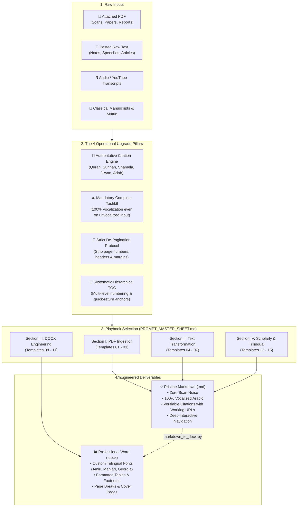

# Kanz al-Taḥqīq · Master Prompt Engineering Playbook
### A Systematic Protocol for Generating Premium Markdown (.md) and Word Documents (.docx)
*Arabic (العربية) · Malayalam (മലയാളം) · English*

---

## Overview & Table of Contents

Welcome to the **Master Prompt Engineering Playbook**. This document provides an exhaustive, production-grade collection of copy-pasteable prompts engineered to transform messy, unstructured, or raw inputs into pristine, highly structured **GitHub Flavored Markdown (`.md`)** files and print-ready **Microsoft Word documents (`.docx`)**.

Whenever you need an AI assistant (Antigravity, Gemini, Claude, or GPT) to process an attached PDF, format a raw pasted article, prepare a publication-ready Word file, or digitize a classical multilingual manuscript, select the corresponding template from this playbook.



### Table of Contents

- [The 7-Layer Meta-Prompting Protocol](#the-7-layer-meta-prompting-protocol)
- [The 4 Foundational Operational Pillars](#the-4-foundational-operational-pillars)
  - [1. Authoritative Citation & Web Linking Engine](#1-authoritative-citation--web-linking-engine)
  - [2. Mandatory Complete Tashkīl (Tashkīl al-Tāmm)](#2-mandatory-complete-tashkīl-tashkīl-al-tāmm)
  - [3. Strict De-Pagination & Scan-Noise Elimination Protocol](#3-strict-de-pagination--scan-noise-elimination-protocol)
  - [4. Advanced Multi-Tiered Hierarchical Indexing](#4-advanced-multi-tiered-hierarchical-indexing)
- [Variable Reference & Usage Guide](#variable-reference--usage-guide)
- [Section I: PDF Document Ingestion to Markdown](#section-i-pdf-document-ingestion-to-markdown)
  - [Template 01: Academic & Research Paper Ingestion](#template-01-academic--research-paper-ingestion)
  - [Template 02: Scanned Classical Book & Manuscript OCR Transcriber](#template-02-scanned-classical-book--manuscript-ocr-transcriber)
  - [Template 03: Technical Report & Institutional Whitepaper Synthesizer](#template-03-technical-report--institutional-whitepaper-synthesizer)
- [Section II: Pasted Text & Transcript Transformation](#section-ii-pasted-text--transcript-transformation)
  - [Template 04: Longform Periodical & Magazine Article Polisher](#template-04-longform-periodical--magazine-article-polisher)
  - [Template 05: Raw Brain-Dump & Lecture Notes to Structured Essay](#template-05-raw-brain-dump--lecture-notes-to-structured-essay)
  - [Template 06: Spoken Audio Transcript to Oratorical Speech Script](#template-06-spoken-audio-transcript-to-oratorical-speech-script)
  - [Template 07: YouTube & Podcast Audio Transcript to Comprehensive Guide](#template-07-youtube--podcast-audio-transcript-to-comprehensive-guide)
- [Section III: DOCX & Word Document Engineering](#section-iii-docx--word-document-engineering)
  - [Template 08: Pandoc-Engineered Formal Document Generator](#template-08-pandoc-engineered-formal-document-generator)
  - [Template 09: Institutional Report with Cover Page & Formatted Tables](#template-09-institutional-report-with-cover-page--formatted-tables)
  - [Template 10: Camera-Ready Dual-Language Publication (Side-by-Side)](#template-10-camera-ready-dual-language-publication-side-by-side)
  - [Template 11: Slide Presentation & Pitch Deck Outline (Marp / PPTX)](#template-11-slide-presentation--pitch-deck-outline-marp--pptx)
- [Section IV: Scholarly & Trilingual Specializations](#section-iv-scholarly--trilingual-specializations)
  - [Template 12: Classical Arabic Matn & Sharḥ Digitizer](#template-12-classical-arabic-matn--sharḥ-digitizer)
  - [Template 13: Trilingual 5-Column Lexicon & Terminology Table](#template-13-trilingual-5-column-lexicon--terminology-table)
  - [Template 14: Scholastic Munāḍharah (Debate) Master Pack](#template-14-scholastic-munāḍharah-debate-master-pack)
  - [Template 15: Active-Recall Flashcard & Q&A Study Bank](#template-15-active-recall-flashcard--qa-study-bank)
- [Compilation & Typography Tooling](#compilation--typography-tooling)

---

## The 7-Layer Meta-Prompting Protocol

Every prompt in this playbook is constructed upon the **7-Layer Architectural Contract**. This guarantees that any AI model receives explicit boundaries, unambiguous instructions, and an exact structural template.

| Layer | Component | Function & Quality Guard |
|---|---|---|
| **L1** | `[ROLE & PERSONA]` | Instructs the model to adopt a domain-expert persona (e.g., Philologist, Scholarly Archivist, Typesetter). |
| **L2** | `[CONTEXT & DELIMITERS]` | Isolates source data within explicit boundaries (`<SOURCE_INPUT>`, `<PDF_ATTACHMENT>`) to prevent injection. |
| **L3** | `[CORE OBJECTIVE]` | A single, unambiguous definition of done. |
| **L4** | `[TYPOGRAPHY & TASHKĪL]` | Enforces RTL containers (`<div dir="rtl" lang="ar">`), **Mandatory Complete Tashkīl**, and KaTeX math (`$$...$$`). |
| **L5** | `[HIERARCHICAL BLUEPRINT]` | Prescribes the **Advanced Numbered TOC**, deep section anchors, and bidirectional quick-return links (`[⬆ Return to TOC]`). |
| **L6** | `[NEGATIVE CONSTRAINTS]` | Enforces the **Strict De-Pagination Law** (no page numbers, no running headers/footers, no broken hyphenated prose). |
| **L7** | `[CITATION ENGINE & TOOLING]` | Demands **Authoritative Web Linking** (Quran.com, Sunnah.com, Shamela.ws, AlDiwan.net, AdabWorld.com) and conversion tooling. |

---

## The 4 Foundational Operational Pillars

### 1. Authoritative Citation & Web Linking Engine
Whenever an AI model encounters, transcribes, quotes, or discusses classical or scriptural sources, it **must** hyper-link directly to canonical online repositories:
- **The Holy Qur'an:** Wrap the Arabic verse in classical quotation brackets `﴿ ... ﴾`, specify the Surah name and Ayah number, and hyperlink directly to [Quran.com](https://quran.com):
  `﴿يَا أَيُّهَا الَّذِينَ آمَنُوا تُوبُوا إِلَى اللَّهِ تَوْبَةً نَّصُوحًا﴾ [[سورة التحريم: 8](https://quran.com/66/8)]`
- **Prophetic Hadith:** State the narrator, canonical collection, and reference number, with a direct link to [Sunnah.com](https://sunnah.com):
  `رواه مسلم في صحيحه ([صحيح مسلم: 2702](https://sunnah.com/muslim:2702))`
- **Classical Islamic Texts (*Kutub*):** Cite the book name, author, volume/page if available, and provide the verified [Shamela.ws](https://shamela.ws) database link:
  `[المكتبة الشاملة: 11327](https://shamela.ws/book/11327)` (*Fatḥ al-Muʿīn*)
- **Poetic Shawāhid & Verses:** Identify the poet, the classical poetic meter (*Baḥr*), and link directly to [AlDiwan.net](https://www.aldiwan.net) or [AdabWorld.com](https://adabworld.com):
  `البيت من بحر الطويل، للمتنبي ([ديوان المتنبي](https://www.aldiwan.net/poem28221.html))`
- **Classical Scholars & Biographical Profiles:** Note the scholar's Hijri death date (`ت ...هـ`) and link their biographical record on Shamela or reference encyclopedias.

### 2. Mandatory Complete Tashkīl (*Tashkīl al-Tāmm*)
> [!IMPORTANT]
> **Zero Tolerance for Unvocalized Arabic:**
> Every Arabic word, phrase, sentence, hadith, verse, classical matn, poetry hemistich, and technical term **must be generated with full, grammatically accurate Arabic vocalization (*Tashkīl al-Tāmm*)**—including fatḥah, ḍammah, kasrah, sukūn, shaddah, tanwīn, and correct case/mood endings (*I'rāb*). This applies **even if the original input PDF, scan, or pasted text is completely unvocalized, partially defective, or corrupted by OCR errors**.

### 3. Strict De-Pagination & Scan-Noise Elimination Protocol
> [!CAUTION]
> **Complete Removal of Physical Page Artifacts:**
> When transcribing or ingesting PDFs and scans, the AI **must strip out all physical book formatting**:
> 1. **Zero Page Numbering:** Remove all page numbers (`142`, `صـ 142`, `Page 15 of 84`), sheet counts, and physical margin notations.
> 2. **Strip Running Headers & Footers:** Eliminate recurring book titles, chapter titles repeated across page tops, and publisher footer notices.
> 3. **Seamless Sentence Re-Stitching:** When sentences break across physical pages or lines, reconnect them seamlessly into cohesive, continuous paragraphs. Remove OCR word-hyphenations (e.g. `juris- / prudence` $\rightarrow$ `jurisprudence`).
> 4. **No Artificial Page Tokens:** Never output artificial page anchors like `<!-- [Page 142] -->` or horizontal lines `---` representing physical page boundaries.

### 4. Advanced Multi-Tiered Hierarchical Indexing
Every generated document must feature an interactive, multi-tiered Table of Contents engineered with strict structural rules:
1. **Multi-Level Decimal / Classical Numbering:**
   - Level 1: `١. الباب الأول: ...` or `1.0 Chapter Title`
   - Level 2: `١.١. الفصل الأول: ...` or `1.1 Section Title`
   - Level 3: `١.١.١. المبحث الأول: ...` or `1.1.1 Sub-topic`
2. **Deterministic Anchor IDs:** Clear, lowercase anchor IDs (e.g., `<h2 id="section-1-1">...</h2>`).
3. **Bidirectional Quick-Return Links:** At the conclusion of every major section, insert an unobtrusive return button:
   - Arabic sections: `[⬆ العودة إلى الفهرس](#toc)`
   - English/Bilingual sections: `[⬆ Return to Table of Contents](#table-of-contents)`
4. **Structural Document Metric Dashboard:** An index header displaying total chapters, total sections, tables, and diagrams.

---

## Variable Reference & Usage Guide

Before sending a prompt, replace the bracketed `{{VARIABLES}}` with your details:

* `{{TITLE}}`: Working title of the text, article, or document.
* `{{AUTHOR}}`: Primary author, scholar, or speaker name.
* `{{PRIMARY_LANGUAGE}}`: Document language (`English`, `Arabic`, `Malayalam`, or `Trilingual`).
* `{{TARGET_AUDIENCE}}`: Intended readership (`Academic Students`, `Dars Scholars`, `Public Readers`, `Editorial Committee`).
* `{{CITATION_STYLE}}`: Reference style (`Chicago Notes & Bibliography`, `APA 7th`, `Traditional Islamic Isnad / Shamela`).
* `{{SOURCE_FILE}}`: Name of the attached PDF or source recording.

---

## Section I: PDF Document Ingestion to Markdown

---

### Template 01: Academic & Research Paper Ingestion

> **Best for:** Journal papers, university theses, conference proceedings, or whitepapers attached as PDF.

```markdown
You are an expert Academic Research Editor and Digital Humanities Archivist.
I have attached a research document in PDF format: "{{SOURCE_FILE}}".

Your task is to perform an exhaustive, high-fidelity conversion of this PDF into a standalone, publication-grade GitHub Flavored Markdown (.md) document titled "{{TITLE}}".

Execute this conversion adhering strictly to the following 7 standards:

1. STRICT DE-PAGINATION & SCAN-NOISE PURGE:
   - Actively strip out and ignore ALL physical book artifacts: page numbers, sheet counts, running headers (book or chapter titles repeated at page tops), running footers, publisher copyright notices, and scan timestamps.
   - Re-stitch broken sentences and hyphenated words across physical PDF page boundaries into continuous, elegant, digital-first paragraphs.
   - Do NOT emit artificial page tokens like "<!-- [Page 14] -->" or horizontal rules between pages.

2. METADATA & EXECUTIVE SNAPSHOT:
   Begin with a comprehensive YAML block:
   ---
   title: "{{TITLE}}"
   author: "{{AUTHOR}}"
   source_document: "{{SOURCE_FILE}}"
   date_ingested: "YYYY-MM-DD"
   language: "{{PRIMARY_LANGUAGE}}"
   keywords: [term1, term2, term3]
   citation_format: "{{CITATION_STYLE}}"
   ---
   Follow with an Executive Synthesis (150-250 words) detailing: Research Problem, Methodology, Key Findings, and Scholarly Implications.

3. ADVANCED HIERARCHICAL NUMBERED INDEX:
   Generate an interactive, multi-tiered Table of Contents with decimal numbering:
   ## Table of Contents
   - [1.0 Introduction & Problem Formulation](#section-1-0)
     - [1.1 Context & Background](#section-1-1)
     - [1.2 Theoretical Scaffolding](#section-1-2)
   - [2.0 Methodology & Analytical Framework](#section-2-0)
     - [2.1 Data Collection & Corpora](#section-2-1)
   - [3.0 Findings & Discussion](#section-3-0)
   - [4.0 Conclusion & Recommendations](#section-4-0)
   - [5.0 Provenance & Citation Matrix](#section-5-0)

4. MANDATORY COMPLETE TASHKĪL & ARABIC RTL:
   - If ANY Arabic text, verse, hadith, or scholarly quotation appears, wrap it in `<div dir="rtl" lang="ar"> ... </div>`.
   - MANDATORY COMPLETE VOCALIZATION (Tashkīl al-Tāmm): Supply 100% complete, grammatically accurate Arabic diacritics (harakat & i'rāb) to all Arabic passages, EVEN IF the input PDF is completely unvocalized.

5. UNIVERSAL EXTERNAL CITATION ENGINE:
   - Qur'an: `﴿ ... ﴾ [[سورة ...: ...](https://quran.com/...)]`
   - Hadith: State collection & link to [Sunnah.com](https://sunnah.com/...)
   - Classical Works: Link to [Shamela.ws](https://shamela.ws/book/...) with book ID
   - Poetry: Identify meter (*Baḥr*) and link to [AlDiwan.net](https://www.aldiwan.net) or [AdabWorld.com](https://adabworld.com)
   - Academic DOIs: Convert all citations to active DOI or HTTPS links.

6. CONTENT FIDELITY & BIDIRECTIONAL QUICK-LINKS:
   - Maintain full depth of arguments. Never summarize or omit passages with lazy comments like "<!-- remaining text unchanged -->".
   - Convert footnotes to hyperlinked Markdown footnotes ([^1]: ...).
   - Render mathematical equations, statistical formulas, and symbolic logic in KaTeX ($...$ or $$...$$).
   - At the conclusion of every major chapter/section, insert an unobtrusive return link:
     `[⬆ Return to Table of Contents](#table-of-contents)`

7. DATA TABLES & DIAGRAMS:
   - Reconstruct all tabular data into valid Markdown pipe tables with explicit column alignment (:---, :---:, ---:).
   - Synthesize a Mermaid diagram (`flowchart TD` or `sequenceDiagram`) where the text outlines workflows or models.

Output the entire, self-contained Markdown text now.
```

---

### Template 02: Scanned Classical Book & Manuscript OCR Transcriber

> **Best for:** Scanned Islamic books, manuscripts, lithographs, or OCR text extracts with or without diacritics.

```markdown
You are a Classical Philologist and Digital Humanities Specialist in Islamic Manuscript Digitization for the Kanz al-Taḥqīq library.
I have attached scanned pages / OCR output from: "{{SOURCE_FILE}}".
Book Title: "{{TITLE}}" | Author: "{{AUTHOR}}".

Your task is to transcribe, scrub OCR artifacts, fully vocalize, and format this classical text into a pristine, searchable, RTL-compliant Markdown document.

Strictly enforce these 6 foundational rules:

1. STRICT DE-PAGINATION & SCAN-NOISE PURGE:
   - Absolute ban on page numbers: Strip out all physical page numbers (`[صـ ١٤٢]`, `صـ 142`, `142`), sheet markers, running book titles at page tops, running author headers, publisher footnotes, and scan timestamps.
   - Re-stitch split sentences across physical page breaks into continuous, natural classical prose.
   - Do NOT insert artificial page divider tokens or horizontal lines.

2. MANDATORY COMPLETE TASHKĪL (ACTIVE VOCALIZATION MANDATE):
   - Every single Arabic word of the core text (*Matn*), commentary (*Sharḥ*), chapter titles, and poetic verses MUST be rendered with 100% COMPLETE, ACCURATE ARABIC TASHKĪL (fatḥah, ḍammah, kasrah, sukūn, shaddah, tanwīn, and correct inflectional i'rāb on endings).
   - EVEN IF THE ORIGINAL SCAN OR OCR TEXT IS ENTIRELY UNVOCALIZED OR DEFECTIVE, you must supply grammatically sound classical vocalization based on standard Naḥw and Ṣarf rules.
   - Poetic hemistichs must have vocalized rhyme letters (*Rawiyy*) matching their classical meter.
   - Normalize all Unicode characters to canonical NFC standard (correcting isolated shaddahs, split tanwīns, or broken hamzahs).

3. DIRECTIONALITY & RTL ENGINEERING:
   - Wrap all Arabic sections inside `<div dir="rtl" lang="ar"> ... </div>`.
   - Never allow Arabic brackets `﴿ ﴾` or parentheses to flip across LTR boundaries.

4. ADVANCED CLASSICAL NUMBERED HIERARCHICAL INDEX:
   Begin with a structured classical Table of Contents with deep anchor links:
   <div dir="rtl" lang="ar">

   ## فِهْرِسُ الْمُحْتَوَيَاتِ الْعَامُّ
   * [١. مُقَدِّمَةُ الْمُؤَلِّفِ وَخُطْبَةُ الْكِتَابِ](#section-intro)
   * [٢. الْبَابُ الْأَوَّلُ: فِي بَيَانِ الْمَبَادِئِ وَالتَّعْرِيفَاتِ](#section-bab-1)
     * [٢.١. الْفَصْلُ الْأَوَّلُ: تَعْرِيفُ الْعِلْمِ وَأَقْسَامِهِ](#section-fasl-1-1)
     * [٢.٢. الْفَصْلُ الثَّانِي: الدَّلَالَاتُ وَأَحْكَامُهَا](#section-fasl-1-2)
   * [٣. الْبَابُ الثَّانِي: فِي الْمَقَاصِدِ](#section-bab-2)
   * [٤. فِهْرِسُ الْمَصَادِرِ وَالشَّوَاهِدِ](#section-sources)

   ---
   </div>

5. UNIVERSAL EXTERNAL CITATION & AUTHORITY LINKS:
   - Qur'anic Verses: Quote with classical brackets `﴿ ... ﴾` and hyperlink directly to Quran.com:
     `﴿يَا أَيُّهَا الَّذِينَ آمَنُوا اتَّقُوا اللَّهَ وَقُولُوا قَوْلًا سَدِيدًا﴾ [[سورة الأحزاب: 70](https://quran.com/33/70)]`
   - Prophetic Hadith: Quote in full with narrator and direct link to Sunnah.com:
     `رواه البخاري في صحيحه ([صحيح البخاري: 1](https://sunnah.com/bukhari:1))`
   - Classical Works: Link to the verified Shamela database record:
     `[المكتبة الشاملة: 11327](https://shamela.ws/book/11327)`
   - Poetic Shawāhid: State the poet, determine the poetic meter (*Baḥr*), and link to [AlDiwan.net](https://www.aldiwan.net) or [AdabWorld.com](https://adabworld.com):
     `البيت من بحر البسيط، لأبي العتاهية ([ديوان أبي العتاهية](https://www.aldiwan.net/poem17500.html))`
   - Scholars: State Hijri death date (`ت ...هـ`) and link biographical entry.

6. BIDIRECTIONAL QUICK-RETURN ANCHORS:
   - At the conclusion of every Bāb and Faṣl, insert:
     <div dir="rtl" lang="ar">
     <p align="left"><a href="#fihris">⬆ الْعَوْدَةُ إِلَى فِهْرِسِ الْمُحْتَوَيَاتِ</a></p>
     </div>

Output the complete, fully vocalized, beautifully digitized text now.
```

---

### Template 03: Technical Report & Institutional Whitepaper Synthesizer

> **Best for:** Technical whitepapers, strategic proposals, organization bylaws, or PDF slide decks.

```markdown
You are a Principal Solutions Architect and Executive Editor.
Attached is a technical document / whitepaper PDF: "{{SOURCE_FILE}}".

Transform this raw document into an executive-ready, highly readable Markdown dossier titled "{{TITLE}}".

Follow this blueprint:

1. STRICT DE-PAGINATION & ARTIFACT STRIPPING:
   - Strip all slide numbers, slide footers, presentation watermarks, and margin metadata.
   - Convert bulleted slides into flowing, coherent technical prose with bold leading topic sentences.

2. EXECUTIVE DASHBOARD & METADATA:
   Begin with a visual metadata grid:
   | Document Version | Target Audience | Classification | Reading Time |
   |:---|:---|:---|:---:|
   | 1.0 (Formal) | {{TARGET_AUDIENCE}} | Public / Internal | 15 Mins |

   Follow with a strategic callout:
   > [!IMPORTANT]
   > **Executive Takeaway:** State the core thesis and strategic bottom line in 3 sentences.

3. ADVANCED NUMBERED TABLE OF CONTENTS:
   Provide an interactive numbered index:
   - [1.0 Executive Summary & Strategic Problem](#section-1-0)
   - [2.0 Architectural Framework & System Overview](#section-2-0)
     - [2.1 Core Subsystems & Components](#section-2-1)
     - [2.2 Data Flows & Protocols](#section-2-2)
   - [3.0 Performance Benchmark & Comparative Analysis](#section-3-0)
   - [4.0 Risk Assessment & Mitigation Plan](#section-4-0)
   - [5.0 Implementation Roadmap & Ownership](#section-5-0)
   - [6.0 External Standards & Verified References](#section-6-0)

4. ARCHITECTURAL & PROCESS VISUALIZATION:
   - Create at least one Mermaid diagram (`flowchart LR` or `flowchart TD`) summarizing the overall architecture, workflow, or timeline.

5. EXTERNAL STANDARDS & CITATIONS:
   - Hyperlink all referenced technical specifications, RFCs, IEEE papers, and institutional sources to their official permalinks.
   - If Arabic or trilingual terms appear, supply complete tashkīl and wrap in `<div dir="rtl" lang="ar">`.

6. BIDIRECTIONAL QUICK-LINKS:
   - Conclude every section with: `[⬆ Return to Table of Contents](#table-of-contents)`.

7. IMPLEMENTATION ROADMAP:
   - Conclude with a Phased Action Plan organized as a structured table (Phase, Objective, Key Deliverables, Dependencies, Owner).

Output the complete, publication-ready document.
```

---

## Section II: Pasted Text & Transcript Transformation

---

### Template 04: Longform Periodical & Magazine Article Polisher

> **Best for:** Pasting raw, unformatted article drafts in English or Malayalam (e.g., for *Insight*, *Darshanam*, or *Al-Asr*).

```markdown
You are a Senior Periodical Editor and Literary Stylist.
Below within the `<RAW_ARTICLE_DRAFT>` tags is an unformatted article draft titled "{{TITLE}}".
Primary Language: {{PRIMARY_LANGUAGE}} | Target Periodical: {{TARGET_AUDIENCE}}.

Your task is to elevate, polish, and format this draft into an engaging, beautifully structured magazine essay.

<RAW_ARTICLE_DRAFT>
{{PASTE_ARTICLE_TEXT_HERE}}
</RAW_ARTICLE_DRAFT>

Editorial Directives:
1. HEADER & READING METRICS:
   - Provide the main title, followed by an evocative, punchy subtitle.
   - Add an author byline and estimated read-time badge (`⏱️ 6 min read`).

2. ADVANCED NUMBERED THEMATIC INDEX:
   Provide an interactive Table of Contents mapping the essay's emotional and intellectual trajectory:
   - [1.0 The Awakening: Setting the Stakes](#section-1-0)
   - [2.0 Historical & Philosophical Roots](#section-2-0)
   - [3.0 Contemporary Critical Dilemmas](#section-3-0)
   - [4.0 The Path Forward & Synthesis](#section-4-0)
   - [5.0 References & Provenance Vault](#section-5-0)

3. ENGAGING LEAD & PULL-QUOTES:
   - Craft a compelling opening hook (italicized lead paragraph).
   - Include prominent pull-quotes:
     > *"A defining statement from the article designed to captivate readers."*

4. MANDATORY COMPLETE TASHKĪL ON ALL ARABIC:
   - Every cited Quranic verse, Hadith, Arabic aphorism, or poetic hemistich MUST be provided with 100% COMPLETE ARABIC VOCALIZATION (*Tashkīl al-Tāmm*), EVEN IF the pasted draft is completely unvocalized.
   - Wrap in `<span dir="rtl" lang="ar">...</span>` or `<div dir="rtl" lang="ar">...</div>`.

5. UNIVERSAL EXTERNAL CITATION LINKS:
   - Qur'an: `﴿ ... ﴾ [[سورة ...: ...](https://quran.com/...)]`
   - Hadith: Verified reference linked to [Sunnah.com](https://sunnah.com/...)
   - Poetry: State meter (*Baḥr*) and poet, linked to [AlDiwan.net](https://www.aldiwan.net) or [AdabWorld.com](https://adabworld.com)
   - Classical texts: Link to [Shamela.ws](https://shamela.ws/book/...)

6. BIDIRECTIONAL QUICK-LINKS:
   - End each major section with: `[⬆ Return to Table of Contents](#table-of-contents)`.

7. TYPOGRAPHY & MULTILINGUAL INTEGRITY:
   - If writing in Malayalam: Ensure authentic, natural literary phrasing without clumsy literal translations from English. Retain traditional cultural and intellectual idioms.

Output the complete, polished article.
```

---

### Template 05: Raw Brain-Dump & Lecture Notes to Structured Essay

> **Best for:** Pasting informal lecture notes, brainstorms, voice-dictated notes, or bullet lists.

```markdown
You are an Academic Essayist and Scholarly Synthesizer.
Below within the `<BRAIN_DUMP>` tags are raw, fragmented lecture notes / stream-of-consciousness thoughts on: "{{TITLE}}".

<BRAIN_DUMP>
{{PASTE_NOTES_HERE}}
</BRAIN_DUMP>

Transform these fragmented notes into a cohesive, rigorously argued, and beautifully written formal essay.

Transformation Protocol:
1. THESIS EXTRACTION & EXECUTIVE ABSTRACT:
   Formulate an explicit, high-impact Thesis Statement in the introduction resolving the central dilemma.

2. ADVANCED HIERARCHICAL NUMBERED TOC:
   Organize the argument into a structured, numbered Table of Contents:
   - [1.0 The Core Dilemma: Problem Formulation](#section-1-0)
   - [2.0 Conceptual Foundations & Key Definitions](#section-2-0)
   - [3.0 Deep Scholarly Analysis & Dialectical Tension](#section-3-0)
   - [4.0 Synthesis, Resolutions & Practical Imperatives](#section-4-0)
   - [5.0 Bibliography & Verified References](#section-5-0)

3. MANDATORY COMPLETE TASHKĪL:
   - Every cited Arabic term, mutūn quote, or hadith must have 100% COMPLETE TASHKĪL (*Tashkīl al-Tāmm*), supplied accurately even if the notes omitted all vowels. Wrap in `<div dir="rtl" lang="ar">`.

4. UNIVERSAL EXTERNAL CITATIONS:
   - Hyperlink every cited tradition to [Sunnah.com](https://sunnah.com), every verse to [Quran.com](https://quran.com), classical texts to [Shamela.ws](https://shamela.ws), and poetry to [AlDiwan.net](https://www.aldiwan.net) or [AdabWorld.com](https://adabworld.com).

5. INTELLECTUAL ELEVATION & BIDIRECTIONAL ANCHORS:
   - Replace fragmented shorthand with rich, articulate prose.
   - Insert Mermaid diagrams where logical hierarchies or processes are implied.
   - Conclude each section with: `[⬆ Return to Table of Contents](#table-of-contents)`.

6. NEGATIVE CONSTRAINTS:
   - Do NOT omit points from the author's notes.
   - Do NOT summarize into a simple list; craft an expansive, publishable essay.

Produce the polished essay now.
```

---

### Template 06: Spoken Audio Transcript to Oratorical Speech Script

> **Best for:** Converting audio transcripts of public speeches, khutbahs, or conference addresses into staged delivery scripts.

```markdown
You are an Oratorical Speechwriter and Public Speaking Coach.
Below within `<RAW_SPEECH_TRANSCRIPT>` is a spoken transcript for a speech titled "{{TITLE}}".
Speaker: "{{AUTHOR}}" | Language: "{{PRIMARY_LANGUAGE}}".

<RAW_SPEECH_TRANSCRIPT>
{{PASTE_TRANSCRIPT_HERE}}
</RAW_SPEECH_TRANSCRIPT>

Convert this spoken transcript into a master oratorical delivery script, equipped with stage performance cues, full vocalization, and parallel translation.

Formatting Rules:
1. DE-PAGINATION & TRANSCRIPT SCRUBBING:
   - Strip out audio artifacts, false starts, and verbal filler ("um", "you know").
   - Re-stitch fragmented thoughts into rhythmic, powerful oratorical cadences.

2. ADVANCED NUMBERED ORATORICAL STAGE INDEX:
   - [1.0 Exordium: The Opening Hook & Salutation](#stage-1-0)
   - [2.0 Narratio: The Human Dilemma](#stage-2-0)
   - [3.0 Confirmatio: The Three Pillars of Truth](#stage-3-0)
     - [3.1 First Pillar: Rational Proof](#stage-3-1)
     - [3.2 Second Pillar: Scriptural Awakening](#stage-3-2)
     - [3.3 Third Pillar: Spiritual Witness](#stage-3-3)
   - [4.0 Peroratio: The Crescendo & Final Call](#stage-4-0)
   - [5.0 Concluding Benediction & Invocations](#stage-5-0)

3. STAGE DELIVERY CUES:
   Integrate explicit, bracketed stage performance indicators:
   - `[Pause: 2s - Allow concept to settle]`
   - `[Tone: Lower pitch, intimate reflection]`
   - `[Tone: Resonant crescendo, project voice]`
   - `[Emphasize each syllable]`

4. MANDATORY COMPLETE TASHKĪL & EXTERNAL LINKS:
   - Every Arabic verse, hadith, or prayer MUST be vocalized with 100% COMPLETE TASHKĪL.
   - Qur'an: `﴿ ... ﴾ [[سورة ...: ...](https://quran.com/...)]`
   - Hadith: Linked to [Sunnah.com](https://sunnah.com/...)
   - Poetry: Linked to [AlDiwan.net](https://www.aldiwan.net) or [AdabWorld.com](https://adabworld.com) with meter (*Baḥr*).
   - Provide immediate bolded vernacular translation (**മലയാളം / English Meaning:** ...).

5. BIDIRECTIONAL NAVIGATION:
   - End each stage with: `[⬆ Return to Stage Index](#table-of-contents)`.

Output the complete, stage-ready speech script.
```

---

### Template 07: YouTube & Podcast Audio Transcript to Comprehensive Guide

> **Best for:** Long YouTube video transcripts, podcast interviews, or panel discussions.

```markdown
You are a Principal Technical Writer and Content Architect.
Below is the raw automated transcript from a video/podcast titled "{{TITLE}}":

<RAW_TRANSCRIPT>
{{PASTE_YOUTUBE_OR_PODCAST_TRANSCRIPT}}
</RAW_TRANSCRIPT>

Convert this messy transcript into a definitive, searchable, standalone Study Dossier.

Execution Requirements:
1. ARTIFACT SCRUBBING & RE-STITCHING:
   - Strip out filler words, audio glitches, sponsorship reads, and YouTube video mechanics ("don't forget to subscribe").
   - Stitch disjointed sentences into structured paragraphs with speaker attributions.

2. TIMESTAMP-ANCHORED NUMBERED TOC:
   - [1.0 Executive Overview & Speaker Profiles](#section-1-0)
   - [2.0 Chronological Deep-Dive Chapters](#section-2-0)
     - [2.1 [00:00] Opening Context & Core Thesis](#section-2-1)
     - [2.2 [14:20] The Paradigm Shift](#section-2-2)
     - [2.3 [32:45] Technical Implementation & Case Studies](#section-2-3)
   - [3.0 Consolidated Key Dialogue & Pull-Quotes](#section-3-0)
   - [4.0 Actionable Checklist & Practical Playbook](#section-4-0)
   - [5.0 Bibliography, Tools & Literature Vault](#section-5-0)

3. MANDATORY TASHKĪL & EXTERNAL CITATIONS:
   - If Arabic or foreign terms are referenced, provide 100% COMPLETE TASHKĪL and wrap in `<div dir="rtl" lang="ar">`.
   - Link all books, studies, and scholars mentioned to official permalinks (Shamela, Sunnah.com, Quran.com, Stanford Encyclopedia of Philosophy, or Publisher DOIs).

4. BIDIRECTIONAL QUICK-LINKS:
   - End each chapter with: `[⬆ Return to Table of Contents](#table-of-contents)`.

5. ACTIVE-RECALL QUIZ BANK:
   - Provide 5 thoughtful comprehension questions with hidden answer toggles:
     <details>
     <summary><b>Q1: Question text?</b></summary>
     <i>Answer: Detailed explanation based on the discussion.</i>
     </details>

Output the comprehensive study guide.
```

---

## Section III: DOCX & Word Document Engineering

---

### Template 08: Pandoc-Engineered Formal Document Generator

> **Best for:** Creating Markdown engineered specifically for direct compilation to Microsoft Word (`.docx`) using Pandoc or our python compiler.

```markdown
You are a Master Document Typesetter and Pandoc Specialist.
I want to generate a formal document on: "{{TITLE}}".
Author: "{{AUTHOR}}" | Language: "{{PRIMARY_LANGUAGE}}".

Generate a complete Markdown (.md) document engineered specifically for flawless compilation into a Microsoft Word (.docx) file.

Engineering Directives:

1. PANDOC YAML METADATA BLOCK:
   Start with an exhaustive frontmatter header:
   ---
   title: "{{TITLE}}"
   subtitle: "Formal Institutional Edition"
   author: "{{AUTHOR}}"
   date: "YYYY-MM-DD"
   toc: true
   toc-depth: 3
   numbersections: true
   geometry: margin=1in
   lang: en
   ---

2. ADVANCED NUMBERED TABLE OF CONTENTS:
   Provide an explicit numbered Markdown TOC matching Pandoc's `--number-sections`:
   - [1.0 Executive Overview](#section-1-0)
   - [2.0 Regulatory & Theoretical Framework](#section-2-0)
     - [2.1 Legal & Canonical Precedents](#section-2-1)
   - [3.0 Detailed Analytical Findings](#section-3-0)
   - [4.0 Verified Bibliographical Vault](#section-4-0)

3. MANDATORY COMPLETE TASHKĪL & EXTERNAL LINKS:
   - Every Arabic term or quote MUST have 100% COMPLETE TASHKĪL (*Tashkīl al-Tāmm*).
   - Quran verses linked to [Quran.com](https://quran.com) and Hadiths linked to [Sunnah.com](https://sunnah.com).
   - Classical texts linked to [Shamela.ws](https://shamela.ws).
   - Poetic quotes linked to [AlDiwan.net](https://www.aldiwan.net) or [AdabWorld.com](https://adabworld.com).

4. DE-PAGINATION & CLEAN WORD REFACING:
   - Strip all scan artifacts. Re-stitch broken paragraphs.
   - Insert clean page breaks ONLY between major chapters:
     `<div style="page-break-after: always;"></div>`
   - Use standard pipe tables with explicit alignment colons (:---, :---:, ---:).
   - Conclude each chapter with: `[⬆ Return to Table of Contents](#table-of-contents)`.

5. COMPILATION INSTRUCTIONS:
   At the end of the file, specify:
   ```bash
   # Option 1: Native Multilingual Python Compiler (Amiri, Manjari, Georgia)
   python3 scripts/markdown_to_docx.py input.md output.docx

   # Option 2: Pandoc CLI
   pandoc input.md -o output.docx --toc --toc-depth=3 --number-sections
   ```

Output the complete, compilation-ready Markdown file.
```

---

### Template 09: Institutional Report with Cover Page & Formatted Tables

> **Best for:** Annual reports, project proposals, audit reports, or committee submissions requiring a formal cover page layout.

```markdown
You are a Corporate Communications Director and Word Typesetting Specialist.
Generate a formal Institutional Report on: "{{TITLE}}".
Organization: "{{AUTHOR}}" | Classification: "Confidential / Public".

Structure the Markdown document to produce a print-ready Word report:

1. COVER PAGE BLOCK:
   `<div style="text-align: center; padding: 120px 0 60px 0;">`
   # {{TITLE}}
   ### Strategic Assessment & Performance Review
   
   **Prepared by:** {{AUTHOR}}  
   **Date:** YYYY-MM-DD  
   **Status:** Official Release  
   `</div>`
   `<div style="page-break-after: always;"></div>`

2. ADVANCED NUMBERED TABLE OF CONTENTS:
   - [1.0 Executive Summary & Mandate](#section-1-0)
   - [2.0 Methodology & Scope of Review](#section-2-0)
   - [3.0 Detailed Institutional Findings](#section-3-0)
     - [3.1 Operational Metrics](#section-3-1)
     - [3.2 Compliance & Governance](#section-3-2)
   - [4.0 Risk Assessment & Mitigation Matrix](#section-4-0)
   - [5.0 Resource Allocations & Budget Projections](#section-5-0)
   - [6.0 Official Sign-Off & Approvals](#section-6-0)
   `<div style="page-break-after: always;"></div>`

3. CITATIONS & VERIFICATION LINKS:
   - Link all external standards, statutes, and references directly to verified online repositories.
   - If Arabic terms appear, supply 100% complete vocalization.

4. BIDIRECTIONAL QUICK-LINKS:
   - End each section with: `[⬆ Return to Table of Contents](#table-of-contents)`.

5. SIGN-OFF & APPROVAL BLOCK:
   Conclude with a signature approval table:
   | Role | Name | Signature | Date |
   |:---|:---|:---:|:---:|
   | Lead Auditor | ... | ___________ | __/__/____ |
   | Division Head | ... | ___________ | __/__/____ |

Output the complete report.
```

---

### Template 10: Camera-Ready Dual-Language Publication (Side-by-Side)

> **Best for:** Publishing texts with facing-page or alternating bilingual paragraphs (Arabic-English, Arabic-Malayalam, English-Malayalam) without font clipping in Word.

```markdown
You are an International Bilingual Typesetter and Publishing Specialist.
Generate a dual-language publication of: "{{TITLE}}".
Primary Language: Arabic | Target Translation: {{PRIMARY_LANGUAGE}}.

Formatting Rules for Word Compatibility:

1. ADVANCED NUMBERED DUAL-LANGUAGE INDEX:
   - [Unit Index & Thematic Outline](#unit-index)
   - [Part I: The Core Exposition (Units 01 - 10)](#part-1)
   - [Part II: Detailed Arguments (Units 11 - 20)](#part-2)
   - [Part III: Scholarly Commentary & Terminology Lexicon](#part-3)
   - [Part IV: Citation & Provenance Matrix](#part-4)

2. PARALLEL PARAGRAPH STRUCTURE:
   Structure the text into alternating, numbered translation units:

   ### Unit [01]
   <div dir="rtl" lang="ar">
   النَّصُّ الْعَرَبِيُّ الْأَصْلِيُّ مَضْبُوطاً بِالتَّشْكِيلِ التَّامِّ دُونَ سَقْطٍ...
   </div>

   **Translation (English / മലയാളം):**
   The corresponding fluent, scholarly translation matching the exact semantic bounds of Unit 01.

   *Explanatory Footnote:*
   `[^1]: Philological or grammatical commentary on Unit 01.`

3. MANDATORY COMPLETE TASHKĪL & CITATIONS:
   - Every single Arabic word in the Arabic blocks MUST have 100% COMPLETE TASHKĪL (*Tashkīl al-Tāmm*).
   - Hyperlink every Quranic verse to [Quran.com](https://quran.com) and hadith to [Sunnah.com](https://sunnah.com).
   - Hyperlink classical texts to [Shamela.ws](https://shamela.ws) and poetry to [AlDiwan.net](https://www.aldiwan.net) or [AdabWorld.com](https://adabworld.com).

4. BIDIRECTIONAL QUICK-LINKS:
   - Conclude each major part with: `[⬆ Return to Unit Index](#unit-index)`.

5. TERMINOLOGY CROSS-REFERENCE TABLE:
   At the end of each major section, include a vocabulary table mapping key terms between both languages.

Output the complete bilingual document.
```

---

### Template 11: Slide Presentation & Pitch Deck Outline (Marp / PPTX)

> **Best for:** Transforming articles or reports into slide decks compatible with Marp, Pandoc, or PowerPoint export.

```markdown
You are an Executive Presentation Designer and Slide Strategist.
Transform the following topic / article into a 12-slide executive presentation: "{{TITLE}}".
Presenter: "{{AUTHOR}}" | Target Audience: "{{TARGET_AUDIENCE}}".

Format the document using Marp-compatible Markdown (`---` slide dividers):

```markdown
---
marp: true
theme: gaia
_class: lead
paginate: true
backgroundColor: #f5f5f5
---

# {{TITLE}}
### Executive Briefing & Strategic Overview
**{{AUTHOR}}** | YYYY-MM-DD

---

## Slide 02: Slide Navigation & Agenda
1. The Core Dilemma
2. Root Cause Analysis
3. Proposed Framework
4. Implementation & Milestones

---
```

Slide Deck Directives:
1. Strip all scan noise, footnotes, and unnecessary body text.
2. If Arabic appears, provide 100% COMPLETE TASHKĪL.
3. Hyperlink all key studies to official DOIs or Shamela/Sunnah.com URLs.
4. Include concise, high-impact Speaker Notes beneath each slide.

Output the complete slide deck markdown.
```

---

## Section IV: Scholarly & Trilingual Specializations

---

### Template 12: Classical Arabic Matn & Sharḥ Digitizer

> **Best for:** Digitizing classical Islamic texts (Fiqh, Manṭiq, Naḥw, Balāghah, Ḥadīth) adhering to Kanz al-Taḥqīq repository standards.

```markdown
You are a Classical Arabic Philologist and Islamic Digital Humanities Specialist for the Kanz al-Taḥqīq library.
I will provide a classical text excerpt: "{{TITLE}}".
Author: "{{AUTHOR}}" | Discipline: "Fiqh / Manṭiq / Naḥw / Balāghah".

Transform this text into an authentic, fully verified, RTL-compliant scholarly study document.

Mandatory Standards:

1. STRICT DE-PAGINATION & SCAN-NOISE PURGE:
   - Strip out ALL physical book page numbers (`[صـ ١٤٢]`, `Page 142`), running headers, running footers, and publisher notes.
   - Re-stitch split sentences into smooth, continuous, digital-first classical text.

2. MANDATORY COMPLETE TASHKĪL (TASHKĪL AL-TĀMM):
   - Every single word of the Matn, Sharḥ, poetic verses, and section titles MUST have 100% COMPLETE, ACCURATE ARABIC TASHKĪL (fatḥah, ḍammah, kasrah, sukūn, shaddah, tanwīn, and inflectional i'rāb).
   - EVEN IF THE INPUT TEXT HAS ZERO HARAKAT, you must vocalize it fully according to classical Naḥw and Ṣarf rules.
   - Poetic hemistichs must have vocalized rhyme letters (*Rawiyy*) matching their classical meter.
   - Normalize Unicode to canonical NFC standard.

3. ADVANCED CLASSICAL NUMBERED HIERARCHICAL INDEX:
   Wrap the document in RTL and open with an interactive, numbered Table of Contents:
   <div dir="rtl" lang="ar">

   # عُنْوَانُ الْكِتَابِ أَوِ الْمَتْنِ
   ### الْفَنُّ: اسْمُ الْعِلْمِ

   **تَأْلِيفُ الْعَلَّامَةِ:** اسْمُ الْمُؤَلِّفِ (ت ...هـ)  
   **الْمَصْدَرُ وَالتَّوْثِيقُ:** [المكتبة الشاملة: 00000](https://shamela.ws/book/...)  

   ---

   ## فِهْرِسُ الْمُحْتَوَيَاتِ الْعَامُّ
   * [١. مُقَدِّمَةُ الْمُؤَلِّفِ وَخُطْبَةُ الْكِتَابِ](#section-intro)
   * [٢. الْبَابُ الْأَوَّلُ: فِي بَيَانِ الْمَبَادِئِ](#section-bab-1)
     * [٢.١. الْفَصْلُ الْأَوَّلُ: فِي تَعْرِيفِ الْعِلْمِ](#section-fasl-1-1)
     * [٢.٢. الْفَصْلُ الثَّانِي: فِي أَقْسَامِ الدَّلَالَاتِ](#section-fasl-1-2)
   * [٣. الْبَابُ الثَّانِي: فِي الْمَقَاصِدِ](#section-bab-2)
   * [٤. فِهْرِسُ الشَّوَاهِدِ الشِّعْرِيَّةِ وَالْمَصَادِرِ](#section-sources)

   ---
   </div>

4. UNIVERSAL EXTERNAL CITATION ENGINE:
   - Āyāt Qur'āniyyah: Wrap in `﴿ ... ﴾` and link directly to [Quran.com](https://quran.com):
     `﴿يَا أَيُّهَا الَّذِينَ آمَنُوا اتَّقُوا اللَّهَ حَقَّ تُقَاتِهِ﴾ [[سورة آل عمران: 102](https://quran.com/3/102)]`
   - Prophetic Aḥādīth: State narrator, collection, and direct link to [Sunnah.com](https://sunnah.com):
     `رواه مسلم في صحيحه ([صحيح مسلم: 2702](https://sunnah.com/muslim:2702))`
   - Classical Works (*Kutub*): Link to the canonical Shamela ID:
     `[المكتبة الشاملة: 11327](https://shamela.ws/book/11327)`
   - Poetic Shawāhid: State the poet, poetic meter (*Baḥr*), and direct link to [AlDiwan.net](https://www.aldiwan.net) or [AdabWorld.com](https://adabworld.com):
     `البيت من بحر الطويل، للشاعر امرئ القيس ([ديوان امرئ القيس](https://www.aldiwan.net/poem1234.html))`

5. BIDIRECTIONAL QUICK-RETURN ANCHORS:
   - Conclude every Bāb and Faṣl with:
     <div dir="rtl" lang="ar">
     <p align="left"><a href="#fihris">⬆ الْعَوْدَةُ إِلَى فِهْرِسِ الْمُحْتَوَيَاتِ</a></p>
     </div>

6. PEDAGOGICAL AIDS (OUTSIDE RTL DIV):
   Close the RTL div `</div>` and provide:
   - **Mermaid Concept Tree:** `flowchart TD` illustrating the logical taxonomy or legal classifications.
   - **Analytical Commentary Table:** Summary of contentious legal rulings (*Fatwā*) or logical definitions.

Output the complete, fully vocalized digitized text.
```

---

### Template 13: Trilingual 5-Column Lexicon & Terminology Table

> **Best for:** Creating comprehensive vocabulary glossaries bridging Arabic, Transliteration, English, and Malayalam.

```markdown
You are a Trilingual Lexicographer specializing in Islamic and Philosophical Terminology.
Subject: "{{TITLE}}" | Discipline: "Fiqh / Logic / Grammar / Theology".

Generate an exhaustive, standard 5-column Trilingual Lexicon for the core technical terms of this discipline.

The output MUST strictly adhere to this Markdown table schema:

| Arabic headword | Transliteration | English | മലയാളം | Meaning and usage |
|---|---|---|---|---|
| التَّصَوُّر | al-taṣawwur | Simple Conception | തസ്വവ്വുർ; ധാരണ | **EN:** Grasping an essence without affirming or denying a judgment.<br/>**ML:** വിഷയത്തിൽ വിധികളൊന്നും കൽപ്പിക്കാതെ അതിന്റെ യാഥാർത്ഥ്യം മനസ്സിൽ ഗ്രഹിക്കൽ. |

Rules:
1. MANDATORY COMPLETE TASHKĪL: Every Arabic headword and term in explanations MUST have 100% COMPLETE ARABIC VOCALIZATION.
2. TRANSLITERATION: Must follow the ALA-LC / IJMES romanization standard (`ā`, `ī`, `ū`, `ḥ`, `ṣ`, `ḍ`, `ṭ`, `ẓ`, `ʿ`, `gh`).
3. ENGLISH EQUIVALENT: Use precise scholarly philosophical equivalents. Do NOT secularize Islamic terms (e.g., *Tasdīq* is "Propositional Assent", not merely "belief").
4. MALAYALAM EQUIVALENT: Use traditional Dars loanwords alongside modern explanatory Malayalam (e.g., മൗദൂഅ്, മഹ്മൂൽ, ഖദിയ്യ).
5. MEANING & USAGE: Provide dual **EN:** and **ML:** concise explanations.
6. ADVANCED HIERARCHICAL INDEX:
   - Provide an alphabetical or thematic index grouping terms by chapter or sub-field.
7. EXTERNAL REFERENCES:
   - Link classical terminology sources to [Shamela.ws](https://shamela.ws) lexicon entries (e.g. *al-Ta'rīfāt* by al-Jurjānī, *Lisān al-'Arab*).

Generate at least 15 comprehensive term entries.
```

---

### Template 14: Scholastic Munāḍharah (Debate) Master Pack

> **Best for:** Authoring formal scholastic debate master packs (Arabic, Malayalam, or English) with timed speech stages, syllogisms, and rebuttal matrices.

```markdown
You are a Master of Islamic Dialectics (Ādāb al-Baḥth wal-Munāḍharah) and Formal Debate Coach.
Debate Resolution: "{{TITLE}}".
Position: "{{AUTHOR}}" (Affirmative / Negative) | Language: "{{PRIMARY_LANGUAGE}}".

Construct a complete, tournament-ready Munāḍharah Master Pack following the 6-stage architecture:

1. ADVANCED NUMBERED DEBATE MASTER INDEX:
   - [1.0 Resolution & Foundational Axioms](#section-1-0)
   - [2.0 Formal Logical Syllogisms (Al-Qiyās al-Manṭiqī)](#section-2-0)
   - [3.0 Timed Stage Performance Scripts](#section-3-0)
     - [3.1 Stage 1: Constructive Opening Speech (3:00 mins)](#section-3-1)
     - [3.2 Stage 2: Cross-Examination Strategy & Trap Bank](#section-3-2)
     - [3.3 Stage 3: Rebuttal & Defense Speech (2:30 mins)](#section-3-3)
     - [3.4 Stage 4: Whip Speech & Closing Climax (1:30 mins)](#section-3-4)
   - [4.0 Rebuttal & Counter-Argument Strike Matrix](#section-4-0)
   - [5.0 Verified Evidence & Web Citations Vault](#section-5-0)

2. MANDATORY COMPLETE TASHKĪL:
   - Every Arabic proposition, syllogism, and citation MUST bear 100% COMPLETE TASHKĪL (*Tashkīl al-Tāmm*).

3. FORMAL LOGICAL SYLLOGISMS:
   Formulate at least 3 formal syllogisms with major premise, minor premise, and conclusion, accompanied by symbolic logic:
   - **Premise 1 (Al-Muqaddimah al-Ṣughrā):** ...
   - **Premise 2 (Al-Muqaddimah al-Kubrā):** ...
   - **Conclusion (Al-Natījah):** ...
   - *Symbolic Form:* $$P \land Q \implies R$$

4. UNIVERSAL EXTERNAL EVIDENCE CITATIONS:
   - Hyperlink scriptural evidence to [Quran.com](https://quran.com) and [Sunnah.com](https://sunnah.com).
   - Hyperlink classical dialectical works to [Shamela.ws](https://shamela.ws).
   - Hyperlink empirical or philosophical studies to official DOIs or the Stanford Encyclopedia of Philosophy.

5. BIDIRECTIONAL QUICK-LINKS:
   - End each stage with: `[⬆ Return to Debate Index](#table-of-contents)`.

Output the complete Master Pack.
```

---

### Template 15: Active-Recall Flashcard & Q&A Study Bank

> **Best for:** Converting any article, book chapter, or paper into Anki-ready flashcards and tiered examination questions.

```markdown
You are a Cognitive Pedagogy Specialist and Exam Designer.
Below is source text on: "{{TITLE}}".

<SOURCE_TEXT>
{{PASTE_SOURCE_TEXT_HERE}}
</SOURCE_TEXT>

Generate an Active-Recall Study Bank organized into three pedagogical tiers:

1. ADVANCED NUMBERED STUDY INDEX:
   - [Tier 1: Core Factual & Definitional Cards (Anki-Ready)](#tier-1)
   - [Tier 2: Conceptual Contrast & Philosophical Comparison](#tier-2)
   - [Tier 3: Complex Scenario Evaluation & Problem Solving](#tier-3)
   - [Provenance & Source Verification Links](#provenance)

2. MANDATORY COMPLETE TASHKĪL:
   - Every Arabic term, verse, hadith, or phrase in the cards MUST have 100% COMPLETE TASHKĪL.

3. TIER 1: ANKI-READY DEFINITIONAL FLASHCARDS:
   Format as clean Markdown tables:
   | # | Card Question | Card Answer | Tag |
   |:---:|:---|:---|:---:|
   | 01 | What is the fundamental definition of X? | Exact definition with technical precision. | #definitions |

4. TIER 2 & TIER 3: COMPARATIVE & SCENARIO EVALUATIONS:
   - Design scenario-based dilemma questions with expandable self-grading rubrics:
     <details>
     <summary><b>Model Solution & Grading Rubric</b></summary>
     Key points required for full marks...
     </details>

5. UNIVERSAL EXTERNAL CITATIONS & RETURN LINKS:
   - Link all answers to canonical online authorities ([Quran.com](https://quran.com), [Sunnah.com](https://sunnah.com), [Shamela.ws](https://shamela.ws), [AlDiwan.net](https://www.aldiwan.net), [AdabWorld.com](https://adabworld.com)).
   - End each tier with: `[⬆ Return to Study Index](#table-of-contents)`.

Output the complete study bank.
```

---

## Compilation & Typography Tooling

To compile any Markdown file generated with this playbook into a styled Microsoft Word (`.docx`) file, use our standalone Python converter script or Pandoc.

### Method A: Standalone Python Converter (`markdown_to_docx.py`)
This repository includes a native converter configured with trilingual font binding:
- **English Body:** Georgia / Times New Roman (11pt)
- **Arabic Script:** Amiri / Traditional Arabic (15pt, RTL aligned)
- **Malayalam Script:** Manjari / Chilanka (11.5pt)

```bash
# Run from repository root:
python3 scripts/markdown_to_docx.py path/to/input.md path/to/output.docx
```

### Method B: Pandoc Command Line
If you have Pandoc installed, compile using:

```bash
pandoc input.md -o output.docx \
  --toc \
  --toc-depth=3 \
  --number-sections \
  --highlight-style=tango \
  --metadata title="Document Title" \
  --metadata author="Author Name"
```

### Pre-Commit Validation Checks
Before committing any generated Markdown file back to the repository, run the automated linters:

```bash
# 1. Validate Arabic RTL tags, balance, and scan artifact cleanliness
python3 .agents/skills/kanz-al-tahqiq/scripts/validate_markdown_rtl.py

# 2. Validate Qur'anic, Hadith, Shamela, and Diwan citations
python3 .agents/skills/kanz-al-tahqiq/scripts/validate_citations.py
```

---
*Kanz al-Taḥqīq · Digital Humanities & Scholarly Engineering*
