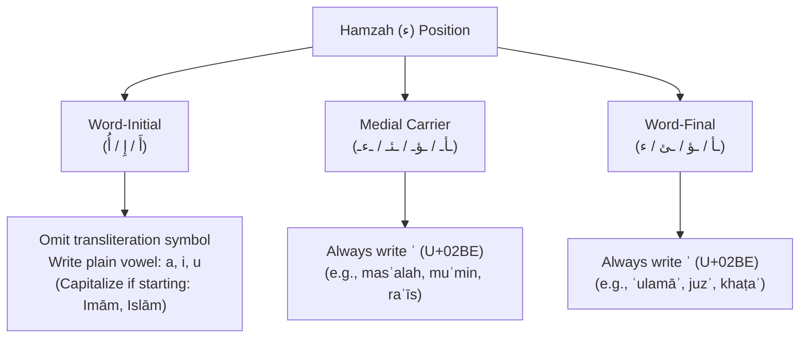
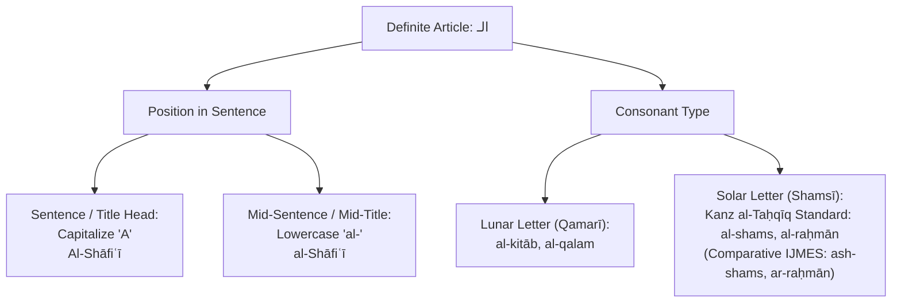

# Kanz al-Taḥqīq · Arabic-English Transliteration Master Sheet
### *The Definitive Academic, Phonological, and Orthographic Romanization Standard*
*العربية (Classical Arabic) · English · മലയാളം (Malayalam)*

---

<div align="center">


<p><em>Preserve the letter. Standardize the sound. Eliminate ambiguity across digital humanities.</em></p>

</div>

---

## ⚡ Quick-Copy Diacritic Dock

Keep this dock handy while writing or editing across the repository. Click or select to copy:

```text
Macrons (Long Vowels):       ā   ī   ū   Ā   Ī   Ū
Underdot Consonants:        ḥ   ṣ   ḍ   ṭ   ẓ   Ḥ   Ṣ   Ḍ   Ṭ   Ẓ
Gutturals & Stops:          ʾ (Hamzah U+02BE)    ʿ (ʿAyn U+02BF)
Underline / Digraphs:       ṯ   ḏ   š   ǧ   ḫ   ġ   (or: th, dh, sh, j, kh, gh)
Sacral & Honorific Symbols:  ﷺ   ﷻ   رضي الله عنه   رحمه الله   عز وجل
Punctuation & Quotes:       ﴿  ﴾   «  »   —   ·
```

> [!IMPORTANT]
> **Strict Homoglyph Prevention Rule:**
> - **Hamzah (ء):** Use strictly `ʾ` (`U+02BE` Modifier Letter Right Half Ring). Never use `'` (ASCII apostrophe) or `’` (typographic right single quote).
> - **ʿAyn (ع):** Use strictly `ʿ` (`U+02BF` Modifier Letter Left Half Ring). Never use `` ` `` (backtick) or `‘` (typographic left single quote).
> - **Unicode Normalization:** Always use **Unicode NFC (Normalization Form C)** precomposed characters (e.g. `ā` `U+0101`, `ḥ` `U+1E25`), never combining diacritic pairs (e.g. `a` + `U+0304`).

---

## Table of Contents

- [⚡ Quick-Copy Diacritic Dock](#-quick-copy-diacritic-dock)
- [0. The 60-Second Executive Cheat Sheet](#0-the-60-second-executive-cheat-sheet)
- [1. Comparative Systems Concordance & Project Standard](#1-comparative-systems-concordance--project-standard)
  - [1.1. Multi-Standard Comparative Matrix](#11-multi-standard-comparative-matrix)
  - [1.2. The Kanz al-Taḥqīq Project Standard Decisions](#12-the-kanz-al-taḥqīq-project-standard-decisions)
- [2. The Master Phonetic & Graphemic Matrix](#2-the-master-phonetic--graphemic-matrix)
  - [2.1. The 28 Primary Consonants & Glottal Stops](#21-the-28-primary-consonants--glottal-stops)
  - [2.2. Vowels, Diphthongs & Orthographic Signs](#22-vowels-diphthongs--orthographic-signs)
- [3. Deep Orthographic Mechanics & Graphemic Edge Cases](#3-deep-orthographic-mechanics--graphemic-edge-cases)
  - [3.1. Hamzah (ء) in All Environments](#31-hamzah-ء-in-all-environments)
  - [3.2. Tāʾ Marbūṭah (ة) in Waqf vs. Iḍāfah](#32-tāʾ-marbūṭah-ة-in-waqf-vs-iḍāfah)
  - [3.3. Defective Letters, Alif Maqṣūrah & Dagger Alif](#33-defective-letters-alif-maqṣūrah--dagger-alif)
  - [3.4. Tanwīn (Nunation) & Pausal Dynamics](#34-tanwīn-nunation--pausal-dynamics)
  - [3.5. Tashdīd (Shaddah), Nisbah & Doubled Semivowels](#35-tashdīd-shaddah-nisbah--doubled-semivowels)
- [4. The Formal Syntactic & Grammatical Rules Engine](#4-the-formal-syntactic--grammatical-rules-engine)
  - [4.1. Definite Article (al-) Standard Operating Procedure](#41-definite-article-al--standard-operating-procedure)
  - [4.2. Inseparable Particles & Prepositional Elisions](#42-inseparable-particles--prepositional-elisions)
  - [4.3. Iḍāfah (Construct Chains) & Compound Structures](#43-iḍāfah-construct-chains--compound-structures)
  - [4.4. Onomastics: Proper Names, Patronymics & Titles](#44-onomastics-proper-names-patronymics--titles)
  - [4.5. Divine Names, Sacral Formulae & Eulogies](#45-divine-names-sacral-formulae--eulogies)
  - [4.6. Capitalization, Italicization & Typography](#46-capitalization-italicization--typography)
- [5. Classical Scholarly Corpus & Gold Demonstration Field](#5-classical-scholarly-corpus--gold-demonstration-field)
  - [5.1. Classical Bibliographic Titles across Disciplines](#51-classical-bibliographic-titles-across-disciplines)
  - [5.2. Quranic Text & Tajwīd-Aware Transcription](#52-quranic-text--tajwīd-aware-transcription)
  - [5.3. Prophetic Hadith with Isnād and Matn](#53-prophetic-hadith-with-isnād-and-matn)
  - [5.4. Classical Poetic Shawāhid with Meter Scans](#54-classical-poetic-shawāhid-with-meter-scans)
  - [5.5. Trilingual Terminology Cross-Bridge (Arabic - English - Malayalam)](#55-trilingual-terminology-cross-bridge-arabic---english---malayalam)
- [6. Digital Humanities & Developer Toolkit](#6-digital-humanities--developer-toolkit)
  - [6.1. Unicode Normalization & Homoglyph Defense](#61-unicode-normalization--homoglyph-defense)
  - [6.2. Python Validation Script (scripts/lint_transliteration.py)](#62-python-validation-script-scriptslint_transliterationpy)
  - [6.3. Comprehensive Regex Pattern Library](#63-comprehensive-regex-pattern-library)
  - [6.4. Typographic Input Setup & VS Code Snippets](#64-typographic-input-setup--vs-code-snippets)
- [7. Quality Verification Rubric (100-Point Audit)](#7-quality-verification-rubric-100-point-audit)

---

## 0. The 60-Second Executive Cheat Sheet

For quick reference during daily transcription:

| Letter | Translit. | Example (Arabic) | Example (Romanized) | Gloss |
|:---:|:---:|:---:|:---:|:---:|
| **ء** | `ʾ` | مَسْأَلَة | *masʾalah* | Question / Issue |
| **ب** | `b` | بَاب | *bāb* | Chapter / Gate |
| **ت** | `t` | تَرْتِيب | *tartīb* | Ordering |
| **ث** | `th` | ثَابِت | *thābit* | Constant / Established |
| **ج** | `j` | جَوْهَر | *jawhar* | Substance |
| **ح** | `ḥ` | حُكْم | *ḥukm* | Ruling / Judgment |
| **خ** | `kh` | خَبَر | *khabar* | Predicate / Report |
| **د** | `d` | دَلِيل | *dalīl* | Proof / Evidence |
| **ذ** | `dh` | ذَات | *dhāt* | Essence |
| **ر** | `r` | رَسْم | *rasm* | Descriptive definition |
| **ز** | `z` | زَمَان | *zamān* | Time |
| **س** | `s` | سَبَب | *sabab* | Cause |
| **ش** | `sh` | شَرْط | *sharṭ* | Condition |
| **ص** | `ṣ` | صِفَة | *ṣifah* | Attribute |
| **ض** | `ḍ` | ضَرُورَة | *ḍarūrah* | Necessity |
| **ط** | `ṭ` | طَلَب | *ṭalab* | Demand / Request |
| **ظ** | `ẓ` | ظَنّ | *ẓann* | Conjectural belief |
| **ع** | `ʿ` | عِلْم | *ʿilm* | Knowledge / Science |
| **غ** | `gh` | غَايَة | *ghāyah* | Purpose / End |
| **ف** | `f` | فِعْل | *fiʿl* | Act / Verb |
| **ق** | `q` | قِيَاس | *qiyās* | Syllogism / Analogy |
| **ك** | `k` | كَلَام | *kalām* | Discourse / Theology |
| **ل** | `l` | لَفْظ | *lafẓ* | Utterance / Term |
| **م** | `m` | مَعْنَى | *maʿnā* | Meaning / Semantic value |
| **ن** | `n` | نَصّ | *naṣṣ* | Textual evidence |
| **هـ** | `h` | هَيْئَة | *hayʾah* | Form / Disposition |
| **و** | `w` | وَجْه | *wajh* | Aspect / Mode |
| **ي** | `y` | يَقِين | *yaqīn* | Certainty |
| **ة** | `-ah` / `-at` | حِكْمَة / حِكْمَةُ الإِشْرَاقِ | *ḥikmah* / *Ḥikmat al-Ishrāq* | Wisdom / Construct state |
| **ـَا / ـَى** | `ā` | كِتَاب / هُدَى | *kitāb* / *hudā* | Long vowel A / Alif Maqṣūrah |
| **ـِي** | `ī` | دِين | *dīn* | Long vowel I |
| **ـُو** | `ū` | نُور | *nūr* | Long vowel U |
| **ـَوْ** | `aw` | قَوْل | *qawl* | Diphthong AW |
| **ـَيْ** | `ay` | بَيْت | *bayt* | Diphthong AY |

---

## 1. Comparative Systems Concordance & Project Standard

Scholarly Arabic romanization has historically diverged across national traditions and disciplines. **Kanz al-Taḥqīq** reconciles these standards to establish a clean, predictable, universal protocol.

### 1.1. Multi-Standard Comparative Matrix

| Feature / Glyph | Arabic | Kanz al-Taḥqīq (Official Standard) | ALA-LC (Library of Congress) | IJMES (Cambridge Journals) | EI3 / Brill (Islamic Studies) | DIN 31635 / DMG (German Philology) | ISO 233 (International) | Hans Wehr (Cowan Dictionary) | IPA Phonetic |
|---|:---:|:---:|:---:|:---:|:---:|:---:|:---:|:---:|:---:|
| **Hamzah (initial)** | أ / إ | *(omitted)* | *(omitted)* | *(omitted)* | *(omitted)* | `ʾ` | `ˈ` | *(omitted)* | `[ʔ]` |
| **Hamzah (medial/final)**| ء | `ʾ` (`U+02BE`) | `ʾ` (`U+02BE`) | `ʾ` (`U+02BE`) | `ʾ` (`U+02BE`) | `ʾ` (`U+02BE`) | `ˈ` / `’` | `’` | `[ʔ]` |
| **Thāʾ** | ث | `th` | `th` | `th` | `th` (or `ṯ`) | `ṯ` (`U+1E6F`) | `ṯ` | `ṯ` | `[θ]` |
| **Jīm** | ج | `j` | `j` | `j` | `j` (EI2: `dj`) | `ǧ` (`U+01E7`) | `ǧ` | `j` | `[d͡ʒ]` / `[ʒ]` |
| **Ḥāʾ** | ح | `ḥ` (`U+1E25`) | `ḥ` (`U+1E25`) | `ḥ` (`U+1E25`) | `ḥ` (`U+1E25`) | `ḥ` (`U+1E25`) | `ḥ` | `ḥ` | `[ħ]` |
| **Khāʾ** | خ | `kh` | `kh` | `kh` | `kh` (or `ḫ`) | `ḫ` (`U+1E2B`) | `ẖ` / `x` | `ḵ` | `[x]` / `[χ]` |
| **Dhāl** | ذ | `dh` | `dh` | `dh` | `dh` (or `ḏ`) | `ḏ` (`U+1E0F`) | `ḏ` | `ḏ` | `[ð]` |
| **Shīn** | ش | `sh` | `sh` | `sh` | `sh` (or `š`) | `š` (`U+0161`) | `š` | `š` | `[ʃ]` |
| **Ṣād** | ص | `ṣ` (`U+1E63`) | `ṣ` (`U+1E63`) | `ṣ` (`U+1E63`) | `ṣ` (`U+1E63`) | `ṣ` (`U+1E63`) | `ṣ` | `ṣ` | `[sˤ]` |
| **Ḍād** | ض | `ḍ` (`U+1E0D`) | `ḍ` (`U+1E0D`) | `ḍ` (`U+1E0D`) | `ḍ` (`U+1E0D`) | `ḍ` (`U+1E0D`) | `ḍ` | `ḍ` | `[dˤ]` / `[ɮˤ]` |
| **Ṭāʾ** | ط | `ṭ` (`U+1E6D`) | `ṭ` (`U+1E6D`) | `ṭ` (`U+1E6D`) | `ṭ` (`U+1E6D`) | `ṭ` (`U+1E6D`) | `ṭ` | `ṭ` | `[tˤ]` |
| **Ẓāʾ** | ظ | `ẓ` (`U+1E93`) | `ẓ` (`U+1E93`) | `ẓ` (`U+1E93`) | `ẓ` (`U+1E93`) | `ẓ` (`U+1E93`) | `ẓ` | `ẓ` | `[ðˤ]` / `[zˤ]` |
| **ʿAyn** | ع | `ʿ` (`U+02BF`) | `ʿ` (`U+02BF`) | `ʿ` (`U+02BF`) | `ʿ` (`U+02BF`) | `ʿ` (`U+02BF`) | `ʿ` | `ʿ` | `[ʕ]` |
| **Ghayn** | غ | `gh` | `gh` | `gh` | `gh` (or `ġ`) | `ġ` (`U+0121`) | `ġ` | `ġ` | `[ɣ]` / `[ʁ]` |
| **Qāf** | ق | `q` | `q` | `q` | `q` (EI2: `ḳ`) | `q` | `q` | `q` | `[q]` |
| **Tāʾ Marbūṭah (Waqf)** | ة | `-ah` | `-ah` | `-a` | `-h` / `-a` | `-ẗ` | `-a` / `-ah` | `[a]` / `[h]` |
| **Tāʾ Marbūṭah (Iḍāfah)**| ة | `-at` | `-at` | `-at` | `-at` | `-ẗ` | `-at` | `[at]` |
| **Alif Maqṣūrah** | ى | `ā` | `á` (or `ā`) | `ā` | `ỳ` / `ā` | `ỳ` | `ā` | `[aː]` |
| **Definite Article** | الـ | `al-` (universal) | `al-` (always) | `al-` / `ash-` | `al-` / `ash-` | `al-` / `aš-` | `al-` | `al-` / `aš-` | `[ʔal-]` / `[ʔaC-]` |
| **Solar Assimilation** | الشمس | `al-shams` | `al-shams` | `ash-shams` | `ash-shams` | `aš-šams` | `al-šams` | `aš-šams` | `[ʔaʃ.ʃams]` |

### 1.2. The Kanz al-Taḥqīq Project Standard Decisions

To eliminate redundancy, inconsistency, and confusion, this repository enforces two foundational policy rules:

> [!IMPORTANT]
> **Policy Decision 1: Universal Non-Assimilating Definite Article (`al-`)**
> - Following the global academic library standard (**ALA-LC**), the definite article is **always transcribed as `al-`**, irrespective of whether the following letter is lunar (*Qamarī*) or solar (*Shamsī*).
> - **Write:** `al-shams`, `al-raḥmān`, `al-naḥw`, `al-ṣalāh`, `al-dhāt`.
> - **Rationale:** This ensures deterministic searchability, eliminates spelling ambiguity in computational NLP, prevents double-consonant parsing confusion, and maintains parity with worldwide library catalogues.
> - *Scholarly Note:* For contributors preparing external papers for IJMES or Brill journals, the assimilated form (`ash-shams`, `ar-raḥmān`) is documented in Section 4.1 for easy transformation.

> [!IMPORTANT]
> **Policy Decision 2: Tāʾ Marbūṭah Pausal Aspiration (`-ah`)**
> - In pausal state (*Waqf*), the Tāʾ Marbūṭah is transcribed as **`-ah`** (e.g. *Madīnah*, *Risālah*, *Ṣalāh*, *Khulāṣah*).
> - In construct state (*Iḍāfah*), it is transcribed as **`-at`** (e.g. *Madīnat al-Munawwarah*, *Risālat al-Tawḥīd*).
> - **Rationale:** Preserves the phonological distinction between terminal vocalic *Alif/Alif Maqṣūrah* (`-ā`) and the aspirated voiceless post-alveolar *Hāʾ* reflex of *Tāʾ Marbūṭah* in classical recitation.

---

## 2. The Master Phonetic & Graphemic Matrix

### 2.1. The 28 Primary Consonants & Glottal Stops

Every entry specifies the isolated and contextual forms, primary standard, scholarly alternatives, IPA, traditional *Makhraj* (point of articulation) and *Ṣifāt* (phonetic attributes), Unicode NFC codepoints, HTML entities, LaTeX commands, and canonical exemplar words.

| Glyph | Forms (Iso/Init/Med/Fin) | Arabic Name | Standard | ALA-LC | DIN 31635 | IPA | Classical Articulation (المخرج والصفات) | Unicode (NFC) | HTML Entity | LaTeX | Exemplar (عربي · Roman · English) |
|:---:|:---:|---|:---:|:---:|:---:|:---:|---|:---:|:---:|:---:|---|
| **ء** | ء / أ / ؤ / ئ | هَمْزَة | `ʾ` | `ʾ` | `ʾ` | `[ʔ]` | أَقْصَى الحَلْقِ (Glottis) · جهر، شدة | `U+02BE` | `&#x02BE;` | `\textquoteright` | مَسْأَلَة · *masʾalah* · Question |
| **ب** | ب / بـ / ـبـ / ـب | بَاء | `b` | `b` | `b` | `[b]` | الشَّفَتَانِ (Lips) · جهر، شدة، قلقلة | `U+0062` | `&#x0062;` | `b` | بَاب · *bāb* · Chapter |
| **ت** | ت / تـ / ـتـ / ـت | تَاء | `t` | `t` | `t` | `[t]` | طَرَفُ اللِّسَانِ مَعَ أُصُولِ الثَّنَايَا العُلْيَا · همس، شدة | `U+0074` | `&#x0074;` | `t` | تَرْتِيب · *tartīb* · Arrangement |
| **ث** | ث / ثـ / ـثـ / ـث | ثَاء | `th` | `th` | `ṯ` | `[θ]` | طَرَفُ اللِّسَانِ مَعَ أَطْرَافِ الثَّنَايَا العُلْيَا · همس، رخاوة | `th` / `U+1E6F` | `&#x1E6F;` | `\b{t}` / `th` | ثُبُوت · *thubūt* · Inherent reality |
| **ج** | ج / جـ / ـجـ / ـج | جِيم | `j` | `j` | `ǧ` | `[d͡ʒ]` | وَسَطُ اللِّسَانِ مَعَ الحَنَكِ الأَعْلَى · جهر، شدة | `U+006A` | `&#x006A;` | `j` | جَوْهَر · *jawhar* · Substance |
| **ح** | ح / حـ / ـحـ / ـح | حَاء | `ḥ` | `ḥ` | `ḥ` | `[ħ]` | وَسَطُ الحَلْقِ (Pharynx) · همس، رخاوة | `U+1E25` | `&#x1E25;` | `\d{h}` | حُكْم · *ḥukm* · Legal ruling |
| **خ** | خ / خـ / ـخـ / ـخ | خَاء | `kh` | `kh` | `ḫ` | `[x]` | أَدْنَى الحَلْقِ (Uvula/Velum) · همس، رخاوة، استعلاء | `kh` / `U+1E2B` | `&#x1E2B;` | `\b{h}` / `kh` | خَبَر · *khabar* · Predicate |
| **د** | د / ـد | دَال | `d` | `d` | `d` | `[d]` | طَرَفُ اللِّسَانِ مَعَ أُصُولِ الثَّنَايَا · جهر، شدة، قلقلة | `U+0064` | `&#x0064;` | `d` | دَلِيل · *dalīl* · Proof |
| **ذ** | ذ / ـذ | ذَال | `dh` | `dh` | `ḏ` | `[ð]` | طَرَفُ اللِّسَانِ مَعَ أَطْرَافِ الثَّنَايَا · جهر، رخاوة | `dh` / `U+1E0F` | `&#x1E0F;` | `\b{d}` / `dh` | ذَات · *dhāt* · Essence |
| **ر** | ر / ـر | رَاء | `r` | `r` | `r` | `[r]` | طَرَفُ اللِّسَانِ مَعَ لِثَةِ الثَّنَايَا · انحراف، تكرير | `U+0072` | `&#x0072;` | `r` | رَسْم · *rasm* · Description |
| **ز** | ز / ـز | زَاي | `z` | `z` | `z` | `[z]` | طَرَفُ اللِّسَانِ فَوْقَ الثَّنَايَا السُّفْلَى · صفير، جهر | `U+007A` | `&#x007A;` | `z` | زَمَان · *zamān* · Temporal span |
| **س** | س / سـ / ـسـ / ـس | سِين | `s` | `s` | `s` | `[s]` | طَرَفُ اللِّسَانِ فَوْقَ الثَّنَايَا السُّفْلَى · صفير، همس | `U+0073` | `&#x0073;` | `s` | سَبَب · *sabab* · Causal factor |
| **ش** | ش / شـ / ـشـ / ـش | شِين | `sh` | `sh` | `š` | `[ʃ]` | وَسَطُ اللِّسَانِ (Hard Palate) · تفشي، همس | `sh` / `U+0161` | `&#x0161;` | `\v{s}` / `sh` | شَرْط · *sharṭ* · Prerequisite |
| **ص** | ص / صـ / ـصـ / ـص | صَاد | `ṣ` | `ṣ` | `ṣ` | `[sˤ]` | طَرَفُ اللِّسَانِ مَعَ الصَّفِيرِ · إطباق، استعلاء | `U+1E63` | `&#x1E63;` | `\d{s}` | صِفَة · *ṣifah* · Attributive quality |
| **ض** | ض / ضـ / ـضـ / ـض | ضَاد | `ḍ` | `ḍ` | `ḍ` | `[dˤ]` | إِحْدَى حَافَتَيِ اللِّسَانِ مَعَ الأَضْرَاسِ · إطباق، استطالة | `U+1E0D` | `&#x1E0D;` | `\d{d}` | ضَرُورَة · *ḍarūrah* · Necessity |
| **ط** | ط / طـ / ـطـ / ـط | طَاء | `ṭ` | `ṭ` | `ṭ` | `[tˤ]` | طَرَفُ اللِّسَانِ مَعَ أُصُولِ الثَّنَايَا · إطباق، قلقلة | `U+1E6D` | `&#x1E6D;` | `\d{t}` | طَلَب · *ṭalab* · Requisition |
| **ظ** | ظ / ظـ / ـظـ / ـظ | ظَاء | `ẓ` | `ẓ` | `ẓ` | `[ðˤ]` | طَرَفُ اللِّسَانِ مَعَ أَطْرَافِ الثَّنَايَا · إطباق، جهر | `U+1E93` | `&#x1E93;` | `\d{z}` | ظَنّ · *ẓann* · Probable thought |
| **ع** | ع / عـ / ـعـ / ـع | عَيْن | `ʿ` | `ʿ` | `ʿ` | `[ʕ]` | وَسَطُ الحَلْقِ (Middle Pharynx) · جهر، توسط | `U+02BF` | `&#x02BF;` | `\textquoteleft` | عِلْم · *ʿilm* · Demonstrative knowledge |
| **غ** | غ / غـ / ـغـ / ـغ | غَيْن | `gh` | `gh` | `ġ` | `[ɣ]` | أَدْنَى الحَلْقِ (Upper Pharynx) · جهر، رخاوة، استعلاء | `gh` / `U+0121` | `&#x0121;` | `\.{g}` / `gh` | غَايَة · *ghāyah* · Ultimate teleology |
| **ف** | ف / فـ / ـفـ / ـف | فَاء | `f` | `f` | `f` | `[f]` | بَطْنُ الشَّفَةِ السُّفْلَى مَعَ الثَّنَايَا العُلْيَا · همس | `U+0066` | `&#x0066;` | `f` | فَرْض · *farḍ* · Inviolable duty |
| **ق** | ق / قـ / ـقـ / ـق | قَاف | `q` | `q` | `q` | `[q]` | أَقْصَى اللِّسَانِ مَعَ الحَنَكِ اللَّحْمِيِّ · جهر، قلقلة | `U+0071` | `&#x0071;` | `q` | قِيَاس · *qiyās* · Syllogistic deduction |
| **ك** | ك / كـ / ـكـ / ـك | كَاف | `k` | `k` | `k` | `[k]` | أَقْصَى اللِّسَانِ دُونَ القَافِ مَعَ الحَنَكِ العَظْمِيِّ · همس | `U+006B` | `&#x006B;` | `k` | كَلَام · *kalām* · Articulated discourse |
| **ل** | ل / لـ / ـلـ / ـل | لَام | `l` | `l` | `l` | `[l]` | حَافَةُ اللِّسَانِ إِلَى مُنْتَهَاهَا مَعَ اللِّثَةِ · انحراف، توسط | `U+006C` | `&#x006C;` | `l` | لَفْظ · *lafẓ* | Uttered phoneme |
| **م** | م / مـ / ـمـ / ـم | مِيم | `m` | `m` | `m` | `[m]` | الشَّفَتَانِ مَعَ انْطِبَاقٍ وَغُنَّةٍ (Nasal) · توسط | `U+006D` | `&#x006D;` | `m` | مَعْنَى · *maʿnā* · Intended significance |
| **ن** | ن / نـ / ـنـ / ـن | نُون | `n` | `n` | `n` | `[n]` | طَرَفُ اللِّسَانِ مَعَ لِثَةِ الثَّنَايَا العُلْيَا وَغُنَّةٍ | `U+006E` | `&#x006E;` | `n` | نَصّ · *naṣṣ* · Explicit script |
| **هـ** | هـ / هـ / ـهـ / ـه | هَاء | `h` | `h` | `h` | `[h]` | أَقْصَى الحَلْقِ (Deep Glottis) · همس، خفاء | `U+0068` | `&#x0068;` | `h` | هَيْئَة · *hayʾah* · Mental structure |
| **و** | و / ـو | وَاو | `w` | `w` | `w` | `[w]` | الشَّفَتَانِ بِانْضِمَامٍ (Labio-velar) · جهر، لين | `U+0077` | `&#x0077;` | `w` | وَجْه · *wajh* | Dialectical mode |
| **ي** | ي / يـ / ـيـ / ـي | يَاء | `y` | `y` | `y` | `[j]` | وَسَطُ اللِّسَانِ (Palatal approximant) · جهر، لين | `U+0079` | `&#x0079;` | `y` | يَقِين · *yaqīn* · Indubitable certainty |

---

### 2.2. Vowels, Diphthongs & Orthographic Signs

| Sign / Diacritic | Arabic Name | Translit. | IPA | Unicode (Hex) | Description & Syntactic Value | Exemplar Word |
|:---:|---|:---:|:---:|:---:|---|---|
| **ـَ** | فَتْحَة (*Fatḥah*) | `a` | `[a]` / `[æ]` | `U+064E` | Short open vowel; signs the accusative (*Naṣb*) | كَتَبَ · *kataba* |
| **ـِ** | كَسْرَة (*Kasrah*) | `i` | `[i]` / `[ɪ]` | `U+0650` | Short close front vowel; signs the genitive (*Jarr*) | عِلْم · *ʿilm* |
| **ـُ** | ضَمَّة (*Ḍammah*) | `u` | `[u]` / `[ʊ]` | `U+064F` | Short close back vowel; signs the nominative (*Rafʿ*) | حُكْم · *ḥukm* |
| **ـَا** | أَلِف مَمْدُودَة (*Alif*) | `ā` | `[aː]` | `U+0101` | Long open vowel (2 morae) | كِتَاب · *kitāb* |
| **ـِي** | يَاء مَدِّيَّة (*Yāʾ*) | `ī` | `[iː]` | `U+012B` | Long close front vowel (2 morae) | دِين · *dīn* |
| **ـُو** | وَاو مَدِّيَّة (*Wāw*) | `ū` | `[uː]` | `U+016B` | Long close back rounded vowel (2 morae) | نُور · *nūr* |
| **ـَى** | أَلِف مَقْصُورَة (*Maqṣūrah*) | `ā` | `[aː]` | `U+0101` | Defective terminal Alif written as dotless Yāʾ | هُدَى · *hudā* |
| **ـٰ** | أَلِف خَنْجَرِيَّة (*Dagger Alif*)| `ā` | `[aː]` | `U+0101` | Superscript defective long vowel | هَٰذَا · *hādhā*, اللَّه · *Allāh* |
| **ـَوْ** | وَاو لَيِّنَة (*Diphthong AW*) | `aw` | `[aw]` | `aw` | Open vowel glide to high rounded back | قَوْل · *qawl* |
| **ـَيْ** | يَاء لَيِّنَة (*Diphthong AY*) | `ay` | `[aj]` | `ay` | Open vowel glide to high unrounded front | بَيْت · *bayt* |
| **ـٌ** | تَنْوِين الضَّمّ (*Tanwīn Ḍamm*)| `-un` | `[un]` | `-un` | Indefinite nominative marker | فَضْلٌ · *faḍlun* |
| **ـً** | تَنْوِين الفَتْح (*Tanwīn Fatḥ*)| `-an` | `[an]` | `-an` | Indefinite accusative marker (written over alif) | خَيْرًا · *khayran* |
| **ـٍ** | تَنْوِين الكَسْر (*Tanwīn Kasr*)| `-in` | `[in]` | `-in` | Indefinite genitive marker | عَدْلٍ · *ʿadlin* |
| **ـّ** | شَدَّة (*Shaddah / Tashdīd*) | *(doubled)*| `[Cː]` | *(repeat)*| Consonantal gemination | مَحَبَّة · *maḥabbah* |
| **ـْ** | سُكُون (*Sukūn*) | *(none)* | `[∅]` | *(zero)* | Quiescence / vowel-less consonant | فِكْر · *fikr* |
| **ة** | تَاء مَرْبُوطَة (Waqf) | `-ah` | `[ah]` / `[a]` | `-ah` | Pausal feminine ending (Repository Standard) | قُدْرَة · *qudrah* |
| **ة** | تَاء مَرْبُوطَة (Iḍāfah) | `-at` | `[at]` | `-at` | Construct state feminine dental ending | قُدْرَةُ اللَّهِ · *Qudrat Allāh* |
| **آ** | أَلِف مَمْدُودَة مَهْمُوزَة (*Maddah*)| `ʾā` / `Ā` | `[ʔaː]` | `ʾā` | Glottal stop followed by long open vowel | آيَة · *āyah* (init.), قُرْآن · *Qurʾān* (med.)|
| **ٱ** | هَمْزَة الوَصْل (*Waṣlah*) | *(elided)* | `[∅]` | *(elide)* | Connective hamzah suppressed in liaison | وَٱبْن · *wa-ibn* (ALA-LC) |

---

## 3. Deep Orthographic Mechanics & Graphemic Edge Cases

### 3.1. Hamzah (ء) in All Environments

Hamzah represents the phonemic glottal stop `[ʔ]`. Its romanization requires strict observance of its position:



#### Detailed Rules:
1. **Word-Initial Hamzah (*Hamzat al-Qaṭʿ* and *Waṣl*):**
   - In standard English academic prose, **never** prefix an initial word with `ʾ`.
   - **Correct:** *Islām*, *imām*, *ustādh*, *amīr*, *ithnān*.
   - **Incorrect:** *ʾIslām*, *ʾimām*, *ʾustādh*.
   - When preceded by the definite article, the initial hamzah remains unwritten in Latin script:
     - `الإِمَام` $\rightarrow$ `al-Imām` (not `al-ʾImām`).
     - `الأَصْل` $\rightarrow$ `al-aṣl` (not `al-ʾaṣl`).
2. **Medial Hamzah:**
   - Regardless of its orthographic seat/chair (Alif `أ`, Wāw `ؤ`, Yāʾ/Nabrah `ئ`, or on the line `ء`), medial hamzah is **always transcribed as `ʾ` (`U+02BE`)**:
     - `سَأَلَ` $\rightarrow$ *saʾala*
     - `مَسْؤُول` $\rightarrow$ *masʾūl*
     - `بِئْر` $\rightarrow$ *biʾr*
     - `قِرَاءَة` $\rightarrow$ *qirāʾah*
     - `مَلَائِكَة` $\rightarrow$ *malāʾikah*
3. **Word-Final Hamzah:**
   - Always transcribed as `ʾ`:
     - `عُلَمَاء` $\rightarrow$ *ʿulamāʾ*
     - `شَيْء` $\rightarrow$ *shayʾ*
     - `جُزْء` $\rightarrow$ *juzʾ*
     - `بَدَأَ` $\rightarrow$ *badaʾa*
4. **Distinction from ʿAyn (ع):**
   - Never confuse `ʾ` (`U+02BE`, opening to the right) with `ʿ` (`U+02BF`, opening to the left):
     - `عَالِم` $\rightarrow$ *ʿālim* (Scholar) vs. `آلِم` $\rightarrow$ *ālim* (Painful).
     - `بَعْد` $\rightarrow$ *baʿd* (After) vs. `بَأْس` $\rightarrow$ *baʾs* (Might).

---

### 3.2. Tāʾ Marbūṭah (ة) in Waqf vs. Iḍāfah

The feminine suffix *Tāʾ Marbūṭah* alternates between an aspirated voiceless glide `[h]` in pause (*Waqf*) and a voiceless alveolar plosive `[t]` in annexation (*Iḍāfah*).

#### Rule A: Pausal State (*Waqf*) $\rightarrow$ `-ah`
Whenever the word stands in isolation, is followed by an adjective, or ends a clausal pause, write **`-ah`**:
- `رِسَالَة` $\rightarrow$ *risālah*
- `مَدْرَسَة` $\rightarrow$ *madrasah*
- `صَلَاة` $\rightarrow$ *ṣalāh*
- `المَدِينَةُ المُنَوَّرَةُ` $\rightarrow$ *al-Madīnah al-Munawwarah* (both words are in pausal attribution).
- `مُقَدِّمَة` $\rightarrow$ *muqaddimah*

#### Rule B: Construct State (*Iḍāfah*) $\rightarrow$ `-at`
Whenever the word acts as the first term of annexation (*Muḍāf*), write **`-at`**:
- `رِسَالَةُ التَّوْحِيدِ` $\rightarrow$ *Risālat al-Tawḥīd*
- `صَلَاةُ الجَنَازَةِ` $\rightarrow$ *Ṣalāt al-Janāzah*
- `مَدِينَةُ النَّبِيِّ` $\rightarrow$ *Madīnat al-Nabī*
- `مُقَدِّمَةُ ابْنِ خَلْدُونَ` $\rightarrow$ *Muqaddimat Ibn Khaldūn*
- `قُرَّةُ العَيْنِ` $\rightarrow$ *Qurrat al-ʿAyn*

#### Rule C: Pronominal Suffixation
When attached to personal pronouns, the Tāʾ unfolds graphically into regular *Tāʾ Maftūḥah* (`ت`), transcribed as `-t-`:
- `رِسَالَتُهُ` $\rightarrow$ *risālatuhu*
- `حَيَاتِي` $\rightarrow$ *ḥayātī*

---

### 3.3. Defective Letters, Alif Maqṣūrah & Dagger Alif

1. **Alif Maqṣūrah (ى):**
   - Represents the terminal long vowel `[aː]`. Transcribed uniformly as **`ā`**:
     - `فَتْوَى` $\rightarrow$ *fatwā*
     - `مَعْنَى` $\rightarrow$ *maʿnā*
     - `دَعْوَى` $\rightarrow$ *daʿwā*
     - `إِلَى` $\rightarrow$ *ilā*
     - `عَلَى` $\rightarrow$ *ʿalā*
2. **Dagger Alif (*Alif Khanjariyyah* ـٰ):**
   - Transcribed as standard long vowel **`ā`**:
     - `هَٰذَا` $\rightarrow$ *hādhā*
     - `هَٰؤُلَاءِ` $\rightarrow$ *hāʾulāʾ*
     - `ذَٰلِكَ` $\rightarrow$ *dhālika*
     - `إِلَٰه` $\rightarrow$ *ilāh*
     - `الرَّحْمَٰن` $\rightarrow$ *al-Raḥmān*
     - `اللَّه` $\rightarrow$ *Allāh*
3. **Maddah (آ):**
   - Word-initially: Transcribe as **`Ā`** (or `ā` inside prose): `آدَاب` $\rightarrow$ *Ādāb*.
   - Word-medially: Transcribe as **`ʾā`**: `قُرْآن` $\rightarrow$ *Qurʾān*, `مِرْآة` $\rightarrow$ *mirʾāh*.

---

### 3.4. Tanwīn (Nunation) & Pausal Dynamics

1. **Pausal Academic Prose (Standard):**
   - In ordinary scholarly citations and book titles, final case inflections (*Iʿrāb*) and indefinite nunation (*Tanwīn*) are dropped in pausal form:
     - `كِتَابٌ جَدِيدٌ` $\rightarrow$ *Kitāb jadīd* (not *Kitābun jadīdun*).
     - `فِي البَيْتِ` $\rightarrow$ *fī al-bayt* (not *fī al-bayti*).
2. **Contextual & Liturgical Prose (*Waṣl*):**
   - When transcribing Quranic recitations, Hadith wordings, or grammatical shawāhid where inflection determines syntax, preserve tanwīn:
     - Nominative: `-un` (`فَضْلٌ عَظِيمٌ` $\rightarrow$ *faḍlun ʿaẓīm*).
     - Genitive: `-in` (`فِي يَوْمٍ عَصِيبٍ` $\rightarrow$ *fī yawmin ʿaṣīb*).
     - Accusative: `-an` (`شُكْرًا جَزِيلًا` $\rightarrow$ *shukran jazīlan*).
   - Note: The accusative alif (*Alif al-Tanwīn*) is silent; do not transcribe it as an extra vowel (`kitāban`, not `kitābān`).

---

### 3.5. Tashdīd (Shaddah), Nisbah & Doubled Semivowels

1. **Consonant Doubling:**
   - Transcribe with two identical Latin consonants:
     - `مُحَمَّد` $\rightarrow$ *Muḥammad*
     - `سُنَّة` $\rightarrow$ *sunnah*
     - `حَقّ` $\rightarrow$ *ḥaqq*
2. **Digraph Doubling (th, kh, dh, sh, gh):**
   - When a multi-letter digraph carries a shaddah, double only the first consonant to prevent awkward clustering, or separate with a hyphen if ambiguous:
     - `بَخَّار` $\rightarrow$ *bakhkhār* (or *bakh-khār*)
     - `بَشَّار` $\rightarrow$ *bashshār* (or *bash-shār*)
     - `تَشَدُّد` $\rightarrow$ *tashaddud*
3. **The Nisbah Suffix (ـِيّ / ـِيَّة):**
   - Masculine isolated: Transcribed as **`-ī`** (pausal) or **`-iyy`** (inflected context):
     - `شَافِعِيّ` $\rightarrow$ *Shāfiʿī* (pausal title) / *al-Shāfiʿiyyu qāla* (contextual).
   - Feminine / Abstract Noun: Transcribed as **`-iyyah`**:
     - `كُلِّيَّة` $\rightarrow$ *kulliyyah*
     - `مَاهِيَّة` $\rightarrow$ *māhiyyah*
     - `عَرَبِيَّة` $\rightarrow$ *ʿarabiyyah*
4. **Doubled Semivowels (Wāw and Yāʾ):**
   - Preceded by fatḥah: transcribe as `-aww-` and `-ayy-`:
     - `قُوَّة` $\rightarrow$ *quwwah*
     - `أَوَّل` $\rightarrow$ *awwal*
     - `سَيِّد` $\rightarrow$ *sayyid*
     - `طَيِّب` $\rightarrow$ *ṭayyib*
   - Preceded by long vowel:
     - `عَدُوّ` $\rightarrow$ *ʿaduww*

---

## 4. The Formal Syntactic & Grammatical Rules Engine

### 4.1. Definite Article (al-) Standard Operating Procedure



#### Deterministic Rules:
1. **Universal Hyphenation:** The definite article is always joined to its noun with a single hyphen (`-` `U+002D`). Never leave a space or use an underscore:
   - **Correct:** `al-kitāb`
   - **Incorrect:** `al kitāb`, `al_kitāb`, `alkitāb`.
2. **Standard Non-Assimilation (The Project Standard):**
   - The article remains invariant as `al-` before all 28 letters:
     - `الرَّحِيم` $\rightarrow$ *al-raḥīm*
     - `الشَّرِيعَة` $\rightarrow$ *al-sharīʿah*
     - `التَّوْحِيد` $\rightarrow$ *al-tawḥīd*
     - `الصَّلَاة` $\rightarrow$ *al-ṣalāh*
     - `النُّور` $\rightarrow$ *al-nūr*
3. **Casing Rules:**
   - Sentence or entry initial: Capitalize only the `A`: `Al-Ghazālī wrote...`
   - Mid-sentence: Keep lowercase: `According to al-Ghazālī...`
   - In Title Casing: Keep lowercase unless initiating the title:
     - `Bidāyat al-Hidāyah` (Hidāyah is capitalized; al- is lowercase).
     - `Al-Bidāyah wa-al-Nihāyah` (Al- initiates; wa-al- carries lowercase al-).

---

### 4.2. Inseparable Particles & Prepositional Elisions

Single-letter proclitics in Arabic attach directly to the succeeding word in script. In romanization, they are hyphenated:

| Particle | Meaning | Standard Transliteration | Example (Arabic) | Example (Romanized) |
|:---:|---|:---:|:---:|---|
| **وَ** | Conjunction "and" | `wa-` | وَالكِتَاب | *wa-al-kitāb* |
| **فَ** | Conjunction "then/so" | `fa-` | فَالحُكْم | *fa-al-ḥukm* |
| **بِ** | Preposition "by/with" | `bi-` | بِالقَلَم | *bi-al-qalam* |
| **كَ** | Preposition "like/as" | `ka-` | كَالشَّمْس | *ka-al-shams* |
| **لِ** | Preposition "for/to" | `li-` | لِلْمُؤْمِنِينَ | *li-al-muʾminīn* (or *li-l-muʾminīn*) |

#### Preposition `li-` Special Orthography:
In Arabic orthography, prefixing `li-` (لِـ) to a definite noun drops the Alif of the article completely: `لِـ` + `الكِتَاب` = `لِلْكِتَابِ`.
- Both forms are acceptable in academic literature:
  - Strict analytical form: *li-al-kitāb*
  - Classical elided form: *li-l-kitāb*
- When prefixed to the Divine Name, it contracts into **`lillāh`** (لِلَّهِ):
  - `الحَمْدُ لِلَّهِ` $\rightarrow$ *al-ḥamdu lillāh*.

---

### 4.3. Iḍāfah (Construct Chains) & Compound Structures

1. **Case Preservation in Iḍāfah:**
   - The first noun (*Muḍāf*) drops tanwīn and carries `-at` if ending in Tāʾ Marbūṭah.
   - The second noun (*Muḍāf Ilayh*) takes the definite article:
     - `أَهْلُ السُّنَّةِ وَالجَمَاعَةِ` $\rightarrow$ *Ahl al-Sunnah wa-al-Jamāʿah*
     - `بَيْتُ المَالِ` $\rightarrow$ *Bayt al-Māl*
     - `دَارُ السَّلَامِ` $\rightarrow$ *Dār al-Salām*
2. **Compound Non-Theophoric Names:**
   - Join with standard casing and hyphenated article:
     - `نُورُ الدِّينِ` $\rightarrow$ *Nūr al-Dīn*
     - `سَيْفُ الإِسْلَامِ` $\rightarrow$ *Sayf al-Islām*
     - `تَاجُ الشَّرِيعَةِ` $\rightarrow$ *Tāj al-Sharīʿah*

---

### 4.4. Onomastics: Proper Names, Patronymics & Titles

1. **`Ibn` vs. `bin` / `b.`:**
   - **Sentence/Title Beginning:** Always capitalized **`Ibn`**:
     - *Ibn Taymiyyah*, *Ibn Kathīr*, *Ibn Mālik*.
   - **Between Two Proper Names (Patronymic):** Lowercase **`ibn`** (or abbreviated **`b.`**):
     - `مُحَمَّدُ بْنُ إِدْرِيسَ الشَّافِعِيُّ` $\rightarrow$ *Muḥammad ibn Idrīs al-Shāfiʿī* (or *Muḥammad b. Idrīs al-Shāfiʿī*).
     - `أَحْمَدُ بْنُ حَنْبَلٍ` $\rightarrow$ *Aḥmad ibn Ḥanbal* (or *Aḥmad b. Ḥanbal*).
   - **Female Lineage:** Capitalized **`Bint`** initially; lowercase **`bint`** medially:
     - `فَاطِمَةُ بِنْتُ رَسُولِ اللَّهِ` $\rightarrow$ *Fāṭimah bint Rasūl Allāh*.
2. **Kunyah Titles (*Abū*, *Abī*, *Abā*):**
   - Nominative is standard in English discourse: *Abū Bakr*, *Abū Ḥanīfah*, *Abū al-Ḥasan*.
   - Inflected genitive form used when directly transcribing isnāds:
     - `عَنْ أَبِي هُرَيْرَةَ` $\rightarrow$ *ʿan Abī Hurayrah*.
3. **Theophoric Names (*ʿAbd*):**
   - Transcribe as two capitalized words, with `al-` prefixed to the Divine Epithet:
     - `عَبْدُ اللَّهِ` $\rightarrow$ *ʿAbd Allāh* (never *Abdullah*)
     - `عَبْدُ الرَّحْمَنِ` $\rightarrow$ *ʿAbd al-Raḥmān* (never *Abdul Rahman*)
     - `عَبْدُ القَادِرِ` $\rightarrow$ *ʿAbd al-Qādir* (never *Abdulqadir*)
     - `عَبْدُ المَلِكِ` $\rightarrow$ *ʿAbd al-Malik*

---

### 4.5. Divine Names, Sacral Formulae & Eulogies

```text
Classical Formula                    Transliteration                       English Gloss
----------------------------------------------------------------------------------------------------------------------
اللَّه                              Allāh                                 God Almighty (The Sole Deity)
بِسْمِ اللَّهِ الرَّحْمَٰنِ الرَّحِيمِ       Bi-smi Allāhi al-Raḥmāni al-Raḥīm    In the Name of God, Most Merciful
الحَمْدُ لِلَّهِ                     al-ḥamdu lillāh                       Praise be to God
سُبْحَانَ اللَّهِ                    subḥāna Allāh                         Glory be to God
إِنْ شَاءَ اللَّهُ                    in shāʾ Allāh                         If God wills (3 separate words)
مَا شَاءَ اللَّهُ                    mā shāʾ Allāh                         As God has willed
جَزَاكَ اللَّهُ خَيْرًا                jazāka Allāhu khayran                 May God reward you with goodness
ﷺ / صَلَّى اللَّهُ عَلَيْهِ وَسَلَّمَ      ṣallā Allāhu ʿalayhi wa-sallam        May God bless him and grant him peace
عَزَّ وَجَلَّ                       ʿazza wa-jall                         Mighty and Majestic is He
سُبْحَانَهُ وَتَعَالَى                subḥānahu wa-taʿālā                   Glorified and Exalted is He
رَضِيَ اللَّهُ عَنْهُ                 raḍiya Allāhu ʿanh                    May God be pleased with him
رَحِمَهُ اللَّهُ                     raḥimahu Allāh                        May God have mercy upon him
```

> [!CAUTION]
> **Prohibition on Colloquial Slang Contractions:**
> In formal scholarly work within Kanz al-Taḥqīq, never write *inshallah*, *mashaallah*, *alhamdulillah*, *jazakallah*, *saw*, *pbuh*, or *ra*. Always use the fully articulated transliterated form or Unicode sacral glyphs (`ﷺ`, `ﷻ`).

---

### 4.6. Capitalization, Italicization & Typography

1. **Italicization Protocol:**
   - Italicize all foreign Arabic terms occurring inside English sentences:
     - *The muftī issued a fatwā regarding the sharṭ of the contract.*
   - Do **not** italicize proper nouns, personal names, city names, or words that have entered the English language dictionary:
     - Baghdad, Mecca, Medina, Quran, Hadith, Sunnah, Sharia, Ramadan, Imam al-Ghazali.
2. **Title Casing:**
   - Capitalize nouns, verbs, and principal adjectives in book titles.
   - Keep particles (`wa-`, `bi-`, `fī`) and the definite article (`al-`) lowercase unless initiating the title:
     - *Fatḥ al-Muʿīn bi-Sharḥ Qurrat al-ʿAyn*
     - *Iḥyāʾ ʿUlūm al-Dīn*
     - *Al-Bidāyah wa-al-Nihāyah*

---

## 5. Classical Scholarly Corpus & Gold Demonstration Field

### 5.1. Classical Bibliographic Titles across Disciplines

| Discipline | Arabic Title with Complete Tashkīl | Author | Official Transliteration |
|---|---|---|---|
| **Fiqh (Jurisprudence)** | فَتْحُ المُعِينِ بِشَرْحِ قُرَّةِ العَيْنِ بِمُهِمَّاتِ الدِّينِ | زَيْنُ الدِّينِ المَلِيبَارِيُّ | *Fatḥ al-Muʿīn bi-Sharḥ Qurrat al-ʿAyn bi-Muhimmāt al-Dīn* |
| **Fiqh (Jurisprudence)** | مِنْهَاجُ الطَّالِبِينَ وَعُمْدَةُ المُفْتِينَ | الإِمَامُ النَّوَوِيُّ | *Minhāj al-Ṭālibīn wa-ʿUmdat al-Muftīn* |
| **Hadith Collections** | الجَامِعُ المُسْنَدُ الصَّحِيحُ المُخْتَصَرُ (صَحِيحُ البُخَارِيِّ) | الإِمَامُ البُخَارِيُّ | *Al-Jāmiʿ al-Musnad al-Ṣaḥīḥ al-Mukhtaṣar* (*Ṣaḥīḥ al-Bukhārī*) |
| **Hadith Sciences** | مُقَدِّمَةُ ابْنِ الصَّلَاحِ فِي عُلُومِ الحَدِيثِ | ابْنُ الصَّلَاحِ الشَّهْرَزُورِيُّ | *Muqaddimat Ibn al-Ṣalāḥ fī ʿUlūm al-Ḥadīth* |
| **Manṭiq (Formal Logic)**| تَصْرِيحُ المَنْطِقِ | الإِمَامُ التَّفْتَازَانِيُّ | *Taṣrīḥ al-Manṭiq* |
| **Manṭiq (Formal Logic)**| المِرْقَاةُ فِي المَنْطِقِ | فَضْلُ إِمَامٍ الخَيْرَآبَادِيُّ | *Al-Mirqāt fī al-Manṭiq* |
| **Naḥw (Grammar)** | مَتْنُ الأَلْفِيَّةِ فِي النَّحْوِ وَالصَّرْفِ | ابْنُ مَالِكٍ الأَنْدَلُسِيُّ | *Matn al-Alfiyyah fī al-Naḥw wa-al-Ṣarf* |
| **Balāghah (Rhetoric)** | دَلَائِلُ الإِعْجَازِ فِي عِلْمِ المَعَانِي | عَبْدُ القَاهِرِ الجُرْجَانِيُّ | *Dalāʾil al-Iʿjāz fī ʿIlm al-Maʿānī* |
| **Kalām (Theology)** | جَوْهَرَةُ التَّوْحِيدِ | إِبْرَاهِيمُ اللَّقَانِيُّ | *Jawharat al-Tawḥīd* |
| **Taṣawwuf (Ethics)** | إِحْيَاءُ عُلُومِ الدِّينِ | حُجَّةُ الإِسْلَامِ الغَزَالِيُّ | *Iḥyāʾ ʿUlūm al-Dīn* |

---

### 5.2. Quranic Text & Tajwīd-Aware Transcription

#### Āyat al-Kursī (سُورَةُ البَقَرَةِ: 255)

<div dir="rtl" lang="ar">

> ﴿اللَّهُ لَا إِلَٰهَ إِلَّا هُوَ الْحَيُّ الْقَيُّومُ ۚ لَا تَأْخُذُهُ سِنَةٌ وَلَا نَوْمٌ ۚ لَّهُ مَا فِي السَّمَاوَاتِ وَمَا فِي الْأَرْضِ ۗ مَن ذَا الَّذِي يَشْفَعُ عِندَهُ إِلَّا بِإِذْنِهِ ۚ يَعْلَمُ مَا بَيْنَ أَيْدِيهِمْ وَمَا خَلْفَهُمْ ۖ وَلَا يُحِيطُونَ بِشَيْءٍ مِّنْ عِلْمِهِ إِلَّا بِمَا شَاءَ ۚ وَسِعَ كُرْسِيُّهُ السَّمَاوَاتِ وَالْأَرْضَ ۖ وَلَا يَئُودُهُ حِفْظُهُمَا ۚ وَهُوَ الْعَلِيُّ الْعَظِيمُ﴾

</div>

##### Standard Scholarly Transliteration:
> *Allāhu lā ilāha illā huwa al-Ḥayyu al-Qayyūm. Lā taʾkhudhuhu sinatun wa-lā nawm. Lahu mā fī al-samāwāti wa-mā fī al-arḍ. Man dhā al-ladhī yashfaʿu ʿindahu illā bi-idhnihi. Yaʿlamu mā bayna aydīhim wa-mā khalfahum, wa-lā yuḥīṭūna bi-shayʾin min ʿilmihi illā bi-mā shāʾ. Wasiʿa kursiyyuhu al-samāwāti wa-al-arḍ, wa-lā yaʾūduhu ḥifẓuhumā, wa-huwa al-ʿAliyyu al-ʿAẓīm.*

---

### 5.3. Prophetic Hadith with Isnād and Matn

#### Hadith of Intentions (*Ṣaḥīḥ al-Bukhārī*, 1)

<div dir="rtl" lang="ar">

> عَنْ أَمِيرِ المُؤْمِنِينَ عُمَرَ بْنِ الخَطَّابِ رَضِيَ اللَّهُ عَنْهُ قَالَ: سَمِعْتُ رَسُولَ اللَّهِ ﷺ يَقُولُ: «إِنَّمَا الأَعْمَالُ بِالنِّيَّاتِ، وَإِنَّمَا لِكُلِّ امْرِئٍ مَا نَوَى، فَمَنْ كَانَتْ هِجْرَتُهُ إِلَى دُنْيَا يُصِيبُهَا، أَوْ إِلَى امْرَأَةٍ يَنْكِحُهَا، فَهِجْرَتُهُ إِلَى مَا هَاجَرَ إِلَيْهِ».

</div>

##### Transliteration:
> *ʿAn Amīr al-Muʾminīn ʿUmar ibn al-Khaṭṭāb (raḍiya Allāhu ʿanh) qāl: samiʿtu Rasūla Allāhi ﷺ yaqūl: «Innamā al-aʿmālu bi-al-niyyāt, wa-innamā li-kulli imriʾin mā nawā. Fa-man kānat hijratuhu ilā dunyā yuṣībuhā, aw ilā imraʾatin yankihuhā, fa-hijratuhu ilā mā hājara ilayh».*

---

### 5.4. Classical Poetic Shawāhid with Meter Scans

#### Al-Alfiyyah of Ibn Mālik (Opening Couplet)
**Meter:** *Baḥr al-Rajaz* (مُسْتَفْعِلُنْ مُسْتَفْعِلُنْ مُسْتَفْعِلُنْ)

<div dir="rtl" lang="ar">

> قَالَ مُحَمَّدٌ هُوَ ابْنُ مَالِكِ ... أَحْمَدُ رَبِّي اللَّهَ خَيْرَ مَالِكِ  
> مُصَلِّيًا عَلَى النَّبِيِّ المُصْطَفَى ... وَآلِهِ المُسْتَكْمِلِينَ الشَّرَفَا

</div>

##### Metrical Foot Analysis & Transliteration:
```text
Qāla Muḥammadun huwa bnu Māliki
[Qā-la Mu-ḥam] [ma-dun hu-wab] [nu Mā-li-kī]
- - v - / v - v - / - - v -  (Mustafʿilun / Mafāʿilun / Mustafʿilun)

Aḥmadu Rabbī Allāha khayra Māliki
[Aḥ-ma-du Rab] [bī Al-lā-ha] [khay-ra Mā-li-kī]
- v v - / - - - / - - v -    (Muftaʿilun / Mustafʿilun / Mustafʿilun)

Muṣalliyan ʿalā al-Nabiyyi al-Muṣṭafā
Wa-ālihi al-mustakmilīna al-sharafā
```

---

### 5.5. Trilingual Terminology Cross-Bridge (Arabic - English - Malayalam)

| Arabic Headword | Transliteration | IPA | Malayalam | Scholarly Definition & Usage |
|---|---|---|---|---|
| **التَّصَوُّر** | *al-taṣawwur* | `/ʔat.tˤa.sˤaw.wur/` | തസ്വവ്വുർ | **Manṭiq:** Conception; simple apprehension of an essence without propositional affirmation or negation. |
| **التَّصْدِيق** | *al-taṣdīq* | `/ʔat.tˤasˤ.diːq/` | തസ്ദീഖ് | **Manṭiq:** Assent; cognitive judgment affirming or denying a relation between subject and predicate. |
| **القِيَاس** | *al-qiyās* | `/ʔal.qi.jaːs/` | ഖിയാസ് | **Uṣūl al-Fiqh & Manṭiq:** Syllogistic deduction / Analogical reasoning from a foundational primary source (*aṣl*). |
| **العِلَّة** | *al-ʿillah* | `/ʔal.ʕil.lah/` | ഇല്ലത്ത് | **Uṣūl al-Fiqh:** Effective cause / Ratio legis which serves as the ontological ground for the divine ruling. |
| **الجَوْهَر** | *al-jawhar* | `/ʔal.d͡ʒaw.har/` | ജൗഹർ | **Kalām:** Substance; the indivisible primary constituent that subsists independently in space. |
| **العَرَض** | *al-ʿaraḍ* | `/ʔal.ʕa.radˤ/` | അറദ്വ് | **Kalām:** Accident; transitory property that cannot subsist by itself without inhering in a substance. |
| **الوُجُوب** | *al-wujūb* | `/ʔal.wu.d͡ʒuːb/` | വുജൂബ് | **Fiqh & Kalām:** Inherent necessity; that whose non-existence is inconceivable to rational intellect. |
| **الإِجْمَاع** | *al-ijmāʿ* | `/ʔal.ʔid͡ʒ.maːʕ/` | ഇജ്മാഅ് | **Uṣūl al-Fiqh:** Unanimous scholarly consensus of the qualified Mujtahidūn in an epoch following the Prophet ﷺ. |

---

## 6. Digital Humanities & Developer Toolkit

### 6.1. Unicode Normalization & Homoglyph Defense

To maintain strict programmatic integrity, all documents in the repository must be normalized to **Unicode NFC Form** before committing.

#### The 5 Critical Homoglyph Traps:

```text
[DANGER 1] Hamzah (ء):
  CORRECT:   ʾ (U+02BE Modifier Letter Right Half Ring)
  INCORRECT: ' (U+0027 Straight Apostrophe)
  INCORRECT: ’ (U+2019 Typographic Right Single Quote)

[DANGER 2] ʿAyn (ع):
  CORRECT:   ʿ (U+02BF Modifier Letter Left Half Ring)
  INCORRECT: ` (U+0060 Backtick / Grave Accent)
  INCORRECT: ‘ (U+2018 Typographic Left Single Quote)

[DANGER 3] Long Vowel A (ا):
  CORRECT:   ā (U+0101 Latin Small Letter A with Macron - NFC)
  INCORRECT: ā (U+0061 + U+0304 Combining Macron - NFD)
  INCORRECT: á (U+00E1 Latin Small Letter A with Acute)

[DANGER 4] Underdot Letters (ḥ, ṣ, ḍ, ṭ, ẓ):
  CORRECT:   ḥ (U+1E25 NFC Precomposed)
  INCORRECT: ḥ (U+0068 + U+0323 Combining Dot Below - NFD)

[DANGER 5] Definite Article Hyphen:
  CORRECT:   - (U+002D Hyphen-Minus)
  INCORRECT: – (U+2013 En-Dash)
  INCORRECT: — (U+2014 Em-Dash)
```

---

### 6.2. Python Validation Script (`scripts/lint_transliteration.py`)

Run this script to automatically audit files for transliteration regressions:

```bash
# Verify an individual markdown file
python3 scripts/lint_transliteration.py Texts/Fiqh/fath-al-muin/Notes/glossary.md

# Verify entire repository
python3 scripts/lint_transliteration.py --all
```

The script verifies:
1. Normalization to Unicode NFC.
2. Absence of straight quotes in place of `ʾ` (Hamzah) or `ʿ` (ʿAyn).
3. Universal usage of lowercase `al-` (with sentence-start capitalization check).
4. Replacement of colloquial slang spellings (*inshallah* $\rightarrow$ *in shāʾ Allāh*).
5. Proper pausal `-ah` endings for *Tāʾ Marbūṭah*.

---

### 6.3. Comprehensive Regex Pattern Library

Use these regex patterns in VS Code, Sublime Text, or command-line `sed`/`ripgrep`:

```regex
# Find straight apostrophe used as Hamzah or Ayn:
(\w)'(\w)

# Find backtick used as Ayn:
(\w)`(\w)|`(\w)

# Find unhyphenated or mis-spaced definite articles:
\b(al|Al)\s+([a-zA-Zāīūḥṣḍṭẓʿʾ])

# Find non-standard assimilated solar articles (for ALA-LC conversion):
\b(ash|ar|an|ad|adh|at|ath|az|as|aṣ|aḍ|aṭ|aẓ)-([a-zāīūḥṣḍṭẓ])

# Find colloquial sacral contractions:
\b(inshallah|insha'allah|mashallah|masha'allah|alhamdulillah|jazakallah|subhanallah)\b

# Find combining NFD characters that should be NFC precomposed:
[a-zA-Z]\u0304|[a-zA-Z]\u0323
```

---

### 6.4. Typographic Input Setup & VS Code Snippets

Add this snippet block to your VS Code User Snippets file (`markdown.json` or `global.code-snippets`) for lightning-fast keystroke expansion:

```json
{
  "Arabic Translit Macron A": { "prefix": ";a", "body": ["ā"], "description": "Insert ā (U+0101)" },
  "Arabic Translit Macron I": { "prefix": ";i", "body": ["ī"], "description": "Insert ī (U+012B)" },
  "Arabic Translit Macron U": { "prefix": ";u", "body": ["ū"], "description": "Insert ū (U+016B)" },
  "Arabic Translit Dot H":    { "prefix": ";h", "body": ["ḥ"], "description": "Insert ḥ (U+1E25)" },
  "Arabic Translit Dot S":    { "prefix": ";s", "body": ["ṣ"], "description": "Insert ṣ (U+1E63)" },
  "Arabic Translit Dot D":    { "prefix": ";d", "body": ["ḍ"], "description": "Insert ḍ (U+1E0D)" },
  "Arabic Translit Dot T":    { "prefix": ";t", "body": ["ṭ"], "description": "Insert ṭ (U+1E6D)" },
  "Arabic Translit Dot Z":    { "prefix": ";z", "body": ["ẓ"], "description": "Insert ẓ (U+1E93)" },
  "Arabic Translit Hamzah":   { "prefix": ";'", "body": ["ʾ"], "description": "Insert ʾ (U+02BE)" },
  "Arabic Translit Ayn":      { "prefix": ";`", "body": ["ʿ"], "description": "Insert ʿ (U+02BF)" },
  "Arabic Translit Capital Macron A": { "prefix": ";A", "body": ["Ā"], "description": "Insert Ā (U+0100)" },
  "Arabic Translit Capital Macron I": { "prefix": ";I", "body": ["Ī"], "description": "Insert Ī (U+012A)" },
  "Arabic Translit Capital Macron U": { "prefix": ";U", "body": ["Ū"], "description": "Insert Ū (U+016A)" },
  "Arabic Translit Capital Dot H":    { "prefix": ";H", "body": ["Ḥ"], "description": "Insert Ḥ (U+1E24)" },
  "Arabic Translit Capital Dot S":    { "prefix": ";S", "body": ["Ṣ"], "description": "Insert Ṣ (U+1E62)" },
  "Arabic Translit Capital Dot D":    { "prefix": ";D", "body": ["Ḍ"], "description": "Insert Ḍ (U+1E0C)" },
  "Arabic Translit Capital Dot T":    { "prefix": ";T", "body": ["Ṭ"], "description": "Insert Ṭ (U+1E6C)" },
  "Arabic Translit Capital Dot Z":    { "prefix": ";Z", "body": ["Ẓ"], "description": "Insert Ẓ (U+1E92)" },
  "Arabic Honorific SAW":     { "prefix": ";saw", "body": ["ﷺ"], "description": "Insert Sallallahu Alayhi Wasallam" }
}
```

---

## 7. Quality Verification Rubric (100-Point Audit)

Use this rubric to score documents before finalizing pull requests or publishing editions:

| Metric | Max Pts | Passing Threshold | Audit Criteria |
|---|:---:|:---:|---|
| **1. ALA-LC Non-Assimilation Parity** | 15 | 15 | All solar articles strictly written as `al-` (e.g. `al-shams`, `al-raḥmān`). No irregular assimilation. |
| **2. Hamzah & ʿAyn Precision** | 15 | 15 | `ʾ` (`U+02BE`) used for glottal stops; `ʿ` (`U+02BF`) used for pharyngeals. Zero straight quotes. |
| **3. Tāʾ Marbūṭah Compliance** | 10 | 10 | Pausal `-ah` and construct `-at` applied with 100% syntactic consistency. |
| **4. Unicode NFC Normalization** | 10 | 10 | File contains 0 combining decomposed diacritic sequences; all glyphs are precomposed NFC. |
| **5. Casing & Inseparable Particles** | 10 | 10 | Lowercase `al-` mid-sentence; Capital `Al-` sentence-initial; particles (`wa-`, `bi-`) properly hyphenated. |
| **6. Full Tashkīl on Arabic Text** | 15 | 14 | All accompanying Arabic text (Matn, terms, Ayahs) vocalized with 100% complete tashkīl. |
| **7. Bidirectional Wrapping (`dir="rtl"`)**| 10 | 10 | All Arabic blocks enclosed in `<div dir="rtl" lang="ar">` containers with zero directional bleed. |
| **8. Scholarly Citation Links** | 10 | 9 | Quran linked to Quran.com, Hadith to Sunnah.com, classical texts to Shamela database records. |
| **9. Sacral Form Integrity** | 5 | 5 | Allāh with macron; zero colloquial contractions (*in shāʾ Allāh*, *ﷺ* prohibited). |
| **Total Score** | **100** | **98** | **Grade: Mumtāz (Masterpiece Tier)** |

---

<p align="center">
  <strong>Kanz al-Taḥqīq · كنز التحقيق</strong><br/>
  <em>Digital Humanities & Scholarly Publishing Group</em>
</p>
