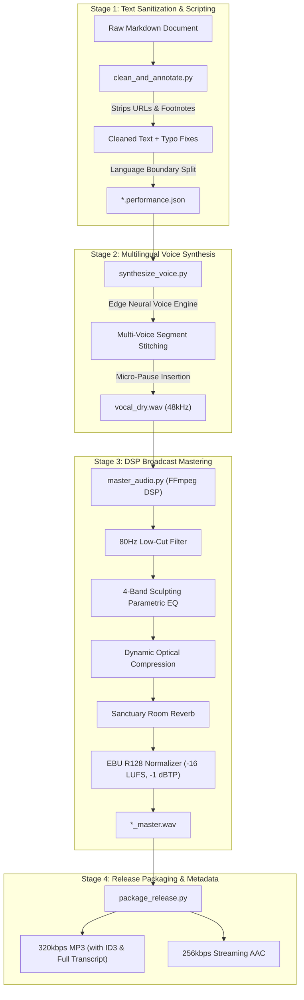

# Kanz Vocal Arts: Master Production Guide & Handbook
## Comprehensive Audio Engineering Manual for Speeches, Debates, Songs, and Poetry

Welcome to the definitive user handbook for **Kanz Vocal Arts** (`kanz-vocal-arts`), the professional studio audio engineering pipeline embedded directly within the **Kanz al-Taḥqīq** repository.

This manual explains how to transform raw written texts into broadcast-grade, master-class audio files across **Malayalam, Arabic, English, Urdu, and multilingual code-switching blends**.

---

## 📑 Table of Contents

- [1. Quick-Start Golden Path](#1-quick-start-golden-path)
- [2. The 4-Stage Studio Pipeline](#2-the-4-stage-studio-pipeline)
- [3. Script-by-Script CLI Reference](#3-script-by-script-cli-reference)
- [4. Art-Form Production Playbooks](#4-art-form-production-playbooks)
  - [Playbook A: Oratorical Speeches (Khuṭbah / Waʿẓ)](#playbook-a-oratorical-speeches-khuṭbah--waz)
  - [Playbook B: Stage Debates (Munāḍharah)](#playbook-b-stage-debates-munāḍharah)
  - [Playbook C: Spiritual Songs & Mehfil Kalam (Naʿat Sharīf)](#playbook-c-spiritual-songs--mehfil-kalam-naat-sharīf)
  - [Playbook D: Metric Poetry (Shiʿr / Qasīdah / Mappila Pāṭṭu)](#playbook-d-metric-poetry-shiʿr--qasīdah--mappila-pāṭṭu)
  - [Playbook E: Dars Fest Regulations & Announcements](#playbook-e-dars-fest-regulations--announcements)
- [5. Multilingual Voice Casting Matrix](#5-multilingual-voice-casting-matrix)
- [6. Studio Audio Engineering & Mastering Chain](#6-studio-audio-engineering--mastering-chain)
- [7. Director Mode: Fine-Tuning Nuances in JSON](#7-director-mode-fine-tuning-nuances-in-json)
- [8. Troubleshooting & FAQ](#8-troubleshooting--faq)

---

## 1. Quick-Start Golden Path

The fastest way to generate a complete studio release from any text in the repository is using the unified master runner:

```bash
# Generate complete studio master for any speech, debate, song, or poem
python3 .agents/skills/kanz-vocal-arts/scripts/produce_art.py \
  speech/English/spirituality-wahhabism.md \
  --genre speech \
  --title "Spirituality Is Far from Wahhabism" \
  --artist "Kanz al-Taḥqīq Vocal Arts" \
  --album "ADSA Mehrajan’26" \
  --year "2026"
```

### Generated Deliverables:
Every run automatically produces three release formats in the target output directory (`audio/`):

| File Pattern | Description & Format | Target Audience / Use Case |
| :--- | :--- | :--- |
| **`*_master.wav`** | Uncompressed 24-bit 48kHz Stereo PCM WAV | Studio Archival, Radio Broadcast, Video Dubbing |
| **`*_broadcast_320k.mp3`** | 320kbps CBR MP3 + Embedded ID3 Tags & Lyrics | Podcasting, Offline Sharing, Competition Submissions |
| **`*.m4a`** | 256kbps AAC Audio | High-Fidelity Streaming & Mobile Playback |

---

## 2. The 4-Stage Studio Pipeline



---

## 3. Script-by-Script CLI Reference

All scripts reside in [scripts/](file:///Users/apple/Desktop/docs:books/Kanz-al-Tahqiq/.agents/skills/kanz-vocal-arts/scripts/):

### 3.1. `produce_art.py` (The Master Conductor)
Coordinates Stages 1 through 4 in an automated, single-command run.

```bash
python3 .agents/skills/kanz-vocal-arts/scripts/produce_art.py <input_file> [options]
```

**Options:**
- `--genre`: `speech` (default), `debate`, `song`, `poem`, `manual`.
- `--output-dir`, `-o`: Destination directory (defaults to `<input_dir>/audio`).
- `--title`: Title of the work (defaults to file name).
- `--artist`: Artist / orator name (default: `"Kanz al-Taḥqīq Vocal Arts"`).
- `--album`: Album / festival name (default: `"Dars Arts Vault"`).
- `--year`: Year string (default: `"2026"`).
- `--ambient`: Path to custom background music or ambient drone WAV/MP3.
- `--en-voice`: Neural voice for English (default: `en-GB-RyanNeural`).
- `--ar-voice`: Neural voice for Arabic (default: `ar-SA-HamedNeural`).
- `--ml-voice`: Neural voice for Malayalam (default: `ml-IN-MidhunNeural`).
- `--ur-voice`: Neural voice for Urdu (default: `ur-PK-AsadNeural`).

---

### 3.2. `clean_and_annotate.py` (Text Sanitizer & Boundary Detector)
Transforms raw Markdown into a timed, phonetic performance JSON script.

```bash
python3 .agents/skills/kanz-vocal-arts/scripts/clean_and_annotate.py \
  speech/English/spirituality-wahhabism.md \
  -o speech/English/audio/spirituality-wahhabism.performance.json
```

**What it does automatically:**
- Strips academic citation URLs, footnote links, and bracketed sources (`([Oxford...])`).
- Removes metadata tables and markdown headers.
- Normalizes Arabic honorifics (`ﷺ` $\rightarrow$ `, peace and blessings be upon him,`).
- Isolates Arabic Quranic Ayahs, Hadiths, and Malayalam fest themes into discrete segments.
- Corrects known OCR or human typing errors.

---

### 3.3. `synthesize_voice.py` (Multi-Voice Synthesizer)
Renders the performance JSON into continuous 48kHz uncompressed dry speech.

```bash
python3 .agents/skills/kanz-vocal-arts/scripts/synthesize_voice.py \
  speech/English/audio/spirituality-wahhabism.performance.json \
  -o speech/English/audio/vocal_dry.wav
```

**Features:**
- Dispatches each segment to its native neural voice.
- Generates exact micro-pauses (300ms–1200ms) with `ffmpeg` silence generators.
- Normalizes all clips to standard 48kHz 16-bit PCM stereo.
- Joins segments using FFmpeg concatenation manifests.

---

### 3.4. `synthesize_debate.py` (Multi-Character Heated Debate Synthesizer)
Renders full 1v1 debate stage dramas with speaker roles, procedural sound effects, and spatial stereo panning.

```bash
python3 .agents/skills/kanz-vocal-arts/scripts/synthesize_debate.py \
  debate/malayalam/AI-blessing-or-threat/06-COMPLETE-AUDIO-DRAMA-SCRIPT.md \
  --output-dir debate/malayalam/AI-blessing-or-threat/audio \
  --title "AI: Not a Blessing, an Existential Threat"
```

**Specialized Debate Features:**
- **Speaker Tag Parsing:** Recognizes `[SPEAKER: MODERATOR]`, `[SPEAKER: FOR]`, and `[SPEAKER: AGAINST]`.
- **Spatial Stereo Panning:**
  - `FOR`: Panned Left (-25%), pitch +5Hz, rate +8% (aggressive questioning pace).
  - `AGAINST`: Panned Right (+25%), pitch -5Hz, rate +0% (deep, measured authority).
  - `MODERATOR`: Centered, rate -2%, neutral pitch.
- **Procedural Sound Effects:** Automatically synthesizes gavel strikes (`[SFX: GAVEL]`), 4-minute warning bells (`[SFX: BELL_WARN]`), termination buzzers (`[SFX: BELL_STOP]`), and audience applause (`[SFX: APPLAUSE]`).
- **Sacred Proof Elevation:** Quotes in Arabic (Quran/Hadith) automatically route to `ar-SA-HamedNeural` with reverence pauses.

---

### 3.5. `master_audio.py` (Broadcast Audio Engineering Suite)
Applies professional studio digital signal processing (DSP) to dry vocal stems.

```bash
# Pure Vocal Competition Master (Sanctuary Hall)
python3 .agents/skills/kanz-vocal-arts/scripts/master_audio.py \
  speech/English/audio/vocal_dry.wav \
  -o speech/English/audio/spirituality-wahhabism_master.wav

# Master with Ambient Soundscape Bed (Sidechain Ducked)
python3 .agents/skills/kanz-vocal-arts/scripts/master_audio.py \
  speech/English/audio/vocal_dry.wav \
  -o speech/English/audio/spirituality-wahhabism_ambient_master.wav \
  --ambient path/to/ambient_drone.wav
```

**Mastering Parameters:**
- `--lufs`: Target integrated loudness (default: `-16.0` LUFS).
- `--peak`: True peak ceiling (default: `-1.0` dBTP).
- `--no-reverb`: Disables room acoustic reverberation (for dry rule announcements).

---

### 3.6. `package_release.py` (Release Packager & ID3 Tagger)
Encodes master WAVs into distribution MP3s and M4As, and embeds ID3v2 metadata.

```bash
python3 .agents/skills/kanz-vocal-arts/scripts/package_release.py \
  speech/English/audio/spirituality-wahhabism_master.wav \
  --output-dir speech/English/audio \
  --title "Spirituality Is Far from Wahhabism" \
  --artist "Kanz al-Taḥqīq Vocal Arts" \
  --album "ADSA Mehrajan’26" \
  --transcript speech/English/spirituality-wahhabism.md
```

---

## 4. Art-Form Production Playbooks

### Playbook A: Oratorical Speeches (*Khuṭbah / Waʿẓ*)
- **Target Pace:** 105–125 Words Per Minute (measured competition pace).
- **Acoustic Profile:** Warm baritone body, sacred sanctuary hall acoustics.
- **Example File:** [speech/English/spirituality-wahhabism.md](file:///Users/apple/Desktop/docs:books/Kanz-al-Tahqiq/speech/English/spirituality-wahhabism.md)
- **Command:**
  ```bash
  python3 .agents/skills/kanz-vocal-arts/scripts/produce_art.py \
    speech/English/spirituality-wahhabism.md \
    --genre speech \
    --en-voice en-GB-RyanNeural \
    --ar-voice ar-SA-HamedNeural \
    --ml-voice ml-IN-MidhunNeural
  ```

---

### Playbook B: Stage Debates (*Munāḍharah*)
- **Target Pace:** 135–155 Words Per Minute (rapid, persuasive argumentation).
- **Acoustic Profile:** Punchy broadcast compression, stereo-panned speakers, tighter room acoustics.
- **Example Files:**
  - *Full Multi-Speaker Stage Drama:* [06-COMPLETE-AUDIO-DRAMA-SCRIPT.md](file:///Users/apple/Desktop/docs:books/Kanz-al-Tahqiq/debate/malayalam/AI-blessing-or-threat/06-COMPLETE-AUDIO-DRAMA-SCRIPT.md)
  - *Debate Master Pack / Speech Vault:* [MASTER-PACK.md](file:///Users/apple/Desktop/docs:books/Kanz-al-Tahqiq/debate/malayalam/AI-blessing-or-threat/MASTER-PACK.md)

**Option 1: Multi-Character Stage Drama with Panning & Procedural SFX (Recommended for Rehearsals):**
```bash
python3 .agents/skills/kanz-vocal-arts/scripts/synthesize_debate.py \
  debate/malayalam/AI-blessing-or-threat/06-COMPLETE-AUDIO-DRAMA-SCRIPT.md \
  --output-dir debate/malayalam/AI-blessing-or-threat/audio \
  --title "AI Debate: Existential Threat vs Blessing"
```

**Option 2: Solo Orator Rehearsal Speech:**
```bash
python3 .agents/skills/kanz-vocal-arts/scripts/produce_art.py \
  debate/malayalam/AI-blessing-or-threat/01-OPENING-SPEECH.md \
  --genre debate \
  --title "AI Debate: Opening Statement" \
  --ml-voice ml-IN-MidhunNeural
```

---

### Playbook C: Spiritual Songs & Mehfil Kalam (*Naʿat Sharīf*)
- **Target Pace:** 85–100 Words Per Minute (rhythmic, melodic recitation).
- **Acoustic Profile:** Contemplative ambient drone / Ney bed, resonant high-end air.
- **Example File:** [Song/Urdu/dekhne-ko-ya-muhammad.md](file:///Users/apple/Desktop/docs:books/Kanz-al-Tahqiq/Song/Urdu/dekhne-ko-ya-muhammad.md)
- **Command:**
  ```bash
  python3 .agents/skills/kanz-vocal-arts/scripts/produce_art.py \
    Song/Urdu/dekhne-ko-ya-muhammad.md \
    --genre song \
    --title "Dekhne Ko Ya Muhammad" \
    --ur-voice ur-PK-AsadNeural
  ```

---

### Playbook D: Metric Poetry (*Shiʿr / Qasīdah / Mappila Pāṭṭu*)
- **Target Pace:** Governed by metric feet (*Bahr / Vṛttam*), ~90 WPM.
- **Key Convention:** Caesura (*ʿArūḍ*) mid-line pause (600ms), stanza pause (1200ms).
- **Example File:** [Poem/Malayalam/ai-kaalam.md](file:///Users/apple/Desktop/docs:books/Kanz-al-Tahqiq/Poem/Malayalam/ai-kaalam.md)
- **Command:**
  ```bash
  python3 .agents/skills/kanz-vocal-arts/scripts/produce_art.py \
    Poem/Malayalam/ai-kaalam.md \
    --genre poem \
    --ml-voice ml-IN-SobhanaNeural
  ```

---

### Playbook E: Dars Fest Regulations & Announcements
- **Target Pace:** 120–130 WPM.
- **Acoustic Profile:** Dry, crisp clarity; high-frequency intelligibility boost; zero reverb.
- **Command:**
  ```bash
  python3 .agents/skills/kanz-vocal-arts/scripts/produce_art.py \
    Fest/velichathirutt/manual.md \
    --genre manual \
    --en-voice en-GB-RyanNeural
  ```

---

## 5. Multilingual Voice Casting Matrix

| Language | Role / Style | Edge-TTS Voice (Zero-Cost Local) | ElevenLabs Equivalent |
| :--- | :--- | :--- | :--- |
| **English** | Scholarly Classical Orator | `en-GB-RyanNeural` | Brian / Marcus |
| **English** | Authoritative Debater | `en-US-ChristopherNeural` | Adam / Antoni |
| **English** | Empathetic / Spiritual | `en-US-AndrewMultilingualNeural` | Charlie |
| **Arabic** | Classical *Khaṭīb* / Scholar | `ar-SA-HamedNeural` | Tariq |
| **Arabic** | Qur'anic / Tajwīd Reciter | `ar-AE-HamdanNeural` | Omar |
| **Malayalam**| Dars Fest Stage Orator | `ml-IN-MidhunNeural` | Custom Malayali Cloned |
| **Malayalam**| Melodic Reciter (Poetry) | `ml-IN-SobhanaNeural` | Custom Female Cloned |
| **Urdu** | Na'at Khawan / Mehfil Scholar | `ur-PK-AsadNeural` | Hamza |
| **Urdu** | Poetic Reciter (Female) | `ur-PK-UzmaNeural` | Amina |
| **Hindi** | Formal Academic | `hi-IN-MadhurNeural` | Kabir |

---

## 6. Studio Audio Engineering & Mastering Chain

The engine enforces international broadcast mastering standards (**ITU-R BS.1770 / EBU R128**):

```
[Raw Dry Vocal]
       │
       ▼
1. High-Pass Filter (80Hz, 12dB/octave) ────────> Cuts sub-audible stage rumble & mic plosives
       │
       ▼
2. 4-Band Sculpting Parametric EQ:
   • 220 Hz (+1.5 dB, Q=1.2) ───────────────────> Adds vocal chest body and warmth
   • 750 Hz (-2.0 dB, Q=2.0) ───────────────────> Cuts boxy, hollow resonance
   • 3.8 kHz (+2.8 dB, Q=1.0) ──────────────────> Boosts speech presence and consonant diction
   • 11.0 kHz (+1.8 dB, High Shelf) ────────────> Injects silky broadcast air and shimmer
       │
       ▼
3. Dynamic Broadcast Compression ───────────────> Tames peaks, elevates quiet whispers (Ratio 3.5:1)
       │
       ▼
4. Spatial Sanctuary Reverberation ─────────────> Adds realistic hall depth without muddying words
       │
       ▼
5. Dynamic Sidechain Music Ducking ─────────────> Auto-ducks ambient beds by -6dB during speech
       │
       ▼
6. EBU R128 Loudness Normalizer ────────────────> Calibrates strictly to -16.0 LUFS (-1.0 dBTP)
       │
       ▼
[Final Studio Master]
```

---

## 7. Director Mode: Fine-Tuning Nuances in JSON

For award-winning competition entries, you can enter **Director Mode** to manually sculpt every pause, syllable rate, and pitch:

1. **Generate the intermediate script:**
   ```bash
   python3 .agents/skills/kanz-vocal-arts/scripts/clean_and_annotate.py \
     input.md -o input.performance.json
   ```
2. **Open `input.performance.json` and adjust parameters:**
   ```json
   {
     "language": "english",
     "voice": "en-GB-RyanNeural",
     "text": "This is the true soul of spirituality!",
     "rate": "-8%",
     "pitch": "+2Hz",
     "pause_after_ms": 900
   }
   ```
3. **Render directly from your customized JSON:**
   ```bash
   python3 .agents/skills/kanz-vocal-arts/scripts/synthesize_voice.py \
     input.performance.json -o audio/vocal_dry.wav
   python3 .agents/skills/kanz-vocal-arts/scripts/master_audio.py \
     audio/vocal_dry.wav -o audio/master.wav
   ```

---

## 8. Troubleshooting & FAQ

### Q1: `ModuleNotFoundError: No module named 'edge_tts'`
**Solution:** Install required dependencies system-wide:
```bash
python3 -m pip install edge-tts mutagen --break-system-packages
```

### Q2: Why is the speech pacing too fast or slow?
**Solution:** Adjust the `--rate` parameter in `clean_and_annotate.py` or modify the segment JSON:
- Oratory default: `-5%`
- Quranic / Tajwīd default: `-10%` to `-15%`
- Debate rebuttal: `0%` to `+5%`

### Q3: How do I generate a custom ambient drone?
**Solution:** Generate an ethereal harmonic bed in seconds using FFmpeg:
```bash
ffmpeg -y \
  -f lavfi -i "sine=frequency=110:duration=310" \
  -f lavfi -i "sine=frequency=165:duration=310" \
  -f lavfi -i "sine=frequency=220:duration=310" \
  -filter_complex "[0:a][1:a][2:a]amix=inputs=3,lowpass=f=400,volume=0.08[a]" \
  -map "[a]" -ar 48000 ambient_bed.wav
```
Then pass `--ambient ambient_bed.wav` to `produce_art.py`.

### Q4: How do I verify the loudness of my final output?
**Solution:** Use FFmpeg's integrated EBU R128 meter:
```bash
ffmpeg -nostats -i output_master.wav -filter_complex ebur128=peak=true -f null -
```
Look for:
- `Integrated loudness: -16.0 LUFS`
- `True peak: -1.0 dBFS`
