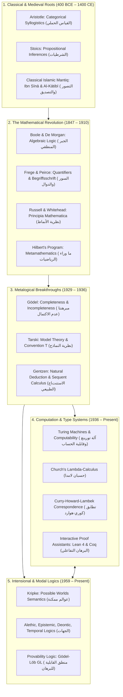
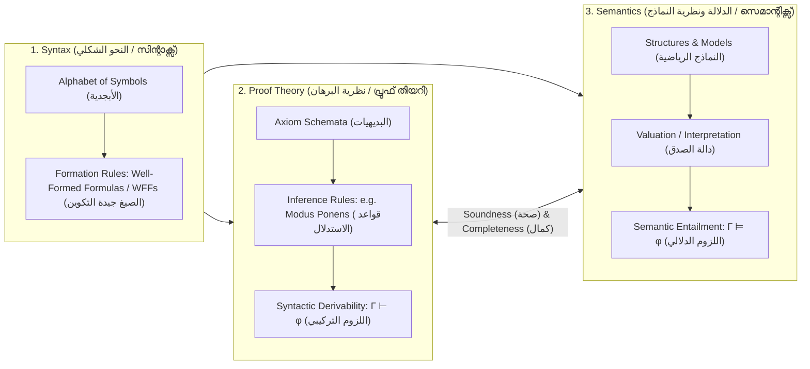
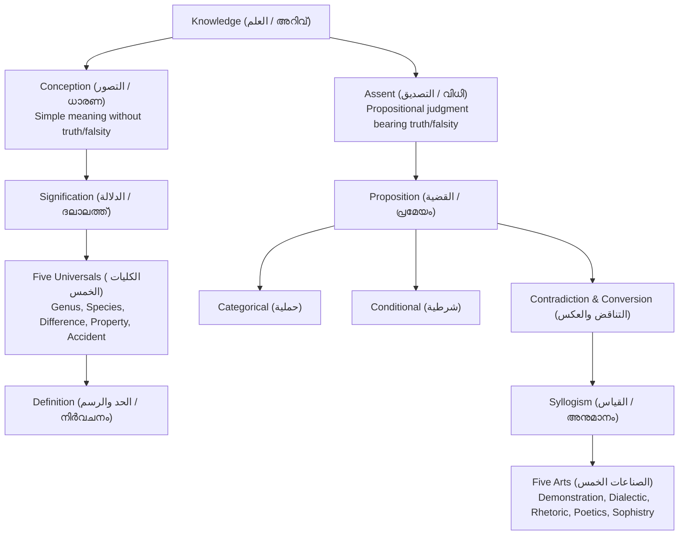
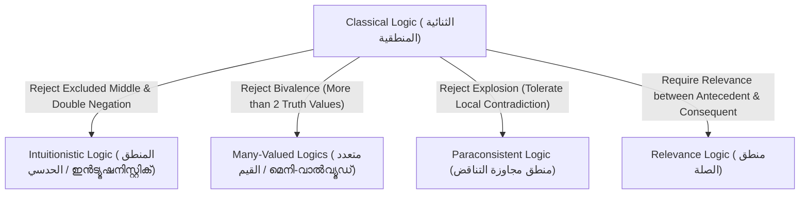
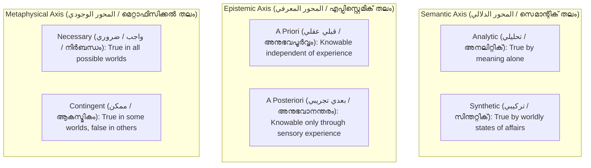
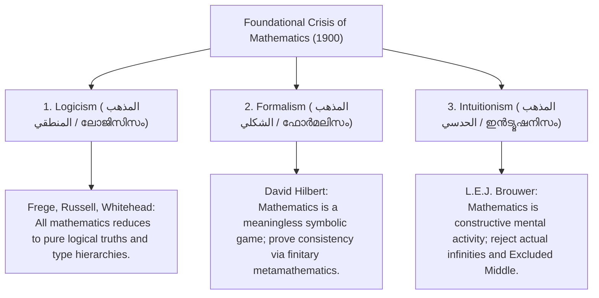
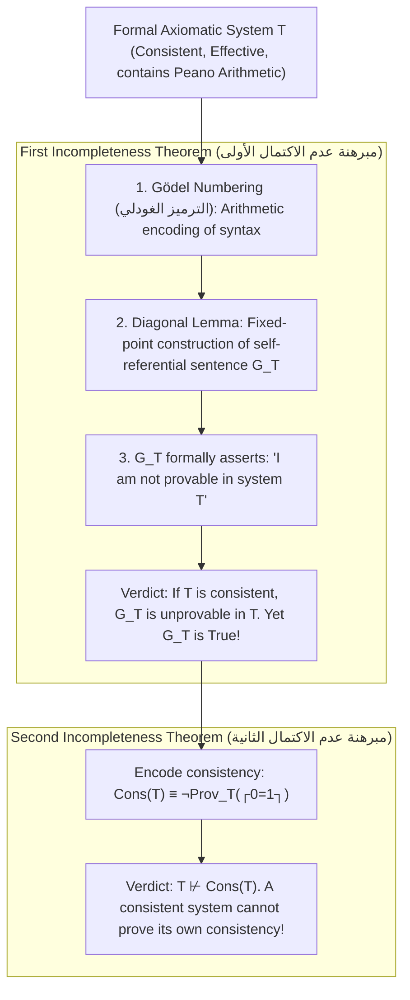
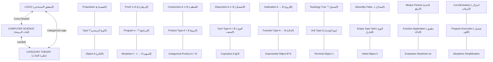
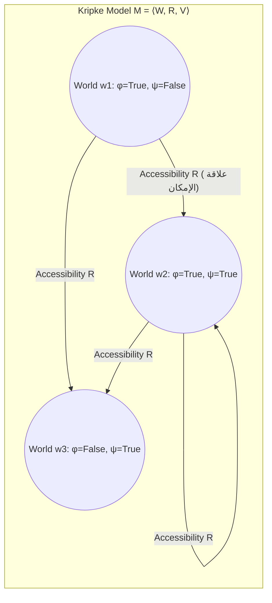
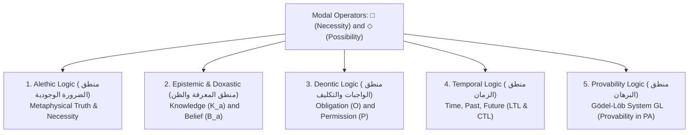

# Foundations of General Logic, Philosophy, Mathematics, Computation, and Modal Logic
### A Unified Formal and Comparative Treatise
**Primary Language:** English  
**Classical & Vernacular Bridges:** Arabic (*‘Ilm al-Manṭiq* — علم المنطق) & Malayalam (*തത്ത്വശാസ്ത്ര-ഗണിത സംജ്ഞകൾ*)

---

> [!NOTE]
> **A Note on Method and Terminology:**  
> This treatise presents the unified architecture of formal reasoning from ancient dialectic to contemporary mathematical logic, algorithmic computation, and intensional semantics. English serves as the primary language of analytical exposition. At each key conceptual junction, traditional Arabic terminology from the classical Islamic logicians (Ibn Sīnā, Al-Fārābī, Al-Ghazālī, Al-Kātibī, Al-Taftāzānī) and precise Malayalam academic equivalents (*മലയാള സാങ്കേതിക പദാവലി*) are seamlessly integrated to bridge the classical Peripatetic-Islamic tradition with modern mathematical, computational, and analytic philosophy.

---

## Table of Contents

- [Architectural Overview: The Unity of Formal Thought](#architectural-overview-the-unity-of-formal-thought)
- [1. Epistemic Foundations: From Classical Dialectic to Symbolic Form](#1-epistemic-foundations-from-classical-dialectic-to-symbolic-form)
  - [1.1 The Evolutionary Trajectory of Deductive Thought](#11-the-evolutionary-trajectory-of-deductive-thought)
  - [1.2 The Triad of Formal Systems: Syntax, Semantics, and Proof Theory](#12-the-triad-of-formal-systems-syntax-semantics-and-proof-theory)
  - [1.3 Core Metalogical Properties](#13-core-metalogical-properties)
  - [1.4 The Universal Epistemic Divide: *Taṣawwur* vs. *Taṣdīq*](#14-the-universal-epistemic-divide-taṣawwur-vs-taṣdīq)
- [2. Formal Logic Systems & Model Theory](#2-formal-logic-systems--model-theory)
  - [2.1 Propositional Calculus (Zeroth-Order Logic)](#21-propositional-calculus-zeroth-order-logic)
  - [2.2 First-Order Predicate Logic (FOL)](#22-first-order-predicate-logic-fol)
  - [2.3 Metatheory of First-Order Logic](#23-metatheory-of-first-order-logic)
  - [2.4 Higher-Order Logics (HOL)](#24-higher-order-logics-hol)
  - [2.5 Non-Classical and Deviant Logics](#25-non-classical-and-deviant-logics)
- [3. Philosophy of Logic, Epistemology, and Language](#3-philosophy-of-logic-epistemology-and-language)
  - [3.1 The Nature of Logical Truth and Modality](#31-the-nature-of-logical-truth-and-modality)
  - [3.2 Theories of Truth and Semantic Paradoxes](#32-theories-of-truth-and-semantic-paradoxes)
  - [3.3 Reference, Meaning, and Ontological Commitment](#33-reference-meaning-and-ontological-commitment)
  - [3.4 Classical Paradoxes and the Limits of Formal Systems](#34-classical-paradoxes-and-the-limits-of-formal-systems)
- [4. Mathematics and Foundational Crises](#4-mathematics-and-foundational-crises)
  - [4.1 The *Grundlagenkrise* (Foundational Crisis of Mathematics)](#41-the-grundlagenkrise-foundational-crisis-of-mathematics)
  - [4.2 Axiomatic Set Theory (ZFC)](#42-axiomatic-set-theory-zfc)
  - [4.3 Gödel's Incompleteness Theorems](#43-gödels-incompleteness-theorems)
  - [4.4 Category Theory: Structural Alternative to Set Theoretic Foundations](#44-category-theory-structural-alternative-to-set-theoretic-foundations)
- [5. Computation, Proof Theory, and Type Systems](#5-computation-proof-theory-and-type-systems)
  - [5.1 Computability, Turing Machines, and the Church-Turing Thesis](#51-computability-turing-machines-and-the-church-turing-thesis)
  - [5.2 The Untyped and Typed $\lambda$-Calculi](#52-the-untyped-and-typed-lambda-calculi)
  - [5.3 The Curry-Howard-Lambek Correspondence ("The Trinity")](#53-the-curry-howard-lambek-correspondence-the-trinity)
  - [5.4 Modern Type Systems and Interactive Theorem Proving](#54-modern-type-systems-and-interactive-theorem-proving)
  - [5.5 Computational Complexity and Intractability](#55-computational-complexity-and-intractability)
- [6. Modal Logic and Intensional Formalisms](#6-modal-logic-and-intensional-formalisms)
  - [6.1 The Intensional Turn: Overcoming Extensional Truth-Functionality](#61-the-intensional-turn-overcoming-extensional-truth-functionality)
  - [6.2 Kripke Relational Semantics (Possible Worlds)](#62-kripke-relational-semantics-possible-worlds)
  - [6.3 Modal Axiom Systems and Frame Correspondences](#63-modal-axiom-systems-and-frame-correspondences)
  - [6.4 Taxonomies of Modal Logic](#64-taxonomies-of-modal-logic)
  - [6.5 Conceptual Cross-Bridge: Avicennian *Mantiq* vs. Modern Modal Logic](#65-conceptual-cross-bridge-avicennian-mantiq-vs-modern-modal-logic)
- [7. Comprehensive Multi-Tradition Concordance & Glossary](#7-comprehensive-multi-tradition-concordance--glossary)
- [8. Epilogue & Recommended Bibliography](#8-epilogue--recommended-bibliography)

---

## Architectural Overview: The Unity of Formal Thought

Logic is the formal science of valid inference, structural truth, and necessary consequence. Across twenty-four centuries, logic evolved from a philosophical organon (*‘Ālah Qānūniyyah* — آلة قانونية / ഉപകരണം) for policing dialectical discourse into the mathematical substrate of digital computers, compiler type-checkers, and artificial intelligence architectures.

---

## 1. Epistemic Foundations: From Classical Dialectic to Symbolic Form

### 1.1 The Evolutionary Trajectory of Deductive Thought

1. **The Aristotelian *Organon* (أورغانون أرسطو / അരിസ്റ്റോട്ടിലിന്റെ ഓർഗനൺ — 384–322 BCE):**  
   Aristotle isolated formal logical validity from concrete empirical matter. In the *Prior Analytics*, he codified the categorical syllogism (*al-Qiyās al-Ḥamlī* — القياس الحملي), governed by terms linked by predication across four classical forms:
   - Universal Affirmative ($A$): *"Every $S$ is $P$"* (كل $S$ هو $P$ / എല്ലാ $S$-ഉം $P$ ആണ്)
   - Universal Negative ($E$): *"No $S$ is $P$"* (لا شيء من $S$ هو $P$ / ഒരു $S$-ഉം $P$ അല്ല)
   - Particular Affirmative ($I$): *"Some $S$ is $P$"* (بعض $S$ هو $P$ / ചില $S$, $P$ ആണ്)
   - Particular Negative ($O$): *"Some $S$ is not $P$"* (ليس كل $S$ هو $P$ / ചില $S$, $P$ അല്ല)

2. **The Stoic Propositional Calculus (منطق الرواقیین / സ്റ്റോയിക് പ്രൊപ്പൊസിഷണൽ ലോജിക് — c. 279–206 BCE):**  
   Chrysippus and the Megarian-Stoic school pioneered propositional logic, analyzing unanalyzed truth-bearing statements connected by truth-evaluable connectives: conditionals (*al-Sharṭiyyah al-Muttaṣilah*), conjunctions (*al-Jam‘*), and exclusive disjunctions (*al-Munfaṣilah al-Māni‘ah*).

3. **The Classical Islamic Synthesis (*‘Ilm al-Manṭiq* — علم المنطق / ഇസ്ലാമിക് മന്തിഖ് — 8th–14th Century CE):**  
   Scholars including Al-Fārābī (*al-Mu‘allim al-Thānī*), Ibn Sīnā (Avicenna), Al-Ghazālī, Fakhr al-Dīn al-Rāzī, and Najm al-Dīn al-Kātibī restructured logic into a universal organon:
   > *"Knowledge is either Conception (*Taṣawwur*) or Assent (*Taṣdīq*); Conception is acquired through Definition (*al-Qawl al-Shāriḥ*), while Assent is acquired through Syllogism (*al-Ḥujjah / al-Qiyās*)."*  
   > *(العلم إما تصور وإما تصديق؛ التصور يكتسب بالقول الشارح، والتصديق يكتسب بالحجة)*

   Furthermore, Ibn Sīnā pioneered temporal and modal modifications (*al-Muwaqqatāt* and *al-Mashrūṭāt*), anticipating modern tense and relational modal systems.

4. **The Leibnizian Dream (غوتفريد لايبنتز — 1646–1716):**  
   Gottfried Wilhelm Leibniz envisioned the *Characteristica Universalis* (a formal conceptual alphabet) and the *Calculus Ratiocinator* (a symbolic engine where disagreements could be resolved by pure mechanical evaluation: *"Calculemus!"* / فلنحسب / നമുക്ക് കണക്കുകൂട്ടാം).

5. **The Fregean Revolution (غوتلوب فريجه — 1879):**  
   With the *Begriffsschrift* ("Concept Script"), Gottlob Frege dissolved the ancient subject-predicate paradigm, introducing **function-argument analysis** ($f(x)$) and variable-binding **quantifiers** ($\forall, \exists$ — *al-Sūr: al-Kullī wa al-Juz’ī* / സർവ്വത്രിക-ഭാഗിക അളവുകൾ). This resolved the classical problem of multiple generality (e.g., *"Every philosopher loves some book"*), which Aristotelian term logic could not represent.

---

### 1.2 The Triad of Formal Systems: Syntax, Semantics, and Proof Theory

Every modern formal system $\mathcal{S}$ is partitioned into three strictly delineated levels:

1. **Syntax ($\mathcal{L}$ — النحو الشكلي / വാക്യഘടന):**  
   The uninterpreted mechanical rules specifying the formal alphabet and inductive formation rules. Syntactic operations treat expressions as strings of symbols without regard to truth or meaning.
2. **Proof Theory ($\vdash$ — نظرية البرهان / വാദശാസ്ത്രം):**  
   Syntactic transformation within a formal calculus. A formula $\phi$ is syntactically derivable from premises $\Gamma$ (written $\Gamma \vdash \phi$) if there exists a finite sequence of formulas ending in $\phi$, where every step is an axiom or instantiated from previous lines via formal inference rules (e.g., Modus Ponens / *Qā‘idat Raf‘ al-Muqaddam*).
3. **Semantics ($\models$ — نظرية الدلالة / അർത്ഥശാസ്ത്രം):**  
   The assignment of mathematical models, domains, and truth values ($\mathbf{T} / \mathbf{F}$ or $1 / 0$) to symbolic expressions. Semantic consequence ($\Gamma \models \phi$) signifies that in every model $\mathfrak{M}$ where all members of $\Gamma$ are true, $\phi$ is necessarily true.

---

### 1.3 Core Metalogical Properties

When assessing any formal deductive calculus $\mathcal{S}$, metalogicians analyze five primary global attributes:

| Metalogical Property | Formal Definition | Arabic Term (*المصطلح العربي*) | Malayalam Term (*മലയാള സംജ്ഞ*) | Conceptual Significance |
|---|---|---|---|---|
| **Soundness** | $\Gamma \vdash \phi \implies \Gamma \models \phi$ | السلامة / صحة الاستدلال (*Salāmah*) | സാധുത / കൃത്യത (*Sādhuta*) | The proof system never derives a false statement; syntax preserves semantic truth. |
| **Completeness** | $\Gamma \models \phi \implies \Gamma \vdash \phi$ | الكمال النسقي (*Kamāl*) | സമ്പൂർണ്ണത (*Sampūrṇṇata*) | Every semantic truth expressible in the language can be proven syntactically. |
| **Consistency** | $\not\exists \phi \text{ s.t. } \vdash \phi \land \vdash \neg\phi$ | الاتساق / عدم التناقض (*Ittisāq*) | പൊരുത്തക്കേടില്ലായ്മ (*Consistency*) | The system contains no internal contradictions; it cannot prove everything ($\not\vdash \bot$). |
| **Decidability** | $\exists \text{ algorithm } \mathcal{A}(\phi) \to \{0, 1\}$ | قابلية التقرير الحسابي (*Taqrīr*) | അൽഗോരിത നിർണ്ണയക്ഷമത | A mechanical algorithm exists to determine validity in finite time. |
| **Compactness** | $\Gamma \models \phi \iff \exists \Gamma_0 \subseteq_{\text{fin}} \Gamma (\Gamma_0 \models \phi)$ | التراص الدلالي (*Tarāṣṣ*) | കോംപാക്റ്റ്നസ്സ് | Infinite semantic entailments reduce to finite subsets of premises. |

---

### 1.4 The Universal Epistemic Divide: *Taṣawwur* vs. *Taṣdīq*

The foundational epistemology of classical logic establishes a dual division that anticipates modern philosophy of language and type theory:

$$\text{Knowledge (العلم / ജ്ഞാനം)} = \begin{cases} \mathbf{Taṣawwur} \text{ (تصور / Conception): Grasping a meaning without ontological judgment} \\ \mathbf{Taṣdīq} \text{ (تصديق / Assent): Judging a propositional relation as True or False} \end{cases}$$

> [!TIP]
> **Modern Analytic Correspondence:**  
> In modern type-theoretic terms, *Taṣawwur* corresponds to **Type / Concept Formulation** ($A : \text{Type}$), whereas *Taṣdīq* corresponds to **Inhabited Type Witnessing / Proof Assertion** ($a : A$, affirming that the proposition holds).

---

## 2. Formal Logic Systems & Model Theory

### 2.1 Propositional Calculus (Zeroth-Order Logic)
*Arabic: حسبان القضايا | Malayalam: പ്രൊപ്പൊസിഷണൽ കാൽക്കുലസ്*

Propositional logic formalizes reasoning over atomic propositions $p, q, r, \dots \in \mathcal{P}$ whose meanings are abstracted entirely into boolean truth values $\{0, 1\}$.

#### Inductive Syntax
$$\phi ::= p \mid \neg \phi \mid (\phi \land \phi) \mid (\phi \lor \phi) \mid (\phi \to \phi) \mid (\phi \leftrightarrow \phi)$$

#### Connectives & Multi-Language Equivalences
- **Negation ($\neg \phi$ — السلب / النفي | നിഷേധം):** $v(\neg \phi) = 1 - v(\phi)$.
- **Conjunction ($\phi \land \psi$ — العطف / الوصل | കൺജങ്ഷൻ):** $v(\phi \land \psi) = \min(v(\phi), v(\psi))$.
- **Disjunction ($\phi \lor \psi$ — الانفصال / الفصل | ഡിസ്ജങ്ഷൻ):** $v(\phi \lor \psi) = \max(v(\phi), v(\psi))$.
- **Material Implication ($\phi \to \psi$ — الشرطية اللزومية | ഇംപ്ലിക്കേഷൻ):** $v(\phi \to \psi) = 1 \iff (v(\phi) = 0 \text{ or } v(\psi) = 1)$.

> [!NOTE]
> **Functional Completeness (التمام الوظيفي / ഫങ്ഷണൽ കംപ്ലീറ്റ്നസ്സ്):**  
> A set of logical connectives is *functionally complete* if it can express all $2^{2^n}$ possible boolean truth functions of $n$ variables. The singleton sets $\{\text{NAND}\}$ (Sheffer stroke $\uparrow$) and $\{\text{NOR}\}$ (Peirce arrow $\downarrow$) are functionally complete on their own:
> $$\phi \uparrow \psi \equiv \neg(\phi \land \psi) \quad \text{and} \quad \phi \downarrow \psi \equiv \neg(\phi \lor \psi)$$

#### Normal Forms
- **Conjunctive Normal Form (CNF / الصيغة القياسية العطفية):** A conjunction of disjunctions of literals:
  $$\bigwedge_{i=1}^n \left( \bigvee_{j=1}^{m_i} L_{i,j} \right) \quad \text{e.g., } (p \lor \neg q) \land (\neg p \lor r \lor s)$$
  This serves as the foundational input format for industrial SAT solvers.
- **Disjunctive Normal Form (DNF / الصيغة القياسية الانفصالية):** A disjunction of conjunctions of literals:
  $$\bigvee_{i=1}^n \left( \bigwedge_{j=1}^{m_i} L_{i,j} \right)$$

---

### 2.2 First-Order Predicate Logic (FOL)
*Arabic: منطق الرتبة الأولى / منطق المحمولات | Malayalam: പ്രഥമ ക്രമ ലോജിക്*

First-Order Logic (FOL) decomposes propositions into individual terms (objects) and predicates (relations and attributes), equipped with variable-binding quantifiers.

#### Formal Syntax
1. **Terms ($\mathcal{T}$ — الحدود):** Variables $x, y, z$ and constants $c_1, c_2$, and function applications $f(t_1, \dots, t_n)$.
2. **Formulas ($\text{WFF}$ — الصيغ):** If $P$ is an $n$-ary predicate and $t_i$ are terms, then $P(t_1, \dots, t_n)$ is an atomic formula. Formulas are closed under $\neg, \land, \lor, \to, \leftrightarrow$ and quantifiers:
   - **Universal Quantifier ($\forall x$ — السور الكلي | സാർവ്വത്രിക അളവ്):** "For all $x$..." (لكل $x$)
   - **Existential Quantifier ($\exists x$ — السور الجزئي | ഭാഗിക അളവ്):** "There exists an $x$ such that..." (يوجد $x$ بحيث)

#### Tarskian Semantics (دلالات تارسكي للنماذج / ടാർസ്കിയൻ സെമാന്റിക്സ്)
A structure $\mathfrak{M} = \langle D, \mathcal{I} \rangle$ consists of a non-empty domain $D$ (*‘Ālam al-Maqāl* — عالم المقال / ചർച്ചാ മണ്ഡലം) and an interpretation function $\mathcal{I}$. For a variable assignment $\sigma : \text{Var} \to D$:
- $\mathfrak{M}, \sigma \models P(t_1, \dots, t_n) \iff \langle \llbracket t_1 \rrbracket_\sigma^\mathfrak{M}, \dots, \llbracket t_n \rrbracket_\sigma^\mathfrak{M} \rangle \in P^\mathfrak{M}$
- $\mathfrak{M}, \sigma \models \forall x \, \phi \iff \forall d \in D, \, \mathfrak{M}, \sigma[x \mapsto d] \models \phi$
- $\mathfrak{M}, \sigma \models \exists x \, \phi \iff \exists d \in D \text{ such that } \mathfrak{M}, \sigma[x \mapsto d] \models \phi$

---

### 2.3 Metatheory of First-Order Logic

1. **Gödel’s Completeness Theorem (مبرهنة الاكتمال لغودل — 1929):**  
   First-Order Logic is both sound and complete:
   $$\Gamma \vdash_{\text{FOL}} \phi \iff \Gamma \models_{\text{FOL}} \phi$$
   Every first-order validity can be systematically produced by a mechanical syntactic deduction in a finite number of steps.
2. **The Compactness Theorem (مبرهنة التراص):**  
   A set of first-order sentences $\Gamma$ has a model if and only if every finite subset $\Gamma_0 \subseteq_{\text{fin}} \Gamma$ has a model.  
   *Metalogical Implication:* FOL cannot formalize the concept of "finitude" or pin down the natural numbers without permitting non-standard models with infinitely large elements.
3. **Löwenheim-Skolem Theorems (مبرهنتا لوفنهايم-سكولم):**  
   If a countable first-order theory has an infinite model, it has a model of every infinite cardinality $\kappa \ge \aleph_0$.  
   *Skolem’s Paradox:* The axiomatic set theory ZFC, which proves the existence of uncountable sets ($\mathbb{R}, \mathcal{P}(\mathbb{N})$), possesses a countable model $\mathfrak{M}$ whose entire domain can be mapped to $\mathbb{N}$.
4. **Undecidability of FOL (Church-Turing, 1936 — مسألة القرار / അൽഗോരിത അനിർണ്ണയക്ഷമത):**  
   While FOL is complete, it is **undecidable** (*Entscheidungsproblem*). No Turing machine can determine in general whether an arbitrary first-order sentence is valid.

---

### 2.4 Higher-Order Logics (HOL)
*Arabic: منطق الرتب العليا | Malayalam: ഉന്നത ക്രമ ലോജിക്*

Higher-Order Logic permits quantifiers to bind not only individual variables ($x \in D$), but predicates, sets, and relations over the domain:

- **Second-Order Logic (SOL):** Permits quantification over predicates:
  $$\forall P \, (P(x) \to P(y)) \quad \text{(Identity of Indiscernibles — تماثل المتطابقات)}$$
- **Categoricity of Arithmetic:** In second-order logic, Peano Arithmetic is **categorical**: every model of second-order PA is isomorphic to the standard natural numbers $(\mathbb{N}, 0, S)$.
- **The Trade-Off:** Full Second-Order Logic sacrifices completeness and compactness. There is no deductive proof system that can capture all second-order semantic truths.

---

### 2.5 Non-Classical and Deviant Logics
*Arabic: المناهج المنطقية اللاكلاسيكية | Malayalam: നോൺ-ക്ലാസിക്കൽ ലോജിക്കുകൾ*

Classical logic relies upon three foundational ontological axioms:
1. **Law of Identity (قانون الهوية / അനന്യതാ നിയമം):** $A = A$.
2. **Law of Non-Contradiction (امتناع اجتماع النقيضين / വൈരുധ്യ നിഷേധ നിയമം):** $\neg(A \land \neg A)$.
3. **Law of Excluded Middle (امتناع ارتفاع النقيضين / തൃതീയ നിഷേധ നിയമം):** $A \lor \neg A$ (and Principle of Bivalence: every statement is strictly True or False).

#### Intuitionistic (Constructive) Logic
Founded by L.E.J. Brouwer and formalized by Arend Heyting:
- Truth is equated with **constructive provability**. A mathematical entity exists only if an explicit algorithm or construction is provided.
- **Rejected:** Law of Excluded Middle ($P \lor \neg P$) and Double Negation Elimination ($\neg\neg P \to P$).  
  *(Note: While $P \to \neg\neg P$ holds intuitionistically, $\neg\neg P \to P$ fails, because proving that $P$ cannot be false does not construct an empirical witness for $P$).*
- **BHK (Brouwer-Heyting-Kolmogorov) Interpretation:**
  - A proof of $\phi \land \psi$ is a pair $\langle p_\phi, p_\psi \rangle$.
  - A proof of $\phi \lor \psi$ is a pair $\langle i, p \rangle$ where $i \in \{0, 1\}$ and $p$ proves $\phi$ (if $i=0$) or $\psi$ (if $i=1$).
  - A proof of $\phi \to \psi$ is a computable construction (algorithm) mapping any proof of $\phi$ into a proof of $\psi$.
  - A proof of $\neg \phi$ is a function demonstrating $\phi \to \bot$ (turning a hypothetical proof of $\phi$ into absurdity).

#### Many-Valued Logics
- **Łukasiewicz 3-Valued Logic ($Ł_3$):** Introduces a third truth value $1/2$ (*Mumkin* — ممكن / അനിർണ്ണീതം) representing future contingents, resolving Aristotle's classic Sea Battle problem.
- **Belnap’s 4-Valued Logic:** Four epistemic states: $\mathbf{T}$ (True), $\mathbf{F}$ (False), $\mathbf{B}$ (Both / Contradictory), $\mathbf{N}$ (Neither / Unknown). Widely applied in fault-tolerant distributed systems and artificial intelligence knowledge representation.

#### Paraconsistent Logic
Classical logic is hostage to the **Principle of Explosion** (*Ex Contradictione Quodlibet* — يلزم من المحال كل شيء):
$$A \land \neg A \vdash B \quad \text{(From a contradiction, any statement can be proven)}$$
Paraconsistent logics invalidate this inference, isolating contradictions locally so that the entire inferential apparatus does not collapse. **Dialetheism** (Graham Priest) asserts that certain genuine dialetheia (true contradictions, such as the Liar paradox) exist in reality.

---

## 3. Philosophy of Logic, Epistemology, and Language

### 3.1 The Nature of Logical Truth and Modality

Philosophers classify judgments across three orthogonal philosophical axes:

- **Kant’s Synthesis (1781):** Immanuel Kant asserted that mathematics is **synthetic a priori** (تركيبية قبلية / അനുഭവപൂർവ്വ സിന്തറ്റിക്): it extends human knowledge yet holds independent of sensory impressions.
- **Quine’s Collapse of the Analytic-Synthetic Dogma (1951):**  
  In *"Two Dogmas of Empiricism"*, W.V.O. Quine attacked the concept of analyticity as fundamentally circular. He introduced the **Holistic Web of Belief** (*Shabakat al-Mu‘taqadāt* — شبكة المعتقدات / വിശ്വാസങ്ങളുടെ സമഗ്ര വല): our knowledge faces experience not sentence by sentence, but as a total organic system. Even fundamental logical laws can theoretically be revised if recalcitrant empirical observations warrant it.
- **Kripke’s Revolution (1972):**  
  In *Naming and Necessity*, Saul Kripke decoupled metaphysics from epistemology:
  - **Necessary A Posteriori (ضروري بعدي):** Scientific identity statements like *"Water is $\text{H}_2\text{O}$"* or *"Gold is element 79"* are metaphysically necessary across all possible worlds, yet discovered *a posteriori* through empirical chemistry.
  - **Contingent A Priori (ممكن قبلي):** Fixing the reference of the standard meter rod in Paris at $t_0$ is known *a priori* by stipulation, but remains contingent (the rod could have expanded if heated).

---

### 3.2 Theories of Truth and Semantic Paradoxes

| Theory of Truth | Arabic Equivalent | Malayalam Equivalent | Central Thesis |
|---|---|---|---|
| **Correspondence Theory** | نظرية المطابقة (*Muṭābaqah*) | പൊരുത്തപ്പെടൽ സിദ്ധാന്തം | A proposition is true iff it corresponds to objective reality (*Muṭābaqat al-Nisbah li al-Wāqi‘*). |
| **Coherence Theory** | نظرية الاتساق (*Ittisāq*) | സംയോജന സിദ്ധാന്തം | A proposition is true iff it coheres with a comprehensive, harmonious system of beliefs. |
| **Pragmatist Theory** | النظرية البراغماتية (*Naf‘iyyah*) | പ്രായോഗികതാ വാദം | Truth is that which proves effective in practice or is agreed upon by an ideal community of inquirers. |
| **Deflationary / Redundancy** | نظرية الاختزال (*Ikhtizāl*) | റിഡണ്ടൻസി തിയറി | The truth predicate is logically redundant: asserting *"It is true that $P$"* is merely asserting $P$. |
| **Semantic Conception (Tarski)** | النظرية الدلالية الصورية | ടാർസ്കിയൻ സെമാന്റിക്സ് | Truth is defined through recursive satisfaction across formal mathematical models. |

#### Tarski’s Undefinability Theorem (مبرهنة تارسكي في استحالة تعريف الصدق)
Alfred Tarski proved that natural languages collapse into inconsistency because they are **semantically closed** (they contain their own truth predicates and can make self-referential assertions).
- **Convention T:** Any adequate truth definition must satisfy:
  $$\text{"}P\text{" is true in language } \mathcal{L} \iff P$$
- **Undefinability:** For any formal language $\mathcal{L}$ containing arithmetic, no formula $\text{True}_\mathcal{L}(x)$ can be defined *within* $\mathcal{L}$ itself that defines truth for $\mathcal{L}$. Truth must strictly be defined in a higher **metalanguage** $\mathcal{M}$ (*Lughat al-Waṣf* — لغة الوصف) over the **object language** $\mathcal{L}$ (*Lughat al-Mawḍū‘* — لغة الموضوع).

---

### 3.3 Reference, Meaning, and Ontological Commitment

#### Frege’s Distinction: Sense (*Sinn*) and Reference (*Bedeutung*)
*Arabic: المعنى والمدلول (الذات) | Malayalam: അർത്ഥവും പരാമർശവും*

Gottlob Frege solved the puzzle of cognitive identity: why is $a = b$ informative while $a = a$ is trivial?
- *"The Morning Star is the Morning Star"* is trivial and *a priori*.
- *"The Morning Star is the Evening Star"* (both denote the planet Venus) was an astronomical discovery that expanded empirical knowledge.
- **Resolution:** An expression possesses both a **Reference** (*Bedeutung* / *al-Mudal* — the concrete object in reality) and a **Sense** (*Sinn* / *al-Ma‘nā* — the conceptual mode of presentation).

#### Russell’s Theory of Definite Descriptions (1905)
Bertrand Russell analyzed non-referring terms (e.g., *"The present King of France is bald"*):
- Eliminating Meinong's phantom entities, Russell demonstrated that surface grammar conceals a tripartite quantified logical form:
  $$\exists x \, (\text{KingOfFrance}(x) \land \forall y \, (\text{KingOfFrance}(y) \to y = x) \land \text{Bald}(x))$$
  Because the existence clause is false, the entire statement is simply **False**, preserving bivalence without ontological clutter.

#### Quine’s Criterion of Ontological Commitment
> *"To be is to be the value of a bound variable."*  
> *(الوجود هو أن تكون قيمة لمتغير مقيد / ഒരു വേരിയബിളിന്റെ സാധുവായ മൂല്യമായിരിക്കുക എന്നതാണ് അസ്തിത്വം)*

We are metaphysically committed to the existence of those entities, and only those entities, that must be included in the domain of our quantifiers ($\exists x$) in order to render our best scientific theories true.

---

### 3.4 Classical Paradoxes and the Limits of Formal Systems

1. **The Liar Paradox (مفارقة الكاذب / കള്ളന്റെ വൈരുധ്യം):**  
   Sentence $\lambda$: *"This statement is false."* If $\lambda$ is true, it is false; if false, it is true.
2. **Curry’s Paradox (مفارقة كوري):**  
   Sentence $C$: *"If this sentence is true, then $X$ holds"* ($C \equiv (C \to X)$). Using Modus Ponens, one can prove any arbitrary proposition $X$ without empirical premises.
3. **Russell’s Set-Theoretic Paradox (مفارقة راسل / റസ്സൽസ് പാരഡോക്സ് — 1901):**  
   In naive set theory with unrestricted comprehension ($\{x \mid \phi(x)\}$), define the Russell set:
   $$R = \{x \mid x \notin x\}$$
   *Dilemma:* Does $R \in R$? $R \in R \iff R \notin R$. This contradiction shattered Frege's logicist foundation.
4. **Sorites Paradox (مفارقة الكومة / ധാന്യക്കൂമ്പാര വൈരുധ്യം):**  
   $1,000,000$ grains form a heap; removing 1 grain preserves heap-ness; by induction, 0 grains form a heap. Exposes the problem of **vagueness** (*al-Ghumūḍ* — الغموض), motivating Fuzzy Logic and Supervaluationism.

---

## 4. Mathematics and Foundational Crises

### 4.1 The *Grundlagenkrise* (Foundational Crisis of Mathematics)
*Arabic: أزمة أسس الرياضيات | Malayalam: ഗണിതശാസ്ത്ര അടിത്തറകളുടെ പ്രതിസന്ധി*

At the turn of the 20th century, the discovery of set-theoretic antinomies ignited a profound conflict among three foundational schools:

---

### 4.2 Axiomatic Set Theory (ZFC)
*Arabic: نظرية المجموعات البديهية | Malayalam: ആക്സിയോമാറ്റിക് സെറ്റ് തിയറി*

To resolve Russell’s paradox, Ernst Zermelo (1908) and Abraham Fraenkel (1922) formulated **ZFC** (Zermelo-Fraenkel set theory with the Axiom of Choice), replacing naive comprehension with restricted separation:

1. **Extensionality (الامتداد):** $\forall x \forall y \, [\forall z (z \in x \leftrightarrow z \in y) \to x = y]$.
2. **Foundation / Regularity (التأسيس):** $\forall x \, [x \neq \emptyset \to \exists y \in x \, (y \cap x = \emptyset)]$ (forbids self-containing cycles like $x \in x$).
3. **Separation Schema (الفصل والتخصيص):** $\forall x \exists y \forall z \, [z \in y \leftrightarrow (z \in x \land \phi(z))]$ (subsets can only be extracted from an existing set, dissolving Russell's set).
4. **Power Set (مجموعة القوى):** $\forall x \exists y \forall z \, [z \in y \leftrightarrow z \subseteq x]$.
5. **Infinity (اللانهاية):** $\exists S \, [\emptyset \in S \land \forall x \in S (x \cup \{x\} \in S)]$ (asserts the existence of $\omega = \mathbb{N}$).
6. **Axiom of Choice (AC — بديهية الاختيار):** For every collection of non-empty disjoint sets, there exists a choice function selecting exactly one element from each.

#### Transfinite Cardinals & The Continuum Hypothesis
- **Cantor’s Theorem (1891):** For any set $A$, $|A| < |\mathcal{P}(A)|$. Proved via diagonalization, establishing an infinite hierarchy of infinities:
  $$\aleph_0 = |\mathbb{N}| < \aleph_1 \le 2^{\aleph_0} = |\mathbb{R}| < 2^{2^{\aleph_0}} < \dots$$
- **The Continuum Hypothesis (CH — فرضية الاتصال | കണ്ടിന്വം ഹൈപ്പോതസിസ്):** $2^{\aleph_0} = \aleph_1$.
- **The Independence of CH:**
  - Kurt Gödel (1938) proved CH is consistent with ZFC ($\text{Con}(\text{ZFC}) \implies \text{Con}(\text{ZFC} + \text{CH})$) using the Constructible Universe $L$.
  - Paul Cohen (1963) invented **Forcing** to prove $\neg\text{CH}$ is also consistent ($\text{Con}(\text{ZFC}) \implies \text{Con}(\text{ZFC} + \neg\text{CH})$).  
  *Metamathematical Verdict:* CH is formally **undecidable** in standard ZFC.

---

### 4.3 Gödel's Incompleteness Theorems
*Arabic: مبرهنتا غودل في عدم الاكتمال | Malayalam: ഗോഡലിന്റെ അപൂർണ്ണതാ സിദ്ധാന്തങ്ങൾ (1931)*

Kurt Gödel delivered the fatal blow to Hilbert's Program by showing that no consistent axiomatic system can capture all mathematical truth.

1. **First Incompleteness Theorem:** Any consistent formal system $T$ capable of doing basic arithmetic is incomplete: there exists a sentence $G_T$ such that $T \not\vdash G_T$ and $T \not\vdash \neg G_T$. Because $G_T$ asserts its own unprovability, it is **true in $\mathbb{N}$**, establishing that **mathematical truth transcends formal provability**.
2. **Second Incompleteness Theorem:** No consistent system $T$ containing arithmetic can prove its own consistency: $T \not\vdash \text{Cons}(T)$.

---

### 4.4 Category Theory: Structural Alternative to Set Theoretic Foundations
*Arabic: نظرية الفئات الرياضية | Malayalam: കാറ്റഗറി തിയറി*

Founded by Samuel Eilenberg and Saunders Mac Lane (1945), **Category Theory** shifts mathematics from an element-membership ontology ($x \in S$) to a relational, structure-preserving ontology (morphisms between objects).

- **Category $\mathcal{C}$:** Comprises a class of Objects $\text{Ob}(\mathcal{C})$, a class of Morphisms $\text{Hom}(A, B)$, identity arrows $\text{id}_A$, and associative composition ($h \circ (g \circ f) = (h \circ g) \circ f$).
- **Topos Theory (نظرية التوبوس / ടോപോസ് തിയറി):** An elementary topos $\mathcal{E}$ is a category behaving like the universe of sets (Cartesian closed, with finite limits and a subobject classifier $\Omega$).  
  *Crucial Insight:* The internal logic of an arbitrary topos is **Intuitionistic Higher-Order Logic**. Classical mathematics is merely the degenerate case where $\Omega \cong 1 \amalg 1$ (Boolean).

---

## 5. Computation, Proof Theory, and Type Systems

### 5.1 Computability, Turing Machines, and the Church-Turing Thesis
*Arabic: قابلية الحساب وآلات تورينغ | Malayalam: കമ്പ്യൂട്ടബിലിറ്റിയും ട്യൂറിംഗ് യന്ത്രങ്ങളും*

In 1936, the foundational crisis birthed computer science.

#### The Turing Machine (آلة تورينغ / ട്യൂറിംഗ് യന്ത്രം)
A deterministic Turing Machine (TM) is a 7-tuple:
$$M = \langle Q, \Sigma, \Gamma, \delta, q_0, q_{\text{accept}}, q_{\text{reject}} \rangle$$
Where $Q$ is a finite set of internal states, $\Gamma$ is the tape alphabet, and $\delta : Q \times \Gamma \to Q \times \Gamma \times \{L, R\}$ is the state transition function.

#### The Halting Problem & Undecidability (مسألة التوقف / ഹാൾട്ടിംഗ് പ്രശ്നം)
Alan Turing proved that the language $A_{\text{TM}} = \{ \langle M, w \rangle \mid M \text{ accepts } w \}$ is **undecidable**.  
*Proof via Diagonalization:* If a decider $H(\langle M, w \rangle)$ existed, one could construct an adversarial machine $D(\langle M \rangle)$ that halts if $M$ loops, and loops if $M$ halts. Evaluating $D(\langle D \rangle)$ yields an immediate logical contradiction ($D$ halts iff $D$ loops).

---

### 5.2 The Untyped and Typed $\lambda$-Calculi
*Arabic: حسبان لامدا الوظيفي | Malayalam: ലാമ്പ്ഡ കാൽക്കുലസ്*

Alonzo Church formalized computation through pure variable abstraction and function application:
$$e ::= x \mid (\lambda x. e) \mid (e_1 \, e_2)$$
1. **$\beta$-Reduction (الحساب / കമ്പ്യൂട്ടേഷൻ):** $(\lambda x. e_1) \, e_2 \to_\beta e_1[x \mapsto e_2]$.
2. **Confluence (Church-Rosser Theorem):** Reduction order (lazy vs. eager) does not alter the unique normal form if one exists.
3. **Y Combinator (Fixed-Point Combinator):** Enables general recursion without named self-reference:
   $$Y \equiv \lambda f. (\lambda x. f \, (x \, x)) \, (\lambda x. f \, (x \, x)) \quad \text{where } Y \, F \to_\beta F \, (Y \, F)$$

---

### 5.3 The Curry-Howard-Lambek Correspondence ("The Trinity")
*Arabic: تطابق كوري-هوارد (الثالوث الرياضي) | Malayalam: കറി-ഹോവാർഡ് ഐസോമോർഫിസം*

The Curry-Howard correspondence reveals that **formal logic, computer programming, and category theory are three notations for the exact same underlying mathematical reality**:

$$\text{Logic (Propositions)} \quad \equiv \quad \text{Computer Science (Types)} \quad \equiv \quad \text{Category Theory (Objects)}$$

> [!IMPORTANT]
> **Proofs as Programs (البرهان كبرنامج / തെളിവുകൾ പ്രോഗ്രാമുകളാകുന്നു):**  
> Proving a theorem in constructive logic is identical to writing a functioning software program. When a modern compiler type-checks your code, it is executing an automated theorem prover to confirm that the program serves as a sound formal proof of its type signature!

---

### 5.4 Modern Type Systems and Interactive Theorem Proving

#### The Barendregt Lambda Cube (مكعب بارندريخت)
Classifies type systems along three dimensions of dependency:
1. **$\lambda^\to$ (Simply Typed):** Terms depending on terms.
2. **$\lambda 2$ (System F / Polymorphism):** Terms depending on types (generic functions).
3. **$\lambda P$ (Dependent Types / الأنواع التابعة):** Types depending on terms (e.g., $\text{Vector}(n)$ where $n : \mathbb{N}$).

#### Martin-Löf Dependent Type Theory (MLTT)
- **$\Pi$-Types (Dependent Functions):** Generalizes implication and universal quantification ($\forall x : A, B(x)$).
- **$\Sigma$-Types (Dependent Pairs):** Generalizes conjunction and existential quantification ($\exists x : A, B(x)$).

#### Proof Assistants (Lean 4, Coq, Isabelle/HOL — برمجيات التحقق البرهاني التفاعلي)
Modern proof assistants leverage Dependent Type Theory to verify mathematical proofs and safety-critical software. Fields Medalists now use **Lean 4** to formally verify cutting-edge mathematics, while **CompCert** (verified in Coq) guarantees a C compiler free of compilation bugs.

#### Homotopy Type Theory (HoTT & Univalence — نظرية الأنواع الهوموتوبية)
Vladimir Voevodsky formulated the **Univalence Axiom**:
$$(A \simeq B) \simeq (A = B)$$
Equivalent mathematical structures are strictly identical, formalizing mathematical practice where isomorphic structures are freely substituted.

---

### 5.5 Computational Complexity and Intractability
*Arabic: نظرية التعقيد الحسابي | Malayalam: കമ്പ്യൂട്ടേഷണൽ കോംപ്ലക്സിറ്റി*

- **P vs. NP:** $\text{P}$ represents problems solvable in polynomial time ($O(n^k)$); $\text{NP}$ represents problems whose candidate solutions are verifiable in polynomial time. Whether $\text{P} = \text{NP}$ is the foremost open problem in computer science.
- **The Cook-Levin Theorem (1971):** The Boolean Satisfiability Problem (**SAT**) is **NP-complete**. Modern SAT/SMT solvers use CDCL algorithms to solve industrial formulas with millions of variables in seconds.

---

## 6. Modal Logic and Intensional Formalisms

### 6.1 The Intensional Turn: Overcoming Extensional Truth-Functionality
*Arabic: التحول المفهومي ونقد الامتدادية | Malayalam: ഇൻടെൻഷണൽ ടേൺ*

Classical logic is strictly **extensional** (truth-functional): the truth value of a compound proposition depends exclusively on the truth values of its constituent parts.
- Compare: *"Necessarily, $2 + 2 = 4$"* vs. *"Necessarily, George Washington was the first US president."*
- Both sub-sentences share the exact same extensional truth value: **True ($1$)**.
- Yet the compound modal propositions diverge: the mathematical statement is **True**, while the historical one is **False** (Washington might never have been elected).
- Classical logic cannot differentiate between **contingent truth** (*Ṣidq al-Ittifāq*) and **necessary truth** (*Ṣidq al-Ḍarūrah*). Modal logic introduces intensional operators to formalize *modes of truth*.

---

### 6.2 Kripke Relational Semantics (Possible Worlds)
*Arabic: دلالات كريبكي والعوالم الممكنة | Malayalam: ക്രിപ്കെ സെമാന്റിക്സും സാദ്ധ്യതാ ലോകങ്ങളും*

In 1959–1963, Saul Kripke introduced relational possible worlds semantics:

1. **Kripke Frame ($\mathcal{F} = \langle W, R \rangle$):**  
   - $W$ is a non-empty set of **Possible Worlds** (*al-‘Awālim al-Mumkinah* — العوالم الممكنة / സാദ്ധ്യതാ ലോകങ്ങൾ).
   - $R \subseteq W \times W$ is a binary **Accessibility Relation** (*‘Alāqat al-Iftirāḍ / al-Wuṣūl* — علاقة الوصول / പ്രവേശനക്ഷമതാ ബന്ധം).
2. **Kripke Model ($\mathcal{M} = \langle W, R, V \rangle$):** Includes valuation $V : \text{Prop} \times W \to \{0, 1\}$.
3. **Truth Conditions:**
   - **Necessity ($\Box \phi$ — الوجوب والضرورة | നിർബന്ധം):** $\phi$ holds in **all** accessible worlds:
     $$\mathcal{M}, w \models \Box \phi \iff \forall v \in W \, (w R v \implies \mathcal{M}, v \models \phi)$$
   - **Possibility ($\Diamond \phi$ — الإمكان والجواز | സാധ്യത):** $\phi$ holds in **at least one** accessible world:
     $$\mathcal{M}, w \models \Diamond \phi \iff \exists v \in W \, (w R v \land \mathcal{M}, v \models \phi)$$
   - **Duality:** $\Diamond \phi \equiv \neg \Box \neg \phi$ (Possible $\equiv$ Not necessarily false).

---

### 6.3 Modal Axiom Systems and Frame Correspondences

Through **Correspondence Theory** (نظرية التطابق الدلالي), specific modal axiom schemata correspond precisely to first-order geometric properties of the accessibility relation $R$:

| System / Axiom | Formal Schema | Frame Condition on $R$ | Arabic Concept | Malayalam Meaning |
|---|---|---|---|---|
| **K** (Basic) | $\Box(P \to Q) \to (\Box P \to \Box Q)$ | Any frame (No restriction) | بديهية التوزيع الأساسية | അടിസ്ഥാന വിതരണ ആക്സിയം |
| **T** (Reflexivity) | $\Box P \to P$ | **Reflexive:** $\forall w (w R w)$ | العينية: الواجب واقع | നിർബന്ധമായത് യാഥാർത്ഥ്യമാണ് |
| **D** (Seriality) | $\Box P \to \Diamond P$ | **Serial:** $\forall w \exists v (w R v)$ | الاتساق التكليفي | വൈരുധ്യമില്ലായ്മ (Ought implies Can) |
| **B** (Symmetry) | $P \to \Box \Diamond P$ | **Symmetric:** $w R v \implies v R w$ | التناظر الإمكاني | സിമെട്രിക് ബന്ധം |
| **4** (Transitivity) | $\Box P \to \Box\Box P$ | **Transitive:** $(u R v \land v R w) \implies u R w$ | الاستبطان الإيجابي | പോസിറ്റീവ് ഇൻട്രോസ്പെക്ഷൻ |
| **5** (Euclidean) | $\Diamond P \to \Box\Diamond P$ | **Euclidean:** $(u R v \land u R w) \implies v R w$ | الاستبطان السلبي | യൂക്ലിഡിയൻ ഫ്രെയിം |

#### The Modal Hierarchy
- **System K:** Minimal normal modal logic.
- **System T ($K + T$):** Reflexive frames.
- **System S4 ($T + 4$):** Preorders (reflexive + transitive). Models epistemic logic with positive introspection; also isomorphic to Intuitionistic Logic via the Gödel-McKinsey-Tarski translation ($\Box P$).
- **System S5 ($S4 + 5$):** Equivalence relations (reflexive, symmetric, transitive). Represents absolute metaphysical necessity: every world accesses every other world.

---

### 6.4 Taxonomies of Modal Logic

1. **Epistemic & Doxastic Logic ($K_i, B_i$):**
   - Hintikka (1962): $K_i \phi$ ("Agent $i$ knows $\phi$"). Satisfies Axiom T: $K_i \phi \to \phi$ (Veridicality: one cannot know a falsehood).
   - Doxastic logic ($B_i \phi$ — belief) rejects Axiom T, replacing it with Axiom D ($B_i \phi \to \neg B_i \neg \phi$: rational agents do not believe contradictions).
   - **Common Knowledge ($C_G \phi$ — العلم المشترك / സാർവ്വത്രിക പൊതു അറിവ്):** Vital in game theory, multi-agent AI, and blockchain distributed consensus.
2. **Deontic Logic (منطق الأحكام التكليفية / കർമ്മശാസ്ത്ര-നിയമ ലോജിക്):**
   - $O\phi$ (Obligatory / *Wājib* — واجب) and $P\phi$ (Permitted / *Mubāḥ* — مباح).
   - **Standard Deontic Logic (SDL = System D):** Satisfies $O\phi \to P\phi$. Crucially, **Axiom T is forbidden**: $O\phi \to \phi$ would absurdly imply that whatever ought to be done is always done in reality!
3. **Temporal Logics (LTL & CTL — منطق الزمان / ടെമ്പോറൽ ലോജിക്):**
   - Linear Temporal Logic (Pnueli, 1977): $\bigcirc$ (Next), $\Box / G$ (Always), $\Diamond / F$ (Eventually), $\mathcal{U}$ (Until). Fundamental to microprocessor and concurrent software verification.
4. **Provability Logic (Gödel-Löb System GL):**
   - Interprets $\Box \phi$ as *"$\phi$ is provable in Peano Arithmetic"*. Replaces Axiom 4 with **Löb’s Axiom**:
     $$\Box(\Box \phi \to \phi) \to \Box \phi$$
   - Perfectly formalizes Gödel’s Second Incompleteness Theorem within a decidable propositional modal calculus.

---

### 6.5 Conceptual Cross-Bridge: Avicennian *Mantiq* vs. Modern Modal Logic
*Arabic: مقارنة مقاربة: الجهات السيناوية والمنطق الموجه الحديث*  
*Malayalam: ഇബ്നു സീനയുടെ മന്തിഖും ആധുനിക മോഡൽ ലോജിക്കും തമ്മിലുള്ള താരതമ്യം*

| Dimension | Classical Avicennian Logic (*‘Ilm al-Manṭiq*) | Modern Relational Modal Logic (Kripkean Semantics) |
|---|---|---|
| **Core Representation** | **Temporalized Predication & Essence:** Modality is embedded inside the proposition between subject (*Mawḍū‘*) and predicate (*Maḥmūl*) conditioned by duration (*Dawām*), essence (*Dhāt*), and time (*Waqt*). | **Relational Possible Worlds:** Modality is an intensional sentential operator quantifying over possible worlds $\langle W, R \rangle$. |
| **Categorization of Modality (*Jihāt*)** | - **Ḍarūriyyah Muṭlaqah (ضرورية مطلقة):** Eternal necessity (e.g., God is existing). - **Mashrūṭah ‘Āmmah (مشروطة عامة):** Necessary as long as the subject's essence persists. - **Waqtiyyah (وقتية):** Necessary at a specified time (e.g., lunar eclipse). - **Muntashirah (منتشرة):** Necessary at an unspecified time. - **Dā’imah (دائمة):** Perpetual without absolute logical necessity. | Systematized strictly into mathematical frames ($K, T, S4, S5$) characterized by first-order constraints on the accessibility relation $R$ (reflexivity, transitivity, euclidean). |
| **Possibility / Contingency** | Sharp distinction between **Imkān ‘Āmm** (إمكان عام — mere non-impossibility) and **Imkān Khāṣṣ** (إمكان خاص — true contingency: neither necessary nor impossible). | Duality: $\Diamond \phi \equiv \neg\Box\neg\phi$ (Possibility). Contingency is formalized as $\text{Cont}(\phi) \equiv \Diamond \phi \land \Diamond \neg \phi$. |
| **Ontology** | Realist / Essentialist: rooted in the objective essence (*Māhiyyah*) and quiddity of entities. | Model-Theoretic / Formalist: possible worlds are mathematical graph indices or sets. |

---

## 7. Comprehensive Multi-Tradition Concordance & Glossary

This concordance synthesizes the four fundamental vocabularies of formal thought: **Modern English**, **Classical Arabic (*Mantiq*)**, **Scholarly Malayalam**, and **Mathematical/Logical Symbolism**:

| Modern English Term | Classical Arabic (*‘Ilm al-Manṭiq*) | Malayalam Equivalent (*മലയാളം*) | Mathematical Notation / Formal Symbolism |
|---|---|---|---|
| **Conception** | تَصَوُّر (*Taṣawwur*) | ധാരണ / വിഭാവനം | $t \in \mathcal{T}$ (Unjudged meaning) |
| **Assent / Judgment** | تَصْدِيق (*Taṣdīq*) | സ്ഥിരീകരണം / വിധി | $v(\phi) \in \{0, 1\}$ / $\vdash \phi$ |
| **Proposition** | قَضِيَّة (*Qaḍiyyah*) | പ്രമേയം / പ്രസ്താവന | $\phi, \psi, P, Q$ |
| **Subject** | مَوْضُوع (*Mawḍū‘*) | വിധേയ വിഷയം / മൗദൂഅ് | Individual constant $c$ or variable $x$ |
| **Predicate** | مَحْمُول (*Maḥmūl*) | വിധിക്കപ്പെടുന്ന ഗുണം / മഹ്മൂൽ | Predicate symbol $P(x)$ |
| **Copula / Relation** | نِسْبَة (*Nisbah*) | സംയോജകം / നിസ്ബത്ത് | Relation $R(x, y)$ or identity $=$ |
| **Universal Quantifier** | سُور كُلِّي (*Sūr Kullī*) | സാർവ്വത്രിക അളവ് | $\forall x \, \phi(x)$ |
| **Particular Quantifier** | سُور جُزْئِي (*Sūr Juz’ī*) | ഭാഗിക അളവ് | $\exists x \, \phi(x)$ |
| **Essential Definition** | حَدّ تَامّ / حَدّ نَاقِص (*Ḥadd*) | സാരാംശ നിർവചനം | Genus + Difference: $\{x \mid G(x) \land D(x)\}$ |
| **Description** | رَسْم تَامّ / رَسْم نَاقِص (*Rasm*) | ലക്ഷണ നിർവചനം | Characterization via accidents: $P(x)$ |
| **Syllogism** | قِيَاس (*Qiyās*) | അനുമാനം / സിദ്ധാന്ത വാക്യം | Deductive derivation: $\frac{A \to B \quad B \to C}{A \to C}$ |
| **Premise** | مُقَدِّمَة (*Muqaddimah*) | ആധാരവാക്യം / മുൻനിബന്ധന | Hypotheses $\Gamma$ in $\Gamma \vdash \phi$ |
| **Conclusion** | نَتِيجَة (*Natījah*) | നിഗമനം / ഫലം | Consequent $\phi$ in $\Gamma \vdash \phi$ |
| **Middle Term** | حَدّ أَوْسَط (*Ḥadd Awsaṭ*) | മധ്യപദം | Eliminated bound term $M$ in syllogisms |
| **Contradiction** | تَنَاقُض (*Tanāquḍ*) | വൈരുധ്യം / പരസ്പരവിരുദ്ധത | $\phi \land \neg \phi \equiv \bot$ |
| **Conversion** | عَكْس مُسْتَوٍ (*‘Aks Mustawī*) | വ്യതിക്രമം / വിപരീതം | Transposition / Converse |
| **Modality** | جِهَة (*Jihah*) | ജിഹത്ത് / അനിവാര്യതാരീതി | Modal operators $\Box, \Diamond$ |
| **Necessity** | ضَرُورَة / وُجُوب (*Ḍarūrah*) | അനിവാര്യത / നിർബന്ധം | $\Box \phi \equiv \neg \Diamond \neg \phi$ |
| **Possibility** | إِمْكَان / جَوَاز (*Imkān*) | സാധ്യത | $\Diamond \phi \equiv \neg \Box \neg \phi$ |
| **Impossibility** | اِمْتِنَاع (*Imtinā‘*) | അസാധ്യത | $\neg \Diamond \phi \equiv \Box \neg \phi$ |
| **Contingency** | إِمْكَان خَاصّ (*Imkān Khāṣṣ*) | ആകസ്മികത | $\Diamond \phi \land \Diamond \neg \phi$ |
| **Soundness** | سَلَامَة / صِحَّة الاسْتِدْلَال | സാധുതയോടൊപ്പം സത്യമാകൽ | $\Gamma \vdash \phi \implies \Gamma \models \phi$ |
| **Completeness** | كَمَال نَسَقِي (*Kamāl*) | സമ്പൂർണ്ണത | $\Gamma \models \phi \implies \Gamma \vdash \phi$ |
| **Consistency** | اِتِّسَاق / عَدَم التَّنَاقُض | പൊരുത്തക്കേടില്ലായ്മ | $\not\vdash \bot$ |
| **Decidability** | قَابِلِيَّة التَّقْرِير الحِسَابِي | അൽഗോരിത നിർണ്ണയക്ഷമത | Deciding algorithm exists |
| **Axiom** | بَدِيهِيَّة / أَصْل مَوْضُوع | സ്വയംസിദ്ധ പ്രമാണം | $\vdash \phi_0$ (Unproved base assertion) |
| **Law of Non-Contradiction** | امْتِنَاع اجْتِمَاع النَّقِيضَيْن | വൈരുധ്യ നിഷേധ നിയമം | $\neg(P \land \neg P)$ |
| **Law of Excluded Middle** | امْتِنَاع ارْتِفَاع النَّقِيضَيْن | തൃതീയ നിഷേധ നിയമം | $P \lor \neg P$ |
| **Principle of Explosion** | لُزُوم كُلِّ شَيْء مِنَ المُحَال | അസംബന്ധ പ്രവാഹ നിയമം | $A \land \neg A \vdash B$ (*Ex Contradictione Quodlibet*) |
| **Demonstration** | بُرْهَان يَقِينِي (*Burhān*) | ദൃഢപ്രമാണം / തെളിവ് | Deductive proof from certain premises |
| **Dialectic** | جَدَل (*Jadal*) | സംവാദം / യുക്തിവാദം | Reasoning from widely accepted premises |
| **Sophistry** | سَفْسَطَة / مُغَالَطَة (*Safsaṭah*) | കുതർക്കം / വ്യാജയുക്തി | Fallacious argumentation |
| **Rhetoric** | خِطَابَة (*Khiṭābah*) | പ്രഭാഷണ വാഗ്മിത | Persuasive non-deductive reasoning |
| **Poetics** | شِعْر تَخْيِيلِي (*Shi‘r*) | കാവ്യഭാവന | Imaginative suggestive evocation |
| **Analytic Truth** | قَضِيَّة تَحْلِيلِيَّة | അർത്ഥപരമായ സത്യം | True solely by virtue of meanings |
| **Synthetic Truth** | قَضِيَّة تَرْكِيبِيَّة | വസ്തുതാപരമായ സത്യം | True by virtue of worldly state of affairs |
| **A Priori** | مَعْلُوم قَبْلِي عَقْلِي | അനുഭവപൂർവ്വ ജ്ഞാനം | Independent of sensory experience |
| **A Posteriori** | مَعْلُوم بَعْدِي تَجْرِيبِي | അനുഭവാനന്തര ജ്ഞാനം | Dependent upon empirical observation |
| **Set** | فِئَة / مَجْمُوعَة (*Majmū‘ah*) | ഗണം / കൂട്ടം | $S = \{x \mid \phi(x)\}$ |
| **Membership** | انْتِمَاء (*Intimā’*) | അംഗത്വം / ഉൾപ്പെടൽ | $x \in S$ |
| **Power Set** | مَجْمُوعَة القُوَى | ഘാത ഗണം | $\mathcal{P}(A) = \{X \mid X \subseteq A\}$ |
| **Cardinality** | عَدَد أَصْلِي / مِقْدَار عَدَدِي | ഗണവലിപ്പം / അംഗസംഖ്യ | $|S|$ (e.g., $\aleph_0, 2^{\aleph_0}$) |
| **Turing Machine** | آلَة تُورِينغ الحِسَابِيَّة | ട്യൂറിംഗ് യന്ത്രം | $M = \langle Q, \Sigma, \Gamma, \delta, q_0, q_a, q_r \rangle$ |
| **Lambda Calculus** | حُسْبَان لَامْدَا الوَظِيفِي | ലാമ്പ്ഡ കാൽക്കുലസ് | $e ::= x \mid \lambda x. e \mid e_1 \, e_2$ |
| **Type Theory** | نَظَرِيَّة الأَنْمَاط وَالأَنْوَاع | ടൈപ്പ് തിയറി | Inhabited terms: $t : T$ |
| **Dependent Type** | نَوْع تَابِع / مُعْتَمِد | ആശ്രിത ടൈപ്പ് | $\Pi(x:A).B(x), \, \Sigma(x:A).B(x)$ |
| **Curry-Howard Isomorphism** | تَطَابُق كُورِي-هُوَارْد | കറി-ഹോവാർഡ് അനുരൂപത | $\text{Propositions} \simeq \text{Types}, \, \text{Proofs} \simeq \text{Programs}$ |
| **Proof Assistant** | بَرْمَجِيَّات التَّحَقُّق البُرْهَانِي | പ്രൂഫ് അസിസ്റ്റന്റ് | Interactive verification: Lean 4, Coq |
| **Possible World** | عَالَم مُمْكِن فَرْضًا | സാദ്ധ്യതാ ലോകം | $w \in W$ in Kripke frame $\langle W, R \rangle$ |
| **Epistemic Logic** | مَنْطِق المَعْرِفَة وَالإِدْرَاك | ജ്ഞാനശാസ്ത്ര ലോജിക് | $K_i \phi$ ("Agent $i$ knows $\phi$") |
| **Doxastic Logic** | مَنْطِق الِاعْتِقَاد وَالظَّنّ | വിശ്വാസ ലോജിക് | $B_i \phi$ ("Agent $i$ believes $\phi$") |
| **Deontic Logic** | مَنْطِق الوَاجِبَات وَالأَحْكَام | കർമ്മശാസ്ത്ര ലോജിക് | $O\phi$ (Obligatory), $P\phi$ (Permitted) |
| **Temporal Logic** | مَنْطِق الزَّمَان وَالتَّحَوُّلَات | കാല ലോജിക് | Linear time: $\bigcirc, \Box, \Diamond, \mathcal{U}$ |
| **Topos Theory** | نَظَرِيَّة التُّوبُوس الرِّيَاضِي | ടോപോസ് തിയറി | Cartesian closed category + subobject classifier |
| **Incompleteness** | عَدَم الِاكْتِمَال النَّسَقِي | അപൂർണ്ണത | $\exists G \text{ s.t. } T \not\vdash G \land T \not\vdash \neg G$ |

---

## 8. Epilogue & Recommended Bibliography

To pursue mastery across these interrelated domains, the following foundational texts and scholarly studies represent the definitive canon:

### 1. General & Mathematical Logic
- **Herbert B. Enderton**, *A Mathematical Introduction to Logic* (Academic Press).
- **Dirk van Dalen**, *Logic and Structure* (Springer Universitext).
- **Elliott Mendelson**, *Introduction to Mathematical Logic* (CRC Press).

### 2. Philosophy of Logic, Epistemology & Language
- **Gottlob Frege**, *Translations from the Philosophical Writings of Gottlob Frege* (ed. Geach & Black, Blackwell).
- **Bertrand Russell**, *"On Denoting"* (Mind, 1905).
- **Willard Van Orman Quine**, *From a Logical Point of View* (Harvard University Press) & *Word and Object* (MIT Press).
- **Saul Kripke**, *Naming and Necessity* (Harvard University Press).
- **Alfred Tarski**, *"The Concept of Truth in Formalized Languages"* (1933/1956).
- **Susan Haack**, *Philosophy of Logics* (Cambridge University Press).

### 3. Computation, Type Theory & Automated Theorem Proving
- **Michael Sipser**, *Introduction to the Theory of Computation* (Cengage Learning).
- **Benjamin C. Pierce**, *Types and Programming Languages (TAPL)* (MIT Press).
- **Morten Heine Sørensen & Paweł Urzyczyn**, *Lectures on the Curry-Howard Isomorphism* (Elsevier).
- **The Univalent Foundations Program**, *Homotopy Type Theory: Univalent Foundations of Mathematics* (Institute for Advanced Study).
- **Jeremy Avigad et al.**, *Theorem Proving in Lean 4* (Open-access interactive curriculum).

### 4. Modal Logic & Intensional Systems
- **Patrick Blackburn, Maarten de Rijke, Yde Venema**, *Modal Logic* (Cambridge University Press).
- **Brian F. Chellas**, *Modal Logic: An Introduction* (Cambridge University Press).
- **James W. Garson**, *Modal Logic for Philosophers* (Cambridge University Press).
- **George Boolos**, *The Logic of Provability* (Cambridge University Press).

### 5. Classical Islamic Logic (*‘Ilm al-Manṭiq*) & Historical Analysis
- **Ibn Sīnā (Avicenna)**, *Al-Ishārāt wa al-Tanbīhāt (al-Manṭiq)*; and *Al-Shifā’ (al-Qiyās)*.
- **Najm al-Dīn al-Kātibī**, *Al-Risālah al-Shamsiyyah fī al-Qawā‘id al-Manṭiqiyyah* (with commentaries of Al-Taftāzānī and Al-Sharīf al-Jurjānī).
- **Al-Ghazālī**, *Mi‘yār al-‘Ilm fī Fann al-Manṭiq* & *Miḥakk al-Naẓar*.
- **Khaled El-Rouayheb**, *Relational Syllogisms and the History of Arabic Logic, 900–1900* (Brill).
- **Khaled El-Rouayheb**, *The Development of Arabic Logic (1200–1800)* (McGill-Queen's University Press).
- **Asad Q. Ahmed**, *Avicenna’s Deliverance: Logic* (Oxford University Press).
- **Tony Street**, *"Arabic Logic"*, in *Handbook of the History of Logic* (Vol. 1, Elsevier).
