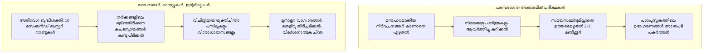
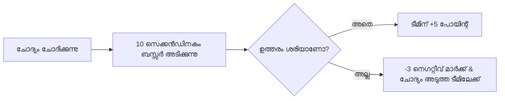
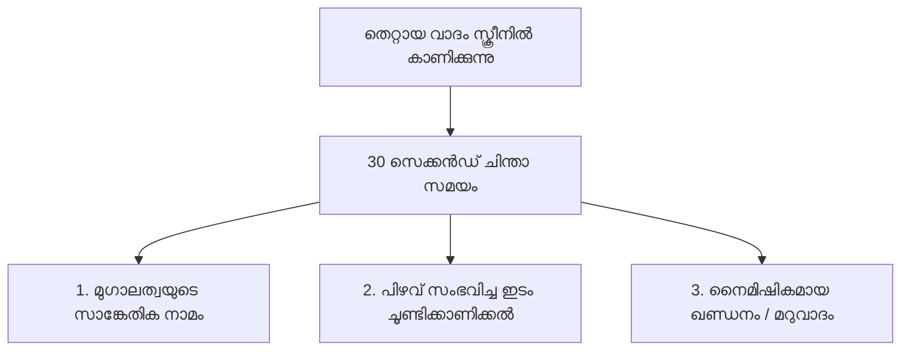
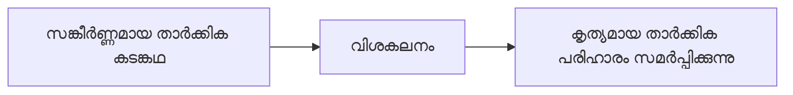
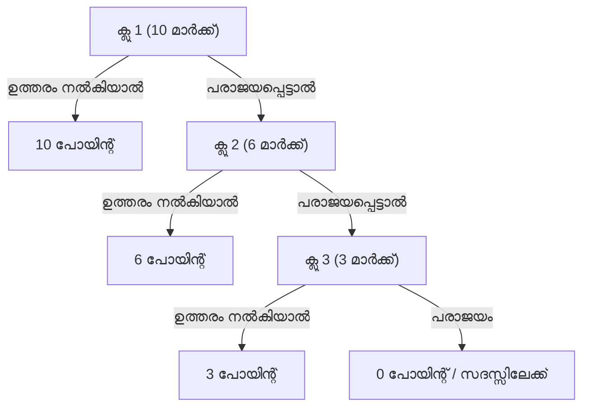
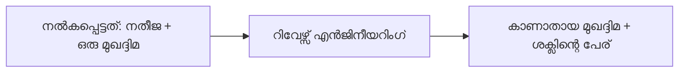
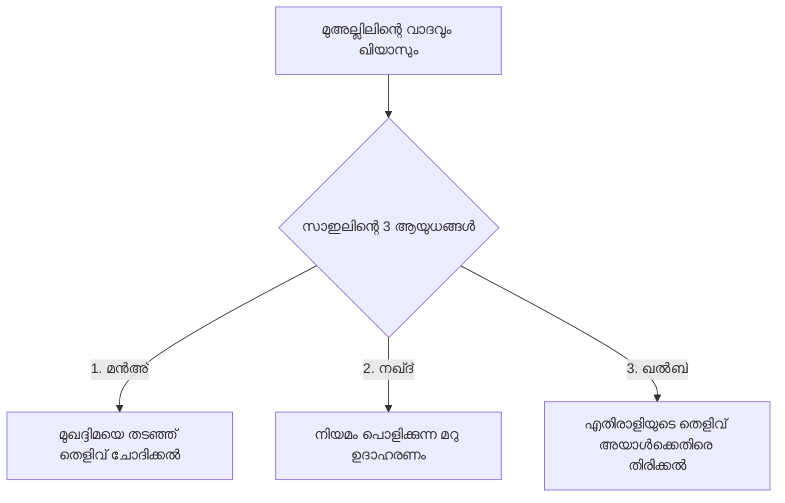
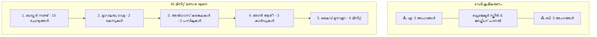

# മന്തിഖ് ഫെസ്റ്റ് & കോമ്പറ്റീഷൻ മാസ്റ്റർ ക്വസ്റ്റ്യൻ ബാങ്ക്
## The Master Mantiq Question Bank & Arena Manual (മലയാളം പതിപ്പ്)
### മത്സരങ്ങൾ, ക്വിസ് പോരാട്ടങ്ങൾ, ഫെസ്റ്റുകൾ, മുനാളറകൾ, അഭിമുഖങ്ങൾ (Interviews/Viva Voce) എന്നിവയ്ക്കുള്ള സമഗ്ര ഗൈഡ്

---

## ആമുഖം: അക്കാദമിക് പരീക്ഷകളും മത്സരവേദികളും തമ്മിലുള്ള വ്യത്യാസം
### Introduction: Academic Exams vs. Fest Competitions

പരമ്പരാഗതമായി മദ്റസകളിലും കോളേജുകളിലും നടക്കുന്ന **ക്ലാസ്സ് മുറി അക്കാദമിക് പരീക്ഷകളിൽ (Academic Exams)** നിന്നും ഏറെ വ്യത്യസ്തമാണ് **ഫെസ്റ്റുകളിലെയും (Arts/Academic Fests) മത്സരങ്ങളിലെയും (Contests/Quizzes) അഭിമുഖങ്ങളിലെയും (Interviews)** ചോദ്യരീതികൾ:

| ഘടകം (Dimension) | അക്കാദമിക് പരീക്ഷ (Academic Exam) | മത്സരങ്ങൾ, ഫെസ്റ്റുകൾ, ഇന്റർവ്യൂകൾ (Fests & Interviews) |
|---|---|---|
| **ചോദ്യത്തിന്റെ സ്വഭാവം** | വിവരണം / നിർവചനം: «തസവ്വുറും തസ്ദീഖും നിർവചിക്കുക». | പ്രായോഗികം / നൈമിഷികം: «ഒരു രാഷ്ട്രീയ പ്രസംഗം കേൾപ്പിച്ച് 15 സെക്കൻഡിൽ അതിലെ യുക്തിദോഷം കണ്ടെത്താൻ ആവശ്യപ്പെടുന്നു». |
| **സമയ പരിധി** | വിശാലമായ സമയം (2 മുതൽ 3 മണിക്കൂർ വരെ). | അതീവ നിമിഷങ്ങൾ (5 മുതൽ 30 സെക്കൻഡ് വരെ; ബസ്സർ അമർത്തണം). |
| **ചിന്താരീതി** | ഓർത്തെടുക്കൽ (Passive Memory Retrieval). | വേഗത്തിലുള്ള താർക്കിക വിശകലനം (Active Logical Deduction & Fallacy Hunting). |
| **വേദി** | നിശബ്ദ പരീക്ഷാ ഹാൾ, പേനയും പേപ്പറും. | ലൈവ് സ്റ്റേജ്, സദസ്സ്, രണ്ട് ടീമുകൾ നേർക്കുനേർ പോരടിക്കുന്ന ബസ്സർ പോരാട്ടം. |
| **ലക്ഷ്യം** | കിതാബ് വായിച്ചു തീർത്തോ എന്ന് പരിശോധിക്കൽ. | മന്തിഖിന്റെ അന്തസ്സത്ത ജീവിതത്തിലും വാദങ്ങളിലും പ്രയോഗിക്കാനുള്ള വൈഭവം അളക്കൽ. |

---

## ഉള്ളടക്കം (Table of Contents)

1. [റൗണ്ട് 1: ബസ്സർ & റാപ്പിഡ് ഫയർ റൗണ്ട് (Rapid-Fire & Buzzer Round)](#1-റൗണ്ട്-1-ബസ്സർ--റാപ്പിഡ്-ഫയർ-റൗണ്ട്-rapid-fire--buzzer-round)
2. [റൗണ്ട് 2: മുഗാലത്വ വേട്ട / കപടന്യായങ്ങൾ പിടികൂടൽ (Spot the Fallacy Arena)](#2-റൗണ്ട്-2-മുഗാലത്വ-വേട്ട--കപടന്യായങ്ങൾ-പിടികൂടൽ-spot-the-fallacy-arena)
3. [റൗണ്ട് 3: അൽഗാസുകളും വിരോധാഭാസങ്ങളും (Logical Riddles & Paradoxes)](#3-റൗണ്ട്-3-അൽഗാസുകളും-വിരോധാഭാസങ്ങളും-logical-riddles--paradoxes)
4. [റൗണ്ട് 4: ക്രമാനുഗത ഡിഡക്ഷൻ — «ഞാൻ ആര്?» (Progressive Deduction — Who Am I?)](#4-റൗണ്ട്-4-ക്രമാനുഗത-ഡിഡക്ഷൻ--ഞാൻ-ആര്-progressive-deduction--who-am-i)
5. [റൗണ്ട് 5: ഒറ്റയാനെ കണ്ടെത്തുക — താർക്കിക കാരണസഹിതം (Odd-One-Out with Proof)](#5-റൗണ്ട്-5-ഒറ്റയാനെ-കണ്ടെത്തുക--താർക്കിക-കാരണസഹിതം-odd-one-out-with-proof)
6. [റൗണ്ട് 6: റിവേഴ്സ് ഖിയാസ് പസിലുകൾ (Reverse Syllogism Challenges)](#6-റൗണ്ട്-6-റിവേഴ്സ്-ഖിയാസ്-പസിലുകൾ-reverse-syllogism-challenges)
7. [റൗണ്ട് 7: മുനാളറ ക്രോസ്-എക്സാമിനേഷൻ (Munāẓara Cross-Examination Duel)](#7-റൗണ്ട്-7-മുനാളറ-ക്രോസ്-എക്സാമിനേഷൻ-munāẓara-cross-examination-duel)
8. [റൗണ്ട് 8: വൈവ, ഇന്റർവ്യൂ, ജഡ്ജിംഗ് പാനൽ ചോദ്യങ്ങൾ (Viva Voce & Interview Bank)](#8-റൗണ്ട്-8-വൈവ-ഇന്റർവ്യൂ-ജഡ്ജിംഗ്-പാനൽ-ചോദ്യങ്ങൾ-viva-voce--interview-bank)
9. [റൗണ്ട് 9: ഫെസ്റ്റ് സംഘാടകർക്കുള്ള സ്റ്റേജ് മാനുവൽ (Fest Blueprint & Competition Rules)](#9-റൗണ്ട്-9-ഫെസ്റ്റ്-സംഘാടകർക്കുള്ള-സ്റ്റേജ്-മാനുവൽ-fest-blueprint--competition-rules)

---

## 1. റൗണ്ട് 1: ബസ്സർ & റാപ്പിഡ് ഫയർ റൗണ്ട് (Rapid-Fire & Buzzer Round)
### റൗണ്ട് നിയമങ്ങൾ:
- **സമയം:** ഓരോ ചോദ്യത്തിനും പരമാവധി **10 സെക്കൻഡ്**.
- **രീതി:** ചോദ്യം കേട്ടയുടൻ ബസ്സർ (Buzzer) അമർത്തുക; അനുവാദം ലഭിച്ച ശേഷം മാത്രം ഉത്തരം പറയുക.
- **പോയിന്റ് നില:** ശരിയുത്തരത്തിന് **$+5$ പോയിന്റ്**, തെറ്റായ ഉത്തരത്തിന് **$-3$ നെഗറ്റീവ് മാർക്ക്** (ആലോചിക്കാതെ ബസ്സർ അടിക്കുന്നത് തടയാൻ).

---

### വർഗ്ഗീകരിച്ച ചോദ്യശേഖരം (Categorized Flash Questions):

#### എ. വേഗത്തിൽ വേർതിരിക്കുക: തസവ്വുറോ തസ്ദീഖോ? (Conception vs. Assent)
1. **ചോദ്യം:** «യാത്ര കഴിഞ്ഞെത്തിയ സൈദിന്റെ ഭൃത്യൻ» (غلام زيد القادم من السفر).
   - **ഉത്തരം:** **തസവ്വുർ** (മുറക്കബ് നാഖിസ് തഖ്‌യീദിയാണ്; വിധി പൂർണ്ണമാകാത്തതിനാൽ കേൾവിക്കാരന് മൗനം പാലിക്കാനാകില്ല).
2. **ചോദ്യം:** «ദൈവത്തിന് ഒരു പങ്കാളിയുണ്ട്» എന്ന അസാധ്യമായ സങ്കല്പം മനസ്സിൽ വരുന്നത്.
   - **ഉത്തരം:** **തസവ്വുർ** (ബാഹ്യലോകത്ത് അസാധ്യമായ കാര്യമാണെങ്കിലും ആ ആശയത്തിന്റെ അർത്ഥം മനസ്സിൽ വരുന്നത് വെറും തസവ്വുറാണ്; എന്നാൽ അത് ഉണ്ടെന്ന് വിശ്വസിച്ചാൽ തസ്ദീഖാകും).
3. **ചോദ്യം:** «ന്യായാധിപൻ കോടതിയിൽ എത്തിയോ?» എന്ന ചോദ്യവാചകം കേൾക്കുമ്പോൾ.
   - **ഉത്തരം:** **തസവ്വുർ** (ഇൻശാഇയ്യായ ചോദിക്കലുകൾക്ക് സത്യമോ കളവോ ഉണ്ടാകില്ല).
4. **ചോദ്യം:** «ത്രികോണത്തിന് നാല് വശങ്ങളുണ്ട്» എന്ന പ്രസ്താവന.
   - **ഉത്തരം:** **തസ്ദീഖ്** (ഇതൊരു തെറ്റായ/കളവായ വിധിയാണ്; കളവാണെങ്കിലും ഒരു ബന്ധത്തെ വിധിച്ചതിനാൽ അത് തസ്ദീഖ് തന്നെ).
5. **ചോദ്യം:** «സൈദ്», «നിൽക്കുന്നു» എന്നീ രണ്ടു പദങ്ങളും അവ തമ്മിലുള്ള ബന്ധവും വിധി നടത്തുന്നതിന് മുമ്പ് മനസ്സിൽ കാണുന്നത്.
   - **ഉത്തരം:** **തസവ്വുറുകൾ** (തസ്ദീഖിന്റെ ഘടകങ്ങളായ മൂന്ന് തസവ്വുറുകൾ: മൗദൂഅ്, മഹ്മൂൽ, നിസ്ബത്ത്).

#### ബി. വേഗത്തിൽ വേർതിരിക്കുക: ബദീഹിയോ നളരിയോ? (Immediate vs. Inferential)
6. **ചോദ്യം:** «ക്വാണ്ടം ഗ്രാവിറ്റി» അല്ലെങ്കിൽ «റൂഹിന്റെ യാഥാർത്ഥ്യം» മനസ്സിലാക്കൽ.
   - **ഉത്തരം:** **തസവ്വുർ നളരി** (ചിന്തയും ഗവേഷണവും ഇല്ലാതെ മനസ്സിലാകില്ല).
7. **ചോദ്യം:** «ഒന്ന് എന്നത് രണ്ടിന്റെ പകുതിയാണ്» എന്ന വിധി.
   - **ഉത്തരം:** **തസ്ദീഖ് ബദീഹി** (മനസ്സിന് അധിക ചിന്ത കൂടാതെ ഉടൻ ഗ്രഹിക്കാനാകുന്നത്).
8. **ചോദ്യം:** «$789,456$ എന്ന സംഖ്യയെ 3 കൊണ്ട് നിശ്ശേഷം ഹരിക്കാം» എന്ന വിധി.
   - **ഉത്തരം:** **തസ്ദീഖ് നളരി** (അക്കങ്ങൾ കൂട്ടി നോക്കുന്ന ചിന്തയും സമീകരണവും ആവശ്യമാണ്).
9. **ചോദ്യം:** «ചൂട്», «വേദന», «ഉണ്മ» എന്നിവ മനസ്സിൽ തോന്നുന്നത്.
   - **ഉത്തരം:** **തസവ്വുർ ബദീഹി** (നിർവചനങ്ങൾ കൂടാതെ തന്നെ പ്രകൃത്യാ മനസ്സിൽ തെളിയുന്നത്).

#### സി. ദലാലത്തുകളും നാലു നിസ്ബത്തുകളും (Signification & The 4 Ratios)
10. **ചോദ്യം:** «കാർ» എന്ന പദം അതിന്റെ «എഞ്ചിനെ» മാത്രം സൂചിപ്പിക്കുന്നത് ഏതു ദലാലത്താണ്?
    - **ഉത്തരം:** **ദലാലത്ത് തളമ്മുൻ (Inclusion)** (മുഴുവൻ അർത്ഥത്തിന്റെ ഭാഗത്തെ സൂചിപ്പിക്കുന്നു).
11. **ചോദ്യം:** ട്രാഫിക് സിഗ്നലിലെ ചുവപ്പു വെളിച്ചം «വാഹനം നിർത്തണം» എന്ന് സൂചിപ്പിക്കുന്നത് ഏതിനം ദലാലത്താണ്?
    - **ഉത്തരം:** **ഗൈർ ലഫ്ളിയ്യ വദ്ഇയ്യ (Non-verbal conventional)** (മനുഷ്യർ നിശ്ചയിച്ച അടയാളം).
12. **ചോദ്യം:** «പക്ഷി» (طائر), «കറുത്തത്» (أسود) എന്നീ ആശയങ്ങൾ തമ്മിലുള്ള താർക്കിക നിസ്ബത്ത് (അനുപാതം) എന്ത്?
    - **ഉത്തരം:** **ഉമൂമും ഖുസൂസും മിൻ വജ്ഹ് (Partial Overlap)** (കാക്കയിൽ രണ്ടും ഒന്നിക്കുന്നു; പ്രാവിലേക്ക് പക്ഷി മാത്രമായും, കരിയിലേക്ക് കറുപ്പ് മാത്രമായും പിരിയുന്നു).
13. **ചോദ്യം:** «വാൾ» (سيف), «മുഹന്നദ്» (مهند) എന്നിവ തമ്മിലുള്ള ബന്ധം?
    - **ഉത്തരം:** **തസാവി / തുല്യത (Identity / Synonymous)** (എല്ലാ വാളും മുഹന്നദും ഒരേ വസ്തുവിനെ കുറിക്കുന്നു).
14. **ചോദ്യം:** «നിർജ്ജീവ വസ്തു» (جماد), «ചിന്തിക്കുന്നത്» (ناطق) എന്നിവ തമ്മിലുള്ള ബന്ധം?
    - **ഉത്തരം:** **തബായുൻ കുല്ലി (Total Exclusion)** (രണ്ടും ഒരിക്കലും ഒന്നിൽ ചേരില്ല).

#### ഡി. ഖദിയ്യകളും അക്സും തനാഖുദും (Immediate Inferences)
15. **ചോദ്യം:** «ഹാളിലുള്ള എല്ലാ വിദ്യാർത്ഥികളും സമർത്ഥരാണ്» (മൗജിബ കുല്ലിയ്യ) എന്നതിന്റെ തനാഖുദ് (വിപരീതം/നഖീദ്) എന്താണ്?
    - **ഉത്തരം:** **«ഹാളിലുള്ള ചില വിദ്യാർത്ഥികൾ സമർത്ഥരല്ല» (സാലിബ ജുസ്ഇയ്യ)** (A യുടെ നഖീദ് O ആണ്).
16. **ചോദ്യം:** «എല്ലാ മനുഷ്യരും ജീവികളാണ്» (മൗജിബ കുല്ലിയ്യ) എന്നതിന്റെ അക്‌സ് മുസ്തവി എന്ത്?
    - **ഉത്തരം:** **«ചില ജീവികൾ മനുഷ്യരാണ്» (മൗജിബ ജുസ്ഇയ്യ)** (മൗജിബ കുല്ലിയ്യ അതേപടി കുല്ലിയ്യയായി തിരിയില്ല, ജുസ്ഇയ്യയായെ തിരിയൂ).
17. **ചോദ്യം:** «ചില ജീവികൾ മനുഷ്യരല്ല» (സാലിബ ജുസ്ഇയ്യ) എന്നതിന്റെ അക്‌സ് മുസ്തവി എന്താണ്?
    - **ഉത്തരം:** **അക്‌സ് ഇല്ല (No valid conversion)** (സാലിബ ജുസ്ഇയ്യക്ക് അക്‌സ് സാധ്യമല്ല).
18. **ചോദ്യം:** «ഒരു സ്വർണ്ണവും ഇരുമ്പല്ല» (സാലിബ കുല്ലിയ്യ) എന്നതിന്റെ അക്‌സ് മുസ്തവി എന്താണ്?
    - **ഉത്തരം:** **«ഒരു ഇരുമ്പും സ്വർണ്ണമല്ല» (സാലിബ കുല്ലിയ്യ)** (സാലിബ കുല്ലിയ്യ സാലിബ കുല്ലിയ്യയായി തന്നെ തിരിയും).

#### ഇ. ഖിയാസും അശ്കാലുകളും (Syllogisms & Figures)
19. **ചോദ്യം:** രണ്ട് സാലിബയായ (നിഷേധപരമായ) മുഖദ്ദിമകളിൽ നിന്നുള്ള ഖിയാസിന്റെ നതീജ എന്തായിരിക്കും?
    - **ഉത്തരം:** **അഖീം / യാതൊരു ഫലവും ലഭിക്കില്ല (Invalid)** (രണ്ട് സാലിബകളിൽ നിന്ന് നതീജ കിട്ടില്ല).
20. **ചോദ്യം:** ഒന്നാം ശക്ലിൽ സുഗ്റ ജുസ്ഇയ്യയായാൽ ഖിയാസ് സ്വഹീഹാകുമോ?
    - **ഉത്തരം:** **ഇല്ല, അഖീം ആണ്** (ഒന്നാം ശക്ലിന്റെ നിബന്ധന: സുഗ്റ മൗജിബയാവണം, കുബ്റ കുല്ലിയ്യയാവണം).
21. **ചോദ്യം:** രണ്ട് മുഖദ്ദിമകളിലും ആവർത്തിച്ചു വരികയും നതീജയിൽ അപ്രത്യക്ഷമാവുകയും ചെയ്യുന്ന പദത്തിന് എന്തു പറയുന്നു?
    - **ഉത്തരം:** **ഹദ്ദുൽ ഔസഥ് (Middle Term)**.
22. **ചോദ്യം:** ഹംലിയ്യ ഖിയാസിന് എത്ര ശക്ലുകളുണ്ട്? ഏതിന്റെ അടിസ്ഥാനത്തിലാണ് അവ നിർണ്ണയിച്ചത്?
    - **ഉത്തരം:** **4 ശക്ലുകൾ**; മുഖദ്ദിമകളിൽ **ഹദ്ദുൽ ഔസഥ് വരുന്ന സ്ഥാനം** (മൗദൂഅ്/മഹ്മൂൽ) നോക്കിയാണ് തിരിക്കുന്നത്.

---

## 2. റൗണ്ട് 2: മുഗാലത്വ വേട്ട / കപടന്യായങ്ങൾ പിടികൂടൽ (Spot the Fallacy Arena)
### റൗണ്ടിന്റെ രീതി:
ഒരു സമകാലിക സംവാദ രംഗമോ തെറ്റായ വാദപ്രസ്താവനയോ പ്രൊജക്ടറിൽ പ്രദർശിപ്പിക്കുന്നു. മത്സരാർത്ഥി **30 സെക്കൻഡിനകം**:
1. മുഗാലത്വയുടെ (Fallacy) സാങ്കേതിക നാമം പറയണം.
2. ആ വാദത്തിലെ താർക്കിക തകരാർ എവിടെയാണെന്ന് വ്യക്തമാക്കണം.
3. അതിനെ ഖണ്ഡിക്കുന്ന മറുവാദം (Rebuttal) ഉന്നയിക്കണം.

---

### മത്സര വേദികളിലെ 6 മുഗാലത്വ കേസുകൾ:

#### കേസ് 1: ഇശ്തിറാകുൽ ലഫ്ള് / ചതുർപദ ദോഷം (Fallacy of Four Terms / Equivocation)
* **വാദ പ്രസ്താവന:**
  > «കണ്ണട എന്നത് കാഴ്ച ശക്തി വർദ്ധിപ്പിക്കാനുള്ള ഉപകരണമാണ്. എന്റെ മുത്തശ്ശി കണ്ണിന് തിമിരം വന്ന് അടഞ്ഞ അവസ്ഥയിലാണ്; അതിനാൽ മുത്തശ്ശി കണ്ണടയാണ്!»
  > അല്ലെങ്കിൽ ക്ലാസിക്കൽ ഉദാഹരണം: «ഇരുമ്പ് കഠിനമായ ലോഹമാണ്. സൽമാന്റെ ഹൃദയം ഇരുമ്പാണ്; അതിനാൽ സൽമാന്റെ ഹൃദയം ഭൂമിയിൽ നിന്ന് കുഴിച്ചെടുത്ത ലോഹമാണ്!»
* **മത്സരാർത്ഥിയുടെ വിശകലനം:**
  * **മുഗാലത്വയുടെ പേര്:** **ഇശ്തിറാകുൽ ലഫ്ള് (Equivocation)** വഴിയുണ്ടാകുന്ന **ചതുർപദ ദോഷം (Four Terms Fallacy)**.
  * **താർക്കിക തകരാർ:** ഖിയാസിൽ ബാഹ്യമായി മൂന്ന് പദങ്ങളുണ്ടെന്ന് തോന്നുമെങ്കിലും, ഹദ്ദുൽ ഔസഥ് ആയ "ഇരുമ്പ്" അല്ലെങ്കിൽ "കണ്ണട" രണ്ട് മുഖദ്ദിമകളിലും രണ്ട് തികച്ചും വ്യത്യസ്തമായ അർത്ഥങ്ങളിലാണ് ഉപയോഗിച്ചിരിക്കുന്നത് (യഥാർത്ഥ ലോഹം / കഠിന്യത്തെ കുറിക്കുന്ന അലങ്കാരം). ഹദ്ദുൽ ഔസഥിന് ഒരേ അർത്ഥമില്ലാത്തതിനാൽ ഇവിടെ യഥാർത്ഥത്തിൽ 4 പദങ്ങളുണ്ടായി, അതിനാൽ ബന്ധം തകർന്നു.
  * **മറുപടി:** «ഹദ്ദുൽ ഔസഥ് ഒരേ അർത്ഥത്തിലല്ല ഉപയോഗിച്ചത്; അലങ്കാരാർത്ഥത്തെ യഥാർത്ഥാർത്ഥവുമായി കൂട്ടിക്കലർത്തി».

---

#### കേസ് 2: ഹദ്ദുൽ ഔസഥ് വ്യാപിപ്പിക്കാത്ത പിഴവ് (Fallacy of the Undistributed Middle)
* **വാദ പ്രസ്താവന:**
  > «എല്ലാ തീവ്രവാദികളും കടുത്ത ആശയങ്ങൾ ഉള്ളവരാണ്. ചില പരിഷ്കരണവാദികളും കടുത്ത ആശയങ്ങൾ ഉള്ളവരാണ്; അതിനാൽ ചില പരിഷ്കരണവാദികൾ തീവ്രവാദികളാണ്!»
* **മത്സരാർത്ഥിയുടെ വിശകലനം:**
  * **മുഗാലത്വയുടെ പേര്:** **ഹദ്ദുൽ ഔസഥ് വ്യാപിപ്പിക്കാത്ത പിഴവ് (Undistributed Middle)** — രണ്ടാം ശക്ലിലെ തെറ്റ്.
  * **താർക്കിക തകരാർ:** ഈ ഖിയാസ് രണ്ടാം ശക്ലിലാണ് (ഹദ്ദുൽ ഔസഥ് ആയ "കടുത്ത ആശയങ്ങൾ ഉള്ളവർ" രണ്ട് മുഖദ്ദിമകളിലും മഹ്മൂലായി വന്നിരിക്കുന്നു). രണ്ടാം ശക്ലിന്റെ ഉൽപാദന നിബന്ധന **രണ്ട് മുഖദ്ദിമകളുടെ കൈഫിയ്യത്ത് വ്യത്യാസപ്പെടണം (ഒന്ന് മൗജിബയും മറ്റേത് സാലിബയുമാകണം)** എന്നതാണ്. എന്നാൽ ഇവിടെ രണ്ടും മൗജിബയാണ്! അതിനാൽ ഹദ്ദുൽ ഔസഥ് എല്ലാ വ്യക്തികളെയും ഉൾക്കൊള്ളുന്നില്ല; തീവ്രവാദികളുടെ കടുത്ത ആശയങ്ങളുടെ വൃത്തവും പരിഷ്കർത്താക്കളുടെ വൃത്തവും രണ്ട് വേറെയായിരിക്കാം.
  * **മറുപടി:** «രണ്ടാം ശക്ലിൽ രണ്ട് മൗജിബകളിൽ നിന്ന് നതീജ ഉണ്ടാവില്ല; കൈഫിയ്യത്തിൽ വ്യത്യാസമില്ലാത്തതിനാൽ ഖിയാസ് അഖീമാണ്».

---

#### കേസ് 3: മുസാദറ അലൽ മത്‌ലൂബ് (Begging the Question / Petitio Principii)
* **വാദ പ്രസ്താവന:**
  > «ഈ ചിന്തകൻ പറയുന്നത് മുഴുവൻ പരമസത്യമാണ്, കാരണം അദ്ദേഹം ഒരിക്കലും തെറ്റ് പറയാത്ത ആളാണ്. അദ്ദേഹം തെറ്റ് പറയാത്ത ആളാണെന്നതിന് തെളിവ് അദ്ദേഹം പറയുന്നതെല്ലാം പരമസത്യമാണ് എന്നതാണ്!»
* **മത്സരാർത്ഥിയുടെ വിശകലനം:**
  * **മുഗാലത്വയുടെ പേര്:** **മുസാദറ അലൽ മത്‌ലൂബ് (Begging the Question)** അല്ലെങ്കിൽ **ദൗർ (Circular Reasoning)**.
  * **താർക്കിക തകരാർ:** സ്ഥാപിക്കേണ്ട നതീജയെത്തന്നെ (അദ്ദേഹത്തിന്റെ വാക്കുകൾ സത്യമാണ് എന്നത്) വാദത്തിനുള്ള തെളിവായി സ്വീകരിച്ചു. വാക്കുകൾ മാറ്റിയതല്ലാതെ തെളിവും വാദവും ഒന്നുതന്നെയാണ്. തെളിവ് വാദത്തേക്കാൾ വ്യക്തവും സ്വതന്ത്രവുമായിരിക്കണം.
  * **മറുപടി:** «തെളിയിക്കപ്പെടേണ്ട വിഷയത്തെത്തന്നെ തെളിവായി എടുത്തിരിക്കുന്നു; വസ്തു സ്വയം തെളിവാകില്ല».

---

#### കേസ് 4: വ്യാജ വിഭജനം / കൃത്രിമ ദ്വന്ദം (False Dilemma in Munfasilah)
* **വാദ പ്രസ്താവന:**
  > «ഒന്നുകിൽ നിങ്ങൾ ഞങ്ങളുടെ ഈ നയത്തെ കണ്ണുമടച്ച് പൂർണ്ണമായി അനുകൂലിക്കണം; അല്ലെങ്കിൽ നിങ്ങൾ നാടിന്റെ ശത്രുവാണ്. നിങ്ങൾ ഞങ്ങളുടെ ടാക്സ് നയത്തെ എതിർക്കുന്നതിനാൽ നിങ്ങൾ നാടിന്റെ ശത്രുവാണ്!»
* **മത്സരാർത്ഥിയുടെ വിശകലനം:**
  * **മുഗാലത്വയുടെ പേര്:** **വ്യാജ വിഭജനം (False Dilemma)** / ഹഖീഖിയ്യത്തല്ലാത്ത ശർതിയ്യ മുൻഫസിലയെ ഹഖീഖിയ്യത്താക്കൽ.
  * **താർക്കിക തകരാർ:** വാദകൻ സമർപ്പിച്ചത് മാനിഅത്തുൽ ജംഇ വൽ ഖുലുവ്വ് ആയ (യഥാർത്ഥ ഹഖീഖിയ്യ) ഒന്നല്ല. ഇതിൽ മൂന്നാമതൊരു വഴിയുണ്ട്: ഒരാൾക്ക് നാടിനെ സ്നേഹിച്ചുകൊണ്ടുതന്നെ ഒരു പ്രത്യേക ടാക്സ് നയത്തിലെ പോരായ്മകളെ തിരുത്താൻ ആവശ്യപ്പെടാം. സാധ്യതകളെ കൃത്രിമമായി രണ്ടിലേക്ക് ചുരുക്കി എതിരാളിയെ കുടുക്കുകയാണിവിടെ.
  * **മറുപടി:** «ഇതൊരു വ്യാജ ദ്വന്ദമാണ്; എതിർപ്പ് രേഖപ്പെടുത്തുന്നവൻ നാടിന്റെ ശത്രുവാകണമെന്നില്ല, രാജ്യസ്നേഹിയായ വിമർശകനാകാം».

---

#### കേസ് 5: താലിയെ സ്ഥാപിച്ച് മുഖദ്ദമിനെ സമർത്ഥിക്കൽ (Affirming the Consequent)
* **വാദ പ്രസ്താവന:**
  > «മഴ പെയ്താൽ റോഡ് നനയും. ഇപ്പോൾ ദാ റോഡ് നനഞ്ഞിരിക്കുന്നു; അതിനാൽ ആകാശത്തുനിന്ന് മഴ പെയ്തിട്ടുണ്ട് എന്ന് ഉറപ്പിക്കാം!»
* **മത്സരാർത്ഥിയുടെ വിശകലനം:**
  * **മുഗാലത്വയുടെ പേര്:** **താലിയെ സ്ഥാപിക്കൽ തെറ്റ് (Affirming the Consequent)** — ശർതിയ്യ ഇസ്തിസ്നാഇയ്യയിലെ പിഴവ്.
  * **താർക്കിക തകരാർ:** മന്തിഖിലെ നിയമപ്രകാരം:
    - മുഖദ്ദമിനെ സ്ഥാപിച്ചാൽ താലി ഉണ്ടാകും (Modus Ponens).
    - താലിയെ ഇല്ലാതാക്കിയാൽ മുഖദ്ദം ഇല്ലാതാകും (Modus Tollens).
    - എന്നാൽ **താലിയെ സ്ഥാപിച്ചാൽ മുഖദ്ദം ഉണ്ടാകണമെന്ന് നിർബന്ധമില്ല**! കാരണം റോഡ് നനയാൻ വാട്ടർ അതോറിറ്റിയുടെ പൈപ്പ് പൊട്ടലോ, റോഡ് കഴുകിയതോ ആവാം കാരണം.
  * **മറുപടി:** «താലി എന്നത് മുഖദ്ദമിനേക്കാൾ പൊതുവായ കാര്യമാണ്; പൊതുവായത് ഉണ്ടായതുകൊണ്ട് പ്രത്യേക കാരണം തന്നെ ഉണ്ടായെന്ന് വാദിക്കാനാവില്ല».

---

#### കേസ് 6: മൗജിബ കുല്ലിയ്യയെ തെറ്റായി അക്സ് ചെയ്യൽ (Illicit Conversion)
* **വാദ പ്രസ്താവന:**
  > «എല്ലാ ശാസ്ത്രജ്ഞരും ബുദ്ധിമാന്മാരാണ്; അതിനാൽ എല്ലാ ബുദ്ധിമാന്മാരും ശാസ്ത്രജ്ഞരാണ്!»
* **മത്സരാർത്ഥിയുടെ വിശകലനം:**
  * **മുഗാലത്വയുടെ പേര്:** **മൗജിബ കുല്ലിയ്യയുടെ അസാധുവായ അക്സ് (Illicit Conversion)**.
  * **താർക്കിക തകരാർ:** മൗജിബ കുല്ലിയ്യ (A) അക്സ് ചെയ്യുമ്പോൾ **മൗജിബ ജുസ്ഇയ്യ (I) ആയി മാത്രമേ തിരിയൂ** (ചില ബുദ്ധിമാന്മാർ ശാസ്ത്രജ്ഞരാണ്). കാരണം മഹ്മൂൽ മൗദൂഇനേക്കാൾ വിശാലമായതാണ്. അതിനെ പൂർണ്ണമായി മാറ്റിയാൽ കവികളും ചിന്തകരും ഭരണാധികാരികളുമായ ബുദ്ധിമാന്മാർ ശാസ്ത്രജ്ഞരല്ലാത്തതിനാൽ വാദം പൊളിയും.
  * **മറുപടി:** «മൗജിബ കുല്ലിയ്യ കുല്ലിയ്യയായി അക്സ് ആകില്ല; ജുസ്ഇയ്യയായെ അക്സ് സാധ്യമാകൂ».

---

## 3. റൗണ്ട് 3: അൽഗാസുകളും വിരോധാഭാസങ്ങളും (Logical Riddles & Paradoxes)
### റൗണ്ടിന്റെ രീതി:
പുരാതന മന്തിഖ് ഗ്രന്ഥങ്ങളിലെയും തത്ത്വശാസ്ത്രങ്ങളിലെയും അതിസൂക്ഷ്മമായ കടങ്കഥകളും പസിലുകളും അവതരിപ്പിക്കുന്നു. മത്സരാർത്ഥികൾ ഇതിന്റെ ഗൂഢമായ താർക്കിക രഹസ്യം ചുരുളഴിയണം.

---

### ലഗസ് 1: സാലിബയായ സുഗ്റയിൽ നിന്ന് നതീജ തരുന്ന വിചിത്ര ഖിയാസ്!
* **കടങ്കഥ:**
  > മന്തിഖിലെ പ്രസിദ്ധമായ നിയമമാണ്: **«രണ്ട് സാലിബകളിൽ നിന്ന് നതീജ കിട്ടില്ല; ഒന്നാം ശക്ലിൽ സുഗ്റ സാലിബയായാൽ നതീജ കിട്ടില്ല»**.
  > എന്നാൽ അഹ്‌ലുൽ മന്തിഖ് ഒന്നാം ശക്ലിൽ ഒരു സുഗ്റയെ സാലിബയാക്കി വെച്ചിട്ടും, അതിൽ നിന്ന് തീർച്ചയായും സത്യമായ ഒരു നതീജ പുറത്തെടുത്തിട്ടുണ്ട്! അതെങ്ങനെ സാധ്യമായി?!
* **രഹസ്യ പരിഹാരം:**
  * ഇത് സംഭവിക്കുന്നത് **ശർതിയ്യ മുത്തസിലയിലെ ഖിയാസുകളിലാണ് (Hypothetical Syllogisms)**, അല്ലെങ്കിൽ **മുഹമ്മലാത്ത്/മൗജഹാത്ത്** ഖിയാസുകളിൽ.
  * **ഉദാഹരണം:**
    * **സുഗ്റ (സാലിബ കുല്ലിയ്യ മുത്തസില):** «ഒരു വസ്തു മനുഷ്യനാകുമ്പോഴൊക്കെ നിർജ്ജീവ വസ്തുവാകുക എന്നത് ഒരിക്കലുമില്ല» (ليس البتة إذا كان الشيء إنساناً كان جماداً).
    * **കുബ്റ (മൗജിബ കുല്ലിയ്യ മുത്തസില):** «ഒരു വസ്തു നിർജ്ജീവമാകുമ്പോഴൊക്കെ അതിന് ജീവനില്ലാത്തതാകും» (وكلما كان جماداً كان عديم الحس).
    * **നതീജ:** «ഒരു വസ്തു മനുഷ്യനാകുമ്പോഴൊക്കെ അതിന് ജീവനില്ലാത്തതാവുക എന്നത് ഉണ്ടാകണമെന്നില്ല» (قد لا يكون إذا كان الشيء إنساناً كان عديم الحس).
  * **താർക്കിക തത്വം:** ശർതിയ്യയിലെ സൽബ് എന്നത് ബാഹ്യവസ്തുവിന്റെ സൽബല്ല, മറിച്ച് രണ്ട് കാര്യങ്ങൾ തമ്മിലുള്ള ഒത്തുചേരലിനെ നിഷേധിക്കലാണ്. അതിനാൽ ഒന്നാം ശക്ലിലെ ശർതിയ്യാത്തിൽ ഇത് ഉൽപാദിപ്പിക്കും.

---

### ലഗസ് 2: സ്വന്തത്തിൽ കളവായ, എന്നാൽ അക്സ് ചെയ്താൽ പരമസത്യമാകുന്ന വാചകം!
* **കടങ്കഥ:**
  > സാധാരണയായി ഒരു വാചകം സത്യമായാൽ അതിന്റെ അക്സും സത്യമാകും. എന്നാൽ **സ്വന്തത്തിൽ പച്ചക്കള്ളമായ ഒരു വാചകം, അതിനെ നേരെ മന്തിഖിന്റെ നിയമപ്രകാരം അക്സ് മുസ്തവി ചെയ്യുമ്പോൾ അത് തർക്കമില്ലാത്ത പരമസത്യമായി മാറുന്നു!** അങ്ങനെയൊരു വാചകം ഉണ്ടാക്കാൻ കഴിയുമോ?
* **രഹസ്യ പരിഹാരം:**
  * **അതെ! മഹ്മൂൽ കൂടുതൽ പൊതുവായതായിട്ടുള്ള ഒരു കള്ള മൗജിബ കുല്ലിയ്യ എടുത്താൽ മതി!**
  * **ഉദാഹരണം:**
    * **യഥാർത്ഥ വാചകം (കളവ്):** «എല്ലാ ജീവികളും മനുഷ്യരാണ്» (كل حيوان إنسان) — ഇത് പച്ചക്കള്ളമാണ്; ആടും മാടും കുതിരയുമെല്ലാം ജീവികളാണ്, മനുഷ്യരല്ല.
    * **ഇതിന്റെ ശരിയായ അക്സ് മുസ്തവി:** «ചില മനുഷ്യർ ജീവികളാണ്» (بعض الإنسان حيوان) — ഇത് തർക്കമില്ലാത്ത പരമസത്യമാണ്! (മനുഷ്യരെല്ലാം ജീവികളാണ് എന്നിരിക്കെ ചിലർ ജീവികളാണ് എന്നതും സത്യമാണല്ലോ).
  * **താർക്കിക തത്വം:** വാചകം കളവാകുന്നത് കള്ളത്തരത്തിന്റെ ആധിക്യം കൊണ്ടാണ് (കുല്ലിയ്യ ആക്കിയത് വഴി). അക്സ് ചെയ്യുമ്പോൾ അത് ജുസ്ഇയ്യയായി മാറുന്നതിനാൽ കളവ് നീങ്ങി സത്യമായി മാറുന്നു!

---

### ലഗസ് 3: മനസ്സിൽ ജുസ്ഇയ്യും പുറത്ത് കുല്ലിയുമായി മാറുന്ന ആശയം!
* **കടങ്കഥ:**
  > സ്വന്തം മനസ്സിൽ സങ്കൽപ്പിക്കുമ്പോൾ അത് കേവലം ഒരു **ജുസ്ഇ** (ഏകവചനം) മാത്രമാണ്; എന്നാൽ പുറംലോകത്തെ വസ്തുക്കളിലേക്ക് നോക്കുമ്പോൾ അത് ലക്ഷക്കണക്കിന് ആളുകൾക്ക് യോജിക്കുന്ന **കുല്ലി**യുമാണ്! എന്താണത്?
* **രഹസ്യ പരിഹാരം:**
  * ഇതാണ് **«കുല്ലി മന്തിഖി» (Logical Universal)** അഥവാ «കുല്ലി എന്ന ആശയം».
  * **താർക്കിക തത്വം:** നിങ്ങളുടെ മനസ്സിൽ ഇപ്പോൾ രൂപപ്പെടുന്ന "കുല്ലി" എന്ന ചിത്രം നിങ്ങളുടെ മനസ്സിന്റെ ഒരു പ്രത്യേക അവസ്ഥയായതുകൊണ്ട് അതൊരു ജുസ്ഇയാണ്. എന്നാൽ ആ ആശയം മനുഷ്യരിലേക്കും കുതിരകളിലേക്കും ചേർക്കുമ്പോൾ അനവധി വസ്തുക്കൾക്ക് ചേരുന്നതുകൊണ്ട് അത് കുല്ലിയാകുന്നു. ഇതാണ് കുല്ലി ത്വബീഇ, കുല്ലി മന്തിഖി, കുല്ലി അഖ്‌ലി എന്നിവ തമ്മിലുള്ള വ്യത്യാസം.

---

### ലഗസ് 4: മുതലയുടെ വിരോധാഭാസം (The Crocodile Paradox)
* **കടങ്കഥ:**
  > നൈൽ നദിക്കരയിൽ നിന്ന് ഒരു മുതല ഒരമ്മയുടെ കുഞ്ഞിനെ തട്ടിയെടുത്തു. എന്നിട്ട് മുതല അമ്മയോട് പറഞ്ഞു: «ഞാൻ കുഞ്ഞിനെ എന്തു ചെയ്യാനാണ് പോകുന്നത് എന്ന് നീ കൃത്യമായി പ്രവചിച്ചാൽ കുഞ്ഞിനെ ഒരു പോറലുമേൽക്കാതെ തിരികെ തരാം; തെറ്റിച്ചാൽ ഞാൻ അതിനെ വിഴുങ്ങും!».
  > ബുദ്ധിമതിയായ അമ്മ പറഞ്ഞു: **«നീ എന്റെ കുഞ്ഞിനെ തിരികെ തരാതെ തിന്നാൻ പോകുന്നു!»**.
  > മുതല കുഴങ്ങിപ്പോയി; കുഞ്ഞിനെ തിന്നാനും പറ്റില്ല, വിട്ടുകൊടുക്കാനും പറ്റില്ല! എന്തുകൊണ്ടാണ് മുതല മന്തിഖിന്റെ കുരുക്കിൽ പെട്ടത്?
* **രഹസ്യ പരിഹാരം:**
  * **വിശകലനം:**
    - മുതല കുഞ്ഞിനെ തിന്നാൻ തീരുമാനിച്ചാൽ: അമ്മ പറഞ്ഞ പ്രവചനം സത്യമായി; സത്യമായാൽ വാഗ്ദാനപ്രകാരം കുഞ്ഞിനെ തിരികെ നൽകണം; തിരികെ നൽകിയാൽ പിന്നെ തിന്നാൻ പറ്റില്ല!
    - ഇനി മുതല കുഞ്ഞിനെ തിരികെ നൽകാൻ തീരുമാനിച്ചാൽ: അമ്മയുടെ പ്രവചനം തെറ്റി; തെറ്റിയാൽ വ്യവസ്ഥപ്രകാരം മുതല കുഞ്ഞിനെ തിന്നണം!
  * **താർക്കിക തത്വം:** ഇതൊരു **സ്വയം-ഖണ്ഡന വിരോധാഭാസമാണ് (Self-Referential Paradox)** ($P \leftrightarrow \neg P$). അടിസ്ഥാനപരമായ ഒരു നിബന്ധന സ്വന്തത്തിൽ തന്നെ പരസ്പരവിരുദ്ധമായാൽ (തനാഖുദ്) ആ വ്യവസ്ഥ അസാധുവാകുന്നു.

---

## 4. റൗണ്ട് 4: ക്രമാനുഗത ഡിഡക്ഷൻ — «ഞാൻ ആര്?» (Progressive Deduction — Who Am I?)
### മാർക്കിംഗ് ഘടന:
- **ഒന്നാം ക്ലൂ (10 മാർക്ക്):** അതീവ സങ്കീർണ്ണമായ താർക്കിക സൂചന.
- **രണ്ടാം ക്ലൂ (6 മാർക്ക്):** അല്പം കൂടി വ്യക്തമായ സൂചന.
- **മൂന്നാം ക്ലൂ (3 മാർക്ക്):** ഏവർക്കും എളുപ്പത്തിൽ പിടികിട്ടുന്ന വ്യക്തമായ സൂചന.

---

### കാർഡ് 1: ഞാൻ ആര്? (മന്തിഖിലെ സാങ്കേതിക പദം)
* **ക്ലൂ 1 (10 മാർക്ക്):** «ഞാൻ എന്റെ വിഷയത്തിന്റെ ദാത്തിൽ പെട്ടതാണ്; യാഥാർത്ഥ്യത്തിലും ചിന്തയിലും വിഷയത്തിൽ നിന്ന് എന്നെ വേർപെടുത്താനാവില്ല. എന്നാൽ ഞാൻ എന്റെ വിഷയത്തിന്റെ മുഴുവൻ യാഥാർത്ഥ്യമല്ല; എന്നെപ്പോലെയുള്ള മറ്റ് യാഥാർത്ഥ്യങ്ങളോട് ചേരുന്ന ഏറ്റവും പൊതുവായ ഭാഗമാണ് ഞാൻ».
* **ക്ലൂ 2 (6 മാർക്ക്):** «വ്യത്യസ്ത വർഗ്ഗങ്ങളിലുള്ള വസ്തുക്കളെ ഒന്നിച്ച് നിർത്തി "ഇത് എന്താണ്?" (മാ ഹുവ?) എന്ന് ചോദിച്ചാൽ ഉത്തരമായി പറയുന്ന പദമാണ് ഞാൻ».
* **ക്ലൂ 3 (3 മാർക്ക്):** «കുല്ലിയ്യാത്തുൽ ഖംസിലെ ആദ്യത്തെ ആളാണ് ഞാൻ. എന്റെ കൂടെ ഫസ്‌ല് ഖരീബ് ചേർത്താൽ നിങ്ങൾക്ക് ഹദ്ദ് താം ലഭിക്കും».
* **ഉത്തരം:** **ജിൻസ് (Genus / الجنس)**.

---

### കാർഡ് 2: ഞാൻ ആര്? (ഖിയാസിലെ ളർബ്)
* **ക്ലൂ 1 (10 മാർക്ക്):** «ലോകത്തിലെ മുഴുവൻ ഖിയാസുകളിലും വെച്ച് ഏറ്റവും ശ്രേഷ്ഠനും പൂർണ്ണനുമായ ആളാണ് ഞാൻ. എന്റെ നതീജയിലെ സത്യം തെളിയിക്കാൻ യാതൊരു തിരിച്ചുമറിക്കലോ പരോക്ഷ തെളിവോ ആവശ്യമില്ലാതെ നേരിട്ട് ബോധ്യപ്പെടുന്നതാണ്».
* **ക്ലൂ 2 (6 മാർക്ക്):** «എന്റെ സുഗ്റ മൗജിബ കുല്ലിയ്യയാണ്; എന്റെ കുബ്റയും മൗജിബ കുല്ലിയ്യയാണ്; എന്റെ ഹദ്ദുൽ ഔസഥ് സുഗ്റയിൽ മഹ്മൂലും കുബ്റയിൽ മൗദൂഉമാണ്».
* **ക്ലൂ 3 (3 മാർക്ക്):** «എന്റെ സമവാക്യം: (എല്ലാ ബി യും സി ആണ്, എല്ലാ സി യും ഡി ആണ് $\therefore$ എല്ലാ ബി യും ഡി ആണ്). എല്ലാ മന്തിഖ് പുസ്തകങ്ങളിലും അശ്കാലുകൾ തുടങ്ങുമ്പോൾ ആദ്യം എന്നെ പഠിപ്പിക്കുന്നു».
* **ഉത്തരം:** **ഒന്നാം ശക്ലിലെ ഒന്നാം ളർബ് (Barbara / الضرب الأول من الشكل الأول)**.

---

### കാർഡ് 3: ഞാൻ ആര്? (ചരിത്ര പുരുഷൻ)
* **ക്ലൂ 1 (10 മാർക്ക്):** «എനിക്ക് "ഹുജ്ജത്തുൽ ഇസ്‌ലാം" എന്ന് വിളിപ്പേരുണ്ട്. ഗ്രീക്ക് മന്തിഖിനെ ഇസ്‌ലാമിക കർമ്മശാസ്ത്രത്തിന്റെയും ഉസൂലുൽ ഫിഖ്ഹിന്റെയും ശൈലിയിലേക്ക് മാറ്റിയെഴുതിയ ആളാണ് ഞാൻ; "മഇയാറുൽ ഇൽമ്", "മിഹക്കുന്നളർ" എന്നിവ എന്റെ രചനകളാണ്».
* **ക്ലൂ 2 (6 മാർക്ക്):** «എന്റെ മാസ്റ്റർപീസ് ഉസൂൽ ഗ്രന്ഥമായ "അൽ-മുസ്തസ്ഫാ" ആരംഭിക്കുന്നത് പ്രശസ്തമായ ഒരു മന്തിഖ് ആമുഖത്തോടെയാണ്. അതിൽ ഞാൻ എഴുതി: "ഈ ശാസ്ത്രം അറിയാത്തവന്റെ അറിവിൽ യാതൊരു വിശ്വാസവുമില്ല!"».
* **ക്ലൂ 3 (3 മാർക്ക്):** «"ഇഹ്‌യാ ഉലൂമിദ്ദീൻ", "തഹാഫുതുൽ ഫലാസിഫ" എന്നിവ രചിച്ച മഹാപണ്ഡിതൻ».
* **ഉത്തരം:** **ഇമാം അബൂ ഹാമിദ് അൽ-ഗസ്സാലി (റഹിമഹുല്ലാഹ്)**.

---

## 5. റൗണ്ട് 5: ഒറ്റയാനെ കണ്ടെത്തുക — താർക്കിക കാരണസഹിതം (Odd-One-Out with Proof)
### റൗണ്ട് നിയമം:
നാല് പദങ്ങൾ നൽകും. ഒറ്റയാനെ കണ്ടെത്തിയാൽ മാത്രം പോരാ; **അത് എന്തുകൊണ്ട് ഒറ്റപ്പെട്ടു എന്നതിന്റെ കൃത്യമായ താർക്കിക കാരണം (Logical Proof)** വിശദീകരിക്കണം.

---

### ഗ്രൂപ്പ് 1: കുല്ലിയ്യാത്തുകൾ
* **പദങ്ങൾ:** [ മനുഷ്യൻ — കുതിര — സിംഹം — ജീവി (حيوان) ]
* **ഒറ്റയാൻ:** **ജീവി (ഹൈവാൻ)**.
* **താർക്കിക കാരണം:** മനുഷ്യൻ, കുതിര, സിംഹം എന്നിവയെല്ലാം ഒരേ തലത്തിലുള്ള **യഥാർത്ഥ നൗഉകൾ (Species)** ആണ്. എന്നാൽ "ജീവി" എന്നത് ഇവയെല്ലാം ഉൾക്കൊള്ളുന്ന **ജിൻസ് (Genus)** ആണ്.

---

### ഗ്രൂപ്പ് 2: അറിവിന്റെ ഉറവിടങ്ങൾ (മവാദത്തുൽ അഖ്‌യിസ)
* **പദങ്ങൾ:** [ അവ്വലിയ്യാത്ത് — മുതവാതിറാത്ത് — മുശാഹദാത്ത് — മഖ്ബൂലാത്ത് ]
* **ഒറ്റയാൻ:** **മഖ്ബൂലാത്ത് (Acceptances)**.
* **താർക്കിക കാരണം:** ആദ്യത്തെ മൂന്നെണ്ണവും (അവ്വലിയ്യാത്ത്, മുതവാതിറാത്ത്, മുശാഹദാത്ത്) സംശയമില്ലാത്ത സത്യം നൽകുന്ന **ബുർഹാന്റെ യഖീനിയ്യായ മൗലിക തെളിവുകളാണ്**. എന്നാൽ മഖ്ബൂലാത്ത് എന്നത് വ്യക്തികളിലുള്ള നല്ല ധാരണ കൊണ്ട് സ്വീകരിക്കുന്ന **ഖിതാബയിലും ജദലിലും** ഉപയോഗിക്കുന്ന ഊഹാധിഷ്ഠിത കാര്യമാണ്.

---

### ഗ്രൂപ്പ് 3: അക്സ് മുസ്തവി നിയമങ്ങൾ
* **പദങ്ങൾ:** [ മൗജിബ കുല്ലിയ്യ — മൗജിബ ജുസ്ഇയ്യ — സാലിബ കുല്ലിയ്യ — സാലിബ ജുസ്ഇയ്യ ]
* **ഒറ്റയാൻ:** **സാലിബ ജുസ്ഇയ്യ (Particular Negative)**.
* **താർക്കിക കാരണം:** ആദ്യത്തെ മൂന്ന് ഖദിയ്യകൾക്കും ക്രമപ്രകാരം **അക്സ് മുസ്തവി സാധ്യമാണ്**; എന്നാൽ **സാലിബ ജുസ്ഇയ്യക്ക് ഒരു നിലക്കും അക്സ് സാധ്യമല്ല**.

---

## 6. റൗണ്ട് 6: റിവേഴ്സ് ഖിയാസ് പസിലുകൾ (Reverse Syllogism Challenges)
### റൗണ്ടിന്റെ രീതി:
നതീജയും (Conclusion) ഒരു മുഖദ്ദിമയും തരും. മത്സരാർത്ഥി **കാണാതായ മുഖദ്ദിമ നിർമ്മിക്കുകയും, അത് ഏത് ശക്ലാണെന്ന് വ്യക്തമാക്കുകയും വേണം**.

---

### പസിൽ 1: രണ്ടാം ശക്ലിലെ മിസ്സിംഗ് ലിങ്ക്
* **ആവശ്യമായ നതീജ:** «ഒരു ആത്മാവും സംയുക്ത പദാർത്ഥമല്ല» (لا شيء من الروح بمادة مركبة).
* **നൽകപ്പെട്ട സുഗ്റ:** «എല്ലാ ആത്മാവും ഭൗതികമല്ലാത്ത ലളിത രൂപമാണ്» (كل روح مجردة وبسيطة).
* **കണ്ടുപിടിക്കേണ്ടത്:** കുബ്റയും ശക്ലും.
* **ഉത്തരം:**
  * **കാണാതായ കുബ്റ:** «ഒരു സംയുക്ത പദാർത്ഥവും ഭൗതികമല്ലാത്ത ലളിത രൂപമല്ല» (ولا شيء من المادة المركبة بمجرد وبسيط).
  * **ശക്ല്:** **രണ്ടാം ശക്ല് (Figure 2)**; ഹദ്ദുൽ ഔസഥ് ആയ "ഭൗതികമല്ലാത്ത ലളിത രൂപം" സുഗ്റയിലും കുബ്റയിലും മഹ്മൂലായി വന്നു.

---

### പസിൽ 2: മൂന്നാം ശക്ലിലെ മിസ്സിംഗ് ലിങ്ക്
* **ആവശ്യമായ നതീജ:** «ചില ലോഹങ്ങൾ അതീവ വിലപിടിപ്പുള്ളതാണ്» (بعض المعادن باهظ الثمن جداً).
* **നൽകപ്പെട്ട കുബ്റ:** «എല്ലാ പ്ലാറ്റിനവും അതീവ വിലപിടിപ്പുള്ളതാണ്» (كل بلاتين باهظ الثمن جداً).
* **കണ്ടുപിടിക്കേണ്ടത്:** സുഗ്റയും ശക്ലും.
* **ഉത്തരം:**
  * **കാണാതായ സുഗ്റ:** «എല്ലാ പ്ലാറ്റിനവും ലോഹമാണ്» (كل بلاتين معدن).
  * **ശക്ല്:** **മൂന്നാം ശക്ല് (Figure 3)**; ഹദ്ദുൽ ഔസഥ് ആയ "പ്ലാറ്റിനം" രണ്ട് മുഖദ്ദിമകളിലും മൗദൂആയി വന്നു. മൂന്നാം ശക്ലിന്റെ നതീജ എപ്പോഴും ജുസ്ഇയ്യയായിരിക്കും.

---

## 7. റൗണ്ട് 7: മുനാളറ ക്രോസ്-എക്സാമിനേഷൻ (Munāẓara Cross-Examination Duel)
### വേദിയിലെ ലൈവ് വാഗ്വാദം:
ഇരു ടീമുകളിൽ നിന്നും ഓരോരുത്തർ പോഡിയത്തിലേക്ക് വരുന്നു:
- **മുഅല്ലിൽ (Proponent):** 1 മിനിറ്റിൽ തന്റെ വാദവും അതിന്റെ ഖിയാസും അവതരിപ്പിക്കുന്നു.
- **സാഇൽ (Opponent):** മുനാളറയുടെ നിയമപ്രകാരം **3 ആയുധങ്ങൾ** ഉപയോഗിച്ച് അതിനെ തകർക്കുന്നു:
  1. **മൻഅ് (Interdiction):** ഒരു മുഖദ്ദിമയെ തടയുകയും തെളിവ് ചോദിക്കുകയും ചെയ്യുക.
  2. **നഖ്ദ് (Counter-Example):** വാദത്തിന്റെ പൊതുതത്വത്തെ തകർക്കുന്ന മറു ഉദാഹരണം കൊണ്ടുവരിക.
  3. **മുആറദ & ഖൽബ് (Counter-Argument):** എതിരാളിയുടെ തെളിവ് തിരിച്ച് അയാളുടെ മേൽ തന്നെ പ്രയോഗിക്കുക.

---

### മാതൃകാ ലൈവ് കേസ്: "നിർമ്മിത ബുദ്ധിയും (AI) മതവിധികളും"
* **മുഅല്ലിലിന്റെ വാദം:**
  > «ഫത്‌വ നൽകുന്നതിലും കോടതി വിധി പറയുന്നതിലും AI ഉപയോഗിക്കുന്നത് നിഷിദ്ധമാണ്.
  > കാരണം:
  > - **സുഗ്റ:** AI എന്നത് ചിന്താശേഷിയോ ആത്മാവോ ഇല്ലാത്ത കേവല അൽഗോരിതമാണ്.
  > - **കുബ്റ:** ആത്മാവോ മനസ്സാക്ഷിയോ ഇല്ലാത്ത വസ്തുക്കളെ വിധിതീർപ്പുകളിൽ ഉപയോഗിക്കുന്നത് നിഷിദ്ധമാണ്.
  > - **നതീജ:** അതിനാൽ AI ഉപയോഗം നിഷിദ്ധമാണ്».

* **സാഇലിന്റെ ആക്രമണം (മറുപടികൾ):**
  * **ആയുധം 1 (മൻഅ്):** «ഞാൻ നിങ്ങളുടെ കുബ്റയെ മൻഅ് ചെയ്യുന്നു. ഫത്‌വക്കും കോടതിക്കും വിവരങ്ങൾ ക്രോഡീകരിക്കാൻ മനസ്സാക്ഷി വേണമെന്ന് എവിടെയാണ് ഉള്ളത്? രേഖകൾ പരിശോധിക്കാൻ മനസ്സാക്ഷി വേണമെന്നതിന് തെളിവെന്ത്?».
  * **ആയുധം 2 (നഖ്ദ്):** «നിങ്ങളുടെ കുബ്റയെ ഞാൻ നഖ്ദ് ചെയ്യുന്നു. അച്ചടിച്ച ഫിഖ്ഹ് കിതാബുകൾക്കും സെർച്ച് എൻജിനുകൾക്കും മനസ്സാക്ഷിയില്ല; എന്നാൽ അവ ഉപയോഗിച്ച് മസ്അലകൾ കണ്ടെത്തുന്നത് പണ്ഡിതന്മാർ അനുവദിച്ചിട്ടുണ്ടല്ലോ; അപ്പോൾ നിങ്ങളുടെ പൊതുവാദം പൊളിഞ്ഞു».
  * **ആയുധം 3 (ഖൽബ് - തെളിവ് തിരിച്ചടിക്കൽ):** «ഞാൻ നിങ്ങളുടെ തെളിവ് നിങ്ങൾക്ക് നേരെ തിരിക്കുന്നു: AI ക്ക് സ്വന്തമായി വികാരങ്ങളോ കൈക്കൂലി വാങ്ങാനുള്ള മനസ്സോ പക്ഷപാതമോ ഇല്ല; വികാരവും ദേഷ്യവുമില്ലാതെ വസ്തുതകൾ നിരത്താൻ സഹായിക്കുന്ന വസ്തുക്കൾ ന്യായാധിപന് ഏറ്റവും അനുയോജ്യമാണ്; അതിനാൽ AI ഉപയോഗിക്കുന്നത് അനുവദനീയമാണ്!».

---

## 8. റൗണ്ട് 8: വൈവ, ഇന്റർവ്യൂ, ജഡ്ജിംഗ് പാനൽ ചോദ്യങ്ങൾ (Viva Voce & Interview Bank)
### ലക്ഷ്യം:
ഉപരിപഠന പ്രവേശന പരീക്ഷകൾ, അധ്യാപക ഇന്റർവ്യൂകൾ, ഫെസ്റ്റിലെ "ബെസ്റ്റ് പേഴ്സൺ" ഗ്രാന്റ് ഫിനാലെ എന്നിവയിലെ ഗഹനമായ ചോദ്യങ്ങൾ.

---

### ചോദ്യം 1: ആർട്ടിഫിഷ്യൽ ഇന്റലിജൻസും തസ്ദീഖും
* **ചോദ്യം:**
  > «മന്തിഖിലെ എല്ലാ സമവാക്യങ്ങളും പിഴവുകളില്ലാതെ സെക്കൻഡുകൾക്കകം സോൾവ് ചെയ്യുന്ന ഒരു സൂപ്പർ കമ്പ്യൂട്ടറിന് പരമ്പരാഗത മന്തിഖിലെ അർത്ഥത്തിലുള്ള യഥാർത്ഥ "തസ്ദീഖ്" (Assent/Belief) ഉണ്ടെന്ന് പറയാൻ കഴിയുമോ? കമ്പ്യൂട്ടറും മനുഷ്യനും തമ്മിലുള്ള താർക്കിക അന്തരമെന്ത്?»
* **ഉത്തരം:**
  * **ഇല്ല, കമ്പ്യൂട്ടറിന് തസ്ദീഖ് ഇല്ല; ഉള്ളത് സിന്റാക്സ് പ്രോസസ്സിംഗ് (Syntactic Manipulation) മാത്രമാണ്.**
  * തസ്ദീഖ് എന്നത് കേവലം അക്ഷരങ്ങൾ അടുക്കിവെക്കലല്ല; മറിച്ച് വസ്തുതയുടെ പൊരുൾ അറിഞ്ഞ് മനസ്സ് അതിലേക്ക് ചായുന്നതാണ് (ഇദ്ആൻ / الإذعان النفسي).
  * ജോൺ സിയോളിന്റെ "ചൈനീസ് റൂം" (Chinese Room Argument) ഉപമ പോലെ, കമ്പ്യൂട്ടർ അർത്ഥമറിയാതെ ചിഹ്നങ്ങൾ മാറ്റിവെക്കുക മാത്രമാണ് ചെയ്യുന്നത്.

---

### ചോദ്യം 2: ഇമാം ഇബ്നു തൈമിയ്യയുടെ മന്തിഖ് വിമർശനം
* **ചോദ്യം:**
  > «ഇമാം ഇബ്നു തൈമിയ്യ "റദ്ദു അലൽ മൻതിഖിയ്യീൻ" എന്ന ഗ്രന്ഥത്തിൽ മന്തിഖിലെ "ഹദ്ദ് താം" (നിർവചനം) എന്ന സിദ്ധാന്തത്തെ നിശിതമായി വിമർശിച്ചിട്ടുണ്ട്. ഇതിനെ നിങ്ങൾ എങ്ങനെ നോക്കിക്കാണുന്നു?»
* **ഉത്തരം:**
  * ഇബ്നു തൈമിയ്യയുടെ വാദം: ഒരു വസ്തുവിന്റെ അന്തസ്സത്തയായ 'ഫസ്‌ല്' കൃത്യമായി വേർതിരിച്ചെടുക്കുക മനുഷ്യന് അസാധ്യമാണ്. മനുഷ്യർ വസ്തുക്കളെ തിരിച്ചറിയുന്നത് ലക്ഷണങ്ങളും സവിശേഷതകളും (റസ്മ് / ഖാസ്സ) വഴിയാണ്.
  * മന്തിഖിന്റെ പ്രതിരോധം: പണ്ഡിതന്മാർ തന്നെ വ്യക്തമാക്കിയിട്ടുണ്ട് "ഹദ്ദ് താം രൂപീകരിക്കൽ അതീവ ദുഷ്കരമാണ്" എന്ന്. എങ്കിലും പൂർണ്ണമായ തത്ത്വചിന്താപരമായ അന്വേഷണങ്ങളിൽ ഒരു ആദർശ മാതൃകയായി (Ideal Standard) ഹദ്ദ് താം നിലനിൽക്കേണ്ടതുണ്ട്.

---

### ചോദ്യം 3: ഇമാം ഗസ്സാലിയുടെ വിഖ്യാത പ്രഖ്യാപനം
* **ചോദ്യം:**
  > «"മന്തിഖ് വശമില്ലാത്തവന്റെ അറിവിൽ യാതൊരു വിശ്വാസവുമില്ല" എന്ന് ഇമാം ഗസ്സാലി പറഞ്ഞതിന്റെ യഥാർത്ഥ താത്പര്യമെന്ത്? മന്തിഖ് പഠിക്കാത്ത മുൻകാല സ്വഹാബികളുടെ അറിവ് അപൂർണ്ണമാണെന്നാണോ ഇതിനർത്ഥം?»
* **ഉത്തരം:**
  * അല്ല; മുൻകാല മഹാന്മാർക്ക് തെളിഞ്ഞ ബുദ്ധിയും ശുദ്ധമായ ഭാഷാപ്രകൃതിയും (സലീഖത്ത്) ഉണ്ടായിരുന്നു. അവർ സ്വാഭാവികമായിത്തന്നെ തെറ്റുകളിൽ നിന്ന് സുരക്ഷിതരായിരുന്നു.
  * എന്നാൽ പിൽക്കാലത്ത് ഭാഷയും ചിന്തയും കലർപ്പുള്ളതായപ്പോൾ, ചിന്തയിലെ തെറ്റുകൾ തിരിച്ചറിയാൻ മന്തിഖ് എന്ന ഉപകരണം (ആലത്ത്) കൂടിയേ തീരൂ എന്ന നില വന്നു. അതിനാലാണ് ഗസ്സാലി ഇമാം ഇതിനെ ചിന്തയുടെ ഉരകല്ലായി പ്രഖ്യാപിച്ചത്.

---

## 9. റൗണ്ട് 9: ഫെസ്റ്റ് സംഘാടകർക്കുള്ള സ്റ്റേജ് മാനുവൽ (Fest Blueprint & Competition Rules)

---

### മാർക്ക് വിതരണ പട്ടിക (Score Sheet - Total 120 Marks):

| റൗണ്ട് | ഇനം | ചോദ്യങ്ങളുടെ എണ്ണം | സമയം | മാർക്ക് ഘടന |
|:---:|---|:---:|:---:|:---:|
| **1** | **ബസ്സർ റൗണ്ട്** | 10 ചോദ്യങ്ങൾ | ചോദ്യത്തിന് 10 സെക്കൻഡ് | $+5$ ശരിക്ക് / $-3$ തെറ്റിന് |
| **2** | **മുഗാലത്വ വേട്ട** | 2 കേസുകൾ | കേസിന് 45 സെക്കൻഡ് | 10 മാർക്ക് വീതം (ആകെ 20) |
| **3** | **അൽഗാസ് പസിലുകൾ** | 2 കടങ്കഥകൾ | 60 സെക്കൻഡ് | 15 മാർക്ക് വീതം (ആകെ 30) |
| **4** | **ഞാൻ ആര്?** | 3 കാർഡുകൾ | 3 ക്ലൂകൾ | 10 / 6 / 3 (പരമാവധി 30) |
| **5** | **ലൈവ് മുനാളറ** | 1 വിഷയം | 6 മിനിറ്റ് | 25 മാർക്ക് |
| **ആകെ** | **ഗ്രാൻഡ് ഫിനാലെ** | **സമഗ്രം** | **45 മിനിറ്റ്** | **120 മാർക്ക്** |

> [!TIP]
> **ടൈ-ബ്രേക്കർ ഗോൾഡൻ ക്വസ്റ്റ്യൻ (Golden Tie-Breaker):** രണ്ട് ടീമുകളും തുല്യ പോയിന്റിൽ എത്തിയാൽ, മൂന്നാം ശക്ലിലെ ഒരു സങ്കീർണ്ണ ഖിയാസിന്റെ അക്സ് സംബന്ധിച്ച് ഒരു ഗോൾഡൻ ചോദ്യം ചോദിക്കുക. ആദ്യം ബസ്സർ അടിച്ച് പൂർണ്ണമായി സമർത്ഥിക്കുന്ന ടീമിനെ വിജയിയായി പ്രഖ്യാപിക്കുക.

---

## ഫയൽ ലിങ്കുകൾ (Related Project Files)

- അറബിക്-ഇംഗ്ലീഷ് മാസ്റ്റർ ഫയൽ: [Mantiq-Fest-Competition-Quiz-Bank.md](file:///Users/apple/Desktop/docs:books/Kanz-al-Tahqiq/Texts/Mantiq/Mantiq-Fest-Competition-Quiz-Bank.md)
- തസ്‌രീഹുൽ മന്തിഖ് സമ്പൂർണ്ണ മലയാളം പഠനസഹായി: [Tasrih-al-Mantiq-note-Ml.md](file:///Users/apple/Desktop/docs:books/Kanz-al-Tahqiq/Texts/Mantiq/tasrih-al-mantiq/Notes/Tasrih-al-Mantiq-note-Ml.md)
- മൂന്ന് ഭാഷകളിലുള്ള സമഗ്ര പദാവലി (Arabic-English-Malayalam): [Tasrih-al-Mantiq-Complete-Glossary.md](file:///Users/apple/Desktop/docs:books/Kanz-al-Tahqiq/Texts/Mantiq/tasrih-al-mantiq/Notes/Tasrih-al-Mantiq-Complete-Glossary.md)
- നാല് തലങ്ങളിലുള്ള പ്രായോഗിക ഉദാഹരണങ്ങൾ: [Tasrih-al-Mantiq-Examples.md](file:///Users/apple/Desktop/docs:books/Kanz-al-Tahqiq/Texts/Mantiq/tasrih-al-mantiq/Notes/Tasrih-al-Mantiq-Examples.md)
- ഫെസ്റ്റ് ജനറൽ മാനുവൽ: [manual.md](file:///Users/apple/Desktop/docs:books/Kanz-al-Tahqiq/Fest/velichathirutt/manual.md)
