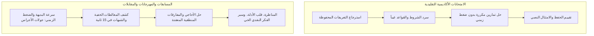
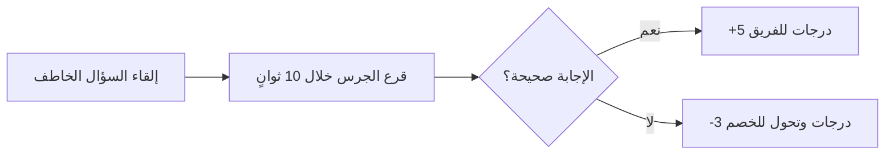
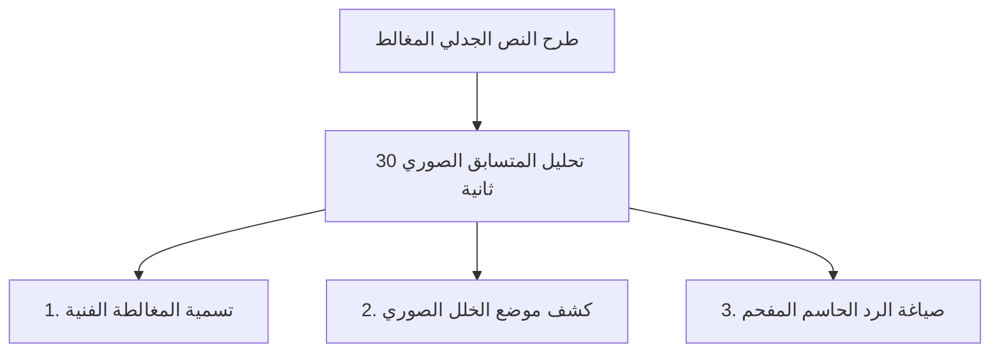
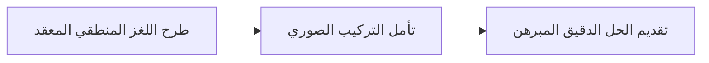
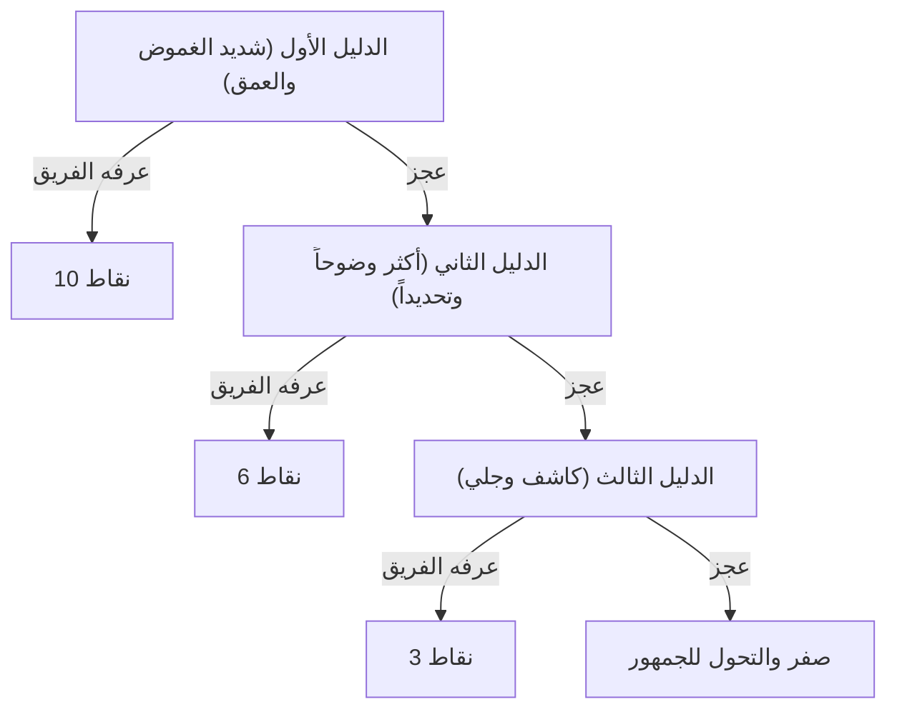
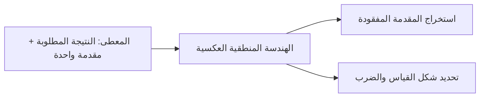
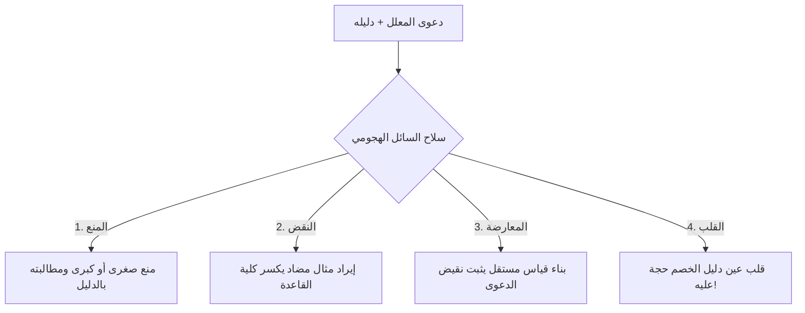
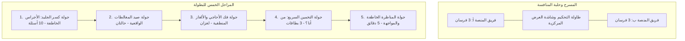

# موسوعة المسابقات والمهرجانات والمقابلات في علم المنطق
## The Master Mantiq Question Bank & Arena Manual
### For Competitions, Quiz Duels, Fests, Debates, Viva Voce & Intellectual Interviews

---

## مقدمة الموسوعة: المنطق التنافسي في مواجهة المنطق الأكاديمي
### Foreword: Competitive Logic vs. Academic Examinations

يختلف **المنطق التنافسي في المهرجانات والمنافسات والمقابلات (Contest & Fest Logic)** جوهرياً عن **الامتحانات المدرسية والأكاديمية التقليدية (Academic Exams)**:

| البُعْد (Dimension) | الامتحان الأكاديمي (Academic Exam) | المسابقات والمهرجانات والمقابلات (Fests & Interviews) |
|---|---|---|
| **طبيعة السؤال** | مقالي / تعريفي: «عرّف التصور واذكر أقسامه». | تطبيقي / نقدي: «أمامك خطاب سياسي/فلسفي، استخرج المغالطة الصورية في 10 ثوانٍ». |
| **عامل الوقت** | مريح وممتد (ساعتان إلى 3 ساعات). | حاسم ومكثف (أجراس، 5 إلى 30 ثانية لكل سؤال، أسئلة خاطفة). |
| **طريقة التفكير** | استدعاء واستظهار (Passive Retrieval). | تحليل سريع، تفنيد، وعكس القضايا ذهنياً (Active Deduction). |
| **الجمهور والبيئة** | صامت، ورقة وقلم، تصحيح فردي مغلق. | منصة، جمهور، جولات مبارزة ثنائية (Prompting Duel)، ولجان تحكيم فورية. |
| **المستهدف** | التأكد من قراءة الكتاب المقرر وفهم مصطلحاته. | قياس عمق الملكة المنطقية، الحضور الذهني، والقدرة على المحاجة وإفحام الخصم. |

---

## فهرس أبواب الموسوعة (Table of Contents)

1. [الجولة الأولى: جولة الأجراس والأسئلة الخاطفة (Rapid-Fire & Buzzer Round)](#1-الجولة-الأولى-جولة-الأجراس-والأسئلة-الخاطفة-rapid-fire--buzzer-round)
2. [الجولة الثانية: قناص المغالطات وتحليل الحجج الزائفة (Spot the Fallacy Arena)](#2-الجولة-الثانية-قناص-المغالطات-وتحليل-الحجج-الزائفة-spot-the-fallacy-arena)
3. [الجولة الثالثة: ألغاز المناطقة، الأحاجي، والمفارقات الكبرى (Logical Riddles & Paradoxes)](#3-الجولة-الثالثة-ألغاز-المناطقة-الأحاجي-والمفارقات-الكبرى-logical-riddles--paradoxes)
4. [الجولة الرابعة: التخمين التراكمي — «من أنا؟» (Progressive Deduction Clues)](#4-الجولة-الرابعة-التخمين-التراكمي--من-أنا-progressive-deduction-clues)
5. [الجولة الخامسة: استخراج العنصر الشاذ مع التعليل الصوري (Odd-One-Out with Proof)](#5-الجولة-الخامسة-استخراج-العنصر-الشاذ-مع-التعليل-الصوري-odd-one-out-with-proof)
6. [الجولة السادسة: ألغاز بناء القياس وتكملة المقدمة المفقودة (Reverse Syllogism Challenges)](#6-الجولة-السادسة-ألغاز-بناء-القياس-وتكملة-المقدمة-المفقودة-reverse-syllogism-challenges)
7. [الجولة السابعة: محاكاة المناظرة وإفحام الخصم (Munāẓara Cross-Examination Duel)](#7-الجولة-السابعة-محاكاة-المناظرة-وإفحام-الخصم-munāẓara-cross-examination-duel)
8. [الجولة الثامنة: بنك أسئلة المقابلات الشخصية، السبر الفكري، ولجان التحكيم (Viva Voce & Interview Bank)](#8-الجولة-الثامنة-بنك-أسئلة-المقابلات-الشخصية-السبر-الفكري-ولجان-التحكيم-viva-voce--interview-bank)
9. [الجولة التاسعة: دليل تشغيل وإدارة مسابقة المنطق في المهرجانات الطلابية (Fest Blueprint & Rules)](#9-الجولة-التاسعة-دليل-تشغيل-وإدارة-مسابقة-المنطق-في-المهرجانات-الطلابية-fest-blueprint--rules)

---

## 1. الجولة الأولى: جولة الأجراس والأسئلة الخاطفة (Rapid-Fire & Buzzer Round)
### قواعد الجولة:
- **الزمن:** 10 ثوانٍ كحد أقصى لكل سؤال.
- **طريقة الإجابة:** قرع الجرس (Buzzer)؛ لا تُقبل الإجابة قبل الإذن.
- **نظام النقاط:** $+5$ درجات للإجابة الصحيحة، $-3$ درجات للإجابة الخاطئة (خصم لتفادي التخمين العشوائي).

### بنك الأسئلة الخاطفة المصنفة:

#### أ. التمييز الخاطف: تصوّر أم تصديق؟ (Conception vs. Assent)
1. **السؤال:** قولنا: «غلام زيد القادم من السفر».
   - **الإجابة:** **تصوّر** (مركب ناقص تقييدي لا يحسن السكوت عليه، خلوه من النسبة الحكمية الإذعانية).
2. **السؤال:** إدراكك لمعنى «المستحيل لذاته» كشريك الباري.
   - **الإجابة:** **تصوّر** (إدراك ماهية المفهوم دون إثبات أو نفي لوجوده في الخارج).
3. **السؤال:** جملة: «هل جاء القاضي؟» بعد سماعها في المحكمة.
   - **الإجابة:** **تصوّر** (الإنشاء والطلب ليس فيه نسبة خبرية تحتمل الصدق والكذب).
4. **السؤال:** قولنا: «المثلث ذو أربعة أضلاع».
   - **الإجابة:** **تصديق** (قضية كاذبة، وكونها كاذبة لا يخرجها عن كونها تصديقاً إذعانياً للنسبة).
5. **السؤال:** إدراك مفردات: «زيد»، «قائم»، والعلاقة بينهما قبل إيقاع الحكم.
   - **الإجابة:** **تصورات مجردة** (شروط التصديق وأجزاؤه التحليلية).

#### ب. التمييز الخاطف: بديهي أم نظري؟ (Immediate vs. Inferential)
6. **السؤال:** إدراكك لحقيقة «الجاذبية الكمومية» أو كنه «الروح».
   - **الإجابة:** **تصوّر نظري** (يحتاج لبحث وتأمل وفكر وتحليل).
7. **السؤال:** حكمك بأن «الواحد نصف الاثنين».
   - **الإجابة:** **تصديق بديهي** (فطري / أولي يحكم به العقل بمجرد تصور الطرفين).
8. **السؤال:** حكمك بأن «العدد $789,456$ يقبل القسمة على $3$».
   - **الإجابة:** **تصديق نظري** (يحتاج لقاعدة جمع الأرقام وإعمال الفكر).
9. **السؤال:** تصور معنى «الوجود» أو «الحرارة».
   - **الإجابة:** **تصوّر بديهي** (حاضر في الذهن دون حاجة لاكتساب بالحد).

#### ج. دلالات الألفاظ والنسب الأربع (Signification & The 4 Ratios)
10. **السؤال:** دلالة لفظ «السيارة» على «المحرّك» بمفرده.
    - **الإجابة:** **دلالة تضمن** (دلالة اللفظ الموضوع على جزء معناه الموضوع له).
11. **السؤال:** دلالة ضوء إشارة المرور الحمراء على وجوب التوقف.
    - **الإجابة:** **دلالة غير لفظية وضعية** (علامة رمزية متعارف عليها).
12. **السؤال:** النسبة المنطقية بين مفهومي: «الطائر» و«الأسود».
    - **الإجابة:** **عموم وخصوص من وجه** (يجتمعان في الغراب، وينفرد الطائر في الحمام، وينفرد الأسود في الفحم).
13. **السؤال:** النسبة بين: «السيف» و«المهنّد».
    - **الإجابة:** **تساوٍ مفهومي/مصداقي** (أو ترادف؛ فكل سيف مهند بالمعنى الأعم، وكل مهند سيف).
14. **السؤال:** النسبة بين: «الجماد» و«الناطق».
    - **الإجابة:** **تباين كلي** (لا يلتقيان في أي مصداق خارجي أبداً).

#### د. أحكام القضايا والعكوس (Propositions & Immediate Inferences)
15. **السؤال:** ما نقيض القضية: «كل طالب في القاعة مجتهد»؟
    - **الإجابة:** **«بعض الطلبة في القاعة ليس بمجتهد»** (سالبة جزئية — نقيض الموجبة الكلية سالبة جزئية دائماً).
16. **السؤال:** ما العكس المستوي للقضية: «كل إنسان حيوان»؟
    - **الإجابة:** **«بعض الحيوان إنسان»** (موجبة جزئية — الموجبة الكلية لا تنعكس كنفسها بل تنعكس جزئية لجواز عموم المحمول).
17. **السؤال:** ما العكس المستوي للسالبة الجزئية مثل: «بعض الحيوان ليس بإنسان»؟
    - **الإجابة:** **لا عكس لها** (لأنه يلزم سلب الأخص عن الأعم أو خلف افتراض الصدق).
18. **السؤال:** ما العكس المستوي للسالبة الكلية: «لا شيء من الذهب بحديد»؟
    - **الإجابة:** **«لا شيء من الحديد بذهب»** (سالبة كلية تنعكس سالبة كلية كنفسها).

#### هـ. قواعد الأقيسة وسرعة البت في الإنتاج (Syllogistic Moods)
19. **السؤال:** قياس اقتراني صغراه سالبة وكبراه سالبة؛ ما نتيجته؟
    - **الإجابة:** **عقيم لا ينتج شيئاً** (لا إنتاج من سالبتين في جميع الأشكال).
20. **السؤال:** قياس اقتراني من الشكل الأول صغراه جزئية موجبة، وكبراه كلية موجبة؛ هل هو منتج؟
    - **الإجابة:** **عقيم** (شرط الشكل الأول إيجاب الصغرى وكلية الكبرى، فإذا كانت الصغرى جزئية انتفى شرط الإنتاج).
21. **السؤال:** الحد الذي يتكرر في المقدمتين ويختفي في النتيجة؛ ما اسمه الفني؟
    - **الإجابة:** **الحد الأوسط (Middle Term / الحد الجامع)**.
22. **السؤال:** كم شكلاً للقياس الاقتراني الحملي؟ وعلى أي أساس قُسمت؟
    - **الإجابة:** **أربعة أشكال**، قُسمت بحسب **موقع الحد الأوسط** في المقدمتين (محمول/موضوع).

---

## 2. الجولة الثانية: قناص المغالطات وتحليل الحجج الزائفة (Spot the Fallacy Arena)
### فلسفة الجولة:
في المناظرات الواقعية والمنافسات الطلابية، لا يأتيك الخصم بقياس معلن مرتب، بل يسوق حججاً بلاغية مموهة بمغالطات منطقية. يُطلب من المتسابق خلال **30 ثانية**:
1. تسمية المغالطة بمصطلحها المنطقي التراثي والمعاصر.
2. تفكيك موضع الخلل الصوري في الاستدلال.
3. تقديم الرد الحاسم (Rebuttal) لإسقاط الحجة.

---

### سيناريوهات المغالطات التنافسية:

#### السيناريو 1: مغالطة اشتراك اللفظ (Fallacy of Four Terms / Equivocation)
* **النص الجدلي:**
  > «الجبن يُصنع من حليب الأبقار والأغنام، والفرار من أرض المعركة جُبْنٌ مخزٍ؛ إذن: الفرار من المعركة يُصنع من حليب الأبقار!»
* **تفكيك المتسابق:**
  * **اسم المغالطة:** **اشتراك اللفظ (Equivocation)** مما أدى إلى **مغالطة الحد الرابع (Quaternio Terminorum)**.
  * **التحليل الصوري:** اشتمل القياس ظاهرياً على ثلاثة حدود، لكن الحد الأوسط «الجبن» استُعمل بمعنيين متباينين كلياً: (الطعام اللبني) في الصغرى، و(الخور وضعف الشجاعة) في الكبرى. القياس الصحيح يشترط اتحاد الحد الأوسط معنى ومصداقاً، وهنا وُجدت أربعة حدود حقيقية فبطل الارتباط.
  * **الرد الحاسم:** «قاس المتكلم مع اختلاف المعنى المشترك، وحمل اللفظ على غير معناه في المقدمة الأخرى، فانعدم الرابط المنطقي».

---

#### السيناريو 2: مغالطة عدم استغراق الحد الأوسط (Fallacy of the Undistributed Middle)
* **النص الجدلي:**
  > «جميع الإرهابيين يحملون أفكاراً متطرفة، وبعض المصلحين السياسيين يحملون أفكاراً متطرفة؛ إذن: بعض المصلحين السياسيين إرهابيون!»
* **تفكيك المتسابق:**
  * **اسم المغالطة:** **عدم استغراق الحد الأوسط (Undistributed Middle)** في الشكل الثاني.
  * **التحليل الصوري:** القياس هنا من الشكل الثاني (الحد الأوسط "يحملون أفكاراً متطرفة" محمول في الصغرى والكبرى معاً). وشرط إنتاج الشكل الثاني **اختلاف المقدمتين في الكيف (إحداهما موجبة والأخرى سالبة)**، والمقدمتان هنا موجبتان! عندما تكون المقدمتان موجبتين، فإن الحد الأوسط لا يستغرق جميع أفراده، فقد يقع المصلحون في دائرة من الأفكار المتطرفة غير الدائرة التي يقع فيها الإرهابيون.
  * **الرد الحاسم:** «القياس عقيم لمخالفته شرط الشكل الثاني وهو اختلاف الكيف، والحد الأوسط لم يشمل الفئتين في حيز واحد».

---

#### السيناريو 3: مغالطة المصادرة على المطلوب (Begging the Question / Petitio Principii)
* **النص الجدلي:**
  > «يجب أن نثق في كل ما يقوله هذا الفيلسوف لأن كلامه حق لا يأتيه الباطل؛ والدليل على أن كلامه حق أنه فيلسوف معصوم عن الخطأ في أقواله!»
* **تفكيك المتسابق:**
  * **اسم المغالطة:** **المصادرة على المطلوب الأول (Petitio Principii)** أو **الدور المنطقي السببي المضمر (Circulus in Demonstrando)**.
  * **التحليل الصوري:** جعل النتيجة المدعاة (صدق أقواله) عين الدليل المقدم لإثباتها (أنه معصوم في أقواله). الدليل والنتيجة شيء واحد في المعنى وإن اختلفا في اللفظ، والدليل يجب أن يكون أوضح وأعرف من الدعوى.
  * **الرد الحاسم:** «أخذت النتيجة المتنازع عليها وجعلتها مقدمة للبرهان، ولا يثبت الشيء بنفسه».

---

#### السيناريو 4: مغالطة الترديد الحاصر الزائف (False Dilemma in Munfasilah)
* **النص الجدلي:**
  > «إما أن توافق على كل بند في هذه الخطة الإدارية بحذافيرها، وإما أنك عدوٌ لتطوير المؤسسة وخائن لمصالحها؛ وبما أنك ترفض بند المكافآت الجديد، فأنت خائن لمصالح المؤسسة!»
* **تفكيك المتسابق:**
  * **اسم المغالطة:** **القسمة الحاصرة الزائفة (False Dilemma)** / إلباس المنفصلة غير الحاصرة ثوب مانعة الجمع والخلو معاً.
  * **التحليل الصوري:** صاغ المحتج قضية شرطية منفصلة زعم أنها حقيقية حاصرة (مانعة جمع وخلو معاً)، بينما هي منفصلة اتفاقية غير حاصرة؛ إذ يوجد قسم ثالث ورابع (مثل: كونه مصلحاً حريصاً يرى تعديل البند لصالح الخطة، أو معترضاً على الجزئية لمصلحة الكلية).
  * **الرد الحاسم:** «حصرت الأمر بين طرفين متطرفين متجاهلاً البدائل المنطقية الممكنة، والقضية المنفصلة باطلة لعدم استيفاء الأقسام».

---

#### السيناريو 5: مغالطة إثبات التالي (Affirming the Consequent)
* **النص الجدلي:**
  > «لو أمطرت السماء لابتلت الأرض؛ والأرض الآن مبتلة في الخارج؛ إذن: السماء قد أمطرت حتماً!»
* **تفكيك المتسابق:**
  * **اسم المغالطة:** **مغالطة وضع التالي (Affirming the Consequent)** في القياس الشرطي الاستثنائي المتصل.
  * **التحليل الصوري:** القاعدة المنطقية الصارمة تنص على:
    $$\text{استثناء عين المقدم يُنتج عين التالي} \quad (\text{Modus Ponens})$$
    $$\text{استثناء نقيض التالي يُنتج نقيض المقدم} \quad (\text{Modus Tollens})$$
    أما **استثناء عين التالي فلا ينتج شيئاً**؛ لجواز أن يكون التالي أعم من المقدم وله أسباب أخرى (كأن تكون الأرض ابتلت بخرطوم مياه، أو تفجر ينبوع، أو ذوبان جليد).
  * **الرد الحاسم:** «ابتلال الأرض أعم من نزول المطر، وثبوت الأعم لا يستلزم ثبوت الأخص المعين».

---

#### السيناريو 6: مغالطة الإيهام بالعكس وسلب النسبة (Illicit Conversion)
* **النص الجدلي:**
  > «كل عبقري غريب الأطوار في بعض عاداته؛ إذن: كل غريب الأطوار هو إنسان عبقري!»
* **تفكيك المتسابق:**
  * **اسم المغالطة:** **العكس المستوي الباطل للموجبة الكلية**.
  * **التحليل الصوري:** الموجبة الكلية (كل أ هو ب) لا تنعكس كلية (كل ب هو أ)، بل تنعكس دائماً إلى **موجبة جزئية (بعض ب هو أ)**. محمول الموجبة الكلية أعم من موضوعها، فعند تحويله لموضوع لا يصح تسويره بالكل، وإلا دخل فيه المجانين والشواذ في الأطوار ممن لا حظ لهم من العبقرية.
  * **الرد الحاسم:** «عكست الموجبة الكلية إلى كلية، ومحمول الموجبة أعم، وعكس الكلية إنما هو جزئية فقط».

---

## 3. الجولة الثالثة: ألغاز المناطقة، الأحاجي، والمفارقات الكبرى (Logical Riddles & Paradoxes)
### فلسفة الجولة:
الألغاز المنطقية التراثية هي المحك الأرقى للبراعة والذكاء الفكري. يطرح المحكّم اللغز، وتتنافس الفرق على فك شفرته وإبراز العلة المنطقية.

---

### اللغز الأول: القياس ذو الصغرى السالبة المنتجة!
* **نص اللغز:**
  > من القواعد المستقرة عند المناطقة أن: **«لا إنتاج من سالبتين، ولا إنتاج من صغرى سالبة في الشكل الأول»**.
  > فكيف صاغ أئمة المنطق قياساً اقترانياً صغراه سالبة، وهو من الشكل الأول، ومع ذلك يُنتج نتيجة قطعية صادقة لا ريب فيها؟!
* **الحل وفك الشفرة:**
  * هذا يتحقق في **القياس الاقتراني من الشرطيات المتصلة** عندما تكون الصغرى سالبة كلية سالبة للاتصال، أو في **القياس المركب من القضايا الموجهة (قياس الضرورة والامتناع)**.
  * **المثال الشرطي التراثي:**
    * **الصغرى:** ليس البتة إذا كان الشيء إنساناً كان جماداً (سالبة كلية متصلة).
    * **الكبرى:** وكلما كان جماداً كان عديم الحس (موجبة كلية متصلة).
    * **النتيجة الصحيحة بالبرهان:** قد لا يكون إذا كان الشيء إنساناً كان عديم الحس!
  * **العلة المنطقية:** السلب في المتصلة رفعٌ للزوم والمصاحبة وليس سلباً للذات، فإذا دخلت جهة الامتناع أو الانفصال أنتجت باللزوم العقلي، وهو ما يُعرف في المطولات بـ «اقترانات الشرطيات».

---

### اللغز الثاني: القضية الكاذبة التي عكسها صادق قطعي!
* **نص اللغز:**
  > الأصل في العكس المستوي أن يتبع الأصل في الصدق؛ فإذا صدق الأصل صدق عكسه. فهل توجد قضية **كاذبة يقيناً**، ولكن إذا أجريت عليها العكس المستوي المنطقي الصحيح صارت قضية **صادقة يقيناً**؟!
* **الحل وفك الشفرة:**
  * **نعم، هذا يقع في الموجبة الكلية الكاذبة التي محمولها أعم من موضوعها!**
  * **المثال:**
    * **القضية الأصلية:** «كل حيوان إنسان» (قضية كاذبة قطعاً؛ لوجود حيوانات ليست بأناسي).
    * **عكسها المستوي المعتمد:** «بعض الإنسان حيوان» (وهي صادقة قطعاً ويقيناً؛ بل كل إنسان حيوان).
  * **العلة المنطقية:** قاعدة العكس المستوي تنص على أن: **صدق الأصل يستلزم صدق العكس، ولكن كذب الأصل لا يستلزم كذب العكس**؛ لأن الكذب قد ينشأ من تعدي السور للقدر الصادق، فإذا انعكست إلى جزئية زال الخلل وثبت الصدق!

---

### اللغز الثالث: الشيء الذي يحمل على نفسه فينقلب غيره!
* **نص اللغز:**
  > ما هو المفهوم الكلي الذي إذا نظرت إليه من حيث هو مفهوم في الذهن كان **جزئياً ذهنياً**، وإذا نظرت إليه من حيث صدقه على أفراده كان **كلياً مطلقاً**؟!
* **الحل وفك الشفرة:**
  * هو مفهوم: **«الكلي المنطقي»** أو **«مفهوم الكلي»**.
  * **العلة المنطقية:**
    * مفهوم "الكلي" نفسه كصورة حاصلة في ذهنك مشخصة في آنٍ معين هي **حادثة مخصوصة في ذهن فردي**، فهي بهذا الاعتبار جزئي.
    * ولكن صدق هذا المفهوم على أفراده (كالإنسان، والحيوان، والشجر) هو صدق يشترك فيه كثيرون دون منع تصور الشركة، فهو بهذا الاعتبار **كلي**. وهذا هو سر تفريق المناطقة بين: الكلي الطبيعي، والكلي المنطقي، والكلي العقلي!

---

### اللغز الرابع: مفارقة التمساح (The Crocodile Paradox)
* **نص اللغز:**
  > خطف تمساحٌ طفلاً من أمه على ضفة النهر، ثم قال للأم: «سأعيد إليك طفلك سالماً بشرط واحد: أن تحزري وتصدقي في القول بما سأفعله بالطفل؛ فإن صدقتِ أرجعته، وإن كذبتِ التهمته!».
  > فقالت الأم بذكاء خارق: **«أنت لن تعيد إليّ طفلي وستلتهمه!»**.
  > وُبهت التمساح ووقع في مأزق منطقي محكم؛ فلماذا عجز التمساح عن التصرف طبقاً لقواعد المنطق؟
* **الحل وفك الشفرة:**
  * **التحليل المنطقي:**
    * **لو التهم التمساح الطفل:** تكون الأم قد صدقت في قولها («أنت ستلتهمه»)، وحيث إنها صدقت فيلزم التمساح بحسب شرطه أن يعيده إليها، وبإعادته يمتنع التهامه!
    * **ولو أعاد التمساح الطفل إليها:** تكون الأم قد كذبت في زعمها («أنت لن تعيده»)، وحيث إنها كذبت فيلزم التمساح بحسب شرطه أن يلتهمه ولا يعيده إليها!
  * **النتيجة المنطقية:** هذا انغلاق دوري ذاتي متناقض ($P \leftrightarrow \neg P$)، لا يمكن حله إلا ببيان بطلان الشرط ابتداءً لكونه مستلزماً للجمع بين النقيضين، وهو الصورة الكلاسيكية لما يُعرف في المنطق بـ **المفارقات ذاتية الإحالة (Self-Referential Paradoxes)** كمفارقة إبيمينيدس الكريتي («أنا الآن كاذب»).

---

## 4. الجولة الرابعة: التخمين التراكمي — «من أنا؟» (Progressive Deduction Clues)
### طريقة المسابقة:
- يتلو المحكّم الدليل الأول (Clue 1): إن عرف الفريق الإجابة نال **10 نقاط**.
- إن عجزوا، يتلو الدليل الثاني (Clue 2): إن عرفوها نالوا **6 نقاط**.
- إن عجزوا، يتلو الدليل الثالث الحاسم (Clue 3): إن عرفوها نالوا **3 نقاط**.

---

### البطاقة 1: من أنا؟ (المفهوم المنطقي الخفي)
* **الدليل الأول (10 نقاط):** «أنا ذاتيٌ لموضوعي، أمتنع عن الانفكاك عنه في الوجود والتعقل، لستُ تمام ماهيته، لكني الجزء الأعم المشترك بينه وبين حقائق أخرى مغايرة له بالنوع».
* **الدليل الثاني (6 نقاط):** «يُطلب بي الجواب عن السؤال بحرف: "ما هو؟" عند الاشتراك بين أفراد شتى مختلفة الماهيات كالإنسان والفرس».
* **الدليل الثالث (3 نقاط):** «أنا الكلي الأول من الكليات الخمس، وإذا ركّبتني مع "الفصل القريب" خرجتَ بـ "الحد التام"».
* **الحل:** **الجنس (Genus / al-Jins)**.

---

### البطاقة 2: من أنا؟ (الضرب القياسي الخفي)
* **الدليل الأول (10 نقاط):** «أنا أكمل وأشرف ضروب الأقيسة في الوجود على الإطلاق؛ نتيجتي تستوعب موضوعها ومحمولها بالإيجاب الكلي الشامل، ولا يحتاج تصديقي لأي برهان خلفي أو رد أو عكس».
* **الدليل الثاني (6 نقاط):** «صغراي موجبة كلية، وكبراي موجبة كلية، وحَدّي الأوسط محمول في الصغرى وموضوع في الكبرى، ولأجل شرفي يبتدئ بي كل كتاب منطق في باب الأشكال».
* **الدليل الثالث (3 نقاط):** «صيغتي الرمزية عند المناطقة: (كل ب جـ، وكل جـ د $\therefore$ كل ب د)؛ مثل: كل إنسان حيوان، وكل حيوان جسم $\therefore$ كل إنسان جسم».
* **الحل:** **الضرب الأول من الشكل الأول (Barbara / الضرب التام)**.

---

### البطاقة 3: من أنا؟ (القضية الخفية)
* **الدليل الأول (10 نقاط):** «أنا قضية مركبة من قضيتين حمليتين بينهما علاقة تلازم واستلزام؛ جزئي الأول يُسمى مقدماً والآخر تالياً، ولا أبالي بصدق أجزائي مفردة بل بحقيقة الترتب واللزوم بينهما».
* **الدليل الثاني (6 نقاط):** «إذا استثنيتَ عين مقدَمي أثمرتَ عين تاليّ، ولكن لو استثنيتَ عين تاليّ كنتَ واقعاً في زلل العقم المنطقي».
* **الدليل الثالث (3 نقاط):** «أبدأ بأدوات الشرط مثل: "كلما"، أو "إذا"؛ كقولك: (كلما كانت الشمس طالعة، فالنهار موجود)».
* **الحل:** **القضية الشرطية المتصلة (Hypothetical Proposition / al-Sharṭiyya al-Muttaṣila)**.

---

### البطاقة 4: من أنا؟ (الشخصية التاريخية)
* **الدليل الأول (10 نقاط):** «لُقبتُ بحجة الإسلام، وكنتُ أول من أدخل علم المنطق الأرسطي وصاغه بلسان الفقه والأصول وعقائد أهل السنة والجماعة، وكتبتُ في مدخله "معيار العلم" و"محك النظر"».
* **الدليل الثاني (6 نقاط):** «افتتحتُ كتابي الأصولي العظيم "المستصفى" بمقدمة منطقية شهيرة، وجعلتُ فيها العبارة التي صدمت التقليديين: "من لا يحيط بهذا العلم فلا ثقة بعلومه أصلاً"».
* **الدليل الثالث (3 نقاط):** «صاحب "تهافت الفلاسفة" و"إحياء علوم الدين"».
* **الحل:** **الإمام أبو حامد الغزالي (رحمه الله)**.

---

## 5. الجولة الخامسة: استخراج العنصر الشاذ مع التعليل الصوري (Odd-One-Out with Proof)
### قواعد الجولة:
يُعرض على الفريق **أربعة عناصر منطقية**؛ ثلاثة منها تجمعها خاصية صورية أو إبستمولوجية دقيقة للغاية، وواحد شاذ. **لا تُمنح النقطة لمجرد تسمية العنصر الشاذ، بل يجب ذكر "مناط الشذوذ الصوري" بدقة.**

---

### المجموعة 1: الكليات والنسب
* **العناصر:** [ الإنسان — الفرس — الأسد — الحيوان ]
* **العنصر الشاذ:** **الحيوان**.
* **البرهان والتعليل المنطقي:** (الإنسان، والفرس، والأسد) كلها **أنواع حقيقية متكافئة** تقع تحت جنس واحد؛ أما (الحيوان) فهو **الجنس الجامع** لها جميعاً المقول عليها وعلى غيرها في جواب "ما هو".

---

### المجموعة 2: أصناف القضايا في اليقينيات الست (مادة البرهان)
* **العناصر:** [ الأوليات — المتواترات — المشاهدات — المقبولات ]
* **العنصر الشاذ:** **المقبولات**.
* **البرهان والتعليل المنطقي:** (الأوليات، والمتواترات، والمشاهدات) هي من **مبادئ البرهان اليقينية القطعية الست** التي تفيد الجزم المطابق للواقع عن علة لا تقبل التشكيك؛ أما (المقبولات) فهي من مبادئ **الخطابة والجدل**، مستندة إلى حُسن الظن بالفاعل أو القائل دون برهان ذاتي.

---

### المجموعة 3: عكوس القضايا
* **العناصر:** [ الموجبة الكلية — الموجبة الجزئية — السالبة الكلية — السالبة الجزئية ]
* **العنصر الشاذ:** **السالبة الجزئية**.
* **البرهان والتعليل المنطقي:** القضايا الثلاث الأولى (الموجبة الكلية، والموجبة الجزئية، والسالبة الكلية) **كلها لها عكس مستوٍ لازم وصحيح** بالبرهان؛ أما **السالبة الجزئية فلا عكس مستوٍ لها بحال** عند كافة المناطقة لأن سلب الأخص لا يستلزم سلب الأعم.

---

### المجموعة 4: شروط إنتاج الأشكال الأربعة
* **العناصر:**
  1. إيجاب الصغرى وكلية الكبرى.
  2. اختلاف المقدمتين في الكيف وكلية الكبرى.
  3. إيجاب الصغرى وكلية إحدى المقدمتين.
  4. سلب المقدمتين معاً وصغر الكبرى.
* **العنصر الشاذ:** **الرابع (سلب المقدمتين معاً وصغر الكبرى)**.
* **البرهان والتعليل المنطقي:** العناصر الثلاثة الأولى تمثل الشروط الرسمية لإنتاج **الشكل الأول، والثاني، والثالث** على الترتيب؛ أما الرابع فهو باطل ومستحيل الإنتاج؛ إذ لا يُنتج القياس من سالبتين في أي شكل، وشروط الشكل الرابع تنص على عدم اجتماع الخستين أو إيجاب الصغرى إن كانتا موجبتين.

---

## 6. الجولة السادسة: ألغاز بناء القياس وتكملة المقدمة المفقودة (Reverse Syllogism Challenges)
### فلسفة الجولة:
في هذه الجولة، لا يُعطى المتسابق قياساً جاهزاً لكي يستخرج النتيجة، بل يُعطى **النتيجة المطلوبة** و**إحدى المقدمتين**، ويُطلب منه صياغة **المقدمة المفقودة** بدقة رياضية صارمة، وتحديد **شكل القياس وضربه**.

---

### التحدي 1: بناء قياس من الشكل الثاني
* **المطلوب إنتاجه (النتيجة):** «لا شيء من الروح بمادة مركبة».
* **المقدمة الصغرى المعطاة:** «كل روح مجردة وبسيطة».
* **المطلوب من المتسابق:**
  1. صياغة الكبرى المفقودة.
  2. بيان شكل القياس ولماذا أنتج سالبة كلية.
* **الحل النموذجي:**
  * **الكبرى المفقودة:** «ولا شيء من المادة المركبة بمجرد وبسيط» (أو: «كل مادة مركبة فليست بمجردة وبسيطة»).
  * **التحليل:**
    * الحد الأصغر = الروح.
    * الحد الأكبر = المادة المركبة.
    * الحد الأوسط = مجردة وبسيطة (جاء محمولاً في الصغرى ومحمولاً في الكبرى $\leftarrow$ هذا هو **الشكل الثاني**).
    * صغرى موجبة كلية + كبرى سالبة كلية $\therefore$ النتيجة سالبة كلية حتماً (ضرب Cesare).

---

### التحدي 2: بناء قياس من الشكل الثالث
* **المطلوب إنتاجه (النتيجة):** «بعض المعادن باهظ الثمن جداً».
* **المقدمة الكبرى المعطاة:** «كل بلاتين باهظ الثمن جداً».
* **المطلوب من المتسابق:** صياغة الصغرى المفقودة، وبيان الشكل.
* **الحل النموذجي:**
  * **الصغرى المفقودة:** «كل بلاتين معدن» (أو: «بعض البلاتين معدن»).
  * **التحليل:**
    * الحد الأوسط المشترك = البلاتين (جاء موضوعاً في الصغرى وموضوعاً في الكبرى $\leftarrow$ هذا هو **الشكل الثالث**).
    * ونتيجة الشكل الثالث **جزئية دائماً** أبداً ولا تكون كلية (ضرب Darapti أو Disamis).

---

### التحدي 3: التحدي الخاطف المعكوس
* **المعطى:** لديك ثلاثة حدود فقط:
  $$\text{الحدود: } [\text{كائن واعٍ (الحد الأصغر)} \quad - \quad \text{حاسوب ذكاء اصطناعي (الحد الأوسط)} \quad - \quad \text{معالج إلكتروني صامت (الحد الأكبر)}]$$
* **المطلوب:** ركّب منها قياساً صحيحاً منتجاً من **الشكل الأول** يُبطل مزاعم وعي الآلات.
* **الحل النموذجي:**
  * **المقدمة الصغرى:** «كل كائن واعٍ فليس بحاسوب ذكاء اصطناعي» $\rightarrow$ *تنبيه:* إذا كانت سالبة في الشكل الأول لم تُنتج، فنعكسها:
  * **الصياغة الصحيحة المطابقة لشرط الشكل الأول (إيجاب الصغرى):**
    * **الصغرى:** «كل حاسوب ذكاء اصطناعي هو معالج خوارزمي مبرمج».
    * **الكبرى:** «ولا شيء من المعالج الخوارزمي المبرمج بكائن ذي وعي وجداني».
    * **النتيجة الحتمية:** «لا شيء من حاسوب الذكاء الاصطناعي بكائن ذي وعي وجداني!».

---

## 7. الجولة السابعة: محاكاة المناظرة وإفحام الخصم (Munāẓara Cross-Examination Duel)
### فلسفة الجولة:
محاكاة مسرحية تنافسية حية على المنصة بين متسابقين:
- **المعلّل (Proponent):** يطرح دعوى مع قياسها ودليلها في دقيقة واحدة.
- **السائل / المانع (Opponent):** أمامه **3 خيارات هجومية قانونية** بحسب علم آداب البحث والمناظرة:
  1. **المَنْع (Interdiction):** مطالبة المعلّل بدليل على إحدى مقدماته قبل التسليم بها.
  2. **النَّقْض (Counter-Example):** إيراد مثال حقيقي يبطل كليّة المقدمة ويهدمها.
  3. **المُعَارَضَة (Counter-Argumentation):** إقامة قياس موازٍ مستقل يُثبت نقيض دعوى المعلل.

---

### سيناريو المناظرة التنافسية التطبيقية:

#### الطرح من المعلل (المتسابق الأول):
> «دعواي هي: **تحريم استخدام برمجيات الذكاء الاصطناعي في الفتوى الشرعية والقضاء**.
> **ودليلي هو القياس التالي:**
> - **الصغرى:** كل ذكاء اصطناعي هو خوارزمية احتمالية لا يقين فيها ولا إدراك قلبي لها.
> - **الكبرى:** وكل ما لا يقين فيه ولا إدراك قلبي له يمتنع شرعاً اعتماده في الفتوى والقضاء.
> - **النتيجة (شكل أول ضرب تام):** إذن: يمتنع شرعاً اعتماد الذكاء الاصطناعي في الفتوى والقضاء».

---

#### أسلحة الرد المتاحة للمتسابق الثاني (أمام لجنة التحكيم):

##### السلاح 1: المنع (Interdiction / سند المنع)
* **المتسابق الثاني:**
  > «أنا أوجّه **المَنْع إلى المقدمة الكبرى**؛ فقولك: "كل ما لا يقين فيه ولا إدراك قلبي له يمتنع اعتماده في الفتوى والقضاء" مقدمة ممنوعة وغير مسلمة!
  > **وسند منعي:** أن الأحكام الفقهية القضائية مبنية في الشريعة على **غلبة الظن والقرائن المادية** (كالشهود، والقرائن الخطية، والفحوصات المعملية الحسابية التي لا قلب لها)، فما دليلك على اشتراط الإدراك القلبي في الأدوات المساعدة؟ هاتِ برهانك أولاً!».

##### السلاح 2: النقض الإجمالي والتفصيلي (Naqd / Counter-Example)
* **المتسابق الثاني:**
  > «أكسر كليّة كبراك بـ **النقض المادي**؛ فالكتب الفقهية المطبوعة، وبرامج البحث الرقمي، وفهارس المخطوطات هي جمادات برمجية خوارزمية لا إدراك قلبي لها، ومع ذلك يجوز للمفتي والقاضي بالإجماع الاعتماد عليها في استخراج النصوص وتدقيق المسائل؛ فبطلت كليتك بالنقض».

##### السلاح 3: المعارضة وقلب الدليل (Qalb & Counter-Argument)
* **المتسابق الثاني:**
  > «أُعارض قياسك بـ **قلب الدليل ذاته ضده**:
  > - **الصغرى:** الذكاء الاصطناعي نظام حسابي دقيق مجرد عن الأهواء، والشهوات، والرشوة، والغضب البشري المفسد للقضاء.
  > - **الكبرى:** وكل وسيلة تُعين على تجريد الحكم من الهوى والغضب والنسيان فهي وسيلة مرغوبة شرعاً وقضاءً لقوله ﷺ: "لا يقضينّ حكمٌ بين اثنين وهو غضبان".
  > - **النتيجة:** إذن: الذكاء الاصطناعي أداة مرغوبة ومعينة للمفتي والقاضي في ضبط مادته، فسقط استدلالك من أساسه!».

---

### شبكة تقييم لجان التحكيم في المناظرة (Scoring Rubric):

| المعيار | الدرجة القصوى | ما يُبحث عنه في المتسابق |
|---|:---:|---|
| **الانضباط الصوري للقياس** | **25%** | خلو حجة المعلل من خلل في الأشكال والشروط، وترتيب الحدود بدقة. |
| **دقة تحديد موضع الهجوم** | **25%** | هل وجّه السائل منعه للكبرى أم الصغرى؟ وهل سمّى سنده بوضوح؟ |
| **سرعة البديهة والارتجال** | **25%** | إيراد المثال الناقض في أقل من 15 ثانية دون تلعثم. |
| **الفصاحة والبلاغة والهدوء** | **25%** | القدرة على إفحام الخصم بأدب وبلاغة دون صراخ أو خروج عن الاصطلاح. |

---

## 8. الجولة الثامنة: بنك أسئلة المقابلات الشخصية، السبر الفكري، ولجان التحكيم (Viva Voce & Interview Bank)
### فلسفة الباب:
هذه الأسئلة مخصصة لـ:
- مقابلات قبول طلبة النخبة والماجستير والدكتوراه في كليات الشريعة والفلسفة والعلوم الإنسانية.
- لجان التحكيم في المهرجانات الكبرى لاختيار "بطل الموسم الفكري".
- اختبارات التأهيل للمناظرين الدوليين والمحكّمين.
- لا تطلب هذه الأسئلة تعاريف كتبية، بل تبحث في **فلسفة المنطق وعمقه المعرفي ونقده الذاتي**.

---

### السؤال 1: حدود المنطق والذكاء الاصطناعي
* **السؤال:**
  > «لو برمجنا نظاماً حسابياً فائقاً قادراً على معالجة كل قياسات المنطق وحل قضايا الأشكال الأربعة في جزء من الثانية دون أي خطأ؛ فهل نعد هذا الحاسوب "عالماً بالمنطق" يمتلك **التصديق الحقيقي** بمفهومه المنطقي عند المناطقة المسلمين؟ وما الفرق الدقيق بين المعالجة الحاسوبية والتصديق الإنساني؟»
* **الإجابة النموذجية العميقة:**
  * **الحاسوب لا يمتلك تصديقاً حقيقياً؛ بل يجري مناقلات صورية رمزية (Syntactic Manipulation) خالية من الإدراك المعنوي (Semantic Understanding).**
  * **التحليل المنطقي:**
    1. التصديق عند أئمة المنطق (كالفخر الرازي والقطب الرازي وصاحب التصريح) مركب من أو مشروط بـ **«الإذعان القلبي والنفسي للنسبة»** (Belief / Assent).
    2. الآلة تفتقر إلى «حضور المعنى للنفس المجردة»؛ فهي تطابق سلاسل الرموز ($0$ و$1$) بقواعد الجبر البولياني دون أن تعي معنى "الحرارة" أو ماهية "الإنسان".
    3. ما لدى الآلة هو **شبح تصوّر صوري آلي** لا حقيقة التصديق القائم على الوعي بالصدق والكذب، وهي حجة "الغرفة الصينية" لسورل (Searle's Chinese Room) مصاغة بلغة التصور والتصديق التراثية.

---

### السؤال 2: نقد ابن تيمية للحد المنطقي
* **السؤال:**
  > «شنّ الإمام ابن تيمية في "الرد على المنطقيين" و"نصيحة أهل الإيمان في الرد على منطق اليونان" هجوماً كاسحاً على نظرية "الحد التام" (بالجنس والفصل)، زاعماً أنه "لا يفيد تصويراً للمجهول ولا يمنع من دخول الشبهات". كيف تدافع عن المنطقيين كالتفتازاني وصاحب التصريح، وكيف توجه نقد ابن تيمية توجيهاً إبستمولوجياً منصفاً؟»
* **الإجابة النموذجية العميقة:**
  * **إنصاف نقد ابن تيمية:** نقد ابن تيمية ينصبّ على الجانب الوجودي الواقعي؛ فالفصل الحقيقي الذاتي المقوّم للماهية في الخارج (كالناطقية في الإنسان) عسيرٌ على البشر إدراكه على وجه التحقيق، والناس يدركون الأشياء ويميزونها بخصائصها ولوازمها الظاهرة قبل معرفة فصولها المركبة، فاشتراط الحد التام لاكتساب التصورات النظرية تعجيز يوقع في الدور أو التسلسل.
  * **الدفاع عن المنطقيين:** المناطقة لا يدّعون أن الحد التام سهل المأخذ لكل طالب، بل قرروا في كتبهم (ومنها التصريح وشروح الإيساغوجي) أن **«الحدود التامة عسرة جداً لكتمان الفصول الحقيقية»**، ولذلك فتحوا الباب للرسم التام، والرسم الناقص، والحد باللوازم الخاصة. والغاية من اشتراط الذاتيات في الحد ليس التعجيز العملي، بل **وضع نموذج إبستمولوجي معياري مثالي (Normative Epistemic Standard)** لضبط الماهيات العقلية المجردة في العلوم البرهانية (كالرياضيات والهندسة والكليات الكلامية).

---

### السؤال 3: مسألة الاستقراء واليقين البرهاني
* **السؤال:**
  > «يقرر المناطقة أن "الاستقراء الناقص لا يفيد إلا الظن"، ومع ذلك فإن معظم العلوم التجريبية المعاصرة (كالفيزياء والطب والأحياء) مبنية على الاستقراء الناقص. فهل العلوم التجريبية برمتها ظنية عند المناطقة؟ أم كيف يرتفع الاستقراء الناقص إلى رتبة "المجربات" اليقينية في مادة البرهان؟»
* **الإجابة النموذجية العميقة:**
  * **الاستقراء الناقص بمجرده يفيد الظن بالفعل؛ لأنه تتبع لبعض الجزئيات دون حصر كلي.**
  * **كيف يتحول إلى يقين قطعي في مادة البرهان؟**
    * يتحول الاستقراء إلى **«تجربة برهانية يقينية (المجرّبات)»** عندما يقترن بـ **قياس خفي عقلي بديهي مضمر** مؤداه:
      $$\text{«لو كان هذا الأثر الصادر عن هذه الماهية بمحض الاتفاق والمصادفة لما اطّرد ولا استمر على وتيرة واحدة دائماً أو غالباً»}$$
    * هذا الحكم العقلي (استحالة دوام الاتفاق والصدفة) يجعل الذهن يجزم بأن هناك **علة ذاتية** ربطت بين الخاصية والماهية (كربط الحرارة بالتمدد في المعادن، أو الإسهال بالسقمونيا)، فينتقل الذهن من مجرد تكرار المشاهدات الاستقرائية إلى الحكم السببي الكلي اليقيني، وهو من الستيات اليقينية المعتمدة في كتاب "البرهان".

---

### السؤال 4: مقولة الغزالي التاريخية وتحليلها
* **السؤال:**
  > «ما المغزى الفلسفي والمعرفي الدقيق لمقولة الإمام الغزالي: "من لا يحيط بالمنطق فلا ثقة بعلومه أصلاً"؟ وهل يقصد إسقاط فقه الصحابة والمتقدمين الذين لم يدرسوا أرسطو؟»
* **الإجابة النموذجية العميقة:**
  * **المغزى المعرفي:** لا يقصد الغزالي الاصطلاحات اليونانية الخاصة ولا الهياكل اللفظية المستوردة؛ بل يقصد **«قوانين التفكير السليم الفطرية التي دوّنها المنطق وهذّبها»**؛ أي القدرة على تمييز الحد الجامع المانع من الوصف الشائع، وتمييز البرهان القطعي من الخطابة المظنونة، وضبط دلالات الألفاظ وشروط القياس.
  * **تنزيهه للمتقدمين:** المتقدمون من الصحابة والتابعين والأئمة المجتهدين كانوا يمارسون هذه القوانين العقلية **سليقةً وطبيعةً وزكاءَ فطرة** ببركة الوحي ولغتهم العربية الصافية، كما كان العربي ينطق بالنحو موزوناً بالسليقة قبل أن يضع سيبويه "الكتاب". فلما فسدت القرائح واختلطت العلوم ودخلت الشبهات الكلامية والفلسفية، صار تدوين المعيار الصوري شرطاً لا غنى عنه لحماية العالم من التناقض وخداع المغالطين، فمن فقد هذه الآلة النظرية اليوم لم يؤمن عليه الخلط بين الظن واليقين في فتواه وبحثه.

---

## 9. الجولة التاسعة: دليل تشغيل وإدارة مسابقة المنطق في المهرجانات الطلابية (Fest Blueprint & Rules)
### الهيكل الإداري والفني للمسابقة المسرحية (Stage Contest Blueprint)

---

### جدول إدارة الوقت وتوزيع الدرجات للمباراة الواحدة (45 دقيقة):

| الجولة | اسمها الفني | عدد الأسئلة / الفقرات | زمن الفقرة | النقاط المرصودة | أداة التحكم |
|---|---|:---:|:---:|:---:|---|
| **1** | **جولة الأجراس السريعة** | 10 أسئلة خاطفة | 10 ثوانٍ | $+5$ صح / $-3$ خطأ | نظام الأجراس الإلكتروني (Buzzer) |
| **2** | **قناص المغالطات** | حالتان جدليتان | 45 ثانية | 10 درجات لكل حالة | شاشة العرض والمنصة (Projector) |
| **3** | **ألغاز المناطقة الكبرى** | لغزان تراثيان معقدان | 60 ثانية | 15 درجة لكل لغز | ظرف مغلق يسحبه قائد الفريق |
| **4** | **تخمين «من أنا؟»** | 3 شخصيات ومفاهيم | 3 أدلة متدرجة | 10 / 6 / 3 درجات | بطاقات الدلائل المتدرجة |
| **5** | **المناظرة الخاطفة والمحاكمة** | قضية فكرية واحدة معاصرة | 6 دقائق | 25 درجة كحد أقصى | ميكروفون المناظرة وساعة الإيقاف |
| **المجموع** | **المباراة الفاصلة** | **شاملة لكافة الأبواب** | **45 دقيقة** | **120 درجة إجمالية** | **تتويج الفريق الفائز بالدرع** |

---

### تعليمات وإرشادات تنظيمية للجان التحكيم (Judges' Protocol):
1. **حيادية وسرعة البت:** لا يجوز للمحكّم الدخول في شروح مطولة أثناء الجولة الأولى؛ الكلمة الحاسمة إما: «صحيح» أو «خطأ» مع الخصم الفوري لمنع المماطلة.
2. **سحب الأسئلة العشوائي:** تُوضع الأسئلة في ظروف مغلقة برمز $Q-1$ إلى $Q-50$، ويسحب قادة الفرق الأسئلة بشفافية أمام الجمهور.
3. **التحدي الإضافي لكسر التعادل (Golden Question):** في حال تساوي الفريقين في نهاية الجولات، يُطرح **«سؤال التحدي الذهبي»** في صناعة الأقيسة وعكوس الموجهات؛ وأول فريق يقرع الجرس ويجيب إجابة كاملة دون أي تردد يُعلن بطلاً للمسابقة فوراً.

---

## المراجع والمصادر المرتبطة بالمذكرة داخل المستودع (File References)

- نص المتن المعتمد: [Tasrih-al-mantiq.md](file:///Users/apple/Desktop/docs:books/Kanz-al-Tahqiq/Texts/Mantiq/tasrih-al-mantiq/Tasrih-al-mantiq.md)
- الشرح والخرائط والمفاهيم الإنجليزية: [Tasrih-al-Mantiq-note-En.md](file:///Users/apple/Desktop/docs:books/Kanz-al-Tahqiq/Texts/Mantiq/tasrih-al-mantiq/Notes/Tasrih-al-Mantiq-note-En.md)
- الشرح باللغة المليبارية: [Tasrih-al-Mantiq-note-Ml.md](file:///Users/apple/Desktop/docs:books/Kanz-al-Tahqiq/Texts/Mantiq/tasrih-al-mantiq/Notes/Tasrih-al-Mantiq-note-Ml.md)
- موسوعة الأمثلة الرباعية التراثية والمعاصرة: [Tasrih-al-Mantiq-Examples.md](file:///Users/apple/Desktop/docs:books/Kanz-al-Tahqiq/Texts/Mantiq/tasrih-al-mantiq/Notes/Tasrih-al-Mantiq-Examples.md)
- معجم المصطلحات المنطقية الثلاثي الكامل: [Tasrih-al-Mantiq-Complete-Glossary.md](file:///Users/apple/Desktop/docs:books/Kanz-al-Tahqiq/Texts/Mantiq/tasrih-al-mantiq/Notes/Tasrih-al-Mantiq-Complete-Glossary.md)
- التحليلات الإحصائية والهيكلية لكلمات المتن: [Tasrih-al-Mantiq-Analytics.md](file:///Users/apple/Desktop/docs:books/Kanz-al-Tahqiq/Texts/Mantiq/tasrih-al-mantiq/Notes/Tasrih-al-Mantiq-Analytics.md)
- جداول تصنيف القضايا والأشكال: [Tasrih-al-Mantiq-Tables.md](file:///Users/apple/Desktop/docs:books/Kanz-al-Tahqiq/Texts/Mantiq/tasrih-al-mantiq/Notes/Tasrih-al-Mantiq-Tables.md)
- دليل تنظيم المهرجانات والمسابقات الرسمية: [manual.md](file:///Users/apple/Desktop/docs:books/Kanz-al-Tahqiq/Fest/velichathirutt/manual.md)
