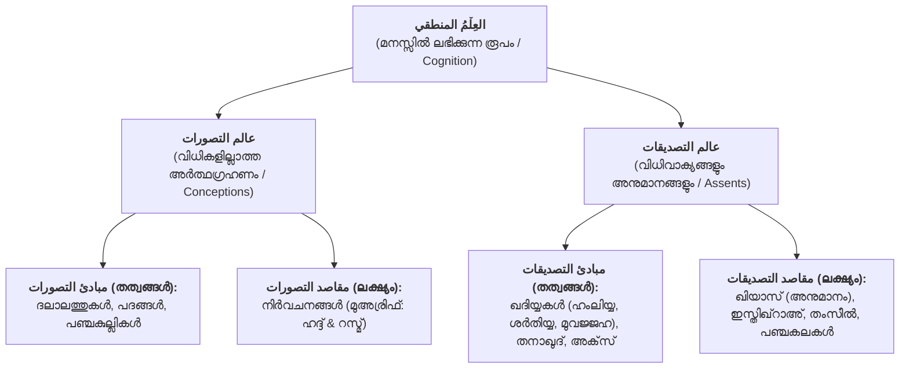

# فهرس مباحث تصريح المنطق
## തസ്‌രീഹുൽ മന്തിഖ് — സമഗ്ര അധ്യായ സൂചികയും പഠന സഹായിയും
### *Taṣrīḥ al-Manṭiq* — Master Curriculum & Syllabus Navigator

---

## 1. ഗ്രന്ഥ പരിചയം (Overview of the Kitāb)

ഇസ്‌ലാമിക പാരമ്പര്യ കലാലയങ്ങളിൽ (ദർസ്–ശരീഅത്ത് കോളേജുകളിൽ) തർക്കശാസ്ത്ര പഠനത്തിന് നൂറ്റാണ്ടുകളായി അവലംബിച്ചുപോരുന്ന പ്രാമാണിക മത്‌നാണ് **«تصريح المنطق» (*Taṣrīḥ al-Manṭiq*)**. ചിന്തയിലെ വ്യതിയാനങ്ങളെ പ്രതിരോധിക്കാനും, ശരിയായ ആശയരൂപീകരണവും (തസവ്വുർ) വിധിതീർപ്പുകളും (തസ്ദീഖ്) ഉറപ്പുവരുത്താനുമുള്ള ചിട്ടയായ നിയമങ്ങളാണ് ഈ ഗ്രന്ഥത്തിൽ ക്രോഡീകരിച്ചിട്ടുള്ളത്.

ഈ ഡിജിറ്റൽ പതിപ്പിൽ ഗ്രന്ഥത്തിലെ എല്ലാ അധ്യായങ്ങളെയും 24 സമഗ്ര പഠനക്കുറിപ്പുകളായി (Dedicated Modular Notes) ക്രമീകരിച്ചിരിക്കുന്നു. ഓരോ കുറിപ്പിലും:
1. **അറബിക് മൂലപാഠം (النص الأصلي المشكول):** പൂർണ്ണ ഹറകത്തുകളോടെ.
2. **മലയാള തർജമയും ദർസ് ശർഹും:** പരമ്പരാഗത ദർസ് രീതിയിലുള്ള സാങ്കേതിക പദാവലിയും ആഴത്തിലുള്ള അപഗ്രഥനവും.
3. **ഇംഗ്ലീഷ് താരതമ്യ വിചാരം (Formal Logic Parallels):** വെസ്റ്റേൺ ലോജിക്, അരിസ്റ്റോട്ടിലിയൻ സിലോഗിസം, ചിഹ്നശാസ്ത്രം (Symbolic Logic).
4. **ചിത്രരൂപങ്ങളും (Mermaid Charts) താരതമ്യ പട്ടികകളും (Comparison Tables)**.
5. **ക്ലാസിക്കൽ–സമകാലിക ഉദാഹരണങ്ങളും പരീക്ഷാ പരിശീലനങ്ങളും**.

---

## 2. മന്തിഖിന്റെ സമഗ്ര ഘടന (Grand Architecture of Islamic Logic)

പരമ്പരാഗത യുക്തിശാസ്ത്രം അറിവിനെ (**العلم**) രണ്ട് പ്രധാന ശാഖകളായി വിഭജിക്കുന്നു: **തസവ്വുറാത്തുകൾ (Conceptions)**, **തസ്ദീഖാത്തുകൾ (Assents / Propositions)**.

---

## 3. അധ്യായങ്ങളുടെ പൂർണ്ണ പട്ടിക (Complete Chapter Navigator)

### ഭാഗം 0: ആമുഖം (Prologue)
- [**01. خطبة الكتاب وبراعة الاستهلال** (ഗ്രന്ഥാവതരണവും ആമുഖവും / Prologue & Methodological Scope)](file:///Users/apple/Desktop/docs:books/Kanz-al-Tahqiq/Texts/Mantiq/tasrih-al-mantiq/Notes/Chapters/01-muqaddimah-wa-khutbah.md)

### ഭാഗം 1: തസവ്വുറാത്തിന്റെ ലോകം (Part I: The Logic of Conceptions)
- [**02. العلم: التصور والتصديق** (അറിവ്: തസവ്വുറും തസ്ദീഖും / Epistemology of Cognition: Conception & Assent)](file:///Users/apple/Desktop/docs:books/Kanz-al-Tahqiq/Texts/Mantiq/tasrih-al-mantiq/Notes/Chapters/02-al-ilm-tasawwur-wa-tasdiq.md)
- [**03. أنواع الدلالات الست** (സൂചനകളുടെ ആറ് ഇനങ്ങൾ / Semiotics & Signification: 6 Modes & Verbal Types)](file:///Users/apple/Desktop/docs:books/Kanz-al-Tahqiq/Texts/Mantiq/tasrih-al-mantiq/Notes/Chapters/03-anwa-al-dalalat.md)
- [**04. المركب والمفرد وأقسامهما** (സംയുക്തവും ഏകവുമായ പ്രയോഗങ്ങൾ / Expressions: Composite & Simple Terms)](file:///Users/apple/Desktop/docs:books/Kanz-al-Tahqiq/Texts/Mantiq/tasrih-al-mantiq/Notes/Chapters/04-al-murakkab-wal-mufrad.md)
- [**05. أنواع المفرد باعتبار المعنى** (അർത്ഥാടിസ്ഥാനത്തിലുള്ള പദവിഭാഗങ്ങൾ / Semantics: Universals, Particulars & Ambiguity)](file:///Users/apple/Desktop/docs:books/Kanz-al-Tahqiq/Texts/Mantiq/tasrih-al-mantiq/Notes/Chapters/05-anwa-al-mufrad-kulli-wa-juz-i.md)
- [**06. الكليات الخمس** (അഞ്ച് കുല്ലിയ്യാത്തുകൾ / The Porphyrian Tree: Five Universals / Predicables)](file:///Users/apple/Desktop/docs:books/Kanz-al-Tahqiq/Texts/Mantiq/tasrih-al-mantiq/Notes/Chapters/06-al-kulliyyat-al-khams.md)
- [**07. النسب الأربع بين الكليات ونقائضها** (നാല് ബന്ധങ്ങളും അവയുടെ വിപരീതങ്ങളും / Four Set Relations & Inversions)](file:///Users/apple/Desktop/docs:books/Kanz-al-Tahqiq/Texts/Mantiq/tasrih-al-mantiq/Notes/Chapters/07-al-nisab-al-arba.md)
- [**08. المعرّف: أقسام الحد والرسم** (നിർവചനം: ഹദ്ദും റസ്മും / Theory of Definition: Essential & Descriptive Limits)](file:///Users/apple/Desktop/docs:books/Kanz-al-Tahqiq/Texts/Mantiq/tasrih-al-mantiq/Notes/Chapters/08-al-mu-arrif-hadd-wa-rasm.md)

### ഭാഗം 2: തസ്ദീഖാത്തും വിധിവാക്യങ്ങളും (Part II: Propositions & Logical Oppositions)
- [**09. القضية الحملية والمحصورات الأربع** (ഹംലിയ്യാ വാക്യങ്ങളും ചതുർവിധ പ്രസ്താവനകളും / Categorical Propositions & Standard Forms)](file:///Users/apple/Desktop/docs:books/Kanz-al-Tahqiq/Texts/Mantiq/tasrih-al-mantiq/Notes/Chapters/09-al-qadiyyah-al-hamliyyah.md)
- [**10. القضية المعدولة والمحصلة** (നിഷേധപദം ചേർന്ന വിധിവാക്യങ്ങൾ / Metathetic / Negated-Term Propositions)](file:///Users/apple/Desktop/docs:books/Kanz-al-Tahqiq/Texts/Mantiq/tasrih-al-mantiq/Notes/Chapters/10-al-qadiyyah-al-ma-dulah.md)
- [**11. القضايا الموجهة البسيطة الثمان** (ലളിത മോഡൽ വിധിവാക്യങ്ങൾ / Modal Logic I: Eight Simple Modal Propositions)](file:///Users/apple/Desktop/docs:books/Kanz-al-Tahqiq/Texts/Mantiq/tasrih-al-mantiq/Notes/Chapters/11-al-qadaya-al-muwajjahah-al-basitah.md)
- [**12. القضايا الموجهة المركبة السبع** (സംയുക്ത മോഡൽ വിധിവാക്യങ്ങൾ / Modal Logic II: Seven Compound Modal Propositions)](file:///Users/apple/Desktop/docs:books/Kanz-al-Tahqiq/Texts/Mantiq/tasrih-al-mantiq/Notes/Chapters/12-al-qadaya-al-muwajjahah-al-murakkabah.md)
- [**13. القضايا الشرطية: المتصلة والمنفصلة** (ബന്ധിതവും വിഭക്തവുമായ വ്യവസ്ഥാവാക്യങ്ങൾ / Conditional Propositions: Connected & Disconnected)](file:///Users/apple/Desktop/docs:books/Kanz-al-Tahqiq/Texts/Mantiq/tasrih-al-mantiq/Notes/Chapters/13-al-qadaya-al-shartiyyah.md)
- [**14. الشرطية المخصوصة والمحصورة وأسوارها** (നിർദ്ദിഷ്ട-അളവുചേർത്ത വ്യവസ്ഥാവാക്യങ്ങൾ / Quantified Conditionals & Quantifiers)](file:///Users/apple/Desktop/docs:books/Kanz-al-Tahqiq/Texts/Mantiq/tasrih-al-mantiq/Notes/Chapters/14-al-shartiyyah-al-mahsurah-wal-aswar.md)
- [**15. التناقض والوحدات الثمانية** (വൈരുദ്ധ്യവും എട്ട് ഏകതകളും / Contradiction, Square of Opposition & Eight Unities)](file:///Users/apple/Desktop/docs:books/Kanz-al-Tahqiq/Texts/Mantiq/tasrih-al-mantiq/Notes/Chapters/15-al-tanaqud-wa-wahadat.md)
- [**16. العكس المستوي وأحكامه** (ലളിതമായ പ്രതിവർത്തനം / Simple Conversion: Distribution Rules & Inversion)](file:///Users/apple/Desktop/docs:books/Kanz-al-Tahqiq/Texts/Mantiq/tasrih-al-mantiq/Notes/Chapters/16-al-aks-al-mustawi.md)
- [**17. عكس النقيض وأحكامه** (നിഷേധത്തിന്റെ പ്രതിവർത്തനം / Conversion by Contraposition: Rules & Reductions)](file:///Users/apple/Desktop/docs:books/Kanz-al-Tahqiq/Texts/Mantiq/tasrih-al-mantiq/Notes/Chapters/17-aks-al-naqid.md)

### ഭാഗം 3: ഹുജ്ജത്തും ഖിയാസും പഞ്ചകലകളും (Part III: Syllogistic Inference & The Five Arts)
- [**18. القياس الحملي الاقتراني والشكل الأول** (ഹംലിയ്യാ ഖിയാസും ഒന്നാം രൂപവും / Categorical Syllogism: Anatomy & Figure 1)](file:///Users/apple/Desktop/docs:books/Kanz-al-Tahqiq/Texts/Mantiq/tasrih-al-mantiq/Notes/Chapters/18-al-qiyas-al-iqtirani-al-hamli.md)
- [**19. الأشكال الثلاثة الباقية (2، 3، 4)** (രണ്ടും മൂന്നും നാലും രൂപങ്ങൾ / Figures 2, 3, & 4: Valid Moods & Reductions)](file:///Users/apple/Desktop/docs:books/Kanz-al-Tahqiq/Texts/Mantiq/tasrih-al-mantiq/Notes/Chapters/19-ashkal-al-qiyas-2-3-4.md)
- [**20. القياس الشرطي الاقتراني** (വ്യവസ്ഥാപിത സംയുക്ത ഖിയാസ് / Syllogisms with Pure & Mixed Conditional Premises)](file:///Users/apple/Desktop/docs:books/Kanz-al-Tahqiq/Texts/Mantiq/tasrih-al-mantiq/Notes/Chapters/20-al-qiyas-al-sharti.md)
- [**21. القياس الاستثنائي وأحكامه** (ഒഴിവാക്കൽ അനുമാനം / Exceptive Syllogisms: Modus Ponens & Tollens)](file:///Users/apple/Desktop/docs:books/Kanz-al-Tahqiq/Texts/Mantiq/tasrih-al-mantiq/Notes/Chapters/21-al-qiyas-al-istithna-i.md)
- [**22. الاستقراء والتمثيل** (അപഗ്രഥനാനുമാനവും സാദൃശ്യാനുമാനവും / Non-Syllogistic Inference: Induction & Analogy)](file:///Users/apple/Desktop/docs:books/Kanz-al-Tahqiq/Texts/Mantiq/tasrih-al-mantiq/Notes/Chapters/22-al-istiqra-wal-tamthil.md)
- [**23. الصناعات الخمس ومواد الأقيسة** (അഞ്ച് ശാസ്ത്രശാഖകൾ / The Five Arts: Epistemic Matter of Syllogisms)](file:///Users/apple/Desktop/docs:books/Kanz-al-Tahqiq/Texts/Mantiq/tasrih-al-mantiq/Notes/Chapters/23-al-sina-at-al-khams.md)
- [**24. خاتمة المتن والموجز العام** (ഗ്രന്ഥസമാപ്തിയും സംഗ്രഹവും / Epilogue, Colophon & Holistic Curriculum Synthesis)](file:///Users/apple/Desktop/docs:books/Kanz-al-Tahqiq/Texts/Mantiq/tasrih-al-mantiq/Notes/Chapters/24-khatimat-al-kitab.md)

---

## 4. പ്രധാന അനുബന്ധ വിഭവങ്ങൾ (Global Supplementary Sheets)

കൂടുതൽ പഠനങ്ങൾക്കും ആവർത്തനങ്ങൾക്കും താഴെ പറയുന്ന കേന്ദ്രീകൃത ഫയലുകൾ ഉപയോഗപ്പെടുത്തുക:

- [**സമ്പൂർണ്ണ പദസൂചിക (Complete Trilingual Glossary)**](file:///Users/apple/Desktop/docs:books/Kanz-al-Tahqiq/Texts/Mantiq/tasrih-al-mantiq/Notes/Tasrih-al-Mantiq-Complete-Glossary.md)
- [**താരതമ്യ പട്ടികകൾ (Comparative Matrices & Tables)**](file:///Users/apple/Desktop/docs:books/Kanz-al-Tahqiq/Texts/Mantiq/tasrih-al-mantiq/Notes/Tasrih-al-Mantiq-Tables.md)
- [**വർഗ്ഗീകരണ വൃക്ഷങ്ങൾ (Classification Trees & Taxonomies)**](file:///Users/apple/Desktop/docs:books/Kanz-al-Tahqiq/Texts/Mantiq/tasrih-al-mantiq/Notes/Tasrih-al-Mantiq-Trees.md)
- [**സമഗ്ര ഉദാഹരണ ശേഖരം (Classical & Contemporary Examples)**](file:///Users/apple/Desktop/docs:books/Kanz-al-Tahqiq/Texts/Mantiq/tasrih-al-mantiq/Notes/Tasrih-al-Mantiq-Examples.md)
- [**ക്വിസ് ബാങ്കും മത്സര സഹായിയും (Fest & Competition Quiz Bank)**](file:///Users/apple/Desktop/docs:books/Kanz-al-Tahqiq/Texts/Mantiq/tasrih-al-mantiq/Notes/Tasrih-al-Mantiq-Fest-Competition-Quiz-Bank-ml.md)
- [**മന്തിഖ്, ഫിലോസഫി, കമ്പ്യൂട്ടേഷൻ സംഗമം (Crossroads: Logic, Math & Computation)**](file:///Users/apple/Desktop/docs:books/Kanz-al-Tahqiq/Texts/Mantiq/tasrih-al-mantiq/Notes/Tasrih-al-Mantiq-Crossroads-Logic-Philosophy-Math-Computation.md)
