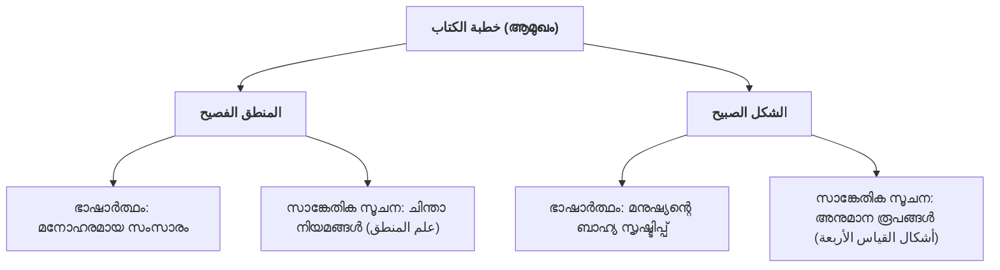

# خطبة الكتاب وبراعة الاستهلال
## ഗ്രന്ഥാവതരണവും ആമുഖവും — Prologue, Methodological Scope & Rhetoric

<!-- Top Navigation Bar -->
[📑 സൂചിക / Master Index](file:///Users/apple/Desktop/docs:books/Kanz-al-Tahqiq/Texts/Mantiq/tasrih-al-mantiq/Notes/Chapters/00-index.md) | [അടുത്ത അധ്യായം: 02. العلم: التصور والتصديق ⏭️](file:///Users/apple/Desktop/docs:books/Kanz-al-Tahqiq/Texts/Mantiq/tasrih-al-mantiq/Notes/Chapters/02-al-ilm-tasawwur-wa-tasdiq.md)

---

### 1. മൂലപാഠം / النص الأصلي من المتن (Al-Matn al-Aṣl)

بِسْمِ اللَّهِ الرَّحْمَنِ الرَّحِيمِ

الْحَمْدُ لِلَّهِ الَّذِي أَنْطَقَ نَوْعَ الْإِنْسَانِ بِالْمَنْطِقِ الْفَصِيحِ، وَأَبْدَعَهُ بِالشَّكْلِ الصَّبِيحِ، وَالصَّلَاةُ وَالسَّلَامُ عَلَى أَفْضَلِ مَنْ أَرْسَلَهُ بِالْكِتَابِ الْمَنْعُوتِ بِفَضْلِ الْخِطَابِ، وَعَلَى آلِهِ وَأَصْحَابِهِ خَيْرِ آلٍ وَأَصْحَابٍ.

---

### 2. മലയാള പരിഭാഷ (ദർസ് ശൈലിയിലുള്ള വാച്യാർത്ഥവും ആശയവും)

പരമകാരുണികനും കരുണാനിധിയുമായ അല്ലാഹുവിന്റെ നാമത്തിൽ ആരംഭിക്കുന്നു.

സകല സ്തുതികളും അല്ലാഹുവിനാണ്; മനുഷ്യവർഗ്ഗത്തെ വ്യക്തവും പ്രസന്നവുമായ സംസാരശേഷികൊണ്ട് (മന്തിഖ് കൊണ്ട്) സംസാരിപ്പിക്കുകയും, സൗന്ദര്യമാർന്ന രൂപത്തിൽ (ശക്‌ലിൽ) അവനെ സൃഷ്ടിക്കുകയും ചെയ്തവനത്രെ അവൻ. വ്യക്തമായ സംസാരവൈഭവം (ഫസ്‌ലുൽ ഖിത്വാബ്) വിശേഷണമായിട്ടുള്ള വിശുദ്ധ വേദഗ്രന്ഥവുമായി അയക്കപ്പെട്ടവരിൽ അത്യുത്തമരായ പ്രവാചകർ മുഹമ്മദ് മുസ്തഫാ ﷺ യുടെ മേലിലും, ഉത്തമരായ അവരുടെ കുടുംബത്തിന്റേയും സ്വഹാബികളുടേയും മേലിലും ശാന്തിയും സമാധാനവും സദാ വർഷിക്കുമാറാകട്ടെ.

---

### 3. ഇംഗ്ലീഷ് വിവർത്തനം / English Scholastic Translation

In the name of Allah, the Most Gracious, the Most Merciful.

All praise belongs to Allah, Who caused the human species to speak with eloquent speech (*manṭiq*), and fashioned him in a radiant form (*shakl*). Blessings and peace be upon the most noble of those He sent with the Book characterized by decisive discourse (*faṣl al-khiṭāb*), and upon his family and companions, the best of families and companions.

---

### 4. ത്രിഭാഷാ പദസൂചിക / المصطلحات / Key Terminology Matrix

| അറബിക് പദം (Arabic) | ലിപ്യന്തരണം (Transliteration) | മലയാള അർത്ഥം (Malayalam Equivalent) | English Logic Term | സാങ്കേതിക വിവരണം (Scholastic Definition) |
|---|---|---|---|---|
| **بَرَاعَةُ الاسْتِهْلَال** | *Barāʿat al-istihlāl* | സൂചനാത്മക പ്രാരംഭം | Rhetorical anticipation | ആമുഖത്തിൽ തന്നെ ഗ്രന്ഥത്തിന്റെ പ്രതിപാദ്യ വിഷയത്തിലേക്ക് (മന്തിഖ്, ശക്ല്) പദപ്രയോഗങ്ങൾ വഴി സൂചന നൽകുന്ന കാവ്യാലങ്കാരം. |
| **المَنْطِق** | *al-Manṭiq* | മന്തിഖ് / യുക്തിശാസ്ത്രം | Logic / Speech | ഭാഷാർത്ഥത്തിൽ 'സംസാരം' (വാഗ്മിത്വം); സാങ്കേതികമായി ചിന്തയെ തെറ്റിൽ നിന്ന് സംരക്ഷിക്കുന്ന നിയമവ്യവസ്ഥ. |
| **الشَّكْل** | *al-Shakl* | രൂപം / ശക്ല് | Logical Figure / Physical Form | ഭാഷാർത്ഥത്തിൽ 'ശരീരരൂപം'; സാങ്കേതികമായി ഖിയാസിലെ (Syllogism) അوسط (Middle Term) വരുന്ന ക്രമത്തിനനുസരിച്ചുള്ള 4 രൂപങ്ങൾ. |
| **فَصْلُ الخِطَاب** | *Faṣl al-khiṭāb* | നിർണ്ണായക സംസാരം | Decisive discourse | സത്യാസത്യങ്ങളെ വേർതിരിക്കുന്ന സുവ്യക്തമായ സംസാരം; ഖുർആനിന്റെയും യുക്തിഭദ്രമായ വാദത്തിന്റെയും വിശേഷണം. |
| **نَوْعُ الإنْسَان** | *Nawʿ al-insān* | മനുഷ്യവർഗ്ഗം | Human species | മന്തിഖിലെ 'കുല്ലിയ്യാത്തുൽ ഖംസ്' പ്രകാരമുള്ള ഒരു നിശ്ചിത 'നൗഅ്' (Species). |

---

### 5. വിശദമായ ശർഹും തത്വവിചാരവും / الشرح والتحليل المعمق

#### എ. ബറാഅത്തുൽ ഇസ്തിഹ്‌ലാൽ (براعة الاستهلال):
ഗ്രന്ഥകർത്താവ് ആമുഖത്തിൽ പ്രയോഗിച്ച രണ്ട് സുപ്രധാന പദങ്ങൾ ശ്രദ്ധേയമാണ്:
1. **«أَنْطَقَ نَوْعَ الْإِنْسَانِ بِالْمَنْطِقِ الْفَصِيحِ»**: ഇവിടെ «മന്തിഖ്» എന്നത് ബാഹ്യമായ സംസാരത്തെ സൂചിപ്പിക്കുന്നതോടൊപ്പം തർക്കശാസ്ത്രമെന്ന (Logic) വിജ്ഞാനശാഖയെയും മനുഷ്യന്റെ ആന്തരിക വിവേചനബുദ്ധിയെയും (അൽ-നുത്വ്ഖുൽ ബാത്വിൻ) സൂചിപ്പിക്കുന്നു.
2. **«وَأَبْدَعَهُ بِالشَّكْلِ الصَّبِيحِ»**: ഇവിടെ «ശക്ല്» എന്നത് മനുഷ്യന്റെ മനോഹരമായ ബാഹ്യരൂപത്തെ സൂചിപ്പിക്കുന്നതോടൊപ്പം, മന്തിഖിലെ അനുമാന ഘടനയായ **അശ്‌കാലുൽ ഖിയാസിനെ (Four Syllogistic Figures)** സൂചിപ്പിക്കുന്നു.

#### ബി. മന്തിഖ് എന്ന വിജ്ഞാനത്തിന്റെ ലക്ഷ്യം (غاية علم المنطق):
മനുഷ്യന്റെ ചിന്തയിൽ ഉണ്ടാകാവുന്ന രണ്ട് വലിയ അപചയങ്ങളുണ്ട്:
1. കാര്യങ്ങളെ തെറ്റായി സങ്കൽപ്പിക്കുക (فساد التصور).
2. തെറ്റായ നിഗമനങ്ങളിൽ എത്തിച്ചേരുക (فساد التصديق).

മന്തിഖ് ഒരു ഉപകരണ ശാസ്ത്രമാണ് (**علم آلي**). ശരീഅത്ത് വിജ്ഞാനങ്ങൾ ഗ്രഹിക്കുന്നതിനും ഖുർആൻ-സുന്നത്ത് അടിസ്ഥാനമാക്കിയുള്ള പ്രമാണവിചാരങ്ങൾക്കും അപഗ്രഥനങ്ങൾക്കും തർക്കശാസ്ത്രം സുരക്ഷിതമായ ചിന്താരീതി പ്രദാനം ചെയ്യുന്നു.

---

### 6. ചിത്രരൂപങ്ങളും താരതമ്യ പട്ടികകളും / Visual Diagrams & Comparative Matrices

---

### 7. ഉദാഹരണ വിശകലനം / Analysis of Classical & Contemporary Examples

- **ക്ലാസിക്കൽ ശൈലി:** ഇമാം ഗസ്സാലി (റ) *അൽ-മുസ്തസ്ഫാ* യുടെ ആമുഖത്തിൽ കുറിച്ചതുപോലെ: *"മന്തിഖ് വശമില്ലാത്തവന്റെ വിജ്ഞാനത്തിൽ പൂർണ്ണമായി വിശ്വസിക്കാനാവില്ല"* (من لا يحيط بالمنطق فلا ثقة له بعلومه أصلاً). ഗ്രന്ഥകർത്താവ് ഈ മഹനീയ പാരമ്പര്യത്തെയാണ് ആമുഖത്തിൽ കോർത്തിണക്കിയിരിക്കുന്നത്.
- **സമകാലിക പ്രസക്തി:** ആധുനിക കമ്പ്യൂട്ടർ സയൻസിലെ അൽഗോരിതങ്ങളും, ഫിലോസഫിക്കൽ ആർഗ്യുമെന്റേഷനും സാധുത നേടുന്നത് ഈ അടിസ്ഥാന ചിന്താ നിയമങ്ങളിലൂടെയാണ്.

---

### 8. ശ്രദ്ധിക്കേണ്ട സൂക്ഷ്മതകൾ / تنبيهات ومزالق شائعة (Common Student Pitfalls)

> [!NOTE]
> പൗരാണിക ഗ്രന്ഥങ്ങളിലെ ആമുഖങ്ങൾ വെറും ഔപചാരികതയല്ല. അതിൽ ഗ്രന്ഥകർത്താവ് ഒളിപ്പിച്ചു വെച്ച സാങ്കേതിക സൂചനകൾ (ഇസ്തിലാഹാത്ത്) ഗ്രഹിക്കാതെ പോകുന്നത് തുടക്കക്കാരായ വിദ്യാർത്ഥികൾക്ക് സംഭവിക്കുന്ന പതിവ് പിഴവാണ്. «മന്തിഖ്», «ശക്ല്» എന്നിവ കേവല ഭാഷാപദങ്ങളല്ല, മറിച്ച് ഗ്രന്ഥത്തിന്റെ പൂർണ്ണ ഉള്ളടക്കത്തിലേക്കുള്ള പ്രവേശന കവാടങ്ങളാണ്.

---

### 9. ആവർത്തന ചോദ്യങ്ങളും വ്യായാമങ്ങളും / تدريبات وتمارين (Review Exercises)

1. ഗ്രന്ഥകർത്താവിന്റെ ആമുഖത്തിൽ അടങ്ങിയിരിക്കുന്ന 'ബറാഅത്തുൽ ഇസ്തിഹ്‌ലാൽ' വ്യക്തമാക്കുക.
2. «المنطق» എന്ന പദത്തിന്റെ ഭാഷാർത്ഥവും സാങ്കേതിക സൂചനയും വിശദീകരിക്കുക.
3. «الشكل» എന്നത് കൊണ്ട് സാങ്കേതികമായി സൂചിപ്പിക്കുന്നത് എന്തിനെയാണ്?
4. തർക്കശാസ്ത്രം പഠിക്കുന്നതിന്റെ ആത്യന്തിക ലക്ഷ്യം എന്താണ്?

---

<!-- Bottom Navigation Bar -->
[📑 സൂചിക / Master Index](file:///Users/apple/Desktop/docs:books/Kanz-al-Tahqiq/Texts/Mantiq/tasrih-al-mantiq/Notes/Chapters/00-index.md) | [അടുത്ത അധ്യായം: 02. العلم: التصور والتصديق ⏭️](file:///Users/apple/Desktop/docs:books/Kanz-al-Tahqiq/Texts/Mantiq/tasrih-al-mantiq/Notes/Chapters/02-al-ilm-tasawwur-wa-tasdiq.md)
