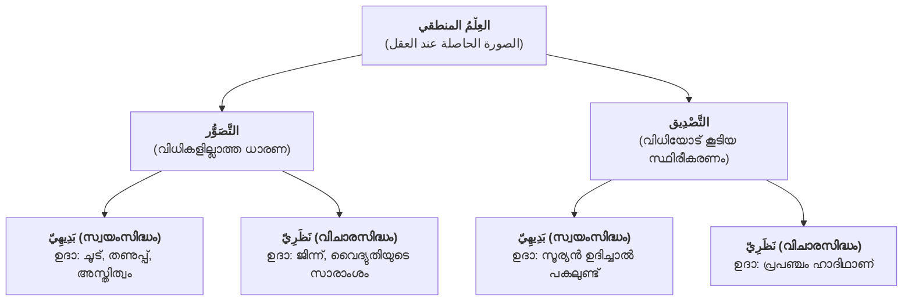

# التَّصْدِيقُ وَالتَّصَوُّرُ
## അറിവ്: തസവ്വുറും തസ്ദീഖും — Epistemology of Cognition: Conception & Assent

<!-- Top Navigation Bar -->
[⏮️ മുൻ അധ്യായം: 01. خطبة الكتاب](file:///Users/apple/Desktop/docs:books/Kanz-al-Tahqiq/Texts/Mantiq/tasrih-al-mantiq/Notes/Chapters/01-muqaddimah-wa-khutbah.md) | [📑 സൂചിക / Master Index](file:///Users/apple/Desktop/docs:books/Kanz-al-Tahqiq/Texts/Mantiq/tasrih-al-mantiq/Notes/Chapters/00-index.md) | [അടുത്ത അധ്യായം: 03. أنواع الدلالات الست ⏭️](file:///Users/apple/Desktop/docs:books/Kanz-al-Tahqiq/Texts/Mantiq/tasrih-al-mantiq/Notes/Chapters/03-anwa-al-dalalat.md)

---

### 1. മൂലപാഠം / النص الأصلي من المتن (Al-Matn al-Aṣl)

اعْلَمْ: أَنَّ الْعِلْمَ - الَّذِي هُوَ عِبَارَةٌ عَنِ الصُّورَةِ الْحَاصِلَةِ عِنْدَ الْعَقْلِ - إِنْ كَانَ اعْتِقَادًا لِلنِّسْبَةِ الْخَبَرِيَّةِ فَتَصْدِيقٌ، وَإِلَّا فَتَصَوُّرٌ. وَالنِّسْبَةُ: هُوَ إِسْنَادُ أَمْرٍ إِلَى آخَرَ، إِيجَابًا كَانَ أَوْ سَلْبًا؛ فَالتَّصْدِيقُ لَا بُدَّ لَهُ مِنْ ثَلَاثِ تَصَوُّرَاتٍ: تَصَوُّرِ الْمَحْكُومِ عَلَيْهِ، وَالْمَحْكُومِ بِهِ، وَالنِّسْبَةِ؛ كَمَا فِي تَصْدِيقِ «زَيْدٌ قَائِمٌ»: يَجِبُ مِنْ تَصَوُّرِ زَيْدٍ، وَتَصَوُّرِ قَائِمٍ، وَتَصَوُّرِ النِّسْبَةِ بَيْنَهُمَا.

وَكُلٌّ مِنْهُمَا بَدِيهِيٌّ وَنَظَرِيٌّ؛ فَالْبَدِيهِيُّ: مَا لَا يَتَوَقَّفُ عَلَى النَّظَرِ وَالْفِكْرِ، وَالنَّظَرِيُّ: خِلَافُهُ. وَأَقْسَامُهُمَا بِهَذَا الِاعْتِبَارِ أَرْبَعَةٌ: التَّصَوُّرُ الْبَدِيهِيُّ كَتَصَوُّرِ الْحَرَارَةِ، وَالنَّظَرِيُّ كَتَصَوُّرِ حَقِيقَةِ الْجِنِّ، وَالتَّصْدِيقُ الْبَدِيهِيُّ كَتَصْدِيقِ «إِنَّ الشَّمْسَ مُشْرِقَةٌ»، وَالنَّظَرِيُّ كَتَصْدِيقِ «إِنَّ الْعَالَمَ حَادِثٌ».

---

### 2. മലയാള പരിഭാഷ (ദർസ് ശൈലിയിലുള്ള വാച്യാർത്ഥവും ആശയവും)

നീ അറിയുക: ബുദ്ധിയിൽ ഉദയം ചെയ്യുന്ന രൂപത്തിന് (الصورة الحاصلة عند العقل) പറയപ്പെടുന്ന പേരാണ് **അറിവ് (العلم)**. ആ അറിവ്, ഒരു ഖബരിയ്യ ബന്ധത്തെക്കുറിച്ചുള്ള ദൃഢവിശ്വാസമാണെങ്കിൽ (اعتقاداً للنسبة الخبرية) അതിന് **തസ്ദീഖ് (التصديق - സ്ഥിരീകരണം)** എന്ന് പറയപ്പെടുന്നു; അങ്ങനെയല്ലെങ്കിൽ (ഒരു വിധിയുമില്ലാത്ത കേവല ഗ്രഹണമാണെങ്കിൽ) അതിന് **തസവ്വുർ (التصور - ധാരണ)** എന്നും പറയപ്പെടുന്നു.

**നിസ്ബത്ത് (النسبة)** എന്നാൽ: ഒരു കാര്യത്തെ മറ്റൊന്നിലേക്ക് ചേർക്കലാണ് (ഇസ്നാദ്); അത് സ്ഥിരീകരണ രൂപത്തിലോ (ഇജാബ്) നിഷേധ രൂപത്തിലോ (സൽബ്) ആകാം. അതിനാൽ തസ്ദീഖിന് അനിവാര്യമായും മൂന്ന് തസവ്വുറുകൾ ഉണ്ടായേ മതിയാകൂ:
1. വിധി കൽപ്പിക്കപ്പെടുന്ന വസ്തുവിനെക്കുറിച്ചുള്ള ധാരണ (**മഹ്കൂമുൻ അലൈഹി / വിഷയം**).
2. വിധി കൽപ്പിക്കപ്പെടുന്ന കാര്യത്തെക്കുറിച്ചുള്ള ധാരണ (**മഹ്കൂമുൻ ബിഹി / വിധി**).
3. അവ രണ്ടും തമ്മിലുള്ള ബന്ധത്തെക്കുറിച്ചുള്ള ധാരണ (**നിസ്ബത്ത്**).
ഉദാഹരണത്തിന് «സൈദ് നിൽക്കുന്നവനാണ്» (زيد قائم) എന്ന് സ്ഥിരീകരിക്കുന്നതിന്: സൈദിനെക്കുറിച്ചുള്ള തസവ്വുറും, നിൽക്കുന്നവനെക്കുറിച്ചുള്ള തസവ്വുറും, അവ രണ്ടിനുമിടയിലെ ബന്ധത്തെക്കുറിച്ചുള്ള തസവ്വുറും നിർബന്ധമായും ഉണ്ടായിരിക്കണം.

ഈ തസവ്വുറും തസ്ദീഖും ഓരോന്നും **ബദീഹിയ്യ് (ضروري / സ്വയംസിദ്ധം)** എന്നും **നളരിയ്യ് (വിചാരസിദ്ധം)** എന്നും രണ്ട് വിധമുണ്ട്.
- **ബദീഹിയ്യ് (البديهي):** ആലോചനയെയും ചിന്തയെയും (നളർ, ഫിക്ർ) ആശ്രയിക്കാതെ തന്നെ മനസ്സിൽ ലഭിക്കുന്നത്.
- **നളരിയ്യ് (النظري):** ചിന്തയിലൂടെയും ആലോചനയിലൂടെയും മാത്രം ലഭിക്കുന്നത്.

ഈ വിഭജന പ്രകാരം വിജ്ഞാനം നാല് ഭാഗങ്ങളായി വിഭജിക്കപ്പെടുന്നു:
1. **തസവ്വുറുൻ ബദീഹിയ്യ്:** ചൂട്, തണുപ്പ്, വേദന തുടങ്ങിയവയെ ഗ്രഹിക്കുന്നത് പോലെ.
2. **തസവ്വുറുൻ നളരിയ്യ്:** ജിന്നിന്റെയോ മലക്കിന്റെയോ യഥാർത്ഥ സ്വത്വത്തെ (ഹഖീഖത്ത്) ഗ്രഹിക്കുന്നത് പോലെ.
3. **തസ്ദീഖുൻ ബദീഹിയ്യ്:** «സൂര്യൻ പ്രകാശിക്കുന്നതാണ്» എന്ന് സ്ഥിരീകരിക്കുന്നത് പോലെ.
4. **തസ്ദീഖുൻ നളരിയ്യ്:** «പ്രപഞ്ചം നശ്വരവും പുതുതായി ഉണ്ടായതുമാണ് (ഹാദിഥ്)» എന്ന് തെളിവിലൂടെ സ്ഥാപിക്കുന്നത് പോലെ.

---

### 3. ഇംഗ്ലീഷ് വിവർത്തനം / English Scholastic Translation

Know that knowledge (*al-ʿilm*)—which denotes the mental form imprinted upon the intellect (*al-ṣūra al-ḥāṣila ʿind al-ʿaql*)—if it constitutes a cognitive belief regarding a propositional relation (*iʿtiqād li-l-nisba al-khabariyya*), is **Assent (*Taṣdīq*)**; otherwise, it is **Conception (*Taṣawwur*)**.

The relation (*al-nisba*) is the predication (ascription) of one entity to another, whether affirmatively or negatively. Therefore, assent necessarily depends upon three antecedent conceptions:
1. Conception of that about which a judgment is made (*al-maḥkūm ʿalayhi* / Subject).
2. Conception of that which is predicated as the judgment (*al-maḥkūm bihi* / Predicate).
3. Conception of the predicative bond between them (*al-nisba* / Copula).
As in affirming "Zayd is standing" (*Zaydun qāʾim*): it is mandatory to conceive Zayd, to conceive standing, and to conceive the relation uniting them.

Each of these two is further divided into **Immediate / Self-evident (*Badīhī*)** and **Acquired / Theoretical (*Naẓarī*)**:
- **Self-evident (*al-Badīhī*):** That which does not depend upon reflection and discursive reasoning.
- **Theoretical (*al-Naẓarī*):** Its contrary (requiring intellectual deduction).

By this criterion, cognitive divisions are fourfold:
1. *Self-evident Conception:* Conceiving the nature of heat or cold.
2. *Theoretical Conception:* Conceiving the true quiddity of the Jinn, intellect, or soul.
3. *Self-evident Assent:* Affirming that "The sun is luminous."
4. *Theoretical Assent:* Affirming that "The cosmos is temporally originated (*ḥādith*)."

---

### 4. ത്രിഭാഷാ പദസൂചിക / المصطلحات / Key Terminology Matrix

| അറബിക് പദം (Arabic) | ലിപ്യന്തരണം (Transliteration) | മലയാള അർത്ഥം (Malayalam Equivalent) | English Logic Term | സാങ്കേതിക വിവരണം (Scholastic Definition) |
|---|---|---|---|---|
| **العِلْم** | *al-ʿIlm* | അറിവ് / ജ്ഞാനം | Cognition / Knowledge | ബുദ്ധിയിൽ പ്രതിഫലിക്കുന്ന വസ്തുവിന്റെ അമൂർത്തമായ ചിത്രം (الصورة الحاصلة عند العقل). |
| **التَّصَوُّر** | *al-Taṣawwur* | തസവ്വുർ / ധാരണ | Conception / Simple Apprehension | ഒരു വസ്തുവിൻമേൽ എന്തെങ്കിലും ഉണ്ടെന്നോ ഇല്ലെന്നോ വിധിക്കാതെ അതിനെ മാത്രം മനസ്സിലാക്കൽ. |
| **التَّصْدِيق** | *al-Taṣdīq* | തസ്ദീഖ് / സ്ഥിരീകരണം | Assent / Propositional Judgment | വിഷയവും വിധിയും തമ്മിലുള്ള ഖബരിയ്യ ബന്ധത്തെ യാഥാർത്ഥ്യമെന്നോ അല്ലെന്നോ അംഗീകരിക്കൽ. |
| **المَحْكُومُ عَلَيْهِ** | *al-Maḥkūm ʿalayhi* | മൗദൂഅ് / വിഷയം | Subject term | വിധി കൽപ്പിക്കപ്പെടുന്ന പ്രധാന പദം (ഉദാ: സൈദ്). |
| **المَحْكُومُ بِهِ** | *al-Maḥkūm bihi* | മഹ്മൂൽ / വിധി | Predicate term | വിഷയത്തിലേക്ക് ആരോപിക്കപ്പെടുന്ന കാര്യം (ഉദാ: നിൽക്കുന്നവൻ). |
| **النِّسْبَةُ الخَبَرِيَّة** | *al-Nisba al-khabariyya* | ഖബരിയ്യ ബന്ധം | Propositional Relation / Nexus | വിഷയവും വിധിയും തമ്മിലുള്ള ചേർക്കൽ (പോസിറ്റീവ് അല്ലെങ്കിൽ നെഗറ്റീവ്). |
| **بَدِيهِيّ / ضَرُورِيّ** | *Badīhī / Ḍarūrī* | സ്വയംസിദ്ധം | Self-evident / Axiomatic | ചിന്തയും ആലോചനയുമില്ലാതെ തന്നെ പെട്ടെന്ന് വ്യക്തമാകുന്ന അറിവ്. |
| **نَظَرِيّ / كَسْبِيّ** | *Naẓarī / Kasbī* | വിചാരസിദ്ധം | Discursive / Theoretical | ആലോചനയും തെളിവും ചിന്താപ്രക്രിയയും ആവശ്യമായ അറിവ്. |

---

### 5. വിശദമായ ശർഹും തത്വവിചാരവും / الشرح والتحليل المعمق

#### എ. അറിവിന്റെ നിർവചനം (تعريف العلم):
മന്തിഖിലെ 'ഇൽമ്' എന്നാൽ മനസ്സിൽ രൂഢമൂലമാകുന്ന ചിത്രമാണ്. ഇത് ഭൗതികമായ ക്യാമറ ഫോട്ടോ പോലെയല്ല; മറിച്ച് വസ്തുവിന്റെ ആശയരൂപമാണ്. 
- ഉദാഹരണത്തിന് ഒരാൾ «പുസ്തകം» എന്ന് കേൾക്കുമ്പോൾ മനസ്സിൽ പുസ്തകത്തെക്കുറിച്ചുള്ള ധാരണ ഉണ്ടാകുന്നു. ഇതിൽ ശരിയോ തെറ്റോ എന്ന വിധിയില്ല. ഇത് **തസവ്വുറാണ്**.
- എന്നാൽ «ഈ പുസ്തകം ഉപയോഗപ്രദമാണ്» എന്ന് കേൾക്കുമ്പോൾ പുസ്തകം, ഉപയോഗപ്രദം, അവ തമ്മിലുള്ള യോജിപ്പ് എന്നിവ ഗ്രഹിക്കുകയും അത് ശരിയാണെന്ന് മനസ്സിൽ തീർപ്പുകൽപ്പിക്കുകയും ചെയ്യുന്നു. ഇതാണ് **തസ്ദീഖ്**.

#### ബി. തസ്ദീഖിന്റെ ഘടകങ്ങൾ (أجزاء التصديق):
ഇമാം ഫഖ്‌റുദ്ദീൻ അൽ-റാസി (റ) വിന്റെ വീക്ഷണപ്രകാരം തസ്ദീഖ് ഒരു സംയുക്തമാണ് (മുറക്കബ്); അതിൽ മൂന്ന് തസവ്വുറുകളും (മൗദൂഅ്, മഹ്മൂൽ, നിസ്ബത്ത്) വിധിയും അടങ്ങിയിരിക്കുന്നു. ഇമാം കത്താബിയും ഭൂരിഭാഗം പണ്ഡിതന്മാരും പറയുന്നത് മൂന്ന് തസവ്വുറുകൾ തസ്ദീഖിന്റെ ശർത്വുകളാണെന്നും വിധി മാത്രമാണ് തസ്ദീഖ് എന്നുമാണ്. മത്‌നിലെ വാചകം ഈ ആശയത്തെയാണ് വ്യവസ്ഥപ്പെടുത്തുന്നത്:
$$\text{തസ്ദീഖ്} = \text{തസവ്വുറുൽ മൗദൂഅ്} + \text{തസവ്വുറുൽ മഹ്മൂൽ} + \text{തസവ്വുറുന്നിസ്ബത്ത്} + \text{വിധി (الحکم)}$$

---

### 6. ചിത്രരൂപങ്ങളും താരതമ്യ പട്ടികകളും / Visual Diagrams & Comparative Matrices

#### ചതുർവിധ വിജ്ഞാന മാട്രിക്സ് (The 4 Epistemological Quadrants)

| വിഭാഗം | സ്വഭാവം | ക്ലാസിക്കൽ ഉദാഹരണം | ആധുനിക സയൻസ് ഉദാഹരണം |
|---|---|---|---|
| **തസവ്വുറുൻ ബദീഹിയ്യ്** | വിചിന്തനമില്ലാത്ത അർത്ഥഗ്രഹണം | ചൂട് (الحرارة), വേദന | വെളിച്ചം, ശബ്ദം എന്ന അനുഭവം |
| **തസവ്വുറുൻ നളരിയ്യ്** | ചിന്തയാൽ വ്യക്തമാകുന്ന സങ്കൽപ്പം | ജിന്ന്, മലക്ക്, മനസ്സ് | ക്വാണ്ടം പാർട്ടിക്കിൾ (Quark / Boson) |
| **തസ്ദീഖുൻ ബദീഹിയ്യ്** | ആലോചന ആവശ്യമില്ലാത്ത വിധി | സൂര്യൻ പ്രകാശിക്കുന്നു; $1 + 1 = 2$ | ആകമാനം അതിന്റെ അംശത്തേക്കാൾ വലുതാണ് |
| **തസ്ദീഖുൻ നളരിയ്യ്** | തെളിവ് വഴി മാത്രം സ്ഥാപിക്കപ്പെടുന്ന വിധി | പ്രപഞ്ചം ഉണ്ടായതാണ് (حادث) | ഭൂമി സൂര്യനെ വലംവെക്കുന്നു (ഭ്രമണം) |

---

### 7. ഉദാഹരണ വിശകലനം / Analysis of Classical & Contemporary Examples

- **മത്‌നിലെ ഉദാഹരണം: «زَيْدٌ قَائِمٌ» (സൈദ് നിൽക്കുന്നു)**
  - സൈദ് എന്ന വ്യക്തിയെപ്പറ്റി അറിയുന്നു (തസവ്വുർ 1).
  - നിൽക്കൽ എന്ന അവസ്ഥയെപ്പറ്റി അറിയുന്നു (തസവ്വുർ 2).
  - നിൽക്കൽ സൈദിലേക്ക് ചേർക്കപ്പെടുന്നുവെന്ന ബന്ധം അറിയുന്നു (തസവ്വുർ 3).
  - സൈദിൽ നിൽക്കൽ യാഥാർത്ഥ്യത്തിൽ ഉണ്ടായിരിക്കുന്നു എന്ന് ബുദ്ധി ഉറപ്പിക്കുന്നു (തസ്ദീഖ്).
- **ആധുനിക സയൻസ് ഉദാഹരണം: «ജലം ഹൈഡ്രജനും ഓക്സിജനും ചേർന്നതാണ്»**
  - ജലം, ഹൈഡ്രജൻ, ഓക്സിജൻ എന്നിവയുടെ സാരാംശം മനസ്സിലാക്കൽ തസവ്വുറാണ്.
  - ലാബ് പരീക്ഷണത്തിലൂടെ അവ പരസ്പരം സംയോജിച്ചതാണെന്ന് സമർത്ഥിക്കുന്നത് തസ്ദീഖുൻ നളരിയ്യാണ്.

---

### 8. ശ്രദ്ധിക്കേണ്ട സൂക്ഷ്മതകൾ / تنبيهات ومزالق شائعة (Common Student Pitfalls)

> [!WARNING]
> പല വിദ്യാർത്ഥികളും «തസവ്വുർ» എന്നാൽ വെറും ഭാവനയാണെന്ന് തെറ്റിദ്ധരിക്കാറുണ്ട്. മന്തിഖിൽ തസവ്വുർ എന്നാൽ അർത്ഥം തെറ്റുകൂടാതെ മനസ്സിലാക്കലാണ്. ഒരു വിഷയത്തിൽ ശരിയോ തെറ്റോ എന്ന് വിധി കൽപ്പിക്കുന്നതിന് മുൻപുള്ള എല്ലാ ഘട്ടങ്ങളും തസവ്വുറിലാണ് ഉൾപ്പെടുന്നത്. സംശയം (ശക്ക്), ഊഹം (ളന്ന്), കേവല വാചകങ്ങൾ എന്നിവയെല്ലാം തസവ്വുറിന്റെ പരിധിയിലാണ് വരുന്നത്; വിധി (ജസ്മ് / ഹുക്മ്) ഉണ്ടാകുമ്പോൾ മാത്രമേ തസ്ദീഖ് ആകുന്നുള്ളൂ.

---

### 9. ആവർത്തന ചോദ്യങ്ങളും വ്യായാമങ്ങളും / تدريبات وتمارين (Review Exercises)

1. «അറിവ്» (العلم) എന്നതിന് മന്തിഖുകാർ നൽകുന്ന നിർവചനം എന്താണ്?
2. തസവ്വുറും തസ്ദീഖും തമ്മിലുള്ള മൗലികമായ വ്യത്യാസം വ്യക്തമാക്കുക.
3. «തസ്ദീഖുണ്ടാകാൻ മൂന്ന് തസവ്വുറുകൾ നിർബന്ധമാണ്» — ഏതൊക്കെയാണ് അവ? ഉദാഹരണ സഹിതം വിവരിക്കുക.
4. താഴെ പറയുന്നവയെ ബദീഹിയ്യ്, നളരിയ്യ് എന്ന് വേർതിരിക്കുക:
   - തണുപ്പിനെക്കുറിച്ചുള്ള ധാരണ.
   - ഭൂഗുരുത്വാകർഷണ തത്വം അംഗീകരിക്കൽ.
   - ഒന്നെന്ന സംഖ്യ രണ്ടിന്റെ പകുതിയാണെന്ന് അറിയൽ.
   - ആത്മാവിന്റെ യഥാർത്ഥ അവസ്ഥയെ മനസ്സിലാക്കൽ.

---

<!-- Bottom Navigation Bar -->
[⏮️ മുൻ അധ്യായം: 01. خطبة الكتاب](file:///Users/apple/Desktop/docs:books/Kanz-al-Tahqiq/Texts/Mantiq/tasrih-al-mantiq/Notes/Chapters/01-muqaddimah-wa-khutbah.md) | [📑 സൂചിക / Master Index](file:///Users/apple/Desktop/docs:books/Kanz-al-Tahqiq/Texts/Mantiq/tasrih-al-mantiq/Notes/Chapters/00-index.md) | [അടുത്ത അധ്യായം: 03. أنواع الدلالات الست ⏭️](file:///Users/apple/Desktop/docs:books/Kanz-al-Tahqiq/Texts/Mantiq/tasrih-al-mantiq/Notes/Chapters/03-anwa-al-dalalat.md)
