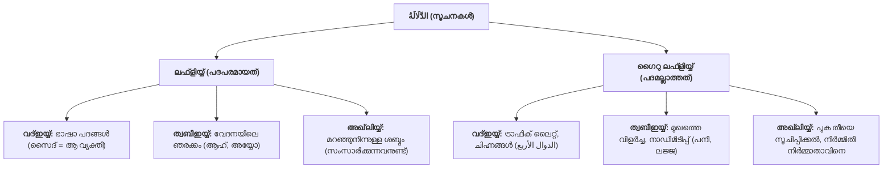
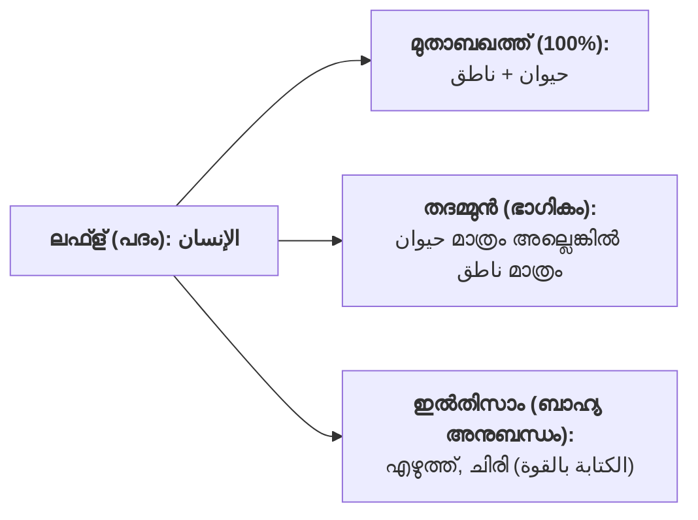

# أَنْوَاعُ الدَّلَالَاتِ
## സൂചനകളുടെ ആറ് ഇനങ്ങളും വദ്ഈ ദലാലത്തും — Semiotics: Six Significations & Tripartite Verbal Signification

<!-- Top Navigation Bar -->
[⏮️ മുൻ അധ്യായം: 02. العلم: التصور والتصديق](file:///Users/apple/Desktop/docs:books/Kanz-al-Tahqiq/Texts/Mantiq/tasrih-al-mantiq/Notes/Chapters/02-al-ilm-tasawwur-wa-tasdiq.md) | [📑 സൂചിക / Master Index](file:///Users/apple/Desktop/docs:books/Kanz-al-Tahqiq/Texts/Mantiq/tasrih-al-mantiq/Notes/Chapters/00-index.md) | [അടുത്ത അധ്യായം: 04. المركب والمفرد وأقسامهما ⏭️](file:///Users/apple/Desktop/docs:books/Kanz-al-Tahqiq/Texts/Mantiq/tasrih-al-mantiq/Notes/Chapters/04-al-murakkab-wal-mufrad.md)

---

### 1. മൂലപാഠം / النص الأصلي من المتن (Al-Matn al-Aṣl)

وَالدَّلَالَةُ - الَّتِي هِيَ كَوْنُ الشَّيْءِ بِحَالَةٍ يَلْزَمُ مِنَ الْعِلْمِ بِهِ الْعِلْمُ بِشَيْءٍ آخَرَ - إِمَّا لَفْظِيَّةٌ أَوْ غَيْرُ لَفْظِيَّةٍ، وَكُلٌّ مِنْهُمَا: إِنْ كَانَ بِوَضْعِ الْوَاضِعِ فَوَضْعِيَّةٌ، كَدَلَالَةِ زَيْدٍ عَلَى ذَاتِهِ، وَالدَّوَّالِ الْأَرْبَعِ عَلَى مَدْلُولَاتِهَا، أَوْ بِاقْتِضَاءِ الطَّبْعِ فَطَبَعِيَّةٌ، كَدَلَالَةِ «أَخْ أَخْ» عَلَى وَجَعِ الصَّدْرِ، وَسُرْعَةِ النَّبْضِ عَلَى الْحُمَّى، أَوْ بِاسْتِدْعَاءِ الْعَقْلِ فَعَقْلِيَّةٌ، كَدَلَالَةِ لَفْظِ «دَيْزٍ» الْمَسْمُوعِ مِنْ وَرَاءِ الْجِدَارِ عَلَى وُجُودِ اللَّافِظِ، وَكَدَلَالَةِ الْمَصْنُوعِ عَلَى وُجُودِ الصَّانِعِ.

وَالِاعْتِبَارُ مِنْهَا الدَّلَالَةُ اللَّفْظِيَّةُ الْوَضْعِيَّةُ؛ فَهِيَ بِاعْتِبَارِ دَلَالَةِ اللَّفْظِ عَلَى تَمَامِ مَا وُضِعَ لَهُ مُطَابَقَةٌ، كَدَلَالَةِ لَفْظِ الْإِنْسَانِ عَلَى الْحَيَوَانِ النَّاطِقِ، وَعَلَى جُزْئِهِ تَضَمُّنٌ، كَدَلَالَتِهِ عَلَى الْحَيَوَانِ فَقَطْ أَوِ النَّاطِقِ وَحْدَهُ، وَعَلَى لَازِمِهِ الْخَارِجِ عَنْهُ الِتِزَامٌ، كَدَلَالَتِهِ عَلَى الْكِتَابَةِ.

---

### 2. മലയാള പരിഭാഷ (ദർസ് ശൈലിയിലുള്ള വാച്യാർത്ഥവും ആശയവും)

**ദലാലത്ത് (الدلالة - സൂചന)** എന്നാൽ: ഒരു കാര്യത്തെക്കുറിച്ച് അറിയുമ്പോൾ മറ്റൊന്നിനെക്കുറിച്ചുള്ള അറിവ് അനിവാര്യമാകുന്ന വിധം ആ കാര്യം നിലകൊള്ളുന്ന അവസ്ഥയാണ് (كون الشيء بحالة يلزم من العلم به العلم بشيء آخر).

അത് ഒന്നുകിൽ ഉച്ചരിക്കപ്പെടുന്ന വാക്കാകാം (**ലഫ്ളിയ്യ് / لفظية**), അല്ലെങ്കിൽ വാക്കല്ലാത്തതാകാം (**ഗൈറു ലഫ്ളിയ്യ് / غير لفظية**). ഇവ രണ്ടും മൂന്ന് വിധത്തിൽ സംഭവിക്കാം:
1. മനുഷ്യന്റെ വ്യവസ്ഥാപിതമായ നിയമനിർണ്ണയത്താലാണെങ്കിൽ (**വദ്ഇയ്യ് / وضعية**):
   - ലഫ്ളിയ്യ് വദ്ഇയ്യ്: «സൈദ്» എന്ന പദം ആ വ്യക്തിയുടെ സത്തയെ സൂചിപ്പിക്കുന്നത് പോലെ.
   - ഗൈറു ലഫ്ളിയ്യ് വദ്ഇയ്യ്: നാല് പ്രമാണങ്ങൾ (الدوال الأربع - എഴുത്ത്, ആംഗ്യം, അടയാളസ്തംഭം, വിരൽമടക്കൽ) അവയുടെ അർത്ഥങ്ങളെ സൂചിപ്പിക്കുന്നത് പോലെ.
2. പ്രകൃതിയുടെയും ശാരീരിക അവസ്ഥയുടെയും തേട്ടത്താലാണെങ്കിൽ (**ത്വബീഇയ്യ് / طبعية**):
   - ലഫ്ളിയ്യ് ത്വബീഇയ്യ്: നെഞ്ചുവേദനയുള്ളവൻ «അഹ് അഹ്» എന്ന് ഞരങ്ങുന്നത് നെഞ്ചുവേദനയെ സൂചിപ്പിക്കുന്നത് പോലെ.
   - ഗൈറു ലഫ്ളിയ്യ് ത്വബീഇയ്യ്: നാഡിമിടിപ്പിന്റെ വേഗത പനിയെ സൂചിപ്പിക്കുന്നത് പോലെ.
3. ബുദ്ധിയുടെ ശുദ്ധമായ യുക്തിവിധി പ്രകാരമാണെങ്കിൽ (**അഖ്‌ലിയ്യ് / عقلية**):
   - ലഫ്ളിയ്യ് അഖ്‌ലിയ്യ്: ചുമരിന്റെ പിന്നിൽ നിന്ന് അർത്ഥമില്ലാത്ത «ദൈസ്» എന്ന ശബ്ദം കേൾക്കുമ്പോൾ അവിടെ ഒരാൾ സംസാരിക്കുന്നുണ്ടെന്ന് അറിയുന്നത് പോലെ.
   - ഗൈറു ലഫ്ളിയ്യ് അഖ്‌ലിയ്യ്: നിർമ്മിക്കപ്പെട്ട ഒരു വസ്തു അതിന്റെ നിർമ്മാതാവിനെ സൂചിപ്പിക്കുന്നത് പോലെ (പുക തീയെ സൂചിപ്പിക്കുന്നതുപോലെ).

ഇവയിൽ ശാസ്ത്രീയമായി പരിഗണിക്കപ്പെടുന്നത് **ലഫ്ളിയ്യ് വദ്ഇയ്യ് (ഭാഷാപരമായ വ്യവസ്ഥാപിത സൂചന)** മാത്രമാണ്. കാരണം ചിന്താവിനിമയം നടക്കുന്നത് ഭാഷയിലൂടെയാണ്.

ഈ ലഫ്ളിയ്യ് വദ്ഇയ്യ് മൂന്ന് വിധമാണ്:
1. **മുതാബഖത്ത് (المطابقة):** പദം നിശ്ചയിക്കപ്പെട്ട പൂർണ്ണ അർത്ഥത്തെ അതേപടി സൂചിപ്പിക്കൽ. ഉദാ: «ഇൻസാൻ» (മനുഷ്യൻ) എന്നത് ചിന്തിക്കുന്ന ജീവിയെ (ഹയവാനുൻ നാത്വിഖ്) പൂർണ്ണമായി സൂചിപ്പിക്കുന്നത്.
2. **തദമ്മുൻ (التضمن):** പദത്തിന്റെ നിശ്ചിതാർത്ഥത്തിന്റെ ഒരു ഭാഗത്തെ മാത്രം ഉൾക്കൊണ്ട് സൂചിപ്പിക്കൽ. ഉദാ: «ഇൻസാൻ» എന്നത് കേവലം 'ജീവിയെ' (ഹയവാൻ) മാത്രമോ അല്ലെങ്കിൽ 'ചിന്തിക്കുന്നവൻ' (നാത്വിഖ്) എന്നതിനെയോ മാത്രം സൂചിപ്പിക്കുന്നത്.
3. **ഇൽതിസാം (الالتزام):** പദത്തിന്റെ സാരാംശത്തിന് പുറത്തുള്ള, എന്നാൽ അതിൽ നിന്ന് ഒരിക്കലും വേർപെടാത്ത ബാഹ്യ ഗുണത്തെ (ലാസിം) സൂചിപ്പിക്കൽ. ഉദാ: «ഇൻസാൻ» എന്ന പദം എഴുതാനുള്ള കഴിവിനെ സൂചിപ്പിക്കുന്നത്.

---

### 3. ഇംഗ്ലീഷ് വിവർത്തനം / English Scholastic Translation

Signification (*al-Dalāla*) is that an entity exists in such a state that cognition of it necessarily entails cognition of another entity.

It is either **Verbal (*Lafẓiyya*)** or **Nonverbal (*Ghayr Lafẓiyya*)**. Each of these is subdivided according to the source of the entailment:
1. **By Convention (*Waḍʿiyya*):**
   - *Verbal Conventional:* Indication of "Zayd" denoting his individual essence.
   - *Nonverbal Conventional:* Indication of the four signs (*al-Dawāll al-Arbaʿ*: script, gesture, milestones/signals, finger-reckoning) denoting their referents.
2. **By Natural Disposition (*Ṭabīʿiyya*):**
   - *Verbal Natural:* The groan "Akh-Akh" signifying chest pain.
   - *Nonverbal Natural:* Rapid pulse indicating fever.
3. **By Pure Intellect (*ʿAqliyya*):**
   - *Verbal Rational:* Hearing an utterance such as "Dayz" from behind a wall signifying the existence of a speaker.
   - *Nonverbal Rational:* A manufactured artifact signifying the existence of an artisan (or smoke signifying fire).

The primary focus of scholarly logic is **Conventional Verbal Signification (*al-Dalāla al-Lafẓiyya al-Waḍʿiyya*)**. In terms of scope, it is tripartite:
1. **Correspondence (*al-Muṭābaqa*):** Indication of the entirety of the meaning for which the expression was coined (e.g., "Human" denoting *Rational Animal*).
2. **Inclusion (*al-Taḍammun*):** Indication of an intrinsic component part of that meaning (e.g., "Human" denoting merely *Animal* or merely *Rational*).
3. **Implication (*al-Iltizām*):** Indication of an extrinsic necessary concomitant (*al-lāzim al-khārij*) inseparable in the mind (e.g., "Human" denoting the capacity for literacy or laughter).

---

### 4. ത്രിഭാഷാ പദസൂചിക / المصطلحات / Key Terminology Matrix

| അറബിക് പദം (Arabic) | ലിപ്യന്തരണം (Transliteration) | മലയാള അർത്ഥം (Malayalam Equivalent) | English Logic Term | സാങ്കേതിക വിവരണം (Scholastic Definition) |
|---|---|---|---|---|
| **الدَّلَالَة** | *al-Dalāla* | ദലാലത്ത് / സൂചന | Signification / Semiosis | ഒന്നിനെ അറിയുമ്പോൾ മറ്റൊന്നിനെ അറിയാൻ കാരണമാകുന്ന ബന്ധം. |
| **الدَّالّ** | *al-Dāll* | സൂചകം | Signifier | സൂചന നൽകുന്ന പദമോ വസ്തുവോ (ഉദാ: സൈദ് എന്ന വാക്ക്, പുക). |
| **المَدْلُول** | *al-Madlūl* | സൂചിതം | Signified | സൂചകത്തിലൂടെ മനസ്സിൽ ലഭിക്കുന്ന അർത്ഥം (ഉദാ: സൈദിന്റെ ശരീരം, തീ). |
| **الدَّوَالُّ الأَرْبَع** | *al-Dawāll al-Arbaʿ* | ചതുർവിധ അടയാളങ്ങൾ | The 4 Conventional Signs | വാക്കുകളല്ലാതെ അർത്ഥം നൽകുന്ന നാല് കാര്യങ്ങൾ: എഴുത്ത് (ഖത്ത്), ആംഗ്യം (ഇശാറ), നാഴികക്കല്ലുകൾ (നുസുബ്), വിരലടയാളങ്ങൾ (അഖ്ദ്). |
| **المُطَابَقَة** | *al-Muṭābaqa* | മുതാബഖത്ത് | Correspondence | വാക്കിന്റെ മുഴുവൻ അർത്ഥത്തെയും നൽകൽ ($100\%$ മാച്ച്). |
| **التَّضَمُّن** | *al-Taḍammun* | തദമ്മുൻ | Inclusion / Part-meaning | വാക്കിന്റെ സാരാംശത്തിൽ ഉൾപ്പെട്ട ഒരു അംശത്തെ മാത്രം നൽകൽ. |
| **الالْتِزَام** | *al-Iltizām* | ഇൽതിസാം | Necessary Implication | സാരാംശത്തിൽ പെടാത്ത, എന്നാൽ അതിനോട് മനസ്സ് ബന്ധിപ്പിച്ച ബാഹ്യ ഗുണം. |

---

### 5. വിശദമായ ശർഹും തത്വവിചാരവും / الشرح والتحليل المعمق

#### എ. ദലാലത്തിന്റെ ആറ് ഇനങ്ങൾ (الأقسام الستة للدلالة):
മന്തിഖുകാർ സൂചകത്തെ (ദാൽ) ആദ്യം വാക്ക് (ലഫ്ള്), വാക്കല്ലാത്തത് (ഗൈറു ലഫ്ള്) എന്ന് വിഭജിക്കുന്നു. ശേഷം ബന്ധത്തിന്റെ അടിസ്ഥാനം വദ്അ് (ഭാഷാ നിശ്ചയം), ത്വബ്അ് (ശാരീരിക പ്രകൃതി), അഖ്‌ല് (ശുദ്ധ ബുദ്ധി) എന്ന് തരംതിരിക്കുന്നു. അങ്ങനെ $2 \times 3 = 6$ ഇനങ്ങൾ ലഭിക്കുന്നു:

#### ബി. ലഫ്ളിയ്യ വദ്ഇയ്യയുടെ വിഭജനം (മുതാബഖത്ത്, തദമ്മുൻ, ഇൽതിസാം):
ഇവിടെ ഉദാഹരണമായി ഗ്രന്ഥകർത്താവ് കൊണ്ടുവന്നത് **«الإنسان» (മനുഷ്യൻ)** എന്ന പദമാണ്.
1. മനുഷ്യന്റെ ശരിയായ നിർവചനം **«حيوان ناطق» (ചിന്തിക്കുന്ന ജീവി)** എന്നാണ്.
2. «ഇൻസാൻ» എന്ന് പറഞ്ഞ് «ഹയവാനുൻ നാത്വിഖ്» മുഴുവൻ ഉദ്ദേശിച്ചാൽ അത് **മുതാബഖത്താണ്**.
3. «ഇൻസാൻ» എന്ന് പറഞ്ഞ് അതിലെ «ഹയവാൻ» (ജീവി) മാത്രമോ അല്ലെങ്കിൽ «നാത്വിഖ്» (ചിന്താശേഷി) മാത്രമോ ഉദ്ദേശിച്ചാൽ അത് **തദമ്മുനാണ്**.
4. «ഇൻസാൻ» എന്ന് പറഞ്ഞ് ചിന്താശേഷിയുടെ ബാഹ്യഫലമായ «എഴുതാനുള്ള കഴിവ്» (അൽ-കിതാബ) അല്ലെങ്കിൽ «ചിരിക്കാനുള്ള കഴിവ്» (അദ്-ദഹിക്) ഉദ്ദേശിച്ചാൽ അത് **ഇൽതിസാമാണ്**.

---

### 6. ചിത്രരൂപങ്ങളും താരതമ്യ പട്ടികകളും / Visual Diagrams & Comparative Matrices

#### ലഫ്ളിയ്യ വദ്ഇയ്യ താരതമ്യ മാട്രിക്സ്

| തരം | സാങ്കേതിക ബന്ധം | ക്ലാസിക്കൽ ഉദാഹരണം | ആധുനിക സയൻസ് ഉദാഹരണം |
|---|---|---|---|
| **മുതാബഖത്ത്** | മുഴുവൻ അർത്ഥവും ($Tamm$) | «ഇൻസാൻ» = ചിന്തിക്കുന്ന ജീവി | «കാർ» = എഞ്ചിനും വീലുമുള്ള യാത്രാ വാഹനം |
| **തദമ്മുൻ** | ആന്തരിക ഭാഗം ($Juz'$) | «ഇൻസാൻ» = ജീവി മാത്രം | «കാർ» = എഞ്ചിൻ മാത്രം |
| **ഇൽതിസാം** | ബാഹ്യ അനുബന്ധം ($Lāzim$) | «ഇൻസാൻ» = ചിരിക്കാൻ കഴിവുള്ളവൻ | «കാർ» = ഇന്ധനം ഉപയോഗിക്കുന്നത് |

---

### 7. ഉദാഹരണ വിശകലനം / Analysis of Classical & Contemporary Examples

- **ട്രാഫിക് ലൈറ്റ് സിഗ്നൽ:** ചുവപ്പ് ലൈറ്റ് തെളിയുമ്പോൾ 'വാഹനം നിർത്തണം' എന്ന് നാം മനസ്സിലാക്കുന്നു. ഇത് വാക്കുകൊണ്ടല്ല, മനുഷ്യർ പരസ്പരം ഒത്തുതീർപ്പാക്കിയ അടയാളമാണ്. അതിനാൽ ഇത് **ഗൈറു ലഫ്ളിയ്യ് വദ്ഇയ്യ്** ആണ്.
- **കമ്പ്യൂട്ടർ പ്രോഗ്രാമിംഗ്:** ഒരു വേരിയബിൾ `status = true` എന്ന് കൊടുക്കുമ്പോൾ ആ സിസ്റ്റം പ്രവർത്തിക്കുന്നു എന്ന് സിപിയു തിരിച്ചറിയുന്നത് ലഫ്ളിയ്യ വദ്ഇയ്യയുടെയും ഡാറ്റാ സിഗ്നലിന്റെയും അടിസ്ഥാനത്തിലാണ്.

---

### 8. ശ്രദ്ധിക്കേണ്ട സൂക്ഷ്മതകൾ / تنبيهات ومزالق شائعة (Common Student Pitfalls)

> [!WARNING]
> തദമ്മുനും ഇൽതിസാമും സാധുവാകണമെങ്കിൽ ആദ്യം **മുതാബഖത്ത്** ഉണ്ടായിരിക്കണം. കാരണം മുഴുവൻ അർത്ഥം ഇല്ലാത്ത ഒന്നിന് ഭാഗിക അർത്ഥമോ (തദമ്മുൻ) ബാഹ്യ അർത്ഥമോ (ഇൽതിസാം) ഉണ്ടാകാൻ കഴിയില്ല. കൂടാതെ ഇൽതിസാമിലെ 'ലാസിം' എന്നാൽ മനസ്സിൽ നിന്ന് വേർപെടാത്തതായിരിക്കണം (ലാസിമുൻ ദിഹ്‌നിയ്യ്); ബാഹ്യലോകത്ത് വേർപെട്ടാലും കുഴപ്പമില്ല (ഉദാ: അന്ധനായ മനുഷ്യനിൽ കാഴ്ച ഇല്ലെങ്കിലും 'മനുഷ്യൻ കാഴ്ചയുള്ളവനാണ്' എന്ന സാങ്കൽപ്പിക ഗുണം മനസ്സിലുണ്ട്).

---

### 9. ആവർത്തന ചോദ്യങ്ങളും വ്യായാമങ്ങളും / تدريبات وتمارين (Review Exercises)

1. 'ദലാലത്ത്' നിർവചിക്കുക.
2. ദലാലത്തിന്റെ ആറ് ഇനങ്ങൾ പട്ടിക തിരിച്ച് ഓരോന്നിനും ഉദാഹരണം എഴുതുക.
3. «മന്തിഖുകാർ ലഫ്ളിയ്യ വദ്ഇയ്യക്ക് മാത്രമാണ് പ്രാമുഖ്യം നൽകുന്നത്» — എന്തുകൊണ്ട്?
4. «ഒരു കാർ കേടായി» എന്ന് കേൾക്കുമ്പോൾ താഴെ പറയുന്ന അർത്ഥങ്ങൾ ഏത് ദലാലത്തിൽ പെടുന്നു?
   - കാറിന്റെ എഞ്ചിൻ നിലച്ചു.
   - വാഹനം മുഴുവനായും നിശ്ചലമായി.
   - യാത്രക്കാരൻ വഴിയിൽ കുടുങ്ങിപ്പോയി.

---

<!-- Bottom Navigation Bar -->
[⏮️ മുൻ അധ്യായം: 02. العلم: التصور والتصديق](file:///Users/apple/Desktop/docs:books/Kanz-al-Tahqiq/Texts/Mantiq/tasrih-al-mantiq/Notes/Chapters/02-al-ilm-tasawwur-wa-tasdiq.md) | [📑 സൂചിക / Master Index](file:///Users/apple/Desktop/docs:books/Kanz-al-Tahqiq/Texts/Mantiq/tasrih-al-mantiq/Notes/Chapters/00-index.md) | [അടുത്ത അധ്യായം: 04. المركب والمفرد وأقسامهما ⏭️](file:///Users/apple/Desktop/docs:books/Kanz-al-Tahqiq/Texts/Mantiq/tasrih-al-mantiq/Notes/Chapters/04-al-murakkab-wal-mufrad.md)
