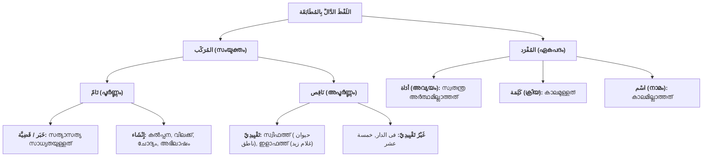

# الْمُرَكَّبُ وَالْمُفْرَدُ
## സംയുക്തവും ഏകവുമായ പ്രയോഗങ്ങൾ — Composite Expressions & Simple Terms

<!-- Top Navigation Bar -->
[⏮️ മുൻ അധ്യായം: 03. أنواع الدلالات الست](file:///Users/apple/Desktop/docs:books/Kanz-al-Tahqiq/Texts/Mantiq/tasrih-al-mantiq/Notes/Chapters/03-anwa-al-dalalat.md) | [📑 സൂചിക / Master Index](file:///Users/apple/Desktop/docs:books/Kanz-al-Tahqiq/Texts/Mantiq/tasrih-al-mantiq/Notes/Chapters/00-index.md) | [അടുത്ത അധ്യായം: 05. أنواع المفرد باعتبار المعنى ⏭️](file:///Users/apple/Desktop/docs:books/Kanz-al-Tahqiq/Texts/Mantiq/tasrih-al-mantiq/Notes/Chapters/05-anwa-al-mufrad-kulli-wa-juz-i.md)

---

### 1. മൂലപാഠം / النص الأصلي من المتن (Al-Matn al-Aṣl)

فَالدَّالُّ بِالْمُطَابَقَةِ، إِنْ قُصِدَتْ بِجُزْئِهِ دَلَالَةٌ عَلَى جُزْءِ مَعْنَاهُ: كَرَامِي الْحِجَارَةِ، فَمُرَكَّبٌ، وَهُوَ تَامٌّ إِنْ صَحَّ بِهِ التَّخَاطُبُ، وَإِلَّا فَنَاقِصٌ. وَأَمَّا التَّامُّ: إِنْ كَانَ مُحْتَمِلًا لِلصِّدْقِ وَالْكَذِبِ فَخَبَرٌ وَقَضِيَّةٌ، وَإِنْ لَمْ يَحْتَمِلْ فَإِنْشَاءٌ، وَهُوَ: إِنْ كَانَ مُفِيدًا لِطَلَبِ الْفِعْلِ فَأَمْرٌ، وَلِلتَّرْكِ فَنَهْيٌ، وَلِلْفَهْمِ فَاسْتِفْهَامٌ، وَإِلَّا فَتَمَنٍّ وَتَرَجٍّ وَتَعَجُّبٌ وَنِدَاءٌ.

وَأَمَّا النَّاقِصُ فَهُوَ تَقْيِيدِيٌّ: إِنْ كَانَ الْجُزْءُ الثَّانِي قَيْدًا لِلْأَوَّلِ بِوَصْفٍ، نَحْوُ: حَيَوَانٌ نَاطِقٌ، أَوْ إِضَافَةٍ، مِثْلُ: غُلَامُ زَيْدٍ؛ وَغَيْرُ تَقْيِيدِيٍّ إِنْ لَمْ يَكُنْ كَذَلِكَ، نَحْوُ: فِي الدَّارِ وَخَمْسَةَ عَشَرَ.

وَإِنْ لَمْ تُقْصَدْ فَمُفْرَدٌ. وَالْمُفْرَدُ إِنْ لَمْ يَسْتَقِلَّ بِالْمَفْهُومِيَّةِ فَهُوَ الْأَدَاةُ، وَإِنِ اسْتَقَلَّ، فَإِنْ كَانَ دَالًّا بِصِيغَتِهِ عَلَى زَمَانٍ مُعَيَّنٍ مِنَ الْأَزْمِنَةِ الثَّلَاثَةِ فَهُوَ الْكَلِمَةُ، وَإِلَّا فَهُوَ الِاسْمُ. وَالْأَوَّلُ لَيْسَ صَالِحًا لِكَوْنِهِ مَحْكُومًا عَلَيْهِ وَبِهِ، وَالثَّانِي صَالِحٌ لِلثَّانِي فَقَطْ، وَالثَّالِثُ يَصْلَحُ لِكُلٍّ مِنْهُمَا.

---

### 2. മലയാള പരിഭാഷ (ദർസ് ശൈലിയിലുള്ള വാച്യാർത്ഥവും ആശയവും)

മുതാബഖത്തായി അർത്ഥം നൽകുന്ന പദത്തിന്റെ (الدال بالمطابقة) ഒരു ഭാഗം കൊണ്ട് അതിന്റെ അർത്ഥത്തിന്റെ ഒരു ഭാഗത്തെ ഉദ്ദേശിക്കപ്പെടുന്നുണ്ടെങ്കിൽ — «കല്ലെറിയുന്നവൻ» (രാമിയുൽ ഹിജാറ) എന്നത് പോലെ — അത് **മുറക്കബ് (സംയുക്ത പ്രയോഗം / المركب)** ആകുന്നു.

ആ മുറക്കബ് പൂർണ്ണ സംസാരത്തിന് ഉപയുക്തമാകുന്നതാണെങ്കിൽ (കേൾവിക്കാരന് സന്ദേഹമില്ലാത്ത വിധം പൂർണ്ണമായതാണെങ്കിൽ) അത് **താമ്മ് (പൂർണ്ണം / تام)** ആകുന്നു; അങ്ങനെയല്ലെങ്കിൽ അത് **നാഖിസ്വ് (അപൂർണ്ണം / ناقص)** ആകുന്നു.
- **താമ്മ് (പൂർണ്ണ വാക്യം):** അത് സത്യവും അസത്യവും ആകാൻ സാധ്യതയുള്ളതാണെങ്കിൽ (ശരിയോ തെറ്റോ എന്ന് പറയാവുന്നതാണെങ്കിൽ) അതിന് **ഖബർ (വാർത്ത / خبر)** എന്നും **ഖദിയ്യ (പ്രസ്താവന / قضية)** എന്നും പറയപ്പെടുന്നു. അങ്ങനെയല്ലെങ്കിൽ (സത്യാസത്യ സാധ്യതയില്ലാത്തതാണെങ്കിൽ) അത് **ഇൻശാഅ് (إنشاء)** ആകുന്നു. ഇൻശാഅ് ഒരു കാര്യം ചെയ്യാൻ ആവശ്യപ്പെടുന്നതാണെങ്കിൽ **അംറ് (കൽപ്പന)**, ഒഴിവാക്കാൻ ആവശ്യപ്പെടുന്നതാണെങ്കിൽ **നഹ്‌യ് (വിലക്ക്)**, കാര്യം ഗ്രഹിക്കാൻ വേണ്ടിയുള്ളതാണെങ്കിൽ **ഇസ്തിഫ്ഹാം (ചോദ്യം)**; ഇതൊന്നുമല്ലെങ്കിൽ അത് **തമന്നി (അഭിലാഷം)**, **തരജ്ജി (പ്രതീക്ഷ)**, **തഅജ്ജുബ് (ആശ്ചര്യം)**, **നിദാഅ് (വിളി)** എന്നിവയാകുന്നു.
- **നാഖിസ്വ് (അപൂർണ്ണ പദസഞ്ചയം):** അതിൽ രണ്ടാമത്തെ പദം ആദ്യത്തെ പദത്തിന് വിശേഷണമായി വരുന്നതാണെങ്കിൽ അത് **തഖ്‌യീദിയ്യ് (ബന്ധിതം)** ആകുന്നു: ഒന്നുകിൽ വിശേഷണം (സ്വിഫത്ത്) മുഖേന, ഉദാ: «ചിന്തിക്കുന്ന ജീവി» (ഹയവാനുൻ നാത്വിഖ്); അല്ലെങ്കിൽ ചേർക്കൽ (ഇളാഫത്ത്) മുഖേന, ഉദാ: «സൈദിന്റെ അടിമ» (ഗുലാമു സൈദ്). അങ്ങനെയല്ലെങ്കിൽ അത് **ഗൈറു തഖ്‌യീദിയ്യ്** ആകുന്നു; ഉദാ: «വീട്ടിൽ» (ഫീദ്ദാർ), «പതിനഞ്ച്» (ഖംസത്ത അശറ).

പദത്തിന്റെ ഒരു ഭാഗം കൊണ്ട് അർത്ഥത്തിന്റെ ഒരു ഭാഗം ഉദ്ദേശിക്കപ്പെടുന്നില്ലെങ്കിൽ അത് **മുഫ്റദ് (ഏകപദം / مفرد)** ആകുന്നു (ഉദാ: സൈദ്, അബ്ദുല്ലാഹ് എന്ന് ഒരാൾക്ക് പേരിട്ടാൽ).

ഈ മുഫ്റദ്, സ്വതന്ത്രമായി അർത്ഥം നൽകാൻ ശേഷിയില്ലാത്തതാണെങ്കിൽ അത് **അദാത്ത് (അവ്യയം / أداة)** ആകുന്നു (വ്യാകരണത്തിലെ 'ഹർഫ്'). ഇനി സ്വതന്ത്രമായി അർത്ഥം നൽകാൻ ശേഷിയുള്ളതാണെങ്കിൽ: അത് അതിന്റെ രൂപം കൊണ്ട് തന്നെ മൂന്ന് കാലങ്ങളിൽ (ഭൂതം, വർത്തമാനം, ഭാവി) ഏതെങ്കിലും ഒരു നിശ്ചിത കാലത്തെ സൂചിപ്പിക്കുന്നതാണെങ്കിൽ അത് **കലിമത്ത് (ക്രിയ / كلمة)** ആകുന്നു (വ്യാകരണത്തിലെ 'ഫിഅ്ൽ'). ഒരു കാലത്തെയും സൂചിപ്പിക്കാത്തതാണെങ്കിൽ അത് **ഇസ്മ് (നാമം / اسم)** ആകുന്നു.
- **അദാത്ത്:** മൗദൂഅ് (വിഷയം) ആകാനോ മഹ്മൂൽ (വിധി) ആകാനോ സാധുവാകില്ല.
- **കലിമത്ത്:** മഹ്മൂൽ (വിധി) ആകാൻ മാത്രമേ സാധുവാകൂ.
- **ഇസ്മ്:** മൗദൂഅ് ആകാനും മഹ്മൂൽ ആകാനും സാധുവാകും.

---

### 3. ഇംഗ്ലീഷ് വിവർത്തനം / English Scholastic Translation

That which signifies by correspondence (*al-dāll bi-l-muṭābaqa*): if a part of the expression is intended to denote a part of its meaning—such as "stone-thrower" (*rāmī al-ḥijāra*)—it is a **Composite Expression (*Murakkab*)**.

A composite expression is **Complete (*Tāmm*)** if it forms an independent utterance conveying complete sense; otherwise, it is **Incomplete (*Nāqiṣ*)**.
- **Complete Composite:** If it admits of truth and falsity, it is an **Informative Report (*Khabar*)** and a **Proposition (*Qaḍiyya*)**; if it does not admit of truth and falsity, it is **Non-informative / Performative (*Inshāʾ*)**. Inshāʾ is either a command (*Amr*), a prohibition (*Nahy*), an inquiry (*Istifhām*), a wish (*Tamannī*), an anticipation (*Tarajjī*), an exclamation (*Taʿajjub*), or a vocative (*Nidāʾ*).
- **Incomplete Composite:** It is **Restrictive (*Taqyīdī*)** if the second element qualifies the first—either by adjectival description (e.g., "rational animal") or by genitive annexation (*iḍāfa*, e.g., "Zayd's servant"); it is **Non-restrictive (*Ghayr Taqyīdī*)** if not so qualified (e.g., "in the house", "fifteen").

If a part of the expression is not intended to denote a part of its meaning, it is a **Simple Term (*Mufrad*)**.
A simple term:
1. If it does not signify an independent concept by itself, it is a **Particle / Syncategorematic term (*al-Adāt*)**.
2. If it signifies an independent concept and its form indicates one of the three tenses (past, present, future), it is a **Verb (*al-Kalima*)**.
3. If it signifies an independent concept without indicating a specific tense, it is a **Noun (*al-Ism*)**.

The particle is not fit to serve as subject (*maḥkūm ʿalayhi*) or predicate (*maḥkūm bihi*). The verb is fit to serve as predicate only. The noun is fit to serve as both subject and predicate.

---

### 4. ത്രിഭാഷാ പദസൂചിക / المصطلحات / Key Terminology Matrix

| അറബിക് പദം (Arabic) | ലിപ്യന്തരണം (Transliteration) | മലയാള അർത്ഥം (Malayalam Equivalent) | English Logic Term | സാങ്കേതിക വിവരണം (Scholastic Definition) |
|---|---|---|---|---|
| **المُرَكَّب** | *al-Murakkab* | സംയുക്തം | Composite expression | പദത്തിന്റെ ഭാഗം അർത്ഥത്തിന്റെ ഭാഗത്തെ കുറിക്കുന്നത്. |
| **المُفْرَد** | *al-Mufrad* | ഏകപദം | Simple term | പദത്തിന്റെ ഭാഗം അർത്ഥത്തിന്റെ ഭാഗത്തെ കുറിക്കാത്തത്. |
| **المُرَكَّبُ التَّامّ** | *al-Murakkab al-tāmm* | പൂർണ്ണ വാക്യം | Complete utterance | പൂർണ്ണമായ സന്ദേശം നൽകുന്ന വാചകം. |
| **القَضِيَّة / الخَبَر** | *al-Qaḍiyya / al-Khabar* | പ്രസ്താവന / ഖദിയ്യ | Proposition / Assertion | ശരിയോ തെറ്റോ എന്ന് വിധിക്കാൻ സാധ്യതയുള്ള പ്രസ്താവന. |
| **الإِنْشَاء** | *al-Inshāʾ* | ഭാവോൽപ്പാദക വാക്യം | Performative / Non-assertive | സത്യം, അസത്യം എന്ന വിധി ബാധകമല്ലാത്ത വാചകം. |
| **المُرَكَّبُ النَّاقِص** | *al-Murakkab al-nāqiṣ* | അപൂർണ്ണ പദാവലി | Incomplete phrase | വാചകം പൂർത്തിയാകാത്ത സംയുക്തം. |
| **الأَدَاة** | *al-Adāt* | അവ്യയം | Particle / Copula / Syncategorematic | സ്വതന്ത്രമായി അർത്ഥമില്ലാത്ത പദം (ഹർഫ്). |
| **الكَلِمَة** | *al-Kalima* | ക്രിയ | Verb / Predicative term | കാലത്തെ സൂചിപ്പിക്കുന്ന ക്രിയാപദം (ഫിഅ്ൽ). |
| **الاسْم** | *al-Ism* | നാമം | Noun / Categorematic term | കാലബന്ധമില്ലാത്ത നാമപദം. |

---

### 5. വിശദമായ ശർഹും തത്വവിചാരവും / الشرح والتحليل المعمق

#### എ. മുറക്കബും മുഫ്റദും തമ്മിലുള്ള അതിർവരമ്പ്:
മന്തിഖിലെ 'മുഫ്റദ്' വ്യാകരണത്തിലെ മുഫ്റദിൽ നിന്ന് വ്യത്യസ്തമാണ്.
- «عبد الله» (അബ്ദുല്ലാഹ്) എന്ന് പറഞ്ഞ് അല്ലാഹുവിന്റെ അടിമയെ ഉദ്ദേശിച്ചാൽ അത് **മുറക്കബാണ്**.
- എന്നാൽ ഒരാൾക്ക് «അബ്ദുല്ലാഹ്» എന്ന് പേരിട്ട് വിളിക്കുമ്പോൾ അത് **മുഫ്റദാണ്**. കാരണം ആ പേരിന്റെ പകുതിയായ «അബ്ദ്» എന്നത് ആ വ്യക്തിയുടെ പകുതി ശരീരത്തെ കുറിക്കുന്നില്ല.

#### ബി. കലിമത്തും ഇസ്മും തർക്കശാസ്ത്രത്തിൽ വഹിക്കുന്ന പങ്ക്:
ഒരു പ്രസ്താവനയിൽ (ഖദിയ്യ) രണ്ട് പ്രധാന ഭാഗങ്ങളുണ്ട്:
1. **മൗദൂഅ് (Subject):** വിധി കൽപ്പിക്കപ്പെടുന്ന വിഷയം.
2. **മഹ്മൂൽ (Predicate):** വിഷയത്തിലേക്ക് ചേർക്കപ്പെടുന്ന വിധി.
- ഇസ്മ് (നാമം) സബ്ജക്റ്റായും പ്രെഡിക്കറ്റായും വരാം (ഉദാ: «സൈദ് പണ്ഡിതനാണ്»).
- കലിമത്ത് (ക്രിയ) പ്രെഡിക്കറ്റായി മാത്രമേ വരാൻ പാടുള്ളൂ (ഉദാ: «സൈദ് എഴുതി»).

---

### 6. ചിത്രരൂപങ്ങളും താരതമ്യ പട്ടികകളും / Visual Diagrams & Comparative Matrices

#### പദങ്ങളുടെ വാക്യഘടനയിലെ യോഗ്യത (Syntactic Role Matrix)

| പദം | സ്വതന്ത്ര അർത്ഥം? | കാല സൂചന? | മൗദൂഅ് (Subject) ആകുമോ? | മഹ്മൂൽ (Predicate) ആകുമോ? |
|---|---|---|---|---|
| **അദാത്ത് (الأداة)** | ഇല്ല (No) | ഇല്ല (No) | ഇല്ല (No) | ഇല്ല (No) |
| **കലിമത്ത് (الكلمة)** | ഉണ്ട് (Yes) | ഉണ്ട് (Yes) | ഇല്ല (No) | **ഉണ്ട് (Yes)** |
| **ഇസ്മ് (الاسم)** | ഉണ്ട് (Yes) | ഇല്ല (No) | **ഉണ്ട് (Yes)** | **ഉണ്ട് (Yes)** |

---

### 7. ഉദാഹരണ വിശകലനം / Analysis of Classical & Contemporary Examples

- **മത്‌നിലെ ഉദാഹരണം: «رَامِي الحِجَارَة» (കല്ലെറിയുന്നവൻ):**
  - «രാമീ» എന്നത് എറിയുന്നവനെയും, «ഹിജാറ» എന്നത് കല്ലുകളെയും സൂചിപ്പിക്കുന്നു. സംയുക്തത്തിന്റെ ഭാഗം അർത്ഥത്തിന്റെ ഭാഗത്തെ കുറിക്കുന്നതിനാൽ ഇത് **മുറക്കബാണ്**.
- **ആധുനിക ഉദാഹരണം: «കമ്പ്യൂട്ടർ പ്രോഗ്രാമർ»:**
  - 'കമ്പ്യൂട്ടർ' എന്നത് മെഷീനെയും, 'പ്രോഗ്രാമർ' എന്നത് കോഡ് ചെയ്യുന്ന വ്യക്തിയെയും കുറിക്കുന്നു. അതിനാൽ ഇത് മുറക്കബ് നാഖിസ്വ് തഖ്‌യീദിയാണ്.

---

### 8. ശ്രദ്ധിക്കേണ്ട സൂക്ഷ്മതകൾ / تنبيهات ومزالق شائعة (Common Student Pitfalls)

> [!WARNING]
> മന്തിഖിൽ ചർച്ച ചെയ്യുന്നത് **ഖദിയ്യ / ഖബർ (Propositions)** മാത്രമാണ്. ഇൻശാഇയ്യായ വാക്യങ്ങളായ ചോദ്യങ്ങൾ, കൽപ്പനകൾ, ശാസനകൾ എന്നിവയിൽ ശരിയോ തെറ്റോ എന്ന വിധി കൽപ്പിക്കാൻ സാധ്യമല്ലാത്തതിനാൽ അവയെ മന്തിഖിൽ വാദപ്രമാണങ്ങളായി സ്വീകരിക്കില്ല.

---

### 9. ആവർത്തന ചോദ്യങ്ങളും വ്യായാമങ്ങളും / تدريبات وتمارين (Review Exercises)

1. മുറക്കബും മുഫ്റദും വേർതിരിക്കുന്ന മാനദണ്ഡം എന്ത്?
2. ഖബറും ഇൻശാഉം തമ്മിലുള്ള വ്യത്യാസം ഉദാഹരണ സഹിതം വ്യക്തമാക്കുക.
3. താഴെ പറയുന്നവയെ മുഫ്റദ്, മുറക്കബ് താമ്മ്, മുറക്കബ് നാഖിസ്വ് എന്ന് വേർതിരിക്കുക:
   - «വിദ്യാർത്ഥി വന്നു»
   - «നീതിമാനായ ഭരണാധികാരി»
   - «മുഹമ്മദ്»
   - «നീ പഠിക്കുക!»
4. ക്രിയക്ക് മൗദൂഅ് (Subject) ആകാൻ കഴിയില്ല എന്ന് പറയുന്നതിന്റെ യുക്തിയെന്ത്?

---

<!-- Bottom Navigation Bar -->
[⏮️ മുൻ അധ്യായം: 03. أنواع الدلالات الست](file:///Users/apple/Desktop/docs:books/Kanz-al-Tahqiq/Texts/Mantiq/tasrih-al-mantiq/Notes/Chapters/03-anwa-al-dalalat.md) | [📑 സൂചിക / Master Index](file:///Users/apple/Desktop/docs:books/Kanz-al-Tahqiq/Texts/Mantiq/tasrih-al-mantiq/Notes/Chapters/00-index.md) | [അടുത്ത അധ്യായം: 05. أنواع المفرد باعتبار المعنى ⏭️](file:///Users/apple/Desktop/docs:books/Kanz-al-Tahqiq/Texts/Mantiq/tasrih-al-mantiq/Notes/Chapters/05-anwa-al-mufrad-kulli-wa-juz-i.md)
