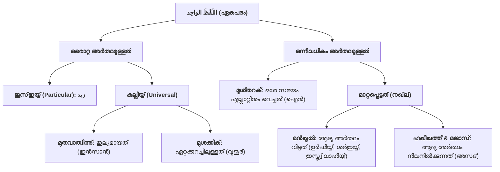

# أَنْوَاعُ الْمُفْرَدِ بِاعْتِبَارِ الْمَعْنَى
## അർത്ഥാടിസ്ഥാനത്തിലുള്ള പദവിഭാഗങ്ങൾ — Semantics: Universals, Particulars, Ambiguity & Metaphor

<!-- Top Navigation Bar -->
[⏮️ മുൻ അധ്യായം: 04. المركب والمفرد وأقسامهما](file:///Users/apple/Desktop/docs:books/Kanz-al-Tahqiq/Texts/Mantiq/tasrih-al-mantiq/Notes/Chapters/04-al-murakkab-wal-mufrad.md) | [📑 സൂചിക / Master Index](file:///Users/apple/Desktop/docs:books/Kanz-al-Tahqiq/Texts/Mantiq/tasrih-al-mantiq/Notes/Chapters/00-index.md) | [അടുത്ത അധ്യായം: 06. الكليات الخمس ⏭️](file:///Users/apple/Desktop/docs:books/Kanz-al-Tahqiq/Texts/Mantiq/tasrih-al-mantiq/Notes/Chapters/06-al-kulliyyat-al-khams.md)

---

### 1. മൂലപാഠം / النص الأصلي من المتن (Al-Matn al-Aṣl)

ثُمَّ اللَّفْظُ الْوَاحِدُ، إِنْ كَانَ مَعْنَاهُ وَاحِدًا: فَإِمَّا أَنْ يَكُونَ تَصَوُّرُهُ مَانِعًا عَنِ الصِّدْقِ عَلَى كَثِيرِينَ، فَعَلَمٌ وَجُزْئِيٌّ: كَزَيْدٍ، وَإِلَّا: فَإِنْ كَانَ صِدْقُ ذَلِكَ الْمَعْنَى عَلَى جَمِيعِ الْأَفْرَادِ عَلَى السَّوَاءِ، فَهُوَ كُلِّيٌّ مُتَوَاطٍ: كَصِدْقِ حَقِيقَةِ الْإِنْسَانِ عَلَى كُلِّ وَاحِدٍ مِنْ أَفْرَادِهِ مِنْ زَيْدٍ وَعَمْرٍو وَبَكْرٍ وَغَيْرِهِمْ عَلَى السَّوِيَةِ، وَإِلَّا فَكُلِّيٌّ مُشَكِّكٌ: كَالْوُجُودِ؛ فَإِنَّ صِدْقَهُ عَلَى الْوَاجِبِ تَعَالَى أَوْلَى وَأَقْدَمُ، بِالنِّسْبَةِ إِلَى صِدْقِهِ عَلَى الْمُمْكِنِ.

وَإِنْ كَانَ مَعْنَاهُ كَثِيرًا؛ فَإِنْ كَانَ وَضْعُهُ لَجَمِيعِ مَعَانِيهِ عَلَى السَّوَاءِ، فَمُشْتَرَكٌ: كَالْعَيْنِ لِلْبَاصِرَةِ، وَالْيَنْبُوعِ، وَالذَّهَبِ، وَالذَّاتِ، وَغَيْرِهَا، وَإِنْ لَمْ يَكُنْ كَذَلِكَ بَلْ يَكُونُ مَوْضُوعًا لِأَحَدِ الْمَعَانِي، وَنُقِلَ إِلَى الثَّانِي لِمُنَاسَبَةٍ بَيْنَهُمَا؛ فَإِنْ كَانَ اسْتِعْمَالُهُ فِي الْمَعْنَى الْأَوَّلِ الْمَوْضُوعِ لَهُ مَتْرُوكًا، وَفِي الثَّانِي مُشْتَهِرًا - فَمَنْقُولٌ. وَالْمَنْقُولُ: إِنْ كَانَ نَاقِلُهُ عُرْفًا عَامًا، فَعُرْفِيٌّ: كَالدَّابَّةِ الْمَوْضُوعَةِ لِمَا يَدِبُّ عَلَى الْأَرْضِ، الْمَنْقُولَةِ إِلَى ذَوَاتِ الْقَوَائِمِ الْأَرْبَعِ، وَإِنْ كَانَ شَرْعًا، فَشَرْعِيٌّ: كَالصَّلَاةِ الْمَوْضُوعَةِ لِلدُّعَاءِ، المُنْقُولَةِ إِلَى الْأَرْكَانِ الْمَخْصُوصَةٍ، وَإِنْ كَانَ عُرْفًا خَاصًا، فَاصْطِلَاحِيٌّ: كَالْفِعْلِ الْمَوْضُوعِ لِمَا يَصْدُرُ عَنِ الْفَاعِلِ، الْمَنْقُولِ إِلَى مَا دَلَّ عَلَى مَعْنَى فِي نَفْسِهِ مُقْتَرِنًّا بِأَحَدٍ الْأَزْمِنَةِ، وَإِنْ لَمْ يَكُنِ الْأَوَّلُ مَتْرُوكًا، فَاللَّفْظُ بِالنِّسْبَةِ إِلَيْهِ حَقِيقَةٌ، وَإِلَى الثَّانِي مَجَازٌ: كَالْأَسَدِ، وَاللَّفْظُ الْمُتَعَدِّدُ: إِنْ كَانَ مَعْنَاهُ وَاحِدًا، فَمُتَرَادِفٌ: كَاللَّيْثِ وَالْغَضَنْفَرِ؛ وَالْقُعُودِ وَالْجُلُوسِ، وَإِنْ كَانَ مُتَعَدِّدًا، فَمُتَبَائِنٌ: كَالشَّجَرِ وَالْحَجَرِ.

---

### 2. മലയാള പരിഭാഷ (ദർസ് ശൈലിയിലുള്ള വാച്യാർത്ഥവും ആശയവും)

പിന്നെ, ഒരു ഏകപദത്തിന് (اللفظ الواحد) ഒരു അർത്ഥം മാത്രമാണുള്ളതെങ്കിൽ:
1. ആ പദത്തെ വിഭാവന ചെയ്യുന്നത് തന്നെ അത് പലരിലേക്ക് ബാധകമാകുന്നതിനെ തടയുന്നതാണെങ്കിൽ (അതായത് ഒരൊറ്റ നിർദ്ദിഷ്ട വ്യക്തിയെ മാത്രം കുറിക്കുന്നതാണെങ്കിൽ) അത് **അലമും (നാമവിശേഷണം) ജുസ്ഇയ്യും (സവിശേഷ പദം / جزئي)** ആകുന്നു; ഉദാ: «സൈദ്».
2. അങ്ങനെ തടയാത്തതാണെങ്കിൽ (പലരിലേക്ക് ബാധകമാകുന്നതാണെങ്കിൽ അത് **കുല്ലിയ്യ് / കുള്ളി / كلي**) ആണ്. ആ കുല്ലിയ്യ് അതിന്റെ എല്ലാ വ്യക്തികളിലേക്കും ഒരേ തുല്യതയോടെയാണ് ബാധകമാകുന്നതെങ്കിൽ അത് **കുല്ലിയ്യ് മുതവാത്വിഅ് (ഏകസാധാരണം / متواطئ)** ആകുന്നു; ഉദാ: «മനുഷ്യൻ» (ഇൻസാൻ) എന്ന യാഥാർത്ഥ്യം സൈദ്, അംറ്, ബക്കർ എന്നിവരിലെല്ലാം തുല്യമായി ഒരേ അളവിൽ ബാധകമാകുന്നത് പോലെ.
3. തുല്യമായല്ല, മറിച്ച് ഏറ്റക്കുറച്ചിലുകളോടെയാണെങ്കിൽ അത് **കുല്ലിയ്യ് മുശക്കിക് (ശ്രേണീബദ്ധ സാധാരണം / مشكك)** ആകുന്നു; ഉദാ: «അസ്തിത്വം» (വുജൂദ്). അല്ലാഹു തആലയിലുള്ള അസ്തിത്വം സൃഷ്ടികളിലുള്ള അസ്തിത്വത്തേക്കാൾ കൂടുതൽ പ്രഥമവും അത്യുന്നതവുമാണ്.

ഇനി, ഒരു ഏകപദത്തിന് ഒന്നിലധികം അർത്ഥങ്ങളുണ്ടെങ്കിൽ:
1. ആ പദം അതിന്റെ എല്ലാ അർത്ഥങ്ങൾക്കും തുല്യമായാണ് നിശ്ചയിക്കപ്പെട്ടിട്ടുള്ളതെങ്കിൽ അത് **മുശ്തറക് (ഏകാക്ഷര നാനാർത്ഥ പദം / مشترك)** ആകുന്നു. ഉദാ: «ഐൻ» (عين) എന്ന പദം കണ്ണ്, നീരുറവ, സ്വർണ്ണം, വ്യക്തിസത്ത എന്നിവയിലെല്ലാം തുല്യമായി ഉപയോഗിക്കപ്പെടുന്നത് പോലെ.
2. അങ്ങനെയല്ല, പദം ആദ്യം ഒരർത്ഥത്തിന് നിശ്ചയിക്കപ്പെടുകയും പിന്നീട് അവ തമ്മിലുള്ള ബന്ധത്താൽ രണ്ടാമതൊരു അർത്ഥത്തിലേക്ക് മാറ്റപ്പെടുകയും (നഖ്‌ല്) ചെയ്തതാണെങ്കിൽ:
   - ആദ്യത്തെ അർത്ഥത്തിലുള്ള പ്രയോഗം ഉപേക്ഷിക്കപ്പെടുകയും രണ്ടാമത്തെ അർത്ഥത്തിൽ പ്രസിദ്ധമാവുകയും ചെയ്തതാണെങ്കിൽ അത് **മൻഖൂൽ (സ്ഥാനാന്തരിതം / منقول)** ആകുന്നു.
     - മാറ്റം വരുത്തിയത് പൊതുജന ഭാഷാശീലമാണെങ്കിൽ **മൻഖൂലുൻ ഉർഫിയ്യ് ആം** (ഉദാ: «ദാബ്ബത്ത്» — ഇഴജന്തുക്കൾക്ക് നിശ്ചയിച്ച പദം പിന്നീട് നാലുകാലുള്ള മൃഗങ്ങൾക്ക് മാത്രമായി മാറിയത്).
     - മാറ്റം വരുത്തിയത് മതനിയമമാണെങ്കിൽ **മൻഖൂലുൻ ശർഇയ്യ്** (ഉദാ: «സ്വലാത്ത്» — പ്രാർത്ഥനയ്ക്ക് നിശ്ചയിച്ച പദം തക്ബീർ കൊണ്ട് തുടങ്ങി സലാം കൊണ്ട് അവസാനിക്കുന്ന നിശ്ചിത നമസ്കാര കർമ്മങ്ങൾക്ക് മാത്രമായി മാറിയത്).
     - മാറ്റം വരുത്തിയത് പ്രത്യേക ശാസ്ത്രകാരന്മാരാണെങ്കിൽ **മൻഖൂലുൻ ഇസ്ത്വിലാഹിയ്യ്** (ഉദാ: വ്യാകരണ പണ്ഡിതന്മാരുടെ അടുക്കൽ «ഫിഅ്ൽ» — കർമ്മം എന്ന അർത്ഥത്തിൽ നിന്ന് കാലത്തോട് ചേർന്ന ക്രിയ എന്ന സാങ്കേതിക അർത്ഥത്തിലേക്ക് മാറിയത്).
   - ആദ്യ അർത്ഥം ഉപേക്ഷിക്കപ്പെടാതെ നിലനിൽക്കുകയാണെങ്കിൽ ആദ്യ അർത്ഥത്തെ സംബന്ധിച്ച് അത് **ഹഖീഖത്തും (യാഥാർത്ഥ്യം)**, രണ്ടാമത്തെ അർത്ഥത്തെ സംബന്ധിച്ച് അത് **മജാസും (അലങ്കാരികം / ഉപമ)** ആകുന്നു. ഉദാ: «അസദ്» (സിംഹം) എന്നത് വന്യമൃഗത്തിന് ഹഖീഖത്തും, ധീരനായ മനുഷ്യന് മജാസും ആകുന്നു.

പദങ്ങൾ ഒന്നിലധികമുണ്ടെങ്കിൽ:
- അർത്ഥം ഒന്നാണെങ്കിൽ അത് **മുതറാദിഫ് (പര്യായപദങ്ങൾ / مترادف)**; ഉദാ: അസദ്, ലൈസ്, ഗളൻഫർ (സിംഹം); ഖുഊദ്, ജുലൂസ് (ഇരിക്കൽ).
- അർത്ഥം വെവ്വേറെയാണെങ്കിൽ അത് **മുതബായിൻ (ഭിന്നപദങ്ങൾ / متباين)**; ഉദാ: വൃക്ഷവും കല്ലും (ശജർ, ഹജർ).

---

### 3. ഇംഗ്ലീഷ് വിവർത്തനം / English Scholastic Translation

A single term (*al-lafẓ al-wāḥid*):
If its meaning is single:
1. If the very conception of it prevents it from being predicated of multiple individuals, it is a **Proper Name / Particular (*ʿAlam / Juzʾī*)**, such as "Zayd".
2. Otherwise (if it can be predicated of multiple individuals), it is a **Universal (*Kullī*)**:
   - If its application to all its individuals is strictly uniform and equal, it is a **Univocal Universal (*Kullī Mutawāṭiʾ*)**, such as the quiddity of "Human" predicated equally of Zayd, ʿAmr, Bakr, etc.
   - If its application varies by priority, posteriority, or degree, it is an **Analogous / Equivocal Universal (*Kullī Mushakkik*)**, such as "Existence" (*al-wujūd*), since its application to the Necessary Being (*al-Wājib Taʿālā*) is prior and more worthy than its application to contingent beings (*al-mumkin*).

If its meanings are multiple:
1. If it was coined for all of its meanings equally by original institution, it is a **Homonym (*Mushtarak*)**, such as *ʿAyn* denoting the physical eye, water spring, gold, and essence.
2. If it was coined for one meaning and then transferred to a second meaning due to an affinity between them:
   - If the first meaning was abandoned and the second became predominant, it is a **Transferred Term (*Manqūl*)**:
     - Transferred by general custom: **Commonly Conventional (*ʿUrfī ʿĀmm*)**, such as *Dābba* (originally any creature crawling on earth, transferred to quadrupeds).
     - Transferred by religious law: **Juridical-Religious (*Sharʿī*)**, such as *Ṣalāt* (originally supplication, transferred to the specific ritual prayer).
     - Transferred by technical specialists: **Technical (*Iṣṭilāḥī*)**, such as *Fiʿl* in grammar (originally generic action, transferred to tense-bound verbs).
   - If the original meaning was not abandoned, it is **Literal (*Ḥaqīqa*)** relative to the first, and **Metaphorical (*Majāz*)** relative to the second, such as "Lion" (*Asad*) applied to the predatory beast (literal) and the brave warrior (metaphorical).

Multiple terms:
- If their meaning is identical, they are **Synonyms (*Mutarādif*)**, such as *Layth* and *Ghaḍanfar* (lion), or *Quʿūd* and *Julūs* (sitting).
- If their meanings differ, they are **Disparate / Distinct terms (*Mutabāyin*)**, such as "Tree" (*Shajar*) and "Stone" (*Ḥajar*).

---

### 4. ത്രിഭാഷാ പദസൂചിക / المصطلحات / Key Terminology Matrix

| അറബിക് പദം (Arabic) | ലിപ്യന്തരണം (Transliteration) | മലയാള അർത്ഥം (Malayalam Equivalent) | English Logic Term | സാങ്കേതിക വിവരണം (Scholastic Definition) |
|---|---|---|---|---|
| **الجُزْئِيّ** | *al-Juzʾī* | ജുസ്ഇയ്യ് / സവിശേഷ പദം | Particular term | മനസ്സിൽ വിഭാവന ചെയ്യുമ്പോൾ തന്നെ ഒന്നിലധികം ആളുകളിലേക്ക് പങ്കുവെക്കപ്പെടാൻ വിസമ്മതിക്കുന്ന പദം. |
| **الكُلِّيّ** | *al-Kullī* | കുല്ലിയ്യ് / സാർവത്രിക പദം | Universal term | മനസ്സിൽ വിഭാവന ചെയ്യുമ്പോൾ അനേകം വ്യക്തികളിലേക്ക് ബാധകമാകാൻ തടസ്സമില്ലാത്ത പദം. |
| **المُتَوَاطِئ** | *al-Mutawāṭiʾ* | മുതവാത്വിഅ് | Univocal universal | തന്റെ വ്യക്തികളിലേക്ക് ഒരേ തുല്യതയോടെ ബാധകമാകുന്ന പൊതുപദം. |
| **المُشَكِّك** | *al-Mushakkik* | മുശക്കിക് | Analogous / Gradational universal | വ്യക്തികളിലേക്ക് ഏറ്റക്കുറച്ചിലുകളോടെ ബാധകമാകുന്ന പദം. |
| **المُشْتَرَك** | *al-Mushtarak* | മുശ്തറക് | Homonym / Equivocal | ഒന്നിലധികം അർത്ഥങ്ങൾക്ക് ഒരേസമയം ഭാഷാനിർണ്ണയം ചെയ്യപ്പെട്ട പദം. |
| **المَنْقُول** | *al-Manqūl* | മൻഖൂൽ | Transferred / Coined term | മുൻ അർത്ഥം ഉപേക്ഷിച്ച് പുതിയ സാങ്കേതിക അർത്ഥത്തിലേക്ക് മാറ്റപ്പെട്ട പദം. |
| **الحَقِيقَة وَالمَجَاز** | *al-Ḥaqīqa wa-l-Majāz* | യാഥാർത്ഥ്യവും ഉപമയും | Literal & Metaphorical | യഥാർത്ഥ ഭാഷാർത്ഥത്തിൽ ഉപയോഗിക്കലും സാദൃശ്യത്താൽ അലങ്കാരികമായി ഉപയോഗിക്കലും. |
| **المُتَرَادِف** | *al-Mutarādif* | പര്യായപദം | Synonymous terms | പദങ്ങൾ പലതും അർത്ഥം ഒന്നാകുന്നത്. |
| **المُتَبَايِن** | *al-Mutabāyin* | ഭിന്നപദങ്ങൾ | Disparate terms | പദങ്ങളും അർത്ഥങ്ങളും വ്യത്യസ്തമായിരിക്കുന്നത്. |

---

### 5. വിശദമായ ശർഹും തത്വവിചാരവും / الشرح والتحليل المعمق

#### എ. കുല്ലിയും ജുസ്ഇയ്യും തമ്മിലുള്ള യുക്തിഭദ്രമായ വ്യത്യാസം:
മന്തിഖിൽ കുല്ലിയ്യ് ആവുക എന്നത് ബാഹ്യലോകത്ത് എത്ര ആളുകളുണ്ട് എന്നതിനെ ആശ്രയിച്ചല്ല; ബുദ്ധിയിലുള്ള സങ്കൽപ്പത്തെ (മഫ്ഹൂം) ആശ്രയിച്ചാണ്:
1. ബാഹ്യത്തിൽ അനേകം ആളുകളുള്ള കുല്ലി: «മനുഷ്യൻ» (ഇൻസാൻ).
2. ബാഹ്യത്തിൽ ഒരൊറ്റ വ്യക്തി മാത്രമുള്ള, എന്നാൽ ഒന്നിലധികം വ്യക്തികളെ ഉൾക്കൊള്ളാൻ ബുദ്ധിപരമായി തടസ്സമില്ലാത്ത കുല്ലി: «സൂര്യൻ» (الشمس).
3. ബാഹ്യത്തിൽ ഒരിക്കലും ഉണ്ടാകാൻ സാധ്യമല്ലാത്ത, എന്നാൽ ബുദ്ധിയിൽ പൊതുവായ കുല്ലി: «രണ്ടാം ദൈവം» (شريك الباري).

#### ബി. മൻഖൂലിന്റെ പ്രാധാന്യം ശാസ്ത്രങ്ങളിൽ:
ഓരോ വിജ്ഞാനശാഖയും വളരുന്നത് അവയുടെ 'മൻഖൂൽ ഇസ്ത്വിലാഹിയ്യ്' അഥവാ ടെക്നിക്കൽ പദാവലികളിലൂടെയാണ്. 
- ഉദാഹരണത്തിന് ഫിഖ്ഹിൽ «വുളൂഅ്» എന്നാൽ ഭാഷാർത്ഥത്തിൽ 'ശുദ്ധി' എന്നാണെങ്കിലും ശരീഅത്തിൽ പ്രത്യേക അവയവങ്ങൾ കഴുകുന്ന കർമ്മമാണ്. 
- മന്തിഖിൽ «ഖിയാസ്» എന്നാൽ കേവല അളവല്ല, സിലോഗിസമാണ്.

---

### 6. ചിത്രരൂപങ്ങളും താരതമ്യ പട്ടികകളും / Visual Diagrams & Comparative Matrices

#### പദാർത്ഥ മാട്രിക്സ് (Semantics Taxonomy Matrix)

| പദവിഭാഗം | അർത്ഥങ്ങളുടെ എണ്ണം | ബാധകമാകുന്ന രീതി | ഉദാഹരണം | ആധുനിക സമാനത |
|---|---|---|---|---|
| **ജുസ്ഇയ്യ്** | 1 | ഒരൊറ്റ നിർദ്ദിഷ്ട വ്യക്തി | സൈദ്, ഇന്ത്യ, ഹിമാലയം | Unique Identifier / Proper Noun |
| **കുല്ലിയ്യ് മുതവാത്വിഅ്** | 1 | എല്ലാവരിലേക്കും തുല്യമായി | മനുഷ്യൻ, നക്ഷത്രം | Data Type / Class Instance |
| **കുല്ലിയ്യ് മുശക്കിക്** | 1 | ശ്രേണീബദ്ധമായി (ഗ്രേഡേഷൻ) | പ്രകാശം (സൂര്യൻ vs മെഴുകുതിരി) | Scalar Intensity / Gradient |
| **മുശ്തറക്** | പലത് | എല്ലാ അർത്ഥങ്ങൾക്കും ഒരുപോലെ | ഐൻ (കണ്ണ്, സ്വർണ്ണം, ഉറവ) | Homonym / Ambiguous Lexeme |
| **മൻഖൂൽ ശർഇയ്യ്** | പലത് (മാറ്റപ്പെട്ടത്) | ആചാരപരമായി പുതിയ അർത്ഥം | സ്വലാത്ത്, ഹജ്ജ്, സകാത്ത് | Domain-Specific Technical Term |
| **ഹഖീഖത്ത് & മജാസ്** | പലത് (സാദൃശ്യത്താൽ) | യഥാർത്ഥവും അലങ്കാരികവും | അസദ് (സിംഹം / വീരൻ) | Literal vs. Metaphorical |

---

### 7. ഉദാഹരണ വിശകലനം / Analysis of Classical & Contemporary Examples

- **«ഐൻ» (العين) എന്ന മുശ്തറക് പദം:**
  ഒരാൾ «ഞാൻ ഇന്നലെ ഐൻ കണ്ടു» എന്ന് പറഞ്ഞാൽ, കൂടെ സൂചകങ്ങളില്ലെങ്കിൽ (ഖരീന) അവ്യക്തത (തശവീശ്) ഉണ്ടാകുന്നു. അതുകൊണ്ടാണ് മന്തിഖിലും വാദപ്രതിവാദങ്ങളിലും മുശ്തറക് പദങ്ങൾ ഉപയോഗിക്കുമ്പോൾ വിശദീകരണം നൽകണമെന്ന് നിഷ്കർഷിക്കുന്നത്.
- **കമ്പ്യൂട്ടിംഗിലെ ഉദാഹരണം: «Bug» (ബഗ്ഗ്):**
  യഥാർത്ഥത്തിൽ ഷഡ്പദങ്ങളെ സൂചിപ്പിക്കുന്ന വാക്ക് കമ്പ്യൂട്ടർ സയൻസിൽ സോഫ്റ്റ്‌വെയർ കോഡിംഗിലെ പിഴവുകളെ സൂചിപ്പിക്കുന്ന 'മൻഖൂൽ ഇസ്ത്വിലാഹിയ്യ്' ആയി പരിണമിച്ചു.

---

### 8. ശ്രദ്ധിക്കേണ്ട സൂക്ഷ്മതകൾ / تنبيهات ومزالق شائعة (Common Student Pitfalls)

> [!WARNING]
> പല വിദ്യാർത്ഥികളും 'മുശ്തറക്' (Homonym) എന്നതിനെയും 'മുതറാദിഫ്' (Synonym) എന്നതിനെയും പരസ്പരം മാറിപ്പോകാറുണ്ട്:
> - **മുശ്തറക്:** വാക്ക് ഒരൊറ്റ ഒന്ന്, അർത്ഥം പലത് (ഉദാ: «ഐൻ»).
> - **മുതറാദിഫ്:** വാക്ക് പലത്, അർത്ഥം ഒരൊറ്റ ഒന്ന് (ഉദാ: «അസദ്», «ലൈസ്»).

---

### 9. ആവർത്തന ചോദ്യങ്ങളും വ്യായാമങ്ങളും / تدريبات وتمارين (Review Exercises)

1. കുല്ലിയും ജുസ്ഇയ്യും നിർവചിക്കുക.
2. 'മുതവാത്വിഅ്', 'മുശക്കിക്' എന്നിവ തമ്മിലുള്ള വ്യത്യാസമെന്ത്? ഉദാഹരണ സഹിതം സമർത്ഥിക്കുക.
3. മൻഖൂലിന്റെ മൂന്ന് വിഭാഗങ്ങൾ ഏതെല്ലാം? ഓരോന്നിനും രണ്ട് വീതം ഉദാഹരണങ്ങൾ കണ്ടെത്തുക.
4. താഴെ പറയുന്ന പദങ്ങളെ വർഗ്ഗീകരിക്കുക:
   - സൂര്യാസ്തമയം
   - 'മൗസ്' (കമ്പ്യൂട്ടർ മൗസ്)
   - 'സ്വൗം' (നോമ്പ്)
   - ഇരിക്കുന്നവൻ, ഉപവിഷ്ടനായവൻ

---

<!-- Bottom Navigation Bar -->
[⏮️ മുൻ അധ്യായം: 04. المركب والمفرد وأقسامهما](file:///Users/apple/Desktop/docs:books/Kanz-al-Tahqiq/Texts/Mantiq/tasrih-al-mantiq/Notes/Chapters/04-al-murakkab-wal-mufrad.md) | [📑 സൂചിക / Master Index](file:///Users/apple/Desktop/docs:books/Kanz-al-Tahqiq/Texts/Mantiq/tasrih-al-mantiq/Notes/Chapters/00-index.md) | [അടുത്ത അധ്യായം: 06. الكليات الخمس ⏭️](file:///Users/apple/Desktop/docs:books/Kanz-al-Tahqiq/Texts/Mantiq/tasrih-al-mantiq/Notes/Chapters/06-al-kulliyyat-al-khams.md)
