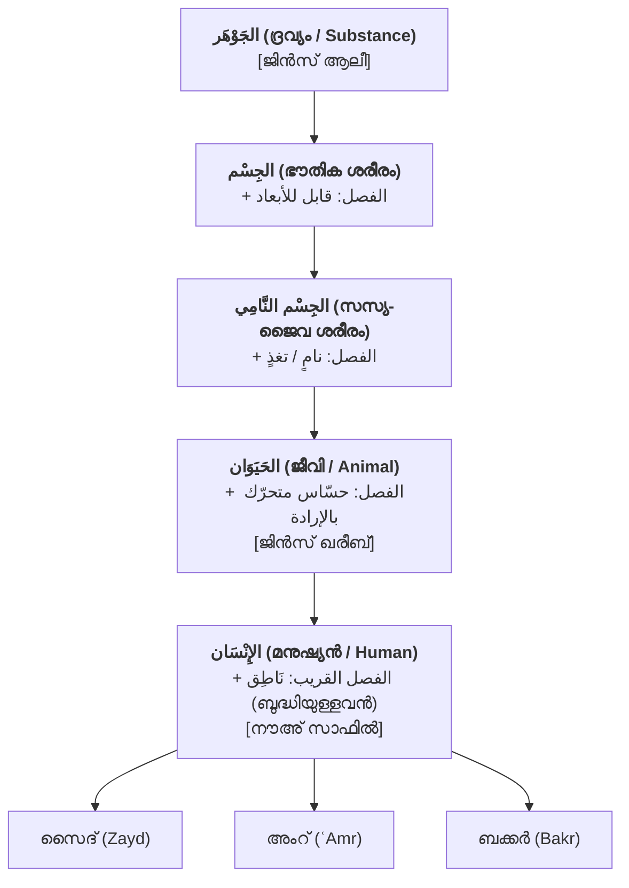

# الْكُلِّيَّاتُ الْخَمْسُ
## അഞ്ച് കുല്ലിയ്യാത്തുകൾ — The Porphyrian Tree: The Five Universals (Predicables)

<!-- Top Navigation Bar -->
[⏮️ മുൻ അധ്യായം: 05. أنواع المفرد باعتبار المعنى](file:///Users/apple/Desktop/docs:books/Kanz-al-Tahqiq/Texts/Mantiq/tasrih-al-mantiq/Notes/Chapters/05-anwa-al-mufrad-kulli-wa-juz-i.md) | [📑 സൂചിക / Master Index](file:///Users/apple/Desktop/docs:books/Kanz-al-Tahqiq/Texts/Mantiq/tasrih-al-mantiq/Notes/Chapters/00-index.md) | [അടുത്ത അധ്യായം: 07. النسب الأربع بين الكليات ⏭️](file:///Users/apple/Desktop/docs:books/Kanz-al-Tahqiq/Texts/Mantiq/tasrih-al-mantiq/Notes/Chapters/07-al-nisab-al-arba.md)

---

### 1. മൂലപാഠം / النص الأصلي من المتن (Al-Matn al-Aṣl)

ثُمَّ الْكُلِّيُّ: إِمَّا أَنْ يَكُونَ تَمَامَ حَقِيقَةِ أَفْرَادِهِ كَالْإِنْسَانِ الَّذِي هُوَ تَمَامُ حَقِيقَةِ زَيْدٍ وَعَمْرِو وَبَكْرٍ وَغَيْرِهِمْ، فَهُوَ نَوْعٌ: صَادِقٌ عَلَى الْمُتَّفِقِينَ بِالْحَقِيقَةِ فِي جَوَابٍ مَا هُوَ، مَثَلًا: إِذَا قِيلَ: زَيْدٌ وَعَمْرٍو مَا هُمَا، يُقَالُ فِي الْجَوَابِ: إِنْسَانٌ؛ فَلَا امْتِيَازَ لِأَحَدٍ مِنْهُمَا عَنِ الآخَرِ إِلَّا بِحَسَبِ الْعَوَارِضِ الْمُعَيَّنَةِ، وَيُقَالُ لَهُ: النَّوْعُ الْحَقِيقِيُّ.

وَيُعَرَّفُ النَّوْعُ الْإِضَافِيُّ: بِأَنَّهُ حَقِيقَةٌ يُحْمَلُ عَلَيْهَا وَعَلَى غَيْرِهَا الْجِنْسُ فِي جَوَابٍ مَا هُوَ؛ فَالْإِضَافِيُّ: إِمَّا نَوْعٌ حَقِيقِيٌّ مُنْدَرِجٌ تَحْتَ جِنْسٍ: كَالْإِنْسَانِ الْمُنْدَرِجِ تَحْتَ الْحَيَوَانِ، أَوْ جِنْسٌ تَحْتَ جِنْسٍ آخَرَ: كَالْحَيَوَانِ تَحْتَ الْجِسْمِ النَّامِي، وَهُوَ تَحْتَ الْجِسْمِ الْمُطْلَقِ، وَهُوَ تَحْتَ الْجَوْهَرِ؛ فَيُحْمَلُ عَلَى الإِنْسَانِ وَالْفَرَسِ حَيَوَانٌ فِي جَوَابٍ مَا هُمَا، وَكَذَا جِسْمٌ نَامٍ عَلَى الْحَيَوَانِ وَالشَّجَرِ، وَالجِسْمُ الْمُطْلَقُ عَلَيْهِ وَعَلَى الْحَجَرِ، وَالْجَوْهَرُ عَلَيْهِ وَعَلَى الْعُقُولِ؛ فَإِنَّ الْإِنْسَانَ يَصْدُقُ عَلَيْهِ تَعْرِيفُ النَّوْعِ الْحَقِيقِيِّ وَالْإِضَافِيِّ كِلَيْهِمَا، وَيُقَالُ لَهُ: نَوْعٌ سَافِلٌ وَنَوْعُ الْأَنْوَاعِ وَمِنَ الْحَيَوَانِ إِلَى الْجِسْمِ الْمُطْلَقِ: نَوْعٌ إِضَافِيٌّ فَقَطْ: أَمَّا الْجِسْمُ الْمُطْلَقُ فَيُقَالُ لَهُ: نَوْعٌ عَالٍ، وَمَا بَيْنَهُمَا، كَالْحَيَوَانِ وَالْجِسْمِ النَّامِي، نَوْعٌ مُتَوَسِّطٌ.

وَإِمَّا أَنْ يَكُونَ جُزْءَ حَقِيقَةِ أَفْرَادِهِ. فَإِنْ كَانَ تَمَامَ الْمُشْتَرَكِ بَيْنَ الْأُمُورِ الْمُخْتَلِفَةِ الْحَقَائِقِ، وَاقِعًا فِي جَوَابِ مَا هُوَ - بِحَيْثُ لَوْ وُجِدَ جُزْءٌ مُشْتَرَكٌ بَيْنَ الْحَقِيقَتَيْنِ - لَا يَكُونُ خَارِجًا عَنْ ذَلِكَ الْجُزْءِ؛ فَمَا يُوجَدُ بَيْنَ الْإِنْسَانِ وَالْفَرَسِ مِنَ الْجَوْهَرِيَّةِ وَالْقَابِلِيَّةِ لِلْأَبْعَادِ وَالْحَسَّاسِيَّةِ وَالتَّحَرُّكِ بِالْإِرَادَةِ، لَيْسَ خَارِجًا عَنِ الْحَيَوَانِ، فَهُوَ جِنْسٌ: كَمَا إِذَا سُئِلَ: أَنَّ الْإِنْسَانَ وَالْفَرَسَ مَا هُمَا؟ أُجِيبَ بِـ«الْحَيَوَانِ» الَّذِي هُوَ تَمَامُ الْحَقِيقَةِ الْمُشْتَرَكَةِ.

وَيُعَرَّفُ الْجِنْسُ: بِأَنَّهُ كُلِّيٌّ مَقُولٌ عَلَى أُمُورٍ مُخْتَلِفَةِ الْحَقَائِقِ فِي جَوَابِ مَا هُوَ، فَهُوَ قَرِيبٌ: إِنْ كَانَ تَمَامَ الْمُشْتَرَكِ بَيْنَ الْمَاهِيَّةِ وَجَمِيعِ مُشَارِكَاتِهَا فِي ذَلِكَ الْجِنْسِ، وَبَعِيدٌ: إِنْ كَانَ تَمَامَ الْمُشْتَرَكِ بَيْنَهَا وَبَيْنَ بَعْضِ الْمُشَارِكَاتِ فِيهِ؛ فَلِلْحَقِيقَةِ الْوَاحِدَةِ أَجْنَاسٌ مُتَعَدِّدَةٌ بَعْضُهَا فَوْقَ بَعْضٍ: كَالْحَيَوَانِ وَالْجِسْمِ النَّامِي وَالْجِسْمِ الْمُطْلَقِ وَالْجَوْهَرِ؛ فَالْحَيَوَانُ جِنْسٌ قَرِيبٌ لِلْإِنْسَانِ، تَمَامُ الْمُشْتَرَكِ بَيْنَهُ وَبَيْنَ الْفَرَسِ وَالْحِمَارِ وَالْغَنَمِ وَالْبَقَرِ وَغَيْرِهَا، وَالْبَوَاقِي بَعِيدَةٌ لَهُ؛ أَمَّا الْحَيَوَانُ- الَّذِي هُوَ جِنْسٌ قَرِيبٌ لِلْإِنْسَانِ- يُسَمَّى جِنْسًا سَافِلًا، وَالْجَوْهَرُ - الَّذِي هُوَ بَعِيدٌ لَهُ بِثَلَاثِ مَرَاتِبَ - جِنْسًا عَالِيًا، وَالْجِسْمُ الْمُطْلَقُ - الَّذِي هُوَ بَعِيدٌ بِمَرْتَبَتَيْنِ، وَالْجِسْمُ النَّامِي - الَّذِي هُوَ بَعِيدٌ بِمَرْتَبَةٍ وَاحِدَةٍ- جِنْسًا مُتَوَسِّطًا.

وَإِنْ لَمْ يَكُنْ تَمَامَ الْمُشْتَرَكِ: فَإِمَّا أَنْ لَمْ يَكُنْ مُشْتَرَكًا أَصْلًا، وَيَكُونُ مُمَيِّزًا لِلْحَقِيقَةِ عَنِ الْمُشَارِكَاتِ فِي الْجِنْسِ الْقَرِيبِ، فَهُوَ فَصْلٌ قَرِيبٌ: كَالنَّاطِقِ بِالنِّسْبَةِ إِلَى الْإِنْسَانِ؛ فَإِنَّهُ مُمَيِّزٌ لَهُ عَنِ الْمُشَارِكَاتِ فِي الْحَيَوَانِ - الَّذِي هُوَ جِنْسُهُ الْقَرِيبُ - أَوْ يَكُونُ مُشْتَرَكًا، لَكِنْ لَا تَمَامَ الْمُشْتَرَكِ، مُمَيِّزًا لَهَا عَنِ الْمُشَارِكَاتِ فِي الْجِنْسِ الْبَعِيدِ، فَهُوَ فَصْلٌ بَعِيدٌ: كَالْحَسَّاسِ بِالنِّسْبَةِ إِلَى الْإِنْسَانِ؛ فَإِنَّهُ مُمَيِّزٌ لَهُ عَنِ الْمُشَارِكَاتِ فِي الْجِسْمِ النَّامِي - الَّذِي هُوَ جِنْسُهُ الْبَعِيدُ. وَيُعَرَّفُ: بِأَنَّهُ كُلِّيٌّ مَقُولٌ فِي جَوَابِ أَيُّ شَيْءٍ هُوَ فِي جَوْهَرِهِ كَالنَّاطِقِ لِلْإِنْسَانِ، وَالنَّاهِقِ لِلْحِمَارِ.

وَإِنْ كَانَ خَارِجًا عَنْ حَقِيقَةِ أَفْرَادِهِ: فَإِنْ كَانَ مَخْصُوصًا بِحَقِيقَةٍ وَاحِدَةٍ، فَهُوَ خَاصَّةٌ. وَتُعَرَّفُ: بِأَنَّهُ كُلِّيٌّ عَرَضِيٌّ مَقُولٌ عَلَى أَفْرَادٍ حَقِيقَةٍ وَاحِدَةٍ فِي جَوَابٍ أَيُّ شَيْءٍ هُوَ فِي عَرَضِهِ: كَالضَّحْكِ لِلْإِنْسَانِ. وَإِنْ كَانَ خَارِجًا مُشْتَرَكًا بَيْنَ الحَقَائِقِ، فَهُوَ عَرَضٌ عَامٌّ، وَيُعَرَّفُ: بِأَنَّهُ كُلِّيٌ عَرَضِيٌّ مَقُولٌ عَلَى أُمُورٍ مُخْتَلِفَةِ الْحَقَائِقِ: كَالْمَاشِي الْمُشْتَرَكِ بَيْنَ الْإِنْسَانِ وَالْفَرَسِ وَغَيْرِهِمَا.

وَكُلُّ وَاحِدٍ مِنْهُمَا: إِنْ كَانَ انْفِكَاكُهُ مُمْتَنِعًا عَنْ مَعْرُوضِهِ، فَلَازِمٌ وَإِلَّا: فَعَرَضٌ مُفَارِقٌ؛ فَالْخَاصَّةُ اللَّازِمَةُ: كَالْكِتَابَةِ بِالْقُوَّةِ بِالنِّسْبَةِ إِلَى أَفْرَادِ الْإِنْسَانِ، وَالْخَاصَّةُ الْمُفَارِقَةُ: كَالْكِتَابَةِ بِالْفِعْلِ بِالنِّسْبَةِ إِلَيْهَا، وَالْعَرَضُ الْعَامُّ اللَّازِمُ: كَالْمَشْيِ بِالْقُوَّةِ بِالنِّسْبَةِ إِلَى أَفْرَادِ الْحَيَوَانِ، وَالْعَرَضُ الْعَامُّ الْمُفَارِقُ: كَالْمَشْيِ بِالْفِعْلِ بِالنِّسْبَةِ إِلَيْهَا.

---

### 2. മലയാള പരിഭാഷ (ദർസ് ശൈലിയിലുള്ള വാച്യാർത്ഥവും ആശയവും)

പിന്നെ, ഒരു സാർവത്രിക പദം (**കുല്ലിയ്യ് / Universal**):
ഒന്നുകിൽ അത് അതിന്റെ വ്യക്തികളുടെ സാരാംശത്തിന്റെ ആകെത്തുകയായിരിക്കും (തമാമു ഹഖീഖത്തി അഫ്റാദിഹി); ഉദാഹരണത്തിന് സൈദ്, അംറ്, ബക്കർ എന്നിവരുടെ സാരാംശത്തിന്റെ ആകെത്തുകയായ «മനുഷ്യൻ» (ഇൻസാൻ) പോലെ. ഇതിന് **നൗഅ് (ഇനം / വർഗ്ഗം / النوع)** എന്ന് പറയപ്പെടുന്നു: യാഥാർത്ഥ്യത്തിൽ യോജിച്ച വ്യക്തികളെക്കുറിച്ച് «അവർ എന്താണ്?» (മാ ഹുവ?) എന്ന ചോദ്യത്തിനുള്ള ഉത്തരമായി ഇത് വരുന്നു. ഉദാഹരണത്തിന് «സൈദും അംറും ആരാണ്/എന്താണ്?» എന്ന് ചോദിച്ചാൽ «മനുഷ്യൻ» എന്ന് ഉത്തരം നൽകപ്പെടുന്നു. അവിടെ ബാഹ്യ വിശേഷണങ്ങൾ വഴിയല്ലാതെ അവർക്കിടയിൽ യാതൊരു വേർതിരിവുമില്ല. ഇതിന് **നൗഅ് ഹഖീഖിയ്യ്** എന്ന് പറയപ്പെടുന്നു.
- **നൗഅ് ഇളാഫിയ്യ്:** ഒരു ജിൻസിന് കീഴിൽ വരുന്ന മറ്റൊന്നിനോടൊപ്പം ജിൻസ് പറയപ്പെടാൻ സാധുവായ സാരാംശം. ജിൻസുകൾ ഒന്നിന് മീതെ ഒന്നായി വരുന്നു:
  $$\text{ജൗഹർ (ദ്രവ്യം)} \rightarrow \text{ജിസ്മുൻ മുത്‍ലഖ്} \rightarrow \text{ജിസ്മുൻ നാമീ (സസ്യം)} \rightarrow \text{ഹയവാൻ (ജീവി)} \rightarrow \text{ഇൻസാൻ (മനുഷ്യൻ)}$$
  ഇതിൽ മനുഷ്യൻ ഏറ്റവും താഴ്ന്ന നൗഅ് (**നൗഅ് സാഫിൽ / നൗഉൽ അൻവാഅ്**); ജിസ്മുൻ മുത്‍ലഖ് **നൗഅ് ആലീ**; ഹയവാനും ജിസ്മുൻ നാമിയും ഇടയിലുള്ള **നൗഅ് മുതവസ്സിത്വ്**.

ഇനി, ആ കുല്ലിയ്യ് തന്റെ വ്യക്തികളുടെ സാരാംശത്തിന്റെ ഒരു അംശമാണെങ്കിൽ (ജുസ്ഉ ഹഖീഖത്തി അഫ്റാദിഹി):
1. വിഭിന്ന യാഥാർത്ഥ്യങ്ങൾക്കിടയിൽ പങ്കുവെക്കപ്പെടുന്ന മുഴുവൻ പൊതു അംശമാണെങ്കിൽ അത് **ജിൻസ് (ലിംഗം / ജനുസ്സ് / الجنس)** ആകുന്നു. «മനുഷ്യനും കുതിരയും എന്താണ്?» എന്ന് ചോദിച്ചാൽ «ഹയവാൻ» (ജീവി) എന്ന് മറുപടി പറയപ്പെടുന്നു.
   - **ജിൻസ് ഖരീബ് (അടുത്ത ജിൻസ്):** മനുഷ്യന് «ഹയവാൻ» എന്നത് പോലെ (തൊട്ടുമുകളിലുള്ള പൊതുത). ഇതിന് **ജിൻസ് സാഫിൽ** എന്നും പറയും.
   - **ജിൻസ് ബഈദ് (വിദൂര ജിൻസ്):** ജിസ്മുൻ നാമീ, ജിസ്മുൻ മുത്‍ലഖ്, ജൗഹർ എന്നിവ പോലെ. ഇതിൽ ജൗഹർ **ജിൻസ് ആലീ** ആകുന്നു.
2. ആ അംശം പൊതുവായതല്ല, മറിച്ച് അടുത്ത ജിൻസിൽ പങ്കാളികളായ മറ്റുള്ളവരിൽ നിന്ന് ഈ യാഥാർത്ഥ്യത്തെ വേർതിരിക്കുന്ന സവിശേഷ ഘടകമാണെങ്കിൽ അത് **ഫസ്വ്‌ല് ഖരീബ് (തനത് വേർതിരിവ് / الفصل القريب)** ആകുന്നു; ഉദാ: മനുഷ്യന് «നാത്വിഖ്» (ചിന്താശേഷിയുള്ളവൻ). ഇത് ജീവികളിൽ നിന്ന് മനുഷ്യനെ വേർതിരിക്കുന്നു. ഇനി വിദൂര ജിൻസിൽ നിന്ന് വേർതിരിക്കുന്നതാണെങ്കിൽ അത് **ഫസ്വ്‌ല് ബഈദ്** ആകുന്നു; ഉദാ: «ഹസ്സാസ്» (ഇന്ദ്രിയജ്ഞാനമുള്ളവൻ — ഇത് സസ്യങ്ങളിൽ നിന്ന് വേർതിരിക്കുന്നു). «തന്റെ സ്വത്വത്തിൽ അത് ഏതാണ്?» (അയ്യു ശൈഇൻ ഹുവ ഫീ ജൗഹരിഹി) എന്ന ചോദ്യത്തിനുള്ള ഉത്തരമാണ് ഫസ്വ്‌ല്.

ഇനി, ആ കുല്ലിയ്യ് സാരാംശത്തിന് പുറത്തുള്ള ബാഹ്യ ഗുണമാണെങ്കിൽ (**അറള് / عرض**):
1. ഒരൊറ്റ യാഥാർത്ഥ്യത്തിന് മാത്രമുള്ളതാണെങ്കിൽ അത് **ഖാസ്സ്വത്ത് (സവിശേഷ ഗുണം / الخاصة)** ആകുന്നു; ഉദാ: മനുഷ്യന് «ചിരി» (ളഹിക്).
2. പല യാഥാർത്ഥ്യങ്ങൾക്കിടയിൽ പൊതുവായുള്ളതാണെങ്കിൽ അത് **അറളേ ആം (പൊതു ബാഹ്യ ഗുണം / العرض العام)** ആകുന്നു; ഉദാ: മനുഷ്യനും കുതിരയ്ക്കും ഉള്ള «നടത്തം» (മാശീ).

ഇവ രണ്ടും (ഖാസ്സ്വത്തും അറളേ ആമ്മും) തന്റെ വസ്തുകളിൽ നിന്ന് വേർപെടാത്തതാണെങ്കിൽ **ലാസിം (അനിവാര്യം)** എന്നും, വേർപെടുന്നതാണെങ്കിൽ **മുഫാരിഖ് (വേർപെടുന്നത്)** എന്നും പറയപ്പെടുന്നു:
- **ഖാസ്സ്വ ലസിമ:** മനുഷ്യന് എഴുതാനുള്ള ജന്മസിദ്ധ ശേഷി (കിതാബത്തുൻ ബിൽ ഖുവ്വ).
- **ഖാസ്സ്വ മുഫാരിക:** യഥാർത്ഥത്തിൽ എഴുതിക്കൊണ്ടിരിക്കൽ (കിതാബത്തുൻ ബിൽ ഫിഅ്ൽ).
- **അറളേ ആം ലാസിം:** ജീവിക്ക് നടക്കാനുള്ള ശേഷി.
- **അറളേ ആം മുഫാരിഖ്:** യഥാർത്ഥത്തിൽ നടക്കൽ.

---

### 3. ഇംഗ്ലീഷ് വിവർത്തനം / English Scholastic Translation

The Universal (*al-Kullī*):
It is either the entire essence of its individuals—such as "Human" (*al-Insān*), which constitutes the complete quiddity of Zayd, ʿAmr, and Bakr—in which case it is a **Species (*al-Nawʿ*)**: predicated of entities agreeing in essence in response to the question "What is it?" (*Mā huwa?*). For instance, if it is asked, "What are Zayd and ʿAmr?", the answer is "Human." There is no distinction between them except by accidental qualities. This is the **True Species (*al-Nawʿ al-Ḥaqīqī*)**.

The **Relative Species (*al-Nawʿ al-Iḍāfī*)** is defined as an essence above which a genus is predicated in response to "What is it?". It forms a hierarchy (The Tree of Porphyry):
Substance (*Jawhar*) $\rightarrow$ Body (*Jism Muṭlaq*) $\rightarrow$ Growing Body (*Jism Nāmī*) $\rightarrow$ Animal (*Ḥayawān*) $\rightarrow$ Human (*Insān*).
- Lowest Species (*Nawʿ Sāfil / Nawʿ al-Anwāʿ*): Human.
- Highest Species (*Nawʿ ʿĀlī*): Body.
- Intermediate Species (*Nawʿ Mutawassiṭ*): Animal, Growing Body.

Or it is a part of the essence of its individuals (*juzʾ ḥaqīqati afrādihi*):
1. If it constitutes the whole common ground among things differing in essence, predicated in response to "What is it?", it is a **Genus (*al-Jins*)**. For instance, "What are human and horse?" The answer is "Animal" (*Ḥayawān*).
   - **Proximate Genus (*Jins Qarīb*):** Animal relative to Human.
   - **Remote Genus (*Jins Baʿīd*):** Growing Body, Body, Substance.
2. If it is not the whole common ground, but uniquely differentiates an essence from its co-participants in the proximate genus, it is a **Proximate Difference (*Faṣl Qarīb*)**, such as "Rational" (*Nāṭiq*) for Human. If it differentiates it from co-participants in a remote genus, it is a **Remote Difference (*Faṣl Baʿīd*)**, such as "Sensitive" (*Ḥassās*). Difference is predicated in response to "Which thing is it in its essence?" (*Ayyu shayʾin huwa fī jawharihi?*).

Or it is extrinsic to the essence (*khārij ʿan al-ḥaqīqa* / Accidental):
1. If exclusive to a single essence, it is a **Property / Proper Accident (*al-Khāṣṣa*)**, predicated in response to "Which thing is it in its accident?" (e.g., laughter for human).
2. If shared across multiple essences, it is a **Common Accident (*al-ʿAraḍ al-ʿĀmm*)**, such as walking for humans and animals.

Each accident is either **Inseparable / Necessary (*Lāzim*)** or **Separable (*Mufāriq*)**:
- Necessary Property: Capacity to write in potentiality (*bi-l-quwwa*).
- Separable Property: Act of writing in actuality (*bi-l-fiʿl*).
- Necessary Common Accident: Capacity of locomotion in potentiality.
- Separable Common Accident: Actual locomotion.

---

### 4. ത്രിഭാഷാ പദസൂചിക / المصطلحات / Key Terminology Matrix

| അറബിക് പദം (Arabic) | ലിപ്യന്തരണം (Transliteration) | മലയാള അർത്ഥം (Malayalam Equivalent) | English Logic Term | സാങ്കേതിക വിവരണം (Scholastic Definition) |
|---|---|---|---|---|
| **الذَّاتِيّ** | *al-Dhātī* | സ്വാഭാവിക സാരാംശം | Essential predicable | വസ്തുവിന്റെ അസ്തിത്വത്തിന് അടിസ്ഥാനമായ ആന്തരിക അംശം (നൗഅ്, ജിൻസ്, ഫസ്വ്‌ല്). |
| **العَرَضِيّ** | *al-ʿAraḍī* | ബാഹ്യ ഗുണം | Accidental predicable | സാരാംശത്തിൽ പെടാത്ത, എന്നാൽ അതിലേക്ക് ആരോപിക്കപ്പെടുന്ന ബാഹ്യ വിശേഷണം (ഖാസ്സ്വത്ത്, അറളേ ആം). |
| **النَّوْع** | *al-Nawʿ* | വർഗ്ഗം / ഇനം | Species | ഒരേ യാഥാർത്ഥ്യമുള്ള വ്യക്തികളുടെ മുഴുവൻ സാരാംശം. |
| **الجِنْس** | *al-Jins* | ജനുസ്സ് | Genus | വിഭിന്ന യാഥാർത്ഥ്യങ്ങൾക്കിടയിലുള്ള പൊതുവായ സത്ത. |
| **الفَصْل** | *al-Faṣl* | വ്യതിരിക്തത | Specific Difference | ഒരേ ജിൻസിലുള്ള മറ്റുള്ളവരിൽ നിന്ന് ഒന്നിനെ വേർതിരിക്കുന്ന സാരാംശ ഗുണം. |
| **الخَاصَّة** | *al-Khāṣṣa* | തനത് ബാഹ്യഗുണം | Property / Proprium | ഒരൊറ്റ വർഗ്ഗത്തിന് മാത്രം സ്വന്തമായ ബാഹ്യ വിശേഷണം. |
| **العَرَضُ العَامّ** | *al-ʿAraḍ al-ʿāmm* | പൊതു ബാഹ്യഗുണം | Common Accident | പല വർഗ്ഗങ്ങൾ പങ്കിടുന്ന ബാഹ്യ വിശേഷണം. |

---

### 5. വിശദമായ ശർഹും തത്വവിചാരവും / الشرح والتحليل المعمق

#### പോർഫിറിയൻ വൃക്ഷം (The Tree of Porphyry - شجرة فرفوريوس):
അരിസ്റ്റോട്ടിലിന്റെ കാറ്റഗറികളെ സമന്വയിപ്പിച്ച് ഇസ്‌ലാം തർക്കശാസ്ത്രജ്ഞർ വികസിപ്പിച്ച ഏറ്റവും മനോഹരമായ വർഗ്ഗീകരണമാണിത്. താഴെയുള്ള ഡയഗ്രം ഇതിന്റെ ശ്രേണിയെ വ്യക്തമാക്കുന്നു:

---

### 6. താരതമ്യ പട്ടികകൾ / Comparative Matrices

#### പഞ്ചകുല്ലികളുടെ സമഗ്ര തരംതിരിവ് (The 5 Predicables Matrix)

| കുല്ലിയ്യ് | സ്വഭാവം (സാരാംശമോ ബാഹ്യമോ?) | മറുപടി നൽകുന്ന ചോദ്യം | ഉദാഹരണം (മനുഷ്യനെ മുൻനിർത്തി) |
|---|---|---|---|
| **നൗഅ് (Species)** | ദാതിയ്യ് — മുഴുവൻ സത്ത ($100\%$) | മാ ഹുവ? (എന്താണ്?) | ഇൻസാൻ (മനുഷ്യൻ) |
| **ജിൻസ് (Genus)** | ദാതിയ്യ് — പൊതുവായ അംശം | മാ ഹുവ? (എന്താണ്?) | ഹയവാൻ (ജീവി) |
| **ഫസ്വ്‌ല് (Difference)** | ദാതിയ്യ് — വേർതിരിക്കുന്ന അംശം | അയ്യു ശൈഇൻ ഹുവ ഫീ ജൗഹരിഹി? | നാത്വിഖ് (ചിന്താശേഷി) |
| **ഖാസ്സ്വത്ത് (Property)** | അറളിയ്യ് — ആ വർഗ്ഗത്തിന് മാത്രം | അയ്യു ശൈഇൻ ഹുവ ഫീ അറളിഹി? | ചിരിക്കൽ, എഴുത്തുവിദ്യ |
| **അറളേ ആം (Common Acc.)** | അറളിയ്യ് — എല്ലാവർക്കും പൊതുവായത് | കെയ്ഫ ഹുവ? (എങ്ങനെയാണ്?) | നടക്കൽ, ഉറങ്ങൽ |

---

### 7. ഉദാഹരണ വിശകലനം / Analysis of Classical & Contemporary Examples

- **മനുഷ്യന്റെ ഘടന:**
  $$\text{മനുഷ്യൻ (നൗഅ്)} = \text{ജീവി (ജിൻസ്)} + \text{ചിന്താശേഷി (ഫസ്വ്‌ല്)}$$
  ചിരിയും എഴുത്തും മനുഷ്യന്റെ **ഖാസ്സ്വത്താ**ണ്. ഭക്ഷണം കഴിക്കലും ഉറങ്ങലും മറ്റ് മൃഗങ്ങളുമായി പങ്കിടുന്ന **അറളേ ആമ്മാ**ണ്.
- **കമ്പ്യൂട്ടർ പ്രോഗ്രാമിംഗ് (Object-Oriented Programming):**
  - Base Class (സൂപ്പർ ക്ലാസ്) = **ജിൻസ്** (`Vehicle`).
  - Derived Class (സബ് ക്ലാസ്) = **നൗഅ്** (`Car`).
  - Unique Method / Attribute = **ഫസ്വ്‌ല്** (`hasEngine()`).
  - Object Instance = **വ്യക്തികൾ (അഫ്റാദ്)** (`myTesla`).

---

### 8. ശ്രദ്ധിക്കേണ്ട സൂക്ഷ്മതകൾ / تنبيهات ومزالق شائعة (Common Student Pitfalls)

> [!WARNING]
> 'ഫസ്വ്‌ല്' (Difference) എന്നത് സാരാംശത്തിൽ പെട്ടതാണ് (ദാതിയ്യ്). അതിനെ ബാഹ്യ ഗുണങ്ങളുമായി (അറളിയ്യ്) തെറ്റിദ്ധരിക്കരുത്. ഉദാഹരണത്തിന് മനുഷ്യന്റെ കറുപ്പോ വെളുപ്പോ ഫസ്വ്‌ലല്ല, മറിച്ച് അറളാണ്. ചിന്താശേഷിയാണ് (നുത്വ്ഖ്) മനുഷ്യനെ മൃഗത്തിൽ നിന്ന് വേർതിരിക്കുന്ന ഫസ്വ്‌ല്.

---

### 9. ആവർത്തന ചോദ്യങ്ങളും വ്യായാമങ്ങളും / تدريبات وتمارين (Review Exercises)

1. പഞ്ചകുല്ലികൾ ഏതെല്ലാം? അവയെ ദാതിയ്യ്, അറളിയ്യ് എന്ന് വേർതിരിക്കുക.
2. ജിൻസ് ഖരീബും ജിൻസ് ബഈദും തമ്മിലുള്ള വ്യത്യാസം ഉദാഹരണ സഹിതം വിവരിക്കുക.
3. പോർഫിറിയൻ വൃക്ഷം (ശജറതു ഫുർഫൂരിയൂസ്) ചാർട്ട് വരച്ച് വിശദീകരിക്കുക.
4. താഴെ പറയുന്നവയെ പഞ്ചകുല്ലികളിലേക്ക് ചേർക്കുക:
   - കുതിരയ്ക്ക് «ചിനയ്ക്കൽ» (സഹീൽ)
   - പക്ഷികൾക്ക് «പറക്കൽ»
   - മനുഷ്യന് «നീതിബോധം»
   - ത്രികോണത്തിന് «മൂന്ന് കോണുകൾ»

---

<!-- Bottom Navigation Bar -->
[⏮️ മുൻ അധ്യായം: 05. أنواع المفرد باعتبار المعنى](file:///Users/apple/Desktop/docs:books/Kanz-al-Tahqiq/Texts/Mantiq/tasrih-al-mantiq/Notes/Chapters/05-anwa-al-mufrad-kulli-wa-juz-i.md) | [📑 സൂചിക / Master Index](file:///Users/apple/Desktop/docs:books/Kanz-al-Tahqiq/Texts/Mantiq/tasrih-al-mantiq/Notes/Chapters/00-index.md) | [അടുത്ത അധ്യായം: 07. النسب الأربع بين الكليات ⏭️](file:///Users/apple/Desktop/docs:books/Kanz-al-Tahqiq/Texts/Mantiq/tasrih-al-mantiq/Notes/Chapters/07-al-nisab-al-arba.md)
