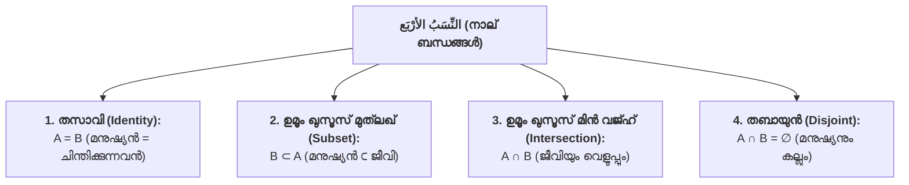

# النِّسَبُ الْأَرْبَعُ بَيْنَ الْكُلِّيَّاتِ
## കുല്ലികൾക്കിടയിലെ നാല് ബന്ധങ്ങളും അവയുടെ വിപരീതങ്ങളും — The Four Set-Theoretic Relations & Inversions

<!-- Top Navigation Bar -->
[⏮️ മുൻ അധ്യായം: 06. الكليات الخمس](file:///Users/apple/Desktop/docs:books/Kanz-al-Tahqiq/Texts/Mantiq/tasrih-al-mantiq/Notes/Chapters/06-al-kulliyyat-al-khams.md) | [📑 സൂചിക / Master Index](file:///Users/apple/Desktop/docs:books/Kanz-al-Tahqiq/Texts/Mantiq/tasrih-al-mantiq/Notes/Chapters/00-index.md) | [അടുത്ത അധ്യായം: 08. المعرّف: أقسام الحد والرسم ⏭️](file:///Users/apple/Desktop/docs:books/Kanz-al-Tahqiq/Texts/Mantiq/tasrih-al-mantiq/Notes/Chapters/08-al-mu-arrif-hadd-wa-rasm.md)

---

### 1. മൂലപാഠം / النص الأصلي من المتن (Al-Matn al-Aṣl)

ثُمَّ الْكُلِّيَّانِ: إِنْ كَانَ بَيْنَهُمَا تَصَادُقٌ كُلِّيٌّ مِنَ الْجَانِبَيْنِ، فَهُمَا مُتَسَاوِيَانِ: كَالْإِنْسَانِ وَالنَّاطِقِ، وَنَقِيضَاهُمَا أَيْضًا مُتَسَاوِيَانِ: كَاللَّا إِنْسَانِ وَاللَّا نَاطِقِ، وَإِنْ كَانَ بَيْنَهُمَا تَصَادُقٌ كُلِّيٌّ مِنْ جَانِبٍ وَاحِدٍ، فَبَيْنَهُمَا عُمُومٌ وَخُصُوصٌ مُطْلَقًا: كَالْحَيَوَانِ وَالْإِنْسَانِ، وَنَقِيضَاهُمَا بِالْعَكْسِ: كَاللَّا حَيَوَانِ وَاللَّا إِنْسَانِ، وَإِنْ لَمْ يَكُنْ بَيْنَهُمَا تَصَادُقٌ كُلِّيٌّ لَا مِنْ جَانِبٍ وَاحِدٍ، وَلَا مِنَ الْجَانِبَيْنِ، فَفِيهِمَا نِسْبَةُ الْعُمُومِ وَالْخُصُوصِ مِنْ وَجْهِ: كَالْحَيَوَانِ وَاللَّا إِنْسَانِ؛ وَالْحَيَوَانِ وَالْأَبْيَضِ.

وَإِنْ كَانَ بَيْنَهُمَا تَبَايُنٌ كُلِّيٌّ، فَهُمَا مُتَبَائِنَانِ: كَالْمَوْجُودِ وَالْمَعْدُومِ؛ وَالْإِنْسَانِ وَالْحَجَرِ، وَبَيْنَ نَقِيضَيِ الْعُمُومِ مِنْ وَجْهٍ وَنَقِيضَي الْمُتَبَايِنَيْنِ: قَدْ يَكُونُ التَّبَايُنُ الْكُلِّيُّ: كَمَا فِي اللَّاحَيَوَانِ وَالْإِنْسَانِ؛ وَاللَّا مَوْجُودِ وَاللَّا مَعْدُومِ، وَقَدْ يَكُونُ الْعُمُومُ مِنْ وَجْهِ: كَاللَّا حَيَوَانِ وَاللَّا أَبْيَضِ: وَاللَّا إِنْسَانِ وَاللَّا حَجَرِ.

---

### 2. മലയാള പരിഭാഷ (ദർസ് ശൈലിയിലുള്ള വാച്യാർത്ഥവും ആശയവും)

പിന്നെ, രണ്ട് കുല്ലിയ്യാത്തുകൾ (പൊതു സങ്കൽപ്പങ്ങൾ):
1. അവ രണ്ടും ഇരുവശത്തുനിന്നും പൂർണ്ണമായി അന്യോന്യം ബാധകമാകുന്നതാണെങ്കിൽ (തസ്വാദുഖുൻ കുല്ലിയ്യുൻ മിനൽ ജാനിബൈൻ) അവ **മുതസാവിയാനികൾ (തുല്യങ്ങൾ / التساوي)** ആകുന്നു; ഉദാ: «മനുഷ്യനും» «ചിന്തിക്കുന്നവനും» (ഇൻസാനും നാത്വിഖും). എല്ലാ മനുഷ്യരും ചിന്തിക്കുന്നവരും, എല്ലാ ചിന്തിക്കുന്നവരും മനുഷ്യരുമാണ്. അവയുടെ വിപരീതങ്ങളും (നഖീദുകൾ) പരസ്പരം തുല്യമായിരിക്കും: «മനുഷ്യനല്ലാത്തവനും» «ചിന്തിക്കാത്തവനും».
2. അവ രണ്ടിനുമിടയിൽ ഒരു വശത്തുനിന്ന് മാത്രമാണ് പൂർണ്ണ യോജിപ്പെങ്കിൽ (തസ്വാദുഖുൻ കുല്ലിയ്യുൻ മിൻ ജാനിബിൻ വാഹിദ്) അവ തമ്മിലുള്ള ബന്ധം **ഉമൂമും ഖുസൂസും മുത്‍ലഖ് (പൂർണ്ണ സാമാന്യ-സവിശേഷത / العموم والخصوص مطلقاً)** ആകുന്നു; ഉദാ: «ജീവിയും» «മനുഷ്യനും» (ഹയവാനും ഇൻസാനും). എല്ലാ മനുഷ്യരും ജീവികളാണ്; എന്നാൽ എല്ലാ ജീവികളും മനുഷ്യരല്ല. അവയുടെ വിപരീതങ്ങൾ നേർവിപരീതമായിരിക്കും (അതായത് ജീവിയല്ലാത്തത് കൂടുതൽ സവിശേഷവും മനുഷ്യനല്ലാത്തത് കൂടുതൽ പൊതുവുമാകും).
3. അവ രണ്ടിനുമിടയിൽ ഒരു വശത്തുനിന്നോ ഇരുവശത്തുനിന്നോ പൂർണ്ണമായ യോജിപ്പില്ല, മറിച്ച് ചില വിഷയങ്ങളിൽ മാത്രം രണ്ടും ഒരുമിച്ചുകൂടുകയും മറ്റ് ചിലതിൽ പിരിയുകയും ചെയ്യുന്നതാണെങ്കിൽ അവ തമ്മിൽ **ഉമൂമും ഖുസൂസും മിൻ വജ്ഹ് (ഭാഗിക സാമാന്യ-സവിശേഷത / العموم والخصوص من وجه)** ആകുന്നു; ഉദാ: «ജീവിയും» «വെളുപ്പും» (ഹയവാനും അബ്‌യളും). വെള്ള കുതിരയിൽ രണ്ടും ഒന്നിക്കുന്നു; കാക്കയിൽ ജീവിയുണ്ട് വെളുപ്പില്ല; ചോക്കിൽ വെളുപ്പുണ്ട് ജീവനില്ല.
4. അവ രണ്ടും തമ്മിൽ ഒരിക്കലും ഒന്നിക്കാത്ത വിധം പൂർണ്ണമായ അകൽച്ചയിലാണെങ്കിൽ (തബായുനുൻ കുല്ലിയ്യ്) അവ **മുതബായിനാനികൾ (പരസ്പര വിരുദ്ധങ്ങൾ / പരസ്പര ഭിന്നങ്ങൾ / التباين الكلي)** ആകുന്നു; ഉദാ: «ഉള്ളതും ഇല്ലാത്തതും» (മൗജൂദ്, മഅ്ദൂം), «മനുഷ്യനും കല്ലും» (ഇൻസാൻ, ഹജർ).

ഉമൂം ഖുസൂസ് മിൻ വജ്ഹിലുള്ളവയുടെയും, മുതബായിനാനികളുടെയും നഖീദുകൾ (വിപരീതങ്ങൾ) തമ്മിൽ:
- ചിലപ്പോൾ തബായുനുൻ കുല്ലിയ്യ് ആയിരിക്കും: ഉദാ: «മൗജൂദല്ലാത്തതും മഅ്ദൂമല്ലാത്തതും» പോലെ.
- ചിലപ്പോൾ ഉമൂമും ഖുസൂസും മിൻ വജ്ഹ് ആയിരിക്കും: ഉദാ: «മനുഷ്യനല്ലാത്തതും കല്ലല്ലാത്തതും» (ലാ ഇൻസാൻ, ലാ ഹജർ). കുതിര മനുഷ്യനുമല്ല കല്ലുമല്ല (രണ്ടും ഒന്നിച്ചു); കല്ല് ലാ ഇൻസാനാണ് എന്നാൽ ലാ ഹജറല്ല; സെയ്ദ് ലാ ഹജറാണ് എന്നാൽ ലാ ഇൻസാനല്ല.

---

### 3. ഇംഗ്ലീഷ് വിവർത്തനം / English Scholastic Translation

Two Universals:
1. If there is mutual, total co-extension from both sides, they are **Equal / Co-extensive (*Mutasāwiyān*)**: such as "Human" and "Rational". Every human is rational, and every rational being is human ($A = B$). Their negations/contradictories are likewise equal: "Non-human" and "Non-rational" ($\neg A = \neg B$).
2. If there is total inclusion from one side only, their relation is **Absolute Generality and Particularity (*ʿUmūm wa-Khuṣūṣ Muṭlaqan*)**: such as "Animal" and "Human". Every human is an animal, but not every animal is a human ($B \subset A$). Their negations are inverted: "Non-animal" is narrower than "Non-human" ($\neg A \subset \neg B$).
3. If total inclusion does not hold from either side, but they overlap in some instances while separating in others, their relation is **Cross-Generality and Particularity / Intersecting (*ʿUmūm wa-Khuṣūṣ min Wajh*)**: such as "Animal" and "White". They intersect in a white sheep; animal exists without white in a black crow; white exists without animal in snow or paper ($A \cap B \neq \emptyset \land A \setminus B \neq \emptyset \land B \setminus A \neq \emptyset$).
4. If there is complete mutual exclusion, they are **Disparate / Mutually Exclusive (*Mutabāyinān*)**: such as "Existent" and "Non-existent", or "Human" and "Stone" ($A \cap B = \emptyset$).

Between the negations of cross-particulars and the negations of disparates:
- Sometimes total disparity holds: such as "Non-existent" and "Non-non-existent".
- Sometimes cross-generality (*min wajh*) holds: such as "Non-human" and "Non-stone" (a horse is neither; a stone is non-human but not non-stone; Zayd is non-stone but not non-human).

---

### 4. ത്രിഭാഷാ പദസൂചിക / المصطلحات / Key Terminology Matrix

| അറബിക് പദം (Arabic) | ലിപ്യന്തരണം (Transliteration) | മലയാള അർത്ഥം (Malayalam Equivalent) | English Set Theory Equivalent | ഗണിതശാസ്ത്ര ചിഹ്നം (Formal Notation) |
|---|---|---|---|---|
| **التَّسَاوِي** | *al-Tasāwī* | തുല്യത | Identity / Co-extension | $A = B$ |
| **العُمُومُ وَالخُصُوصُ مُطْلَقًا** | *al-ʿUmūm wa-l-khuṣūṣ muṭlaqan* | പൂർണ്ണ സാമാന്യ-സവിശേഷത | Proper Subset / Superset | $B \subset A$ |
| **العُمُومُ وَالخُصُوصُ مِنْ وَجْه** | *al-ʿUmūm wa-l-khuṣūṣ min wajh* | ഭാഗിക സങ്കലനം (ഇന്റർസെക്ഷൻ) | Intersection with Remainder | $A \cap B \neq \emptyset$ |
| **التَّبَايُنُ الكُلِّيّ** | *al-Tabāyun al-kullī* | പൂർണ്ണ അകൽച്ച (ഡിസ്‌ജോയിന്റ്) | Disjoint Sets | $A \cap B = \emptyset$ |
| **النَّقِيض** | *al-Naqīḍ* | വിപരീതം (കോംപ്ലിമെന്റ്) | Set Complement / Negation | $A^c$ or $\neg A$ |

---

### 5. വിശദമായ ശർഹും തത്വവിചാരവും / الشرح والتحليل المعمق

#### എ. സെറ്റ് തിയറിയും നിസബുൽ അർബഉം (Set-Theoretic Precision):
ആധുനിക ഗണിതത്തിലെ ജോർജ്ജ് കാന്ററുടെ സെറ്റ് തിയറിക്ക് (Set Theory) നൂറ്റാണ്ടുകൾക്ക് മുൻപേ ഇസ്‌ലാമിക തർക്കശാസ്ത്രജ്ഞർ ആവിഷ്കരിച്ചതാണ് **നിസബുൽ അർബഅ് (Four Relations)**:
- **തസാവി:** സെറ്റ് $A$-യും സെറ്റ് $B$-യും പൂർണ്ണമായി ഒന്നാകുന്നു. ഉദാ: ത്രികോണവും മൂന്ന് കോണുകളുള്ള ജ്യാമിതീയ രൂപവും.
- **ഉമൂം ഖുസൂസ് മുത്‍ലഖ്:** ഒരു സെറ്റ് മറ്റൊന്നിന്റെ പൂർണ്ണ ഉപസെറ്റ് (Subset) ആകുന്നു. മനുഷ്യൻ $\subset$ ജീവി.
- **ഉമൂം ഖുസൂസ് മിൻ വജ്ഹ്:** വെൻ ഡയഗ്രമിലെ ഓവർലാപ്പിംഗ് സർക്കിളുകൾ. രണ്ട് വൃത്തങ്ങൾ തമ്മിൽ സന്ധിക്കുന്ന പൊതുവായ മധ്യഭാഗവും, ഇരുവശങ്ങളിലും സ്വന്തമായ ഭാഗങ്ങളുമുണ്ടാകുന്നു.
- **തബായുൻ:** രണ്ട് ഡിസ്‌ജോയിന്റ് സർക്കിളുകൾ. ഒന്നിന്റെ ഒരംശം പോലും മറ്റൊന്നിൽ പ്രവേശിക്കുന്നില്ല.

---

### 6. ചിത്രരൂപങ്ങളും താരതമ്യ പട്ടികകളും / Visual Diagrams & Comparative Matrices

#### ചതുർവിധ ബന്ധങ്ങളുടെ വെൻ ഡയഗ്രം മാട്രിക്സ്

| ബന്ധം | നിർവചനം | പദാർത്ഥ മാതൃക | വിപരീതങ്ങളുടെ (നഖീദ്) വിധി |
|---|---|---|---|
| **തസാവി ($A = B$)** | $A$ ഉള്ളിടത്തെല്ലാം $B$ ഉണ്ട്, തിരിച്ചും | മനുഷ്യൻ & ചിന്താശേഷി | വിപരീതങ്ങളും തസാവി ആയിരിക്കും ($\neg A = \neg B$) |
| **ഉമൂം മുത്‍ലഖ് ($B \subset A$)** | $B$ ഉള്ളിടത്തെല്ലാം $A$ ഉണ്ട്, തിരിച്ചില്ല | മനുഷ്യൻ ($B$) & ജീവി ($A$) | വിപരീതങ്ങളിൽ ബന്ധം തലതിരിയും ($\neg A \subset \neg B$) |
| **ഉമൂം മിൻ വജ്ഹ്** | ചിലതിൽ ഒന്നിക്കും, ചിലതിൽ പിരിയും | ജീവി & വെളുപ്പ് | വിപരീതങ്ങൾ തമ്മിൽ ഉമൂം മിൻ വജ്ഹ് ആകാം |
| **തബായുൻ ($A \cap B = \emptyset$)** | രണ്ടും ഒരിക്കലും ഒന്നിക്കില്ല | മനുഷ്യൻ & കല്ല് | വിപരീതങ്ങൾ ചിലപ്പോൾ തബായുൻ, ചിലപ്പോൾ മിൻ വജ്ഹ് |

---

### 7. ഉദാഹരണ വിശകലനം / Analysis of Classical & Contemporary Examples

- **നഖീദിന്റെ തലതിരിയൽ (Inversion Rule in Absolute Generality):**
  - "എല്ലാ മനുഷ്യരും ജീവികളാണ്" ($B \subset A$).
  - എന്നാൽ ഇതിന്റെ വിപരീതം നോക്കുക: "ജീവിയല്ലാത്തത്" (ലാ ഹയവാൻ — ഉദാ: കല്ല്), "മനുഷ്യനല്ലാത്തത്" (ലാ ഇൻസാൻ — ഉദാ: കുതിര, കല്ല്).
  - ഇവിടെ «ലാ ഹയവാൻ» എന്ന അവസ്ഥയുള്ളതെല്ലാം തീർച്ചയായും «ലാ ഇൻസാൻ» ആയിരിക്കും; എന്നാൽ «ലാ ഇൻസാൻ» ആയ കുതിര «ലാ ഹയവാൻ» അല്ല. അങ്ങനെ വിപരീതങ്ങൾക്കിടയിൽ കൂടുതൽ വിശാലമായത് (ആം) ലാ ഇൻസാനും, കൂടുതൽ ചുരുങ്ങിയത് (ഖാസ്സ്വ്) ലാ ഹയവാനുമായി മാറുന്നു!

---

### 8. ശ്രദ്ധിക്കേണ്ട സൂക്ഷ്മതകൾ / تنبيهات ومزالق شائعة (Common Student Pitfalls)

> [!WARNING]
> പല വിദ്യാർത്ഥികൾക്കും തെറ്റുപറ്റുന്ന പ്രധാന നിയമമാണ് **നഖീദുകൾ (വിപരീതങ്ങൾ) തമ്മിലുള്ള ബന്ധം**. ഉമൂം ഖുസൂസ് മുത്‍ലഖിൽ അസൽ പദങ്ങൾ തമ്മിലുള്ള ബന്ധം ഏതാണോ അതിന്റെ വിപരീതമായിരിക്കും നഖീദുകൾ തമ്മിലുള്ളത്. സാമാന്യമായത് (ആം) വിപരീതമാകുമ്പോൾ സവിശേഷവും (ഖാസ്സ്വ്), സവിശേഷമായത് (ഖാസ്സ്വ്) വിപരീതമാകുമ്പോൾ സാമാന്യവുമാകും (ആം).

---

### 9. ആവർത്തന ചോദ്യങ്ങളും വ്യായാമങ്ങളും / تدريبات وتمارين (Review Exercises)

1. കുല്ലിയ്യാത്തുകൾ തമ്മിലുള്ള നാല് ബന്ധങ്ങൾ ഏതെല്ലാം? ഉദാഹരണ സഹിതം വിവരിക്കുക.
2. «ഉമൂമും ഖുസൂസും മുത്‍ലഖ്» ആയ രണ്ട് പദങ്ങളുടെ നഖീദുകൾ (വിപരീതങ്ങൾ) തമ്മിലുള്ള ബന്ധം എന്തായിരിക്കും? തെളിയിക്കുക.
3. താഴെ പറയുന്ന ജോഡികൾ തമ്മിലുള്ള ബന്ധം കണ്ടെത്തുക:
   - പക്ഷി — കാക്ക
   - ഡോക്ടർ — എഴുത്തുകാരൻ
   - ഇരുട്ട് — വെളിച്ചം
   - ചതുരം — നാല് വശങ്ങളുള്ള രൂപം
4. ഉമൂം ഖുസൂസ് മിൻ വജ്ഹിന് സ്വന്തമായി ഒരു ഉദാഹരണം കണ്ടെത്തി മൂന്ന് അവസ്ഥകളും (യോജിക്കുന്നത്, ഒന്ന് മാത്രമാകുന്നത്, മറ്റേത് മാത്രമാകുന്നത്) വിശദീകരിക്കുക.

---

<!-- Bottom Navigation Bar -->
[⏮️ മുൻ അധ്യായം: 06. الكليات الخمس](file:///Users/apple/Desktop/docs:books/Kanz-al-Tahqiq/Texts/Mantiq/tasrih-al-mantiq/Notes/Chapters/06-al-kulliyyat-al-khams.md) | [📑 സൂചിക / Master Index](file:///Users/apple/Desktop/docs:books/Kanz-al-Tahqiq/Texts/Mantiq/tasrih-al-mantiq/Notes/Chapters/00-index.md) | [അടുത്ത അധ്യായം: 08. المعرّف: أقسام الحد والرسم ⏭️](file:///Users/apple/Desktop/docs:books/Kanz-al-Tahqiq/Texts/Mantiq/tasrih-al-mantiq/Notes/Chapters/08-al-mu-arrif-hadd-wa-rasm.md)
