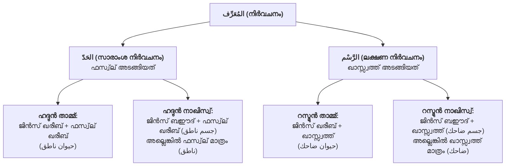

# الْمُعَرِّفُ: الحَدُّ وَالرَّسْمُ
## നിർവചനം: ഹദ്ദും റസ്മും — The Theory of Definition: Essential Limits & Descriptive Types

<!-- Top Navigation Bar -->
[⏮️ മുൻ അധ്യായം: 07. النسب الأربع بين الكليات](file:///Users/apple/Desktop/docs:books/Kanz-al-Tahqiq/Texts/Mantiq/tasrih-al-mantiq/Notes/Chapters/07-al-nisab-al-arba.md) | [📑 സൂചിക / Master Index](file:///Users/apple/Desktop/docs:books/Kanz-al-Tahqiq/Texts/Mantiq/tasrih-al-mantiq/Notes/Chapters/00-index.md) | [അടുത്ത അധ്യായം: 09. القضية الحملية والمحصورات ⏭️](file:///Users/apple/Desktop/docs:books/Kanz-al-Tahqiq/Texts/Mantiq/tasrih-al-mantiq/Notes/Chapters/09-al-qadiyyah-al-hamliyyah.md)

---

### 1. മൂലപാഠം / النص الأصلي من المتن (Al-Matn al-Aṣl)

فَصْلٌ: الْمُعَرِّفُ لِلشَّيْءِ: مَا يُفِيدُ تَصَوُّرُهُ تَصَوُّرَ ذَلِكَ الشَّيْءِ، وَهُوَ عَلَى أَرْبَعَةِ أَقْسَامٍ:

أَحَدُهَا: الْحَدُّ التَّامُ، هُوَ: الْمُرَكَّبُ مِنَ الْجِنْسِ وَالْفَصْلِ الْقَرِيبِيْنِ: كَالْحَيَوَانِ النَّاطِقِ فِي تَعْرِيفِ الْإِنْسَانِ.

وَثَانِيهِمَا: الْحَدُّ النَّاقِصُ، هُوَ: الْمُرَكَّبُ مِنَ الْجِنْسِ الْبَعِيدِ وَالْفَصْلِ الْقَرِيبِ: كَالْجِسْمِ النَّاطِقِ، أَوِ الْفَصْلِ الْقَرِيبِ وَحْدَهُ: كَالنَّاطِقِ.

وَثَالِثُها: الرَّسْمُ التَّامُّ، هُوَ: الْمُرَكَّبُ مِنَ الْجِنْسِ الْقَرِيبِ وَالْخَاصَّةِ: كَالْحَيَوَانِ الضَّاحِكِ.

وَرَابِعُهَا: الرَّسْمُ النَّاقِصُ، هُوَ: الْمُرَكَّبُ مِنَ الْجِنْسِ الْبَعِيدِ وَالْخَاصَّةِ: كَالْجِسْمِ الضَّاحِكِ، أَوْ بِالْخَاصَّةِ وَحْدَهَا: كَالضَّاحِكِ.

---

### 2. മലയാള പരിഭാഷ (ദർസ് ശൈലിയിലുള്ള വാച്യാർത്ഥവും ആശയവും)

ഒരു കാര്യത്തിന്റെ **മുഅര്രിഫ് (നിർവചനം / المعرّف / ഖൗലുൻ ശാരിഹ്)** എന്നാൽ: അതിനെ വിഭാവനം ചെയ്യുന്നത് ആ കാര്യത്തെക്കുറിച്ചുള്ള ധാരണ നേടിത്തരുന്ന ഒന്നാണ് (ما يفيد تصوره تصور ذلك الشيء).

ആ നിർവചനം നാല് വിഭാഗങ്ങളാകുന്നു:
1. **ഹദ്ദുൻ താമ്മ് (സമ്പൂർണ്ണ സാരാംശ നിർവചനം / الحد التام):** അടുത്ത ജിൻസും അടുത്ത ഫസ്വ്‌ലും ചേർത്തുണ്ടാക്കുന്ന സംയുക്തമാണത്; ഉദാഹരണത്തിന് മനുഷ്യനെ നിർവചിക്കുമ്പോൾ «ചിന്തിക്കുന്ന ജീവി» (ഹയവാനുൻ നാത്വിഖ്) എന്ന് പറയുന്നത് പോലെ.
2. **ഹദ്ദുൻ നാഖിസ്വ് (അപൂർണ്ണ സാരാംശ നിർവചനം / الحد الناقص):** വിദൂര ജിൻസും അടുത്ത ഫസ്വ്‌ലും ചേർന്നത്; ഉദാ: «ചിന്തിക്കുന്ന ശരീരം» (ജിസ്മുൻ നാത്വിഖ്), അല്ലെങ്കിൽ അടുത്ത ഫസ്വ്‌ല് മാത്രമായി പറയുന്നത്; ഉദാ: മനുഷ്യന് «ചിന്തിക്കുന്നവൻ» (നാത്വിഖ്) എന്ന് മാത്രം പറയുന്നത്.
3. **റസ്മുൻ താമ്മ് (സമ്പൂർണ്ണ ബാഹ്യലക്ഷണ നിർവചനം / الرسم التام):** അടുത്ത ജിൻസും സവിശേഷ ബാഹ്യഗുണവും (ഖാസ്സ്വത്ത്) ചേർന്നത്; ഉദാ: മനുഷ്യന് «ചിരിക്കുന്ന ജീവി» (ഹയവാനുൻ ളാഹിക്) എന്ന് പറയുന്നത് പോലെ.
4. **റസ്മുൻ നാഖിസ്വ് (അപൂർണ്ണ ബാഹ്യലക്ഷണ നിർവചനം / الرسم الناقص):** വിദൂര ജിൻസും ഖാസ്സ്വത്തും ചേർന്നത്; ഉദാ: «ചിരിക്കുന്ന ശരീരം» (ജിസ്മുൻ ളാഹിക്), അല്ലെങ്കിൽ ഖാസ്സ്വത്ത് മാത്രമായി പറയുന്നത്; ഉദാ: «ചിരിക്കുന്നവൻ» (ളാഹിക്) എന്ന് മാത്രം പറയുന്നത്.

---

### 3. ഇംഗ്ലീഷ് വിവർത്തനം / English Scholastic Translation

The Definiens / Explanatory Statement (*al-Muʿarrif / al-Qawl al-Shāriḥ*) of an entity is that whose conception yields the conception of that entity. It is of four kinds:

1. **Complete Essential Definition (*al-Ḥadd al-Tāmm*):** Composed of the proximate genus and proximate difference (*al-jins wa-l-faṣl al-qarībayn*), such as "Rational Animal" (*Ḥayawān Nāṭiq*) in defining Human.
2. **Incomplete Essential Definition (*al-Ḥadd al-Nāqiṣ*):** Composed of the remote genus and proximate difference (*al-jins al-baʿīd wa-l-faṣl al-qarīb*), such as "Rational Body" (*Jism Nāṭiq*), or the proximate difference alone, such as "Rational" (*al-Nāṭiq*).
3. **Complete Descriptive Definition (*al-Rasm al-Tāmm*):** Composed of the proximate genus and the proper accident (*al-jins al-qarīb wa-l-khāṣṣa*), such as "Laughing Animal" (*Ḥayawān Ḍāḥik*).
4. **Incomplete Descriptive Definition (*al-Rasm al-Nāqiṣ*):** Composed of the remote genus and the proper accident (*al-jins al-baʿīd wa-l-khāṣṣa*), such as "Laughing Body" (*Jism Ḍāḥik*), or the proper accident alone, such as "Laughing" (*al-Ḍāḥik*).

---

### 4. ത്രിഭാഷാ പദസൂചിക / المصطلحات / Key Terminology Matrix

| അറബിക് പദം (Arabic) | ലിപ്യന്തരണം (Transliteration) | മലയാള അർത്ഥം (Malayalam Equivalent) | English Logic Term | സാങ്കേതിക ഘടന (Formula) |
|---|---|---|---|---|
| **المُعَرِّف** | *al-Muʿarrif* | നിർവചനം / ലക്ഷണം | Definiens / Explanatory statement | ഒരു വസ്തുവിനെ വ്യക്തമാക്കിക്കൊടുക്കുന്ന പദസഞ്ചയം. |
| **المُعَرَّف** | *al-Muʿarraf* | നിർവചിക്കപ്പെടുന്നത് | Definiendum | നിർവചനം ആവശ്യമായി വരുന്ന വസ്തു (ഉദാ: മനുഷ്യൻ). |
| **الحَدُّ التَّامّ** | *al-Ḥadd al-tāmm* | സമ്പൂർണ്ണ സാരാംശ നിർവചനം | Complete Essential Definition | അടുത്ത ജിൻസ് + അടുത്ത ഫസ്വ്‌ല് (Genus Proximum + Differentia) |
| **الحَدُّ النَّاقِص** | *al-Ḥadd al-nāqiṣ* | അപൂർണ്ണ സാരാംശ നിർവചനം | Incomplete Essential Definition | വിദൂര ജിൻസ് + അടുത്ത ഫസ്വ്‌ല്, അല്ലെങ്കിൽ ഫസ്വ്‌ല് മാത്രം |
| **الرَّسْمُ التَّامّ** | *al-Rasm al-tāmm* | സമ്പൂർണ്ണ ലക്ഷണ നിർവചനം | Complete Descriptive Definition | അടുത്ത ജിൻസ് + ഖാസ്സ്വത്ത് (Genus Proximum + Proprium) |
| **الرَّسْمُ النَّاقِص** | *al-Rasm al-nāqiṣ* | അപൂർണ്ണ ലക്ഷണ നിർവചനം | Incomplete Descriptive Definition | വിദൂര ജിൻസ് + ഖാസ്സ്വത്ത്, അല്ലെങ്കിൽ ഖാസ്സ്വത്ത് മാത്രം |

---

### 5. വിശദമായ ശർഹും തത്വവിചാരവും / الشرح والتحليل المعمق

#### എ. തസവ്വുറാത്തിന്റെ ആത്യന്തിക ലക്ഷ്യം (مقاصد التصورات):
മന്തിഖ് വിജ്ഞാനത്തിന്റെ ഒന്നാം പകുതിയായ **തസവ്വുറാത്തിന്റെ (Conceptions)** മുഴുവൻ നിയമങ്ങളും (ദലാലത്തുകൾ, പദങ്ങൾ, പഞ്ചകുല്ലികൾ) ക്രോഡീകരിക്കപ്പെട്ടത് ഈ ഒരൊറ്റ അധ്യായത്തിന് വേണ്ടിയാണ്: **ശരിയായ നിർവചനം (അൽ-മുഅര്രിഫ്) എങ്ങനെയുണ്ടാക്കാം**.

#### ബി. ഹദ്ദും റസ്മും തമ്മിലുള്ള മൗലിക വ്യത്യാസം:
- **ഹദ്ദ് (حد):** വസ്തുവിന്റെ ആന്തരിക സാരാംശത്തെയാണ് (ദാതിയാത്ത് - ജിൻസും ഫസ്വ്‌ലും) വിശദീകരിക്കുന്നത്. ഒരു വസ്തു എന്താണെന്ന് അതിന്റെ അന്തർഘടന സഹിതം ബോധ്യപ്പെടുത്താൻ ഹദ്ദിനേ കഴിയൂ.
- **റസ്മ് (رسم):** വസ്തുവിന്റെ ബാഹ്യ ലക്ഷണങ്ങളെയാണ് (ഖാസ്സ്വത്ത്) വിശദീകരിക്കുന്നത്. ഇത് വസ്തുവിനെ മറ്റുള്ളവരിൽ നിന്ന് വേർതിരിച്ചു മനസ്സിലാക്കാൻ സഹായിക്കുമെങ്കിലും അതിന്റെ സാരാംശം വെളിപ്പെടുത്തുന്നില്ല.

#### സി. നിർവചനത്തിന്റെ സുപ്രധാന നിബന്ധനകൾ (ശറൂത്വുൽ മുഅര്രിഫ്):
പരമ്പരാഗത ദർസ് ഗ്രന്ഥങ്ങൾ നിർവചനത്തിന് നിഷ്കർഷിക്കുന്ന 4 പ്രധാന നിയമങ്ങൾ:
1. **ജാമിഉം മാനaffirming ആയിരിക്കണം (جامع ومانع / ഉമൂമും ഖുസൂസും തുല്യമാകണം):** നിർവചിക്കപ്പെടുന്നതിന്റെ എല്ലാ വ്യക്തികളെയും ഉൾക്കൊള്ളുന്നതും (ജാമിഅ്), അന്യമായ ഒന്നിനെയും പ്രവേശിപ്പിക്കാത്തതുമായിരിക്കണം (മാനിഅ്).
2. **നിർവചിക്കപ്പെടുന്നതിനേക്കാൾ വ്യക്തമായിരിക്കണം (أجلى وأوضح):** നിർവചനം കൂടുതൽ സങ്കീർണ്ണമോ അവ്യക്തമോ ആകാൻ പാടില്ല.
3. **ചുറ്റിക്കറങ്ങൽ (ദൗറ് / الدور) ഉണ്ടാകാൻ പാടില്ല:** നിർവചനത്തിൽ പറയുന്ന കാര്യം അറിയാൻ നിർവചിക്കപ്പെടുന്ന വസ്തുവിനെ അറിയേണ്ട അവസ്ഥ വരാൻ പാടില്ല (ഉദാ: «സൂര്യൻ എന്നാൽ പകൽ ഉദിക്കുന്ന ഗോളമാണ്; പകൽ എന്നാൽ സൂര്യൻ ഉദിക്കുന്ന സമയമാണ്»).
4. **അന്യോന്യതയില്ലാത്ത മുശ്തറക് പദങ്ങളോ അലങ്കാരങ്ങളോ (മജാസ്) ഉപയോഗിക്കരുത്:** വ്യക്തമായ സൂചകങ്ങളില്ലാത്ത അവ്യക്ത പദങ്ങൾ നിർവചനത്തിൽ വർജ്ജ്യമാണ്.

---

### 6. ചിത്രരൂപങ്ങളും താരതമ്യ പട്ടികകളും / Visual Diagrams & Comparative Matrices

#### ചതുർവിധ നിർവചന സമഗ്ര മാട്രിക്സ്

| നിർവചന തരം | ഫോർമുല | മനുഷ്യനിലെ ഉദാഹരണം | ത്രികോണത്തിലെ ഉദാഹരണം | ഗുണമേന്മ |
|---|---|---|---|---|
| **ഹദ്ദുൻ താമ്മ്** | ജിൻസ് ഖരീബ് + ഫസ്വ്‌ല് ഖരീബ് | ചിന്തിക്കുന്ന ജീവി (حیوان ناطق) | മൂന്ന് നേർരേഖകളാൽ ബന്ധിതമായ ജ്യാമിതീയ രൂപം | പരമോന്നതം ($100\%$ സാരാംശം) |
| **ഹദ്ദുൻ നാഖിസ്വ്** | ജിൻസ് ബഈദ് + ഫസ്വ്‌ല് ഖരീബ് | ചിന്തിക്കുന്ന ശരീരം (جسم ناطق) | മൂന്ന് വശങ്ങളുള്ള അസ്തിത്വം | ഭാഗിക സാരാംശം |
| **റസ്മുൻ താമ്മ്** | ജിൻസ് ഖരീബ് + ഖാസ്സ്വത്ത് | ചിരിക്കുന്ന ജീവി (حیوان ضاحك) | ആന്തരിക കോണുകളുടെ തുക 180° ആയ രൂപം | പൂർണ്ണ വേർതിരിവ് |
| **റസ്മുൻ നാഖിസ്വ്** | ജിൻസ് ബഈദ് + ഖാസ്സ്വത്ത് / ഖാസ്സ്വത്ത് | ചിരിക്കുന്നവൻ (الضاحك) | 180° കോണുകളുള്ള വസ്തു | കേവല ബാഹ്യ ലക്ഷണം |

---

### 7. ഉദാഹരണ വിശകലനം / Analysis of Classical & Contemporary Examples

- **മെഡിസിനിലെ രോഗനിർണ്ണയം (Medical Diagnosis):**
  - ഒരു രോഗാണുവിന്റെ ഡിഎൻഎ ഘടനയും പ്രകൃതവും കൃത്യമായി നിർവചിക്കുന്നത് **ഹദ്ദുൻ താമ്മാ**ണ് (Etiological Definition).
  - ആ രോഗം ബാധിച്ച വ്യക്തിയിലുണ്ടാകുന്ന ലക്ഷണങ്ങൾ (പനി, തുമ്മൽ, ക്ഷീണം) വെച്ച് നിർവചിക്കുന്നത് **റസ്മാ**ണ് (Symptomatic Definition).
- **ആധുനിക രസതന്ത്രം:**
  - ജലം = $H_2O$ (രണ്ട് ഹൈഡ്രജനും ഒരു ഓക്സിജനും ചേർന്ന തന്മാത്ര) എന്നത് **ഹദ്ദുൻ താമ്മാ**ണ്.
  - ജലം = 100°C-ൽ തിളയ്ക്കുന്ന, നിറവും മണമില്ലാത്ത ദ്രാവകം എന്നത് **റസ്മാ**ണ്.

---

### 8. ശ്രദ്ധിക്കേണ്ട സൂക്ഷ്മതകൾ / تنبيهات ومزالق شائعة (Common Student Pitfalls)

> [!WARNING]
> പല വിദ്യാർത്ഥികളും «ഹദ്ദുൻ നാഖിസ്വി»ൽ ജിൻസ് ഖരീബ് ഉപയോഗിക്കാൻ പാടില്ലെന്ന് ചിന്തിക്കാറുണ്ട്. എന്നാൽ ജിൻസ് ഖരീബ് ഉപയോഗിച്ചാൽ അത് ഹദ്ദുൻ താമ്മായി മാറും! ഫസ്വ്‌ല് ഒറ്റയ്ക്ക് നിന്നാൽ അത് ഹദ്ദുൻ നാഖിസ്വാണ്, കാരണം ജിൻസ് അതിൽ പരാമർശിക്കപ്പെട്ടിട്ടില്ല. അതുപോലെ, റസ്മ് ഒരിക്കലും വസ്തുവിന്റെ സത്തയെ (ഹഖീഖത്ത്) വെളിപ്പെടുത്തുന്നില്ല, മറിച്ച് സവിശേഷ വേർതിരിവ് (തമയ്യുസ്) മാത്രമാണ് നൽകുന്നത്.

---

### 9. ആവർത്തന ചോദ്യങ്ങളും വ്യായാമങ്ങളും / تدريبات وتمارين (Review Exercises)

1. മുഅര്രിഫിന്റെ നാല് ഇനങ്ങൾ ഏതെല്ലാം? ഓരോന്നിന്റെയും ഘടന സമർത്ഥിക്കുക.
2. «ഹദ്ദ്», «റസ്മ്» എന്നിവ തമ്മിലുള്ള പ്രധാന വ്യത്യാസമെന്ത്?
3. താഴെ പറയുന്ന നിർവചനങ്ങൾ ഏത് വിഭാഗത്തിൽ പെടുന്നുവെന്ന് കണ്ടെത്തുക:
   - "മനുഷ്യൻ എന്നാൽ ചിന്തിക്കുന്നവനാണ്."
   - "മനുഷ്യൻ എന്നാൽ വസ്ത്രം ധരിക്കുന്ന ശരീരമാണ്."
   - "മനുഷ്യൻ എന്നാൽ ചിന്തിക്കുന്ന ജീവിയാണ്."
   - "മനുഷ്യൻ എന്നാൽ കരയാൻ കഴിവുള്ള ജീവിയാണ്."
4. നിർവചനത്തിൽ 'ദൗറ്' (ചുറ്റിക്കറങ്ങൽ) ഉണ്ടാകാൻ പാടില്ല എന്ന് പറയുന്നതിന്റെ അർത്ഥമെന്ത്? ഒരു ഉദാഹരണത്തിലൂടെ വ്യക്തമാക്കുക.

---

<!-- Bottom Navigation Bar -->
[⏮️ മുൻ അധ്യായം: 07. النسب الأربع بين الكليات](file:///Users/apple/Desktop/docs:books/Kanz-al-Tahqiq/Texts/Mantiq/tasrih-al-mantiq/Notes/Chapters/07-al-nisab-al-arba.md) | [📑 സൂചിക / Master Index](file:///Users/apple/Desktop/docs:books/Kanz-al-Tahqiq/Texts/Mantiq/tasrih-al-mantiq/Notes/Chapters/00-index.md) | [അടുത്ത അധ്യായം: 09. القضية الحملية والمحصورات ⏭️](file:///Users/apple/Desktop/docs:books/Kanz-al-Tahqiq/Texts/Mantiq/tasrih-al-mantiq/Notes/Chapters/09-al-qadiyyah-al-hamliyyah.md)
