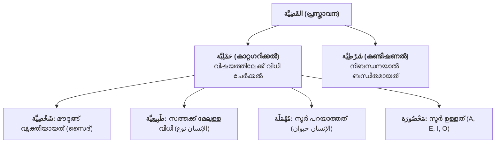

# الْقَضِيَّةُ الْحَمْلِيَّةُ وَالْمَحْصُورَاتُ الأَرْبَعُ
## ഹംലിയ്യാ വാക്യങ്ങളും ചതുർവിധ പ്രസ്താവനകളും — Categorical Propositions & Standard Forms (A, E, I, O)

<!-- Top Navigation Bar -->
[⏮️ മുൻ അധ്യായം: 08. المعرّف: أقسام الحد والرسم](file:///Users/apple/Desktop/docs:books/Kanz-al-Tahqiq/Texts/Mantiq/tasrih-al-mantiq/Notes/Chapters/08-al-mu-arrif-hadd-wa-rasm.md) | [📑 സൂചിക / Master Index](file:///Users/apple/Desktop/docs:books/Kanz-al-Tahqiq/Texts/Mantiq/tasrih-al-mantiq/Notes/Chapters/00-index.md) | [അടുത്ത അധ്യായം: 10. القضية المعدولة والمحصلة ⏭️](file:///Users/apple/Desktop/docs:books/Kanz-al-Tahqiq/Texts/Mantiq/tasrih-al-mantiq/Notes/Chapters/10-al-qadiyyah-al-ma-dulah.md)

---

### 1. മൂലപാഠം / النص الأصلي من المتن (Al-Matn al-Aṣl)

فَصْلٌ فِي التَّصْدِيقَاتِ: الْقَضِيَّةُ: قَوْلٌ يَحْتَمِلُ الصِّدْقَ وَالْكَذِبَ بِنَفْسِ مَفْهُومِهِ، أَوْ قَوْلٌ يَصِحُّ أَنْ يُقَالَ لِقَائِلِهِ: إِنَّهُ صَادِقٌ أَوْ كَاذِبٌ.

وَهِيَ: إِنْ كَانَ الحُكْمُ فِيهَا بِثُبُوتِ الْمَحْكُومِ بِهِ لِلْمَحْكُومِ عَلَيْهِ، أَوْ بِنَفْيٍ ثُبُوتِهِ عَنْهُ، - فَحَمْلِيَّةٌ، مُوجَبَةً كَانَتْ أَوْ سَالِبَةً، نَحْوُ: زَيْدٌ قَائِمٌ، وَزَيْدٌ لَيْسَ بِقَائِمٍ، وَإِلَّا: فَشَرْطِيَّةٌ، وَيُسَمَّى الْمَحْكُومُ عَلَيْهِ وَالْمَحْكُوم بِهِ فِي الْحَمْلِيَّةِ: مَوْضُوعًا وَمَحْمُولًا، وَاللَّفْظُ الدَّالُّ عَلَى النِّسْبَةِ الْحُكْمِيَّةِ بَيْنَهُمَا: رَابِطَةٌ: زَمَانِيَّةٌ كَانَتْ أَوْ غَيْرَ زَمَانِيَّةٍ، نَحْوُ: كَانَ وَهُوَ، وَفِي الشَّرْطِيَّةِ: مُقَدَّمًا وَتَالِيًا.

ثُمَّ الْحَمْلِيَّةُ: إِنْ كَانَ مَوْضُوعُهَا جُزْئِيًّا، فَشَخْصِيَّةٌ، نَحْوُ: زَيْدٌ كَاتِبٌ، وَهَذَا عَالِمٌ، وَإِنْ كَانَ كُلِّيًّا؛ فَإِنْ كَانَ الْحُكْمُ عَلَى نَفْسِ الطَّبِيعَةِ، فَطَبِيعِيَّةٌ، نَحْوُ: الْإِنْسَانُ نَوْعٌ، وَإِنْ كَانَ عَلَى الأَفْرَادٍ؛ فَإِنْ بُيِّنَ كَمَّيَّةُ أَفْرَادِهِ كُلَّا أَوْ بَعْضًا، فَمَحْصُورَةٌ كُلِّيَّةٌ أَوْ جُزْئِيَّةٌ، وَإِنْ لَمْ تُبَيَّنْ، فَمُهْمَلَةٌ، نَحْوُ: الْإِنْسَانُ حَيَوَانٌ.

وَالْمُعْتَبَرَةُ فِي الْعُلُومِ هِيَ الْمَحْصُورَةُ، وَهِيَ عَلَى أَرْبَعَةِ أَقْسَامٍ: مُوجَبَةٌ كُلِّيَّةٌ، وَسُوَرُهَا: كُلٌّ وَلَامُ الْاِسْتِغْرَاقِ، نَحْوُ: كُلُّ إِنْسَانٍ حَيَوَانٌ، وَالْحَيَوَانُ مَاشٍ، وَمُوجَبَةٌ جُزْئِيَّةٌ، وَسُوَرُهَا: بَعْضٌ وَوَاحِدٌ، نَحْوُ: بَعْضُ الْحَيَوَانِ إِنْسَانٌ، وَوَاحِدٌ مِنَ الْإِنْسَانِ جَاءَنِي، وَسَالِبَةٌ كُلِّيَّةٌ، وَسُوَرُهَا: لَا شَيْءَ وَلَا وَاحِدَ، وَوُقُوعُ النَّكِرَةِ تَحْتَ النَّفْيِ، نَحْوُ: لَا شَيْءَ مِنَ الْإِنْسَانِ بِحَجَرٍ، وَلَا وَاحِدَ مِنْهُ بِجَمَادٍ، وَلَا رَجُلَ فِي الدَّارِ، وَسَالِبَةٌ جُزْئِيَّةٌ، وَسُوَرُهَا: لَيْسَ كُلٌّ وَلَيْسَ بَعْضٌ وَبَعْضُ لَيْسَ، نَحْوُ: لَيْسَ كُلُّ حَيَوَانٍ، أَوْ لَيْسَ بَعْضُهُ إِنْسَانًا، أَوْ بَعْضُهُ لَيْسَ بِإِنْسَانٍ.

---

### 2. മലയാള പരിഭാഷ (ദർസ് ശൈലിയിലുള്ള വാച്യാർത്ഥവും ആശയവും)

തസ്ദീഖാത്തുകളുടെ (സ്ഥിരീകരണങ്ങളുടെ) അധ്യായം:
**ഖദിയ്യ (പ്രസ്താവന / വിധിവാക്യം):** തന്റെ കേവല ആശയത്താൽ തന്നെ സത്യവും അസത്യവുമാകാൻ സാധ്യതയുള്ള വാചകമാണ്; അഥവാ അത് പറഞ്ഞവനോട് «നീ പറഞ്ഞത് സത്യമാണ്» എന്നോ «കളവാണ്» എന്നോ പറയാൻ സാധുവാകുന്ന വാചകമാണ്.

ആ ഖദിയ്യ:
- അതിലെ വിധി, മഹ്കൂമുൻ അലൈഹിയിലേക്ക് (വിഷയത്തിലേക്ക്) മഹ്കൂമുൻ ബിഹിയെ (വിധിയെ) സ്ഥിരപ്പെടുത്തലാണെങ്കിലോ അല്ലെങ്കിൽ അതിൽ നിന്ന് നിഷേധിക്കലാണെങ്കിലോ അത് **ഹംലിയ്യ (കാറ്റഗറിക്കൽ വാക്യം / الحملية)** ആകുന്നു. അത് മുജീബയോ (സ്ഥിരീകരണം) സാലിബയോ (നിഷേധം) ആകാം; ഉദാ: «സൈദ് നിൽക്കുന്നവനാണ്» (മുജീബ), «സൈദ് നിൽക്കുന്നവനല്ല» (സാലിബ).
- അങ്ങനെയല്ലെങ്കിൽ അത് **ശർതിയ്യ (വ്യവസ്ഥാപിത വാക്യം / الشرطية)** ആകുന്നു.

ഹംലിയ്യയിലെ മഹ്കൂമുൻ അലൈഹിക്ക് **മൗദൂഅ് (വിഷയം / Subject)** എന്നും, മഹ്കൂമുൻ ബിഹിക്ക് **മഹ്മൂൽ (വിധി / Predicate)** എന്നും പറയപ്പെടുന്നു. അവ രണ്ടിനുമിടയിലുള്ള ബന്ധത്തെ കാണിക്കുന്ന പദത്തിന് **റാബിത്വ (യോജിപ്പ് / Copula)** എന്ന് പറയപ്പെടുന്നു; അത് കാലമുള്ളതോ («കാന» പോലെ) കാലമില്ലാത്തതോ («ഹുവ» പോലെ) ആകാം. ശർതിയ്യയിൽ അവയ്ക്ക് **മുഖദ്ദമും (പൂർവ്വപദം) താലിയും (ഉത്തരപദം)** എന്നും പറയപ്പെടുന്നു.

പിന്നെ ഹംലിയ്യ:
1. മൗദൂഅ് ഒരു സവിശേഷ വ്യക്തിയാണെങ്കിൽ (ജുസ്ഇയ്യ്) അത് **ശഖ്‌സ്വിയ്യ (സവിശേഷ പ്രസ്താവന / വ്യക്തിവാക്യം)** ആകുന്നു; ഉദാ: «സൈദ് എഴുത്തുകാരനാണ്», «ഇയാൾ പണ്ഡിതനാണ്».
2. മൗദൂഅ് ഒരു കുല്ലിയ്യ് (പൊതുനാമം) ആണെങ്കിൽ:
   - വിധി കൽപ്പിക്കുന്നത് ആ സ്വഭാവത്തിന്റെ യാഥാർത്ഥ്യത്തിന്മേൽ മാത്രമാണെങ്കിൽ അത് **ത്വബീഇയ്യ (സ്വാഭാവിക വാക്യം)** ആകുന്നു; ഉദാ: «മനുഷ്യൻ ഒരു നൗഅ് ആകുന്നു» (ഇവിടെ വ്യക്തികൾക്കൊന്നും നൗഅ് എന്ന് പറയാനാവില്ല).
   - വിധി കൽപ്പിക്കുന്നത് അതിലെ വ്യക്തികൾക്ക് മേലാണെങ്കിൽ:
     - ആ വ്യക്തികളുടെ എണ്ണവും അളവും (മുഴുവനുമോ ചിലതോ എന്ന്) വ്യക്തമാക്കിയിട്ടുണ്ടെങ്കിൽ അത് **മഹ്സൂറ (അളവുനിർണ്ണയിച്ച പ്രസ്താവന / Quantified)** ആകുന്നു; അത് കുല്ലിയ്യയോ ജുസ്ഇയ്യയോ ആകാം.
     - വ്യക്തികളുടെ അളവ് വ്യക്തമാക്കിയിട്ടില്ലെങ്കിൽ അത് **മുഹ്മല (അളവില്ലാത്തത് / Unquantified)** ആകുന്നു; ഉദാ: «മനുഷ്യൻ ജീവിയാകുന്നു».

ശാസ്ത്രങ്ങളിലും തർക്കങ്ങളിലും പരിഗണിക്കപ്പെടുന്നത് **മഹ്സൂറ** മാത്രമാണ്. അത് നാല് വിഭാഗമാകുന്നു (ചതുർവിധ വാക്യങ്ങൾ):
1. **മുജീബ കുല്ലിയ്യ (Universal Affirmative - A):** സൂചനകൾ (സൂർ): «കുല്ലുൻ» (എല്ലാം), ഇസ്തിഗ്‌റാഖിന്റെ ലാം. ഉദാ: «എല്ലാ മനുഷ്യരും ജീവികളാണ്» (കുല്ലു ഇൻസാനിൻ ഹയവാൻ).
2. **മുജീബ ജുസ്ഇയ്യ (Particular Affirmative - I):** സൂർ: «ബഅ്ള്» (ചിലത്), «വാഹിദ്» (ഒന്ന്). ഉദാ: «ചില ജീവികൾ മനുഷ്യരാണ്» (ബഅ്ളുൽ ഹയവാനി ഇൻസാൻ).
3. **സാലിബ കുല്ലിയ്യ (Universal Negative - E):** സൂർ: «ലാ ശൈഅ്» (ഒന്നുമില്ല), «ലാ വാഹിദ» (ഒരാളുമില്ല), നിഷേധത്തിന് കീഴിൽ വരുന്ന നകിറ. ഉദാ: «മനുഷ്യരിൽ യാതൊന്നും കല്ലല്ല» (ലാ ശൈഅ മിനൽ ഇൻസാനി ബിഹജർ).
4. **സാലിബ ജുസ്ഇയ്യ (Particular Negative - O):** സൂർ: «ലൈസ കുല്ലുൻ» (എല്ലാവരുമല്ല), «ലൈസ ബഅ്ളുൻ», «ബഅ്ളുൻ ലൈസ» (ചിലരല്ല). ഉദാ: «എല്ലാ ജീവികളും മനുഷ്യരല്ല» / «ചില ജീവികൾ മനുഷ്യരല്ല» (ലൈസ കുല്ലു ഹയവാനിൻ ഇൻസാനൻ / ബഅ്ളുഹു ലൈസ ബിഇൻസാൻ).

---

### 3. ഇംഗ്ലീഷ് വിവർത്തനം / English Scholastic Translation

A **Proposition (*al-Qaḍiyya*)** is an expression that inherently admits of truth and falsity by virtue of its cognitive sense, or an utterance concerning whose speaker it is valid to say, "He is truthful" or "He is lying."

It is:
- **Categorical (*Ḥamliyya*)**: If the judgment affirms or denies a predicate of a subject, whether affirmative (*mūjaba*) or negative (*sāliba*), such as "Zayd is standing" and "Zayd is not standing."
- **Conditional (*Sharṭiyya*)**: Otherwise (governed by a condition or disjunction).

In a categorical proposition, the subject term is called **Subject (*Mawḍūʿ*)**, the predicated term is called **Predicate (*Maḥmūl*)**, and the expression denoting the nexus between them is called the **Copula (*Rābiṭa*)** (temporal or non-temporal, such as "is" or "was"). In a conditional proposition, the components are called **Antecedent (*Muqaddam*)** and **Consequent (*Tālī*)**.

Categorical Propositions by Subject Nature:
1. **Singular (*Shakhṣiyya*)**: If the subject is a particular entity (e.g., "Zayd is a writer").
2. **General / Universal Subject**:
   - **Essential / Natural (*Ṭabīʿiyya*)**: If the judgment is upon the abstract nature itself (e.g., "Man is a species").
   - **Quantified / Enclosed (*Maḥṣūra*)**: If the judgment applies to the individual instances with a specified quantifier (all or some).
   - **Indeterminate / Unquantified (*Muhmala*)**: If the judgment applies to individual instances without specifying quantity (e.g., "Man is an animal").

The standard propositions recognized in science and logic are the **Four Quantified Categorical Forms (A, E, I, O)**:
1. **Universal Affirmative (*Mūjaba Kulliyya* - A)**: Quantifiers: "Every", "All". (e.g., "Every human is an animal").
2. **Particular Affirmative (*Mūjaba Juzʾiyya* - I)**: Quantifiers: "Some", "At least one". (e.g., "Some animals are human").
3. **Universal Negative (*Sāliba Kulliyya* - E)**: Quantifiers: "No", "None". (e.g., "No human is a stone").
4. **Particular Negative (*Sāliba Juzʾiyya* - O)**: Quantifiers: "Not all", "Some... are not". (e.g., "Some animals are not human").

---

### 4. ത്രിഭാഷാ പദസൂചിക / المصطلحات / Key Terminology Matrix

| അറബിക് പദം (Arabic) | ലിപ്യന്തരണം (Transliteration) | മലയാള അർത്ഥം (Malayalam Equivalent) | Western Formal Logic Form | ചിഹ്നം (Code) |
|---|---|---|---|---|
| **مُوجَبَة كُلِّيَّة** | *Mūjaba Kulliyya* | സാർവത്രിക സ്ഥിരീകരണം | Universal Affirmative | **A** ($SaP$) |
| **سَالِبَة كُلِّيَّة** | *Sāliba Kulliyya* | സാർവത്രിക നിഷേധം | Universal Negative | **E** ($SeP$) |
| **مُوجَبَة جُزْئِيَّة** | *Mūjaba Juzʾiyya* | ഭാഗിക സ്ഥിരീകരണം | Particular Affirmative | **I** ($SiP$) |
| **سَالِبَة جُزْئِيَّة** | *Sāliba Juzʾiyya* | ഭാഗിക നിഷേധം | Particular Negative | **O** ($SoP$) |
| **المَوْضُوع** | *al-Mawḍūʿ* | വിഷയം | Subject term | $S$ |
| **المَحْمُول** | *al-Maḥmūl* | വിധി | Predicate term | $P$ |
| **السُّور** | *al-Sūr* | ക്വാണ്ടിഫയർ (അളവുസൂചകം) | Logical Quantifier | $\forall$ (All), $\exists$ (Some) |
| **الرَّابِطَة** | *al-Rābiṭa* | യോജകം | Copula | "is" / "is not" |

---

### 5. വിശദമായ ശർഹും തത്വവിചാരവും / الشرح والتحليل المعمق

#### എ. ചതുർവിധ പ്രസ്താവനകളുടെ (A, E, I, O) ലാറ്റിൻ നാമകരണം:
വെസ്റ്റേൺ ലോജിക്കിൽ ഈ നാല് രൂപങ്ങളെ സൂചിപ്പിക്കാൻ ഉപയോഗിക്കുന്ന അക്ഷരങ്ങൾ ലാറ്റിൻ പദങ്ങളിൽ നിന്നാണ് എടുത്തത്:
- **A** & **I**: *AffIrmo* (ഞാൻ സ്ഥിരീകരിക്കുന്നു — ആദ്യത്തെ രണ്ട് സ്വരാക്ഷരങ്ങൾ: A = സാർവത്രികം, I = ഭാഗികം).
- **E** & **O**: *nEgO* (ഞാൻ നിഷേധിക്കുന്നു — ആദ്യത്തെ രണ്ട് സ്വരാക്ഷരങ്ങൾ: E = സാർവത്രികം, O = ഭാഗികം).

#### ബി. മൗദൂഇന്റെ സ്വഭാവമനുസരിച്ചുള്ള 4 രൂപങ്ങൾ:
1. **ശഖ്‌സ്വിയ്യ:** മൗദൂഅ് ഒരു വ്യക്തിയാണ് (ഉദാ: «സൈദ് നീതിമാനാണ്»). വ്യക്തിവാദങ്ങളിൽ അളവ് പറയേണ്ടതില്ല.
2. **ത്വബീഇയ്യ:** വ്യക്തികളിലേക്കല്ല, പ്രകൃതത്തിലേക്കാണ് വിധി (ഉദാ: «മനുഷ്യൻ നൗഅ് ആണ്»). ഇവിടെ സൈദോ അംറോ നൗഅ് അല്ല, മനുഷ്യന്റെ ആശയം മാത്രമാണ് നൗഅ്. ശാസ്ത്രീയ സിദ്ധാന്തങ്ങളിൽ ഇത് അപൂർവ്വമായേ വരാറുള്ളൂ.
3. **മുഹ്‌മല:** ക്വാണ്ടിഫയർ (സൂർ) ഇല്ല (ഉദാ: «മനുഷ്യൻ നഷ്ടത്തിലാണ്»). ഇത് മന്തിഖിൽ 'മുജീബ ജുസ്ഇയ്യ'ക്ക് തുല്യമായിട്ടാണ് കണക്കാക്കുക.
4. **മഹ്സൂറ:** ക്വാണ്ടിഫയർ വ്യക്തമായി പറയപ്പെട്ടവ (കുല്ലിയ്യ / ജുസ്ഇയ്യ). ഇതാണ് മന്തിഖിലെ മുഖ്യ ആയുധം.

---

### 6. ചിത്രരൂപങ്ങളും താരതമ്യ പട്ടികകളും / Visual Diagrams & Comparative Matrices

#### ചതുർവിധ മഹ്സൂറാത്തുകളുടെ സമഗ്ര മാട്രിക്സ് (The A-E-I-O Square Matrix)

| കോഡ് | അറബിക് നാമം | മലയാളം | സൂർ (Quantifier) | ക്ലാസിക്കൽ ഉദാഹരണം | ലോജിക് സമവാക്യം |
|:---:|---|---|---|---|---|
| **A** | موجبة كلية | സാർവത്രിക സ്ഥിരീകരണം | كُلّ / لام الاستغراق | എല്ലാ മനുഷ്യരും ജീവികളാണ് | $\forall x (S(x) \rightarrow P(x))$ |
| **E** | سالبة كلية | സാർവത്രിക നിഷേധം | لا شيء / لا واحد | ഒരു മനുഷ്യനും കല്ലല്ല | $\forall x (S(x) \rightarrow \neg P(x))$ |
| **I** | موجبة جزئية | ഭാഗിക സ്ഥിരീകരണം | بَعْض / واحد | ചില ജീവികൾ മനുഷ്യരാണ് | $\exists x (S(x) \land P(x))$ |
| **O** | سالبة جزئية | ഭാഗിക നിഷേധം | ليس كل / بعض... ليس | ചില ജീവികൾ മനുഷ്യരല്ല | $\exists x (S(x) \land \neg P(x))$ |

---

### 7. ഉദാഹരണ വിശകലനം / Analysis of Classical & Contemporary Examples

- **മത്‌നിലെ ഉദാഹരണങ്ങൾ:**
  - **A:** «كُلُّ إِنْسَانٍ حَيَوَانٌ» — മനുഷ്യരിലെ ഓരോ വ്യക്തിക്കും ജീവി എന്ന ഗുണം സ്ഥിരപ്പെട്ടു.
  - **E:** «لَا شَيْءَ مِنَ الْإِنْسَانِ بِحَجَرٍ» — മനുഷ്യരിലെ ഒരു വ്യക്തിയിലേക്കും കല്ല് എന്ന വിധി ചേരില്ല.
  - **I:** «بَعْضُ الْحَيَوَانِ إِنْسَانٌ» — ജീവികളിൽ ഒരു വിഭാഗം മനുഷ്യരാണ്.
  - **O:** «بَعْضُ الْحَيَوَانِ لَيْسَ بِإِنْسَانٍ» — ജീവികളിൽ മറ്റൊരു വിഭാഗം (കുതിര, കാള) മനുഷ്യരല്ല.
- **കമ്പ്യൂട്ടർ സയൻസ് ഡാറ്റാബേസ് (SQL Queries):**
  - **A (All):** `SELECT * FROM Users WHERE status = 'active'` (എല്ലാവരും ആക്ടീവ്).
  - **E (None):** `SELECT * FROM Users WHERE status != 'blocked'` (ആരും ബ്ലോക്കല്ല).
  - **I (Some):** `SELECT * FROM Users WHERE role = 'admin' LIMIT 1` (ചിലർ അഡ്മിൻ).

---

### 8. ശ്രദ്ധിക്കേണ്ട സൂക്ഷ്മതകൾ / تنبيهات ومزالق شائعة (Common Student Pitfalls)

> [!WARNING]
> «സാലിബ ജുസ്ഇയ്യ» (O) യിൽ «ليس كل» (എല്ലാവരുമല്ല) എന്ന് പറയുമ്പോൾ അത് «ഒരാളുമല്ല» എന്നല്ല അർത്ഥമാക്കുന്നത്; മറിച്ച് «എല്ലാവരുമല്ല = ചിലർ മാത്രമാണ്» എന്നാണ്. അതിനാൽ «എല്ലാ മനുഷ്യരും കവികളല്ല» എന്ന് പറഞ്ഞാൽ «ചില മനുഷ്യർ കവികളല്ല» എന്ന ഭാഗിക നിഷേധമാണ് സിദ്ധിക്കുന്നത്.

---

### 9. ആവർത്തന ചോദ്യങ്ങളും വ്യായാമങ്ങളും / تدريبات وتمارين (Review Exercises)

1. ഖദിയ്യ നിർവചിക്കുക. ഹംലിയ്യയും ശർതിയ്യയും തമ്മിലുള്ള ഘടനാപരമായ വ്യത്യാസമെന്ത്?
2. മൗദൂഇന്റെ അടിസ്ഥാനത്തിലുള്ള നാല് പ്രസ്താവനകൾ ഏതെല്ലാം? ഉദാഹരണ സഹിതം വിവരിക്കുക.
3. ചതുർവിധ മഹ്സൂറാത്തുകൾ (A, E, I, O) പട്ടിക തിരിച്ച് അവയുടെ അറബിക്, മലയാളം സൂറുകൾ രേഖപ്പെടുത്തുക.
4. താഴെ പറയുന്ന വാക്യങ്ങളുടെ കോഡ് (A, E, I, O) കണ്ടെത്തുക:
   - "ഒരു സത്യവിശ്വാസിയും കളവ് പറയില്ല."
   - "എല്ലാ ലോഹങ്ങളും താപം കടത്തിവിടുന്നു."
   - "ചില വിദ്യാർത്ഥികൾ പരീക്ഷ പാസായില്ല."
   - "ചില പഴങ്ങൾ മധുരമുള്ളതാണ്."

---

<!-- Bottom Navigation Bar -->
[⏮️ മുൻ അധ്യായം: 08. المعرّف: أقسام الحد والرسم](file:///Users/apple/Desktop/docs:books/Kanz-al-Tahqiq/Texts/Mantiq/tasrih-al-mantiq/Notes/Chapters/08-al-mu-arrif-hadd-wa-rasm.md) | [📑 സൂചിക / Master Index](file:///Users/apple/Desktop/docs:books/Kanz-al-Tahqiq/Texts/Mantiq/tasrih-al-mantiq/Notes/Chapters/00-index.md) | [അടുത്ത അധ്യായം: 10. القضية المعدولة والمحصلة ⏭️](file:///Users/apple/Desktop/docs:books/Kanz-al-Tahqiq/Texts/Mantiq/tasrih-al-mantiq/Notes/Chapters/10-al-qadiyyah-al-ma-dulah.md)
