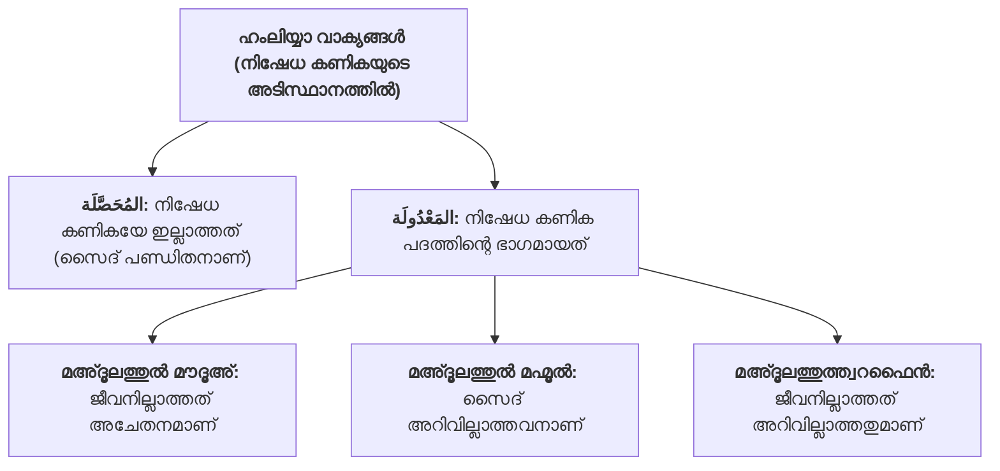

# الْقَضِيَّةُ الْمَعْدُولَةُ وَالْمُحَصَّلَةُ
## നിഷേധപദം ചേർന്ന വിധിവാക്യങ്ങൾ — Metathetic / Negated-Term Propositions

<!-- Top Navigation Bar -->
[⏮️ മുൻ അധ്യായം: 09. القضية الحملية والمحصورات](file:///Users/apple/Desktop/docs:books/Kanz-al-Tahqiq/Texts/Mantiq/tasrih-al-mantiq/Notes/Chapters/09-al-qadiyyah-al-hamliyyah.md) | [📑 സൂചിക / Master Index](file:///Users/apple/Desktop/docs:books/Kanz-al-Tahqiq/Texts/Mantiq/tasrih-al-mantiq/Notes/Chapters/00-index.md) | [അടുത്ത അധ്യായം: 11. القضايا الموجهة البسيطة ⏭️](file:///Users/apple/Desktop/docs:books/Kanz-al-Tahqiq/Texts/Mantiq/tasrih-al-mantiq/Notes/Chapters/11-al-qadaya-al-muwajjahah-al-basitah.md)

---

### 1. മൂലപാഠം / النص الأصلي من المتن (Al-Matn al-Aṣl)

ثُمَّ حَرْفُ السَّلْبِ مِثْلُ «لَا» وَ«لَيْسَ» قَدْ يُجْعَلُ جُزْءًا؛ فَإِنْ كَانَ جُزْءًا مِنَ الْمَوْضُوعِ، فَمَعْدُولَةُ الْمَوْضُوعِ، نَحْوُ: اللَّاحَيُّ جَمَادٌ، وَإِنْ كَانَ جُزْءًا مِنَ الْمَحْمُولِ، فَمَعْدُولَةُ الْمَحْمُولِ، مِثْلُ: الْجَمَادُ لَاحَيٌّ، وَإِنْ كَانَ جُزْءًا مِنْ كِلَيْهِمَا، فَمَعْدُولَةُ الطَّرْفَيْنِ، نَحْوُ: اللَّاحَيُّ لَا عَالِمٌ.

---

### 2. മലയാള പരിഭാഷ (ദർസ് ശൈലിയിലുള്ള വാച്യാർത്ഥവും ആശയവും)

പിന്നെ, «ലാ» (لا), «ലൈസ» (ليس) തുടങ്ങിയ നിഷേധ അക്ഷരങ്ങൾ ചിലപ്പോൾ പദത്തിന്റെ തന്നെ ഒരു ഘടകമായി ചേർക്കപ്പെട്ടേക്കാം:
1. അത് മൗദൂഇന്റെ (വിഷയത്തിന്റെ) ഭാഗമാണെങ്കിൽ അതിന് **മഅ്ദൂലത്തുൽ മൗദൂഅ് (നിഷേധപദ വിഷയ വാക്യം / معدولة الموضوع)** എന്ന് പറയപ്പെടുന്നു; ഉദാഹരണത്തിന്: «ജീവില്ലാത്തത് അചേതന വസ്തുവാണ്» (അൽ-ലാഹയ്യു ജമാദ്).
2. അത് മഹ്മൂലിന്റെ (വിധിയുടെ) ഭാഗമാണെങ്കിൽ അതിന് **മഅ്ദൂലത്തുൽ മഹ്മൂൽ (നിഷേധപദ വിധി വാക്യം / معدولة المحمول)** എന്ന് പറയപ്പെടുന്നു; ഉദാഹരണത്തിന്: «അചേതന വസ്തു ജീവനില്ലാത്തതാണ്» (അൽ-ജമാദു ലാഹയ്യ്).
3. അത് മൗദൂഇന്റെയും മഹ്മൂലിന്റെയും ഭാഗമാണെങ്കിൽ അതിന് **മഅ്ദൂലത്തുത്ത്വറഫൈൻ (ഇരുവശങ്ങളിലും നിഷേധപദം ചേർന്ന വാക്യം / معدولة الطرفين)** എന്ന് പറയപ്പെടുന്നു; ഉദാഹരണത്തിന്: «ജീവില്ലാത്തത് അറിവില്ലാത്തതുമാണ്» (അൽ-ലാഹയ്യു ലാ ആലിം).

നിഷേധപദങ്ങൾ പദത്തിന്റെ ഭാഗമാകാതെ പൂർണ്ണമായും സ്വാഭാവികമായി നിൽക്കുന്ന വാക്യത്തിന് **മുഹസ്സ്വല (المحصلة)** എന്ന് പറയപ്പെടുന്നു.

---

### 3. ഇംഗ്ലീഷ് വിവർത്തനം / English Scholastic Translation

The negative particle—such as *lā* ("non-", "un-") or *laysa* ("not")—may sometimes be incorporated as an integral constituent part of a term:
1. If it forms part of the subject term, the proposition is **Metathetic / Negated in Subject (*Maʿdūlat al-Mawḍūʿ*)**, such as: "The non-living is inanimate" (*al-lā-ḥayy jamād*).
2. If it forms part of the predicate term, it is **Metathetic in Predicate (*Maʿdūlat al-Maḥmūl*)**, such as: "The inanimate is non-living" (*al-jamād lā-ḥayy*).
3. If it forms part of both terms, it is **Bimetathetic / Negated in Both Extremes (*Maʿdūlat al-Ṭarafayn*)**, such as: "The non-living is non-knowing" (*al-lā-ḥayy lā-ʿālim*).

A proposition whose subject and predicate terms are completely devoid of incorporated negative particles is called **Positive / Standard Unaltered (*Muḥaṣṣala*)**.

---

### 4. ത്രിഭാഷാ പദസൂചിക / المصطلحات / Key Terminology Matrix

| അറബിക് പദം (Arabic) | ലിപ്യന്തരണം (Transliteration) | മലയാള അർത്ഥം (Malayalam Equivalent) | English Logic Term | സാങ്കേതിക മാതൃക (Schema) |
|---|---|---|---|---|
| **المُحَصَّلَة** | *al-Muḥaṣṣala* | സ്വാഭാവിക വാക്യം | Standard / Positive Proposition | $S$ is $P$ |
| **مَعْدُولَةُ المَوْضُوع** | *Maʿdūlat al-Mawḍūʿ* | നിഷേധപദ വിഷയം | Negated-Subject Proposition | $\text{Non-}S$ is $P$ |
| **مَعْدُولَةُ المَحْمُول** | *Maʿdūlat al-Maḥmūl* | നിഷേധപദ വിധി | Negated-Predicate Proposition | $S$ is $\text{Non-}P$ |
| **مَعْدُولَةُ الطَّرَفَيْن** | *Maʿdūlat al-Ṭarafayn* | ഇരുവശ നിഷേധപദം | Bimetathetic Proposition | $\text{Non-}S$ is $\text{Non-}P$ |
| **السَّالِبَة** | *al-Sāliba* | നിഷേധ വാക്യം | Negative Proposition (copula negated) | $S$ is not $P$ |

---

### 5. വിശദമായ ശർഹും തത്വവിചാരവും / الشرح والتحليل المعمق

#### എ. സാലിബയും മഅ്ദൂലയും തമ്മിലുള്ള ഗഹനമായ വ്യത്യാസം (Salb vs. 'Udūl):
ഇസ്‌ലാമിക തർക്കശാസ്ത്രത്തിലെ ഏറ്റവും സൂക്ഷ്മമായ തത്വമാണിത്:
- **സാലിബ (Negative):** ഇവിടെ വിധി (نسبة الحكم) തന്നെയാണ് നിഷേധിക്കപ്പെടുന്നത്. അതായത് സബ്ജക്റ്റും പ്രെഡിക്കറ്റും തമ്മിൽ ബന്ധമില്ലെന്ന് പറയുന്നു ($S \text{ is not } P$). ഇതിന് വിഷയം (സബ്ജക്റ്റ്) ബാഹ്യലോകത്ത് നിലനിൽക്കണമെന്നില്ല. ഉദാഹരണത്തിന് «രണ്ടാം ദൈവം കാഴ്ചയുള്ളവനല്ല» എന്ന് പറയാം; കാരണം രണ്ടാമതൊരു ദൈവം ഇല്ലാത്തതിനാൽ ആ നിഷേധം സത്യമാണ്.
- **മഅ്ദൂലത്തുൽ മഹ്മൂൽ (Affirmative with Negated Predicate):** ഇവിടെ പ്രസ്താവന **മുജീബ (സ്ഥിരീകരണം)** തന്നെയാണ്! എന്നാൽ സ്ഥിരീകരിക്കപ്പെടുന്ന വിധി ഒരു നെഗറ്റീവ് പദമാണെന്ന് മാത്രം ($S \text{ is } (\text{Non-}P)$). ഒരു കാര്യം മറ്റൊന്നിൽ സ്ഥിരപ്പെടണമെങ്കിൽ വിഷയം യാഥാർത്ഥ്യത്തിൽ നിലനിൽക്കേണ്ടതുണ്ട് (**قاعدة الفرعية: ثبوت شيء لشيء فرع لثبوت المثبت له**). അതിനാൽ «സൈദ് അന്ധനാണ് (കാഴ്ചയില്ലാത്തവനാണ്)» എന്ന് പറയണമെങ്കിൽ സൈദ് എന്ന വ്യക്തി ജീവനോടെ ഉണ്ടായിരിക്കണം!

---

### 6. ചിത്രരൂപങ്ങളും താരതമ്യ പട്ടികകളും / Visual Diagrams & Comparative Matrices

#### സാലിബയും മഅ്ദൂലത്തുൽ മഹ്മൂലും തമ്മിലുള്ള താരതമ്യം

| വശം | സാലിബ (Negative Copula) | മഅ്ദൂലത്തുൽ മഹ്മൂൽ (Negated Term) |
|---|---|---|
| **വാക്യ രൂപം** | സൈദ് പണ്ഡിതനല്ല ($S \text{ is not } P$) | സൈദ് അവിദ്വാനാണ് ($S \text{ is } \text{Non-}P$) |
| **വാക്യത്തിന്റെ ഇനം** | സാലിബ (നിഷേധം) | **മുജീബ (സ്ഥിരീകരണം)** |
| **മൗദൂഇന്റെ അസ്തിത്വം ആവശ്യമുണ്ടോ?** | ഇല്ല (ഇല്ലാത്ത വസ്തുവിനും നിഷേധം പറയാം) | **ഉണ്ട് (സബ്ജക്റ്റ് യാഥാർത്ഥ്യത്തിൽ ഉണ്ടായേ തീരൂ)** |
| **ഫോർമൽ ലോജിക്** | $\neg P(s)$ | $P'(s) \quad \text{where } P' = \text{Non-}P$ |

---

### 7. ഉദാഹരണ വിശകലനം / Analysis of Classical & Contemporary Examples

- **ക്ലാസിക്കൽ ദർസ് ഉദാഹരണം:**
  1. «زيد ليس ببصير» (സൈദ് കാഴ്ചയുള്ളവനല്ല — സാലിബ): സൈദ് ജനിക്കുന്നതിന് മുൻപും, മരിച്ച ശേഷവും, അന്ധനായപ്പോഴും ഈ വാചകം സത്യമാണ്.
  2. «زيد هو أعمى / لا بصير» (സൈദ് കാഴ്ചയില്ലാത്തവനാണ് — മഅ്ദൂല): സൈദ് എന്ന വ്യക്തി ഇപ്പോൾ ജീവിച്ചിരിക്കുകയും അവന് കാഴ്ചയില്ലാതിരിക്കുകയും ചെയ്യുമ്പോൾ മാത്രമേ ഇത് സത്യമാകൂ.
- **കമ്പ്യൂട്ടർ പ്രോഗ്രാമിംഗിലെ ഉദാഹരണം:**
  - `if (!user.isActive)` $\rightarrow$ സാലിബ (നെഗേഷൻ ഓപ്പറേറ്റർ).
  - `user.status = "INACTIVE"` $\rightarrow$ മഅ്ദൂല (സ്റ്റാറ്റസ് എന്ന പ്രോപ്പർട്ടിയിലേക്ക് "ഇൻ-ആക്ടീവ്" എന്ന നിഷേധ മൂല്യം അസൈൻ ചെയ്യുന്നു). ഒബ്ജക്റ്റ് ഇല്ലാതെ ഇതിന് നിലനിൽപ്പില്ല!

---

### 8. ശ്രദ്ധിക്കേണ്ട സൂക്ഷ്മതകൾ / تنبيهات ومزالق شائعة (Common Student Pitfalls)

> [!WARNING]
> «ലൈസ» (ليس) എന്ന അക്ഷരം കേൾക്കുമ്പോൾ തന്നെ വാക്യം സാലിബയാണെന്ന് ധരിക്കരുത്. «ലൈസ» എന്നത് റാബിത്വയെ (Copula) ബാധിക്കാതെ മഹ്മൂലിലേക്ക് ചേർന്ന് ഒരൊറ്റ നാമമായി മാറിയാൽ (ഉദാ: «زيد ليس بعالم» എന്നതിന് പകരം «زيد هو لا عالم») അത് മുജീബ മഅ്ദൂലത്തായി മാറും!

---

### 9. ആവർത്തന ചോദ്യങ്ങളും വ്യായാമങ്ങളും / تدريبات وتمارين (Review Exercises)

1. മഅ്ദൂല എന്നാൽ എന്താണ്? അതിന്റെ മൂന്ന് ഇനങ്ങൾ ഏതെല്ലാം?
2. സാലിബയും മഅ്ദൂലത്തുൽ മഹ്മൂലും തമ്മിലുള്ള രണ്ട് അടിസ്ഥാന വ്യത്യാസങ്ങൾ എഴുതുക.
3. «ഖാഇദത്തുൽ ഫർഇയ്യ» (قاعدة الفرعية) എന്താണെന്നും മഅ്ദൂലയിൽ അത് എങ്ങനെയാണ് പ്രതിഫലിക്കുന്നതെന്നും വ്യക്തമാക്കുക.
4. താഴെ പറയുന്ന വാക്യങ്ങളെ മുഹസ്സ്വല, മഅ്ദൂലത്തുൽ മൗദൂഅ്, മഅ്ദൂലത്തുൽ മഹ്മൂൽ, മഅ്ദൂലത്തുത്ത്വറഫൈൻ എന്ന് വേർതിരിക്കുക:
   - "അനീതിമാൻ വിശ്വസ്തനല്ല."
   - "അനീതിമാൻ അവിശ്വസ്തനാണ്."
   - "സൂര്യൻ പ്രകാശിക്കുന്നു."
   - "ഇരുമ്പ് മരമല്ല."

---

<!-- Bottom Navigation Bar -->
[⏮️ മുൻ അധ്യായം: 09. القضية الحملية والمحصورات](file:///Users/apple/Desktop/docs:books/Kanz-al-Tahqiq/Texts/Mantiq/tasrih-al-mantiq/Notes/Chapters/09-al-qadiyyah-al-hamliyyah.md) | [📑 സൂചിക / Master Index](file:///Users/apple/Desktop/docs:books/Kanz-al-Tahqiq/Texts/Mantiq/tasrih-al-mantiq/Notes/Chapters/00-index.md) | [അടുത്ത അധ്യായം: 11. القضايا الموجهة البسيطة ⏭️](file:///Users/apple/Desktop/docs:books/Kanz-al-Tahqiq/Texts/Mantiq/tasrih-al-mantiq/Notes/Chapters/11-al-qadaya-al-muwajjahah-al-basitah.md)
