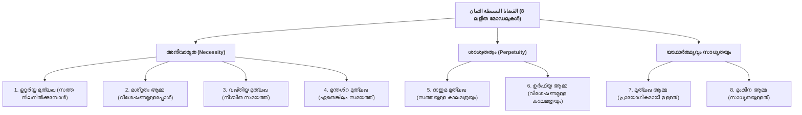

# القَضَايَا المُوَجَّهَةُ البَسِيطَةُ الثَّمَان
## ലളിത മോഡൽ വിധിവാക്യങ്ങൾ — Modal Logic I: The Eight Simple Modal Propositions

<!-- Top Navigation Bar -->
[⏮️ മുൻ അധ്യായം: 10. القضية المعدولة والمحصلة](file:///Users/apple/Desktop/docs:books/Kanz-al-Tahqiq/Texts/Mantiq/tasrih-al-mantiq/Notes/Chapters/10-al-qadiyyah-al-ma-dulah.md) | [📑 സൂചിക / Master Index](file:///Users/apple/Desktop/docs:books/Kanz-al-Tahqiq/Texts/Mantiq/tasrih-al-mantiq/Notes/Chapters/00-index.md) | [അടുത്ത അധ്യായം: 12. القضايا الموجهة المركبة ⏭️](file:///Users/apple/Desktop/docs:books/Kanz-al-Tahqiq/Texts/Mantiq/tasrih-al-mantiq/Notes/Chapters/12-al-qadaya-al-muwajjahah-al-murakkabah.md)

---

### 1. മൂലപാഠം / النص الأصلي من المتن (Al-Matn al-Aṣl)

اِعْلَمْ: أَنَّ نِسْبَةَ الْمَحْمُولِ إِلَى الْمَوْضُوعِ - إِيجَابِيَّةً كَانَتْ أَوْ سَلْبِيَّةً - مُكَيَّفَةٌ فِي الْوَاقِعِ بِكَيْفِيَّةِ مِنَ الضَّرُورَةِ وَالدَّوَامِ وَالْإِمْكَانِ وَالْإِمْتِنَاعِ وَغَيْرِ ذَلِكَ قَطْعًا؛ فَالْقَضِيَّةُ الْمُكَيَّفَةُ بِهَذِهِ الْكَيْفِيَّاتِ النَّفْسِ الأَمْرِيَّةِ تُسَمَّى: مُوَجَّهَةً، وَاللَّفْظُ الدَّالُّ عَلَى تِلْكَ الْكَيْفِيَّةِ: جِهَةً. ثُمَّ تِلْكَ الْقَضِيَّةُ: إِمَّا بَسِيطَةٌ، وَهِيَ: مَا يَكُونُ حَقِيقَتُهُ إِمَّا إِيجَابًا فَقَطْ أَوْ سَلْبًا فَقَطْ، أَوْ مُرَكَّبَةٌ، وَهِيَ: مَا يَتَأَلَّفُ حَقِيقَتُهُ مِنَ الْإِيجَابِ وَالسَّلْبِ مَعًا.

أَمَّا الْقَضَايَا الْبَسِيطَةُ فَثَمَانِيَةٌ:

الأُولَى: ضَرُورِيَّةٌ مُطْلَقَةٌ، وَهِيَ: مَا حُكِمَ فِيهَا بِضَرُورَةِ ثُبُوتِ الْمَحْمُولِ لِلْمَوْضُوعِ، أَوْ سَلْبِهِ عَنْهُ، مَا دَامَتْ ذَاتُ الْمَوْضُوعِ مَوْجُودَةً، نَحْوُ: كُلُّ إِنْسَانٍ حَيَوَانٌ بِالضَّرُورَةٍ، وَلَا شَيْءَ مِنَ الْإِنْسَانِ بِحَجَرٍ بِالضَّرُورَةِ.

وَالثَّانِيَةُ: الْمَشْرُوطَةُ الْعَامَةُ، وَهِيَ: مَا حُكِمَ فِيهَا بِضَرُورَةِ ثُبُوتِهِ لَهُ، أَوْ سَلْبِهِ عَنْهُ، مَا دَامَتْ ذَاتُ الْمَوْضُوعِ مَوْصُوفَةً بِالْوَصْفِ الْعِنْوَانِي، كَقَوْلِنَا: كُلُّ كَاتِبٍ مُتَحَرِّكُ الْأَصَابِعِ بِالضَّرُورَةِ مَا دَامَ كَاتِبًا. وَلَا شَيْءَ مِنْهُ بِسَاكِنِ الأصَابعِ بِالضَّرُورَةِ مَا دَامَ كَاتِبًا.

وَالثَّالِثَةُ: الْوَقْتِيَّةُ الْمُطْلَقَةُ، وَهِيَ: مَا حُكِمَ فِيهَا بِضَرُورَةِ ثُبُوتِهِ لَهُ، أَوْ سَلْبِهِ عَنْهُ فِي وَقْتٍ مُعَيَّنٍ مِنْ أَوْقَاتِ الْمَوْضُوعِ، نَحْوُ: كُلُّ قَمَرٍ مُنْحَسِفٌ بِالضَّرُورَةٍ وَقْتَ حَيْلُولَةِ الْأَرْضِ بَيْنَهُ وَبَيْنَ الشَّمْسِ، وَلَا شَيْءَ مِنَ الْقَمَرِ بِمُنْحَسِفٍ بِالضَّرُورَةٍ وَقْتَ التَّرْبِيعِ.

وَالرَّابِعَةُ: الْمُنْتَشِرَةُ الْمُطْلَقَةُ، وَهِيَ: مَا حُكِمَ فِيهَا بِضَرُورَةِ الثُّبُوتِ أَوِ السَّلْبِ فِي وَقْتٍ مِنَ الْأَوْقَاتِ، نَحْوُ: كُلُّ إِنْسَانٍ مُتَنَفِّسٌ بِالضَّرُورَةٍ فِي وَقْتٍ مَا، وَلَا شَيْءَ مِنْهُ بِمُتَنَفِّسٍ بِالضَّرُورَةٍ فِي وَقْتٍ مَا.

وَالْخَامِسَةُ: الدَّائِمَةُ الْمُطْلَقَةُ، وَهِيَ: مَا حُكِمَ فِيهَا بِدَوَامِ الثُّبُوتِ أَوِ السَّلْبِ، مَا دَامَ ذَاتُ الْمَوْضُوعِ مَوْجُودَةً، مِثْلُ: كُلُّ فَلَكٍ مُتَحَرِّكٌ دَائِمًا، وَلَا شَيْءَ مِنْهُ بِسَاكِنِ دَائِمًا، وَالْفَرْقُ بَيْنَ الضَّرُورَةِ وَالدَّوَامِ: أَنَّ مَعْنَى الضَّرُورَةِ: اِمْتِنَاعُ انْفِكَاكِ النِّسْبَةِ، وَالدَّوَامِ: عَدْمُ انْفِكَاكِهَا بِحَسَبِ الْأَزْمِنَةِ وَالْأَوْقَاتِ، أَعَمُّ مِنْ أَنْ يَكُونَ الْإِنْفِكَاكُ مُمْتَنِعًا، بِحَسَبِ الذَّاتِ أَوْلَا - كَدَوَامِ حَرْكَةِ الْفَلَكِ.

وَالسَّادِسَةُ: الْعُرْفِيَّةُ الْعَامَةُ. وَهِيَ: مَا حُكِمَ فِيهَا بِدَوَامِ الثُّبُوتِ أَوِ السَّلْبِ، مَا دَامَ الْوَصْفُ، نَحْوُ: كُلُّ كَاتِبٍ مُتَحَرِّكُ الْأَصَابِعِ مَا دَامَ كَاتِبًا، وَلَا شَيْءَ مِنْهُ بِسَاكِنِ الْأَصَابِعِ مَا دَامَ كَاتِبًا.

وَالسَّابِعَةُ: الْمُطْلَقَةُ الْعَامَّةُ، وَهِيَ: مَا حُكِمَ فِيهَا بِالثُّبُوتِ أَوِ السَّلْبِ بِالْفِعْلِ، أَيْ فِي أَحَدِ الْأَزْمِنَةِ الثَّلَاثَةِ، كَقَوْلِنَا: كُلُّ إِنْسَانٍ ضَاحِكٌ بِالْفِعْلِ، وَلَا شَيْءَ مِنَ الْإِنْسَانِ بِضَاحِكِ بِالْفِعْلِ.

وَالثَّامِنَةُ: الْمُمْكِنَةُ الْعَامَةُ، وَهِيَ: مَا حُكِمَ فِيهَا بِسَلْبٍ ضَرُورَةِ النِّسْبَةِ عَنِ الجانِبِ الْمُخَالِفِ، نَحْوُ: كُلُّ إِنْسَانٍ كَاتِبٌ بِالْإِمْكَانِ الْعَامِّ، وَلَا شَيْءَ مِنْهُ بِكَاتِبٍ بِالْإِمْكَانِ الْعَامِّ.

---

### 2. മലയാള പരിഭാഷ (ദർസ് ശൈലിയിലുള്ള വാച്യാർത്ഥവും ആശയവും)

നീ അറിയുക: വിഷയവും വിധിയും (മൗദൂഉം മഹ്മൂലും) തമ്മിലുള്ള ബന്ധം യാഥാർത്ഥ്യത്തിൽ അനിവാര്യത (ളറൂറത്ത്), ശാശ്വതത്വം (ദവാം), സാധ്യത (ഇംകാൻ), അസാധ്യത (ഇംതിനാഅ്) തുടങ്ങിയ ഭാവങ്ങളാൽ (മോഡാലിറ്റി / കൈഫിയ്യത്ത്) പരിമിതപ്പെടുത്തപ്പെട്ടതാണ്. ആ യാഥാർത്ഥ്യ ഭാവങ്ങൾ പ്രസ്താവിക്കപ്പെട്ട വാക്യത്തിന് **മുവജ്ജഹ (മോഡൽ വാക്യം / الموجهة)** എന്നും, ആ ഭാവത്തെ കാണിക്കുന്ന പദത്തിന് **ജിഹത്ത് (ദിശ / ഭാവസൂചകം / الجهة)** എന്നും പറയപ്പെടുന്നു.

ഈ മുവജ്ജഹകൾ രണ്ട് വിധമാണ്:
1. **ബസീത്വ (ലളിതം / بسيطة):** കേവലം സ്ഥിരീകരണമോ (ഇജാബ്) കേവലം നിഷേധമോ (സൽബ്) മാത്രമുള്ളത്.
2. **മുറക്കബ (സംയുക്തം / مركبة):** സ്ഥിരീകരണവും നിഷേധവും ഒരുമിച്ച് ചേർന്നത്.

ലളിത മോഡൽ വാക്യങ്ങൾ (ബസീത്വ) എട്ടെണ്ണമാകുന്നു:
1. **ളറൂരിയ്യ മുത്‍ലഖ (ضرورية مطلقة - സമ്പൂർണ്ണ അനിവാര്യത):** മൗദൂഅ് നിലനിൽക്കുന്നിടത്തോളം കാലം മഹ്മൂൽ അതിന് അനിവാര്യമായി ഉണ്ടാകുമെന്നോ ഉണ്ടാവുകയില്ലെന്നോ വിധിക്കപ്പെട്ടത്. ഉദാ: «എല്ലാ മനുഷ്യരും അനിവാര്യമായും ജീവികളാണ്» (ഇജാബ്), «ഒരു മനുഷ്യനും അനിവാര്യമായും കല്ലല്ല» (സൽബ്).
2. **മശ്റൂത്വ ആമ്മ (مشروطة عامة - സോപാധിക അനിവാര്യത):** മൗദൂഇൽ വിശേഷണം നിലനിൽക്കുന്ന കാലത്തോളം മഹ്മൂൽ അനിവാര്യമാകുന്നത്. ഉദാ: «എഴുതിക്കൊണ്ടിരിക്കുന്നിടത്തോളം കാലം എല്ലാ എഴുത്തുകാരന്റെയും വിരലുകൾ അനിവാര്യമായും ചലിക്കുന്നതാണ്».
3. **വഖ്തിയ്യ മുത്‍ലഖ (وقتية مطلقة - സമയബന്ധിത അനിവാര്യത):** ഒരു പ്രത്യേക നിശ്ചിത സമയത്ത് മാത്രം അനിവാര്യമാകുന്നത്. ഉദാ: «സൂര്യനും ചന്ദ്രനുമിടയിൽ ഭൂമി മറയായി നിൽക്കുന്ന സമയത്ത് ചന്ദ്രന് ഗ്രഹണം ബാധിക്കുന്നത് അനിവാര്യമാണ്».
4. **മുന്തശിറ മുത്‍ലഖ (منتشرة مطلقة - അനിശ്ചിത സമയ അനിവാര്യത):** ഏതോ ഒരു അനിശ്ചിത സമയത്ത് അനിവാര്യമാകുന്നത്. ഉദാ: «മനുഷ്യൻ ഏതെങ്കിലും ഒരു സമയത്ത് ശ്വാസമെടുക്കുന്നത് അനിവാര്യമാണ്».
5. **ദാഇമ മുത്‍ലഖ (دائمة مطلقة - സമ്പൂർണ്ണ ശാശ്വതത്വം):** മൗദൂഅ് ഉള്ളിടത്തോളം കാലം മഹ്മൂൽ സദാ നിലനിൽക്കുമെന്ന് വിധിക്കപ്പെടുന്നത്. ഉദാ: «എല്ലാ ഗ്രഹങ്ങളും സദാ ചലിച്ചുകൊണ്ടിരിക്കുന്നതാണ്».
   *(ളറൂറത്തും ദവാമും തമ്മിലുള്ള വ്യത്യാസം: ളറൂറത്ത് എന്നാൽ വേർപെടൽ ബുദ്ധിപരമായി അസാധ്യമാകലാണ്; ദവാം എന്നാൽ കാലങ്ങളിലുടനീളം അത് വേർപെടാതിരിക്കലാണ്; വേർപെടൽ ബുദ്ധിപരമായി സാധ്യമായാലും ശരി).*
6. **ഉർഫിയ്യ ആമ്മ (عرفية عامة - സോപാധിക ശാശ്വതത്വം):** വിശേഷണം ഉള്ള കാലത്തോളം സദാ നിലനിൽക്കുന്നത്. ഉദാ: «എഴുത്തുകാരൻ എഴുതിക്കൊണ്ടിരിക്കുന്നിടത്തോളം അവന്റെ വിരലുകൾ സദാ ചലിക്കുന്നതാണ്».
7. **മുത്‍ലഖ ആമ്മ (مطلقة عامة - പ്രായോഗിക യാഥാർത്ഥ്യം):** മൂന്ന് കാലങ്ങളിൽ ഒന്നിൽ പ്രായോഗികമായി (ബിൽ ഫിഅ്ൽ) സംഭവിച്ചിട്ടുണ്ടെന്ന് വിധിക്കുന്നത്. ഉദാ: «എല്ലാ മനുഷ്യരും പ്രായോഗികമായി ചിരിക്കുന്നവരാണ്».
8. **മുംകിന ആമ്മ (ممكنة عامة - സാമാന്യ സാധ്യത):** എതിർവശത്തിന്റെ അനിവാര്യതയെ നിഷേധിക്കുന്നത്. ഉദാ: «എല്ലാ മനുഷ്യരും എഴുതാൻ സാധ്യതയുള്ളവരാണ്» (അതായത് എഴുതാതിരിക്കൽ മനുഷ്യന് അനിവാര്യമല്ല).

---

### 3. ഇംഗ്ലീഷ് വിവർത്തനം / English Scholastic Translation

The predicative relation between subject and predicate—whether affirmative or negative—is objectively qualified in reality by modal determinations such as Necessity (*Ḍarūra*), Perpetuity (*Dawām*), Possibility (*Imkān*), or Impossibility (*Imtināʿ*). A proposition modified by such real-world determination is termed **Modalized (*Muwajjaha*)**, and the explicit term denoting that determination is called the **Mode (*Jihat*)**.

Modals are either:
- **Simple (*Basīṭa*)**: Consisting purely of an affirmation alone or a negation alone.
- **Compound (*Murakkaba*)**: Synthesized from both an affirmation and an implicit negation.

The **Eight Simple Modal Propositions (*al-Basīṭa*)**:
1. **Absolute Necessary (*Ḍarūriyya Muṭlaqa*)**: Necessity holds as long as the essence of the subject exists (e.g., "Every human is necessarily an animal").
2. **General Conditional (*Mashrūṭa ʿĀmma*)**: Necessity holds as long as the subject possesses the titular description (e.g., "Every writer necessarily moves his fingers as long as he is writing").
3. **Absolute Temporal (*Waqtiyya Muṭlaqa*)**: Necessity holds at a specific, designated time (e.g., "The moon is necessarily eclipsed at the time the earth intervenes between it and the sun").
4. **Absolute Dispersed (*Muntashira Muṭlaqa*)**: Necessity holds at an unspecified, indefinite time (e.g., "Every human necessarily breathes at some time").
5. **Absolute Perpetual (*Dāʾima Muṭlaqa*)**: Perpetuity holds as long as the essence of the subject exists (e.g., "Every celestial sphere is perpetually in motion").
   *(Difference: Necessity means impossibility of separation; Perpetuity means non-separation across time, whether separation is intrinsically impossible or not).*
6. **General Conventional (*ʿUrfiyya ʿĀmma*)**: Perpetuity holds as long as the titular description endures (e.g., "Every writer perpetually moves his fingers as long as he is writing").
7. **General Absolute (*Muṭlaqa ʿĀmma*)**: Judgment affirms actual instantiation in actuality (*bi-l-fiʿl*) in one of the three tenses (e.g., "Every human is actually laughing").
8. **General Possible (*Mumkina ʿĀmma*)**: Negates necessity from the contradictory opposite (e.g., "Every human is a writer by general possibility"—meaning non-writing is not necessary).

---

### 4. ത്രിഭാഷാ പദസൂചിക / المصطلحات / Key Terminology Matrix

| അറബിക് പദം (Arabic) | ലിപ്യന്തരണം (Transliteration) | മലയാള അർത്ഥം (Malayalam Equivalent) | English Modal Term | ചിഹ്നം / മോഡാലിറ്റി |
|---|---|---|---|---|
| **القَضِيَّةُ المُوَجَّهَة** | *al-Qaḍiyya al-muwajjaha* | മോഡൽ വിധിവാക്യം | Modal Proposition | $\Box P$ (Necessary) / $\Diamond P$ (Possible) |
| **الجِهَة** | *al-Jihah* | മോഡ് / ഭാവസൂചകം | Mode / Modal Copula | ഭാവത്തെ കാണിക്കുന്ന വാക്ക് |
| **المَادَّة** | *al-Mādda* | ബാഹ്യ യാഥാർത്ഥ്യം | Objective Metaphysical Matter | വാക്കിലില്ലെങ്കിലും യാഥാർത്ഥ്യത്തിലുള്ള അനിവാര്യത |
| **الضَّرُورَة** | *al-Ḍarūra* | അനിവാര്യത | Necessity | ബുദ്ധിപരമായി വേർപെടാൻ സാധ്യമല്ലാത്ത അവസ്ഥ |
| **الدَّوَام** | *al-Dawām* | ശാശ്വതത്വം | Perpetuity | സദാ നിലനിൽക്കൽ (എപ്പോഴും ഉണ്ടാകൽ) |
| **الإِمْكَانُ العَامّ** | *al-Imkān al-ʿāmm* | സാമാന്യ സാധ്യത | One-sided Possibility | എതിർവശം അസാധ്യമല്ല എന്ന് പറയൽ |

---

### 5. വിശദമായ ശർഹും തത്വവിചാരവും / الشرح والتحليل المعمق

#### എ. ജിഹത്തും മാദ്ദത്തും തമ്മിലുള്ള വ്യത്യാസം (Jihah vs. Mādda):
- **മാദ്ദത്ത് (المادة):** വാക്യത്തിൽ പ്രസ്താവിച്ചാലും ഇല്ലെങ്കിലും വിഷയവും വിധിയും തമ്മിൽ യാഥാർത്ഥ്യത്തിലുള്ള വസ്തുനിഷ്ഠ ബന്ധം (ഉദാ: «മനുഷ്യൻ ജീവിയാണ്» എന്ന് കേവലം പറഞ്ഞാലും മനുഷ്യന് ജീവിയാവുക എന്നത് അനിവാര്യമാണ്).
- **ജിഹത്ത് (الجهة):** സംസാരിക്കുന്നയാൾ നാവുകൊണ്ട് വ്യക്തമായി ഉച്ചരിക്കുന്ന പദം (ഉദാ: «അനിവാര്യമായും», «എപ്പോഴും», «സാധ്യതയുണ്ട്»).

#### ബി. ളറൂറത്തും ദവാമും (Necessity vs. Perpetuity):
ഇസ്‌ലാമിക തത്വചിന്തയിലെ അതിപ്രധാനമായ ചർച്ചയാണിത്:
- **ളറൂറത്ത്:** വിധി വിഷയത്തിൽ നിന്ന് വേർപെടൽ യുക്തിപരമായി അസാധ്യമാണ് ($1+1=2$, മനുഷ്യൻ ജീവിയാകൽ).
- **ദവാം:** വേർപെടൽ യുക്തിപരമായി സാധ്യമാണെങ്കിലും പ്രായോഗികമായി എപ്പോഴും കൂടെയുണ്ടാകുന്നു (ഉദാ: ആകാശഗോളങ്ങൾ അല്ലാഹുവിന്റെ കൽപ്പനയാൽ സദാ ചലിച്ചുകൊണ്ടിരിക്കുന്നു; ദൈവം ഉദ്ദേശിച്ചാൽ അവയെ നിശ്ചലമാക്കാൻ കഴിയും എന്നതിനാൽ ഇത് ശാശ്വതമാണ്, എന്നാൽ സ്വയം അനിവാര്യമല്ല).
$$\text{ളറൂറത്ത്} \subset \text{ദവാം (എല്ലാ അനിവാര്യതയും ശാശ്വതമായിരിക്കും; എന്നാൽ എല്ലാ ശാശ്വതതയും അനിവാര്യമാകണമെന്നില്ല)}$$

---

### 6. ചിത്രരൂപങ്ങളും താരതമ്യ പട്ടികകളും / Visual Diagrams & Comparative Matrices

#### എട്ട് ലളിത മോഡലുകളുടെ സൂചിക (The 8 Simple Modals Matrix)

| ക്രമം | നാമം (Arabic) | നിബന്ധന (Condition) | ഉദാഹരണം | മോഡൽ സിംബൽ |
|:---:|---|---|---|---|
| **1** | ضرورية مطلقة | സത്ത ഉള്ളിടത്തോളം അനിവാര്യം | എല്ലാ മനുഷ്യരും അനിവാര്യമായും ജീവിയാണ് | $\Box \forall x (S(x) \rightarrow P(x))$ |
| **2** | مشروطة عامة | വിശേഷണം ഉള്ളിടത്തോളം അനിവാര്യം | എഴുതുമ്പോൾ വിരൽ ചലിക്കുന്നത് അനിവാര്യം | $\Box_W (S \rightarrow P)$ |
| **3** | وقتية مطلقة | നിശ്ചിത സമയത്ത് അനിവാര്യം | ഗ്രഹണ സമയത്ത് ചന്ദ്രന് ഗ്രഹണമുണ്ടാകൽ | $\Box_{t_0} (S \rightarrow P)$ |
| **4** | منتشرة مطلقة | ഏതെങ്കിലും സമയത്ത് അനിവാര്യം | ഏതെങ്കിലും സമയത്ത് മനുഷ്യൻ ശ്വാസമെടുക്കൽ | $\Box_{\exists t} (S \rightarrow P)$ |
| **5** | دائمة مطلقة | സത്ത ഉള്ളിടത്തോളം സദാ നിലനിൽക്കുന്നത് | ആകാശഗോളങ്ങൾ സദാ ചലിക്കുന്നത് | $\text{Always } (S \rightarrow P)$ |
| **6** | عرفية عامة | വിശേഷണം ഉള്ളിടത്തോളം സദാ നിലനിൽക്കുന്നത് | എഴുത്തുകാരന്റെ വിരലുകൾ സദാ ചലിക്കുന്നത് | $\text{Always}_W (S \rightarrow P)$ |
| **7** | مطلقة عامة | പ്രായോഗികമായി ഒരുകാലത്ത് ഉണ്ടായത് | മനുഷ്യൻ പ്രായോഗികമായി ചിരിക്കുന്നവനാണ് | $\text{Actually } (S \rightarrow P)$ |
| **8** | ممكنة عامة | എതിർവശം അസാധ്യമല്ല എന്ന് മാത്രം | മനുഷ്യൻ എഴുതാൻ സാധ്യതയുള്ളവനാണ് | $\Diamond (S \rightarrow P)$ |

---

### 7. ഉദാഹരണ വിശകലനം / Analysis of Classical & Contemporary Examples

- **ചന്ദ്രഗ്രഹണം (വഖ്തിയ്യ മുത്‍ലഖ):**
  ഭൂമി സൂര്യനും ചന്ദ്രനുമിടയിൽ നേർരേഖയിൽ വരുമ്പോൾ ചന്ദ്രനിൽ നിഴൽ വീഴുന്നത് ആ പ്രത്യേക നിമിഷത്തിൽ **അനിവാര്യമാണ്**. എന്നാൽ ഇത് സദാ സമയത്തും ഉണ്ടാകുന്നതല്ല.
- **കമ്പ്യൂട്ടർ സിസ്റ്റം എക്സിക്യൂഷൻ:**
  - ഒരു പ്രോഗ്രാം റൺ ചെയ്യുമ്പോൾ റാം മെമ്മറി ഉപയോഗിക്കുന്നത് **മശ്റൂത്വ ആമ്മ** ആണ് (`while running, RAM usage is necessary`).

---

### 8. ശ്രദ്ധിക്കേണ്ട സൂക്ഷ്മതകൾ / تنبيهات ومزالق شائعة (Common Student Pitfalls)

> [!WARNING]
> «മുംകിന ആമ്മ» എന്നത് സാധാരണ ഭാഷയിലെ സാധ്യതയല്ല. സാധാരണ നാം സാധ്യത എന്ന് പറയുമ്പോൾ «ഉണ്ടാകാനും ഉണ്ടാകാതിരിക്കാനും സാധ്യതയുണ്ട്» (രണ്ട് വശവും തുല്യം) എന്നാണ് കരുതുക. എന്നാൽ തർക്കശാസ്ത്രത്തിലെ «ഇംകാൻ ആം» എന്നാൽ **എതിർവശം അസാധ്യമല്ല** എന്ന് മാത്രമാണ് അർത്ഥമാക്കുന്നത് (One-sided possibility). അതിനാൽ അനിവാര്യമായ കാര്യത്തിനും «ഇംകാൻ ആം» ബാധകമാകും!

---

### 9. ആവർത്തന ചോദ്യങ്ങളും വ്യായാമങ്ങളും / تدريبات وتمارين (Review Exercises)

1. മുവജ്ജഹ എന്നാൽ എന്താണ്? ജിഹത്തും മാദ്ദത്തും തമ്മിലുള്ള വ്യത്യാസമെന്ത്?
2. ളറൂറത്തും ദവാമും തമ്മിലുള്ള വ്യത്യാസം ഉദാഹരണ സഹിതം വിവരിക്കുക.
3. താഴെ പറയുന്നവ ഏത് മോഡൽ വിധിവാക്യങ്ങളിൽ പെടുന്നുവെന്ന് കണ്ടെത്തുക:
   - "ഓടുന്നിടത്തോളം കാലം കുതിര കാലുകൾ ചലിപ്പിക്കുന്നത് അനിവാര്യമാണ്."
   - "തീ ചൂടുള്ളതായിരിക്കൽ സദാ അനിവാര്യമാണ്."
   - "മഴ പെയ്യുന്ന സമയത്ത് ആകാശം മേഘാവൃതമായിരിക്കൽ അനിവാര്യമാണ്."
   - "മനുഷ്യൻ ഒരു നിമിഷം ഉറങ്ങുന്നത് അനിവാര്യമാണ്."
4. ഇംകാൻ ആമ്മിൽ അനിവാര്യമായ വസ്തുക്കൾ ഉൾപ്പെടുമോ? എന്തുകൊണ്ട്?

---

<!-- Bottom Navigation Bar -->
[⏮️ മുൻ അധ്യായം: 10. القضية المعدولة والمحصلة](file:///Users/apple/Desktop/docs:books/Kanz-al-Tahqiq/Texts/Mantiq/tasrih-al-mantiq/Notes/Chapters/10-al-qadiyyah-al-ma-dulah.md) | [📑 സൂചിക / Master Index](file:///Users/apple/Desktop/docs:books/Kanz-al-Tahqiq/Texts/Mantiq/tasrih-al-mantiq/Notes/Chapters/00-index.md) | [അടുത്ത അധ്യായം: 12. القضايا الموجهة المركبة ⏭️](file:///Users/apple/Desktop/docs:books/Kanz-al-Tahqiq/Texts/Mantiq/tasrih-al-mantiq/Notes/Chapters/12-al-qadaya-al-muwajjahah-al-murakkabah.md)
