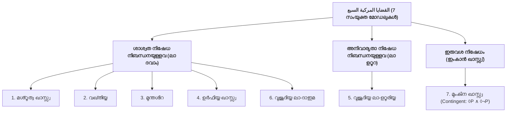

# القَضَايَا المُوَجَّهَةُ المُرَكَّبَةُ السَّبْع
## സംയുക്ത മോഡൽ വിധിവാക്യങ്ങൾ — Modal Logic II: The Seven Compound Modal Propositions

<!-- Top Navigation Bar -->
[⏮️ മുൻ അധ്യായം: 11. القضايا الموجهة البسيطة](file:///Users/apple/Desktop/docs:books/Kanz-al-Tahqiq/Texts/Mantiq/tasrih-al-mantiq/Notes/Chapters/11-al-qadaya-al-muwajjahah-al-basitah.md) | [📑 സൂചിക / Master Index](file:///Users/apple/Desktop/docs:books/Kanz-al-Tahqiq/Texts/Mantiq/tasrih-al-mantiq/Notes/Chapters/00-index.md) | [അടുത്ത അധ്യായം: 13. القضايا الشرطية ⏭️](file:///Users/apple/Desktop/docs:books/Kanz-al-Tahqiq/Texts/Mantiq/tasrih-al-mantiq/Notes/Chapters/13-al-qadaya-al-shartiyyah.md)

---

### 1. മൂലപാഠം / النص الأصلي من المتن (Al-Matn al-Aṣl)

وَأَمَّا الْقَضَايَا الْمُرَكَّبَةُ مِنَ الْقَضِيَّتَيْنِ، اللَّتيْنِ إِحْدَيهُمَا مَذْكُورَةٌ صَرِيحَةً؛ بِأَنْ تَكُونَ مُخَالِفَتَيْنِ بِالْإِيجَابِ وَالسَّلْبِ، مُوَافِقَتَيْنِ بِالْكُلَّيَّةِ وَالْجُزْئِيَّةِ فَسَبْعٌ، وَلَمَّا كَانَتِ الْعِبْرَةُ فِي كَوْنِهَا مُوجَبَةً وَسَالِبَةً بِالْجُزْءِ الْأَوَّلِ، فَأَوْرَدْنَا لِكُلٍّ مِنْهَا مِثَالَيْنِ:

الأُولَى: الْمَشْرُوطَةُ الْخَاصَّةُ وَهِيَ: الْمَشْرُوطَةُ الْعَامَّةُ الْمُقَيَّدَةُ بِاللَّا دَوَامِ الذَّاتِيِّ، نَحْوُ: كُلُّ كَاتِبٍ مُتَحَرِّكُ الْأَصَابِعِ بِالضَّرُورَةِ مَا دَامَ كَاتِبًا لَا دَائِمًا، أَيْ لَا شَيْءَ مِنَ الْكَاتِبِ بِمُتَحَرِّكِ الْأَصَابِعِ بِالْفِعْلِ - إِيجَابًا، وَلَا شَيْءَ مِنَ الْكَاتِبِ بِسَاكِنِ الْأَصَابِعِ بِالضَّرُورَةِ مَا دَامَ كَاتِبًا لَا دَائِمًا - سَلْبًا.

وَالثَّانِيَةُ: الْوَقْتِيَّةُ، وَهِيَ: الْوَقْتِيَّةُ المُطْلَقَةُ الْمُقَيَّدَةُ بِاللَّادَوَامِ بِحَسَبِ الذَّاتِ، نَحْوُ: كُلُّ قَمَرٍ مُنْخَسِفٌ بِالضَّرُورَةِ وَقْتَ حَيْلُولَةِ الْأَرْضِ بَيْنَهُ وَبَيْنَ الشَّمْسِ لَا دَائِمًا، أَيْ لَا شَيْءَ مِنَ الْقَمَرِ بِمُنْخَسِفٍ بِالْفِعْلِ - إِيجَابًا، وَلَا شَيْءَ مِنَ الْقَمَرِ بِمُنْحَسِفٍ بِالضَّرُورَةٍ وَقْتَ التَّرْبِيعِ لَا دَائِمًا - سَلْبًا.

وَالثَّالِثَةُ: الْمُنْتَشِرَةُ، وَهِيَ: الْمُنْتَشِرَةُ الْمُطْلَقَةُ الْمُقَيَّدَةُ بِاللَّادَوَامِ الذَّاتِيِّ، كَقَوْلِنَا: كُلُّ إِنْسَانٍ مُتَنَفَّسٌ بِالضَّرُورَةِ وَقْتًا مَا لَا دَائِمًا، أَيْ لَا شَيْءَ مِنَ الْإِنْسَانِ بِمُتَنَفَّسٍ بِالْفِعْلِ - إِيجَابًا، وَلَا شَيْءَ مِنَ الْإِنْسَانِ بِمُتَنَفِّسٍ بِالضَّرُورَةٍ فِي وَقْتٍ مَا لَا دَائِمًا - سَلْبًا.

وَالرَّابِعَةُ: الْعُرْفِيَّةُ الْخَاصَّةُ، وَهِيَ: الْعُرْفِيَّةُ الْعَامَّةُ مَعَ قَيْدِ اللَّادَوَامَ الذَّاتِيِّ، نَحْوُ: كُلُّ كَاتِبٍ مُتَحَرِّكُ الْأَصَابِعِ مَا دَامَ كَاتِبًا لَا دَائِمًا، أَيْ لَا شَيْءَ مِنَ الْكَاتِبِ بِمُتَحَرِّكِ الْأَصَابِعِ بِالْفِعْلِ - إِيجَابًا، وَلَا شَيْءَ مِنَ الْكَاتِبِ بِسَاكِنِ الْأَصَابِعِ مَا دَامَ كَاتِبًا لَا دَائِمًا - سَلْبًا.

وَالْخَامِسَةُ: الْوُجُودِيَّةُ اللَّاضَرُورِيَّةُ، وَهِيَ: الْمُطْلَقَةُ الْعَامَّةُ الْمُقَيَّدَةُ بِاللَّاضَرُورِيَّةِ الذَّاتِيَّةِ، نَحْوُ: كُلُّ إِنْسَانٍ ضَاحِكٌ بِالْفِعْلِ لَا بِالضَّرُورَةٍ، أَيْ لَا شَيْءَ مِنَ الْإِنْسَانِ بِضَاحِكِ بِالْإِمْكَانِ الْعَامِّ - إِيجَابًا، وَلَا شَيْءَ مِنَ الْإِنْسَانِ بِضَاحِكِ بِالْفِعْلِ لَا بِالضَّرُورَةِ - سَلْبًا.

وَالسَّادِسَةُ: الْوُجُودِيَّةُ اللَّادَائِمَةُ، هِيَ: الْمُطْلَقَةُ الْعَامَّةُ مَعَ قَيْدِ اللَّا دَوَامّ الذَّاتِيِّ، كَقَوْلِنَا: كُلُّ إِنْسَانٍ ضَاحِكٌ بِالْفِعْلِ لَا دَائِمًا - إِيجَابًا، وَلَا شَيْءَ مِنَ الْإِنْسَانِ بِضَاحِكٍ بِالْفِعْلِ لَا دَائِمًا - سَلْبًا.

وَالسَّابِعَةُ: الْمُمْكِنَةُ الْخَاصَّةُ، وَهِيَ: الَّتِي حُكِمَ فِيهَا بِسَلْبِ الضَّرُورَةِ الذَّاتِيَّةِ مِنْ جَانِبَي الْمُوَافِقِ وَالْمُخَالِفِ جَمِيعًا، فَيَكُونُ تَرْكِيبُهَا مِنْ إِمْكَانَيْنِ عَامَّتَيْنِ، كَقَوْلِنَا: كُلُّ إِنْسَانٍ كَاتِبٌ بِالْإِمْكَانِ الْخَاصِّ، وَلَا شَيْءَ مِنَ الْإِنْسَانِ بِكَاتِبٍ بِالإِمْكَانِ الْخَاصِّ، أَيْ كُلُّ إِنْسَانٍ كَاتِبٌ بِالْإِمْكَانِ الْعَامِّ، وَلَا شَيْءَ مِنَ الْإِنْسَانِ بِكَاتِبٍ بِالْإِمْكَانِ الْعَامِّ - فِي الْإِيجَابِ، وَبِالْعَكْسِ - فِي السَّلْبِ، وَالْفَرْقُ فِيهِمَا بَيْنَ الْمُوجَبَةِ وَالسَّالِبَةِ فِي اللَّفْظِ فَقَطْ.

---

### 2. മലയാള പരിഭാഷ (ദർസ് ശൈലിയിലുള്ള വാച്യാർത്ഥവും ആശയവും)

രണ്ട് പ്രസ്താവനകൾ ചേർന്ന സംയുക്ത മോഡൽ വാക്യങ്ങൾ (**മുറക്കബാത്തുകൾ / المركبات**): അവയിൽ ഒന്ന് വ്യക്തമായി പ്രസ്താവിക്കപ്പെടുകയും (മദ്കൂറുൻ സരീഹൻ), മറ്റൊന്ന് അന്തർലീനമായി അടങ്ങിയിരിക്കുകയും ചെയ്യുന്നു. അവ രണ്ടും സ്ഥിരീകരണത്തിലും (ഇജാബ്) നിഷേധത്തിലും (സൽബ്) പരസ്പരം വ്യത്യാസപ്പെട്ടതും, കുല്ലിയ്യത്തിലും ജുസ്ഇയ്യത്തിലും യോജിച്ചതുമായിരിക്കും. ഇവ **ഏഴ് എണ്ണമാകുന്നു**. ആദ്യ ഭാഗത്തെ ആശ്രയിച്ചാണ് വാക്യം മുജീബയാണോ സാലിബയാണോ എന്ന് നിർണ്ണയിക്കപ്പെടുന്നത്.

ഏഴ് സംയുക്ത മോഡൽ വാക്യങ്ങൾ:
1. **മശ്റൂത്വ ഖാസ്സ്വ (مشروطة خاصة):** മശ്റൂത്വ ആമ്മയോടൊപ്പം «സത്താപരമായി ശാശ്വതമല്ല» (ലാ ദവാമ ദാതിയ്യ്) എന്ന നിബന്ധന ചേർത്തത്. ഉദാ: «എഴുത്തുകാരൻ എഴുതിക്കൊണ്ടിരിക്കുന്നിടത്തോളം അവന്റെ വിരലുകൾ ചലിക്കുന്നത് അനിവാര്യമാണ്; എന്നാൽ സദാ സമയത്തും അങ്ങനെയായിരിക്കില്ല».
2. **വഖ്തിയ്യ (الوقتية):** വഖ്തിയ്യ മുത്‍ലഖയോടൊപ്പം «സത്താപരമായി ശാശ്വതമല്ല» എന്ന നിബന്ധന ചേർത്തത്. ഉദാ: «ഭൂമി മറയായി നിൽക്കുമ്പോൾ ചന്ദ്രന് ഗ്രഹണമുണ്ടാകൽ അനിവാര്യമാണ്; എന്നാൽ എപ്പോഴും ഗ്രഹണമുണ്ടാവില്ല».
3. **മുന്തശിറ (المنتشرة):** മുന്തശിറ മുത്‍ലഖയോടൊപ്പം «സത്താപരമായി ശാശ്വതമല്ല» എന്ന നിബന്ധന ചേർത്തത്. ഉദാ: «ഏതെങ്കിലും ഒരു സമയത്ത് മനുഷ്യൻ ശ്വാസമെടുക്കൽ അനിവാര്യമാണ്; എന്നാൽ എപ്പോഴും ശ്വാസമെടുക്കലിലല്ല».
4. **ഉർഫിയ്യ ഖാസ്സ്വ (عرفية خاصة):** ഉർഫിയ്യ ആമ്മയോടൊപ്പം «സത്താപരമായി ശാശ്വതമല്ല» എന്ന നിബന്ധന ചേർത്തത്. ഉദാ: «എഴുത്തുകാരൻ എഴുതുന്ന കാലമത്രയും വിരലുകൾ ചലിക്കുന്നതാണ്; എന്നാൽ അവന്റെ ജീവിതകാലം മുഴുവൻ അത് ചലിച്ചുകൊണ്ടിരിക്കില്ല».
5. **വുജൂദിയ്യ ലാ-ളറൂരിയ്യ (وجودية لا ضرورية):** മുത്‍ലഖ ആമ്മയോടൊപ്പം «സത്താപരമായി അനിവാര്യമല്ല» (ലാ ളറൂരിയ്യത്ത ദാതിയ്യ) എന്ന നിബന്ധന ചേർത്തത്. ഉദാ: «എല്ലാ മനുഷ്യരും പ്രായോഗികമായി ചിരിക്കുന്നവരാണ്; എന്നാൽ ഇത് സത്താപരമായി അനിവാര്യമല്ല» (ചിരിക്കാതിരിക്കലും സാധ്യമാണ്).
6. **വുജൂദിയ്യ ലാ-ദാഇമ (وجودية لا دائمة):** മുത്‍ലഖ ആമ്മയോടൊപ്പം «സത്താപരമായി ശാശ്വതമല്ല» എന്ന നിബന്ധന ചേർത്തത്. ഉദാ: «എല്ലാ മനുഷ്യരും പ്രായോഗികമായി ചിരിക്കുന്നവരാണ്; എന്നാൽ സദാ സമയത്തും ചിരിച്ചുകൊണ്ടിരിക്കുന്നവരല്ല».
7. **മുംകിന ഖാസ്സ്വ (ممكنة خاصة - ദ്വിമുഖ സാധ്യത):** യോജിച്ച ഭാഗത്തുനിന്നും എതിർ ഭാഗത്തുനിന്നും സത്താപരമായ അനിവാര്യതയെ ഒരുപോലെ നിഷേധിക്കുന്നത് (സൽബുദ്ദറൂറതിൽ മുഖാലഫ വൽ മുവാഫഖ). ഉദാ: «മനുഷ്യൻ എഴുതാൻ പ്രത്യേക സാധ്യതയുള്ളവനാണ്» (അതായത് എഴുതൽ അവന് നിർബന്ധവുമല്ല, എഴുതാതിരിക്കൽ അവന് അസാധ്യവുമല്ല; രണ്ട് സാധ്യതകളും തുറന്നുകിടക്കുന്നു). ഇവിടെ മുജീബയും സാലിബയും തമ്മിലുള്ള വ്യത്യാസം ഉച്ചാരണത്തിൽ മാത്രമാണ്; അർത്ഥത്തിൽ രണ്ടും ഒന്നുതന്നെ!

---

### 3. ഇംഗ്ലീഷ് വിവർത്തനം / English Scholastic Translation

Compound Modal Propositions (*al-Murakkabāt*) are composed of two distinct propositions—one explicitly stated, and one implicit—differing in quality (affirmation vs. negation) but agreeing in quantity (universal vs. particular). There are **Seven Compound Modals**, designated affirmative or negative based upon their primary explicit clause:

1. **Special Conditional (*al-Mashrūṭa al-Khāṣṣa*)**: A General Conditional restricted by "non-perpetuity of essence" (*lā-dawām dhātī*), e.g., "Every writer necessarily moves his fingers as long as he is writing, but not perpetually."
2. **Special Temporal (*al-Waqtiyya*)**: An Absolute Temporal restricted by non-perpetuity of essence, e.g., "The moon is necessarily eclipsed at the moment of the earth's interception, but not perpetually."
3. **Special Dispersed (*al-Muntashira*)**: An Absolute Dispersed restricted by non-perpetuity of essence, e.g., "Every human necessarily breathes at some time, but not perpetually."
4. **Special Conventional (*al-ʿUrfiyya al-Khāṣṣa*)**: A General Conventional restricted by non-perpetuity of essence, e.g., "Every writer perpetually moves his fingers as long as he is writing, but not perpetually in his absolute essence."
5. **Existential Non-necessary (*al-Wujūdiyya al-Lā-Ḍarūriyya*)**: A General Absolute restricted by essential non-necessity, e.g., "Every human actually laughs, but not by necessity."
6. **Existential Non-perpetual (*al-Wujūdiyya al-Lā-Dāʾima*)**: A General Absolute restricted by essential non-perpetuity, e.g., "Every human actually laughs, but not perpetually."
7. **Special Possible (*al-Mumkina al-Khāṣṣa* / Contingent / Two-sided Possibility)**: Negates essential necessity from both the affirmative and negative sides simultaneously, synthesized from two general possibilities, e.g., "Every human is a writer by special possibility" (meaning writing is not necessary, nor is not-writing impossible; it is purely contingent: $\neg \Box P \land \neg \Box \neg P$).

---

### 4. ത്രിഭാഷാ പദസൂചിക / المصطلحات / Key Terminology Matrix

| അറബിക് പദം (Arabic) | ലിപ്യന്തരണം (Transliteration) | മലയാള അർത്ഥം (Malayalam Equivalent) | Western Modal Logic Concept | മോഡൽ ഫോർമുല |
|---|---|---|---|---|
| **المُرَكَّبَة** | *al-Murakkaba* | സംയുക്ത മോഡൽ | Compound / Restricted Modal | $P \land \neg Q$ |
| **قَيْدُ اللَّادَوَام** | *Qayd al-lādawām* | ശാശ്വത നിഷേധ നിബന്ധന | Non-perpetuity constraint | $\text{Not Always } P$ |
| **قَيْدُ اللَّاضَرُورَة** | *Qayd al-lāḍarūra* | അനിവാര്യതാ നിഷേധ നിബന്ധന | Non-necessity constraint | $\neg \Box P$ |
| **الإِمْكَانُ الخَاصّ** | *al-Imkān al-khāṣṣ* | ദ്വിമുഖ സാധ്യത (കണ്ടിൻജൻസി) | Bilateral Possibility / Contingency | $\neg \Box P \land \neg \Box \neg P$ |
| **المُمْكِنَةُ الخَاصَّة** | *al-Mumkina al-khāṣṣa* | ആകസ്മിക പ്രസ്താവന | Contingent Proposition | $\Diamond P \land \Diamond \neg P$ |

---

### 5. വിശദമായ ശർഹും തത്വവിചാരവും / الشرح والتحليل المعمق

#### ഇംകാൻ ആമ്മും ഇംകാൻ ഖാസ്സ്വയും തമ്മിലുള്ള കാതലായ വ്യത്യാസം:
- **ഇംകാൻ ആം (One-sided Possibility):** ഒരു വശത്തിന്റെ അനിവാര്യതയെ മാത്രം തള്ളിക്കളയുന്നു. ഉദാ: "അല്ലാഹു ഏകനാകൽ സാധ്യമാണ്" എന്ന് ഇംകാൻ ആമ്മിൽ പറയാം; കാരണം ബഹുദൈവത്വം അസാധ്യമാണ്.
- **ഇംകാൻ ഖാസ്സ്വ് (Two-sided Possibility / Contingency):** രണ്ട് വശങ്ങളുടെയും അനിവാര്യതയെ തള്ളുന്നു (ഉണ്ടാകലും നിർബന്ധമില്ല, ഇല്ലാതാകലും അസാധ്യമല്ല). ഇത് **സൃഷ്ടികളുടെ (മുംകിനാത്തുകളുടെ)** മാത്രം സവിശേഷതയാണ്. അതിനാൽ ദൈവത്തിന്റെ ഗുണങ്ങളിലോ ഗണിത സത്യങ്ങളിലോ ഇംകാൻ ഖാസ്സ്വ് ഒരിക്കലും ബാധകമാകില്ല!

---

### 6. ചിത്രരൂപങ്ങളും താരതമ്യ പട്ടികകളും / Visual Diagrams & Comparative Matrices

#### ഏഴ് സംയുക്ത മോഡലുകളുടെ ഫോർമുല മാട്രിക്സ്

| ക്രമം | നാമം (Arabic) | ഒന്നാം ഭാഗം (വ്യക്തമായത്) | രണ്ടാം ഭാഗം (അന്തർലീന നിബന്ധന) | ഉദാഹരണം |
|:---:|---|---|---|---|
| **1** | مشروطة خاصة | മശ്റൂത്വ ആമ്മ | + സത്താപരമായി ശാശ്വതമല്ല | എഴുതുമ്പോൾ വിരലനക്കം നിർബന്ധം, സദായല്ല |
| **2** | وقتية | വഖ്തിയ്യ മുത്‍ലഖ | + സത്താപരമായി ശാശ്വതമല്ല | ഗ്രഹണസമയത്ത് ഗ്രഹണം നിർബന്ധം, സദായല്ല |
| **3** | منتشرة | മുന്തശിറ മുത്‍ലഖ | + സത്താപരമായി ശാശ്വതമല്ല | ശ്വാസമെടുക്കൽ നിർബന്ധം, സദായല്ല |
| **4** | عرفية خاصة | ഉർഫിയ്യ ആമ്മ | + സത്താപരമായി ശാശ്വതമല്ല | എഴുതുമ്പോൾ വിരൽ ചലനം സദാ, ജീവിതാന്ത്യം വരെയല്ല |
| **5** | وجودية لا ضرورية | മുത്‍ലഖ ആമ്മ | + സത്താപരമായി അനിവാര്യമല്ല | മനുഷ്യൻ ചിരിക്കുന്നു, ചിരിക്കൽ നിർബന്ധമല്ല |
| **6** | وجودية لا دائمة | മുത്‍ലഖ ആമ്മ | + സത്താപരമായി ശാശ്വതമല്ല | മനുഷ്യൻ ചിരിക്കുന്നു, സദാ ചിരിയല്ല |
| **7** | ممكنة خاصة | മുംകിന ആമ്മ (ഇജാബ്) | + മുംകിന ആമ്മ (സൽബ്) | മനുഷ്യൻ എഴുതുന്നത് സാധ്യമാണ് (നിർബന്ധവുമല്ല, അസാധ്യവുമല്ല) |

---

### 7. ഉദാഹരണ വിശകലനം / Analysis of Classical & Contemporary Examples

- **മുംകിന ഖാസ്സ്വ (Contingency): «كُلُّ إِنْسَانٍ كَاتِبٌ بِالْإِمْكَانِ الْخَاصِّ»:**
  മനുഷ്യൻ എഴുത്തുകാരനാവുക എന്നത് അവന്റെ സത്തക്ക് അനിവാര്യമല്ല (എഴുതാത്ത മനുഷ്യരുണ്ട്); അതുപോലെ എഴുതാതിരിക്കുക എന്നത് അവന്റെ സത്തക്ക് അസാധ്യവുമല്ല (എഴുതുന്ന മനുഷ്യരുണ്ട്). രണ്ട് സാധ്യതകളും തുല്യമായി തുറന്നുകിടക്കുന്ന അവസ്ഥയാണിത്.
- **മോഡേൺ ഫിലോസഫി & ക്വാണ്ടം ലോജിക്:**
  ക്വാണ്ടം സൂപ്പർപോസിഷനിൽ ഒരു കണിക ക്ലോക്ക്‌വൈസ് ആയും ആന്റി-ക്ലോക്ക്‌വൈസ് ആയും കറങ്ങാൻ സാധ്യത നിലനിൽക്കുന്നത് 'ഇംകാൻ ഖാസ്സ്വ'യുടെ ഭൗതിക മാതൃകയാണ്.

---

### 8. ശ്രദ്ധിക്കേണ്ട സൂക്ഷ്മതകൾ / تنبيهات ومزالق شائعة (Common Student Pitfalls)

> [!WARNING]
> സംയുക്ത മോഡലുകൾ കേൾക്കുമ്പോൾ ഒറ്റ വാചകമായി തോന്നുമെങ്കിലും മനസ്സിന്റെ വിശകലനത്തിൽ അത് **രണ്ട് വാക്യങ്ങളാണ് (ഖദിയ്യത്തൈനി)**:
> 1. ഒന്നാം ഭാഗം: നാം നാവുകൊണ്ട് പറയുന്ന ഭാഗം.
> 2. രണ്ടാം ഭാഗം: «ലാ ദാഇമൻ» അല്ലെങ്കിൽ «ലാ ബിളറൂറതി» എന്ന് പറയുമ്പോൾ മനസ്സ് സ്വമേധയാ നിർമ്മിക്കുന്ന വിപരീത വാക്യം.

---

### 9. ആവർത്തന ചോദ്യങ്ങളും വ്യായാമങ്ങളും / تدريبات وتمارين (Review Exercises)

1. സംയുക്ത മോഡലുകൾ (മുറക്കബാത്തുകൾ) എന്ന് പേരിടാനുള്ള കാരണമെന്ത്?
2. ഇംകാൻ ആമ്മും ഇംകാൻ ഖാസ്സ്വയും തമ്മിലുള്ള അന്തരം വ്യക്തമാക്കുക.
3. താഴെ പറയുന്നവയെ വിശകലനം ചെയ്ത് രണ്ട് ഭാഗങ്ങളാക്കി മാറ്റുക:
   - "എല്ലാ മനുഷ്യരും ചിരിക്കുന്നവരാണ്, എന്നാൽ സദായല്ല."
   - "ഗ്രഹണ സമയത്ത് ചന്ദ്രന് ഗ്രഹണമുണ്ടാകൽ അനിവാര്യമാണ്, എന്നാൽ എപ്പോഴുമല്ല."
4. എന്തുകൊണ്ടാണ് ദൈവത്തിന്റെ സത്തയിലും ഗുണങ്ങളിലും «ഇംകാൻ ഖാസ്സ്വ്» അസാധ്യമാകുന്നത്?

---

<!-- Bottom Navigation Bar -->
[⏮️ മുൻ അധ്യായം: 11. القضايا الموجهة البسيطة](file:///Users/apple/Desktop/docs:books/Kanz-al-Tahqiq/Texts/Mantiq/tasrih-al-mantiq/Notes/Chapters/11-al-qadaya-al-muwajjahah-al-basitah.md) | [📑 സൂചിക / Master Index](file:///Users/apple/Desktop/docs:books/Kanz-al-Tahqiq/Texts/Mantiq/tasrih-al-mantiq/Notes/Chapters/00-index.md) | [അടുത്ത അധ്യായം: 13. القضايا الشرطية ⏭️](file:///Users/apple/Desktop/docs:books/Kanz-al-Tahqiq/Texts/Mantiq/tasrih-al-mantiq/Notes/Chapters/13-al-qadaya-al-shartiyyah.md)
