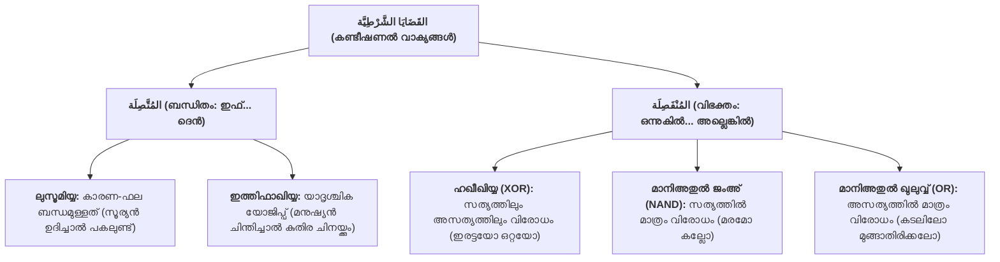

# القَضَايَا الشَّرْطِيَّةُ: المُتَّصِلَةُ وَالمُنْفَصِلَةُ
## ബന്ധിതവും വിഭക്തവുമായ വ്യവസ്ഥാവാക്യങ്ങൾ — Conditional Propositions: Hypothetical & Disjunctive

<!-- Top Navigation Bar -->
[⏮️ മുൻ അധ്യായം: 12. القضايا الموجهة المركبة](file:///Users/apple/Desktop/docs:books/Kanz-al-Tahqiq/Texts/Mantiq/tasrih-al-mantiq/Notes/Chapters/12-al-qadaya-al-muwajjahah-al-murakkabah.md) | [📑 സൂചിക / Master Index](file:///Users/apple/Desktop/docs:books/Kanz-al-Tahqiq/Texts/Mantiq/tasrih-al-mantiq/Notes/Chapters/00-index.md) | [അടുത്ത അധ്യായം: 14. الشرطية المخصوصة والمحصورة ⏭️](file:///Users/apple/Desktop/docs:books/Kanz-al-Tahqiq/Texts/Mantiq/tasrih-al-mantiq/Notes/Chapters/14-al-shartiyyah-al-mahsurah-wal-aswar.md)

---

### 1. മൂലപാഠം / النص الأصلي من المتن (Al-Matn al-Aṣl)

فَصْلٌ فِي الشَّرْطِيَّاتِ: الشَّرْطِيَّةُ، إِنْ كَانَ الْحُكْمُ فِيهَا بِلُزُومِ التَّالِي لِلْمُقَدَّمِ أَوْ سَلْبِهِ عَنْهُ، فَمُتَّصِلَةٌ لُزُومِيَّةٌ. أَمَّا الْمُوجَبَةُ، فَكَقَوْلِنَا: كُلَّمَا كَانَتِ الشَّمْسُ طَالِعَةً فَالنَّهَارُ مَوْجُودٌ؛ وَأَمَّا السَّالِبَةُ، فَمِثْلُ: لَيْسَ أَلْبَتَّةَ كُلَّمَا كَانَتِ الشَّمْسُ طَالِعَةً كَانَ اللَّيْلُ مَوْجُودًا. وَإِنْ كَانَ بِمُوَافَقَةِ التَّالِي لِلْمُقَدَّمِ أَوْ سَلْبِ الِاتِّفَاقِ، فَمُتَّصِلَةٌ اتِّفَاقِيَّةٌ. أَمَّا الْمُوجَبَةُ، فَنَحْوُ: كُلَّمَا كَانَ الْإِنْسَانُ نَاطِقًا كَانَ الْفَرَسُ صَاهِلًا؛ وَأَمَّا السَّالِبَةُ، فَنَحْوُ: لَيْسَ أَلْبَتَّةَ كُلَّمَا كَانَ الْإِنْسَانُ نَاطِقًا كَانَ الْحِمَارُ نَاهِقًا.

ثُمَّ الْحُكْمُ فِيهَا، إِنْ كَانَ بِتَنَافِي النِّسْبَتَيْنِ أَوْ سَلْبِهِ صِدْقًا وَكَذِبًا مَعًا، فَمُنْفَصِلَةٌ حَقِيقِيَّةٌ. أَمَّا الْمُوجَبَةُ، فَكَقَوْلِنَا: إِمَّا أَنْ يَكُونَ هَذَا الْعَدَدُ زَوْجًا وَإِمَّا أَنْ يَكُونَ فَرْدًا؛ وَالسَّالِبَةُ، نَحْوُ: لَيْسَ أَلْبَتَّةَ إِمَّا أَنْ يَكُونَ هَذَا الْعَدَدُ زَوْجًا أَوْ مُنْقَسِمًا بِمُتَسَاوِيَيْنِ.

وَإِنْ كَانَ فِي الصِّدْقِ فَقَطْ، فَمُنْفَصِلَةٌ مَانِعَةُ الْجَمْعِ. أَمَّا الْمُوجَبَةُ، فَنَحْوُ قَوْلِنَا: هَذَا الشَّيْءُ إِمَّا أَنْ يَكُونَ شَجَرًا وَإِمَّا أَنْ يَكُونَ حَجَرًا؛ وَالسَّالِبَةُ، مِثْلُ: لَيْسَ أَلْبَتَّةَ إِمَّا أَنْ يَكُونَ زَيْدٌ إِنْسَانًا أَوْ يَكُونَ نَاطِقًا.

وَإِنْ كَانَ فِي الْكَذِبِ فَقَطْ، فَمُنْفَصِلَةٌ مَانِعَةُ الْخُلُوِّ. أَمَّا الْمُوجَبَةُ، فَكَقَوْلِنَا: إِمَّا أَنْ يَكُونَ زَيْدٌ فِي الْبَحْرِ وَإِمَّا أَنْ لَا يَغْرَقَ؛ وَالسَّالِبَةُ، نَحْوُ: لَيْسَ أَلْبَتَّةَ هَذَا الشَّيْءُ إِمَّا أَنْ يَكُونَ شَجَرًا أَوْ يَكُونَ حَجَرًا.

وَكُلٌّ مِنْ هَذِهِ الْأَقْسَامِ الثَّلَاثَةِ، إِنْ حُكِمَ فِيهَا بِالتَّنَافِي بِالنَّظَرِ إِلَى ذَاتِ الْجُزْأَيْنِ، كَالتَّنَافِي بَيْنَ الزَّوْجِيَّةِ وَالْفَرْدِيَّةِ، فَعِنَادِيَّةٌ؛ وَإِنْ كَانَ التَّنَافِي لَا بِالنَّظَرِ إِلَى ذَاتَيْهِمَا، بَلْ بِمَحْضِ الِاتِّفَاقِ، كَالتَّنَافِي بَيْنَ كَوْنِ الْإِنْسَانِ أَسْوَدَ وَكَاتِبًا، فَاتِّفَاقِيَّةٌ.

---

### 2. മലയാള പരിഭാഷ (ദർസ് ശൈലിയിലുള്ള വാച്യാർത്ഥവും ആശയവും)

വ്യവസ്ഥാവാക്യങ്ങളുടെ (ശർത്വിയ്യാത്തുകളുടെ) അധ്യായം:
ഒരു വ്യവസ്ഥാവാക്യം:
I. അതിലെ വിധി, പൂർവ്വപദത്തിന് (മുഖദ്ദം) പിന്നാലെ ഉത്തരപദം (താലി) അനിവാര്യമായി വരുന്നുവെന്നോ അല്ലെങ്കിൽ അങ്ങനെയല്ലെന്നോ വിധിക്കലാണെങ്കിൽ അത് **മുത്തസ്വില ലുസൂമിയ്യ (അനിവാര്യ ബന്ധിത വാക്യം / متصلة لزومية)** ആകുന്നു:
   - മുജീബ: «സൂര്യൻ ഉദിച്ചിട്ടുണ്ടെങ്കിൽ പകൽ നിലവിലുണ്ടാകും».
   - സാലിബ: «സൂര്യൻ ഉദിച്ചിട്ടുണ്ടെങ്കിൽ രാത്രി നിലവിലുണ്ടാകുമെന്നത് ഒരിക്കലുമില്ല».
   ഇനി അവ തമ്മിലുള്ള ബന്ധം കാര്യകാരണപരമായ അനിവാര്യത കൊണ്ടല്ലാതെ കേവല യാദൃശ്ചിക യോജിപ്പ് (മുവാഫഖത്ത്) കൊണ്ടാണെങ്കിൽ അത് **മുത്തസ്വില ഇത്തിഫാഖിയ്യ (യാദൃശ്ചിക ബന്ധിത വാക്യം / متصلة اتفاقية)** ആകുന്നു:
   - മുജീബ: «മനുഷ്യൻ ചിന്തിക്കുന്നവനാണെങ്കിൽ കുതിര ചിനയ്ക്കുന്നതാണ്».
   - സാലിബ: «മനുഷ്യൻ ചിന്തിക്കുന്നവനാണെങ്കിൽ കഴുത ചിനയ്ക്കുന്നതാണെന്നത് ഒരിക്കലുമില്ല».

II. അതിലെ വിധി, രണ്ട് അംശങ്ങൾ തമ്മിലുള്ള പരസ്പര നിഷേധത്തെയും (തനാഫീ) അകൽച്ചയെയും കുറിച്ചാണെങ്കിൽ അത് **മുൻഫസ്വില (വിഭക്ത വാക്യം / Disjunctive / منفصلة)** ആകുന്നു:
1. **മുൻഫസ്വില ഹഖീഖിയ്യ (സമ്പൂർണ്ണ വിഭക്ത വാക്യം):** സത്യത്തിലോ അസത്യത്തിലോ രണ്ടും ഒരുമിച്ചു കൂടുകയോ ഇല്ലാതാവുകയോ ചെയ്യാത്തത് (സത്യത്തിലും അസത്യത്തിലും അകൽച്ചയുള്ളത്).
   - മുജീബ: «ഈ സംഖ്യ ഒന്നുകിൽ ഇരട്ടയായിരിക്കും, അല്ലെങ്കിൽ ഒറ്റയായിരിക്കും» (രണ്ടും ആവില്ല, രണ്ടും അല്ലാതിരിക്കില്ല).
   - സാലിബ: «ഈ സംഖ്യ ഒന്നുകിൽ ഇരട്ടയാണ് അല്ലെങ്കിൽ തുല്യമായി ഭാഗിക്കപ്പെടുന്നതാണ് എന്നത് ഒരിക്കലുമില്ല».
2. **മുൻഫസ്വില മാനിഅതുൽ ജംഅ് (സംയോജന വിരുദ്ധ വിഭക്ത വാക്യം):** സത്യത്തിൽ മാത്രം ഒരുമിച്ചുകൂടൽ തടയപ്പെട്ടത് (രണ്ടും ശരിയാവില്ല, എന്നാൽ രണ്ടും അസത്യമാകാം).
   - മുജീബ: «ഈ വസ്തു ഒന്നുകിൽ വൃക്ഷമാണ്, അല്ലെങ്കിൽ കല്ലാണ്» (ഒരേ സമയം രണ്ടും ആകില്ല; എന്നാൽ രണ്ടും അല്ലാതെ മനുഷ്യനാകാം).
   - സാലിബ: «സൈദ് ഒന്നുകിൽ മനുഷ്യനാണ് അല്ലെങ്കിൽ ചിന്തിക്കുന്നവനാണ് എന്നത് ഒരിക്കലുമില്ല».
3. **മുൻഫസ്വില മാനിഅതുൽ ഖുലുവ്വ് (ശൂന്യതാ വിരുദ്ധ വിഭക്ത വാക്യം):** അസത്യത്തിൽ മാത്രം ഒന്നിക്കൽ തടയപ്പെട്ടത് (രണ്ടും ഇല്ലാതാവില്ല, എന്നാൽ രണ്ടും ശരിയാകാം).
   - മുജീബ: «സൈദ് ഒന്നുകിൽ കടലിലാണ്, അല്ലെങ്കിൽ അവൻ മുങ്ങിപ്പോകാത്തവനാണ്» (കടലിലല്ലെങ്കിൽ അവൻ മുങ്ങില്ല, രണ്ടും ഒരേസമയം ഇല്ലാതാകില്ല; എന്നാൽ കടലിലാവുകയും ലൈഫ് ജാക്കറ്റുള്ളതിനാൽ മുങ്ങാതിരിക്കുകയും ചെയ്യാം — രണ്ടും ഒന്നിക്കാം).

ഈ മൂന്ന് ഇനങ്ങളിൽ ഓരോന്നും:
- രണ്ട് ഘടകങ്ങളുടെ സ്വത്വപരമായ വിരോധം കാരണമാണെങ്കിൽ (ഇരട്ടയും ഒറ്റയും പോലെ) അത് **ഇനാദിയ്യ (സത്താപരമായ വിരോധം / عنادية)** ആകുന്നു.
- കേവല ബാഹ്യ യാദൃശ്ചികത കൊണ്ടാണെങ്കിൽ അത് **ഇത്തിഫാഖിയ്യ (യാദൃശ്ചിക വിരോധം / اتفاقية)** ആകുന്നു.

---

### 3. ഇംഗ്ലീഷ് വിവർത്തനം / English Scholastic Translation

Conditional Propositions (*al-Sharṭiyyāt*):
I. **Connected / Hypothetical Conditional (*al-Muttaṣila*)**:
- **Implicative / Necessary (*Luzūmiyya*)**: If the judgment affirms or denies that the consequent necessarily follows from the antecedent by causal or logical entailment:
  - *Affirmative:* "Whenever the sun has risen, daytime exists." ($P \rightarrow Q$)
  - *Negative:* "It is never the case that whenever the sun has risen, nighttime exists." ($\neg (P \rightarrow \neg Q)$)
- **Coincidental / Accidental (*Ittifāqiyya*)**: If the conjunction between antecedent and consequent is by mere factual coincidence without intrinsic entailment:
  - *Affirmative:* "Whenever man is rational, the horse is neighing."
  - *Negative:* "It is never the case that whenever man is rational, the donkey is neighing."

II. **Disconnected / Disjunctive Conditional (*al-Munfaṣila*)**:
1. **Real / Exclusive Disjunction (*Ḥaqīqiyya*)**: Incompatibility in both truth and falsity simultaneously (they cannot both be true, nor can they both be false):
   - *Affirmative:* "Either this number is even or it is odd." ($P \oplus Q$)
   - *Negative:* "It is never the case that either this number is even or divisible into two equal halves."
2. **Incompatible / Non-Conjunctive Disjunction (*Māniʿat al-Jamʿ*)**: Incompatibility in truth only (they cannot both be true, but can both be false):
   - *Affirmative:* "This object is either a tree or a stone." (Cannot be both; can be neither, e.g., a horse).
   - *Negative:* "It is never the case that Zayd is either a human or rational."
3. **Exhaustive / Subcontrary Disjunction (*Māniʿat al-Khuluww*)**: Incompatibility in falsity only (they cannot both be false, but can both be true):
   - *Affirmative:* "Either Zayd is in the sea or he is not drowning." (Cannot both be false; but can both be true if he is in the sea with a flotation device).
   - *Negative:* "It is never the case that this object is either a tree or a stone."

All three disjunctive types are either **Essential (*ʿInādiyya*)** due to the very nature of the concepts (e.g., parity vs. oddity), or **Coincidental (*Ittifāqiyya*)** due to pure factual coincidence.

---

### 4. ത്രിഭാഷാ പദസൂചിക / المصطلحات / Key Terminology Matrix

| അറബിക് പദം (Arabic) | ലിപ്യന്തരണം (Transliteration) | മലയാള അർത്ഥം (Malayalam Equivalent) | Western Logic Term | ചിഹ്നം (Symbolic Logic) |
|---|---|---|---|---|
| **المُتَّصِلَة اللُّزُومِيَّة** | *al-Muttaṣila al-luzūmiyya* | അനിവാര്യ കണ്ടീഷണൽ | Material / Strict Implication | $P \rightarrow Q$ |
| **المُنْفَصِلَة الحَقِيقِيَّة** | *al-Munfaṣila al-ḥaqīqiyya* | എക്സ്ക്ലൂസീവ് ഡിസ്‌ജംഗ്ഷൻ | Exclusive Disjunction (XOR) | $P \oplus Q$ |
| **مَانِعَةُ الجَمْع** | *Māniʿat al-jamʿ* | സംയോജന വിരുദ്ധം | Incompatible Alternation (NAND) | $\neg (P \land Q)$ |
| **مَانِعَةُ الخُلُوّ** | *Māniʿat al-khuluww* | ശൂന്യതാ വിരുദ്ധം | Inclusive Disjunction (OR) | $P \lor Q$ |
| **المُقَدَّم** | *al-Muqaddam* | പൂർവ്വപദം | Antecedent | $P$ |
| **التَّالِي** | *al-Tālī* | ഉത്തരപദം | Consequent | $Q$ |

---

### 5. വിശദമായ ശർഹും തത്വവിചാരവും / الشرح والتحليل المعمق

#### വിഭക്ത വാക്യങ്ങളുടെ (Munfaṣila) ട്രൂത്ത് ടേബിൾ അപഗ്രഥനം:
മന്തിഖിലെ മൂന്ന് മുൻഫസ്വിലകൾ ആധുനിക കമ്പ്യൂട്ടർ ലോജിക് ഗേറ്റുകളുമായി (Logic Gates) അത്ഭുതകരമാംവിധം സമാനമാണ്:

1. **ഹഖീഖിയ്യ (XOR Gate):** ഒന്നുകിൽ $P$ അല്ലെങ്കിൽ $Q$. രണ്ടും ഒന്നിച്ചുണ്ടാകില്ല ( $T, T \rightarrow F$ ); രണ്ടും ഒന്നിച്ചു പോവില്ല ( $F, F \rightarrow F$ ). ഒരെണ്ണം മാത്രം ശരിയാകുമ്പോഴാണ് വാക്യം സത്യമാകുന്നത് ($T$).
2. **മാനിഅതുൽ ജംഅ് (NAND Gate):** രണ്ടും ഒരുമിച്ചു കൂടുന്നത് നിഷിദ്ധമാണ് ($T, T \rightarrow F$). എന്നാൽ രണ്ടും ഒഴിവാകാം (വൃക്ഷവുമല്ല കല്ലുമല്ല, മറിച്ച് മനുഷ്യനാണ്).
3. **മാനിഅതുൽ ഖുലുവ്വ് (OR Gate):** രണ്ടും ഇല്ലാതാകുന്നത് നിഷിദ്ധമാണ് ($F, F \rightarrow F$). എന്നാൽ രണ്ടും ഒരുമിച്ചുകൂടാം.

---

### 6. ചിത്രരൂപങ്ങളും താരതമ്യ പട്ടികകളും / Visual Diagrams & Comparative Matrices

#### മുൻഫസ്വിലകളുടെ ട്രൂത്ത് മാട്രിക്സ് (Truth Table Matrix)

| കേസ് ($P, Q$) | ഹഖീഖിയ്യ (XOR) | മാനിഅതുൽ ജംഅ് (NAND) | മാനിഅതുൽ ഖുലുവ്വ് (OR) |
|:---:|:---:|:---:|:---:|
| **രണ്ടും സത്യമായാൽ ($T, T$)** | ❌ അസാധ്യം (False) | ❌ **അസാധ്യം (False)** | ✅ സാധ്യം (True) |
| **ഒന്ന് സത്യം, മറ്റേത് അസത്യം ($T, F$ / $F, T$)** | ✅ **സാധ്യം (True)** | ✅ സാധ്യം (True) | ✅ സാധ്യം (True) |
| **രണ്ടും അസത്യമായാൽ ($F, F$)** | ❌ അസാധ്യം (False) | ✅ സാധ്യം (True) | ❌ **അസാധ്യം (False)** |

---

### 7. ഉദാഹരണ വിശകലനം / Analysis of Classical & Contemporary Examples

- **മാനിഅതുൽ ജംഅ് ഉദാഹരണം: «ഈ വസ്തു ഒന്നുകിൽ കറുപ്പാണ് അല്ലെങ്കിൽ വെളുപ്പാണ്»:**
  ഒരേസമയം കറുപ്പും വെളുപ്പുമാകാൻ കഴിയില്ല (മാനിഅതുൽ ജംഅ്). എന്നാൽ രണ്ടും അല്ലാതെ ചുവപ്പോ പച്ചയോ ആകാം!
- **കമ്പ്യൂട്ടർ പ്രോഗ്രാമിംഗ് സ്വിച്ച് സ്റ്റേറ്റ്മെന്റ്:**
  ഒരു ബൂളിയൻ വേരിയബിൾ `isOnline` ഒന്നുകിൽ `true` അല്ലെങ്കിൽ `false` ആയിരിക്കും. ഇത് **മുൻഫസ്വില ഹഖീഖിയ്യ** ആണ്.

---

### 8. ശ്രദ്ധിക്കേണ്ട സൂക്ഷ്മതകൾ / تنبيهات ومزالق ശائعة (Common Student Pitfalls)

> [!WARNING]
> «മാനിഅതുൽ ഖുലുവ്വ്» മനസ്സിലാക്കുന്നതിൽ പലർക്കും പ്രയാസം നേരിടാറുണ്ട്. ലളിതമായി പറഞ്ഞാൽ: **രണ്ടും കൂടി ഇല്ലാതാകാൻ പാടില്ല**. ഉദാഹരണത്തിന് «പ്രകാശം ഉണ്ടാകും അല്ലെങ്കിൽ ഇരുട്ടുണ്ടാകും». രണ്ടും കൂടി ഒരേസമയം ഇല്ലാതായാൽ മൂന്നാമതൊരു അവസ്ഥയില്ല. എന്നാൽ പ്രകാശവും നിഴലും ചില അവസ്ഥകളിൽ സങ്കരമായി വരാം.

---

### 9. ആവർത്തന ചോദ്യങ്ങളും വ്യായാമങ്ങളും / تدريبات وتمارين (Review Exercises)

1. മുത്തസ്വിലയും മുൻഫസ്വിലയും തമ്മിലുള്ള വ്യത്യാസമെന്ത്?
2. ലുസൂമിയ്യയും ഇത്തിഫാഖിയ്യയും ഉദാഹരണ സഹിതം വിവരിക്കുക.
3. മുൻഫസ്വിലയുടെ മൂന്ന് ഇനങ്ങൾ (ഹഖീഖിയ്യ, മാനിഅതുൽ ജംഅ്, മാനിഅതുൽ ഖുലുവ്വ്) ട്രൂത്ത് ടേബിൾ സഹിതം സമർത്ഥിക്കുക.
4. താഴെ പറയുന്നവ ഏത് ഇനത്തിൽ പെടുന്നുവെന്ന് കണ്ടെത്തുക:
   - "ഒരു സംഖ്യ പൂജ്യത്തേക്കാൾ വലുതാണ് അല്ലെങ്കിൽ പൂജ്യത്തേക്കാൾ ചെറുതാണ് അല്ലെങ്കിൽ പൂജ്യമാണ്."
   - "സ്വിച്ച് ഓണാണെങ്കിൽ ലൈറ്റ് കത്തും."
   - "ഈ മൃഗം കരജീവിയാണ് അല്ലെങ്കിൽ ജലജീവിയാണ്."

---

<!-- Bottom Navigation Bar -->
[⏮️ മുൻ അധ്യായം: 12. القضايا الموجهة المركبة](file:///Users/apple/Desktop/docs:books/Kanz-al-Tahqiq/Texts/Mantiq/tasrih-al-mantiq/Notes/Chapters/12-al-qadaya-al-muwajjahah-al-murakkabah.md) | [📑 സൂചിക / Master Index](file:///Users/apple/Desktop/docs:books/Kanz-al-Tahqiq/Texts/Mantiq/tasrih-al-mantiq/Notes/Chapters/00-index.md) | [അടുത്ത അധ്യായം: 14. الشرطية المخصوصة والمحصورة ⏭️](file:///Users/apple/Desktop/docs:books/Kanz-al-Tahqiq/Texts/Mantiq/tasrih-al-mantiq/Notes/Chapters/14-al-shartiyyah-al-mahsurah-wal-aswar.md)
