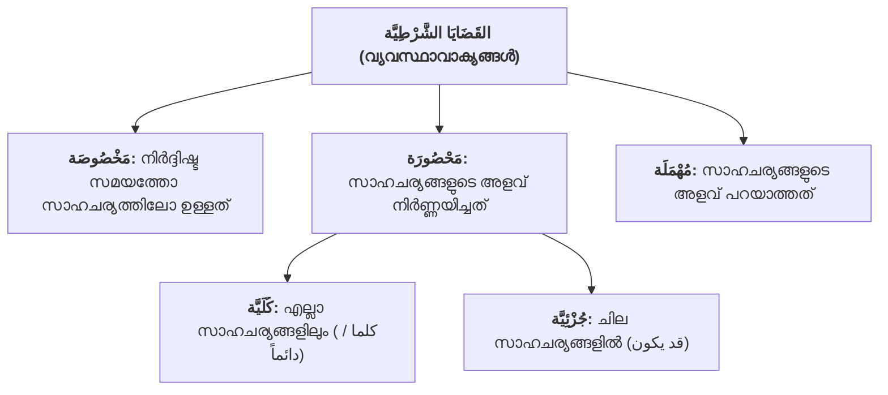

# الشَّرْطِيَّةُ المَخْصُوصَةُ وَالمَحْصُورَةُ وَأَسْوَارُهَا
## നിർദ്ദിഷ്ടവും അളവുചേർത്തതുമായ വ്യവസ്ഥാവാക്യങ്ങളും അവയുടെ സൂറുകളും — Quantified Conditionals & Quantifiers

<!-- Top Navigation Bar -->
[⏮️ മുൻ അധ്യായം: 13. القضايا الشرطية](file:///Users/apple/Desktop/docs:books/Kanz-al-Tahqiq/Texts/Mantiq/tasrih-al-mantiq/Notes/Chapters/13-al-qadaya-al-shartiyyah.md) | [📑 സൂചിക / Master Index](file:///Users/apple/Desktop/docs:books/Kanz-al-Tahqiq/Texts/Mantiq/tasrih-al-mantiq/Notes/Chapters/00-index.md) | [അടുത്ത അധ്യായം: 15. التناقض ووحداته الثمانية ⏭️](file:///Users/apple/Desktop/docs:books/Kanz-al-Tahqiq/Texts/Mantiq/tasrih-al-mantiq/Notes/Chapters/15-al-tanaqud-wa-wahadat.md)

---

### 1. മൂലപാഠം / النص الأصلي من المتن (Al-Matn al-Aṣl)

ثُمَّ الْحُكْمُ فِي الشَّرْطِيَّةِ: إِنْ كَانَ عَلَى تَقْدِيرٍ مُعَيَّنٍ فَشَرْطِيَّةٌ مَخْصُوصَةٌ، كَقَوْلِنَا: إِنْ جِئْتَنِي الْيَوْمَ أَكْرَمْتُكَ، وَزَيْدٌ فِي هَذَا الْيَوْمِ إِمَّا أَنْ يَمُوتَ أَوْ يَصِحَّ.

وَإِنْ لَمْ يَكُنْ كَذَلِكَ، فَإِنْ كَانَ لُزُومُ التَّالِي أَوْ عِنَادُهُ، أَوْ سَلْبُهُمَا عَلَى جَمِيعِ تَقَادِيرِ الْمُقَدَّمِ، فَمَحْصُورَةٌ كُلِّيَّةٌ، مِثْلُ: كُلَّمَا كَانَتِ الشَّمْسُ طَالِعَةً فَالنَّهَارُ مَوْجُودٌ، وَدَائِمًا إِمَّا أَنْ يَكُونَ الْعَدَدُ زَوْجًا أَوْ فَرْدًا، وَلَيْسَ أَلْبَتَّةَ كُلَّمَا كَانَتِ الشَّمْسُ طَالِعَةً فَاللَّيْلُ مَوْجُودٌ، وَلَيْسَ أَلْبَتَّةَ إِمَّا أَنْ يَكُونَ الْعَدَدُ زَوْجًا أَوْ مُنْقَسِمًا بِمُتَسَاوِيَيْنِ.

أَوْ عَلَى بَعْضِ التَّقَادِيرِ فَجُزْئِيَّةٌ، مِثْلُ: قَدْ يَكُونُ إِذَا كَانَ الشَّيْءُ حَيَوَانًا كَانَ إِنْسَانًا، وَقَدْ يَكُونُ إِمَّا أَنْ يَكُونَ الشَّيْءُ حَجَرًا أَوْ شَجَرًا؛ وَمِثْلُ: قَدْ لَا يَكُونُ إِذَا كَانَ الشَّيْءُ حَيَوَانًا كَانَ إِنْسَانًا، وَقَدْ لَا يَكُونُ إِمَّا أَنْ تَكُونَ الشَّمْسُ طَالِعَةً وَإِمَّا أَنْ يَكُونَ النَّهَارُ مَوْجُودًا.

وَإِنْ أُهْمِلَتِ التَّقَادِيرُ فَمُهْمَلَةٌ، نَحْوُ: إِذَا كَانَ الشَّيْءُ إِنْسَانًا كَانَ حَيَوَانًا، وَكَقَوْلِنَا: الْعَدَدُ إِمَّا أَنْ يَكُونَ زَوْجًا أَوْ فَرْدًا.

وَسُورُ الْمُوجَبَةِ الْكُلِّيَّةِ الْمُتَّصِلَةِ: مَتَى وَمَهْمَا وَكُلَّمَا، وَالْمُنْفَصِلَةِ: دَائِمًا وَأَبَدًا. وَسُورُ السَّالِبَةِ الْكُلِّيَّةِ الْمُتَّصِلَةِ وَالْمُنْفَصِلَةِ: لَيْسَ أَلْبَتَّةَ. وَالْمُوجَبَةِ الْجُزْئِيَّةِ الْمُتَّصِلَةِ وَالْمُنْفَصِلَةِ: قَدْ يَكُونُ، وَسَالِبَتِهِمَا الْجُزْئِيَّةِ: قَدْ لَا يَكُونُ.

---

### 2. മലയാള പരിഭാഷ (ദർസ് ശൈലിയിലുള്ള വാച്യാർത്ഥവും ആശയവും)

പിന്നെ, വ്യവസ്ഥാവാക്യങ്ങളിലെ (ശർത്വിയ്യ) വിധി:
1. ഒരു പ്രത്യേക നിർദ്ദിഷ്ട അവസ്ഥയിൻമേൽ (തഖ്ദീറിൻ മുഅയ്യൻ) മാത്രമാണെങ്കിൽ അതിന് **ശർത്വിയ്യ മഖ്സൂസ്വ (നിർദ്ദിഷ്ട വ്യവസ്ഥാവാക്യം / Singular Conditional)** എന്ന് പറയപ്പെടുന്നു; ഉദാഹരണത്തിന്: «ഇന്ന് നീ എന്റെ അടുക്കൽ വന്നാൽ ഞാൻ നിന്നെ ആദരിക്കും», «ഇന്നത്തെ ദിവസം സൈദ് ഒന്നുകിൽ മരണപ്പെടും അല്ലെങ്കിൽ രോഗമുക്തി നേടും».
2. അങ്ങനെയല്ലെങ്കിൽ (പൊതുവായ അവസ്ഥകളിലാണെങ്കിൽ):
   - പൂർവ്വപദത്തിന്റെ (മുഖദ്ദം) **എല്ലാ അവസ്ഥകളിലും (ജമീഇ തഖാദീർ)** ഉത്തരപദത്തിന്റെ ലുസൂമോ ഇനാദോ സ്ഥിരപ്പെടുകയോ നിഷേധിക്കപ്പെടുകയോ ആണെങ്കിൽ അത് **മഹ്സൂറ കുല്ലിയ്യ (സാർവത്രിക വ്യവസ്ഥാവാക്യം)** ആകുന്നു.
     - മുത്തസ്വില മുജീബ: «എപ്പോഴെല്ലാം സൂര്യൻ ഉദിച്ചിട്ടുണ്ടോ അപ്പോഴെല്ലാം പകലുണ്ട്» (കുല്ലമാ കാനതിശ്ശംസു ത്വാലിഅതൻ...).
     - മുൻഫസ്വില മുജീബ: «എല്ലായ്പ്പോഴും ഒരു സംഖ്യ ഒന്നുകിൽ ഇരട്ടയായിരിക്കും അല്ലെങ്കിൽ ഒറ്റയായിരിക്കും» (ദാഇമൻ ഇമ്മാ അൻ യകൂന...).
     - മുത്തസ്വില സാലിബ: «സൂര്യൻ ഉദിച്ചിരിക്കെ രാത്രി ഉണ്ടാവുക എന്നത് ഒരിക്കലുമില്ല» (ലൈസ അൽബത്തത്ത...).
     - മുൻഫസ്വില സാലിബ: «ഒരു സംഖ്യ ഇരട്ടയാവുകയോ തുല്യമായി ഭാഗിക്കപ്പെടുകയോ ചെയ്യുക എന്നത് ഒരിക്കലുമില്ല».
   - ചില അവസ്ഥകളിൽ (ബഅ്ദി തഖാദീർ) മാത്രമാണെങ്കിൽ അത് **മഹ്സൂറ ജുസ്ഇയ്യ (ഭാഗിക വ്യവസ്ഥാവാക്യം)** ആകുന്നു:
     - മുത്തസ്വില മുജീബ: «ഒരു വസ്തു ജീവിയാകുമ്പോൾ അത് മനുഷ്യനാകാൻ ചിലപ്പോൾ ഇടവരും» (ഖദ് യകൂനു...).
     - മുൻഫസ്വില മുജീബ: «ഒരു വസ്തു ഒന്നുകിൽ കല്ലോ അല്ലെങ്കിൽ മരമോ ആകാൻ ചിലപ്പോൾ ഇടവരും».
     - മുത്തസ്വില സാലിബ: «ഒരു വസ്തു ജീവിയാകുമ്പോൾ അത് മനുഷ്യനാകാതിരിക്കാൻ ചിലപ്പോൾ ഇടവരും» (ഖദ് ലാ യകൂനു...).
     - മുൻഫസ്വില സാലിബ: «സൂര്യൻ ഉദിച്ചിരിക്കെ പകലില്ലാതിരിക്കാൻ ചിലപ്പോൾ ഇടവരും എന്നത് സംഭവ്യമല്ല».
   - അവസ്ഥകളെ പരിഗണിക്കാതെ ഉപേക്ഷിച്ചിരിക്കുകയാണെങ്കിൽ അത് **മുഹ്മല (അളവില്ലാത്ത വ്യവസ്ഥാവാക്യം)** ആകുന്നു; ഉദാ: «ഒരു വസ്തു മനുഷ്യനായാൽ അത് ജീവിയാകുന്നു», «സംഖ്യ ഒന്നുകിൽ ഇരട്ടയോ ഒറ്റയോ ആകുന്നു».

**വ്യവസ്ഥാവാക്യങ്ങളുടെ ക്വാണ്ടിഫയറുകൾ (സൂറുകൾ):**
- **മുജീബ കുല്ലിയ്യ മുത്തസ്വിലയുടെ സൂറുകൾ:** «മതാ» (متى - എപ്പോൾ), «മഹ്‌മാ» (مهما - എന്തെല്ലാം), «കുല്ലമാ» (كلما - എപ്പോഴെല്ലാം).
- **മുജീബ കുല്ലിയ്യ മുൻഫസ്വിലയുടെ സൂറുകൾ:** «ദാഇമൻ» (دائماً - എല്ലായ്പ്പോഴും), «അബദൻ» (أبداً - ഒരിക്കലും).
- **സാലിബ കുല്ലിയ്യയുടെ സൂറുകൾ (മുത്തസ്വിലക്കും മുൻഫസ്വിലക്കും):** «ലൈസ അൽബത്തത്ത» (ليس ألبتة - ഒരിക്കലുമില്ല).
- **മുജീബ ജുസ്ഇയ്യയുടെ സൂറുകൾ:** «ഖദ് യകൂനു» (قد يكون - ചിലപ്പോൾ ആവാം).
- **സാലിബ ജുസ്ഇയ്യയുടെ സൂറുകൾ:** «ഖദ് ലാ യകൂനു» (قد لا يكون - ചിലപ്പോൾ ആവാതിരിക്കാം).

---

### 3. ഇംഗ്ലീഷ് വിവർത്തനം / English Scholastic Translation

The judgment in a conditional proposition:
1. If restricted to a specific occasion or determinate circumstance (*taqdīr muʿayyan*), it is a **Singular / Specified Conditional (*Sharṭiyya Makhṣūṣa*)**, such as: "If you come to me today, I will honor you."
2. Otherwise:
   - If entailment (*luzūm*) or incompatibility (*ʿinād*) holds across **all suppositions and circumstances of the antecedent**, it is a **Universal Quantified Conditional (*Maḥṣūra Kulliyya*)**:
     - *Connected Affirmative:* "Whenever the sun has risen, daytime is present."
     - *Disconnected Affirmative:* "Always, a number is either even or odd."
     - *Connected Negative:* "It is never the case that whenever the sun has risen, nighttime is present."
     - *Disconnected Negative:* "It is never the case that a number is either even or divisible into two equal halves."
   - If it holds under **some suppositions and circumstances only**, it is a **Particular Quantified Conditional (*Maḥṣūra Juzʾiyya*)**:
     - *Connected Affirmative:* "It may be that if an entity is an animal, it is a human."
     - *Disconnected Affirmative:* "It may be that an entity is either a stone or a tree."
     - *Connected Negative:* "It may not be that if an entity is an animal, it is a human."
   - If circumstances and suppositions are left completely indeterminate, it is **Unquantified / Indeterminate (*Muhmala*)**, e.g., "If an entity is human, it is an animal."

**The Quantifiers (*al-Aswār*) of Conditional Propositions:**
- Universal Affirmative Connected: *Matā* (whenever), *Mahmā* (whatever), *Kullamā* (every time that).
- Universal Affirmative Disconnected: *Dāʾiman* (always), *Abadan* (perpetually).
- Universal Negative (both Connected and Disconnected): *Laysa al-battata* (it is never the case that).
- Particular Affirmative: *Qad yakūnu* (it may be that / sometimes).
- Particular Negative: *Qad lā yakūnu* (it may not be that / sometimes not).

---

### 4. ത്രിഭാഷാ പദസൂചിക / المصطلحات / Key Terminology Matrix

| അറബിക് പദം (Arabic) | ലിപ്യന്തരണം (Transliteration) | മലയാള അർത്ഥം (Malayalam Equivalent) | English Logical Equivalent | സൂറുകൾ (Quantifiers) |
|---|---|---|---|---|
| **شَرْطِيَّة مَخْصُوصَة** | *Sharṭiyya makhṣūṣa* | നിർദ്ദിഷ്ട വ്യവസ്ഥാവാക്യം | Singular Conditional | പ്രത്യേക സമയം / വ്യക്തി |
| **مَحْصُورَة كُلِّيَّة** | *Maḥṣūra kulliyya* | സാർവത്രിക വ്യവസ്ഥാവാക്യം | Universal Quantified Conditional | كلما / دائماً / ليس ألبتة |
| **مَحْصُورَة جُزْئِيَّة** | *Maḥṣūra juzʾiyya* | ഭാഗിക വ്യവസ്ഥാവാക്യം | Particular Quantified Conditional | قد يكون / قد لا يكون |
| **مُهْمَلَة** | *Muhmala* | ക്വാണ്ടിഫയറില്ലാത്തത് | Indeterminate Conditional | إذا / لو (സൂറുകളില്ലാത്തവ) |
| **السُّور** | *al-Sūr* | ക്വാണ്ടിഫയർ | Conditional Quantifier | അവസ്ഥകളുടെ അളവ് കാണിക്കുന്ന പദങ്ങൾ |

---

### 5. വിശദമായ ശർഹും തത്വവിചാരവും / الشرح والتحليل المعمق

#### ഹംലിയ്യയിലെയും ശർത്വിയ്യയിലെയും സൂറുകൾ തമ്മിലുള്ള താരതമ്യം:
- **ഹംലിയ്യയിലെ സൂർ (ക്വാണ്ടിഫയർ):** ബാധകമാകുന്നത് **വ്യക്തികളുടെ എണ്ണത്തിൻമേലാണ്** (അഫ്റാദ്: എല്ലാ മനുഷ്യരും, ചില മനുഷ്യർ).
- **ശർത്വിയ്യയിലെ സൂർ (ക്വാണ്ടിഫയർ):** ബാധകമാകുന്നത് **സാഹചര്യങ്ങളുടെയും അവസ്ഥകളുടെയും മേലാണ്** (അഹ്‌വാൽ / തഖാദീർ: എല്ലാ സാഹചര്യങ്ങളിലും, എപ്പോഴെല്ലാം, ചില സന്ദർഭങ്ങളിൽ).

---

### 6. ചിത്രരൂപങ്ങളും താരതമ്യ പട്ടികകളും / Visual Diagrams & Comparative Matrices

#### ശർത്വിയ്യ സൂറുകളുടെ മാട്രിക്സ് (Conditional Quantifiers Matrix)

| ഇനം | മുത്തസ്വില (Connected) | മുൻഫസ്വില (Disconnected) | മലയാള വിവർത്തനം | ലോജിക് സമവാക്യം |
|---|---|---|---|---|
| **മുജീബ കുല്ലിയ്യ** | كُلَّمَا / مَتَى / مَهْمَا | دَائِمًا / أَبَدًا | എപ്പോഴെല്ലാം... / എല്ലായ്പ്പോഴും... | $\forall t (P_t \rightarrow Q_t)$ |
| **സാലിബ കുല്ലിയ്യ** | لَيْسَ أَلْبَتَّةَ كُلَّمَا | لَيْسَ أَلْبَتَّةَ دَائِمًا | ഒരിക്കലുമില്ല | $\forall t \neg (P_t \rightarrow Q_t)$ |
| **മുജീബ ജുസ്ഇയ്യ** | قَدْ يَكُونُ إِذَا | قَدْ يَكُونُ إِمَّا | ചിലപ്പോൾ ഇടവരും | $\exists t (P_t \land Q_t)$ |
| **സാലിബ ജുസ്ഇയ്യ** | قَدْ لَا يَكُونُ إِذَا | قَدْ لَا يَكُونُ إِمَّا | ചിലപ്പോൾ ആവാതിരിക്കാം | $\exists t \neg (P_t \rightarrow Q_t)$ |

---

### 7. ഉദാഹരണ വിശകലനം / Analysis of Classical & Contemporary Examples

- **മത്‌നിലെ ഉദാഹരണം: «كُلَّمَا كَانَتِ الشَّمْسُ طَالِعَةً فَالنَّهَارُ مَوْجُودٌ»:**
  ഇവിടെ «കുല്ലമാ» എന്ന സൂർ കാണിക്കുന്നത്: സൂര്യൻ ഉദിക്കുന്ന ഏത് ദിവസത്തിലും, ഏത് വർഷത്തിലും, ഏത് ഭൂപ്രദേശത്തും പകലുമുണ്ടാകും എന്നാണ്. സർവ്വ സാഹചര്യങ്ങളെയും ഉൾക്കൊള്ളുന്നതിനാൽ ഇത് **മുജീബ കുല്ലിയ്യ മുത്തസ്വില** ആണ്.
- **കമ്പ്യൂട്ടർ പ്രോഗ്രാമിംഗിലെ ഇവന്റ് ഹാൻഡ്‌ലർ:**
  `window.addEventListener('click', () => { ... })` — ഉപയോക്താവ് എപ്പോഴെല്ലാം ക്ലിക്ക് ചെയ്യുന്നുവോ അപ്പോഴെല്ലാം ഈ ഫംഗ്ഷൻ റൺ ചെയ്യും. ഇത് 'കുല്ലമാ' (Universal Trigger) എന്നതിന്റെ കൃത്യമായ ആധുനിക ആവിഷ്കാരമാണ്.

---

### 8. ശ്രദ്ധിക്കേണ്ട സൂക്ഷ്മതകൾ / تنبيهات ومزالق شائعة (Common Student Pitfalls)

> [!WARNING]
> ശർത്വിയ്യയിലെ «മുഹ്മല» കാണുമ്പോൾ പലരും അതിനെ «കുല്ലിയ്യ» ആയി തെറ്റിദ്ധരിക്കാറുണ്ട്. ഉദാഹരണത്തിന് «മഴ പെയ്താൽ റോഡ് നനയും» എന്ന് കേവലം പറയുമ്പോൾ അതിൽ സൂർ ഇല്ലാത്തതിനാൽ അത് മുഹ്മലയാണ്. ഒരു ഓവർബ്രിഡ്ജിന് താഴെയുള്ള റോഡിൽ ഈ വിധി ബാധകമാകണമെന്നില്ല. അതിനാൽ സൂർ ഇല്ലാത്ത വാക്യങ്ങൾ തർക്കത്തിൽ ദുർബലമാണ്.

---

### 9. ആവർത്തന ചോദ്യങ്ങളും വ്യായാമങ്ങളും / تدريبات وتمارين (Review Exercises)

1. ശർത്വിയ്യ മഖ്സൂസ്വയും മഹ്സൂറയും തമ്മിലുള്ള വ്യത്യാസമെന്ത്?
2. മുത്തസ്വിലയിലെയും മുൻഫസ്വിലയിലെയും മുജീബ കുല്ലിയ്യ സൂറുകൾ ഏതെല്ലാം?
3. താഴെ പറയുന്ന വാക്യങ്ങളുടെ സൂർ തിരിച്ചറിഞ്ഞ് തരംതിരിക്കുക:
   - "എപ്പോഴെല്ലാം വൈദ്യുതിയുണ്ടോ അപ്പോഴെല്ലാം ഈ മെഷീൻ പ്രവർത്തിക്കും."
   - "ചിലപ്പോൾ ഒരാൾ ഡോക്ടറായാൽ അവൻ എഴുത്തുകാരനുമാകാം."
   - "ഒരു സംഖ്യ ഒരിക്കലും ഇരട്ടയും ഒറ്റയുമാകില്ല."
   - "ഇന്ന് നീ വിജയിച്ചാൽ ഞാൻ സമ്മാനം തരും."

---

<!-- Bottom Navigation Bar -->
[⏮️ മുൻ അധ്യായം: 13. القضايا الشرطية](file:///Users/apple/Desktop/docs:books/Kanz-al-Tahqiq/Texts/Mantiq/tasrih-al-mantiq/Notes/Chapters/13-al-qadaya-al-shartiyyah.md) | [📑 സൂചിക / Master Index](file:///Users/apple/Desktop/docs:books/Kanz-al-Tahqiq/Texts/Mantiq/tasrih-al-mantiq/Notes/Chapters/00-index.md) | [അടുത്ത അധ്യായം: 15. التناقض ووحداته الثمانية ⏭️](file:///Users/apple/Desktop/docs:books/Kanz-al-Tahqiq/Texts/Mantiq/tasrih-al-mantiq/Notes/Chapters/15-al-tanaqud-wa-wahadat.md)
