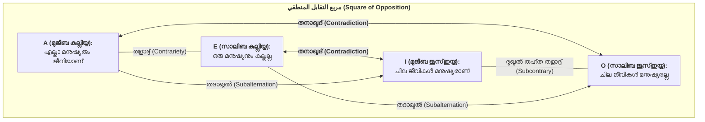

# التَّنَاقُضُ وَالْوَحَدَاتُ الثَّمَانِيَةُ
## വൈരുദ്ധ്യവും എട്ട് ഏകതകളും — Contradiction, The Square of Opposition & The Eight Unities

<!-- Top Navigation Bar -->
[⏮️ മുൻ അധ്യായം: 14. الشرطية المخصوصة والمحصورة](file:///Users/apple/Desktop/docs:books/Kanz-al-Tahqiq/Texts/Mantiq/tasrih-al-mantiq/Notes/Chapters/14-al-shartiyyah-al-mahsurah-wal-aswar.md) | [📑 സൂചിക / Master Index](file:///Users/apple/Desktop/docs:books/Kanz-al-Tahqiq/Texts/Mantiq/tasrih-al-mantiq/Notes/Chapters/00-index.md) | [അടുത്ത അധ്യായം: 16. العكس المستوي وأحكامه ⏭️](file:///Users/apple/Desktop/docs:books/Kanz-al-Tahqiq/Texts/Mantiq/tasrih-al-mantiq/Notes/Chapters/16-al-aks-al-mustawi.md)

---

### 1. മൂലപാഠം / النص الأصلي من المتن (Al-Matn al-Aṣl)

فَصْلٌ: هُوَ اخْتِلَافُ الْقَضِيَّتَيْنِ، بِحَيْثُ يَقْتَضِي لِذَاتِهِ صِدْقُ كُلِّ مِنْهَا كَذِبَ الْأُخْرَى.

لَا بُدَّ مِنِ اخْتِلَافِهَما فِي الْإِيجَابِ وَالسَّلْبِ: وَالْكُلِّيَّةِ وَالْجُزْئِيَّةِ، وَاشْتِرَاكِهَما فِي ثَمَانِ وَحْدَاتٍ: هِيَ وَحْدَةُ الْمَوْضُوعِ وَوَحْدَةُ الْمَحْمُولِ؛ وَوَحْدَةُ الْمَكَانِ وَوَحْدَةُ الزَّمَانِ، نَحْوُ: زَيْدٌ قَائِمٌ فِي السُّوقِ وَقْتَ الظُّهْرِ، وَزَيْدٌ لَيْسَ بِقَائِمٍ فِي السُّوقِ وَقْتَ الظُّهْرِ، وَوَحْدَةُ الْقُوَّةِ وَالْفِعْلِ، نَحْوُ: زَيْدٌ كَاتِبٌ بِالْفِعْلِ أَوْ بِالْقُوَّةِ، وَزَيْدٌ لَيْسَ بِكَاتِبٍ بِالْفِعْلِ أَوْ بِالْقُوَّةِ.

وَوَحْدَةُ الشَّرْطِ، نَحْوُ: الْعَالَمُ مُضِيءٌ بِشَرْطِ وُجُودِ النَّهَارِ، وَالْعَالَمُ لَيْسَ بِمُضِيءٍ بِشَرْطِ وُجُودِهِ، وَوَحْدَةُ الْإِضَافَةِ، نَحْوُ: زَيْدٌ أَبُ عَمْرِو، وَزَيْدٌ لَيْسَ بِأَبِ عَمْرِو، وَوَحْدَةُ الْجُزْءِ وَالْكُلِّ، نَحْوُ: الزِّنْجِيُّ كُلُّهُ أَوْ بَعْضُهُ أَسْوَدُ، وَالزِّنْجِيُّ لَيْسَ كُلُّهُ أَوْ بَعْضُهُ أَسْوَدَ.

فَنَقِيضُ الْمُوجَبَةِ الْكُلِّيَّةِ سَالِبَةٌ جُزْئِيَّةٌ، وَنَقِيضُ السَّالِبَةِ الْكُلِّيَّةِ مُوجَبَةٌ جُزْئِيَّةٌ، وَبِالْعَكْسِ، نَحْوُ: كُلَّ إِنْسَانٍ حَيَوَانٌ، وَبَعْضُ الْإِنْسَانِ لَيْسَ بِحَيَوَانٍ، وَلَا شَيْءَ مِنَ الْحَيَوَانِ بِحَجَرٍ، وَبَعْضُ الْحَيَوَانِ حَجَرٌ.

---

### 2. മലയാള പരിഭാഷ (ദർസ് ശൈലിയിലുള്ള വാച്യാർത്ഥവും ആശയവും)

തനാഖുദിന്റെ (വൈരുദ്ധ്യത്തിന്റെ) അധ്യായം:
**തനാഖുദ് (التناقض / Contradiction):** രണ്ട് പ്രസ്താവനകൾ പരസ്പരം വ്യത്യാസപ്പെടലാണ്; എങ്ങനെയെന്നാൽ അവയുടെ സത്ത തന്നെ ഒന്നിന്റെ സത്യത മറ്റേതിന്റെ അസത്യതയെ അനിവാര്യമാക്കും വിധം (ഒന്ന് സത്യമായാൽ മറ്റേത് തീർച്ചയായും അസത്യമായിരിക്കും; രണ്ടും ഒരേ സമയം ശരിയാവുകയോ ഒരേ സമയം തെറ്റാവുകയോ ഇല്ല).

തനാഖുദ് സാധുവാകാൻ രണ്ട് നിബന്ധനകൾ അനിവാര്യമാണ്:
1. അവ രണ്ടും സ്ഥിരീകരണത്തിലും നിഷേധത്തിലും (ഇജാബ്, സൽബ്) അളവിലും (കുല്ലിയ്യത്ത്, ജുസ്ഇയ്യത്ത്) വ്യത്യാസപ്പെട്ടിരിക്കണം.
2. അവ രണ്ടും **എട്ട് ഏകതകളിൽ (വുഹ്ദാത്തുകൾ / الوحدات الثمان)** ഒത്തുചേർന്നിരിക്കണം (അതിൽ ഒന്നിൽ വ്യത്യാസമുണ്ടായാലും തനാഖുദ് സാധുവാകില്ല):
   - **ഏകതാ വിഷയം (വുഹ്ദത്തുൽ മൗദൂഅ്):** സബ്ജക്റ്റ് ഒന്നായിരിക്കണം (ഉദാ: «സൈദ് നിൽക്കുന്നു», «അംറ് നിൽക്കുന്നില്ല» എന്ന് പറഞ്ഞാൽ തനാഖുദില്ല).
   - **ഏകതാ വിധി (വുഹ്ദത്തുൽ മഹ്മൂൽ):** പ്രെഡിക്കറ്റ് ഒന്നായിരിക്കണം (ഉദാ: «സൈദ് നിൽക്കുന്നു», «സൈദ് ഇരിക്കുന്നില്ല»).
   - **ഏകതാ സ്ഥലം (വുഹ്ദത്തുൽ മക്കാൻ):** സ്ഥലം ഒന്നായിരിക്കണം (ഉദാ: മാർക്കറ്റിൽ നിൽക്കുന്നു, വീട്ടിൽ നിൽക്കുന്നില്ല).
   - **ഏകതാ കാലം (വുഹ്ദത്തുസ്സമാൻ):** സമയം ഒന്നായിരിക്കണം (ഉദാ: ളുഹ്‌റിന്റെ സമയത്ത് നിൽക്കുന്നു, അസ്വറിന്റെ സമയത്ത് നിൽക്കുന്നില്ല).
   - **ഏകതാ ശക്തിയും പ്രയോഗവും (വുഹ്ദത്തുൽ ഖുവ്വ വൽ ഫിഅ്ൽ):** ശേഷിയും പ്രവൃത്തിയും ഒന്നായിരിക്കണം (ഉദാ: «കുട്ടി എഴുത്തുകാരനാണ്» — ശേഷിയുണ്ട്; «കുട്ടി എഴുത്തുകാരനല്ല» — ഇപ്പോൾ എഴുതിക്കൊണ്ടിരിക്കുന്നില്ല; ഇവിടെ തനാഖുദില്ല).
   - **ഏകതാ നിബന്ധന (വുഹ്ദത്തുശ്ശർത്വ):** നിബന്ധന ഒന്നായിരിക്കണം (ഉദാ: «പകലുണ്ട് എന്ന നിബന്ധനയിൽ ലോകം പ്രകാശിക്കുന്നു», «പകലുണ്ട് എന്ന നിബന്ധനയിൽ ലോകം പ്രകാശിക്കുന്നില്ല»).
   - **ഏകതാ ചേർച്ച (വുഹ്ദത്തുൽ ഇളാഫത്ത്):** ചേർക്കപ്പെട്ട ബന്ധം ഒന്നായിരിക്കണം (ഉദാ: «സൈദ് അംറിന്റെ പിതാവാണ്», «സൈദ് ബക്കറിന്റെ പിതാവല്ല»).
   - **ഏകതാ അംശവും മുഴുവനും (വുഹ്ദത്തുൽ ജുസ്ഇ വൽ കുൽ):** മുഴുവനിലോ ഭാഗികത്തിലോ എന്നത് ഒന്നായിരിക്കണം (ഉദാ: «നീഗ്രോക്കാരൻ കറുത്തവനാണ്» — അവന്റെ ശരീരം മുഴുവൻ; «നീഗ്രോക്കാരൻ കറുത്തവനല്ല» — അവന്റെ പല്ലുകൾ മാത്രം).

**ചതുർവിധ വാക്യങ്ങളിലെ തനാഖുദ് നിയമം (The Rule of Contradiction):**
- **മുജീബ കുല്ലിയ്യയുടെ (A) നഖീദ് $\rightarrow$ സാലിബ ജുസ്ഇയ്യ (O)** ആകുന്നു; തിരിച്ചും.
  - ഉദാ: «എല്ലാ മനുഷ്യരും ജീവികളാണ്» (A - സത്യം) $\leftrightarrow$ «ചില മനുഷ്യർ ജീവികളല്ല» (O - അസത്യം).
- **സാലിബ കുല്ലിയ്യയുടെ (E) നഖീദ് $\rightarrow$ മുജീബ ജുസ്ഇയ്യ (I)** ആകുന്നു; തിരിച്ചും.
  - ഉദാ: «ഒരു ജീവിയും കല്ലല്ല» (E - സത്യം) $\leftrightarrow$ «ചില ജീവികൾ കല്ലാണ്» (I - അസത്യം).

---

### 3. ഇംഗ്ലീഷ് വിവർത്തനം / English Scholastic Translation

**Contradiction (*al-Tanāquḍ*)** is the divergence of two propositions in such a manner that the intrinsic nature of the opposition necessitates that the truth of one strictly entails the falsity of the other (they cannot both be true, nor can they both be false simultaneously).

For contradiction to hold, two conditions are mandatory:
1. They must differ in **Quality** (Affirmation vs. Negation) and **Quantity** (Universal vs. Particular).
2. They must share **Eight Unities (*al-Waḥadāt al-Thamān*)**:
   - Unity of Subject (*Mawḍūʿ*)
   - Unity of Predicate (*Maḥmūl*)
   - Unity of Place (*Makān*)
   - Unity of Time (*Zamān*)
   - Unity of Potentiality vs. Actuality (*al-Quwwa wa-l-Fiʿl*)
   - Unity of Condition (*al-Sharṭ*)
   - Unity of Relation / Annexation (*al-Iḍāfa*)
   - Unity of Part vs. Whole (*al-Juzʾ wa-l-Kull*)

**The Classical Square of Opposition Contradictories:**
- Contradictory of **Universal Affirmative (A)** is **Particular Negative (O)**, and vice versa.
  - "Every human is an animal" (A) $\leftrightarrow$ "Some humans are not animals" (O).
- Contradictory of **Universal Negative (E)** is **Particular Affirmative (I)**, and vice versa.
  - "No animal is a stone" (E) $\leftrightarrow$ "Some animals are stones" (I).

---

### 4. ത്രിഭാഷാ പദസൂചിക / المصطلحات / Key Terminology Matrix

| അറബിക് പദം (Arabic) | ലിപ്യന്തരണം (Transliteration) | മലയാള അർത്ഥം (Malayalam Equivalent) | Western Formal Logic Term | സമവാക്യം (Equation) |
|---|---|---|---|---|
| **التَّنَاقُض** | *al-Tanāquḍ* | തനാഖുദ് / വൈരുദ്ധ്യം | Contradiction | $P \iff \neg Q$ |
| **مُرَبَّعُ التَّقَابُل** | *Murabbaʿ al-taqābul* | ചതുർവിധ വൈരുദ്ധ്യ ചതുരം | Square of Opposition | A, E, I, O Square |
| **وَحْدَةُ المَوْضُوع** | *Waḥdat al-mawḍūʿ* | വിഷയ ഏകത | Unity of Subject | $S_1 = S_2$ |
| **وَحْدَةُ المَحْمُول** | *Waḥdat al-maḥmūl* | വിധി ഏകത | Unity of Predicate | $P_1 = P_2$ |
| **بِالقُوَّةِ وَبِالفِعْل** | *bi-l-quwwa wa bi-l-fiʿl* | ശേഷിയിലും പ്രവൃത്തിയിലും | In Potentiality vs. In Actuality | Potential vs. Actual state |

---

### 5. വിശദമായ ശർഹും തത്വവിചാരവും / الشرح والتحليل المعمق

#### എ. എട്ട് ഏകതകൾ (الوحدات الثمانية) ലംഘിക്കപ്പെട്ടാലുണ്ടാകുന്ന പ്രശ്നം:
ഒരു വാദത്തിൽ എതിരാളി നമ്മുടെ പ്രസ്താവനയെ ഖണ്ഡിക്കുന്നുവെന്ന് അവകാശപ്പെടുമ്പോൾ, ഈ എട്ട് ഏകതകളിൽ ഒന്നിലെങ്കിലും വ്യത്യാസമുണ്ടെങ്കിൽ അവിടെ യഥാർത്ഥത്തിൽ തനാഖുദ് (വൈരുദ്ധ്യം) ഉണ്ടായിട്ടില്ല!
- *സ്ഥലവ്യത്യാസം:* "സൈദ് നിൽക്കുന്നു" (പള്ളിയിൽ), "സൈദ് നിൽക്കുന്നില്ല" (വീട്ടിൽ). രണ്ടും സത്യമാണ്!
- *ശേഷി vs പ്രവൃത്തി:* "കുഞ്ഞ് ഡോക്ടറാണ്" (പഠിച്ചാൽ ഡോക്ടറാകാനുള്ള ശേഷിയുണ്ട് - ബിൽ ഖുവ്വ), "കുഞ്ഞ് ഡോക്ടറല്ല" (ഇപ്പോൾ പ്രാക്ടീസ് ചെയ്യുന്നില്ല - ബിൽ ഫിഅ്ൽ). രണ്ടും സത്യമാണ്!
- *അംശം vs മുഴുവൻ:* "ഇന്ത്യക്കാരൻ വെളുത്തവനാണ്" (അവന്റെ പല്ലുകൾ), "ഇന്ത്യക്കാരൻ വെളുത്തവനല്ല" (അവന്റെ ശരീരം). രണ്ടും സത്യമാണ്!

#### ബി. പരിമാണത്തിൽ (ക്വാണ്ടിറ്റിയിൽ) വ്യത്യാസം നിർബന്ധമാകുന്നതിന്റെ രഹസ്യം:
എന്തുകൊണ്ടാണ് രണ്ട് കുല്ലിയ്യാത്തുകൾ (A യും E യും) തമ്മിൽ തനാഖുദ് ആകാത്തത്?
- "എല്ലാ മനുഷ്യരും കവികളാണ്" (A) എന്നത് അസത്യമാണ്.
- "ഒരു മനുഷ്യനും കവിയല്ല" (E) എന്നതും അസത്യമാണ്!
ഇവിടെ രണ്ടും ഒരേ സമയം അസത്യമായി മാറി (കള്ളമായി). എന്നാൽ തനാഖുദിന്റെ നിയമപ്രകാരം **ഒന്ന് സത്യമായാൽ മറ്റേത് അസത്യവും, ഒന്ന് അസത്യമായാൽ മറ്റേത് സത്യവുമാകണം**. അതുകൊണ്ട് A-യുടെ ശരിയായ നഖീദ് O ആണ്; E-യുടെ നഖീദ് I ആണ്!

---

### 6. ചിത്രരൂപങ്ങളും താരതമ്യ പട്ടികകളും / Visual Diagrams & Comparative Matrices

#### ചതുർവിധ വൈരുദ്ധ്യ മാട്രിക്സ് (The Contradiction Matrix)

| പ്രസ്താവന | കോഡ് | നഖീദ് (Contradictory) | നഖീദിന്റെ കോഡ് | ഉദാഹരണം |
|---|:---:|---|:---:|---|
| **മുജീബ കുല്ലിയ്യ** | **A** | **സാലിബ ജുസ്ഇയ്യ** | **O** | എല്ലാ മനുഷ്യരും ജീവിയാണ് $\leftrightarrow$ ചില മനുഷ്യർ ജീവികളല്ല |
| **സാലിബ കുല്ലിയ്യ** | **E** | **മുജീബ ജുസ്ഇയ്യ** | **I** | ഒരു മനുഷ്യനും കല്ലല്ല $\leftrightarrow$ ചില മനുഷ്യർ കല്ലാണ് |
| **മുജീബ ജുസ്ഇയ്യ** | **I** | **സാലിബ കുല്ലിയ്യ** | **E** | ചില ജീവികൾ മനുഷ്യരാണ് $\leftrightarrow$ ഒരു ജീവിയും മനുഷ്യനല്ല |
| **സാലിബ ജുസ്ഇയ്യ** | **O** | **മുജീബ കുല്ലിയ്യ** | **A** | ചില ജീവികൾ മനുഷ്യരല്ല $\leftrightarrow$ എല്ലാ ജീവികളും മനുഷ്യരാണ് |

---

### 7. ഉദാഹരണ വിശകലനം / Analysis of Classical & Contemporary Examples

- **ഖുർആനിക സംവാദങ്ങളിലെ തനാഖുദ്:**
  ബഹുദൈവാരാധകർ ദൈവത്തിന് പങ്കുകാരുണ്ടെന്ന് വാദിച്ചപ്പോൾ, ഖുർആൻ ആ വാദത്തിന്റെ നേരിട്ടുള്ള നഖീദ് സ്ഥാപിച്ചു: «لَيْسَ كَمِثْلِهِ شَيْءٌ» (അവന് സമാനമായി യാതൊന്നുമില്ല). സാലിബ കുല്ലിയ്യ സ്ഥാപിക്കപ്പെട്ടതോടെ അവരുടെ എല്ലാ വാദങ്ങളും താനേ അസത്യമായി തകർന്നു.
- **സോഫ്റ്റ്‌വെയർ യൂണിറ്റ് ടെസ്റ്റിംഗ്:**
  ഒരു പ്രോഗ്രാം ശരിയായി പ്രവർത്തിക്കുന്നുവെന്ന അസേർഷൻ `assert(user.isAuthenticated == true)` പാസാകണമെങ്കിൽ, അതിന്റെ നഖീദായ `user.isAuthenticated == false` അസാധ്യമായിരിക്കണം.

---

### 8. ശ്രദ്ധിക്കേണ്ട സൂക്ഷ്മതകൾ / تنبيهات ومزالق شائعة (Common Student Pitfalls)

> [!WARNING]
> സാധാരണ സംസാരത്തിൽ "എല്ലാവരും വന്നു" എന്നതിന്റെ എതിർപ്പ് "ആരും വന്നില്ല" എന്നാണെന്ന് വിദ്യാർത്ഥികൾ തെറ്റിദ്ധരിക്കാറുണ്ട്. മന്തിഖിൽ ഇത് കടുത്ത പിഴവാണ്! "എല്ലാവരും വന്നു" എന്നതിന്റെ യഥാർത്ഥ നഖീദ് "ചിലർ വന്നിട്ടില്ല" എന്നാണ്. കാരണം ഒരാൾ വരാതിരുന്നാൽ തന്നെ ആദ്യ വാചകം തകരും; എല്ലാവരും വരാതിരിക്കേണ്ടതില്ല!

---

### 9. ആവർത്തന ചോദ്യങ്ങളും വ്യായാമങ്ങളും / تدريبات وتمارين (Review Exercises)

1. തനാഖുദ് നിർവചിക്കുക.
2. തനാഖുദിൽ കുല്ലിയ്യത്തും ജുസ്ഇയ്യത്തും വ്യത്യാസപ്പെടണമെന്ന് നിർബന്ധമാക്കുന്നതിന്റെ യുക്തിയെന്ത്?
3. എട്ട് ഏകതകൾ (വുഹ്ദാത്തുകൾ) ഏതൊക്കെയാണെന്ന് ഉദാഹരണ സഹിതം വിവരിക്കുക.
4. താഴെ പറയുന്ന വാക്യങ്ങളുടെ കൃത്യമായ നഖീദ് (Contradictory) രൂപപ്പെടുത്തുക:
   - "എല്ലാ വിദ്യാർത്ഥികളും പരീക്ഷ പാസായി."
   - "ഒരു പക്ഷിയും പാൽ കുടിക്കാറില്ല."
   - "ചില നഗരങ്ങൾ മലിനീകരിക്കപ്പെട്ടതാണ്."
   - "ചില മനുഷ്യർ സത്യസന്ധരല്ല."

---

<!-- Bottom Navigation Bar -->
[⏮️ മുൻ അധ്യായം: 14. الشرطية المخصوصة والمحصورة](file:///Users/apple/Desktop/docs:books/Kanz-al-Tahqiq/Texts/Mantiq/tasrih-al-mantiq/Notes/Chapters/14-al-shartiyyah-al-mahsurah-wal-aswar.md) | [📑 സൂചിക / Master Index](file:///Users/apple/Desktop/docs:books/Kanz-al-Tahqiq/Texts/Mantiq/tasrih-al-mantiq/Notes/Chapters/00-index.md) | [അടുത്ത അധ്യായം: 16. العكس المستوي وأحكامه ⏭️](file:///Users/apple/Desktop/docs:books/Kanz-al-Tahqiq/Texts/Mantiq/tasrih-al-mantiq/Notes/Chapters/16-al-aks-al-mustawi.md)
