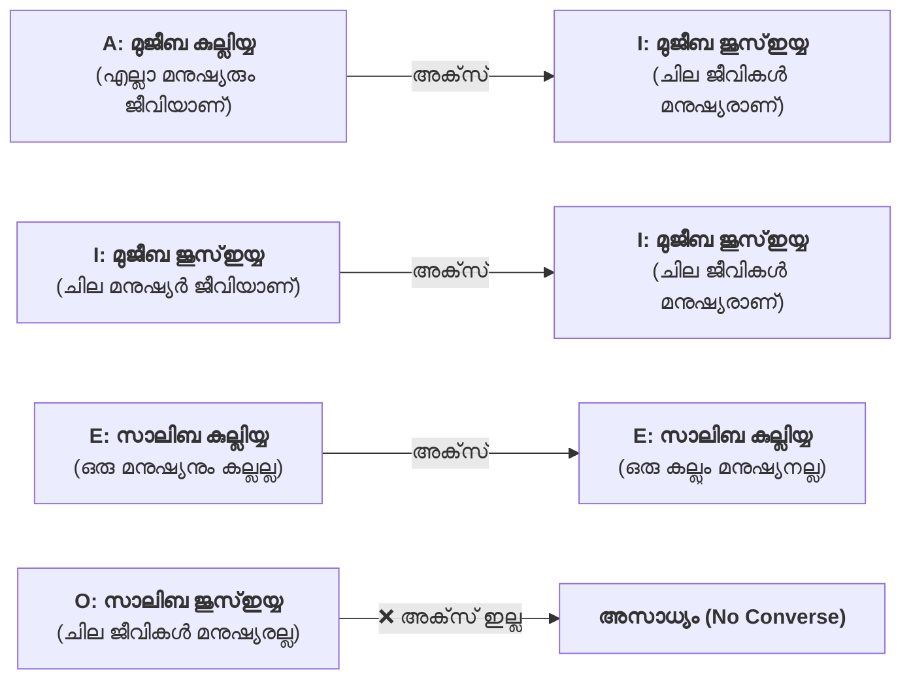

# العَكْسُ المُسْتَوِي وَأَحْكَامُهُ
## ലളിതമായ പ്രതിവർത്തനം — Simple Conversion: Truth Preservation & Distribution Rules

<!-- Top Navigation Bar -->
[⏮️ മുൻ അധ്യായം: 15. التناقض ووحداته الثمانية](file:///Users/apple/Desktop/docs:books/Kanz-al-Tahqiq/Texts/Mantiq/tasrih-al-mantiq/Notes/Chapters/15-al-tanaqud-wa-wahadat.md) | [📑 സൂചിക / Master Index](file:///Users/apple/Desktop/docs:books/Kanz-al-Tahqiq/Texts/Mantiq/tasrih-al-mantiq/Notes/Chapters/00-index.md) | [അടുത്ത അധ്യായം: 17. عكس النقيض وأحكامه ⏭️](file:///Users/apple/Desktop/docs:books/Kanz-al-Tahqiq/Texts/Mantiq/tasrih-al-mantiq/Notes/Chapters/17-aks-al-naqid.md)

---

### 1. മൂലപാഠം / النص الأصلي من المتن (Al-Matn al-Aṣl)

فَصْلٌ: الْعَكْسُ الْمُسْتَوِي، هُوَ: تَحْوِيلُ طَرَفَيِ الْقَضِيَّةِ؛ بِجَعْلِ أَحَدِهِمَا مَكَانَ الآخَرِ، مَعَ بَقَاءِ الصِّدْقِ: بِأَنْ لَوْ فُرِضَ صِدْقُ الْأَصْلِ كَانَ الْعَكْسُ صَادِقًا بِحَسْبِهِ، وَبَقَاءِ الْكَيْفِ: بِأَنَّهُ إِنْ كَانَ الْأَصْلُ مُوجَبًا أَوْ سَالِبًا كَانَ الْعَكْسُ كَذَلِكَ.

فَالْمُوجَبَةُ الْكُلِّيَّةُ وَالْجُزْئِيَّةُ تَنْعَكِسُ مُوجَبَةً جُزْئِيَّةٍ؛ فَعَكْسُ قَوْلِنَا: كُلُّ إِنْسَانٍ حَيَوَانٌ، وَبَعْضُ الْإِنْسَانِ حَيَوَانٌ - يَكُونُ: بَعْضُ الْحَيَوَانِ إِنْسَانٌ.

وَالسَّالِبَةُ الْكُلِّيَّةُ تَنْعَكِسُ سَالِبَةً كُلِّيَّةً؛ فَيَكُونُ عَكْسُ قَوْلِنَا: لَا شَيْءَ مِنَ الْإِنْسَانِ بِحَجَرٍ - لَا شَيْءَ مِنَ الْحَجَرِ بِإِنْسَانٍ.

وَلَا تَنْعَكِسُ السَّالِبَةُ الْجُزْئِيَّةُ مُطْلَقًا - لَا إِلَى كُلِّيَّةٍ وَلَا جُزْئِيَّةِ.

---

### 2. മലയാള പരിഭാഷ (ദർസ് ശൈലിയിലുള്ള വാച്യാർത്ഥവും ആശയവും)

അക്‌സുൽ മുസ്തവിയുടെ (ലളിതമായ പ്രതിവർത്തനത്തിന്റെ) അധ്യായം:
**അക്‌സുൽ മുസ്തവി (العكس المستوي / Simple Conversion):** പ്രസ്താവനയുടെ രണ്ട് അറ്റങ്ങളെ (മൗദൂഇനെയും മഹ്മൂലിനെയും) പരസ്പരം മാറ്റിവെക്കലാണ് (ഒന്നിന്റെ സ്ഥാനത്ത് മറ്റൊന്നിനെ വെക്കൽ); രണ്ട് കാര്യങ്ങൾ നിലനിർത്തിക്കൊണ്ട്:
1. **സത്യത നിലനിൽക്കണം (ബഖാഉസ്സ്വിദ്ഖ്):** മൂലം (അസ്വ്‌ല്) സത്യമാണെങ്കിൽ അക്‌സും സത്യമായിരിക്കണം.
2. **കൈഫിയ്യത്ത് നിലനിൽക്കണം (ബഖാഉൽ കൈഫ്):** മൂലം മുജീബയാണെങ്കിൽ അക്‌സും മുജീബയായിരിക്കണം; മൂലം സാലിബയാണെങ്കിൽ അക്‌സും സാലിബയായിരിക്കണം.

**ചതുർവിധ വാക്യങ്ങളിലെ അക്‌സ് നിയമങ്ങൾ:**
1. **മുജീബ കുല്ലിയ്യയും (A) മുജീബ ജുസ്ഇയ്യയും (I) $\rightarrow$ മുജീബ ജുസ്ഇയ്യയായി (I)** പ്രതിവർത്തിക്കുന്നു:
   - «എല്ലാ മനുഷ്യരും ജീവികളാണ്» (A), «ചില മനുഷ്യർ ജീവികളാണ്» (I) എന്നിവയുടെ അക്‌സ് $\rightarrow$ **«ചില ജീവികൾ മനുഷ്യരാണ്» (I)** എന്നാകുന്നു.
2. **സാലിബ കുല്ലിയ്യ (E) $\rightarrow$ സാലിബ കുല്ലിയ്യയായിത്തന്നെ (E)** പ്രതിവർത്തിക്കുന്നു:
   - «ഒരു മനുഷ്യനും കല്ലല്ല» (E) എന്നതിന്റെ അക്‌സ് $\rightarrow$ **«ഒരു കല്ലും മനുഷ്യനല്ല» (E)** എന്നാകുന്നു.
3. **സാലിബ ജുസ്ഇയ്യക്ക് (O) $\rightarrow$ ഒട്ടും അക്‌സ് ഉണ്ടാകുന്നതല്ല (ലളിതമായോ ഭാഗികമായോ പ്രതിവർത്തിക്കില്ല)**.

---

### 3. ഇംഗ്ലീഷ് വിവർത്തനം / English Scholastic Translation

**Simple Conversion (*al-ʿAks al-Mustawī*)** is the transposition of the two terms of a proposition (placing the subject in the place of the predicate and the predicate in the place of the subject), while preserving:
1. **Truth (*Baqāʾ al-Ṣidq*)**: Such that if the original proposition is assumed true, the converse must necessarily be true.
2. **Quality (*Baqāʾ al-Kayf*)**: If the original is affirmative, the converse remains affirmative; if negative, negative.

**Conversion Rules for the Four Standard Forms:**
1. **Universal Affirmative (A)** and **Particular Affirmative (I)** convert by limitation to a **Particular Affirmative (I)**:
   - The converse of "Every human is an animal" (A) is **"Some animals are human" (I)**.
   - The converse of "Some humans are animals" (I) is **"Some animals are human" (I)**.
2. **Universal Negative (E)** converts simply to a **Universal Negative (E)**:
   - The converse of "No human is a stone" (E) is **"No stone is a human" (E)**.
3. **Particular Negative (O) does NOT convert at all** (neither universally nor particularly).

---

### 4. ത്രിഭാഷാ പദസൂചിക / المصطلحات / Key Terminology Matrix

| അറബിക് പദം (Arabic) | ലിപ്യന്തരണം (Transliteration) | മലയാള അർത്ഥം (Malayalam Equivalent) | English Logic Term | ഫോർമുല (Conversion Rule) |
|---|---|---|---|---|
| **العَكْسُ المُسْتَوِي** | *al-ʿAks al-mustawī* | ലളിതമായ പ്രതിവർത്തനം | Simple Conversion | $S \text{ is } P \rightarrow P \text{ is } S$ |
| **الأَصْل** | *al-Aṣl* | മൂല പ്രസ്താവന | Original Proposition | $S$ — $P$ |
| **العَكْس** | *al-ʿAks* | പ്രതിവർത്തിത വാക്യം | Converse Proposition | $P$ — $S$ |
| **بَقَاءُ الصِّدْق** | *Baqāʾ al-ṣidq* | സത്യത നിലനിൽക്കൽ | Truth Preservation | $T(Aṣl) \rightarrow T(ʿAks)$ |
| **بَقَاءُ الكَيْف** | *Baqāʾ al-kayf* | ഗുണപരമായ നിലനിൽപ്പ് | Quality Preservation | Aff $\rightarrow$ Aff, Neg $\rightarrow$ Neg |

---

### 5. വിശദമായ ശർഹും തത്വവിചാരവും / الشرح والتحليل المعمق

#### എ. എന്തുകൊണ്ടാണ് 'മുജീബ കുല്ലിയ്യ' (A) കുല്ലിയ്യയായി പ്രതിവർത്തിക്കാത്തത്?
- "എല്ലാ മനുഷ്യരും ജീവികളാണ്" ($S \subset P$) എന്നത് സത്യമാണ്.
- എന്നാൽ ഇതിന്റെ സബ്ജക്റ്റും പ്രെഡിക്കറ്റും അതേപടി കുല്ലിയ്യയായി തിരിച്ചിട്ടാൽ: "എല്ലാ ജീവികളും മനുഷ്യരാണ്" ($P \subset S$) എന്ന് വരും! ഇത് പച്ചക്കള്ളമാണ്; കാരണം കുതിരയും സിംഹവുമെല്ലാം ജീവികളാണ്, മനുഷ്യരല്ല.
- അതിനാൽ പ്രസ്താവന എപ്പോഴും സത്യമായി നിലനിൽക്കണമെങ്കിൽ (ബഖാഉസ്സ്വിദ്ഖ്) കുല്ലിയ്യയായ A-യെ **ജുസ്ഇയ്യയായ I-ലേക്ക്** ചുരുക്കി മാത്രമേ അക്‌സ് ചെയ്യാൻ കഴിയൂ: **«ചില ജീവികൾ മനുഷ്യരാണ്»**.

#### ബി. എന്തുകൊണ്ടാണ് 'സാലിബ ജുസ്ഇയ്യ'ക്ക് (O) അക്‌സ് ഇല്ലാത്തത്?
- ഉദാഹരണം നോക്കുക: «ചില ജീവികൾ മനുഷ്യരല്ല» (സാലിബ ജുസ്ഇയ്യ - O). ഇത് തികച്ചും സത്യമായ വാക്യമാണ്.
- ഇതിനെ സാലിബ ജുസ്ഇയ്യയായി തിരിച്ചിട്ടാൽ: «ചില മനുഷ്യർ ജീവികളല്ല» എന്ന് വരും! ഇത് തികഞ്ഞ അസത്യമാണ് (കാരണം എല്ലാ മനുഷ്യരും ജീവികളാണ്).
- സത്യമായ ഒന്നിൽ നിന്ന് അസത്യമായ ഒന്ന് വരുന്നതിനെ മന്തിഖിൽ അംഗീകരിക്കാൻ കഴിയില്ല. അതിനാൽ **സാലിബ ജുസ്ഇയ്യക്ക് അക്‌സ് സാധ്യമല്ല**.

---

### 6. ചിത്രരൂപങ്ങളും താരതമ്യ പട്ടികകളും / Visual Diagrams & Comparative Matrices

#### ചതുർവിധ വാക്യങ്ങളുടെ അക്‌സുൽ മുസ്തവി ചാർട്ട്

| മൂല വാക്യം (Aṣl) | കോഡ് | അക്‌സിന്റെ രൂപം (Converse) | അക്‌സിന്റെ കോഡ് | ഉദാഹരണം |
|---|:---:|---|:---:|---|
| **മുജീബ കുല്ലിയ്യ** | **A** | **മുജീബ ജുസ്ഇയ്യ** | **I** | എല്ലാ മനുഷ്യരും ജീവിയാണ് $\rightarrow$ ചില ജീവികൾ മനുഷ്യരാണ് |
| **മുജീബ ജുസ്ഇയ്യ** | **I** | **മുജീബ ജുസ്ഇയ്യ** | **I** | ചില മനുഷ്യർ പണ്ഡിതരാണ് $\rightarrow$ ചില പണ്ഡിതർ മനുഷ്യരാണ് |
| **സാലിബ കുല്ലിയ്യ** | **E** | **സാലിബ കുല്ലിയ്യ** | **E** | ഒരു മനുഷ്യനും കല്ലല്ല $\rightarrow$ ഒരു കല്ലും മനുഷ്യനല്ല |
| **സാലിബ ജുസ്ഇയ്യ** | **O** | **അക്‌സ് ഇല്ല** | **None** | അക്‌സ് എപ്പോഴും സത്യമായി നിലനിൽക്കില്ല |

---

### 7. ഉദാഹരണ വിശകലനം / Analysis of Classical & Contemporary Examples

- **ഖുർആനിക തത്വവിചാരം:**
  "എല്ലാ മുഅ്മിനുകളും മുസ്ലിംകളാണ്" (A). ഇതിന്റെ ശരിയായ അക്‌സ്: "ചില മുസ്ലിംകൾ മുഅ്മിനുകളാണ്" (I). എല്ലാ മുസ്ലിമും മുഅ്മിനാകണമെന്നില്ല (കപടവിശ്വാസികളോ ദുർബല വിശ്വാസികളോ ആകാം). ഇതാണ് അക്‌സിന്റെ കൃത്യമായ പ്രയോഗം!
- **ഡാറ്റാബേസ് റിലേഷണൽ മാപ്പിംഗ്:**
  പാരന്റ്-ചൈൽഡ് റിലേഷൻഷിപ്പിൽ, `Every Student is a Person` എന്നത് റിവേഴ്സ് ചെയ്യുമ്പോൾ `Some Persons are Students` എന്ന് മാത്രമേ മാപ്പ് ചെയ്യാൻ സാധിക്കൂ.

---

### 8. ശ്രദ്ധിക്കേണ്ട സൂക്ഷ്മതകൾ / تنبيهات ومزالق شائعة (Common Student Pitfalls)

> [!WARNING]
> പല വിദ്യാർത്ഥികളും 'മുജീബ കുല്ലിയ്യ'യുടെ അക്‌സ് മുജീബ കുല്ലിയ്യയാണെന്ന് അബദ്ധത്തിൽ ധരിക്കാറുണ്ട് (ഉദാ: "എല്ലാ മാങ്ങയും പഴമാണ്, അതുകൊണ്ട് എല്ലാ പഴവും മാങ്ങയാണ്" എന്ന് ചിന്തിക്കുന്നത് പോലെ!). മന്തിഖിൽ ഇത്തരത്തിലുള്ള അബദ്ധ ചിന്തകളെ തടയാനാണ് അക്‌സിന്റെ നിയമങ്ങൾ വ്യവസ്ഥപ്പെടുത്തിയിരിക്കുന്നത്.

---

### 9. ആവർത്തന ചോദ്യങ്ങളും വ്യായാമങ്ങളും / تدريبات وتمارين (Review Exercises)

1. അക്‌സുൽ മുസ്തവി നിർവചിക്കുക. അതിൽ നിലനിൽക്കേണ്ട രണ്ട് നിബന്ധനകൾ ഏതെല്ലാം?
2. എന്തുകൊണ്ടാണ് സാലിബ ജുസ്ഇയ്യക്ക് അക്‌സ് ഇല്ലാത്തത്? ഉദാഹരണ സഹിതം തെളിയിക്കുക.
3. താഴെ പറയുന്ന വാക്യങ്ങളുടെ അക്‌സുൽ മുസ്തവി കണ്ടെത്തുക:
   - "എല്ലാ പണ്ഡിതന്മാരും ബഹുമാനിക്കപ്പെടേണ്ടവരാണ്."
   - "ഒരു സത്യവിശ്വാസിയും മദ്യപാനിയല്ല."
   - "ചില വാഹനങ്ങൾ വൈദ്യുത വാഹനങ്ങളാണ്."
   - "ചില പക്ഷികൾ പറക്കാത്തവയാണ്."

---

<!-- Bottom Navigation Bar -->
[⏮️ മുൻ അധ്യായം: 15. التناقض ووحداته الثمانية](file:///Users/apple/Desktop/docs:books/Kanz-al-Tahqiq/Texts/Mantiq/tasrih-al-mantiq/Notes/Chapters/15-al-tanaqud-wa-wahadat.md) | [📑 സൂചിക / Master Index](file:///Users/apple/Desktop/docs:books/Kanz-al-Tahqiq/Texts/Mantiq/tasrih-al-mantiq/Notes/Chapters/00-index.md) | [അടുത്ത അധ്യായം: 17. عكس النقيض وأحكامه ⏭️](file:///Users/apple/Desktop/docs:books/Kanz-al-Tahqiq/Texts/Mantiq/tasrih-al-mantiq/Notes/Chapters/17-aks-al-naqid.md)
