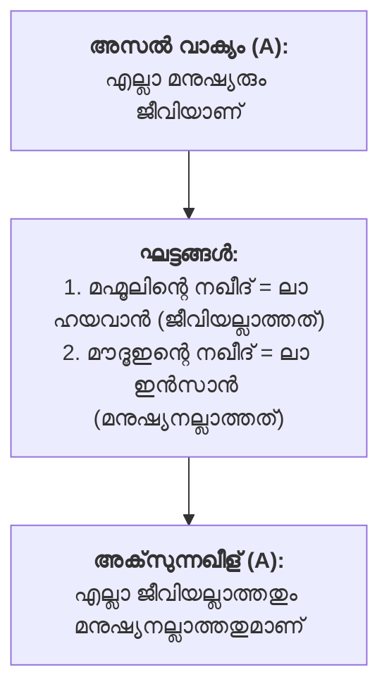

# عَكْسُ النَّقِيضِ وَأَحْكَامُهُ
## നിഷേധത്തിന്റെ പ്രതിവർത്തനം — Conversion by Contraposition: Rules & Reductions

<!-- Top Navigation Bar -->
[⏮️ മുൻ അധ്യായം: 16. العكس المستوي وأحكامه](file:///Users/apple/Desktop/docs:books/Kanz-al-Tahqiq/Texts/Mantiq/tasrih-al-mantiq/Notes/Chapters/16-al-aks-al-mustawi.md) | [📑 സൂചിക / Master Index](file:///Users/apple/Desktop/docs:books/Kanz-al-Tahqiq/Texts/Mantiq/tasrih-al-mantiq/Notes/Chapters/00-index.md) | [അടുത്ത അധ്യായം: 18. القياس الحملي والشكل الأول ⏭️](file:///Users/apple/Desktop/docs:books/Kanz-al-Tahqiq/Texts/Mantiq/tasrih-al-mantiq/Notes/Chapters/18-al-qiyas-al-iqtirani-al-hamli.md)

---

### 1. മൂലപാഠം / النص الأصلي من المتن (Al-Matn al-Aṣl)

فَصْلٌ: عَكْسُ النَّقِيضِ، هُوَ: تَبْدِيلُ طَرَفَي الْقَضِيَّةِ؛ بِجَعْلِ نَقِيضِ الثَّانِي أَوَّلًا، وَنَقِيضِ الْأَوَّلِ ثَانِيًا، مَعَ بَقَاءِ الصِّدْقِ وَالْكَيْفِ بِحَالِهِ.

فَعَكْسُ نَقِيضِ الْمُوجَبَةِ الْكُلِّيَّةِ مُوجَبَةٌ كُلِّيَّةٌ مِثْلُ: كُلُّ إِنْسَانٍ حَيَوَانٌ، يَنْعَكِسُ إِلَى قَوْلِنَا: كُلُّ لَا حَيَوَانٍ لَا إِنْسَانٌ.

وَلَا عَكْسَ لِلْمُوجَبَةِ الْجُزْئِيَّةِ.

وَالسَّالِبَةُ- كُلِّيَّةٌ كَانَتْ أَوْ جُزْئِيَّة- تَنْعَكِسُ إِلَى سَالِبَةٍ جُزْئِيَّةٍ؛ فَيَكُونُ عَكْسُ نَقِيضِ قَوْلِنَا: لَا شَيْءَ مِنَ الْإِنْسَانِ بِفَرَسٍ، وَبَعْضُ الْإِنْسَانِ لَيْسَ بِفَرَسٍ - بَعْضُ اللَّا فَرَسِ لَيْسَ بِلَا إِنْسَانٍ.

---

### 2. മലയാള പരിഭാഷ (ദർസ് ശൈലിയിലുള്ള വാച്യാർത്ഥവും ആശയവും)

അക്‌സുന്നഖീളിന്റെ (നിഷേധത്തിന്റെ പ്രതിവർത്തനത്തിന്റെ / Contraposition) അധ്യായം:
**അക്‌സുന്നഖീള് (عكس النقيض):** പ്രസ്താവനയുടെ രണ്ട് അറ്റങ്ങളെ പരസ്പരം മാറ്റിവെക്കലാണ്; രണ്ടാമത്തെ പദത്തിന്റെ (മഹ്മൂലിന്റെ) നഖീദിനെ (വിപരീതത്തെ) ഒന്നാമതും, ഒന്നാമത്തെ പദത്തിന്റെ (മൗദൂഇന്റെ) നഖീദിനെ രണ്ടാമതും ആക്കിക്കൊണ്ട്; സത്യതയും (സിദ്ഖ്) കൈഫിയ്യത്തും (മുജീബ/സാലിബ) അതേപടി നിലനിർത്തിക്കൊണ്ട്.

**ചതുർവിധ വാക്യങ്ങളിലെ അക്‌സുന്നഖീള് നിയമങ്ങൾ:**
1. **മുജീബ കുല്ലിയ്യയുടെ (A) അക്‌സുന്നഖീള് $\rightarrow$ മുജീബ കുല്ലിയ്യയായിത്തന്നെ (A)** വരുന്നു:
   - «എല്ലാ മനുഷ്യരും ജീവികളാണ്» (A) എന്നതിന്റെ അക്‌സുന്നഖീള് $\rightarrow$ **«ജീവിയല്ലാത്തതെല്ലാം മനുഷ്യനല്ലാത്തതുമാണ്» (കുല്ലു ലാ ഹയവാനിൻ ലാ ഇൻസാൻ - A)** എന്നാകുന്നു.
2. **മുജീബ ജുസ്ഇയ്യക്ക് (I) $\rightarrow$ ഒട്ടും അക്‌സുന്നഖീള് സാധ്യമല്ല**.
3. **സാലിബകൾ (സാലിബ കുല്ലിയ്യ E ആവട്ടെ, സാലിബ ജുസ്ഇയ്യ O ആവട്ടെ) $\rightarrow$ സാലിബ ജുസ്ഇയ്യയായി (O)** പ്രതിവർത്തിക്കുന്നു:
   - «ഒരു മനുഷ്യനും കുതിരയല്ല» (E), «ചില മനുഷ്യർ കുതിരയല്ല» (O) എന്നിവയുടെ അക്‌സുന്നഖീള് $\rightarrow$ **«കുതിരയല്ലാത്ത ചിലത് മനുഷ്യനല്ലാത്തതല്ല (അതായത് മനുഷ്യനാണ്)» (ബഅ്ളുൽ ലാ ഫറസി ലൈസ ബിലാ ഇൻസാൻ - O)** എന്നാകുന്നു.

---

### 3. ഇംഗ്ലീഷ് വിവർത്തനം / English Scholastic Translation

**Conversion by Contraposition (*ʿAks al-Naqīḍ*)** is the transposition of the two terms of a proposition by placing the contradictory of the second term (predicate) in the first position (subject), and the contradictory of the first term (subject) in the second position (predicate), while preserving both truth and quality.

**Contraposition Rules for the Four Standard Forms:**
1. **Universal Affirmative (A)** contraposes to a **Universal Affirmative (A)**:
   - "Every human is an animal" ($S \rightarrow P$) contraposes to **"Every non-animal is non-human" ($\neg P \rightarrow \neg S$)**.
2. **Particular Affirmative (I) has NO contrapositive at all**.
3. **Negative Propositions (both Universal E and Particular O)** contrapose to a **Particular Negative (O)**:
   - "No human is a horse" (E) and "Some humans are not horses" (O) contrapose to **"Some non-horses are not non-humans" (O)**.

---

### 4. ത്രിഭാഷാ പദസൂചിക / المصطلحات / Key Terminology Matrix

| അറബിക് പദം (Arabic) | ലിപ്യന്തരണം (Transliteration) | മലയാള അർത്ഥം (Malayalam Equivalent) | English Logic Term | സമവാക്യം (Formula) |
|---|---|---|---|---|
| **عَكْسُ النَّقِيض** | *ʿAks al-naqīḍ* | കോൺട്രാപോസിഷൻ | Contraposition | $S \rightarrow P \iff \neg P \rightarrow \neg S$ |
| **نَقِيضُ الثَّانِي** | *Naqīḍ al-thānī* | മഹ്മൂലിന്റെ വിപരീതം | Negated Predicate as Subject | $\neg P$ |
| **نَقِيضُ الأَوَّل** | *Naqīḍ al-awwal* | മൗദൂഇന്റെ വിപരീതം | Negated Subject as Predicate | $\neg S$ |
| **عَكْسُ النَّقِيضِ المُوَافِق** | *al-Muwāfiq* | അനുരൂപ കോൺട്രാപോസിഷൻ | Direct Contraposition (same quality) | മുജീബ $\rightarrow$ മുജീബ |
| **عَكْسُ النَّقِيضِ المُخَالِف** | *al-Mukhālif* | ഭിന്ന കോൺട്രാപോസിഷൻ | Indirect Contraposition (reversed quality) | മുൻകാല പണ്ഡിതരുടെ ശൈലി |

---

### 5. വിശദമായ ശർഹും തത്വവിചാരവും / الشرح والتحليل المعمق

#### എ. കോൺട്രാപോസിഷന്റെ ഗണിതശാസ്ത്ര യുക്തി (Modus Tollens in Set Theory):
ആധുനിക ഗണിതശാസ്ത്രത്തിലും കമ്പ്യൂട്ടർ സയൻസിലും അത്യധികം ഉപയോഗിക്കുന്ന തത്വമാണ് **കോൺട്രാപോസിഷൻ**:
$$P \rightarrow Q \equiv \neg Q \rightarrow \neg P$$
"മഴ പെയ്താൽ റോഡ് നനയും" എന്നത് സത്യമാണെങ്കിൽ, "റോഡ് നനഞ്ഞിട്ടില്ലെങ്കിൽ മഴ പെയ്തിട്ടില്ല" എന്നതും ഗണിതപരമായി തികച്ചും സത്യമായിരിക്കും!
ഇതാണ് മത്‌നിലെ ഉദാഹരണം: «എല്ലാ മനുഷ്യരും ജീവിയാണ്» $\rightarrow$ «ജീവിയല്ലാത്ത ഒന്നിനും ഒരിക്കലും മനുഷ്യനാവാൻ കഴിയില്ല».

#### ബി. എന്തുകൊണ്ട് മുജീബ ജുസ്ഇയ്യക്ക് അക്‌സുന്നഖീളില്ല?
- "ചില ജീവികൾ മനുഷ്യരാണ്" (I). ഇത് തികച്ചും സത്യമാണ്.
- ഇതിനെ കോൺട്രാപോസ് ചെയ്താൽ: "മനുഷ്യനല്ലാത്ത ചിലത് ജീവിയല്ലാത്തതല്ല (അതായത് ജീവിയാണ്)" എന്ന് വരും. എന്നാൽ ചില ഉദാഹരണങ്ങളിൽ (ഉദാ: «ചില ജീവികൾ കുതിരയല്ല») ഇത് സത്യമായി നിലനിൽക്കില്ല. എല്ലാ മാതൃകകളിലും ഒരേപോലെ സത്യം ലഭിക്കാത്തതിനാൽ ഇതിന് നിയമപരമായ അക്‌സുന്നഖീളില്ലെന്ന് മന്തിഖുകാർ വിധിച്ചു.

---

### 6. ചിത്രരൂപങ്ങളും താരതമ്യ പട്ടികകളും / Visual Diagrams & Comparative Matrices

#### അക്‌സുൽ മുസ്തവിയും അക്‌സുന്നഖീളും തമ്മിലുള്ള താരതമ്യ മാട്രിക്സ്

| രൂപം | അക്‌സുൽ മുസ്തവി (Simple Conversion) | അക്‌സുന്നഖീള് (Contraposition) |
|---|---|---|
| **മാറ്റിവെക്കുന്ന രീതി** | $S$ നെ $P$ ആക്കുന്നു, $P$ നെ $S$ ആക്കുന്നു | $\neg P$ നെ സബ്ജക്റ്റാക്കുന്നു, $\neg S$ നെ പ്രെഡിക്കറ്റാക്കുന്നു |
| **മുജീബ കുല്ലിയ്യ (A)** | **I** (ചില $P$ ആണു $S$) | **A** (എല്ലാ $\neg P$ ഉം $\neg S$ ആണ്) |
| **മുജീബ ജുസ്ഇയ്യ (I)** | **I** (ചില $P$ ആണു $S$) | **അക്‌സ് ഇല്ല (None)** |
| **സാലിബ കുല്ലിയ്യ (E)** | **E** (ഒരു $P$ യും $S$ അല്ല) | **O** (ചില $\neg P$ ആണു $\neg S$ അല്ലാത്തത്) |
| **സാലിബ ജുസ്ഇയ്യ (O)** | **അക്‌സ് ഇല്ല (None)** | **O** (ചില $\neg P$ ആണു $\neg S$ അല്ലാത്തത്) |

---

### 7. ഉദാഹരണ വിശകലനം / Analysis of Classical & Contemporary Examples

- **തത്വചിന്താപരമായ തെളിവ് (Proof by Contraposition):**
  നാം ദൈവത്തിന്റെ അസ്തിത്വം തെളിയിക്കുമ്പോൾ: "പ്രപഞ്ചം ഉണ്ടായതാണെങ്കിൽ (ഹാദിഥ്) അതിനൊരു സ്രഷ്ടാവ് അനിവാര്യമാണ്" ($P \rightarrow Q$). ഇതിന്റെ കോൺട്രാപോസിറ്റീവ്: "സ്രഷ്ടാവില്ലെങ്കിൽ പ്രപഞ്ചം ഉണ്ടാകില്ല" ($\neg Q \rightarrow \neg P$). ഇത് നിരീശ്വരവാദികളുടെ വാദമുഖങ്ങളെ ഖണ്ഡിക്കാൻ പണ്ഡിതന്മാർ സ്ഥിരമായി ഉപയോഗിക്കുന്ന യുക്തിമാർഗ്ഗമാണ്.
- **കമ്പ്യൂട്ടർ കണ്ടീഷണൽസ് (Code Refactoring):**
  `if (isValid(user)) { proceed(); }` എന്നത് ഗാർഡ് ക്ലോസ് (Guard Clause) ആയി മാറ്റുമ്പോൾ കോൺട്രാപോസിഷൻ ഉപയോഗിക്കുന്നു:
  `if (!isValid(user)) { return; } proceed();`

---

### 8. ശ്രദ്ധിക്കേണ്ട സൂക്ഷ്മതകൾ / تنبيهات ومزالق شائعة (Common Student Pitfalls)

> [!WARNING]
> അക്‌സുൽ മുസ്തവിയിൽ മുജീബ കുല്ലിയ്യ ജുസ്ഇയ്യയായിട്ടാണ് മാറുന്നതെങ്കിൽ, അക്‌സുന്നഖീളിൽ **മുജീബ കുല്ലിയ്യ കുല്ലിയ്യയായിത്തന്നെ നിലനിൽക്കും**. എന്നാൽ സാലിബ കുല്ലിയ്യ ഇവിടെ ജുസ്ഇയ്യയായി ചുരുങ്ങുന്നു. ഈ വിപരീത സ്വഭാവം വിദ്യാർത്ഥികൾ കൃത്യമായി മനഃപാഠമാക്കേണ്ടതുണ്ട്.

---

### 9. ആവർത്തന ചോദ്യങ്ങളും വ്യായാമങ്ങളും / تدريبات وتمارين (Review Exercises)

1. അക്‌സുന്നഖീള് നിർവചിക്കുക. അക്‌സുൽ മുസ്തവിയിൽ നിന്ന് ഇത് എങ്ങനെ വ്യത്യസ്തമാകുന്നു?
2. മുജീബ കുല്ലിയ്യയുടെ അക്‌സുന്നഖീള് ഉദാഹരണ സഹിതം തെളിയിക്കുക.
3. താഴെ പറയുന്ന വാക്യങ്ങളുടെ അക്‌സുന്നഖീള് രൂപപ്പെടുത്തുക:
   - "എല്ലാ നീതിമാന്മാരും ആദരണീയരാണ്."
   - "ഒരു ജീവിയും കല്ലല്ല."
   - "ചില പക്ഷികൾ പറക്കാത്തവയാണ്."
4. "മഴ പെയ്താൽ തണുപ്പുണ്ടാകും" എന്ന വാക്യത്തിന്റെ കോൺട്രാപോസിറ്റീവ് എന്താണ്?

---

<!-- Bottom Navigation Bar -->
[⏮️ മുൻ അധ്യായം: 16. العكس المستوي وأحكامه](file:///Users/apple/Desktop/docs:books/Kanz-al-Tahqiq/Texts/Mantiq/tasrih-al-mantiq/Notes/Chapters/16-al-aks-al-mustawi.md) | [📑 സൂചിക / Master Index](file:///Users/apple/Desktop/docs:books/Kanz-al-Tahqiq/Texts/Mantiq/tasrih-al-mantiq/Notes/Chapters/00-index.md) | [അടുത്ത അധ്യായം: 18. القياس الحملي والشكل الأول ⏭️](file:///Users/apple/Desktop/docs:books/Kanz-al-Tahqiq/Texts/Mantiq/tasrih-al-mantiq/Notes/Chapters/18-al-qiyas-al-iqtirani-al-hamli.md)
