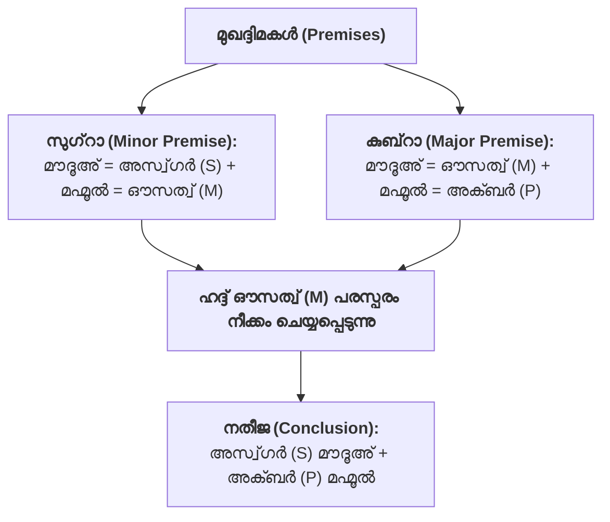

# القِيَاسُ الحَمْلِيُّ الاِقْتِرَانِيُّ وَالشَّكْلُ الأَوَّلُ
## ഹംലിയ്യാ ഖിയാസും ഒന്നാം രൂപവും — Categorical Syllogism: Anatomy & The First Figure (Barbara, Celarent, Darii, Ferio)

<!-- Top Navigation Bar -->
[⏮️ മുൻ അധ്യായം: 17. عكس النقيض وأحكامه](file:///Users/apple/Desktop/docs:books/Kanz-al-Tahqiq/Texts/Mantiq/tasrih-al-mantiq/Notes/Chapters/17-aks-al-naqid.md) | [📑 സൂചിക / Master Index](file:///Users/apple/Desktop/docs:books/Kanz-al-Tahqiq/Texts/Mantiq/tasrih-al-mantiq/Notes/Chapters/00-index.md) | [അടുത്ത അധ്യായം: 19. الأشكال الثلاثة الباقية ⏭️](file:///Users/apple/Desktop/docs:books/Kanz-al-Tahqiq/Texts/Mantiq/tasrih-al-mantiq/Notes/Chapters/19-ashkal-al-qiyas-2-3-4.md)

---

### 1. മൂലപാഠം / النص الأصلي من المتن (Al-Matn al-Aṣl)

فَصْلٌ: الْقِيَاسُ قَوْلٌ مُؤَلَّفٌ مِنْ قَضَايَا، يَلْزَمُ عَنْهَا لِذَاتِهَا قَوْلٌ آخَرُ؛ فَإِنْ كَانَتِ النَّتِيجَةُ مَذْكُورَةً فِيهِ بِالْفِعْلِ بِعَيْنِهَا، أَوْ نَقِيضِهَا، فَهُوَ اسْتِثْنَائِيٌّ، وَإِلَّا فَاقْتِرَانِيٌّ: إِنْ كَانَ مُرَكَّبًا مِنَ الْحَمْلِيَّاتِ الصِّرْفَةِ، فَهُوَ حَمْلِيٌّ، وَإِلَّا فَشَرْطِيٌّ.

أَمَّا الْحَمْلِيُّ، فَمَوْضُوعُ النَّتِيجَةِ فِيهِ يُسَمَّى: أَصْغَرَ، وَمَحْمُولُهَا: أَكْبَرَ، وَالْقَضِيَّةُ الَّتِي فِيهَا الْأَصْغَرُ يُسَمَّى: صُغْرَى، وَالَّتِي فِيهَا الْأَكْبَرُ: كُبْرَى، وَالْمُكَرَّرُ الْمُتَوَسِّطُ بَيْنَ الْأَصْغَرِ وَالْأَكْبَرِ يُسَمَّى: حَدًّا أَوْسَطَ، وَيُقَالُ لِلْهَيْئَةِ الْحَاصِلَةِ مِنَ الْقَضِيَّتَيْنِ: شَكْلٌ.

وَالشَّكْلُ، إِنْ كَانَ الْحَدُّ الْأَوْسَطُ فِيهِ مَحْمُولًا لِلصُّغْرَى وَمَوْضُوعًا لِلْكُبْرَى - يُسَمَّى: شَكْلًا أَوَّلًا، وَإِنْ كَانَ مَحْمُولًا فِيهِمَا: فَشَكْلًا ثَانِيًا، وَإِنْ كَانَ مَوْضُوعًا فِيهِمَا: فَشَكْلًا ثَالِثًا، وَإِنْ كَانَ مَوْضُوعًا لِلصُّغْرَى وَمَحْمُولًا لِلْكُبْرَى: فَشَكْلًا رَابِعًا.

أَمَّا الشَّكْلُ الْأَوَّلُ: فَيُشْتَرَطُ فِيهِ كَوْنُ الصُّغْرَى مُوجَبَةً، وَالْكُبْرَى كُلِّيَّةً، وَضُرُوبُهُ الْمُنْتِجَةُ: أَرْبَعَةٌ.

الْأَوَّلُ: الْمُؤَلَّفُ مِنْ مُوجَبَتَيْنِ كُلَّيَّتيْنِ، يُنْتِجُ مُوجَبَةً كُلِّيَّةً، نَحْوُ: كُلُّ إِنْسَانٍ حَيَوَانٌ، وَكُلُّ حَيَوَانٍ حَسَّاسٌ؛ فَكُلُّ إِنْسَانٍ حَسَّاسٌ.

وَالثَّانِي: مِنْ مُوجَبَةٍ كُلِّيَّةِ صُغْرَى، وَسَالِبَةٍ كُلِّيَةِ كُبْرَى، يُنْتِجُ سَالِبَةً كُلَّّيَّةً، نَحْوُ: كُلُّ إِنْسَانٍ حَيَوَانٌ، وَلَا شَيْءَ مِنَ الْحَيَوَانِ بِجَمَادٍ؛ فَلَا شَيْءَ مِنَ الْإِنْسَانِ بِجَمَادٍ.

وَالثَّالِثُ: مِنْ مُوجَبَةٍ جُزْئِيَّةٍ صُغْرَى، وَمُوجَبَةٍ كُلِّيَّةٍ كُبْرَى، يُنْتِجُ مُوجَبَةً جُزْئِيَّةٌ، نَحْوُ: بَعْضُ الْحَيَوَانِ إِنْسَانٌ، وَكُلُّ إِنْسَانٍ نَاطِقٌ؛ فَبَعْضُ الْحَيَوَانِ نَاطِقٌ.

وَالرَّابِعُ: مِنْ مُوجَبَةٍ جُزْئِيَّةٍ صُغْرَى، وَسَالِبَةٍ كُلِّيَّةٍ كُبْرَى، يُنْتِجُ سَالِبَةً جُزْئِيَّةً، نَحْوُ: بَعْضُ الْحَيَوَانِ إِنْسَانٌ، وَلَا شَيْءَ مِنَ الْإِنْسَانِ بِحِمَارٍ؛ فَبَعْضُ الْحَيَوَانِ لَيْسَ بِحِمَارٍ.

---

### 2. മലയാള പരിഭാഷ (ദർസ് ശൈലിയിലുള്ള വാച്യാർത്ഥവും ആശയവും)

ഖിയാസിന്റെ (അനുമാനക്രമത്തിന്റെ / Syllogism) അധ്യായം:
**ഖിയാസ് (القياس):** ഒന്നിലധികം പ്രസ്താവനകൾ ചേർത്തുവെച്ച ഘടനയാണ്; അവയുടെ സത്താപരമായ ചേർച്ചയിൽ നിന്ന് തന്നെ മറ്റൊരു പുതിയ പ്രസ്താവന (നതീജ / നിഗമനം) അനിവാര്യമായി പുറപ്പെടുന്നതാണ്.
- ലഭിക്കേണ്ട നതീജയോ അതിന്റെ നഖീദോ ആ പ്രസ്താവനകളിൽ പൂർണ്ണരൂപത്തിൽ വ്യക്തമായി പരാമർശിക്കപ്പെട്ടിട്ടുണ്ടെങ്കിൽ അത് **ഖിയാസുൻ ഇസ്തിസ്നാഈ (ഒഴിവാക്കൽ അനുമാനം / വിഭക്ത അനുമാനം)** ആകുന്നു.
- അങ്ങനെയല്ലെങ്കിൽ അത് **ഖിയാസുൻ ഇഖ്തിറാനീ (സംയോജിത അനുമാനം / Categorical Syllogism)** ആകുന്നു. ഈ ഇഖ്തിറാനീ ശുദ്ധമായ ഹംലിയ്യാ വാക്യങ്ങൾ കൊണ്ടുള്ളതാണെങ്കിൽ **ഹംലിയ്യ്** എന്നും, വ്യവസ്ഥാവാക്യങ്ങൾ കൊണ്ടുള്ളതാണെങ്കിൽ **ശർത്വിയ്യ്** എന്നും പറയപ്പെടുന്നു.

ഹംലിയ്യാ ഖിയാസിന്റെ ഘടന:
- നതീജയിലെ (നിഗമനത്തിലെ) മൗദൂഇന് (സബ്ജക്റ്റിന്) **അസ്വ്‌ഗർ (ചെറുപദം / Minor Term)** എന്ന് പറയുന്നു.
- നതീജയിലെ മഹ്മൂലിന് (പ്രെഡിക്കറ്റിന്) **അക്ബർ (വലിയപദം / Major Term)** എന്ന് പറയുന്നു.
- അസ്വ്‌ഗർ അടങ്ങിയ ആദ്യ വാക്യത്തിന് **സുഗ്‌റാ (ചെറിയ മുഖദ്ദിമ / Minor Premise)** എന്ന് പറയുന്നു.
- അക്ബർ അടങ്ങിയ രണ്ടാമത്തെ വാക്യത്തിന് **കുബ്‌റാ (വലിയ മുഖദ്ദിമ / Major Premise)** എന്ന് പറയുന്നു.
- സുഗ്‌റായിലും കുബ്‌റായിലും ആവർത്തിച്ചു വരികയും നതീജയിൽ ഇല്ലാതാവുകയും ചെയ്യുന്ന മധ്യവർത്തി പദത്തിന് **ഹദ്ദ് ഔസത്വ് (മധ്യപദം / Middle Term)** എന്ന് പറയുന്നു.
- രണ്ട് മുഖദ്ദിമകൾ ചേരുമ്പോൾ ഉണ്ടാകുന്ന ഘടനാപരമായ രൂപത്തിന് **ശക്ല് (രൂപം / Figure)** എന്ന് പറയുന്നു.

ഹദ്ദ് ഔസത്വ് വരുന്ന സ്ഥാനത്തിനനുസരിച്ച് **നാല് രൂപങ്ങളുണ്ട് (അശ്‌കാലുൽ അർബഅ്)**:
1. **ശക്ല് അവ്വൽ (ഒന്നാം രൂപം):** ഹദ്ദ് ഔസത്വ് സുഗ്‌റായിൽ മഹ്മൂലും, കുബ്‌റായിൽ മൗദൂഉം ആകുന്നത്.
2. **ശക്ല് സാനീ (രണ്ടാം രൂപം):** ഹദ്ദ് ഔസത്വ് രണ്ടിലും മഹ്മൂൽ ആകുന്നത്.
3. **ശക്ല് സാലിസ് (മൂന്നാം രൂപം):** ഹദ്ദ് ഔസത്വ് രണ്ടിലും മൗദൂഅ് ആകുന്നത്.
4. **ശക്ല് റാബിഅ് (നാലാം രൂപം):** ഹദ്ദ് ഔസത്വ് സുഗ്‌റായിൽ മൗദൂഉം, കുബ്‌റായിൽ മഹ്മൂലും ആകുന്നത്.

**ഒന്നാം രൂപത്തിന്റെ (الشكل الأول) നിബന്ധനകളും 4 ഫലപ്രദമായ ക്രമങ്ങളും (ളറൂബുകൾ):**
- **നിബന്ധനകൾ:** സുഗ്‌റാ മുജീബയായിരിക്കണം, കുബ്‌റാ കുല്ലിയ്യയായിരിക്കണം.
1. **ഒന്നാം ക്രമം (AAA-1 / ബാർബറ - Barbara):**
   - സുഗ്‌റാ: മുജീബ കുല്ലിയ്യ (എല്ലാ മനുഷ്യരും ജീവിയാണ്).
   - കുബ്‌റാ: മുജീബ കുല്ലിയ്യ (എല്ലാ ജീവികളും ഇന്ദ്രിയജ്ഞാനമുള്ളവരാണ്).
   - $\rightarrow$ **നതീജ: മുജീബ കുല്ലിയ്യ (എല്ലാ മനുഷ്യരും ഇന്ദ്രിയജ്ഞാനമുള്ളവരാണ്)**.
2. **രണ്ടാം ക്രമം (EAE-1 / സെലറന്റ് - Celarent):**
   - സുഗ്‌റാ: മുജീബ കുല്ലിയ്യ (എല്ലാ മനുഷ്യരും ജീവിയാണ്).
   - കുബ്‌റാ: സാലിബ കുല്ലിയ്യ (ഒരു ജീവിയും അചേതന വസ്തുവല്ല).
   - $\rightarrow$ **നതീജ: സാലിബ കുല്ലിയ്യ (ഒരു മനുഷ്യനും അചേതന വസ്തുവല്ല)**.
3. **മൂന്നാം ക്രമം (AII-1 / ദാരിയി - Darii):**
   - സുഗ്‌റാ: മുജീബ ജുസ്ഇയ്യ (ചില ജീവികൾ മനുഷ്യരാണ്).
   - കുബ്‌റാ: മുജീബ കുല്ലിയ്യ (എല്ലാ മനുഷ്യരും ചിന്തിക്കുന്നവരാണ്).
   - $\rightarrow$ **നതീജ: മുജീബ ജുസ്ഇയ്യ (ചില ജീവികൾ ചിന്തിക്കുന്നവരാണ്)**.
4. **നാലാം ക്രമം (EIO-1 / ഫെരിയോ - Ferio):**
   - സുഗ്‌റാ: മുജീബ ജുസ്ഇയ്യ (ചില ജീവികൾ മനുഷ്യരാണ്).
   - കുബ്‌റാ: സാലിബ കുല്ലിയ്യ (ഒരു മനുഷ്യനും കഴുതയല്ല).
   - $\rightarrow$ **നതീജ: സാലിബ ജുസ്ഇയ്യ (ചില ജീവികൾ കഴുതയല്ല)**.

---

### 3. ഇംഗ്ലീഷ് വിവർത്തനം / English Scholastic Translation

A **Syllogism (*al-Qiyās*)** is a discourse composed of propositions from which another discourse (the conclusion / *al-natīja*) necessarily follows intrinsically by virtue of their logical form alone.
- If the conclusion or its contradictory is explicitly stated in actuality within the premises, it is an **Exceptive Syllogism (*Qiyās Istithnāʾī*)**.
- Otherwise, it is a **Conjunctive / Categorical Syllogism (*Qiyās Iqtirānī*)**. If constructed purely from categorical propositions, it is Categorical (*Ḥamlī*); otherwise, it is Conditional (*Sharṭī*).

Anatomy of the Categorical Syllogism:
- Subject of the conclusion: **Minor Term (*al-Aṣghar* - $S$)**.
- Predicate of the conclusion: **Major Term (*al-Akbar* - $P$)**.
- Premise containing the minor term: **Minor Premise (*al-Ṣughrā*)**.
- Premise containing the major term: **Major Premise (*al-Kubrā*)**.
- Repeated middle term connecting them: **Middle Term (*al-Ḥadd al-Awsaṭ* - $M$)**.
- Configuration of the terms: **Figure (*al-Shakl*)**.

The **Four Syllogistic Figures**:
1. **Figure 1**: Middle term is Predicate in Minor, Subject in Major ($S-M, M-P$).
2. **Figure 2**: Middle term is Predicate in both ($S-M, P-M$).
3. **Figure 3**: Middle term is Subject in both ($M-S, M-P$).
4. **Figure 4**: Middle term is Subject in Minor, Predicate in Major ($M-S, P-M$).

**Figure 1 Conditions & The 4 Valid Moods:**
- *Conditions:* Minor premise must be Affirmative; Major premise must be Universal.
1. **Mood 1 (Barbara / AAA-1):**
   All $M$ are $P$; All $S$ are $M$ $\vdash$ **All $S$ are $P$**.
2. **Mood 2 (Celarent / EAE-1):**
   No $M$ is $P$; All $S$ are $M$ $\vdash$ **No $S$ is $P$**.
3. **Mood 3 (Darii / AII-1):**
   All $M$ are $P$; Some $S$ are $M$ $\vdash$ **Some $S$ are $P$**.
4. **Mood 4 (Ferio / EIO-1):**
   No $M$ is $P$; Some $S$ are $M$ $\vdash$ **Some $S$ are not $P$**.

---

### 4. ത്രിഭാഷാ പദസൂചിക / المصطلحات / Key Terminology Matrix

| അറബിക് പദം (Arabic) | ലിപ്യന്തരണം (Transliteration) | മലയാള അർത്ഥം (Malayalam Equivalent) | Western Logic Term | ചിഹ്നം / കോഡ് |
|---|---|---|---|---|
| **القِيَاس** | *al-Qiyās* | ഖിയാസ് / അനുമാനം | Syllogism | Deductive Inference |
| **الصُّغْرَى** | *al-Ṣughrā* | സുഗ്‌റാ (ചെറിയ മുഖദ്ദിമ) | Minor Premise | Premise with $S$ |
| **الكُبْرَى** | *al-Kubrā* | കുബ്‌റാ (വലിയ മുഖദ്ദിമ) | Major Premise | Premise with $P$ |
| **الحَدُّ الأَوْسَط** | *al-Ḥadd al-awsaṭ* | ഹദ്ദ് ഔസത്വ് (മധ്യപദം) | Middle Term | $M$ |
| **الأَصْغَر** | *al-Aṣghar* | അസ്വ്‌ഗർ (ചെറുപദം) | Minor Term | $S$ |
| **الأَكْبَر** | *al-Akbar* | അക്ബർ (വലിയപദം) | Major Term | $P$ |
| **النَّتِيجَة** | *al-Natīja* | നതീജ (നിഗമനം) | Conclusion | $S$ is $P$ |
| **الشَّكْلُ الأَوَّل** | *al-Shakl al-awwal* | ഒന്നാം രൂപം | First Figure | Sub-Pre / $M$ in middle |

---

### 5. വിശദമായ ശർഹും തത്വവിചാരവും / الشرح والتحليل المعمق

#### എ. തസ്ദീഖാത്തിന്റെ പരമോന്നത ലക്ഷ്യം (مقاصد التصديقات):
മന്തിഖിലെ ഏറ്റവും വലിയ ലക്ഷ്യമാണ് **ഖിയാസ് (Syllogism)**. മുൻപ് നാം പഠിച്ച പ്രസ്താവനകളും അവയുടെ വിപരീതങ്ങളും വൈരുദ്ധ്യങ്ങളുമെല്ലാം ഈ ഖിയാസ് നിർമ്മിക്കാനുള്ള ഘടകങ്ങൾ മാത്രമാണ്.

#### ബി. ഒന്നാം രൂപത്തിന്റെ (الشكل الأول) ശ്രേഷ്ഠത:
നാല് രൂപങ്ങളിൽ വെച്ച് ഏറ്റവും സ്വാഭാവികവും (ഫിത്വ്രിയ്യ്), സ്വയം തെളിവ് ആവശ്യമില്ലാത്തതുമായ (ബദീഹിയ്യുൽ ഇൻതാജ്) രൂപമാണ് **ഒന്നാം രൂപം**. മറ്റ് മൂന്ന് രൂപങ്ങളുടെയും സാധുത തെളിയിക്കുന്നത് അവയെ ഒന്നാം രൂപത്തിലേക്ക് തിരിച്ചുവിട്ടുകൊണ്ടാണ് (റദ്ദ് / Reduction).
- ഒന്നാം രൂപത്തിന് മാത്രമേ **നാല് തരം നതീജകളും (A, E, I, O)** നൽകാൻ സാധിക്കുകയുള്ളൂ!

---

### 6. ചിത്രരൂപങ്ങളും താരതമ്യ പട്ടികകളും / Visual Diagrams & Comparative Matrices

#### ഒന്നാം രൂപത്തിലെ നാല് ളറൂബുകൾ (The 4 Valid Moods of Figure 1)

| ക്രമം | ലാറ്റിൻ നാമം | സുഗ്‌റാ | കുബ്‌റാ | നതീജ | ഉദാഹരണം |
|:---:|---|:---:|:---:|:---:|---|
| **1** | **Barbara (AAA-1)** | മുജീബ കുല്ലിയ്യ (A) | മുജീബ കുല്ലിയ്യ (A) | **മുജീബ കുല്ലിയ്യ (A)** | എല്ലാ മനുഷ്യരും ജീവിയാണ്; എല്ലാ ജീവിയും ഇന്ദ്രിയജ്ഞാനമുള്ളവരാണ് $\rightarrow$ **എല്ലാ മനുഷ്യരും ഇന്ദ്രിയജ്ഞാനമുള്ളവരാണ്** |
| **2** | **Celarent (EAE-1)** | മുജീബ കുല്ലിയ്യ (A) | സാലിബ കുല്ലിയ്യ (E) | **സാലിബ കുല്ലിയ്യ (E)** | എല്ലാ മനുഷ്യരും ജീവിയാണ്; ഒരു ജീവിയും കല്ലല്ല $\rightarrow$ **ഒരു മനുഷ്യനും കല്ലല്ല** |
| **3** | **Darii (AII-1)** | മുജീബ ജുസ്ഇയ്യ (I) | മുജീബ കുല്ലിയ്യ (A) | **മുജീബ ജുസ്ഇയ്യ (I)** | ചില ജീവികൾ മനുഷ്യരാണ്; എല്ലാ മനുഷ്യരും ചിന്തിക്കുന്നവരാണ് $\rightarrow$ **ചില ജീവികൾ ചിന്തിക്കുന്നവരാണ്** |
| **4** | **Ferio (EIO-1)** | മുജീബ ജുസ്ഇയ്യ (I) | സാലിബ കുല്ലിയ്യ (E) | **സാലിബ ജുസ്ഇയ്യ (O)** | ചില ജീവികൾ മനുഷ്യരാണ്; ഒരു മനുഷ്യനും കഴുതയല്ല $\rightarrow$ **ചില ജീവികൾ കഴുതയല്ല** |

---

### 7. ഉദാഹരണ വിശകലനം / Analysis of Classical & Contemporary Examples

- **ദൈവശാസ്ത്രത്തിലെ തെളിവ് (Ilm al-Kalam / Barbara Form):**
  - സുഗ്‌റാ: പ്രപഞ്ചം മാറ്റങ്ങൾക്ക് വിധേയമാകുന്നതാണ് (العالم متغير).
  - കുബ്‌റാ: മാറ്റങ്ങൾക്ക് വിധേയമാകുന്നതെല്ലാം പുതുതായി ഉണ്ടായതാണ് (وكل متغير حادث).
  - $\rightarrow$ **നതീജ: പ്രപഞ്ചം പുതുതായി ഉണ്ടായതാണ് (فالعالم حادث)**.
  - ഇവിടെ «മുതഗയ്യിർ» (മാറ്റമുള്ളത്) എന്നത് ഹദ്ദ് ഔസത്വാകുന്നു; അത് നതീജയിൽ ഒഴിവാക്കപ്പെടുന്നു!

---

### 8. ശ്രദ്ധിക്കേണ്ട സൂക്ഷ്മതകൾ / تنبيهات ومزالق شائعة (Common Student Pitfalls)

> [!WARNING]
> ഹദ്ദ് ഔസത്വ് (Middle Term) രണ്ട് മുഖദ്ദിമകളിലും കൃത്യമായി ഒരേ അർത്ഥത്തിൽ തന്നെ ഉപയോഗിക്കണം. സുഗ്‌റായിൽ ഒരു അർത്ഥത്തിലും കുബ്‌റായിൽ മറ്റൊരു അർത്ഥത്തിലും (മുശ്തറക് പദം പോലെ) വന്നാൽ ഖിയാസ് അസാധുവാകും (Fallacy of Four Terms / ഫാസിദുൽ ഖിയാസ്). ഉദാ: "ഇത് കണ്ണ് (ഐൻ) ആണ്; എല്ലാ ഐനും ഭൂമിയിൽ നിന്ന് ഒഴുകുന്നതാണ്; അതിനാൽ ഇത് ഭൂമിയിൽ നിന്ന് ഒഴുകുന്നതാണ്" — ഇവിടെ ഐൻ എന്ന പദത്തിന്റെ നാനാർത്ഥം മൂലം ഖിയാസ് തകർന്നു!

---

### 9. ആവർത്തന ചോദ്യങ്ങളും വ്യായാമങ്ങളും / تدريبات وتمارين (Review Exercises)

1. ഖിയാസ് നിർവചിക്കുക. ഹംലിയ്യ്, ശർത്വിയ്യ് എന്നിവ വേർതിരിക്കുക.
2. ഖിയാസിന്റെ അഞ്ച് പ്രധാന ഘടകങ്ങൾ (സുഗ്‌റാ, കുബ്‌റാ, അസ്വ്‌ഗർ, അക്ബർ, ഹദ്ദ് ഔസത്വ്) ഒരു ഉദാഹരണത്തിലൂടെ വ്യക്തമാക്കുക.
3. ഒന്നാം രൂപത്തിന്റെ നിബന്ധനകൾ എന്തൊക്കെയാണ്? അതിന്റെ നാല് ളറൂബുകൾ പട്ടികപ്പെടുത്തുക.
4. താഴെ പറയുന്ന മുഖദ്ദിമകളിൽ നിന്ന് ഒന്നാം രൂപം പ്രകാരം നതീജ രൂപപ്പെടുത്തുക:
   - "എല്ലാ പ്ലാസ്റ്റിക്കും പരിസ്ഥിതിക്ക് ദോഷകരമാണ്; പരിസ്ഥിതിക്ക് ദോഷകരമായതെല്ലാം ഒഴിവാക്കപ്പെടേണ്ടതാണ്."
   - "ചില വിദ്യാർത്ഥികൾ കായികതാരങ്ങളാണ്; ഒരു കായികതാരവും അലസനല്ല."

---

<!-- Bottom Navigation Bar -->
[⏮️ മുൻ അധ്യായം: 17. عكس النقيض وأحكامه](file:///Users/apple/Desktop/docs:books/Kanz-al-Tahqiq/Texts/Mantiq/tasrih-al-mantiq/Notes/Chapters/17-aks-al-naqid.md) | [📑 സൂചിക / Master Index](file:///Users/apple/Desktop/docs:books/Kanz-al-Tahqiq/Texts/Mantiq/tasrih-al-mantiq/Notes/Chapters/00-index.md) | [അടുത്ത അധ്യായം: 19. الأشكال الثلاثة الباقية ⏭️](file:///Users/apple/Desktop/docs:books/Kanz-al-Tahqiq/Texts/Mantiq/tasrih-al-mantiq/Notes/Chapters/19-ashkal-al-qiyas-2-3-4.md)
