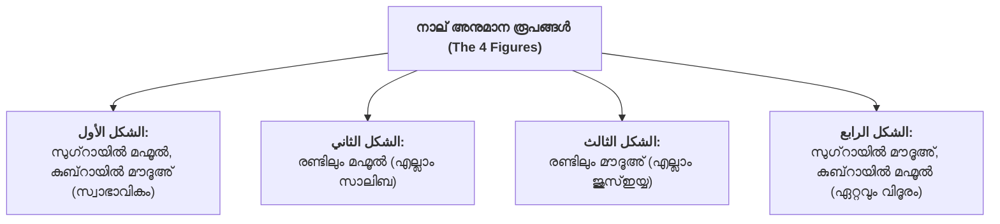

# الأَشْكَالُ الثَّلَاثَةُ البَاقِيَةُ لِلْقِيَاسِ (2، 3، 4)
## രണ്ടും മൂന്നും നാലും രൂപങ്ങൾ — Syllogistic Figures 2, 3, & 4: Conditions, Moods & Reductions

<!-- Top Navigation Bar -->
[⏮️ മുൻ അധ്യായം: 18. القياس الحملي والشكل الأول](file:///Users/apple/Desktop/docs:books/Kanz-al-Tahqiq/Texts/Mantiq/tasrih-al-mantiq/Notes/Chapters/18-al-qiyas-al-iqtirani-al-hamli.md) | [📑 സൂചിക / Master Index](file:///Users/apple/Desktop/docs:books/Kanz-al-Tahqiq/Texts/Mantiq/tasrih-al-mantiq/Notes/Chapters/00-index.md) | [അടുത്ത അധ്യായം: 20. القياس الشرطي الاقتراني ⏭️](file:///Users/apple/Desktop/docs:books/Kanz-al-Tahqiq/Texts/Mantiq/tasrih-al-mantiq/Notes/Chapters/20-al-qiyas-al-sharti.md)

---

### 1. മൂലപാഠം / النص الأصلي من المتن (Al-Matn al-Aṣl)

وَالشَّكْلُ الثَّانِي: يُشْتَرَطُ فِيهِ أَنْ تَكُونَ إِحْدَى الْمُقَدِّمَتَيْنِ مُوجَبَةً، وَالْأُخْرَى سَالِبَةً؛ مَعَ كَوْنِ الْكُبْرَى كُلَّيَةً، وَضُرُوبُهُ النَّاتِجَةُ أيْضًا أَرْبَعَةٌ:
الأَوَّلُ: الْمُرَكَّبُ مِنْ مُوجَبَةٍ كُلَّيَّةٍ صُغْرَى، وَسَالِبَةٍ كُلَّيَّةٍ كُبْرَى، يُنْتِجُ سَالِبَةً كُلِّيَّةً، نَحْوُ: كُلُّ إِنْسَانٍ حَيَوَانٌ، وَلَا شَيْءَ مِنَ الْحَجَرِ بِحَيَوَانٍ؛ فَلَا شَيْءَ مِنَ الْإِنْسَانِ بِحَجَرٍ.
وَالثَّانِي: مِنْ سَالِبَةٍ كُلَّيَّةٍ صُغْرَى، وَمُوجَبَةٍ كُلِّيَّةٍ كُبْرَى، يُنْتِجُ أَيْضًا سَالِبَةً كُلِّيَّةً، نَحْوُ: لَا شَيْءَ مِنَ الْحَجَرِ بِحَيَوَانٍ، وَكُلُّ إِنْسَانٍ حَيَوَانٌ؛ فَلَا شَيْءَ مِنَ الْحَجَرِ بِإِنْسَانٍ.
وَالثَّالِثُ: مِنْ مُوجَبَةٍ جُزْئِيَّةِ صُغْرَى، وَسَالِبَةٍ كُلِّيَّةٍ كُبْرَى، يُنْتِجُ سَالِبَةً جُزْئِيَّةً، نَحْوُ: بَعْضُ الْحَيَوَانِ إِنْسَانٌ، وَلَا شَيْءَ مِنَ الْحَجَرِ بِإِنْسَانٍ؛ فَبَعْضُ الْحَيَوَانِ لَيْسَ بِحَجَرٍ.
وَالرَّابِعُ: مِنْ سَالِبَةٍ جُزْئِيَّةِ صُغْرَى، وَمُوجَبَةٍ كُلِّيَةِ كُبْرَى، يُنْتِجُ أَيْضًا سَالِبَةً جُزْئِيَّة، نَحْوُ: بَعْضُ الْحَيَوَانِ لَيْسَ بِإِنْسَانٍ، وَكُلُّ نَاطِق إِنْسَانٌ؛ فَبَعْضُ الْحَيَوَانِ لَيْسَ بِنَاطِقٍ.

وَالشَّكْلُ الثَّالِثُ: مَشْرُوطٌ بِكَوْنِ الصُّغْرَى مُوجَبَةً؛ مَعَ كَوْنِ إِحْدَى الْمُقَدِّمَتَيْنِ كُلِّيَّةٌ، وَضُرُوبُهُ الْمُنْتِجَةُ سِتَّةُ:
الأَوَّلُ: مِنْ مُوجَبَتَيْنِ كُلَّيَّتَيْنِ. وَالثَّانِي: مِنْ مُوجَبَةٍ جُزْئِيَّةٍ صُغْرَى، وَمُوجَبَةٍ كُلِّيَّةِ كُبْرَى. وَالثَّالِثُ: مِنْ مُوجَبَةٍ كُلِّيَّةٍ صُغْرَى، وَمُوجَبَةٍ جُزْئِيَّةٍ كُبْرَى، وَالنَّتِيجَةُ مِنْ هَذِهِ الثَّلَاثَةِ: مُوجَبَةٌ جُزْئِيَّةٌ، نَحْوُ: كُلُّ إِنْسَانٍ حَيَوَانٌ، وَكُلُّ إِنْسَانٍ نَاطِقٌ؛ فَبَعْضُ الْحَيَوَانِ نَاطِقٌ...
وَالرَّابِعُ: مِنْ مُوجَبَةٍ كُلِّيَّةٍ صُغْرَى، وَسَالِبَةٍ كُلَّيَّةٍ كُبْرَى. وَالْخَامِسُ: مِنْ مُوجَبَةٍ جُزْئِيَّةٍ صُغْرَى، وَسَالِبَةٍ كُلِّيَّةٍ كُبْرَى. وَالسَادِسُ: مِنْ مُوجَبَةٍ كُلِّيَّةٍ صُغْرَى، وَسَالِبَةٍ جُزْئِيَّةٍ كُبْرَى. وَالنَّتِيجَةُ فِي هَذِهِ الثَّلَاثَةِ: سَالِبَةٌ جُزْئِيَّةٌ...

وَالشَّكْلُ الرَّابِعُ: يُشْتَرَطُ فِيهِ أَحَدُ الْأَمْرَيْنِ: إِمَّا إِيجَابُهُمَا مَعَ كَوْنِ الصُّغْرَى كُلَّيَّةً، أَوِ اخْتِلَافُهُمَا مَعَ كُلَّيَّةِ إِحْدَيهُمَا، وَضُرُوبُهُ الْمُنْتِجَةُ ثَمَانِيَةٌ...

---

### 2. മലയാള പരിഭാഷ (ദർസ് ശൈലിയിലുള്ള വാച്യാർത്ഥവും ആശയവും)

#### രണ്ടാം രൂപം (الشكل الثاني):
ഹദ്ദ് ഔസത്വ് (മധ്യപദം) സുഗ്‌റായിലും കുബ്‌റായിലും **മഹ്മൂലായി (പ്രെഡിക്കറ്റ്)** വരുന്നത്.
- **നിബന്ധനകൾ:** രണ്ട് മുഖദ്ദിമകളിൽ ഒന്ന് മുജീബയും മറ്റൊന്ന് സാലിബയുമായിരിക്കണം (കൈഫിയ്യത്തിൽ ഭിന്നത); കുബ്‌റാ കുല്ലിയ്യയായിരിക്കണം.
- ഇതിലെ **നാല് ളറൂബുകളും സാലിബയായിരിക്കും (നിഷേധം മാത്രം)**:
  1. മുജീബ കുല്ലിയ്യ + സാലിബ കുല്ലിയ്യ $\rightarrow$ **സാലിബ കുല്ലിയ്യ** (ഉദാ: എല്ലാ മനുഷ്യരും ജീവിയാണ്; ഒരു കല്ലും ജീവിയല്ല $\vdash$ ഒരു മനുഷ്യനും കല്ലല്ല).
  2. സാലിബ കുല്ലിയ്യ + മുജീബ കുല്ലിയ്യ $\rightarrow$ **സാലിബ കുല്ലിയ്യ**.
  3. മുജീബ ജുസ്ഇയ്യ + സാലിബ കുല്ലിയ്യ $\rightarrow$ **സാലിബ ജുസ്ഇയ്യ**.
  4. സാലിബ ജുസ്ഇയ്യ + മുജീബ കുല്ലിയ്യ $\rightarrow$ **സാലിബ ജുസ്ഇയ്യ**.

#### മൂന്നാം രൂപം (الشكل الثالث):
ഹദ്ദ് ഔസത്വ് രണ്ടിലും **മൗദൂആയി (സബ്ജക്റ്റ്)** വരുന്നത്.
- **നിബന്ധനകൾ:** സുഗ്‌റാ മുജീബയായിരിക്കണം; രണ്ടിലൊന്ന് കുല്ലിയ്യയായിരിക്കണം.
- ഇതിലെ **ആറ് ളറൂബുകളുടെയും നതീജ ജുസ്ഇയ്യയായിരിക്കും (ഭാഗികം മാത്രം)**:
  - ആദ്യ മൂന്നെണ്ണം $\rightarrow$ **മുജീബ ജുസ്ഇയ്യ** (I).
  - ശേഷിക്കുന്ന മൂന്നെണ്ണം $\rightarrow$ **സാലിബ ജുസ്ഇയ്യ** (O).

#### നാലാം രൂപം (الشكل الرابع):
ഹദ്ദ് ഔസത്വ് സുഗ്‌റായിൽ മൗദൂഉം കുബ്‌റായിൽ മഹ്മൂലുമായി വരുന്നത് (ഒന്നാം രൂപത്തിന്റെ നേർവിപരീതം).
- **നിബന്ധനകൾ:** ഒന്നുകിൽ രണ്ടും മുജീബയാവുകയും സുഗ്‌റാ കുല്ലിയ്യയാവുകയും വേണം; അല്ലെങ്കിൽ രണ്ടും കൈഫിയ്യത്തിൽ വ്യത്യാസപ്പെടുകയും ഒന്നുകിൽ കുല്ലിയ്യയാവുകയും വേണം.
- ഇതിൽ **എട്ട് ഫലപ്രദമായ ക്രമങ്ങളുണ്ട് (ളറൂബുകൾ)**; നതീജകൾ മുജീബ ജുസ്ഇയ്യയോ സാലിബയോ ആയിരിക്കും.

---

### 3. ഇംഗ്ലീഷ് വിവർത്തനം / English Scholastic Translation

#### Figure 2 (Middle term is Predicate in both premises: $S-M, P-M$):
- *Conditions:* Premises must differ in quality (one affirmative, one negative); Major premise must be Universal.
- *Valid Moods (4 moods — all conclusions are negative):*
  1. **Camestres (AEE-2):** All $S$ are $M$, No $P$ is $M$ $\vdash$ No $S$ is $P$.
  2. **Cesare (EAE-2):** No $S$ is $M$, All $P$ are $M$ $\vdash$ No $S$ is $P$.
  3. **Festino (EIO-2):** Some $S$ are $M$, No $P$ is $M$ $\vdash$ Some $S$ are not $P$.
  4. **Baroco (AOO-2):** Some $S$ are not $M$, All $P$ are $M$ $\vdash$ Some $S$ are not $P$.

#### Figure 3 (Middle term is Subject in both premises: $M-S, M-P$):
- *Conditions:* Minor premise must be Affirmative; at least one premise must be Universal.
- *Valid Moods (6 moods — all conclusions are particular):*
  1. **Darapti (AAI-3):** All $M$ are $S$, All $M$ are $P$ $\vdash$ Some $S$ are $P$.
  2. **Disamis (IAI-3):** Some $M$ are $S$, All $M$ are $P$ $\vdash$ Some $S$ are $P$.
  3. **Datisi (AII-3):** All $M$ are $S$, Some $M$ are $P$ $\vdash$ Some $S$ are $P$.
  4. **Felapton (EAO-3):** All $M$ are $S$, No $M$ is $P$ $\vdash$ Some $S$ are not $P$.
  5. **Bocardo (OAO-3):** Some $M$ are not $S$, All $M$ are $P$ $\vdash$ Some $S$ are not $P$.
  6. **Ferison (EIO-3):** Some $M$ are $S$, No $M$ is $P$ $\vdash$ Some $S$ are not $P$.

#### Figure 4 (Middle term is Subject in Minor, Predicate in Major: $M-S, P-M$):
- *Conditions:* Either both affirmative with minor universal, or differing in quality with one universal.
- Classical Arabic treatises detail **8 valid moods** yielding either particular affirmative or negative conclusions (Bramantip, Camenes, Dimaris, Fesapo, Fresison, etc.).

---

### 4. ത്രിഭാഷാ പദസൂചിക / المصطلحات / Key Terminology Matrix

| രൂപം (Figure) | ഹദ്ദ് ഔസത്വിന്റെ സ്ഥാനം | നിബന്ധനകൾ (Conditions) | ളറൂബുകൾ (Moods) | നതീജയുടെ പ്രത്യേകത |
|---|---|---|:---:|---|
| **الشَّكْلُ الثَّانِي (Figure 2)** | രണ്ടിലും മഹ്മൂൽ ($P-M$) | കൈഫിൽ വ്യത്യാസം + കുബ്‌റാ കുല്ലിയ്യ | 4 | **എപ്പോഴും സാലിബ (E, O)** |
| **الشَّكْلُ الثَّالِث (Figure 3)** | രണ്ടിലും മൗദൂഅ് ($M-S$) | സുഗ്‌റാ മുജീബ + ഒരെണ്ണം കുല്ലിയ്യ | 6 | **എപ്പോഴും ജുസ്ഇയ്യ (I, O)** |
| **الشَّكْلُ الرَّابِع (Figure 4)** | സുഗ്‌റായിൽ മൗദൂഅ്, കുബ്‌റായിൽ മഹ്മൂൽ | വ്യവസ്ഥാപിത സങ്കലനം | 8 | സ്വാഭാവിക ചിന്തയ്ക്ക് വിപരീതം |
| **الرَّدّ / البُرْهَان** | *al-Radd* | ഒന്നാം രൂപത്തിലേക്ക് മാറ്റൽ | Reduction | അക്‌സ് അല്ലെങ്കിൽ ഖുൽഫ് വഴി |

---

### 5. വിശദമായ ശർഹും തത്വവിചാരവും / الشرح والتحليل المعمق

#### മറ്റ് രൂപങ്ങളെ ഒന്നാം രൂപത്തിലേക്ക് റദ്ദ് ചെയ്യുന്ന രീതി (Reduction):
ഒന്നാം രൂപം മാത്രമാണ് സ്വയംസിദ്ധമായത് (ബദീഹിയ്യ്). മറ്റ് മൂന്ന് രൂപങ്ങളുടെയും സാധുത സ്ഥാപിക്കാൻ മന്തിഖുകാർ രണ്ട് മാർഗ്ഗങ്ങൾ ഉപയോഗിക്കുന്നു:
1. **ത്വരീഖുൽ അക്‌സ് (പ്രതിവർത്തന മാർഗ്ഗം / Direct Proof by Conversion):** മുഖദ്ദിമകളിൽ ഒന്നിനെ അക്‌സ് ചെയ്ത് ഹദ്ദ് ഔസത്വിനെ മധ്യത്തിലേക്ക് കൊണ്ടുവന്ന് ഒന്നാം രൂപമാക്കുക.
2. **ത്വരീഖുൽ ഖുൽഫ് (വിപരീത തെളിവ് / Reductio ad Absurdum):** നതീജയുടെ നഖീദിനെ (വിപരീതത്തെ) ഒരു മുഖദ്ദിമയായി സ്വീകരിക്കുകയും, അത് വഴി പ്രാരംഭ മുഖദ്ദിമകൾക്ക് വിരുദ്ധമായ ഒരു അസംബന്ധത്തിലേക്ക് എത്തിച്ചേരുകയും ചെയ്യുക വഴി ആദ്യ നതീജ ശരിയാണെന്ന് സ്ഥാപിക്കൽ.

---

### 6. ചിത്രരൂപങ്ങളും താരതമ്യ പട്ടികകളും / Visual Diagrams & Comparative Matrices

---

### 7. ഉദാഹരണ വിശകലനം / Analysis of Classical & Contemporary Examples

- **രണ്ടാം രൂപം (തത്ത്വശാസ്ത്ര സംവാദം - EAE-2):**
  - സുഗ്‌റാ: ആത്മാവ് ഭൗതിക ശരീരമല്ല (സാലിബ).
  - കുബ്‌റാ: വിഭജിക്കപ്പെടാൻ കഴിയുന്നതെല്ലാം ഭൗതിക ശരീരമാണ് (മുജീബ).
  - $\rightarrow$ **നതീജ: ആത്മാവ് വിഭജിക്കപ്പെടാൻ കഴിയുന്ന ഒന്നല്ല (സാലിബ കുല്ലിയ്യ)**.
- **മൂന്നാം രൂപം (പ്രത്യേക കണ്ടെത്തലുകൾ - AAI-3):**
  - സുഗ്‌റാ: എല്ലാ തിമിംഗലങ്ങളും സസ്തനികളാണ് (മുജീബ).
  - കുബ്‌റാ: എല്ലാ തിമിംഗലങ്ങളും കടലിൽ ജീവിക്കുന്നവയാണ് (മുജീബ).
  - $\rightarrow$ **നതീജ: ചില സസ്തനികൾ കടലിൽ ജീവിക്കുന്നവയാണ് (മുജീബ ജുസ്ഇയ്യ)**.

---

### 8. ശ്രദ്ധിക്കേണ്ട സൂക്ഷ്മതകൾ / تنبيهات ومزالق شائعة (Common Student Pitfalls)

> [!WARNING]
> മൂന്നാം രൂപത്തിലെ രണ്ട് മുഖദ്ദിമകളും കുല്ലിയ്യ ആയാലും (ഉദാ: ദറാപ്തി - Darapti), **നതീജ ഒരിക്കലും കുല്ലിയ്യ ആയിരിക്കില്ല; ജുസ്ഇയ്യ മാത്രമേ വരൂ!** കാരണം ഹദ്ദ് ഔസത്വ് രണ്ടിലും മൗദൂആയതിനാൽ അത് ആ രണ്ട് വിശേഷണങ്ങളും ചിലതിൽ ഒന്നിക്കുന്നുവെന്ന് മാത്രമേ സ്ഥാപിക്കുന്നുള്ളൂ, സർവ്വതിലും ഒന്നിക്കുമെന്ന് സ്ഥാപിക്കുന്നില്ല.

---

### 9. ആവർത്തന ചോദ്യങ്ങളും വ്യായാമങ്ങളും / تدريبات وتمارين (Review Exercises)

1. ഖിയാസിലെ നാല് രൂപങ്ങളെ വേർതിരിക്കുന്ന ഘടകം എന്ത്?
2. രണ്ടാം രൂപത്തിന്റെ നിബന്ധനകൾ എന്തൊക്കെയാണ്? അതിൽ നിന്നുള്ള നതീജകൾ എപ്പോഴും സാലിബയാകുന്നത് എന്തുകൊണ്ട്?
3. മൂന്നാം രൂപത്തിലെ ആറ് ളറൂബുകൾ പട്ടികപ്പെടുത്തുക.
4. "ഖുൽഫ്" (Reductio ad Absurdum) എന്നാൽ എന്താണെന്നും അത് വഴി ബാറോകോ (Baroco) തെളിയിക്കുന്നത് എങ്ങനെയെന്നും സംഗ്രഹിക്കുക.

---

<!-- Bottom Navigation Bar -->
[⏮️ മുൻ അധ്യായം: 18. القياس الحملي والشكل الأول](file:///Users/apple/Desktop/docs:books/Kanz-al-Tahqiq/Texts/Mantiq/tasrih-al-mantiq/Notes/Chapters/18-al-qiyas-al-iqtirani-al-hamli.md) | [📑 സൂചിക / Master Index](file:///Users/apple/Desktop/docs:books/Kanz-al-Tahqiq/Texts/Mantiq/tasrih-al-mantiq/Notes/Chapters/00-index.md) | [അടുത്ത അധ്യായം: 20. القياس الشرطي الاقتراني ⏭️](file:///Users/apple/Desktop/docs:books/Kanz-al-Tahqiq/Texts/Mantiq/tasrih-al-mantiq/Notes/Chapters/20-al-qiyas-al-sharti.md)
