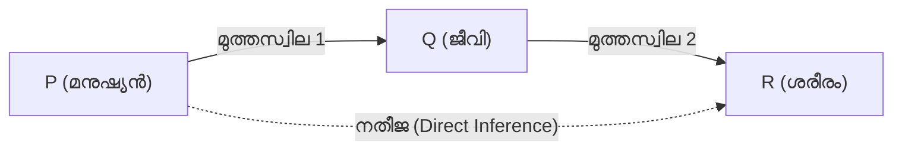

# القِيَاسُ الشَّرْطِيُّ الاِقْتِرَانِيُّ
## വ്യവസ്ഥാപിത സംയോജിത അനുമാനം — Syllogisms with Pure & Mixed Conditional Premises

<!-- Top Navigation Bar -->
[⏮️ മുൻ അധ്യായം: 19. الأشكال الثلاثة الباقية](file:///Users/apple/Desktop/docs:books/Kanz-al-Tahqiq/Texts/Mantiq/tasrih-al-mantiq/Notes/Chapters/19-ashkal-al-qiyas-2-3-4.md) | [📑 സൂചിക / Master Index](file:///Users/apple/Desktop/docs:books/Kanz-al-Tahqiq/Texts/Mantiq/tasrih-al-mantiq/Notes/Chapters/00-index.md) | [അടുത്ത അധ്യായം: 21. القياس الاستثنائي ⏭️](file:///Users/apple/Desktop/docs:books/Kanz-al-Tahqiq/Texts/Mantiq/tasrih-al-mantiq/Notes/Chapters/21-al-qiyas-al-istithna-i.md)

---

### 1. മൂലപാഠം / النص الأصلي من المتن (Al-Matn al-Aṣl)

وَأَمَّا الْقِيَاسُ الشَّرْطِيُّ فَلَا يَتَرَكَّبُ إِلَّا:
1. مِنْ مُتَّصِلَتَيْنِ، كَقَوْلِنَا: كُلَّمَا كَانَ زَيْدٌ إِنْسَانًا كَانَ حَيَوَانًا، وَكُلَّمَا كَانَ حَيَوَانًا كَانَ جِسْمًا؛ فَكُلَّمَا كَانَ زَيْدٌ إِنْسَانًا كَانَ جِسْمَا.
2. أَوْ مِنْ مُنْفَصِلَتَيْنِ، نَحْوُ: إِمَّا أَنْ يَكُونَ هَذَا الْعَدَدُ زَوْجًا أَوْ فَرْدًا، وَكُلُّ زَوْجٍ إِمَّا زَوْجُ الزَّوْجِ أَوْ زَوْجُ الْفَرْدِ؛ فَكُلُّ عَدَدٍ إِمَّا فَرْدٌ أَوْ زَوْجُ الزَّوْجِ أَوْ زَوْجُ الْفَرْدِ.
3. أَوْ مِنْ حَمْلِيَّةٍ وَمُتَّصِلَةٍ، نَحْوُ قَوْلِنَا: هَذَا الشَّيْءُ إِنْسَانٌ، وَكُلَّمَا كَانَ الشَّيْءُ إِنْسَانًا كَانَ حَيَوَانًا؛ فَهَذَا الشَّيْءُ حَيَوَانٌ.
4. أَوْ مِنْ حَمْلِيَّةٍ وَمُنْفَصِلَةٍ، نَحْوُ: هَذَا عَدَدٌ، وَدَائِمًا إِمَّا أَنْ يَكُونَ الْعَدَدُ زَوْجًا أَوْ فَرْدًا؛ فَهَذَا إِمَّا أَنْ يَكُونَ زَوْجًا أَوْ فَرْدًا.
5. أَوْ مِنْ مُتَّصِلَةٍ وَمُنْفَصِلَةٍ، نَحْوُ: كُلَّمَا كَانَ هَذَا ثَلَاثَةً فَهُوَ عَدَدٌ، وَدَائِمَا إِمَّا أَنْ يَكُونَ الْعَدَدُ زَوْجًا أَوْ يَكُونَ فَرْدًا؛ فَكُلَّمَا كَانَ هَذَا ثَلَاثَةً فَهُوَ إِمَّا أَنْ يَكُونَ زَوْجًا أَوْ يَكُونَ فَرْدًا.

فَهَذِهِ خَمْسَةُ أَقْسَامٍ، وَيَنْعَقِدُ فِيهَا الْأَشْكَالُ الْأَرْبَعَةُ كَمَا فِي الْحَمْلِيَّاتِ. وَفِي تَفْصِيلِهِ طُولٌ يُطْلَبُ مِنَ الْمُطَوَّلَاتِ.

---

### 2. മലയാള പരിഭാഷ (ദർസ് ശൈലിയിലുള്ള വാച്യാർത്ഥവും ആശയവും)

വ്യവസ്ഥാപിത സംയോജിത അനുമാനം (**ഖിയാസുൻ ശർത്വിയ്യുൻ ഇഖ്തിറാനീ / Conditional Syllogism**):
ഇത് അഞ്ച് വിധങ്ങളിലല്ലാതെ രൂപപ്പെടുകയില്ല:
1. **രണ്ട് മുത്തസ്വിലകൾ ചേർന്നത് (Pure Connected):**
   - സുഗ്‌റാ: «സൈദ് മനുഷ്യനാകുമ്പോഴെല്ലാം അവൻ ജീവിയാകുന്നു» ($P \rightarrow Q$).
   - കുബ്‌റാ: «അവൻ ജീവിയാകുമ്പോഴെല്ലാം അവൻ ശരീരമുള്ളവനാകുന്നു» ($Q \rightarrow R$).
   - $\rightarrow$ **നതീജ: «സൈദ് മനുഷ്യനാകുമ്പോഴെല്ലാം അവൻ ശരീരമുള്ളവനാകുന്നു» ($P \rightarrow R$)**.
2. **രണ്ട് മുൻഫസ്വിലകൾ ചേർന്നത് (Pure Disconnected):**
   - സുഗ്‌റാ: «ഈ സംഖ്യ ഒന്നുകിൽ ഇരട്ടയാണ് അല്ലെങ്കിൽ ഒറ്റയാണ്».
   - കുബ്‌റാ: «എല്ലാ ഇരട്ട സംഖ്യയും ഒന്നുകിൽ ഇരട്ടയുടെ ഇരട്ടയോ അല്ലെങ്കിൽ ഒറ്റയുടെ ഇരട്ടയോ ആണ്».
   - $\rightarrow$ **നതീജ: «ഓരോ സംഖ്യയും ഒന്നുകിൽ ഒറ്റയാണ്, അല്ലെങ്കിൽ ഇരട്ടയുടെ ഇരട്ടയാണ്, അല്ലെങ്കിൽ ഒറ്റയുടെ ഇരട്ടയാണ്»**.
3. **ഹംലിയ്യയും മുത്തസ്വിലയും ചേർന്നത്:**
   - സുഗ്‌റാ (ഹംലിയ്യ): «ഈ വസ്തു മനുഷ്യനാണ്».
   - കുബ്‌റാ (മുത്തസ്വില): «ഒരു വസ്തു മനുഷ്യനാകുമ്പോഴെല്ലാം അത് ജീവിയാകുന്നു».
   - $\rightarrow$ **നതീജ (ഹംലിയ്യ): «ഈ വസ്തു ജീവിയാകുന്നു»**.
4. **ഹംലിയ്യയും മുൻഫസ്വിലയും ചേർന്നത്:**
   - സുഗ്‌റാ (ഹംലിയ്യ): «ഇതൊരു സംഖ്യയാണ്».
   - കുബ്‌റാ (മുൻഫസ്വില): «എല്ലായ്പ്പോഴും സംഖ്യ ഒന്നുകിൽ ഇരട്ടയാണ് അല്ലെങ്കിൽ ഒറ്റയാണ്».
   - $\rightarrow$ **നതീജ (മുൻഫസ്വില): «ഇത് ഒന്നുകിൽ ഇരട്ടയാണ് അല്ലെങ്കിൽ ഒറ്റയാണ്»**.
5. **മുത്തസ്വിലയും മുൻഫസ്വിലയും ചേർന്നത്:**
   - സുഗ്‌റാ (മുത്തസ്വില): «ഇത് മൂന്നാണെങ്കിലെല്ലാം ഇതൊരു സംഖ്യയാണ്».
   - കുബ്‌റാ (മുൻഫസ്വില): «എല്ലായ്പ്പോഴും സംഖ്യ ഒന്നുകിൽ ഇരട്ടയോ ഒറ്റയോ ആണ്».
   - $\rightarrow$ **നതീജ: «ഇത് മൂന്നാണെങ്കിലെല്ലാം ഇത് ഒന്നുകിൽ ഇരട്ടയോ ഒറ്റയോ ആണ്»**.

ഇവ അഞ്ച് ഇനങ്ങളാകുന്നു. ഹംലിയ്യാ ഖിയാസുകളിൽ പറഞ്ഞതുപോലെ ഈ അഞ്ചിനങ്ങളിലും നാല് രൂപങ്ങളും (അശ്‌കാലുൽ അർബഅ്) ബാധകമാകും. ഇതിന്റെ വിപുലമായ വിശദീകരണങ്ങൾ ദീർഘമേറിയതാണ്; അത് വലിയ ഗ്രന്ഥങ്ങളിൽ അന്വേഷിക്കേണ്ടതാണ്.

---

### 3. ഇംഗ്ലീഷ് വിവർത്തനം / English Scholastic Translation

The **Conjunctive Conditional Syllogism (*al-Qiyās al-Sharṭī al-Iqtirānī*)** is constructed exclusively from five configurations of premises:
1. **Composed of Two Connected Conditionals (Hypothetical Syllogism)**:
   - "Whenever Zayd is human, he is an animal" ($P \rightarrow Q$).
   - "Whenever he is an animal, he is a physical body" ($Q \rightarrow R$).
   - $\vdash$ **"Whenever Zayd is human, he is a physical body" ($P \rightarrow R$)**.
2. **Composed of Two Disconnected Conditionals (Pure Disjunctive Syllogism)**:
   - "Either this number is even or odd."
   - "Every even number is either even-times-even or even-times-odd."
   - $\vdash$ **"Every number is either odd, or even-times-even, or even-times-odd."**
3. **Composed of a Categorical and a Connected Conditional**:
   - "This entity is human."
   - "Whenever an entity is human, it is an animal."
   - $\vdash$ **"This entity is an animal."**
4. **Composed of a Categorical and a Disconnected Conditional**:
   - "This is a number."
   - "Always, a number is either even or odd."
   - $\vdash$ **"This is either even or odd."**
5. **Composed of a Connected and a Disconnected Conditional**:
   - "Whenever this is three, it is a number."
   - "Always, a number is either even or odd."
   - $\vdash$ **"Whenever this is three, it is either even or odd."**

These are the five compositional classes. In all of them, the Four Syllogistic Figures obtain just as in categorical syllogisms. Detailed deductions are lengthy and sought in advanced treatises.

---

### 4. ത്രിഭാഷാ പദസൂചിക / المصطلحات / Key Terminology Matrix

| ക്രമം | വിഭാഗം | ഘടന (Composition) | ഫോർമൽ ലോജിക് ഫോർമുല |
|:---:|---|---|---|
| **1** | മുത്തസ്വിലതൈനി | രണ്ട് മുത്തസ്വിലകൾ | $P \rightarrow Q, \quad Q \rightarrow R \vdash P \rightarrow R$ |
| **2** | മുൻഫസ്വിലതൈനി | രണ്ട് മുൻഫസ്വിലകൾ | $(A \lor B), \quad (B \rightarrow C \lor D) \vdash A \lor C \lor D$ |
| **3** | ഹംലിയ്യ + മുത്തസ്വില | കാറ്റഗറിക്കൽ + കണക്ടഡ് | $S \text{ is } M, \quad M \rightarrow P \vdash S \text{ is } P$ |
| **4** | ഹംലിയ്യ + മുൻഫസ്വില | കാറ്റഗറിക്കൽ + ഡിസ്‌ജംഗ്റ്റീവ് | $S \text{ is } M, \quad M \rightarrow (P \lor Q) \vdash S \text{ is } (P \lor Q)$ |
| **5** | മുത്തസ്വില + മുൻഫസ്വില | കണക്ടഡ് + ഡിസ്‌ജംഗ്റ്റീവ് | $P \rightarrow M, \quad M \rightarrow (Q \lor R) \vdash P \rightarrow (Q \lor R)$ |

---

### 5. വിശദമായ ശർഹും തത്വവിചാരവും / الشرح والتحليل المعمق

#### ഹൈപ്പോതെറ്റിക്കൽ സിലോഗിസത്തിന്റെ ട്രാൻസിറ്റിവിറ്റി തത്വം (Law of Transitivity):
ആധുനിക ഗണിതശാസ്ത്രത്തിലും കമ്പ്യൂട്ടേഷനിലും നിർണ്ണായകമായ തത്വമാണ് **ട്രാൻസിറ്റിവിറ്റി (Transitivity)**:
$$A \rightarrow B \quad \text{and} \quad B \rightarrow C \implies A \rightarrow C$$
മന്തിഖിലെ ഒന്നാം വിഭാഗമായ «മുത്തസ്വിലതൈനി» കൃത്യമായി ഈ നിയമത്തെയാണ് പ്രതിഫലിപ്പിക്കുന്നത്. ഹദ്ദ് ഔസത്വായ $Q$ ആദ്യ വാക്യത്തിൽ താലിയായും (ഉത്തരപദം) രണ്ടാം വാക്യത്തിൽ മുഖദ്ദമായും (പൂർവ്വപദം) വന്ന് പരസ്പരം റദ്ദാക്കപ്പെടുന്നു.

---

### 6. ചിത്രരൂപങ്ങളും താരതമ്യ പട്ടികകളും / Visual Diagrams & Comparative Matrices

---

### 7. ഉദാഹരണ വിശകലനം / Analysis of Classical & Contemporary Examples

- **കമ്പ്യൂട്ടർ അൽഗോരിതം ലോജിക് ഫ്ലോ:**
  - `if (input == valid) authenticate();` ($P \rightarrow Q$)
  - `if (authenticated) grantAccess();` ($Q \rightarrow R$)
  - $\rightarrow$ `if (input == valid) grantAccess();` ($P \rightarrow R$).
  ഈ പ്രോഗ്രാമിംഗ് കോഡ് രണ്ട് മുത്തസ്വിലകൾ ചേർത്തുവെച്ച ഒന്നാം ഇനം ശർത്വിയ്യാ ഖിയാസാണ്.

---

### 8. ശ്രദ്ധിക്കേണ്ട സൂക്ഷ്മതകൾ / تنبيهات ومزالق شائعة (Common Student Pitfalls)

> [!WARNING]
> ശർത്വിയ്യയിൽ ഹദ്ദ് ഔസത്വ് ഒരു വാക്കായിരിക്കില്ല; മറിച്ച് **ഒരു പൂർണ്ണ വാക്യമായിരിക്കും** (താലി അല്ലെങ്കിൽ മുഖദ്ദം). അതിനാൽ ഹദ്ദ് ഔസത്വിനെ തിരിച്ചറിയുമ്പോൾ അക്ഷരങ്ങളെ നോക്കാതെ പൂർവ്വ-ഉത്തര പദങ്ങളുടെ അർത്ഥത്തെയാണ് ശ്രദ്ധിക്കേണ്ടത്.

---

### 9. ആവർത്തന ചോദ്യങ്ങളും വ്യായാമങ്ങളും / تدريبات وتمارين (Review Exercises)

1. ശർത്വിയ്യാ ഇഖ്തിറാനീ ഖിയാസിന്റെ അഞ്ച് ഇനങ്ങൾ ഏതെല്ലാം?
2. ട്രാൻസിറ്റിവിറ്റി (Transitivity) നിയമം പ്രതിഫലിക്കുന്ന വിഭാഗമേതാണ്? ഒരു ഉദാഹരണ സഹിതം വിവരിക്കുക.
3. ഹംലിയ്യയും മുത്തസ്വിലയും ചേർത്ത് സ്വന്തമായി ഒരു ഖിയാസ് രചിക്കുക.
4. എന്തുകൊണ്ടാണ് ഈ അധ്യായത്തിന്റെ വിപുലീകരണങ്ങൾ വലിയ ഗ്രന്ഥങ്ങളിലേക്ക് മാറ്റിവെക്കാൻ ഗ്രന്ഥകർത്താവ് നിർദ്ദേശിച്ചത്?

---

<!-- Bottom Navigation Bar -->
[⏮️ മുൻ അധ്യായം: 19. الأشكال الثلاثة الباقية](file:///Users/apple/Desktop/docs:books/Kanz-al-Tahqiq/Texts/Mantiq/tasrih-al-mantiq/Notes/Chapters/19-ashkal-al-qiyas-2-3-4.md) | [📑 സൂചിക / Master Index](file:///Users/apple/Desktop/docs:books/Kanz-al-Tahqiq/Texts/Mantiq/tasrih-al-mantiq/Notes/Chapters/00-index.md) | [അടുത്ത അധ്യായം: 21. القياس الاستثنائي ⏭️](file:///Users/apple/Desktop/docs:books/Kanz-al-Tahqiq/Texts/Mantiq/tasrih-al-mantiq/Notes/Chapters/21-al-qiyas-al-istithna-i.md)
