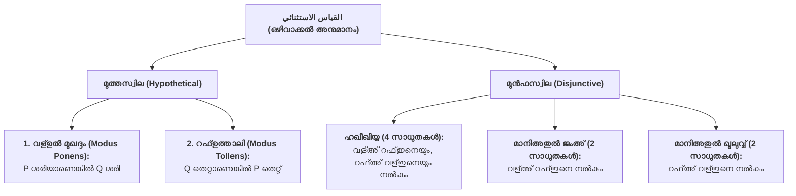

# القِيَاسُ الاِسْتِثْنَائِيُّ وَأَحْكَامُهُ
## ഒഴിവാക്കൽ അനുമാനം — Exceptive Syllogisms: Modus Ponens, Modus Tollens & Disjunctive Rules

<!-- Top Navigation Bar -->
[⏮️ മുൻ അധ്യായം: 20. القياس الشرطي الاقتراني](file:///Users/apple/Desktop/docs:books/Kanz-al-Tahqiq/Texts/Mantiq/tasrih-al-mantiq/Notes/Chapters/20-al-qiyas-al-sharti.md) | [📑 സൂചിക / Master Index](file:///Users/apple/Desktop/docs:books/Kanz-al-Tahqiq/Texts/Mantiq/tasrih-al-mantiq/Notes/Chapters/00-index.md) | [അടുത്ത അധ്യായം: 22. الاستقراء والتمثيل ⏭️](file:///Users/apple/Desktop/docs:books/Kanz-al-Tahqiq/Texts/Mantiq/tasrih-al-mantiq/Notes/Chapters/22-al-istiqra-wal-tamthil.md)

---

### 1. മൂലപാഠം / النص الأصلي من المتن (Al-Matn al-Aṣl)

وَالْقِيَاسُ الِاسْتِثْنَائِيُّ:
إِمَّا مُرَكَّبٌ مِنْ مُتَّصِلَةٍ لُزُومِيَّةٍ؛ فَيُنْتِجُ وَضْعُ الْمُقَدَّمِ وَضْعَ التَّالِي، وَرَفْعُ التَّالِي رَفْعَ الْمُقَدَّمِ، نَحْوُ قَوْلِنَا: إِنْ كَانَ هَذَا الْجِسْمُ إِنْسَانًا كَانَ حَيَوَانًا، لَكِنَّهُ إِنْسَانٌ؛ فَهُوَ حَيَوَانٌ، وَلَكِنَّهُ لَيْسَ بِحَيَوَانٍ؛ فَهُوَ لَيْسَ بِإِنْسَانٍ.

أَوْ مِنْ مُنْفَصِلَةٍ حَقِيقِيَّةٍ؛ يُنْتِجُ وَضْعُ كُلٍّ مِنَ الْجُزْئَيْنِ رَفْعَ الْآخَرِ، وَبِالْعَكْسِ، كَقَوْلِنَا: إِمَّا أَنْ يَكُونَ هَذَا الْعَدَدُ زَوْجًا أَوْ فَرْدًا، لَكِنَّهُ زَوْجٌ؛ فَلَيْسَ بِفَرْدٍ، وَلَكِنَّهُ فَرْدٌ؛ فَهُوَ لَيْسَ بِزَوْجٍ، وَلَكِنَّهُ لَيْسَ بِفَرْدٍ؛ فَهُوَ زَوْجٌ، وَلَكِنَّهُ لَيْسَ بِزَوْجٍ؛ فَهُوَ فَرْدٌ.

أَوْ مِنْ مُنْفَصِلَةٍ مَانِعَةِ الْجَمْعِ؛ فَيُنْتِجُ وَضْعُ أَحَدِ الْجُزْئَيْنِ رَفْعَ الْآخَرِ، نَحْوُ: هَذَا إِمَّا شَجَرٌ أَوْ حَجَرٌ، لَكِنَّهُ شَجَرٌ؛ فَلَيْسَ بِحَجَرٍ، وَلَكِنَّهُ حَجَرٌ؛ فَلَيْسَ بِشَجَرٍ.

أَوْ مِنْ مُنْفَصِلَةٍ مَانِعَةِ الْخُلُوِّ؛ فَيُنْتِجُ رَفْعُ أَحَدِ الْجُزْئَيْنِ وَضْعَ الْآخَرِ، نَحْوُ: هَذَا إِمَّا لَا شَجَرٌ أَوْ لَا حَجَرٌ، لَكِنَّهُ لَيْسَ بِلَا شَجَرٍ؛ فَهُوَ لَا حَجَرٌ، وَلَكِنَّهُ لَيْسَ بِلَا حَجَرٍ؛ فَهُوَ لَا شَجَرٌ.

---

### 2. മലയാള പരിഭാഷ (ദർസ് ശൈലിയിലുള്ള വാച്യാർത്ഥവും ആശയവും)

**ഖിയാസുൻ ഇസ്തിസ്നാഈ (ഒഴിവാക്കൽ അനുമാനം / Exceptive Syllogism):**
ഇതിൽ «പക്ഷേ» (ലാകിൻ / لكن) എന്ന ഇസ്തിസ്നാഇന്റെ അക്ഷരമുള്ള ഒരു മുഖദ്ദിമ ഉണ്ടായിരിക്കും. ഇതിൽ നതീജയോ അതിന്റെ വിപരീതമോ മുൻകൂട്ടി പ്രസ്താവിക്കപ്പെട്ടിട്ടുണ്ടാകും.

ഇത് നാല് വിധത്തിൽ വരുന്നു:
1. **മുത്തസ്വില ലുസൂമിയ്യയിൽ നിന്നുള്ളത്:**
   - **പൂർവ്വപദത്തെ സ്ഥിരീകരിക്കൽ (വള്ഉൽ മുഖദ്ദം) $\rightarrow$ ഉത്തരപദത്തെ സ്ഥിരീകരിക്കലിനെ (വള്ഉത്താലി) നൽകും:** «ഈ ശരീരം മനുഷ്യനാണെങ്കിൽ അത് ജീവിയാകുന്നു; പക്ഷേ ഇത് മനുഷ്യനാണ്; അതിനാൽ ഇത് ജീവിയാകുന്നു» (മോഡസ് പോണൻസ് / Modus Ponens).
   - **ഉത്തരപദത്തെ നിഷേധിക്കൽ (റഫ്ഉത്താലി) $\rightarrow$ പൂർവ്വപദത്തെ നിഷേധിക്കലിനെ (റഫ്ഉൽ മുഖദ്ദം) നൽകും:** «പക്ഷേ ഇത് ജീവിയല്ല; അതിനാൽ ഇത് മനുഷ്യനുമല്ല» (മോഡസ് ടോളൻസ് / Modus Tollens).
   *(ശ്രദ്ധിക്കുക: പൂർവ്വപദത്തെ നിഷേധിച്ചാലോ ഉത്തരപദത്തെ സ്ഥിരീകരിച്ചാലോ നതീജ ലഭിക്കില്ല).*
2. **മുൻഫസ്വില ഹഖീഖിയ്യയിൽ നിന്നുള്ളത് (4 സാധുവായ ഫലങ്ങൾ):**
   - ഒന്നിനെ സ്ഥിരീകരിച്ചാൽ മറ്റേത് നിഷേധിക്കപ്പെടും; ഒന്നിനെ നിഷേധിച്ചാൽ മറ്റേത് സ്ഥിരീകരിക്കപ്പെടും.
   - «ഈ സംഖ്യ ഒന്നുകിൽ ഇരട്ടയാണ് അല്ലെങ്കിൽ ഒറ്റയാണ്»:
     - പക്ഷേ ഇത് ഇരട്ടയാണ് $\rightarrow$ അതിനാൽ ഇത് ഒറ്റയല്ല.
     - പക്ഷേ ഇത് ഒറ്റയാണ് $\rightarrow$ അതിനാൽ ഇത് ഇരട്ടയല്ല.
     - പക്ഷേ ഇത് ഒറ്റയല്ല $\rightarrow$ അതിനാൽ ഇത് ഇരട്ടയാണ്.
     - പക്ഷേ ഇത് ഇരട്ടയല്ല $\rightarrow$ അതിനാൽ ഇത് ഒറ്റയാണ്.
3. **മുൻഫസ്വില മാനിഅതുൽ ജംഇൽ നിന്നുള്ളത് (2 സാധുവായ ഫലങ്ങൾ):**
   - ഒന്നിനെ സ്ഥിരീകരിച്ചാൽ മറ്റേത് നിഷേധിക്കപ്പെടും (എന്നാൽ നിഷേധിച്ചാൽ മറ്റേത് സ്ഥിരീകരിക്കപ്പെടില്ല).
   - «ഈ വസ്തു ഒന്നുകിൽ മരമാണ് അല്ലെങ്കിൽ കല്ലാണ്»:
     - പക്ഷേ ഇത് മരമാണ് $\rightarrow$ അതിനാൽ ഇത് കല്ലല്ല.
     - പക്ഷേ ഇത് കല്ലാണ് $\rightarrow$ അതിനാൽ ഇത് മരമല്ല.
4. **മുൻഫസ്വില മാനിഅതുൽ ഖുലുവ്വിൽ നിന്നുള്ളത് (2 സാധുവായ ഫലങ്ങൾ):**
   - ഒന്നിനെ നിഷേധിച്ചാൽ മറ്റേത് സ്ഥിരീകരിക്കപ്പെടും (എന്നാൽ സ്ഥിരീകരിച്ചാൽ മറ്റേത് നിഷേധിക്കപ്പെടില്ല).
   - «ഈ വസ്തു ഒന്നുകിൽ മരമല്ലാത്തതാണ് അല്ലെങ്കിൽ കല്ലല്ലാത്തതാണ്»:
     - പക്ഷേ ഇത് മരമല്ലാത്തതല്ല (അതായത് മരമാണ്) $\rightarrow$ അതിനാൽ ഇത് കല്ലല്ലാത്തതാണ്.

---

### 3. ഇംഗ്ലീഷ് വിവർത്തനം / English Scholastic Translation

The **Exceptive Syllogism (*al-Qiyās al-Istithnāʾī*)** incorporates an adversarial/exceptive particle such as "but" (*lākin*). It is either:

1. **Constructed from a Connected Conditional (Hypothetical)**:
   - **Affirming the Antecedent affirms the Consequent (Modus Ponens)**:
     "If this body is human, it is an animal; but it is human; therefore, it is an animal." ($P \rightarrow Q, \quad P \vdash Q$)
   - **Denying the Consequent denies the Antecedent (Modus Tollens)**:
     "But it is not an animal; therefore, it is not human." ($P \rightarrow Q, \quad \neg Q \vdash \neg P$)
   - *(Note: Denying the antecedent or affirming the consequent are formal fallacies).*
2. **Constructed from a Real Disjunction (*Ḥaqīqiyya* / Exclusive OR)**:
   - Affirming either part denies the other, and denying either part affirms the other (4 valid moods):
     "Either this number is even or odd":
     - But it is even $\vdash$ Therefore it is not odd.
     - But it is odd $\vdash$ Therefore it is not even.
     - But it is not odd $\vdash$ Therefore it is even.
     - But it is not even $\vdash$ Therefore it is odd.
3. **Constructed from an Incompatible Disjunction (*Māniʿat al-Jamʿ*)**:
   - Affirming either part denies the other (2 valid moods):
     "This is either a tree or a stone; but it is a tree $\vdash$ Therefore it is not a stone."
4. **Constructed from an Exhaustive Disjunction (*Māniʿat al-Khuluww*)**:
   - Denying either part affirms the other (2 valid moods):
     "This is either non-tree or non-stone; but it is not non-tree $\vdash$ Therefore it is non-stone."

---

### 4. ത്രിഭാഷാ പദസൂചിക / المصطلحات / Key Terminology Matrix

| അറബിക് പദം (Arabic) | ലിപ്യന്തരണം (Transliteration) | മലയാള അർത്ഥം (Malayalam Equivalent) | Western Formal Rule | ലോജിക് സമവാക്യം |
|---|---|---|---|---|
| **وَضْعُ المُقَدَّم** | *Waḍʿ al-muqaddam* | പൂർവ്വപദ സ്ഥിരീകരണം | Affirming the Antecedent | **Modus Ponens** ($P \rightarrow Q, P \vdash Q$) |
| **رَفْعُ التَّالِي** | *Rafʿ al-tālī* | ഉത്തരപദ നിഷേധം | Denying the Consequent | **Modus Tollens** ($P \rightarrow Q, \neg Q \vdash \neg P$) |
| **مُغَالَطَةُ وَضْعِ التَّالِي** | Fallacy of Affirming Consequent | ഉത്തരപദ സ്ഥിരീകരണ പിഴവ് | Fallacy of Affirming Consequent | $P \rightarrow Q, Q \not\vdash P$ (Invalid) |
| **مُغَالَطَةُ رَفْعِ المُقَدَّم** | Fallacy of Denying Antecedent | പൂർവ്വപദ നിഷേധ പിഴവ് | Fallacy of Denying Antecedent | $P \rightarrow Q, \neg P \not\vdash \neg Q$ (Invalid) |
| **القِيَاسُ الِانْفِصَالِيّ** | *al-Qiyās al-infiṣālī* | വിഭക്ത അനുമാനം | Disjunctive Syllogism | $P \lor Q, \neg P \vdash Q$ |

---

### 5. വിശദമായ ശർഹും തത്വവിചാരവും / الشرح والتحليل المعمق

#### രണ്ട് ക്ലാസിക്കൽ ലോജിക്കൽ ഫാലസികൾ (The Two Formal Fallacies):
തർക്കശാസ്ത്രത്തിലെയും ഡിബേറ്റുകളിലെയും ഏറ്റവും അപകടകരമായ രണ്ട് തെറ്റായ അനുമാനങ്ങൾ:
1. **ഉത്തരപദത്തെ സ്ഥിരീകരിക്കൽ (Affirming the Consequent):**
   - "മഴ പെയ്താൽ റോഡ് നനയും ($P \rightarrow Q$); റോഡ് നനഞ്ഞിട്ടുണ്ട് ($Q$); അതിനാൽ മഴ പെയ്തിട്ടുണ്ട് ($P$)!"
   - ഇത് **തെറ്റായ വാദമാണ്**; കാരണം വാട്ടർ അതോറിറ്റിയുടെ പൈപ്പ് പൊട്ടിയോ ടാങ്കർ ലോറിയിൽ നിന്ന് വെള്ളം തെറിച്ചോ റോഡ് നനയാം! ഉത്തരപദം സ്ഥിരപ്പെട്ടത് കൊണ്ട് പൂർവ്വപദം സ്ഥിരപ്പെടണമെന്നില്ല.
2. **പൂർവ്വപദത്തെ നിഷേധിക്കൽ (Denying the Antecedent):**
   - "മഴ പെയ്താൽ റോഡ് നനയും; മഴ പെയ്തിട്ടില്ല; അതിനാൽ റോഡ് നനഞ്ഞിട്ടില്ല!"
   - ഇതും **തെറ്റാണ്**; മഴ പെയ്തില്ലെങ്കിലും മറ്റ് കാരണങ്ങളാൽ റോഡ് നനയാവുന്നതാണ്.

---

### 6. ചിത്രരൂപങ്ങളും താരതമ്യ പട്ടികകളും / Visual Diagrams & Comparative Matrices

---

### 7. ഉദാഹരണ വിശകലനം / Analysis of Classical & Contemporary Examples

- **ഖുർആനിക ദാർശനിക തെളിവ് (Modus Tollens):**
  ﴿لَوْ كَانَ فِيهِمَا آلِهَةٌ إِلَّا اللَّهُ لَفَسَدَتَا﴾ [[سورة الأنبياء: 22](https://quran.com/21/22)]
  - മുഖദ്ദിമ 1: ആകാശഭൂമികളിൽ അല്ലാഹുവല്ലാത്ത ദൈവങ്ങളുണ്ടായിരുന്നെങ്കിൽ അവ രണ്ടും തകരുമായിരുന്നു ($P \rightarrow Q$).
  - മുഖദ്ദിമ 2: പക്ഷേ പ്രപഞ്ചം വ്യവസ്ഥാപിതമായി നിലനിൽക്കുന്നു, തകർന്നിട്ടില്ല ($\neg Q$ - റഫ്ഉത്താലി).
  - $\rightarrow$ **നതീജ: അതിനാൽ അല്ലാഹുവല്ലാത്ത യാതൊരു ദൈവവുമില്ല ($\neg P$ - റഫ്ഉൽ മുഖദ്ദം)**.
  - എന്തൊരു യുക്തിഭദ്രമായ തെളിവ്! ഇതാണ് മന്തിഖിലെ 'റഫ്ഉത്താലി റഫ്ഉൽ മുഖദ്ദമിനെ നൽകും' എന്ന മോഡസ് ടോളൻസ്.

---

### 8. ശ്രദ്ധിക്കേണ്ട സൂക്ഷ്മതകൾ / تنبيهات ومزالق شائعة (Common Student Pitfalls)

> [!WARNING]
> മുത്തസ്വിലയിൽ **രണ്ട് വഴികൾ മാത്രമേ ഫലപ്രദമാകൂ**:
> 1. മുഖദ്ദമിനെ സ്ഥിരീകരിക്കൽ ($P \vdash Q$).
> 2. താലിയെ നിഷേധിക്കൽ ($\neg Q \vdash \neg P$).
> മറ്റുള്ള രണ്ട് വഴികളും (മുഖദ്ദമിനെ നിഷേധിക്കലും താലിയെ സ്ഥിരീകരിക്കലും) പൂർണ്ണമായും അസാധുവായ ഫാലസികളാണ്!

---

### 9. ആവർത്തന ചോദ്യങ്ങളും വ്യായാമങ്ങളും / تدريبات وتمارين (Review Exercises)

1. ഖിയാസുൻ ഇസ്തിസ്നാഈ നിർവചിക്കുക. ഇഖ്തിറാനിയിൽ നിന്ന് ഇത് എങ്ങനെ വ്യത്യസ്തമാകുന്നു?
2. മോഡസ് പോണൻസും മോഡസ് ടോളൻസും ഉദാഹരണ സഹിതം വിവരിക്കുക.
3. «Affirming the Consequent» എന്ന ലോജിക്കൽ ഫാലസി എന്താണെന്ന് ഒരു നിത്യജീവിത ഉദാഹരണത്തിലൂടെ വ്യക്തമാക്കുക.
4. വിശുദ്ധ ഖുർആനിലെ സൂറത്തുൽ അൻബിയാഅ് 22-ാം ആയത്തിൽ അടങ്ങിയിരിക്കുന്ന ഇസ്തിസ്നാഈ ഖിയാസ് വേർതിരിച്ചെഴുതുക.

---

<!-- Bottom Navigation Bar -->
[⏮️ മുൻ അധ്യായം: 20. القياس الشرطي الاقتراني](file:///Users/apple/Desktop/docs:books/Kanz-al-Tahqiq/Texts/Mantiq/tasrih-al-mantiq/Notes/Chapters/20-al-qiyas-al-sharti.md) | [📑 സൂചിക / Master Index](file:///Users/apple/Desktop/docs:books/Kanz-al-Tahqiq/Texts/Mantiq/tasrih-al-mantiq/Notes/Chapters/00-index.md) | [അടുത്ത അധ്യായം: 22. الاستقراء والتمثيل ⏭️](file:///Users/apple/Desktop/docs:books/Kanz-al-Tahqiq/Texts/Mantiq/tasrih-al-mantiq/Notes/Chapters/22-al-istiqra-wal-tamthil.md)
