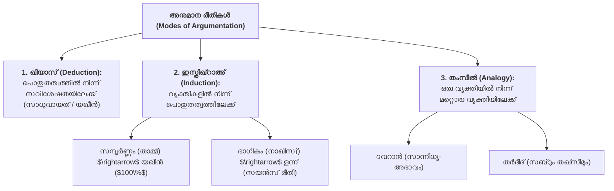

# الاِسْتِقْرَاءُ وَالتَّمْثِيلُ
## അപഗ്രഥനാനുമാനവും സാദൃശ്യാനുമാനവും — Non-Syllogistic Inference: Induction & Legal Analogy

<!-- Top Navigation Bar -->
[⏮️ മുൻ അധ്യായം: 21. القياس الاستثنائي](file:///Users/apple/Desktop/docs:books/Kanz-al-Tahqiq/Texts/Mantiq/tasrih-al-mantiq/Notes/Chapters/21-al-qiyas-al-istithna-i.md) | [📑 സൂചിക / Master Index](file:///Users/apple/Desktop/docs:books/Kanz-al-Tahqiq/Texts/Mantiq/tasrih-al-mantiq/Notes/Chapters/00-index.md) | [അടുത്ത അധ്യായം: 23. الصناعات الخمس ⏭️](file:///Users/apple/Desktop/docs:books/Kanz-al-Tahqiq/Texts/Mantiq/tasrih-al-mantiq/Notes/Chapters/23-al-sina-at-al-khams.md)

---

### 1. മൂലപാഠം / النص الأصلي من المتن (Al-Matn al-Aṣl)

فَصْلٌ: الْاِسْتِقْرَاءُ هُوَ حُجَّةٌ يُسْتَدَلُّ فِيهَا مِنْ حُكْمِ الْجُزْئِيَّاتِ عَلَى كُلِّيِّهَا.

وَهُوَ تَامٌّ إِنِ اسْتُدِلَّ بِجَمِيعِ الْجُزْئِيَّاتِ عَلَى إِثْبَاتِ حُكْمٍ كُلِّيٍّ، كَمَا يُقَالُ: كُلُّ جِسْمٍ عُنْصُرِيٍّ إِمَّا أَنْ يَكُونَ حَيَوَانًا، أَوْ نَبَاتًا، أَوْ جَمَادًا، وَكُلُّ وَاحِدٍ مِنْهَا مُتَحَيِّزٌ، فَيُنْتِجُ أَنَّ كُلَّ جِسْمٍ عُنْصُرِيٍّ مُتَحَيِّزٌ.

وَنَاقِصٌ إِنِ اسْتُدِلَّ بِأَكْثَرِهَا وَحُكِمَ عَلَى الْكُلِّ، كَقَوْلِنَا: كُلُّ حَيَوَانٍ يَتَحَرَّكُ فَكُّهُ الْأَسْفَلُ عِنْدَ الْمَضْغِ؛ لِأَنَّ الْإِنْسَانَ وَالطُّيُورَ وَالْبَهَائِمَ وَغَيْرَ ذَلِكَ مِنَ الْحَيَوَانَاتِ الَّتِي تَتَبَّعْنَاهَا وَجَدْنَا كَذَلِكَ، وَذَلِكَ الْحُكْمُ غَيْرُ مُفِيدٍ لِلْيَقِينِ؛ لِجَوَازِ وُجُودِ حَيَوَانٍ لَا يَكُونُ كَذَلِكَ، كَمَا نَسْمَعُ فِي التِّمْسَاحِ.

فَصْلٌ: التَّمْثِيلُ حُجَّةٌ يُسْتَدَلُّ فِيهَا مِنْ حَالِ جُزْئِيٍّ عَلَى جُزْئِيٍّ لِأَمْرٍ مُشْتَرَكٍ بَيْنَهُمَا، وَالْأَشْهَرُ فِيهِ طَرِيقَانِ:

الْأَوَّلُ: الدَّوَرَانُ، وَهُوَ تَرَتُّبُ الْحُكْمِ عَلَى الْوَصْفِ الَّذِي لَهُ صَلَاحِيَّةُ الْعِلِّيَّةِ وُجُودًا وَعَدَمًا؛ بِأَنَّهُ كُلَّمَا وُجِدَ الْوَصْفُ وُجِدَ الْحُكْمُ، وَكُلَّمَا عُدِمَ الْوَصْفُ عُدِمَ الْحُكْمُ، كَتَرَتُّبِ الْحُرْمَةِ فِي الْخَمْرِ عَلَى الْإِسْكَارِ؛ فَإِنَّهُ مَا دَامَ مُسْكِرًا حَرَامٌ، وَإِذَا زَالَ عَنْهُ الْإِسْكَارُ زَالَتِ الْحُرْمَةُ.

وَالثَّانِي: التَّرْدِيدُ، وَهُوَ تَتَبُّعُ أَوْصَافِ الْأَصْلِ وَإِبْطَالُ بَعْضِهَا؛ لِيَتَعَيَّنَ الْبَاقِي لِلْعِلِّيَّةِ، كَمَا يُقَالُ: عِلَّةُ حُرْمَةِ الْخَمْرِ إِمَّا اتِّخَاذُهُ مِنَ الْعِنَبِ، أَوِ السَّيَلَانُ، أَوِ اللَّوْنُ، أَوِ الطَّعْمُ، أَوِ الرَّائِحَةُ، أَوِ الْإِسْكَارُ؛ لَكِنْ كُلُّ وَاحِدٍ مِنْهَا سِوَى الْإِسْكَارِ لَا يَصْلُحُ لِلْعِلِّيَّةِ؛ لِوُجُودِ كُلٍّ مِنْهَا فِي الْأَشْيَاءِ الْأُخْرَى بِدُونِ الْحُرْمَةِ؛ فَتَعَيَّنَ الْإِسْكَارُ لِعِلِّيَّةِ الْحُرْمَةِ.

---

### 2. മലയാള പരിഭാഷ (ദർസ് ശൈലിയിലുള്ള വാച്യാർത്ഥവും ആശയവും)

#### ഇസ്തിഖ്റാഅ് (അപഗ്രഥനാനുമാനം / Induction):
**ഇസ്തിഖ്റാഅ് (الاستقراء):** വ്യക്തികളിലെ (ജുസ്ഇയ്യാത്തുകൾ) വിധികളെ നിരീക്ഷിച്ച് അവയുടെ പൊതുവായ സാർവത്രിക നിയമത്തിലേക്ക് (കുല്ലി) എത്തിച്ചേരുന്ന തെളിവാണ്.
1. **ഇസ്തിഖ്റാഅ് താമ്മ് (സമ്പൂർണ്ണ അപഗ്രഥനം / Complete Induction):** ഒരു യാഥാർത്ഥ്യത്തിലെ എല്ലാ വ്യക്തികളെയും പൂർണ്ണമായി പരിശോധിച്ചുകൊണ്ട് സാർവത്രിക വിധി പ്രഖ്യാപിക്കൽ. ഉദാ: "ഭൗതിക പദാർത്ഥങ്ങൾ ജീവി, സസ്യം, നിർജ്ജീവ വസ്തു എന്നിവയിൽ പെട്ടതാണ്; ഇവയോരോന്നും ഇടം (Space / المتحيز) ആവശ്യമുള്ളതാണ്; അതിനാൽ സർവ്വ ഭൗതിക പദാർത്ഥങ്ങൾക്കും ഇടം ആവശ്യമുള്ളതാണ്". ഇത് **ഉറപ്പുള്ള അറിവിനെ (യഖീൻ / Certainty)** നൽകുന്നു.
2. **ഇസ്തിഖ്റാഅ് നാഖിസ്വ് (ഭാഗിക / അനുഭവ അപഗ്രഥനം / Incomplete Induction):** ഒട്ടുമിക്ക വ്യക്തികളെയും പരിശോധിച്ച് മുഴുവൻ ആളുകളിലേക്കും സാമാന്യ വിധി കൽപ്പിക്കൽ. ഉദാ: "എല്ലാ ജീവികളും ചവയ്ക്കുമ്പോൾ താടിയെല്ല് ചലിപ്പിക്കുന്നവരാണ്; കാരണം മനുഷ്യരിലും പക്ഷികളിലും മൃഗങ്ങളിലും നാം അന്വേഷിച്ചപ്പോൾ അങ്ങനെ കണ്ടു". എന്നാൽ ഇത് **യഖീൻ നൽകില്ല; പ്രബലമായ ഊഹം (ളന്ന് / Probability) മാത്രമേ നൽകൂ**. കാരണം ഇതിൽ പെടാത്ത ജീവികൾ ഉണ്ടാകാൻ സാധ്യതയുണ്ട്; മുതല (തിംസാഹ്) ചവയ്ക്കുമ്പോൾ മേൽത്താടിയെല്ലാണ് ചലിപ്പിക്കുന്നത് എന്ന് നാം കേൾക്കുന്നത് പോലെ!

#### തമ്‌സീൽ (സാദൃശ്യാനുമാനം / Analogy / ഫിഖ്ഹിലെ ഖിയാസ്):
**തമ്‌സീൽ (التمثيل):** രണ്ട് സവിശേഷ കാര്യങ്ങൾക്കിടയിലുള്ള (ജുസ്ഇയ്യുകൾക്കിടയിലുള്ള) പൊതുവായ ഒരു കാരണത്താൽ (ഇല്ലത്ത്) ഒന്നിന്റെ വിധി മറ്റൊന്നിലേക്ക് കൽപ്പിക്കൽ.
കാരണം (ഇല്ലത്ത്) കണ്ടെത്താൻ രണ്ട് പ്രശസ്തമായ വഴികളുണ്ട്:
1. **ദവറാൻ (الدوران / സാന്നിധ്യ-അഭാവ അനുബന്ധം):** ഒരു ഗുണം ഉണ്ടാകുമ്പോൾ വിധി ഉണ്ടാവുകയും, ആ ഗുണം ഇല്ലാതാകുമ്പോൾ വിധി ഇല്ലാതാവുകയും ചെയ്യുക (വസ്തുതയിലും ഇല്ലായ്മയിലും ഇല്ലത്തുണ്ടായിരിക്കുക). ഉദാ: കള്ളിന്റെ നിഷിദ്ധത (ഹറാം) ലഹരിയോട് ബന്ധപ്പെട്ടിരിക്കുന്നു; ലഹരി ഉള്ളിടത്തോളം അത് ഹറാമാണ്; അത് വിനാഗിരിയായി (ഖല്ല്) ലഹരി വിട്ടുപോയാൽ ഹറാം ഇല്ലാതാവുന്നു.
2. **തർദീദ് (സബ്‌റും തഖ്സീമും / الترديد / السبر والتقسيم):** മൂലവസ്തുവിലെ ഗുണങ്ങളെ ഓരോന്നായി പരിശോധിച്ച്, കാരണമാകാൻ കൊള്ളാത്തവയെ തള്ളിക്കളഞ്ഞ് ഒടുവിൽ അവശേഷിക്കുന്നതിനെ കാരണമായി ഉറപ്പിക്കൽ. ഉദാ: കള്ളിന്റെ നിഷിദ്ധതയ്ക്ക് കാരണം മുന്തിരിയാണോ, ദ്രാവകമാണോ, നിറമാണോ, രുചിയാണോ, മണമാണോ, ലഹരിയാണോ എന്ന് പരിശോധിക്കുന്നു; ലഹരിയൊഴികെയുള്ളവ മറ്റ് അനുവദനീയ വസ്തുക്കളിലും ഉള്ളതിനാൽ അവയെ തള്ളുന്നു; അങ്ങനെ **ലഹരിയാണ് (ഇസ്കാർ) കാരണം** എന്ന് സ്ഥിരീകരിക്കുന്നു.

---

### 3. ഇംഗ്ലീഷ് വിവർത്തനം / English Scholastic Translation

**Induction (*al-Istiqrāʾ*)** is an argument in which one infers a universal judgment from the examination of its particular instances:
1. **Complete Induction (*Istiqrāʾ Tāmm*)**: If all individual instances are exhaustively investigated to establish a universal rule (e.g., "Every physical body is either animal, plant, or mineral, and each occupies space; therefore, every physical body occupies space"). This yields **Epistemic Certainty (*Yaqīn*)**.
2. **Incomplete Induction (*Istiqrāʾ Nāqiṣ*)**: If the majority of instances are investigated and a universal rule is inferred (e.g., "Every animal moves its lower jaw when chewing; for we observed humans, birds, and beasts to be such"). This **does NOT yield certainty, but merely probability (*Ẓann*)**, because an unexamined exception may exist—such as the crocodile, which moves its upper jaw!

**Analogy (*al-Tamthīl* / Juridical Qiyās)** is an argument inferring a judgment concerning one particular instance from another particular instance due to a common ground (*al-ʿilla* / ratio legis) uniting them. The two primary methods of discovering the effective cause are:
1. **Concomitance / Co-presence and Co-absence (*al-Dawarān*)**: The judgment correlates with the attribute in existence and non-existence (whenever the attribute is present, the ruling is present; whenever absent, absent), such as the prohibition of wine turning upon intoxication.
2. **Disjunctive Elimination / Exclusion (*al-Tardīd / al-Sabr wa-l-Taqsīm*)**: Surveying all candidate attributes of the base case and eliminating those unsuitable for causality, until the genuine cause is uniquely isolated (e.g., examining color, taste, fluidity, smell, and intoxication in wine, and determining that intoxication alone is the ratio legis).

---

### 4. ത്രിഭാഷാ പദസൂചിക / المصطلحات / Key Terminology Matrix

| അറബിക് പദം (Arabic) | ലിപ്യന്തരണം (Transliteration) | മലയാള അർത്ഥം (Malayalam Equivalent) | Western Philosophy Term | ജ്ഞാനശാസ്ത്ര മൂല്യം (Epistemic Value) |
|---|---|---|---|---|
| **الاسْتِقْرَاءُ التَّامّ** | *al-Istiqrāʾ al-tāmm* | സമ്പൂർണ്ണ ഇൻഡക്ഷൻ | Perfect Induction | ഉറപ്പുള്ളത് (യഖീൻ / $100\%$) |
| **الاسْتِقْرَاءُ النَّاقِص** | *al-Istiqrāʾ al-nāqiṣ* | അനുഭവ ഇൻഡക്ഷൻ | Incomplete / Empirical Induction | സാധ്യത / പ്രബലം (ളന്ന്) |
| **التَّمْثِيل** | *al-Tamthīl* | സാദൃശ്യാനുമാനം (ഖിയാസ്) | Argument from Analogy | പ്രബലമായ ഊഹം (ളന്ന്) |
| **الدَّوَرَان** | *al-Dawarān* | സാന്നിധ്യ-അഭാവ അനുബന്ധം | Concomitant Variation (Mill's Method) | $P \iff Q$ |
| **التَّرْدِيد (السَّبْر وَالتَّقْسِيم)** | *al-Tardīd* | അപഗ്രഥന ശുദ്ധീകരണം | Disjunctive Elimination | $A \lor B \lor C, \neg A, \neg B \vdash C$ |
| **العِلَّة** | *al-ʿIlla* | ഇല്ലത്ത് / കാര്യകാരണം | Effective Cause / Ratio Legis | വിധിയുടെ ആധാര ബിന്ദു |

---

### 5. വിശദമായ ശർഹും തത്വവിചാരവും / الشرح والتحليل المعمق

#### എ. ആധുനിക സയൻസും ഇസ്തിഖ്റാഉം (Empirical Science & Karl Popper's Falsification):
ആധുനിക പ്രകൃതിശാസ്ത്രം (ഫിസിക്സ്, ബയോളജി) നിലകൊള്ളുന്നത് **ഇസ്തിഖ്റാഅ് നാഖിസ്വിൻമേലാണ് (Empirical Induction)**.
- ലക്ഷക്കണക്കിന് തവണ നിരീക്ഷിച്ച് കണ്ടെത്തിയ സിദ്ധാന്തങ്ങളും ഒരൊറ്റ പുതിയ പ്രതിഭാസം വന്നാൽ തിരുത്തപ്പെടാം.
- ഗ്രന്ഥകർത്താവ് കൊണ്ടുവന്ന **മുതലയുടെ ഉദാഹരണം (തിംസാഹ്)** കാൾ പോപ്പറിന്റെ "കറുത്ത അരയന്നം" (Black Swan Fallacy) സിദ്ധാന്തത്തിന്റെ പൗരാണിക അറബ് മാതൃകയാണ്! "എല്ലാ അരയന്നങ്ങളും വെളുത്തതാണ്" എന്ന് ആയിരക്കണക്കിന് വർഷം വിശ്വസിച്ച യൂറോപ്യന്മാർ ഓസ്‌ട്രേലിയയിൽ കറുത്ത അരയന്നങ്ങളെ കണ്ടപ്പോൾ സിദ്ധാന്തം മാറ്റേണ്ടി വന്നു.

#### ബി. ഫിഖ്ഹിലെ ഖിയാസും മന്തിഖിലെ തംസീലും:
ഇസ്‌ലാമിക കർമ്മശാസ്ത്രത്തിലെ (ഉസൂലുൽ ഫിഖ്ഹ്) മൂന്നാമത്തെ പ്രമാണമായ 'ഖിയാസ്' മന്തിഖിന്റെ ഭാഷയിൽ **തംസീലാ**ണ്.
- അസ്വ്‌ല് (മൂലവസ്തു - കള്ള്).
- ഫർഅ് (പുതിയ വസ്തു - മയക്കുമരുന്ന്).
- ഹുക്മ് (വിധി - ഹറാം).
- ഇല്ലത്ത് (കാരണം - ലഹരി).
'ദവറാൻ', 'സബ്റും തഖ്സീമും' എന്നീ രീതികളിലൂടെയാണ് മുജ്തഹിദുകളായ പണ്ഡിതന്മാർ ഇല്ലത്ത് വേർതിരിച്ചെടുക്കുന്നത്.

---

### 6. ചിത്രരൂപങ്ങളും താരതമ്യ പട്ടികകളും / Visual Diagrams & Comparative Matrices

---

### 7. ഉദാഹരണ വിശകലനം / Analysis of Classical & Contemporary Examples

- **ആധുനിക മയക്കുമരുന്ന് നിരോധനം (തംസീൽ):**
  - കള്ളിന്റെ കാര്യത്തിൽ ഖുർആൻ ഹറാം എന്ന് പറഞ്ഞു. കാരണം ലഹരിയാണ്.
  - പുതിയ കാലത്തെ എൽ.എസ്.ഡി, എം.ഡി.എം.എ എന്നിവയിൽ ഇതേ ലഹരി എന്ന ഇല്ലത്ത് ഉള്ളതിനാൽ അവയും ഹറാമാണെന്ന് വിധിക്കുന്നു.
- **മെഡിക്കൽ ക്ലിനിക്കൽ ട്രയലുകൾ (ഇസ്തിഖ്റാഅ് നാഖിസ്വ്):**
  ഒരു വാക്സിൻ പതിനായിരം ആളുകളിൽ പരീക്ഷിച്ച് പാർശ്വഫലമില്ലെന്ന് കണ്ടാൽ "ഇത് സുരക്ഷിതമാണ്" എന്ന് വിധി പ്രഖ്യാപിക്കുന്നത് ഇസ്തിഖ്റാഅ് നാഖിസ്വിലൂടെയാണ്.

---

### 8. ശ്രദ്ധിക്കേണ്ട സൂക്ഷ്മതകൾ / تنبيهات ومزالق شائعة (Common Student Pitfalls)

> [!WARNING]
> പലരും 'ഇസ്തിഖ്റാഅ് നാഖിസ്വി'നെ അന്ധമായി തള്ളിക്കളയാറുണ്ട്; എന്നാൽ ലൗകിക കാര്യങ്ങളിലും സാങ്കേതിക ശാസ്ത്രങ്ങളിലും മനുഷ്യപുരോഗതി സാധ്യമാകുന്നത് ഇസ്തിഖ്റാഅ് നാഖിസ്വിലൂടെയാണ്. എന്നാൽ വിശ്വാസപരമായ അഖീദ കാര്യങ്ങളിൽ ഖണ്ഡിതമായ തെളിവുകൾ (ഖിയാസ്, യഖീനിയ്യാത്തുകൾ) മാത്രമേ സ്വീകരിക്കാവൂ.

---

### 9. ആവർത്തന ചോദ്യങ്ങളും വ്യായാമങ്ങളും / تدريبات وتمارين (Review Exercises)

1. ഇസ്തിഖ്റാഅ് താമ്മും നാഖിസ്വവും തമ്മിലുള്ള വ്യത്യാസമെന്ത്? ഉദാഹരണ സഹിതം വിവരിക്കുക.
2. എന്തുകൊണ്ടാണ് ഇസ്തിഖ്റാഅ് നാഖിസ്വ് ഉറപ്പുള്ള അറിവ് (യഖീൻ) നൽകാത്തത്? ഗ്രന്ഥകർത്താവ് കൊണ്ടുവന്ന മുതലയുടെ ഉദാഹരണം വിവരിക്കുക.
3. തംസീൽ നിർവചിക്കുക. അതിലെ നാല് ഘടകങ്ങൾ ഏതെല്ലാം?
4. കാരണം (ഇല്ലത്ത്) കണ്ടെത്താനുള്ള 'ദവറാൻ', 'തർദീദ്' എന്നീ വഴികൾ ഒരു പുതിയ കർമ്മശാസ്ത്ര പ്രശ്നത്തിൽ പ്രയോഗിച്ച് സമർത്ഥിക്കുക.

---

<!-- Bottom Navigation Bar -->
[⏮️ മുൻ അധ്യായം: 21. القياس الاستثنائي](file:///Users/apple/Desktop/docs:books/Kanz-al-Tahqiq/Texts/Mantiq/tasrih-al-mantiq/Notes/Chapters/21-al-qiyas-al-istithna-i.md) | [📑 സൂചിക / Master Index](file:///Users/apple/Desktop/docs:books/Kanz-al-Tahqiq/Texts/Mantiq/tasrih-al-mantiq/Notes/Chapters/00-index.md) | [അടുത്ത അധ്യായം: 23. الصناعات الخمس ⏭️](file:///Users/apple/Desktop/docs:books/Kanz-al-Tahqiq/Texts/Mantiq/tasrih-al-mantiq/Notes/Chapters/23-al-sina-at-al-khams.md)
