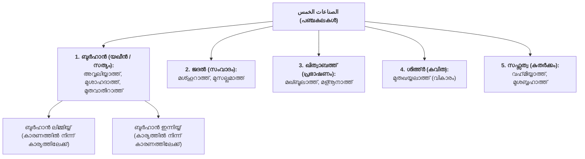

# الصِّنَاعَاتُ الخَمْسُ وَمَوَادُّ الأَقْيِسَةِ
## അഞ്ച് ശാസ്ത്രശാഖകൾ — The Five Arts: Epistemic Matter of Syllogisms (Demonstration to Sophistry)

<!-- Top Navigation Bar -->
[⏮️ മുൻ അധ്യായം: 22. الاستقراء والتمثيل](file:///Users/apple/Desktop/docs:books/Kanz-al-Tahqiq/Texts/Mantiq/tasrih-al-mantiq/Notes/Chapters/22-al-istiqra-wal-tamthil.md) | [📑 സൂചിക / Master Index](file:///Users/apple/Desktop/docs:books/Kanz-al-Tahqiq/Texts/Mantiq/tasrih-al-mantiq/Notes/Chapters/00-index.md) | [അടുത്ത അധ്യായം: 24. خاتمة المتن والموجز العام ⏭️](file:///Users/apple/Desktop/docs:books/Kanz-al-Tahqiq/Texts/Mantiq/tasrih-al-mantiq/Notes/Chapters/24-khatimat-al-kitab.md)

---

### 1. മൂലപാഠം / النص الأصلي من المتن (Al-Matn al-Aṣl)

فَصْلٌ فِي الصِّنَاعَاتِ الْخَمْسِ:

الْأُولَى مِنْهَا: الْبُرْهَانُ هُوَ: الْمُؤَلَّفُ مِنَ الْيَقِينِيَّاتِ.
مِنْهَا:
- الْأَوَّلِيَّاتُ، هِيَ: الْقَضَايَا الْبَدِيهِيَّةُ الَّتِي يَكْفِي فِي الْجَزْمِ بِهَا تَصَوُّرُ طَرْفَيْهَا مَعَ النِّسْبَةِ، كَقَوْلِنَا: الْكُلُّ أَعْظَمُ مِنَ الْجُزْءِ.
- وَمِنْهَا: الْفِطْرِيَّاتُ، هِيَ: مَا يَفْتَقِرُ إِلَى وَاسِطَةٍ لَا تَغِيبُ عَنِ الذِّهْنِ عِنْدَ حُضُورِ الْأَطْرَافِ، نَحْوُ: الْأَرْبَعَةُ زَوْجٌ.
- وَمِنْهَا: الْمُشَاهَدَاتُ، هِيَ: الْقَضَايَا الَّتِي يَحْكُمُ بِهَا الْعَقْلُ، إِمَّا بِحِسِّ ظَاهِرٍ، هِيَ: الْحِسِّيَّاتُ، نَحْوُ: الشَّمْسُ مُشْرِقَةٌ، أَوْ بِحِسِّ بَاطِنٍ، هِيَ: الْوِجْدَانِيَّاتُ، نَحْوُ: إِنَّ لَنَا جُوعًا وَعَطْشًا.
- وَمِنْهَا: الْحَدَسِيّاتُ، هِيَ: انْتِقَالُ الذِّهْنِ مِنَ الْمَبَادِي إِلَى الْمَطْلُوبِ دَفْعَةً، كَقَوْلِنَا: نُورُ الْقَمَرِ مُسْتَفَادٌ مِنْ ضَوْءِ الشَّمْسِ.
- وَمِنْهَا: التَّجْرِبِيَّاتُ، هِيَ: تَكْرَارُ فِعْلٍ حَتَّى يَحْصُلَ الْجُزْمُ، نَحْوُ: السَّقَمُونِيَا مُسَهِّلٌ لِلصَّفْرَاءِ.
- وَمِنْهَا: الْمُتَوَاتِرَاتُ، هِيَ: إِخْبَارُ جَمَاعَةٍ مُحِيلُ الْعَقْلُ تَوَاطُؤَهُمْ عَلَى الْكَذِبِ، كَقَوْلِنَا: مَكَّةُ مَوْجُودَةٌ.

وَالْمُرَكَّبُ مِنْهَا بُرْهَانٌ لِمِّيٌّ - إِنْ كَانَ الْحَدُّ الْأَوْسَطُ فِيهِ عِلَّةً لِلنِّسْبَةِ فِي الْوَاقِعِ، كَمَا كَانَ عِلَّةً لَهَا فِي الذِّهْنِ، نَحْوُ: هَذَا مُتَعَفِّنُ الْأَخْلَاطِ، وَكُلُّ مُتَعَفِّنُ الْأَخْلَاطِ فَهُوَ مَحْمُومٌ؛ فَهَذَا مَحْمُومٌ، وَإِنِّيٌّ - إِنْ لَمْ يَكُنْ عِلَّةً لِلْحُكْمِ فِي الْوَاقِعِ، نَحْوُ: هَذَا مَحْمُومٌ، وَكُلُّ مَحْمُومٍ مُتَعَفِّنُ الْأَخْلَاطِ؛ فَهَذَا مُتَعَفِّنُ الْأَخْلَاطِ.

وَالثَّانِيَةُ: الْجَدَلُ، هُوَ: الْمُؤَلَّفُ مِنْ مَشْهُورَاتٍ، كَقَوْلِنَا: الْعَدْلُ حَسَنٌ، وَالظُّلْمُ قَبِيحٌ، أَوْ مُسَلَّمَاتٍ، كَتَسْلِيمِ قَضِيَّةٍ أَنَّ الْأَمْرَ لِلْوُجُوبٍ.

وَالثَّالِثَةُ: الْخَطَابَةُ، هِيَ: الْمُؤَلَّفَةُ مِنَ الْمَقْبُولَاتِ الْمَأْخُوذَةِ مِمَّنْ يُحْسَنُ الظَّنُ فِيهِ، كَالْأَوْلِيَاءِ، أَوْ مِنَ الْمَظْنُونَاتِ، كَالْحُكْمِ بِنُزُولِ الْمَطَرِ عِنْدَ وُجُودِ الْغَيْمِ.

وَالرَّابِعَةُ: الشِّعْرُ، هُوَ: الْمُؤَلَّفُ مِنَ الْمُتَخَيَّلَاتِ الَّتِي يُذْعِنُ بِهَا النَّفْسُ، وَتَنْفَعِلُ بِالتَّرْغِيبِ وَالتَّرْهِيبِ، كَمَا إِذَا أَنْشَدَ قَصِيدَةً بِصَوْتٍ طَيِّبٍ أَوْ كَرِيهٍ، أَوْ يَكُونُ عَلَى وَزْنٍ حَسَنٍ أَوْ قَبِيحٍ.

وَالْخَامِسَةُ: السَّفْسَطَةُ، وَهِيَ: الْمُؤَلَّفَةُ مِنَ الْوَهْمِيَّاتِ، كَمَا يُقَالُ: كُلُّ مَوْجُودٍ مُشَارٌ إِلَيْهِ، وَكُلُّ مَوْجُودٍ مُتَحَيِّزٌ، أَوْ مِنَ الْمُشَبَّهَاتِ، كَمَا يُقَالُ لِصُورَةِ الْحِمَارِ الْمَنْقُوشِ عَلَى الجِدَارِ: إِنَّهَا حِمَارٌ، وَكُلُّ حِمَارٍ نَاهِقٌ، وَالْغَرَضُ مِنْهَا لَا يَكُونُ إِلَّا تَغْلِيطَ الْخَصْمِ.

---

### 2. മലയാള പരിഭാഷ (ദർസ് ശൈലിയിലുള്ള വാച്യാർത്ഥവും ആശയവും)

പഞ്ചകലകളുടെ (الصناعات الخمس) അധ്യായം:
ഖിയാസിന്റെ ഘടനാപരമായ രൂപം (ശക്ല്) ശരിയായാൽ മാത്രം പോരാ; അതിൽ ഉപയോഗിക്കുന്ന മുഖദ്ദിമകളുടെ ഉള്ളടക്കം (മാദ്ദത്ത്) ഏത് തരത്തിലുള്ളതാണ് എന്നതിനെ അടിസ്ഥാനമാക്കി ഖിയാസുകൾ അഞ്ച് ശാസ്ത്രശാഖകളായി തിരിയുന്നു:

1. **ബുർഹാൻ (ഖണ്ഡിത തെളിവ് / البرهان / Demonstration):** പൂർണ്ണമായ യഖീനിയ്യാത്തുകൾ (ഉറപ്പുള്ള കാര്യങ്ങൾ) കൊണ്ട് നിർമ്മിക്കപ്പെടുന്നത്. അവ ആറ് ഇനങ്ങളാണ്:
   - **അവ്വലിയ്യാത്ത് (പ്രാഥമിക തത്വങ്ങൾ):** രണ്ട് ഭാഗങ്ങളെയും അവ തമ്മിലുള്ള ബന്ധത്തെയും ഗ്രഹിച്ചാൽ തന്നെ ബുദ്ധി പെട്ടെന്ന് ഉറപ്പിക്കുന്നവ; ഉദാ: «ആകമാനം അതിന്റെ അംശത്തേക്കാൾ വലുതാണ്».
   - **ഫിത്വ്രിയ്യാത്ത് (സഹജജ്ഞാനം):** മനസ്സിൽ നിന്ന് മറഞ്ഞുപോകാത്ത ഒരു മധ്യവർത്തി ഘടകം ആവശ്യമുള്ളവ; ഉദാ: «നാല് ഒരു ഇരട്ട സംഖ്യയാണ്» (രണ്ടായി ഭാഗിക്കപ്പെടാം എന്ന മധ്യപദം മനസ്സിൽ സദാ സന്നിഹിതമാണ്).
   - **മുശാഹദാത്ത് (ദൃശ്യാനുഭവങ്ങൾ):** ബാഹ്യേന്ദ്രിയങ്ങളാൽ അറിയപ്പെടുന്ന **ഹിസ്സിയ്യാത്തുകൾ** («സൂര്യൻ പ്രകാശിക്കുന്നു»), ആന്തരികാനുഭവങ്ങളാൽ അറിയപ്പെടുന്ന **വിജ്ദാനിയ്യാത്തുകൾ** («നമുക്ക് വിശപ്പും ദാഹവുമുണ്ട്»).
   - **ഹദസിയ്യാത്ത് (ഉൾക്കാഴ്ചകൾ):** കാരണങ്ങളിൽ നിന്ന് ലക്ഷ്യത്തിലേക്ക് ബുദ്ധി പെട്ടെന്ന് ചെന്നെത്തുന്നത്; ഉദാ: «ചന്ദ്രന്റെ പ്രകാശം സൂര്യനിൽ നിന്ന് കടംകൊള്ളുന്നതാണ്» (ചന്ദ്രന്റെ വൃദ്ധിക്ഷയങ്ങൾ നിരീക്ഷിച്ച് കണ്ടെത്തിയത്).
   - **തജ്‌രിബിയ്യാത്ത് (പരീക്ഷണ നിരീക്ഷണങ്ങൾ):** ഒരു കാര്യം വീണ്ടും വീണ്ടും ആവർത്തിച്ച് കണ്ട് ഉറപ്പുവരുത്തുന്നത്; ഉദാ: «സഖമൂനിയ എന്ന ഔഷധം പിത്തരോഗത്തിന് ശമനമുണ്ടാക്കുന്നു».
   - **മുതവാതിറാത്ത് (നിഷേധിക്കാനാവാത്ത ജനകീയ സാക്ഷ്യങ്ങൾ):** അസത്യത്തിന്മേൽ ഒത്തുചേരൽ ബുദ്ധിപരമായി അസാധ്യമായ ഒരു വലിയ ജനം റിപ്പോർട്ട് ചെയ്ത വാർത്തകൾ; ഉദാ: «മക്ക എന്നൊരു നഗരമുണ്ട്».
   *ബുർഹാൻ രണ്ട് വിധമുണ്ട്:*
   - **ബുർഹാനുൻ ലിമ്മിയ്യ് (കാരണത്തിൽ നിന്നുള്ള തെളിവ്):** ഹദ്ദ് ഔസത്വ് മനസ്സിലെന്നപോലെ ബാഹ്യലോകത്തും വിധിയുടെ യഥാർത്ഥ കാരണമായി വർത്തിക്കുന്നത്; ഉദാ: «ഇയാൾക്ക് രക്തദോഷമുണ്ട്; രക്തദോഷമുള്ളവർക്കെല്ലാം പനിയുണ്ടാകും $\vdash$ അതിനാൽ ഇയാൾക്ക് പനിയുണ്ട്».
   - **ബുർഹാനുൻ ഇന്നിയ്യ് (ഫലത്തിൽ നിന്നുള്ള തെളിവ്):** ഹദ്ദ് ഔസത്വ് ബാഹ്യലോകത്ത് വിധിയുടെ കാരണമല്ലാത്തത് (ഫലത്തെ വെച്ച് കാരണത്തിലേക്ക് എത്തുന്നത്); ഉദാ: «ഇയാൾക്ക് പനിയുണ്ട്; പനിയുള്ളവർക്കെല്ലാം രക്തദോഷമുണ്ട് $\vdash$ അതിനാൽ ഇയാൾക്ക് രക്തദോഷമുണ്ട്».
2. **ജദൽ (സംവാദ ശാസ്ത്രം / الجدل / Dialectic):** ജനങ്ങൾക്കിടയിൽ പ്രശസ്തമായ കാര്യങ്ങൾ (**മശ്ഹൂറാത്ത്** — ഉദാ: «നീതി ഉത്തമമാണ്, അനീതി നിന്ദ്യമാണ്») അല്ലെങ്കിൽ എതിരാളി അംഗീകരിച്ച തത്വങ്ങൾ (**മുസല്ലമാത്ത്** — ഉദാ: ഉസൂലിലെ «കൽപ്പന നിർബന്ധത്തെ കുറിക്കുന്നു») എന്നിവ കൊണ്ട് വാദിക്കൽ. എതിരാളിയെ നിശബ്ദനാക്കലാണ് ഇതിന്റെ ലക്ഷ്യം.
3. **ഖിത്വാബത്ത് (പ്രഭാഷണ കല / الخطابة / Rhetoric):** സജ്ജനങ്ങളും വലിയ പണ്ഡിതന്മാരും പറഞ്ഞതിനാൽ സ്വീകരിക്കപ്പെട്ട കാര്യങ്ങൾ (**മഖ്ബൂലാത്ത്**) അല്ലെങ്കിൽ പ്രബലമായ ഊഹങ്ങൾ (**മള്നൂനാത്ത്** — ഉദാ: കാർമേഘം കണ്ടാൽ മഴ പെയ്യുമെന്ന് കരുതുന്നത്) കൊണ്ട് സാധാരണ ജനങ്ങളെ ഉൽബുദ്ധരാക്കൽ.
4. **ശിഅ്ർ (കാവ്യ ശാസ്ത്രം / الشعر / Poetics):** ഭാവനകൾ (**മുതഖയ്യലാത്ത്**) കൊണ്ട് മനുഷ്യ മനസ്സുകളിൽ ആകർഷണവും ഭയവും വികാരങ്ങളും സൃഷ്ടിക്കുന്ന പ്രയോഗങ്ങൾ (മനോഹരമായ ഈണവും താളവും).
5. **സഫ്സത്വ (Sophistry / വഞ്ചനാ വാദം / അവഭാസ വാദം / السفسطة):** മിഥ്യാധാരണകൾ (**വഹ്‌മിയ്യാത്തുകൾ** — ഉദാ: «ഇന്ദ്രിയങ്ങളാൽ ചൂണ്ടിക്കാണിക്കാൻ പറ്റാത്തതൊന്നും നിലനിൽക്കുന്നില്ല») അല്ലെങ്കിൽ സാദൃശ്യ വഞ്ചനകൾ (**മുശബ്ബഹാത്ത്** — ഉദാ: ചുമരിൽ വരച്ച കഴുതയുടെ ചിത്രം കണ്ട് «ഇത് കഴുതയാണ്; എല്ലാ കഴുതയും കരയും; അതിനാൽ ഇത് കരയും») കൊണ്ട് എതിരാളിയെ തെറ്റിദ്ധരിപ്പിക്കാൻ നടത്തുന്ന കുതർക്കങ്ങൾ.

---

### 3. ഇംഗ്ലീഷ് വിവർത്തനം / English Scholastic Translation

The **Five Arts (*al-Ṣināʿāt al-Khams*)** classify syllogisms according to the epistemic quality of their matter (*mādda*):

1. **Demonstration (*al-Burhān*)**: Constructed exclusively from **Certain Premises (*al-Yaqīniyyāt*)**, comprising six axiomatic categories:
   - **Primary Axioms (*al-Awwaliyyāt*)**: Conception of the terms is sufficient for immediate certainty (e.g., "The whole is greater than its part").
   - **Innate Propositions (*al-Fiṭriyyāt*)**: Requiring an unforgotten middle term immediately present to the mind (e.g., "Four is even").
   - **Observables (*al-Mushāhadāt*)**: Perceived through external senses (*al-Ḥissiyyāt*, e.g., "The sun is luminous") or internal consciousness (*al-Wijdāniyyāt*, e.g., "We feel hunger and pain").
   - **Intuitions (*al-Ḥadsiyyāt*)**: Instantaneous transition from principles to conclusions (e.g., "The moon's light is derived from the sun").
   - **Empirical Experiments (*al-Tajribiyyāt*)**: Repeated observation yielding certitude (e.g., "Scammony is a purgative for bile").
   - **Mass-Transmitted Reports (*al-Mutawātirāt*)**: Reports by a multitude whose collusion upon a lie is logically impossible (e.g., "Mecca exists").
   *Types of Demonstration:*
   - **Propter Quid Demonstration (*Burhān Limmī*)**: The middle term is the real-world cause of the conclusion as well as the cognitive reason (e.g., inferring fever from infection).
   - **Quia Demonstration (*Burhān Innī*)**: The middle term is an effect in reality, serving as an epistemic sign to infer the cause (e.g., inferring infection from fever).
2. **Dialectic (*al-Jadal*)**: Constructed from **Generally Accepted Opinions (*al-Mashhūrāt*)**, e.g., "Justice is noble, oppression is vile," or **Conceded Premises (*al-Musallamāt*)**. Its teleology is refuting an adversary in disputation.
3. **Rhetoric (*al-Khiṭāba*)**: Constructed from **Accepted Authority (*al-Maqbūlāt*)** from trusted sages, or **Probabilistic Presumptions (*al-Maẓnūnāt*)**. Its purpose is persuasive appeal to common audiences.
4. **Poetics (*al-Shiʿr*)**: Constructed from **Imaginative Evocations (*al-Mutakhayyalāt*)** designed to stir emotional attraction or repulsion.
5. **Sophistry (*al-Safsaṭa*)**: Constructed from **Sensory Illusions (*al-Wahmiyyāt*)** or **Deceptive Fallacies (*al-Mushabbahāt*)**, calculated strictly to mislead and perplex opponents.

---

### 4. ത്രിഭാഷാ പദസൂചിക / المصطلحات / Key Terminology Matrix

| കല (The Art) | പ്രാമാണിക മാദ്ദത്ത് (Premise Matter) | ജ്ഞാനശാസ്ത്ര പദവി (Epistemic Status) | ലക്ഷ്യം (Objective) |
|---|---|---|---|
| **البُرْهَان (Demonstration)** | യഖീനിയ്യാത്തുകൾ (അവ്വലിയ്യാത്ത്, മുശാഹദാത്ത്, മുതവാതിറാത്ത്) | **ഖണ്ഡിതമായ അറിവ് (Yaqīn / 100%)** | സത്യം സ്ഥാപിക്കൽ |
| **الجَدَل (Dialectic)** | മശ്ഹൂറാത്ത് (പ്രശസ്തങ്ങൾ), മുസല്ലമാത്ത് | പ്രബലമായ പൊതുസമ്മതി (Taslīm) | എതിരാളിയെ തർക്കത്തിൽ തളയ്ക്കൽ |
| **الخِطَابَة (Rhetoric)** | മഖ്ബൂലാത്ത് (നേതാക്കളുടെ വാക്ക്), മള്നൂനാത്ത് | പ്രേരണയും ആശ്വാസവും (Iqnāʿ) | ജനങ്ങളെ നന്മയിലേക്ക് നയിക്കൽ |
| **الشِّعْر (Poetics)** | മുതഖയ്യലാത്ത് (ഭാവനകൾ) | മാനസിക വികാരം (Infīʿāl) | ഹൃദയത്തെ സ്പർശിക്കൽ |
| **السَّفْسَطَة (Sophistry)** | വഹ്‌മിയ്യാത്തുകൾ (മിഥ്യകൾ), മുശബ്ബഹാത്ത് | തികഞ്ഞ വഞ്ചനയും തെറ്റും (Mughālaṭa) | എതിരാളിയെ കുഴപ്പത്തിലാക്കൽ |

---

### 5. വിശദമായ ശർഹും തത്വവിചാരവും / الشرح والتحليل المعمق

#### എ. ബുർഹാൻ ലിമ്മിയും ബുർഹാൻ ഇന്നിയും (Burhān Limmī vs. Innī):
- **ബുർഹാൻ ലിമ്മിയ്യ് (Demonstration of the Cause / Propter Quid):** ഇവിടെ നാം കാരണം (Cause) അറിഞ്ഞ ശേഷം അതിലൂടെ കാര്യത്തിലേക്ക് (Effect) എത്തുന്നു. ഉദാ: "വിറക് നനഞ്ഞിരിക്കുന്നു; നനഞ്ഞ വിറകിൽ തീ പുകയും $\vdash$ അതിനാൽ തീ പുകയുന്നു". ശാസ്ത്രത്തിൽ ഏറ്റവും ഉയർന്ന തെളിവ് ഇതാണ്.
- **ബുർഹാൻ ഇന്നിയ്യ് (Demonstration of the Fact / Quia):** ഇവിടെ നാം ബാഹ്യമായ അടയാളം (Effect) കണ്ട ശേഷം അതിൽ നിന്ന് കാരണത്തിലേക്ക് (Cause) റിവേഴ്സ് അനുമാനം നടത്തുന്നു. ഉദാ: "പുക കാണുന്നു; പുകയുള്ളിടത്ത് തീ ഉണ്ടാകും $\vdash$ അതിനാൽ അവിടെ തീ ഉണ്ട്". പ്രപഞ്ചത്തെ കണ്ട് സ്രഷ്ടാവിനെ സ്ഥാപിക്കുന്ന ദാർശനിക തെളിവ് ബുർഹാൻ ഇന്നിയാണ്.

---

### 6. ചിത്രരൂപങ്ങളും താരതമ്യ പട്ടികകളും / Visual Diagrams & Comparative Matrices

---

### 7. ഉദാഹരണ വിശകലനം / Analysis of Classical & Contemporary Examples

- **സഫ്സത്വ (Sophistry / സോഷ്യൽ മീഡിയ വ്യാജവാദങ്ങൾ):**
  - "സ്വാതന്ത്ര്യം എന്നാൽ ഇഷ്ടമുള്ളത് ചെയ്യലാണ്; കുറ്റകൃത്യങ്ങൾ ചെയ്യുന്നത് ഇഷ്ടമുള്ളത് ചെയ്യലാണ്; അതിനാൽ കുറ്റകൃത്യങ്ങൾ സ്വാതന്ത്ര്യമാണ്!"
  - ഇവിടെ 'സ്വാതന്ത്ര്യം' എന്ന പദത്തിൽ തെറ്റായ മുശബ്ബഹാത്ത് (മിഥ്യാ സാദൃശ്യം) കലർത്തിയാണ് വാദിക്കുന്നത്. സഫ്സത്വയെ തിരിച്ചറിയാൻ മന്തിഖ് പഠനം അത്യന്താപേക്ഷിതമാണ്.
- **മുതവാതിറാത്ത് (Mass-transmitted reports):**
  ലോകത്ത് ആരും നേരിട്ട് കണ്ടിട്ടില്ലെങ്കിലും ആൽബർട്ട് ഐൻസ്റ്റീൻ ജീവിച്ചിരുന്നുവെന്നോ, ഹിരോഷിമയിൽ അണുബോംബ് വീണുവെന്നോ നാം വിശ്വസിക്കുന്നത് ലക്ഷക്കണക്കിന് ജനങ്ങളുടെ പരമ്പരയാലുള്ള മുതവാതിറായ സാക്ഷ്യം വഴിയാണ്.

---

### 8. ശ്രദ്ധിക്കേണ്ട സൂക്ഷ്മതകൾ / تنبيهات ومزالق شائعة (Common Student Pitfalls)

> [!WARNING]
> ജദലും (Dialectic) ഖിത്വാബത്തും (Rhetoric) സത്യം സ്ഥാപിക്കാനുള്ള മാർഗ്ഗങ്ങളല്ല; മറിച്ച് ജനങ്ങളെ ബോധ്യപ്പെടുത്താനും വാദങ്ങളിൽ ജയിക്കാനുമുള്ള ഉപകരണങ്ങൾ മാത്രമാണ്. ബുർഹാൻ (Demonstration) മാത്രമാണ് പരമമായ സത്യം (യഖീൻ) സ്ഥാപിക്കാൻ ഉപയോഗിക്കേണ്ടത്.

---

### 9. ആവർത്തന ചോദ്യങ്ങളും വ്യായാമങ്ങളും / تدريبات وتمارين (Review Exercises)

1. പഞ്ചകലകൾ ഏതെല്ലാം? അവയുടെ മാദ്ദത്തുകൾ പട്ടിക തിരിച്ച് സമർത്ഥിക്കുക.
2. ബുർഹാനിൽ ഉപയോഗിക്കുന്ന ആറ് യഖീനിയ്യാത്തുകൾ ഏതെല്ലാം? ഓരോന്നിനും രണ്ട് വീതം ഉദാഹരണങ്ങൾ എഴുതുക.
3. 'ബുർഹാൻ ലിമ്മിയ്യ്', 'ബുർഹാൻ ഇന്നിയ്യ്' എന്നിവ തമ്മിലുള്ള വ്യത്യാസം വിശദീകരിക്കുക.
4. നിത്യജീവിതത്തിൽ സഫ്സത്വക്ക് (Sophistry) ഇരയാകുന്ന രണ്ട് സന്ദർഭങ്ങൾ വിശകലനം ചെയ്യുക.

---

<!-- Bottom Navigation Bar -->
[⏮️ മുൻ അധ്യായം: 22. الاستقراء والتمثيل](file:///Users/apple/Desktop/docs:books/Kanz-al-Tahqiq/Texts/Mantiq/tasrih-al-mantiq/Notes/Chapters/22-al-istiqra-wal-tamthil.md) | [📑 സൂചിക / Master Index](file:///Users/apple/Desktop/docs:books/Kanz-al-Tahqiq/Texts/Mantiq/tasrih-al-mantiq/Notes/Chapters/00-index.md) | [അടുത്ത അധ്യായം: 24. خاتمة المتن والموجز العام ⏭️](file:///Users/apple/Desktop/docs:books/Kanz-al-Tahqiq/Texts/Mantiq/tasrih-al-mantiq/Notes/Chapters/24-khatimat-al-kitab.md)
