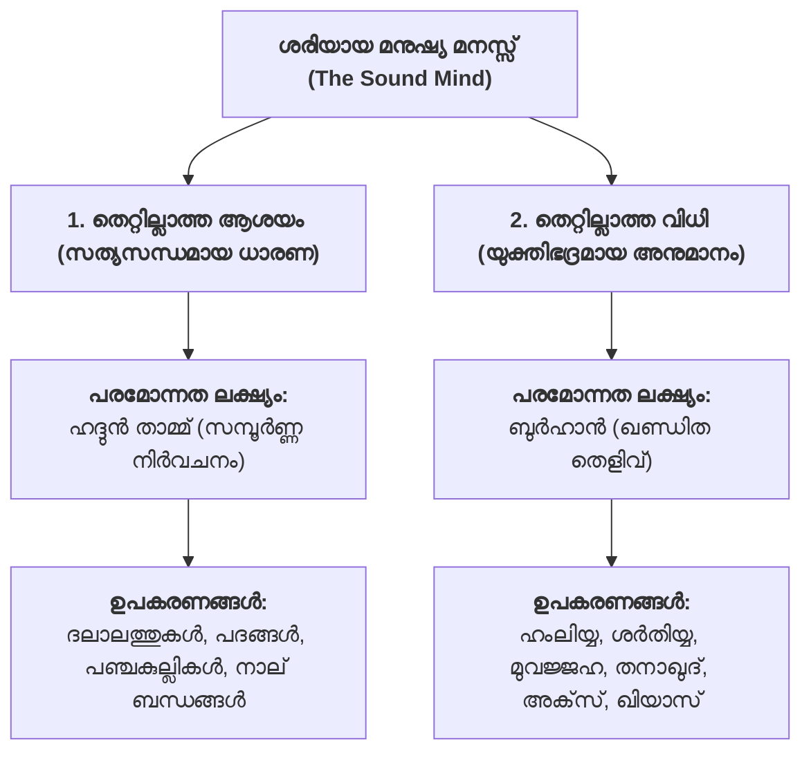

# خَاتِمَةُ الْمَتْنِ وَالْمُوجَزُ العَامُّ
## ഗ്രന്ഥസമാപ്തിയും സംഗ്രഹവും — Epilogue, Author's Colophon & Holistic Curriculum Synthesis

<!-- Top Navigation Bar -->
[⏮️ മുൻ അധ്യായം: 23. الصناعات الخمس](file:///Users/apple/Desktop/docs:books/Kanz-al-Tahqiq/Texts/Mantiq/tasrih-al-mantiq/Notes/Chapters/23-al-sina-at-al-khams.md) | [📑 സൂചിക / Master Index](file:///Users/apple/Desktop/docs:books/Kanz-al-Tahqiq/Texts/Mantiq/tasrih-al-mantiq/Notes/Chapters/00-index.md)

---

### 1. മൂലപാഠം / النص الأصلي من المتن (Al-Matn al-Aṣl)

هَذَا آخِرُ مَا اسْتَخْرَجْتُهُ مِنْ كُتُبِ الْفَنِّ: تَسْهِيلًا عَلَى طَالِبِ النَّظَرِ الصَّحِيحِ، مُسَمِّيًّا بِالتَّصْرِيحِ.

وَالْحَمْدُ للهِ رَبِّ الْعَالَمِينَ، وَالصَّلَاةُ وَالسَّلَامُ عَلَى خَيْرِ خَلْقِهِ مُحَمَّدٍ وَآلِهِ وَصَحْبِهِ أَجْمَعِينَ.

---

### 2. മലയാള പരിഭാഷ (ദർസ് ശൈലിയിലുള്ള വാച്യാർത്ഥവും ആശയവും)

ശരിയായ വിചാരചിന്തകൾ അന്വേഷിക്കുന്ന വിദ്യാർത്ഥിക്ക് (ത്വാലിബുസ്സദദി വന്നിഫാഖ്) ഗ്രഹണം സുഗമമാക്കുന്നതിനായി തർക്കശാസ്ത്ര ഗ്രന്ഥങ്ങളിൽ നിന്ന് ഞാൻ സംഗ്രഹിച്ചെടുത്ത അവസാനത്തെ വിഷയങ്ങൾ ഇതാകുന്നു; ഇതിന് **«തസ്‌രീഹ്» (വ്യക്തമാക്കൽ / التصريح)** എന്ന് ഞാൻ നാമകരണം ചെയ്തിരിക്കുന്നു.

സർവ്വലോക പരിപാലകനായ അല്ലാഹുവിനാണ് സർവ്വസ്തുതികളും. അവന്റെ സൃഷ്ടികളിൽ ഉത്തമരായ മുഹമ്മദ് നബി ﷺ യുടെയും, അവരുടെ കുടുംബത്തിന്റെയും, എല്ലാ സ്വഹാബികളുടെയും മേൽ ശാന്തിയും സമാധാനവും സദാ വർഷിക്കുമാറാകട്ടെ.

---

### 3. ഇംഗ്ലീഷ് വിവർത്തനം / English Scholastic Translation

This is the conclusion of what I have extracted from the treatises of this art, as a facilitation for the seeker of sound discursive thought, entitling it ***al-Taṣrīḥ*** ("The Clarification").

All praise belongs to Allah, the Lord of all the worlds, and peace and blessings be upon the best of His creation, Muḥammad, and upon all his family and companions.

---

### 4. ത്രിഭാഷാ പദസൂചിക / المصطلحات / Key Terminology Matrix

| അറബിക് പദം (Arabic) | ലിപ്യന്തരണം (Transliteration) | മലയാള അർത്ഥം (Malayalam Equivalent) | English Scholastic Equivalent | സാങ്കേതിക പ്രസക്തി |
|---|---|---|---|---|
| **التَّصْرِيح** | *al-Taṣrīḥ* | തസ്‌രീഹ് (വ്യക്തമാക്കൽ) | Explicit Clarification | ഗ്രന്ഥത്തിന്റെ നാമം; ഗഹനമായ മന്തിഖ് നിയമങ്ങളെ സുവ്യക്തമായി വിശദീകരിക്കൽ. |
| **طَالِبُ النَّظَرِ الصَّحِيح** | *Ṭālib al-naẓar al-ṣaḥīḥ* | സത്യാന്വേഷിയായ വിദ്യാർത്ഥി | Seeker of Sound Reasoning | തെറ്റുകളിൽ നിന്ന് സുരക്ഷിതമായ ശരിയായ ചിന്തയെ ആഗ്രഹിക്കുന്ന പഠിതാവ്. |
| **كُتُبُ الفَنّ** | *Kutub al-fann* | ശാസ്ത്ര ഗ്രന്ഥങ്ങൾ | Treatises of the Art | ഇബ്‌നു സീന, അബഹരി, കാതിബി, തഫ്താസാനി തുടങ്ങിയവരുടെ പ്രാമാണിക കൃതികൾ. |

---

### 5. തസ്‌രീഹുൽ മന്തിഖിന്റെ സമഗ്ര ജ്ഞാനഘടന (The Grand Synthesis)

മുഴുവൻ തർക്കശാസ്ത്രവും രണ്ട് മൗലിക ലക്ഷ്യങ്ങളെ ചുറ്റിപ്പറ്റിയാണ് കറങ്ങുന്നത്:

---

### 6. 24 അധ്യായങ്ങളുടെ ദ്രുത അവലോകനം (Rapid Review Table)

| ഭാഗം | അധ്യായങ്ങൾ | കേന്ദ്ര ആശയം | ആധുനിക സമാനത |
|---|:---:|---|---|
| **ആമുഖം** | 01 | ലക്ഷ്യം, ബറാഅത്തുൽ ഇസ്തിഹ്‌ലാൽ | Scope & Epistemology |
| **തസവ്വുറാത്തിന്റെ തത്വങ്ങൾ** | 02 - 07 | അറിവ്, സൂചനകൾ, പദങ്ങൾ, കുല്ലികൾ, സെറ്റ് ബന്ധങ്ങൾ | Semiotics, Semantics, Set Theory |
| **തസവ്വുറാത്തിന്റെ ലക്ഷ്യം** | 08 | നിർവചനം (ഹദ്ദും റസ്മും) | Theory of Definition |
| **തസ്ദീഖാത്തിന്റെ തത്വങ്ങൾ** | 09 - 14 | ഹംലിയ്യ, മഅ്ദൂല, മോഡലുകൾ, ശർത്വിയ്യ | Categorical & Modal Propositions |
| **പ്രസ്താവനാ നിയമങ്ങൾ** | 15 - 17 | തനാഖുദ് (വൈരുദ്ധ്യം), അക്‌സ് (കൺവേർഷൻ) | Square of Opposition, Inversion |
| **തസ്ദീഖാത്തിന്റെ ലക്ഷ്യം** | 18 - 21 | ഖിയാസ് (സിലോഗിസം, 4 രൂപങ്ങൾ, ഇസ്തിസ്നാഈ) | Deductive Syllogistic Logic |
| **മറ്റ് അനുമാനങ്ങൾ** | 22 | ഇസ്തിഖ്റാഅ് (ഇൻഡക്ഷൻ), തംസീൽ (അനലോഗി) | Empirical Induction, Legal Analogy |
| **വാദത്തിന്റെ മാദ്ദത്ത്** | 23 | പഞ്ചകലകൾ (ബുർഹാൻ, ജദൽ, സഫ്സത്വ) | Epistemic Demonstration vs Fallacies |
| **സമാപ്തി** | 24 | ഗ്രന്ഥസംഗ്രഹവും ഉപസംഹാരവും | Colophon & Synthesis |

---

### 7. വിദ്യാർത്ഥികൾക്കുള്ള പഠന നിർദ്ദേശങ്ങൾ (Mutāla'ah Guidelines)

1. **തസവ്വുറാത്തുകൾ ഭദ്രമാക്കുക:** ആശയങ്ങൾ (തസവ്വുർ) കൃത്യമല്ലാത്തവന് ഒരിക്കലും ശരിയായ വിധികളിൽ (തസ്ദീഖ്) എത്താൻ സാധ്യമല്ല.
2. **ഉദാഹരണങ്ങൾ സ്വന്തമായി നിർമ്മിക്കുക:** ഗ്രന്ഥത്തിലെ ക്ലാസിക്കൽ ഉദാഹരണങ്ങൾക്കപ്പുറം നിത്യജീവിതത്തിലെ സംഭവങ്ങളും ആധുനിക സയൻസ് നിരീക്ഷണങ്ങളും വെച്ച് സ്വന്തമായി ഖിയാസുകൾ നിർമ്മിച്ച് പരിശീലിക്കുക.
3. **സഫ്സത്വകളെ തിരിച്ചറിയുക:** ഇന്നത്തെ മാധ്യമ ചർച്ചകളിലും രാഷ്ട്രീയ വാദങ്ങളിലും നിറഞ്ഞുനിൽക്കുന്ന തർക്കവൈകല്യങ്ങളെ (Fallacies) വേർതിരിച്ചെടുക്കാൻ ഈ അറിവ് ആയുധമാക്കുക.

---

<!-- Bottom Navigation Bar -->
[⏮️ മുൻ അധ്യായം: 23. الصناعات الخمس](file:///Users/apple/Desktop/docs:books/Kanz-al-Tahqiq/Texts/Mantiq/tasrih-al-mantiq/Notes/Chapters/23-al-sina-at-al-khams.md) | [📑 സൂചിക / Master Index](file:///Users/apple/Desktop/docs:books/Kanz-al-Tahqiq/Texts/Mantiq/tasrih-al-mantiq/Notes/Chapters/00-index.md)
