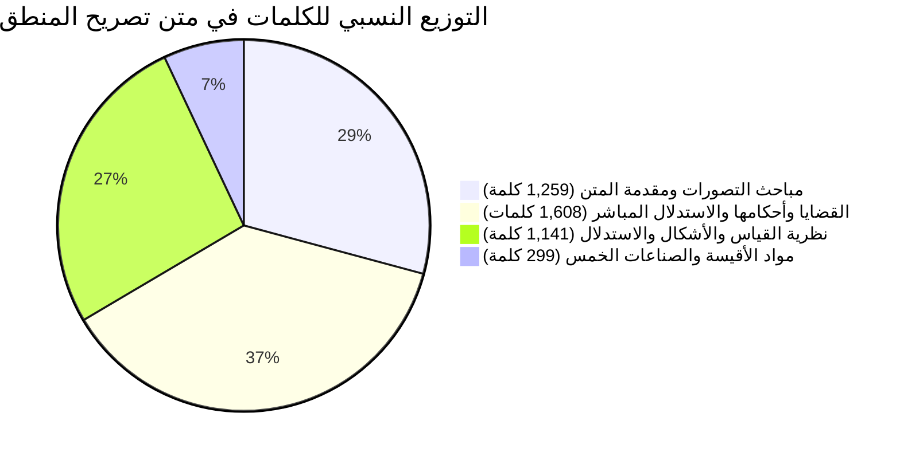
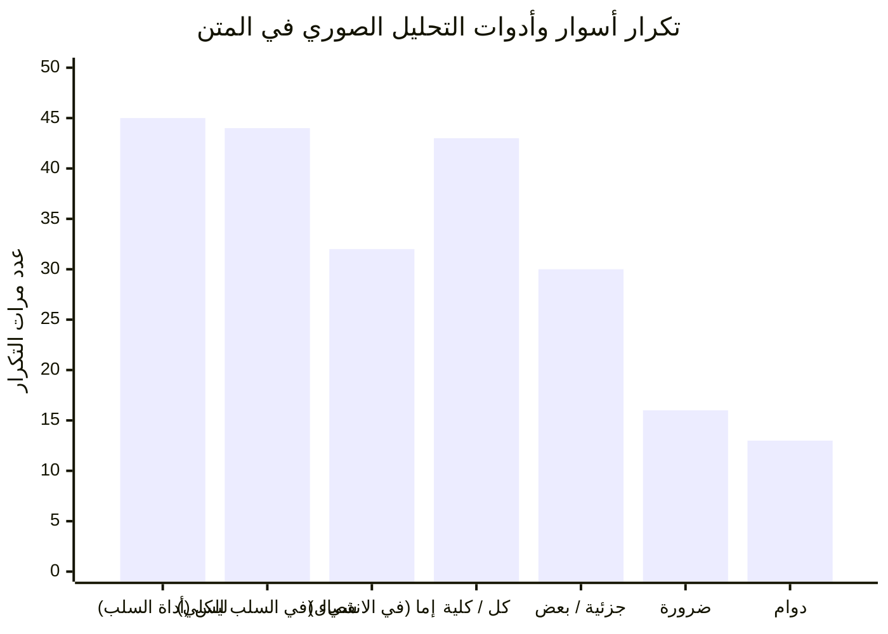
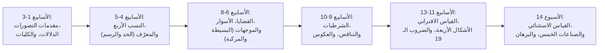

# التحليلات الإحصائية والهيكلية لمتن «تصريح المنطق»
### قياسات المتن النصية، ومعجم الترددات، وكثافة العقد، ومؤشر الصعوبة الإدراكية، والخطة التعليمية

---

## مدخل منهجي

يُقدم هذا الملف تحليلاً كمياً وهيكلياً دقيقاً لمتن **«تصريح المنطق»**، استناداً إلى المعالجة الرقمية للنص العربي الأصلي. يهدف هذا التحليل إلى كشف البنية الهندسية الكامنة في المتن، وتحديد أوزان الأبواب، وحساب كثافة المصطلحات، ورسم خريطة إدراكية تعين المدرس والطالب على تقدير الوقت والجهد اللازمين لكل مبحث.

---

## 1. البنية الإحصائية العامة للمتن (Corpus Overview)

### 1.1. الأرقام القياسية الأساسية:
- **إجمالي عدد كلمات المتن العربي:** 4,308 كلمة.
- **إجمالي عدد الفصول والمباحث المعنونة:** 25 فصلاً وباباً رئيسياً.
- **إجمالي العقد التصنيفية المستخرجة (Node Count):** 184 عقدة ومفهوماً فرعياً.
- **أقصى عمق هرمي للشجرة المنطقية (Max Tree Depth):** 6 مستويات تفريعية.
- **متوسط معامل التفرع (Average Branching Factor):** 2.76 فرع لكل عقدة أم.

---

### 1.2. التوزيع النسبي للكلمات بين عالم التصورات وعالم التصديقات:

| المبحث العام | عدد الكلمات | النسبة المئوية من المتن | عدد الفصول | كثافة المصطلحات الفنية |
|---|---|---|---|---|
| **مقدمة المتن وعالم التصورات** (من العلم إلى المعرِّف) | 1,259 كلمة | **29.2%** | 7 فصول | عالية (الكليات الخمس والنسب) |
| **مبادئ التصديقات** (القضايا، الموجهات، التناقض، العكوس) | 1,608 كلمات | **37.3%** | 10 فصول | فائقة التعقيد (الموجهات والعكوس) |
| **مقاصد التصديقات** (القياس الاقتراني، الاستثنائي، الاستقراء، التمثيل) | 1,141 كلمة | **26.5%** | 7 فصول | عالية جداً (شروط الضروب الـ 19) |
| **مادة القياس** (الصناعات الخمس واليقينيات الست) | 299 كلمة | **7.0%** | فصل واحد جامع | مركزة إبستمولوجياً |
| **المجموع الكلي** | **4,308 كلمات** | **100%** | **25 فصلاً** | **184 عقدة مصنفة** |

> **ملاحظة تحليلية:**
> يستحوذ قسم التصديقات على **70.8%** من حجم المتن كاملاً (3,048 كلمة)، مما يدل بوضوح على أن الغاية التعليمية الأهم عند المصنف هي **بناء مهارة إنتاج وفحص الحجج والبراهين والقياسات**، بينما جاءت التصورات بمثابة المدخل الضروري لتأسيس لغة الاصطلاح وضبط المفاهيم.

---

## 2. معجم الترددات والمصطلحات المفتاحية (Lexical Analysis)

تم استخراج ترددات المصطلحات الفنية بعد إزالة حروف الجر وحروف العطف والضمائر والزوائد النحوية:

### 2.1. المصطلحات المنطقية الأكثر دوراناً وتكراراً في المتن:

| الرتبة | المصطلح المنطقي | عدد مرات التكرار في المتن | الوظيفة الدلالية والمنطقية |
|---|---|---|---|
| **1** | **إِنْسَان / الإِنْسَان** | **95 مرة** | الموضوع والمحمول النموذجي المعتمد لضرب الأمثلة الماهوية |
| **2** | **حَيَوَان / الحَيَوَان** | **67 مرة** | الجنس القريب للإنسان المعتمد في توضيح الكليات والحمل |
| **3** | **لَيْسَ** | **45 مرة** | أداة السلب المعتمدة في نفي الرابطة وسلب القضايا وسور السوالب |
| **4** | **شَيْء** | **44 مرة** | أداة حصر السوالب الكلية («لا شيء من...») وصياغة المفهوم العام |
| **5** | **كُلِّيَّة** | **43 مرة** | بيان كم القضايا الكلية وشروط إنتاج كبريات الأشكال القياسية |
| **6** | **إِمَّا** | **32 مرة** | حرف العناد والشرط المعتمد لصياغة القضايا المنفصلة وتقسيم المسائل |
| **7** | **جُزْئِيَّة** | **30 مرة** | بيان كم القضايا الجزئية ونتائج الأشكال الثالث والرابع |
| **8** | **مُوجَبَة** | **27 مرة** | بيان كيف القضايا المثبتة وشروط إيجاب الصغريات |
| **9** | **صُغْرَى** | **20 مرة** | المقدمة المشتملة على الحد الأصغر موضوع النتيجة |
| **10** | **كُبْرَى** | **20 مرة** | المقدمة المشتملة على الحد الأكبر محمول النتيجة |
| **11** | **سَالِبَة** | **19 مرة** | بيان كيف القضايا المنفية وأحكام اختلاف الكيف |
| **12** | **حَجَر / الحَجَر** | **25 مرة** | المثال المعتمد للتباين الكلي في السوالب («لا شيء من الإنسان بحجر») |
| **13** | **زَيْد** | **16 مرة** | الفرد الجزئي الشخصي المعتمد في القضايا الشخصية والحمل |
| **14** | **بِالْفِعْل** | **16 مرة** | جهة التحقق الفعلي في المطلقة العامة والوجودية اللادرورية |
| **15** | **بِالضَّرُورَة** | **16 مرة** | جهة الامتناع الذاتي في الضرورية والمشروطة والوقتية والمنتشرة |
| **16** | **نَاطِق** | **13 مرة** | الفصل الذاتي للإنسان المعتمد في عكوس القضايا والحدود |
| **17** | **دَائِمًا** | **13 مرة** | جهة الدوام في الدائمة والعرفية، وسور المنفصلة الكلية |

---

### 2.2. تحليل الأدوات والأسوار المنطقية في المتن:

1. **أدوات الحصر الكلي الموجب:** «كُلٌّ»، «جَمِيعُ»، «لام الاستغراق».
2. **أدوات الحصر الكلي السالب:** «لَا شَيْءَ»، «لَا وَاحِدَ»، «وُقُوعُ النَّكِرَةِ تَحْتَ النَّفْيِ».
3. **أدوات الحصر الجزئي:** «بَعْضٌ»، «وَاحِدٌ»، «لَيْسَ كُلٌّ»، «لَيْسَ بَعْضٌ».
4. **أدوات الشرط والعناد:** «كُلَّمَا»، «مَتَى»، «مَهْمَا»، «إِمَّا... وَإِمَّا»، «لَيْسَ أَلْبَتَّةَ»، «قَدْ يَكُونُ»، «قَدْ لَا يَكُونُ».

---

## 3. قياسات الكثافة العقدية والطوبولوجيا الشجرية

### 3.1. توزيع العقد المنطقية بحسب الأبواب (184 عقدة مصنفة):

| الباب المنطقي | عدد العقد الفرعية | أقصى عمق | نسبة التعقيد الطوبولوجي |
|---|---|---|---|
| **1. العلم والتصور والتصديق** | 8 عقد | 3 | 4.3% |
| **2. الدلالات وأقسامها** | 12 عقدة | 4 | 6.5% |
| **3. المفرد والمركب وأقسامهما** | 16 عقدة | 4 | 8.7% |
| **4. أنواع المفرد باعتبار معناه** | 14 عقدة | 4 | 7.6% |
| **5. الكليات الخمس ومراتبها** | 20 عقدة | 5 | 10.9% |
| **6. النسب الأربع ونقائضها** | 8 عقد | 3 | 4.3% |
| **7. المعرّف (الحد والرسم)** | 7 عقد | 3 | 3.8% |
| **8. القضايا الحملية وأسوارها** | 12 عقدة | 3 | 6.5% |
| **9. القضايا المعدولة والمحصلة** | 4 عقد | 2 | 2.2% |
| **10. القضايا الموجهة (البسيطة والمركبة)** | 17 عقدة | 3 | 9.2% |
| **11. القضايا الشرطية وأسوارها** | 14 عقدة | 4 | 7.6% |
| **12. أحكام القضايا (التناقض والعكوس)** | 16 عقدة | 4 | 8.7% |
| **13. القياس الاقتراني والأشكال الأربعة** | 24 عقدة | 5 | 13.0% (الأعلى كثافة) |
| **14. القياس الاستثنائي والاستقراء والتمثيل** | 13 عقدة | 4 | 7.1% |
| **15. الصناعات الخمس واليقينيات الست** | 14 عقدة | 3 | 7.6% |
| **المجموع الإجمالي للعقد** | **184 عقدة** | **المعدل: 3.8** | **100%** |

---

## 4. مصفوفة الصعوبة الإدراكية والتدرج البيداغوجي (Cognitive Load Matrix)

تم تصنيف أبواب الكتاب إلى 5 مستويات بحسب مؤشر الصعوبة العقلية، وتحديد مواطن اللبس التي تحتاج إلى مزيد إيضاح:

| المبحث | مؤشر الصعوبة (1-5) | موطن اللبس والخلط الشائع عند الطلاب | التوجيه البيداغوجي الموصى به |
|---|---|---|---|
| **1. العلم والدلالات** | ⭐ | الخلط بين الدلالة العقلية والطبعية (كالنبض والدخان) | تدريب الطلاب على تمييز الدافع الغريزي من السببية الكونية |
| **2. المفرد والمركب** | ⭐⭐ | الخلط بين المركب الناقص التقييدي الإضافي والمفرد العلم (كعبد الله) | التركيز على قصد جزء اللفظ لجزء المعنى حال التسمية |
| **3. الكليات الخمس** | ⭐⭐⭐ | الخلط بين النوع الإضافي والجنس السافل؛ والخلط بين الفصل والخاصة | تدريب الطلاب بأسئلة: «ما هو؟» و«أي شيء هو في ذاته وعرضه؟» |
| **4. النسب الأربع** | ⭐⭐⭐ | الغفلة عن انقلاب نسبة نقيضي العموم والخصوص المطلق | استخدام لغة المجموعات الرياضية المعاصرة ($A \subset B$) |
| **5. المعرّف (الحد والرسم)** | ⭐⭐ | إدخال العوارض في الحد التام، أو تعريف الشيء بلفظ مساوٍ في الخفاء | مراجعة أمثلة الحدود الفاسدة وتمييزها بمصفوفة الاختبار |
| **6. القضايا الحملية وأسوارها** | ⭐⭐ | الخلط بين القضية المهملة والقضية الطبيعية | التأكيد على أن الحكم في الطبيعية على الماهية وفي المهملة على الأفراد |
| **7. القضايا الموجهة البسيطة** | ⭐⭐⭐⭐ | التمييز بين دوام النسبة بحسب الذات وبين دوامها بحسب الوصف | إبراز الفارق بين: «ما دامت الذات» و«ما دام الوصف العنواني» |
| **8. القضايا الموجهة المركبة** | ⭐⭐⭐⭐⭐ | تفكيك قيد اللادوام أو اللادرورة المعطوف على الجزء الصريح | تدريب الطالب على كتابة القضية المركبة كقضيتين صريحتين منفصلتين |
| **9. القضايا الشرطية** | ⭐⭐⭐ | الخلط بين مانعة الجمع ومانعة الخلو | تطبيق جدول قيم الصدق والحقيقة ($Truth\ Table$) |
| **10. التناقض والوحدات الثمانية** | ⭐⭐⭐ | توهم التناقض مع اختلاف الزمان أو المكان أو الإضافة | حث الطالب على مراجعة شروط الوحدات الثمانية خطوة بخطوة |
| **11. العكس المستوي وعكس النقيض** | ⭐⭐⭐⭐ | نسيان عدم انعكاس السالبة الجزئية في المستوي، والموجبة الجزئية في النقيض | حفظ مصفوفة العكوس وتدريب الذهن على استحضار الأمثلة الناقضة |
| **12. القياس الاقتراني (الأشكال 1-3)** | ⭐⭐⭐⭐ | نسيان شروط إنتاج كل شكل وضياع الحد الأوسط | حفظ القواعد الكلية (إيجاب الصغرى وكلية الكبرى) |
| **13. الشكل الرابع للقياس** | ⭐⭐⭐⭐⭐ | ثقل ضروبه الثمانية وبعده عن الطبع البشري | التركيز على الضروب الخمسة المشهورة وبيان ردها للشكل الأول |
| **14. القياس الاستثنائي والتمثيل** | ⭐⭐⭐ | الوقوع في مغالطة وضع التالي أو رفع المقدم | تطبيق خوارزمية الاستثناء واختبار اللزوم التام |
| **15. الصناعات الخمس والبرهان** | ⭐⭐⭐ | الخلط بين البرهان اللمّي والإِنّي، والخلط بين الحدس والتجربة | بيان موقع الحد الأوسط: هل هو علة في الخارج أم علة في الذهن فقط |

---

## 5. الخطة الزمنية المقترحة لتدريس المتن (Curriculum Roadmap)

خطة دراسية موزعة على **14 أسبوعاً** (بواقع محاضرتين أسبوعياً، 28 جلسة دراسية):

### تفصيل الخطة الأسبوعية:
- **الأسبوع 1:** مدخل لعلم المنطق، تعريف العلم، انقسامه إلى تصور وتصديق (بديهي ونظري).
- **الأسبوع 2:** الدلالات الست، تفصيل الدلالة اللفظية الوضعية (مطابقة، تضمن، التزام).
- **الأسبوع 3:** أقسام اللفظ (مركب ومفرد)، الاسم والكلمة والأداة، الكلي والجزئي، والمتواطئ والمشكك.
- **الأسبوع 4:** الكليات الخمس (النوع، الجنس، الفصل، الخاصة، العرض العام) ومراتبها.
- **الأسبوع 5:** النسب الأربع بين الكليات ونقائضها، والمعرِّف (الحد التام والناقص، الرسم التام والناقص، وشروط التعريف).
- **الأسبوع 6:** القضية الحملية وأقسامها (شخصية، طبيعية، مهملة، ومحصورة)، وأسوار القضايا الأربع.
- **الأسبوع 7:** القضايا المعدولة والمحصلة، ومدخل القضايا الموجهة والجهات البسيطة الثمانية.
- **الأسبوع 8:** القضايا الموجهة المركبة السبعة، وتفكيك قيود اللادوام واللادرورة.
- **الأسبوع 9:** القضايا الشرطية (متصلة ومنفصلة) وأقسام الحقيقية ومانعة الجمع ومانعة الخلو، وأسوار الشرطيات.
- **الأسبوع 10:** مبحث التناقض والوحدات الثمانية، قواعد تناقض المحصورات والموجهات، وقواعد العكس المستوي وعكس النقيض.
- **الأسبوع 11:** تعريف القياس، أجزاؤه وحدوده (أصغر، أكبر، أوسط)، وشروط وإنتاج الشكل الأول والضروب الأربعة.
- **الأسبوع 12:** الشكل الثاني (شروطه وضروبه الأربعة)، والشكل الثالث (شروطه وضروبه الستة).
- **الأسبوع 13:** الشكل الرابع (شروطه والضروب المنتجة)، والقياس الشرطي الاقتراني.
- **الأسبوع 14:** القياس الاستثنائي (الاتصالي والانفصالي)، الاستقراء (التام والناقص)، التمثيل، والصناعات الخمس (البرهان واليقينيات الست، الجدل، الخطابة، الشعر، والسفسطة).

---

> **خاتمة التحليلات:**
> يُبرز هذا الفحص الإحصائي والهيكلي الدقيق أن متن «تصريح المنطق» قد صيغ بأعلى درجات الاقتصاد اللفظي والكثافة الاصطلاحية؛ حيث استطاع المصنف في 4,308 كلمات فقط أن يودع نظاماً منطقياً صورياً وبرهانياً متكاملاً يستوعب 184 مفهوماً وحكماً منطقياً دون حشو أو استطراد.

