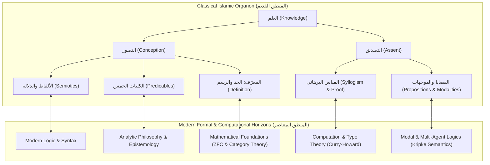
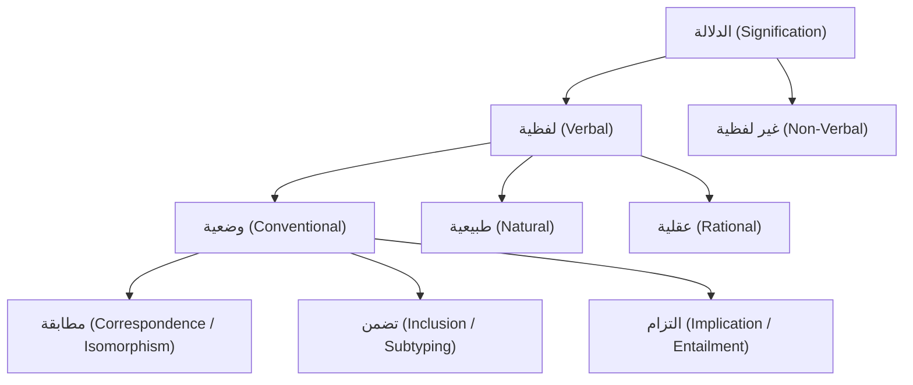
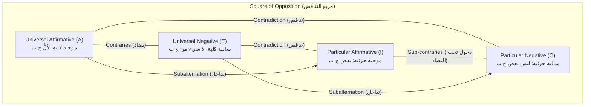
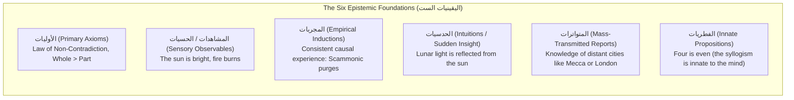
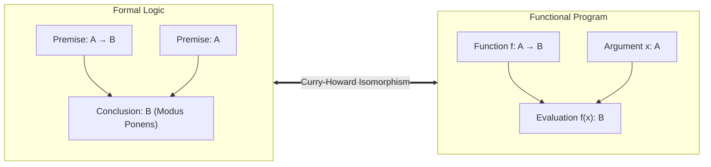
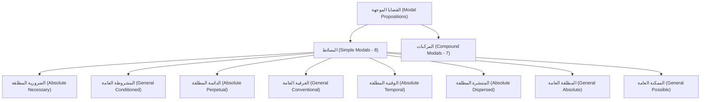
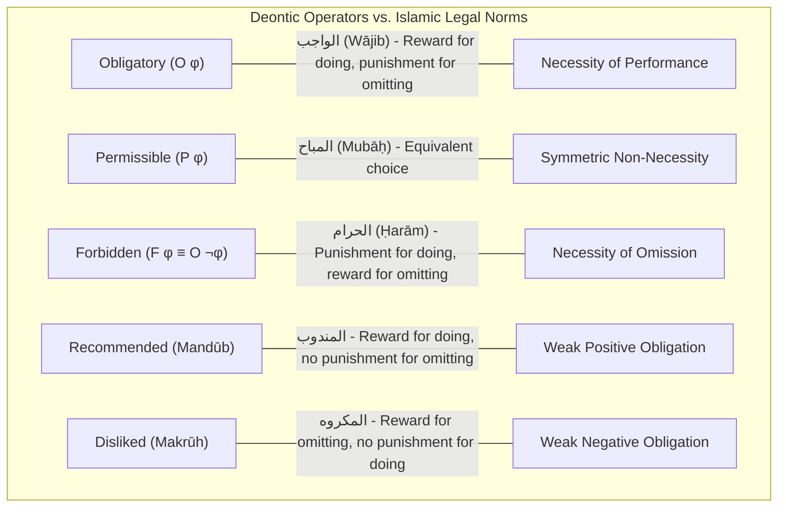

# The Architectonic of Reason: From Classical *Manṭiq* to Modern Philosophy, Mathematics, Computation, and Modal Logic
### *منطق التصريح إلى آفاق الفلسفة والرياضيات والحوسبة والمنطق الموجه*
### *തസ്രീഹുൽ മൻത്വിഖ് മുതൽ മോഡേൺ ഫിലോസഫി, മാത്തമാറ്റിക്സ്, കമ്പ്യൂട്ടേഷൻ, മോഡൽ ലോജിക് വരെയുള്ള ജ്ഞാനശാസ്ത്ര സഞ്ചാരം*

---

> **Document Type:** Advanced Cross-Disciplinary Research Note & Epistemological Guide  
> **Primary Source Base:** *Taṣrīḥ al-Manṭiq* (متن تصريح المنطق) by Mawlānā ‘Alī Aṣghar al-Qannawjī, with Avicennian (*Sīnawī*) commentaries  
> **Linguistic Medium:** English (Primary exposition & formal semantics), Arabic (Classical terminology & technical citations), Malayalam (Scholarly pedagogical glosses & synthetic commentaries)  
> **Audience:** Students of classical Islamic scholasticism (*Dars / Niẓāmī* curricula), logicians, computer scientists, analytic philosophers, and mathematicians.

---

## 1. Introduction & Epistemic Horizon
### المقدمة والآفاق الإبستمولوجية | ആമുഖവും ജ്ഞാനശാസ്ത്ര ചട്ടക്കൂടും

For over a millennium, the tradition of Arabic-Islamic logic (*al-Manṭiq*) functioned not merely as an isolated instrument for dialectic, but as the foundational **Cura Mentis**—the "instrumental science" (*ālatun qānūniyyah*) preserving the human intellect from cognitive error (*ta‘ṣimu al-dhihna ‘an al-khaṭa’ fī al-fikr*). In texts such as *Taṣrīḥ al-Manṭiq*, this system achieved an exceptional pedagogy: compressing the ontology of Aristotle, the radical logical reforms of Ibn Sīnā (Avicenna), and the rigorous scholastic refinements of al-Kātibī, al-Taftāzānī, and al-Sharīf al-Jurjānī into an integrated deductive grammar.

Yet, in the contemporary academy, logic has experienced a double transformation:
1. **Mathematical Formalization:** Through George Boole, Gottlob Frege, Charles Sanders Peirce, and Bertrand Russell, logic abandoned natural language syntax in favor of formal symbolic calculi (Propositional, First-Order Predicate, and Higher-Order Type Systems).
2. **Computational Embodiment:** Through Alan Turing, Alonzo Church, and Haskell Curry, logic became physicalized as the foundational architecture of digital computers, algorithmics, type theories, and automated theorem provers.



#### മലയാള വിശകലനം (Malayalam Contextual Overview):
പരമ്പരാഗത ദർസ്-ഇസ്ലാമിക പാഠ്യപദ്ധതികളിൽ തത്വചിന്തയുടെയും നിദാനശാസ്ത്രങ്ങളുടെയും (ഉസൂലുൽ ഫിഖ്ഹ്, കലാം) താക്കോലായി പഠിപ്പിക്കപ്പെടുന്ന ഗ്രന്ഥമാണ് മൗലാനാ അലി അസ്ഗർ അൽ-ഖന്നൗജിയുടെ *തസ്രീഹുൽ മൻത്വിഖ്*. ചിന്തയിലെ പിഴവുകളെ തടയുന്ന നിയാമക ശാസ്ത്രമായാണ് (ആലതുൻ ഖാനൂനിയ്യ) അരിസ്റ്റോട്ടിലിയൻ-ഇബ്നു സീനാ പാരമ്പര്യത്തിൽ ഇത് വികസിച്ചത്. എന്നാൽ പത്തൊൻപതാം നൂറ്റാണ്ട് മുതൽ സംഭവിച്ച ഗണിതശാസ്ത്രവൽക്കരണവും (Mathematical Logic) ഇരുപതാം നൂറ്റാണ്ടിലെ കമ്പ്യൂട്ടേഷണൽ വിപ്ലവവും (Computer Science & Type Theory) മോഡൽ ലോജിക്കിന്റെ (Modal Logic) ആധുനിക വളർച്ചയും ലോജിക്കിനെ ഒരു കേവല സംവാദകലയിൽ നിന്നും പ്രപഞ്ചത്തെയും ബുദ്ധിയെയും അൽഗോരിതങ്ങളെയും അപഗ്രഥിക്കുന്ന സാർവലൗകിക ഭാഷയായി മാറ്റിമറിച്ചു. ഈ പഠനക്കുറിപ്പ് ശാസ്ത്രീയമായി ഈ രണ്ട് ജ്ഞാനശാഖകളെയും തമ്മിൽ ബന്ധിപ്പിക്കുന്നു.

---

## 2. General Logic & Modern Formal Systems
### المنطق العام والنظم الصورية الحديثة | ജനറൽ ലോജിക്കും മോഡേൺ ഫോർമൽ സിസ്റ്റങ്ങളും

```
========================================================================================
CLASSICAL DICHOTOMY                        MODERN FORMAL SEMANTICS
========================================================================================
العلم (Knowledge / Cognitive State)   ---> Epistemic Content / Cognitive Representation
  ├─ التصور (Taṣawwur - Conception)   ---> Terms, Types, Non-Propositional Meanings, Syntax
  └─ التصديق (Taṣdīq - Assent)        ---> Propositions, Truth-Values ({True, False} / {1, 0})
========================================================================================
```

### 2.1 The Foundational Epistemic Bipartition: *Taṣawwur* vs. *Taṣdīq*
In *Taṣrīḥ al-Manṭiq*, all cognition (*al-‘Ilm*) is partitioned into **Conception** (*al-Taṣawwur*) and **Assent** (*al-Taṣdīq*):
* **Conception (*al-Taṣawwur* / സങ്കല്പം):** Grasping an unasserted quiddity or meaning without mental attribution or truth-commitment (e.g., the concept of "water", "rational animal", or "triangle").
* **Assent (*al-Taṣdīq* / വിധിതീർപ്പ് - സത്യപ്പെടുത്തൽ):** Grasping a propositional nexus (*nisbah ḥukmiyyah*) accompanied by a decisive judgment (*ḥukm*) that affirms or denies the relation in objective reality (e.g., "The triangle has three angles totaling 180 degrees").

#### Formal Semantic Formulation
In modern formal semantics (Frege-Tarski framework), *Taṣawwur* maps onto the denotation of **terms** ($t \in \mathcal{T}$), **predicates** ($P(x)$), and **open formulas** with free variables. *Taṣdīq* corresponds to a **closed sentence** or **proposition** ($\phi \in \text{Sent}$) evaluated under an interpretation model $\mathcal{M}$:

$$\mathcal{M} \models \phi \quad \text{or} \quad \mathcal{V}(\phi) \in \{1, 0\}$$

Where Frege distinguished between **Sense** (*Sinn* / المفهوم / *al-Mafhūm*) and **Reference** (*Bedeutung* / الماصدق / *al-Māṣadaq*), classical Islamic logicians had already crystallized this exact distinction:
* **Concept/Comprehension (*al-Mafhūm* / മഫ്ഹൂം):** The mental intension and attributes constituting the definition.
* **Extension (*al-Māṣadaq* / മാസ്വദഖ്):** The concrete or extensional entities in the external world (*al-khārij*) to which the concept applies.

### 2.2 Semiotics: *al-Dalālah* and the Semiotic Triangle
*Taṣrīḥ al-Manṭiq* introduces signification (*al-Dalālah* / ദ്യോതനം) as:
$$\text{كَوْنُ الشَّيْءِ بِحَالَةٍ يَلْزَمُ مِنْ عِلْمِهِ الْعِلْمُ بِشَيْءٍ آخَرَ}$$
*"A state of an entity such that knowledge of it necessarily yields knowledge of another entity."*



| Type of Signification | Arabic Definition | Modern Mathematical / Logical Parallel | Malayalam Explanation |
| :--- | :--- | :--- | :--- |
| **Correspondence (*Muṭābaqa*)** | الدلالة على تمام المعنى الموضوع له | Bijection / Exact Isomorphism: $f: A \leftrightarrow B$ | പദത്തിന്റെ പൂർണ്ണാർത്ഥത്തെ സൂചിപ്പിക്കുന്നത് (ഉദാ: മനുഷ്യൻ = ചിന്തിക്കുന്ന ജീവി). |
| **Inclusion (*Taḍammun*)** | الدلالة على جزء المعنى الموضوع له | Proper Subset / Projection: $A \subset B$ or $\pi_i(A)$ | പദാർത്ഥത്തിന്റെ ഒരു അംശത്തെ മാത്രം കാണിക്കുന്നത് (ഉദാ: മനുഷ്യൻ എന്ന് പറയുമ്പോൾ 'ജീവി' എന്നത്). |
| **Implication (*Iltizām*)** | الدلالة على خارج لازم للمعنى ذهناً | Necessary Consequence / Entailment: $\phi \implies \psi$ | ബാഹ്യമായ എന്നാൽ വേർപെടാത്ത ഗുണത്തെ സൂചിപ്പിക്കുന്നത് (ഉദാ: മനുഷ്യൻ $\implies$ ചിരി ശേഷി / എഴുത്ത്). |

### 2.3 Propositional Logic vs. *al-Qadhāyā al-Sharṭiyyah*
Classical logic divides propositions into **Categorical** (*Ḥamliyyah* / വിധേയ-വിധേയക വാക്യങ്ങൾ / $S$ is $P$) and **Conditional** (*Sharṭiyyah* / നിബന്ധനാ വാക്യങ്ങൾ). In modern propositional calculus, all compound assertions are constructed using truth-functional connectives:

1. **Conjunctive Propositions (*al-Sharṭiyyah al-Muttaṣilah* / സംയോജകം):**
   * Classical form: *"Whenever the sun rises, the day is present"* (كلما كانت الشمس طالعة فالنهار موجود).
   * Modern Material Implication: $P \to Q \equiv \neg P \vee Q$.
   * Avicennian Intensional Implication (*Luzūmiyyah* / ലുസൂമിയ്യ): Avicenna explicitly rejected mere material truth-functionality, requiring a genuine causal or rational nexus between antecedent (*muqaddam*) and consequent (*tālī*). This directly anticipates modern **Relevance Logic**.

2. **Disjunctive Propositions (*al-Sharṭiyyah al-Munfaṣilah* / വിയോജകം):**
   * **Exclusive Disjunction (*Māni‘at al-Jam‘ wal-Khuluww* - مانعة الجمع والخلو):**
     $$P \oplus Q \iff (P \vee Q) \wedge \neg(P \wedge Q)$$
     The proposition cannot be both true, nor both false (Exact Partition of Sample Space).
   * **Alternative Denial (*Māni‘at al-Jam‘* - مانعة الجمع):**
     $$\neg(P \wedge Q) \iff \text{NAND}(P, Q)$$
     Cannot be simultaneously true; may both be false.
   * **Sub-contrary / Joint Denial (*Māni‘at al-Khuluww* - مانعة الخلو):**
     $$P \vee Q$$
     Cannot be simultaneously false; may both be true.

```
========================================================================================
CLASSICAL CONDITIONAL TAXONOMY           MODERN BOOLEAN LOGIC EQUIVALENT
========================================================================================
متصلة لزومية (Strict Conditional)    ---> Strict Entailment: □(P → Q)
متصلة اتفاقية (Accidental Implic.)   ---> Material Implication: P → Q
منفصلة حقيقية (True Disjunctive)      ---> Exclusive OR (XOR): P ⊕ Q
منفصلة مانعة الجمع (No-Joint-True)    ---> NAND: ¬(P ∧ Q)
منفصلة مانعة الخلو (No-Joint-False)   ---> Inclusive OR: P ∨ Q
========================================================================================
```

### 2.4 First-Order Predicate Calculus (FOL) & The Classical Quantifiers (*al-Aswār*)
Classical logic expressed quantification via the Four Categorical Forms (the Aristotelian-Avicennian Square of Opposition / *Murabba‘ al-Tanaqudh*):



#### The Existential Import Controversy: Avicenna vs. Russell
* **Modern FOL Formulation:**
  * Universal Affirmative ($A$): $\forall x (S(x) \to P(x))$
  * Particular Affirmative ($I$): $\exists x (S(x) \wedge P(x))$
  * *Critical divergence:* In modern FOL, if the subject class $S$ is empty (e.g., $S = \text{Unicorn}$), $\forall x (S(x) \to P(x))$ is **vacuously true**, whereas $\exists x (S(x) \wedge P(x))$ is **false**. Consequently, subalternation ($A \implies I$) fails!
* **The Avicennian Solution in *Taṣrīḥ al-Manṭiq*:**
  Classical Islamic logicians distinguished three modes of subject-consideration:
  1. **Mental Existence (*al-Wujūd al-Dhihnī*):** In mathematical and essential definitions, predication holds in the realm of mental concepts, guaranteeing non-vacuous semantic evaluation.
  2. **External Existence (*al-Wujūd al-Khārijī*):** In empirical assertions, the universal quantifier explicitly presumes a non-empty domain of instantiate discourse (*fī al-khārij*).
  3. **Real/Modal Status (*al-Ḥaqīqiyyah*):** Judgments hold across all actual and counterfactual instances whose existence is possible, matching modern **Possible World Semantics**.

---

## 3. Philosophy & Epistemology
### الفلسفة ونظرية المعرفة | തത്ത്വചിന്തയും ജ്ഞാനസിദ്ധാന്തവും

### 3.1 The Problem of Universals (*Mushkilat al-Kulliyyāt*)
The core of *Taṣrīḥ al-Manṭiq*’s analytical power lies in **The Five Universals** (*al-Kulliyyāt al-Khamsah* / പഞ്ച സാർവലൗകികങ്ങൾ):
1. **Genus (*al-Jins* / വർഗ്ഗം / $\text{Genus}$):** Essential universal shared by multiple species differing in quiddity (e.g., *Animal* for Human and Horse).
2. **Specific Difference (*al-Faṣl* / വിശേഷകം / $\text{Differentia}$):** Essential universal that distinguishes a species within its genus (e.g., *Rational* for Human).
3. **Species (*al-Naw‘* / ഉപവർഗ്ഗം / $\text{Species}$):** The complete essential quiddity comprising Genus + Differentia (e.g., *Human* = Rational Animal).
4. **Proprium (*al-Khāṣṣah* / സവിശേഷഗുണം / $\text{Property}$):** Non-essential (accidental) universal unique to a single species (e.g., *Capacity to laugh* or *Write* for Human).
5. **Common Accident (*al-‘Araḍ al-‘Āmm* / പൊതുഗുണം / $\text{Accident}$):** Non-essential universal shared across multiple species (e.g., *Walking*, *Sleeping*, *Blackness*).

```
========================================================================================
THE ONTOLOGICAL HIERARCHY OF PREDICABLES
========================================================================================
                             [ الكلي - The Universal ]
                                        │
                 ┌──────────────────────┴──────────────────────┐
            [ ذاتي - Essential ]                          [ عرضي - Accidental ]
                 │                                             │
         ┌───────┴───────┐                             ┌───────┴───────┐
    [ تمام الماهية ]   [ جزء الماهية ]               [ يخص حقيقة ]    [ يعم حقائق ]
           │                 │                             │               │
     النوع (Species)   ┌─────┴─────┐                الخاصة (Proprium) العرض العام (Accident)
      (Human/إنسان)    │           │                 (Laughing/ضاحك)  (Walking/ماشٍ)
                 الجنس (Genus)  الفصل (Diff.)
                 (Animal/حيوان) (Rational/ناطق)
========================================================================================
```

#### The Tripartite Avicennian Division of Universals
In the epistemological synthesis formulated by Ibn Sīnā and maintained in *Taṣrīḥ al-Manṭiq*, the universal has three ontological statuses:
1. **The Natural Universal (*al-Kullī al-Ṭabī‘ī* / പ്രകൃതിദത്ത സാർവലൗകികം):** Quiddity considered in itself (*māhiyyah min ḥaythu hiya hiya*), unconditioned by universality or individuality. Human nature exists externally in Zayd and ‘Amr.
2. **The Logical Universal (*al-Kullī al-Manṭiqī* / താർക്കിക സാർവലൗകികം):** The second-order mental concept of "universality" itself (*al-kulliyyah*)—the attribute of being predicable of many.
3. **The Intellectual Universal (*al-Kullī al-‘Aqlī* / ബുദ്ധിപരമായ സാർവലൗകികം):** The combination of the quiddity together with the attribute of universality existing solely within the rational soul.

This solved the medieval European **Realism vs. Nominalism** debate centuries before Abelard and Ockham: Universals exist *in re* as natural quiddities, *post rem* as intellectual concepts in the mind, and *ante rem* in the Divine Intellect.

### 3.2 Epistemic Justification: Foundationalism & The Six Certainties (*al-Yaqīniyyāt*)
In the section on the Demonstration Art (*Ṣinā‘at al-Burhān*), *Taṣrīḥ al-Manṭiq* introduces the axioms of classical foundationalism. For an argument to yield apodictic knowledge (*yaqīn jāzim*), its premises must terminate in self-evident principles (*badīhiyyāt*):



| Epistemic Class | Arabic Nomenclature | Contemporary Epistemological Equivalent | Malayalam Equivalent |
| :--- | :--- | :--- | :--- |
| **Primary Axioms** | الأوّليّات | A priori Analytic Truths / Logical Axioms | സ്വയംസിദ്ധമായ പ്രാഥമിക ബോധ്യം (ഉദാ: ഒരേ സമയം ഒരു വസ്തു ഉണ്ട് എന്നും ഇല്ല എന്നും വരികയില്ല). |
| **Sensory Perceptions**| المشاهدات / الوجدانيات | Direct Empirical Data / Qualia / Phenomenal Beliefs | ഇന്ദ്രിയാനുഭവങ്ങൾ (ഉദാ: സൂര്യൻ പ്രകാശിക്കുന്നു). |
| **Scientific Inductions**| المُجرَّبات | Methodological Empiricism / Robust Induction | ആവർത്തിച്ചുള്ള പരീക്ഷണങ്ങളിലൂടെ ലഭിക്കുന്ന ഉറപ്പ്. |
| **Rational Intuitions**| الحَدْسِيّات | Abductive Insight / Scientific Hypothesis Confirmation | സൂക്ഷ്മ ചിന്തയിലൂടെയുള്ള ഉദയം (ഉദാ: ചന്ദ്രന്റെ പ്രകാശം സൂര്യനിൽ നിന്നാണ്). |
| **Testimonial Certainty**| المُتَواتِرات | Epistemology of Testimony / Historical Verifiability | വിശ്വസനീയമായ കൂട്ടായ തലമുറാവ്യാപ്തിയുള്ള അറിവ് (തവാതുർ). |
| **Innate Propositions**| الفِطْرِيّات | Basic Deductive Intuitions / Propositions with Innate Syllogisms | മനസ്സിൽ തന്നെ തെളിവ് അന്തർലീനമായ സത്യങ്ങൾ (ഉദാ: 4 എന്നത് ഇരട്ടസംഖ്യയാണ്). |

---

## 4. Mathematical Logic & Formal Foundations
### المنطق الرياضي والأسس الشكلية | മാത്തമാറ്റിക്കൽ ലോജിക്കും അടിസ്ഥാന സിദ്ധാന്തങ്ങളും

### 4.1 Set-Theoretic Translation of Classical *Mantiq*
Set theory, axiomatized via Zermelo-Fraenkel with Choice ($\text{ZFC}$), provides the natural mathematical semantic model for classical Arabic logic:

$$\begin{aligned}
\text{Subject Term } S &\mapsto \text{Set } \mathcal{S} = \{ x \in \mathcal{U} \mid S(x) \} \\
\text{Predicate Term } P &\mapsto \text{Set } \mathcal{P} = \{ x \in \mathcal{U} \mid P(x) \}
\end{aligned}$$

The classical four categorical relations translate into set-theoretic operators:
1. **Universal Affirmative ($A$):** $\mathcal{S} \subseteq \mathcal{P} \iff \mathcal{S} \setminus \mathcal{P} = \emptyset$
2. **Universal Negative ($E$):** $\mathcal{S} \cap \mathcal{P} = \emptyset$
3. **Particular Affirmative ($I$):** $\mathcal{S} \cap \mathcal{P} \neq \emptyset$
4. **Particular Negative ($O$):** $\mathcal{S} \setminus \mathcal{P} \neq \emptyset \iff \mathcal{S} \not\subseteq \mathcal{P}$

```
========================================================================================
THE FOUR LOGICAL RELATIONS (النسب الأربع) IN EXTENSIONAL SET THEORY
========================================================================================
1. التساوي (Equipollence / Equality):
   A = B  ⟺  (A ⊆ B) ∧ (B ⊆ A)
   Example: الإنسان (Human) vs الناطق (Rational)

2. العموم والخصوص المطلق (Total Inclusion / Proper Subset):
   A ⊂ B  or  B ⊂ A
   Example: الحيوان (Animal) vs الإنسان (Human)

3. العموم والخصوص من وجه (Partial Intersection):
   (A ∩ B ≠ ∅) ∧ (A \ B ≠ ∅) ∧ (B \ A ≠ ∅)
   Example: الأبيض (White) vs الحيوان (Animal)

4. التباين الكلي (Complete Disjointness / Mutually Exclusive):
   A ∩ B = ∅
   Example: الحجر (Stone) vs الإنسان (Human)
========================================================================================
```

### 4.2 Boolean Algebra and Duality
In 1854, George Boole formulated *An Investigation of the Laws of Thought*, establishing that classical syllogistic operations form a complemented distributive lattice:

$$\langle \mathcal{B}, \vee, \wedge, \neg, 0, 1 \rangle$$

* **Idempotence:** $x \wedge x = x$; $x \vee x = x$
* **Distributivity:** $x \wedge (y \vee z) = (x \wedge y) \vee (x \wedge z)$
* **De Morgan’s Laws (Equivalence to Classical Contradiction):**
  $$\neg(x \wedge y) = \neg x \vee \neg y \qquad \neg(x \vee y) = \neg x \wedge \neg y$$

In *Taṣrīḥ al-Manṭiq*, this algebraic structure is mirrored in the rules of **Conversion by Contradiction** (*‘Aks al-Naqīḍ* / വിപരീത പരിവർത്തനം):
The contrapositive of "Every $S$ is $P$" ($S \subseteq P$) is "Every non-$P$ is non-$S$" ($\neg P \subseteq \neg S$). Since complementation in Boolean algebra reverses inclusion:
$$S \le P \iff \neg P \le \neg S$$

### 4.3 Gödel's Incompleteness Theorems & Limits of Deductive Formalization
In classical scholasticism, the demonstrative syllogism (*al-Qiyās al-Burhānī*) was assumed capable of formalizing all necessary scientific truths (*al-Yaqīn al-Muṭlaq*). In 1931, Kurt Gödel revolutionized mathematical logic by demonstrating the inherent limitations of formal deductive systems:

> [!IMPORTANT]
> **Gödel's First Incompleteness Theorem:**  
> Any consistent formal system $\mathcal{F}$ capable of carrying out basic Peano arithmetic is incomplete; that is, there exist statements $G_\mathcal{F}$ in the language of $\mathcal{F}$ such that:
> $$\mathcal{F} \not\vdash G_\mathcal{F} \quad \text{and} \quad \mathcal{F} \not\vdash \neg G_\mathcal{F}$$
>
> **Gödel's Second Incompleteness Theorem:**  
> A consistent formal system $\mathcal{F}$ cannot prove its own consistency:
> $$\mathcal{F} \not\vdash \text{Cons}(\mathcal{F})$$

#### Scholastic Parallels: *Jadhir al-Aṣamm* (The Surd Root of Logic)
This mathematical reality mirrors the famous classical Islamic paradox discussed by al-Taftāzānī and al-Jurjānī: **The Paradox of the Absolute Negation** (*Jadhir al-Aṣamm* / جذر الأصم):
If a speaker states: *"Every judgment I utter in this book is false."*
If the sentence is true, it must be false. If it is false, it becomes true. Classical logicians recognized that self-referential semantic loops escape the standard machinery of categorical assent (*Taṣdīq*), prefiguring Tarski’s hierarchy of meta-languages and Gödelian diagonalization.

---

## 5. Computation, Automata & Type Theory
### علوم الحوسبة ونظرية الآلات والأنماط | കമ്പ്യൂട്ടേഷൻ, ഓട്ടോമാറ്റ, ടൈപ്പ് തിയറി

### 5.1 Automata Theory and The Chomsky Hierarchy
The classification of expressions in *Taṣrīḥ al-Manṭiq*—from the non-composite word (*al-Lafẓ al-Mufrad*) through composite phrases (*al-Murakkab al-Nāqiṣ*) to complete propositions (*al-Murakkab al-Tāmm*)—directly mirrors the computational hierarchy of formal grammars:

```
========================================================================================
THE CHOMSKY HIERARCHY                    CLASSICAL LINGUISTIC / LOGICAL CORRELATE
========================================================================================
Type 0: Unrestricted Grammars        --> Complete Human Discourse (المركب التام التواصلي)
        [Turing Machines]
Type 1: Context-Sensitive Grammars   --> Syllogistic Inference with Context (الاستلزام المقيد)
        [Linear Bounded Automata]
Type 2: Context-Free Grammars (CFG)  --> Predicate-Subject Syntactic Trees (الإسناد الإضافي)
        [Pushdown Automata]
Type 3: Regular Grammars             --> Atomic Terms and Simple Morphemes (اللفظ المفرد)
        [Finite State Automata]
========================================================================================
```

### 5.2 The Curry-Howard-Lambek Isomorphism: Propositions-as-Types
The most profound intellectual bridge between logic and modern computing is the **Curry-Howard Correspondence**:

$$\begin{array}{ccc}
\textbf{Logic} & \longleftrightarrow & \textbf{Computation / Type Theory} \\
\hline
\text{Proposition } A & \longleftrightarrow & \text{Type } A \\
\text{Proof of } A & \longleftrightarrow & \text{Program / Term } t \text{ of type } A \\
\text{Implication } A \to B & \longleftrightarrow & \text{Function Space } A \to B \\
\text{Conjunction } A \wedge B & \longleftrightarrow & \text{Product Type } A \times B \\
\text{Disjunction } A \vee B & \longleftrightarrow & \text{Sum / Either Type } A + B \\
\text{Tautology / True } \top & \longleftrightarrow & \text{Unit Type } () \\
\text{Absurdity / False } \bot & \longleftrightarrow & \text{Empty / Bottom Type } \text{Void} \\
\text{Modus Ponens} & \longleftrightarrow & \text{Function Application } f(a) \\
\text{Proof Normalization} & \longleftrightarrow & \text{Program Evaluation / } \beta\text{-Reduction}
\end{array}$$



#### Classical Syllogism as Functional Code:
Consider the classical First Figure Barbara Syllogism:
* Premise 1 (Major): Every human is an animal ($\forall x. H(x) \to A(x)$)
* Premise 2 (Minor): Every rational being is human ($\forall x. R(x) \to H(x)$)
* Conclusion: Every rational being is an animal ($\forall x. R(x) \to A(x)$)

In Modern Functional Programming (Haskell / OCaml / Scala):
```haskell
-- The Barbara Syllogism as Function Composition
barbara :: (Human -> Animal) -> (Rational -> Human) -> (Rational -> Animal)
barbara major minor = major . minor
```
The classical middle term (*al-Ḥadd al-Awsaṭ* / ഇടനില പദം) is nothing other than the intermediate data type eliminated during functional composition!

### 5.3 Automated Reasoning & Knowledge Representation
In computational AI, classical Aristotelian-Avicennian logic lives on through:
1. **Horn Clauses & Prolog (Logic Programming):**
   ```prolog
   animal(X) :- human(X).
   human(socrates).
   % Query: ?- animal(socrates). -> true.
   ```
2. **Description Logics (OWL - Web Ontology Language):**
   The semantic web represents classes using Avicennian genus-species hierarchies:
   $$\text{Human} \equiv \text{Animal} \sqcap \exists \text{hasProperty}.\text{Rational}$$
3. **Symbolic AI (System 2) vs. Neural Networks (System 1):**
   Modern Large Language Models (LLMs) operate via probabilistic pattern matching over vector embeddings (akin to classical *al-Wahm* and *al-Khayāl*). However, to eliminate hallucinations and achieve verified reasoning, contemporary computer science couples neural models with **Automated Theorem Provers** (Lean, Z3 SMT solver, Coq)—returning to the foundational ideal of *Taṣrīḥ al-Manṭiq*: apodictic deductive verification (*Burhān*).

---

## 6. Modal Logic & The Islamic Theory of Modalities
### المنطق الموجه ونظرية الموجهات الإسلامية | മോഡൽ ലോജിക്കും മുവജ്ജഹാത്ത് സിദ്ധാന്തവും

The treatment of **Modal Propositions** (*al-Qadhāyā al-Muwajjahah* / മോഡൽ പ്രൊപ്പോസിഷനുകൾ) represents the absolute pinnacle of analytical sophistication in *Taṣrīḥ al-Manṭiq*. Where Western classical scholasticism largely restricted itself to basic de dicto necessity and possibility, Avicenna and his successors constructed an intricate, multi-layered modal logic incorporating temporal parameters, descriptive conditions, and dynamic essential constraints.



### 6.1 The 8 Simple Modals (*al-Basā’iṭ*) and Their Modern Formal Semantics
In modern Kripke semantics, a modal model is a triple $\mathcal{M} = \langle W, R, V \rangle$, where $W$ is a set of possible worlds, $R \subseteq W \times W$ is the accessibility relation, and $V$ is a valuation function:
* **Necessity ($\Box \phi$):** $\mathcal{M}, w \models \Box \phi \iff \forall w' (w R w' \implies \mathcal{M}, w' \models \phi)$
* **Possibility ($\Diamond \phi$):** $\mathcal{M}, w \models \Diamond \phi \iff \exists w' (w R w' \wedge \mathcal{M}, w' \models \phi)$

Classical Islamic logic introduced precise relational qualifiers that combine temporal logic ($\text{LTL} / \text{CTL}$) with modal constraints:

| Modal Proposition | Classical Arabic Formula | Formal Symbolic Semantics | Rigorous Analytical Definition |
| :--- | :--- | :--- | :--- |
| **1. Absolute Necessary (*al-Ḍarūriyyah al-Muṭlaqah*)** | الضرورية المطلقة | $\Box \forall t. P(S)$ as long as $S$ exists | The predicate is necessary for the subject's essence as long as the essence exists (e.g., *Human is necessarily an animal*). |
| **2. General Conditioned (*al-Mashrūṭah al-‘Āmmah*)** | المشروطة العامة | $\Box (D(S) \to P(S))$ | Necessity is conditioned upon the subject retaining a specific descriptive attribute (e.g., *A writer’s fingers are moving necessarily as long as he is writing*). |
| **3. Absolute Perpetual (*al-Dā’imah al-Muṭlaqah*)** | الدائمة المطلقة | $\forall t. P(S)$ | The predicate belongs to the subject always in external reality without modal necessity (e.g., *Every celestial sphere is perpetual in motion*). |
| **4. General Conventional (*al-‘Urfiyyah al-‘Āmmah*)** | العرفية العامة | $\forall t (D(S) \to P(S))$ | Perpetuity conditioned upon the subject retaining a descriptive attribute (e.g., *Every walking entity moves its legs perpetually while walking*). |
| **5. Absolute Temporal (*al-Waqtiyyah al-Muṭlaqah*)** | الوقتية المطلقة | $\exists t_k. P(S, t_k)$ | Necessity locked to a specific determined time window (e.g., *The moon is necessarily eclipsed during the time of Earth-shadow alignment*). |
| **6. Absolute Dispersed (*al-Muntashirah al-Muṭlaqah*)** | المنتشرة المطلقة | $\exists t. P(S, t)$ | Necessity at an undetermined, dispersed moment in time (e.g., *A living being necessarily breathes at some undetermined moment*). |
| **7. General Absolute (*al-Muṭlaqah al-‘Āmmah*)** | المطلقة العامة | $P(S) \text{ at least once}$ | Actual factual realization at least once in time without necessity or perpetuity (e.g., *Every human is laughing in actuality*). |
| **8. General Possible (*al-Mumkinah al-‘Āmmah*)** | الممكنة العامة | $\neg \Box \neg P(S) \equiv \Diamond P(S)$ | Negation of the absolute necessity of the contradictory (e.g., *Every human is possibly a writer*). |

### 6.2 The 7 Compound Modals (*al-Murakkabāt*)
A compound modal (*Murakkabah*) consists of an explicit simple modal (*juz’ mūjab/sālib*) conjoined with an implicit negation of necessity (*al-lā-ḍarūrah*) or perpetuity (*al-lā-dawām*):

1. **Special Conditioned (*al-Mashrūṭah al-Khāṣṣah* - المشروطة الخاصة):** General Conditioned + Non-perpetuity of the predicate's essence ($\text{Mashrūṭah ‘Āmmah} \wedge \text{Lā-Dawām Dhātī}$).
2. **Special Conventional (*al-‘Urfiyyah al-Khāṣṣah* - العرفية الخاصة):** General Conventional + Non-perpetuity of the predicate's essence.
3. **Non-Necessary Existential (*al-Wujūdiyyah al-Lā-Ḍarūriyyah* - الوجودية اللاضرورية):** General Absolute + Negation of necessity of the predicate ($\text{Actual} \wedge \neg\Box P$).
4. **Non-Perpetual Existential (*al-Wujūdiyyah al-Lā-Dā’imah* - الوجودية اللادائمة):** General Absolute + Negation of perpetuity of the predicate ($\text{Actual} \wedge \neg\forall t. P$).
5. **Special Temporal (*al-Waqtiyyah al-Khāṣṣah* - الوقتية الخاصة):** Absolute Temporal + Non-perpetual outside of that specific time window.
6. **Special Dispersed (*al-Muntashirah al-Khāṣṣah* - المنتشرة الخاصة):** Absolute Dispersed + Non-perpetual outside of that dispersed time.
7. **Special Possible (*al-Mumkinah al-Khāṣṣah* - الممكنة الخاصة):** Negation of both the necessity of existence and the necessity of non-existence ($\Diamond P \wedge \Diamond \neg P$ / Contingency / ഇരട്ട സാധ്യത).

#### മലയാള വിശദീകരണം:
ആധുനിക മോഡൽ ലോജിക്കിൽ 'അനിവാര്യത' (Necessity - $\Box$), 'സാധ്യത' (Possibility - $\Diamond$) എന്നീ രണ്ട് അവസ്ഥകളെ പ്രധാനമായും വിശകലനം ചെയ്യുമ്പോൾ, തസ്രീഹുൽ മൻത്വിഖ് അതിനെ കാലം (Time - وقت), അവസ്ഥ (Condition - وصف), സത്ത (Essence - ذات) എന്നിവയുമായി ബന്ധിപ്പിച്ച് 8 ലളിത മോഡലുകളായും (ബസാഇത്വ്) 7 സംയുക്ത മോഡലുകളായും (മുറക്കബാത്) വിഭജിച്ചു. ഉദാഹരണത്തിന്, മനുഷ്യൻ ജീവിയാകുന്നത് സത്താപരമായി എപ്പോഴും അനിവാര്യമാണ് (ളറൂരിയ്യ മുത്വ്‌ലഖ). എന്നാൽ എഴുത്തുകാരൻ വിരലനക്കുന്നത് അവൻ എഴുതിക്കൊണ്ടിരിക്കുന്ന അവസ്ഥയിൽ മാത്രമാണ് അനിവാര്യമാകുന്നത് (മശ്റൂത്വ ആമ്മ). ഇത് ആധുനിക കമ്പ്യൂട്ടേഷണൽ ടെമ്പറൽ ലോജിക്കിനെക്കാൾ (Temporal Logic) സങ്കീർണ്ണവും സൂക്ഷ്മവുമായ വർഗ്ഗീകരണമാണ്.

### 6.3 De Re vs. De Dicto Modality in Classical *Mantiq*
A legendary debate in modern analytic philosophy (championed by W.V.O. Quine, Saul Kripke, and Alvin Plantinga) concerns the distinction between:
* **Modality *De Dicto* (of the dictum/proposition):** $\Box \phi(a)$ — The proposition as a whole is necessary.
* **Modality *De Re* (of the thing/res):** $\forall x [P(x) \to \Box Q(x)]$ — An object has a property essentially.

Classical Islamic logicians had formulated this distinction with extreme mathematical exactitude under:
* **Direction of the Proposition (*Jihatu al-Qadhīyyah*):** Evaluating the modality of the nexus between words (De Dicto).
* **Direction of the Predicate/Essence (*Jihatu al-Maḥmūl / Bi-Ḥasab al-Dhāt*):** Evaluating whether the property belongs to the subject's extensional quiddity necessarily or accidentally (De Re).

```
========================================================================================
THE AVICENNIAN DISTINCTION BETWEEN DE RE AND DE DICTO
========================================================================================
1. الحمل الأولي الذاتي (Primary Essential Predication - De Re Necessity):
   Predication holds because the concept of the predicate is identical to or essential
   to the subject (e.g., "Human is Rational Animal"). True in all possible worlds.

2. الحمل الشائع الصناعي (Common Technical Predication - De Dicto / Extensional):
   Predication holds because the instances of the subject in the external world happen
   to satisfy the predicate (e.g., "Every laughing entity is walking").
========================================================================================
```

### 6.4 Deontic Logic & Islamic Jurisprudence (*Uṣūl al-Fiqh*)
Von Wright’s 1951 formulation of **Deontic Logic** (logic of obligation and permission) is isomorphic to the millennium-old Islamic jurisprudence framework (*al-Aḥkām al-Taklīfiyyah al-Khamsah*):



The fundamental deontic axiom:
$$O\phi \implies P\phi$$
*"If an action is obligatory, it is necessarily permitted"* is the universal consensus of *Uṣūl al-Fiqh* (ما وجب فقد أُذن فيه).

---

## 7. Comparative Epistemology: Syllogisms vs. Modern Resolution
### المقارنات المنهجية | താരതമ്യ നിഗമനങ്ങൾ

```
========================================================================================
CLASSICAL ARABIC SYLLOGISM (القياس)       MODERN COMPUTATIONAL RESOLUTION (SLD)
========================================================================================
Premise 1 (الصغرى - Minor): S is M       Clause 1: ¬S(x) ∨ M(x)
Premise 2 (الكبرى - Major): M is P       Clause 2: ¬M(x) ∨ P(x)
----------------------------------       -----------------------------------------------
Resolvent / Conclusion: S is P           Resolvent: ¬S(x) ∨ P(x)  [M(x) unified & canceled]
========================================================================================
```

In *Taṣrīḥ al-Manṭiq*, the categorical syllogism (*al-Qiyās al-Iqtirānī*) is structured across **Four Figures** (*al-Ashkāl al-Arba‘ah*) governed by the position of the Middle Term (*al-Ḥadd al-Awsaṭ*):
1. **Figure 1 (الشكل الأول):** Middle is Predicate of Minor, Subject of Major ($S-M, M-P$). Most intuitive (*Badīhī al-Intāj*), yields all four categorical forms.
2. **Figure 2 (الشكل الثاني):** Middle is Predicate of both ($S-M, P-M$). Produces only negative conclusions.
3. **Figure 3 (الشكل الثالث):** Middle is Subject of both ($M-S, M-P$). Produces only particular conclusions.
4. **Figure 4 (الشكل الرابع):** Middle is Subject of Minor, Predicate of Major ($M-S, P-M$). Furthest from human intuition; requiring conversion to verify.

In automated theorem proving (Robinson’s Resolution Principle, 1965), all four figures and their 19 valid moods collapse into a **single, uniform algorithm**: converting statements into Conjunctive Normal Form (CNF) and canceling the complementary literals via syntactic unification!

---

## 8. Master Trilingual Reference Lexicon
### المعجم الاصطلاحي المقارن | ത്രിഭാഷാ സാങ്കേതിക പദാവലി

| English Domain Concept | Arabic Technical Term (*Iṣṭilāḥ*) | Malayalam Scholarly Gloss & Technical Equivalent | Mathematical / Formal Symbolism |
| :--- | :--- | :--- | :--- |
| **Conception** | تَصَوُّر | സങ്കല്പം / വിഭാവനം (വിധിതീർപ്പില്ലാതെ അർത്ഥം മാത്രം മനസ്സിലുദിക്കുന്നത്) | $t \in \mathcal{T}$ |
| **Assent** | تَصْدِيق | വിധിതീർപ്പ് / ദൃഢീകരണം (വാക്യബന്ധത്തെ ശരിവെക്കുകയോ തള്ളുകയോ ചെയ്യൽ) | $\mathcal{M} \models \phi \in \{1, 0\}$ |
| **Correspondence Signification** | دَلَالَةُ الْمُطَابَقَةِ | പൂർണ്ണാർത്ഥ ദ്യോതനം (പദത്തിന്റെ മുഴുവൻ അർത്ഥത്തെയും കുറിക്കുന്നത്) | $f: A \longleftrightarrow B$ |
| **Inclusion Signification** | دَلَالَةُ التَّضَمُّنِ | ഭാഗികാർത്ഥ ദ്യോതനം (അർത്ഥത്തിന്റെ ഒരംശത്തെ കുറിക്കുന്നത്) | $A \subset B$ |
| **Implication Signification** | دَلَالَةُ الِالْتِزَامِ | അനുബന്ധാർത്ഥ ദ്യോതനം (ബാഹ്യമായ അനിവാര്യ ഗുണത്തെ കുറിക്കുന്നത്) | $\phi \implies \psi$ |
| **Genus** | جِنْس | വർഗ്ഗം (വ്യത്യസ്ത യാഥാർത്ഥ്യങ്ങളുടെ പൊതു ഘടകം) | $\text{Supremum}(\text{Types})$ |
| **Specific Difference** | فَصْل | വിശേഷകം (വർഗ്ഗത്തിൽ നിന്ന് ഒരു വർഗ്ഗവിഭാഗത്തെ വേർതിരിക്കുന്ന ഘടകം) | $\text{Diff}(S, G)$ |
| **Species** | نَوْع | ഉപവർഗ്ഗം (പൂർണ്ണ യാഥാർത്ഥ്യം = വർഗ്ഗം + വിശേഷകം) | $S \equiv G \sqcap D$ |
| **Proprium** | خَاصَّة | സവിശേഷ ഗുണം (ഒരു വർഗ്ഗത്തിന് മാത്രമായുള്ള ബാഹ്യഗുണം) | $\forall x (S(x) \leftrightarrow P(x))$ |
| **Common Accident** | عَرَضٌ عَامّ | പൊതുഗുണം (പല വർഗ്ഗങ്ങളിൽ പങ്കുവെക്കപ്പെടുന്ന ഗുണം) | $\exists x, y (S_1(x) \wedge S_2(y) \wedge P(x) \wedge P(y))$ |
| **Categorical Proposition** | قَضِيَّةٌ حَمْلِيَّةٌ | വിധേയ-വിധേയക വാക്യം | $P(S)$ |
| **Conditional Proposition** | قَضِيَّةٌ شَرْطِيَّةٌ | നിബന്ധനാ വാക്യം | $P \to Q$ |
| **Contradiction** | تَنَاقُض | വൈരുദ്ധ്യം (ഒരേ സമയം രണ്ടും ശരിയാവുകയോ തെറ്റാവുകയോ ചെയ്യാത്ത അവസ്ഥ) | $\phi \wedge \neg\phi \equiv \bot$ |
| **Conversion (Equipollence)** | عَكْسٌ مُسْتَوٍ | നേർ വിപരീതം (ഗുണവും സത്യവും നിലനിർത്തി വിഷയം മാറ്റിവെക്കൽ) | $S \to P \rightsquigarrow P' \to S'$ |
| **Apodictic Syllogism** | قِيَاسٌ بُرْهَانِيٌّ | നിസ്സംശയ തെളിവ് / യുക്തിവാക്യം | $\Gamma \vdash \psi$ |
| **Absolute Necessity** | ضَرُورِيَّةٌ مُطْلَقَةٌ | സമ്പൂർണ്ണ അനിവാര്യത | $\Box \forall t. P(S)$ |
| **Absolute Perpetuity** | دَائِمَةٌ مُطْلَقَةٌ | ശാശ്വതമായ നിലനിൽപ്പ് | $\forall t. P(S)$ |
| **Special Possibility (Contingency)** | مُمْكِنَةٌ خَاصَّةٌ | ഇരട്ട സാധ്യത / ആകസ്മികത | $\Diamond P \wedge \Diamond \neg P$ |
| **Possible Worlds** | عَوَالِمُ مُمْكِنَةٌ | സാധ്യതാലോകങ്ങൾ (മോഡൽ ലോജിക് മാതൃക) | $w \in W$ |
| **Curry-Howard Isomorphism** | تَطَابُقُ كُورِي-هَاوَارْد | പ്രൊപ്പോസിഷൻ-ടൈപ്പ് സമാനത | $\text{Proofs} \cong \text{Programs}$ |
| **Decidability** | قَابِلِيَّةُ الْحَسْمِ | നിർണ്ണായകത (അൽഗോരിതത്തിലൂടെ ഉത്തരം കണ്ടെത്താനുള്ള ശേഷി) | $L \in \mathbf{R}$ (Recursive) |
| **Incompleteness** | عَدَمُ الِاكْتِمَالِ | അപൂർണ്ണത (ഗോഡൽ സിദ്ധാന്തം) | $\exists \phi (\mathcal{T} \not\vdash \phi \wedge \mathcal{T} \not\vdash \neg\phi)$ |

---

## 9. Advanced Cross-Disciplinary Problems & Thought Experiments
### تطبيقات وأسئلة بحثية معاصرة | ഉന്നത ഗവേഷണ പ്രശ്നങ്ങളും ചിന്താ പരീക്ഷണങ്ങളും

To bridge the classroom of *Taṣrīḥ al-Manṭiq* with modern computing and philosophy, students should engage with the following ten advanced inquiries:

1. **The Halting Problem as *Burhān al-Khulf* (Proof by Contradiction):**  
   Demonstrate how Alan Turing’s proof of the undecidability of the halting problem ($H(M, w)$) functions strictly as a classical *Burhān al-Khulf* (قياس الخلف): assuming a universal decider machine leads directly to an impossible contradiction of the form $P \wedge \neg P$.

2. **Avicennian Modalities vs. Kripke Frames:**  
   Prove that the Avicennian modal proposition *al-Mashrūṭah al-‘Āmmah* ("$S$ is necessarily $P$ as long as it is $D$") maps onto a Kripke frame with a restricted accessibility relation $R_D = \{ (w, w') \in R \mid w' \models D(S) \}$.

3. **The Empty Subject Paradox:**  
   Evaluate whether the statement "The current King of France is bald" is a failure of *Taṣawwur* (empty denotation), an invalid *Taṣdīq*, or a truth-value gap, contrasting Bertrand Russell's theory of definite descriptions with al-Fārābī's distinction between *Wujūd Khārijī* and *Wujūd Dhihnī*.

4. **Curry-Howard Typing of Second Figure Syllogisms:**  
   Given the Cesare mood (Major: No $P$ is $M$; Minor: Every $S$ is $M$; Conclusion: No $S$ is $P$), write its corresponding lambda-calculus term demonstrating that a value of type $S$ and a value of type $P$ yield a term of type $\text{Void}$ ($\bot$).

5. **LLM Hallucinations in the Light of the Five Arts (*al-Ṣanā‘āt al-Khams*):**  
   Why do autoregressive Large Language Models excel at Rhetoric (*Khaṭābah*) and Poetics (*Shi‘r*), while chronically faltering at pure Demonstration (*Burhān*)? Analyze this using the distinction between statistical association (*al-Istiqrā’ al-Nāqiṣ*) and apodictic necessity (*al-Mulāzamah al-‘Aqliyyah*).

---

## 10. Conclusion & Epistemological Synthesis
### خاتمة وخلاصة تركيبية | ഉപസംഹാരം

*Taṣrīḥ al-Manṭiq* is neither an obsolete relic of medieval scholasticism nor a narrow religious manual. When decrypted through the lens of modern formal semantics, mathematical logic, and computer science, it reveals itself as a brilliant, mathematically rigorous node in humanity’s quest to systematize pure thought. 

From the basic duality of *Taṣawwur* and *Taṣdīq* (anticipating syntax and truth evaluation) to the astonishing richness of *al-Muwajjahāt* (prefiguring Kripke semantics and temporal logics), the classical tradition of Islamic logic stands fully vindicated. By studying classical *Manṭiq* alongside modern mathematical foundations and computer science, the contemporary student inherits a profound, seamless continuum of rational insight—unifying the classical intellect with the computational architecture of the modern world.

---
*Document compiled and verified for the Alathurpadi Dars Kanz-al-Tahqiq Research Archive.*  
*Texts / Mantiq / Tasrih al-Mantiq Series.*
