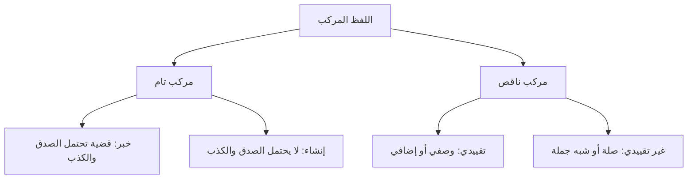
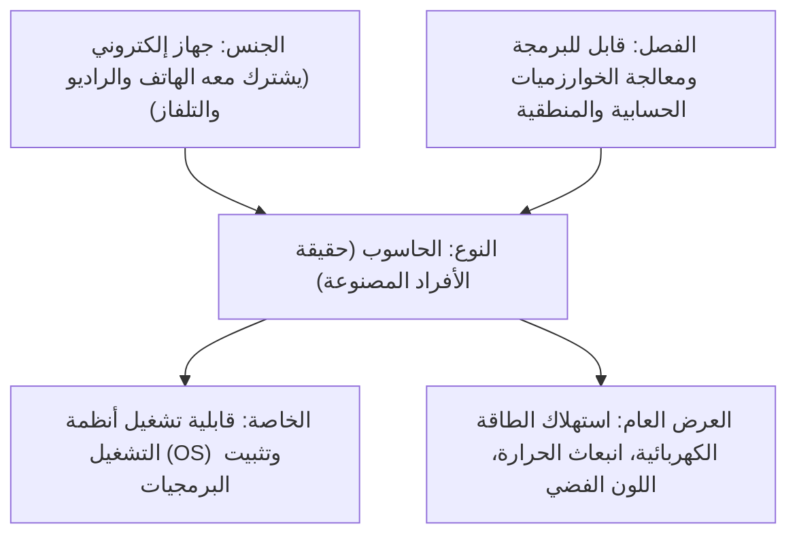
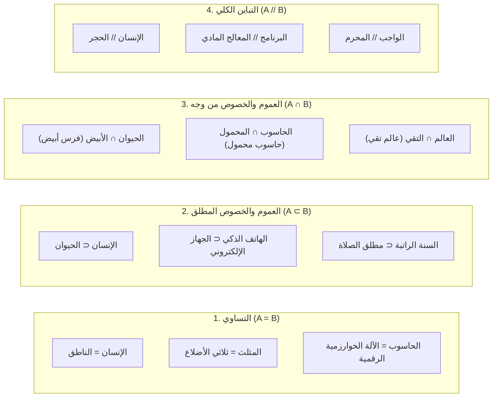
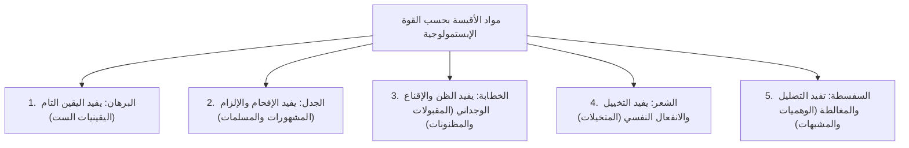

# موسوعة الأمثلة التطبيقية المعاصرة والتراثية لمتن «تصريح المنطق»
### دليل تعليمي شامل: أمثلة تراثية، وواقعية معاصرة، وعلمية ورياضية، وفقهية وأصولية لكل مصطلح وقاعدة

---

## مقدمة الموسوعة التطبيقية

يقول المناطقة: «بالمثال يتضح المقال، وبالمقابلة تتبين الفروق والأشكال». وإن أعظم عائق يواجه دارس المنطق الكلاسيكي هو انحصار الأمثلة المضروبة في متون القدماء في أمثلة تاريخية مكررة كـ «زيد»، و«عمرو»، و«الفرس»، و«الضحك بالقوة»، و«السقمونيا». 

تهدف هذه الموسوعة إلى فك الارتهان بهذه الأمثلة التقليدية، من خلال اعتماد **نموذج الأمثلة الرباعي المتكامل** لكل مفهوم منطقي ورد في متن «تصريح المنطق»:
1. **المثال التراثي المدرسي:** نص مثال المصنف في المتن لربط الشرح بالنص.
2. **المثال الواقعي المعاصر والتقني:** من واقع حياتنا اليومية المعاصرة (الحواسيب، الهواتف الذكية، شبكات الإنترنت، السيارات، الأنظمة الإدارية).
3. **المثال العلمي والرياضي:** من الهندسة، والفيزياء، والرياضيات، وعلم الأحياء، والكيمياء.
4. **المثال الفقهي والشرعي والأصولي:** من أبواب الفقه الإسلامي، وأصول الفقه، وقواعد الشريعة.

---

## 1. مبحث العِلْم: التصور والتصديق وأقسامهما

### 1.1. التصور البديهي (إدراك ساذج لا يتوقف على فكر)
- **التراثي:** تصور معنى «الحرارة»، و«البرودة»، و«الألم»، و«الوجود».
- **المعاصر والتقني:** تصور مفهوم «الشاشة»، أو معنى «الصوت»، أو مفهوم «النقر بالزر».
- **العلمي والرياضي:** تصور مفهوم «النقطة» في الهندسة، أو مفهوم «الوحدة العددية (1)».
- **الشرعي والأصولي:** تصور مفهوم «الماء»، أو معنى «الأكل»، أو معنى «الموت».

### 1.2. التصور النظري (إدراك ساذج يتوقف على بحث ونظر وتأمل)
- **التراثي:** تصور حقيقة «الجن»، وحقيقة «الروح»، وحقيقة «العقل».
- **المعاصر والتقني:** تصور حقيقة «الذكاء الاصطناعي التوليدي»، أو فهم كنه «التشفير الكمومي»، أو معمارية «المعالجات الدقيقة».
- **العلمي والرياضي:** تصور مفهوم «الثقب الأسود»، أو حقيقة «المادة المظلمة»، أو «البعد الزماني المكاني الرابع».
- **الشرعي والأصولي:** تصور حقيقة «الربا المحرم في العملات الرقمية»، أو حقيقة «عقد الاستصناع الحديث».

### 1.3. التصديق البديهي (حكم إذعاني لا يحتاج لدليل وبرهان)
- **التراثي:** «الشمس مشرقة في رابعة النهار»، «الكل أعظم من الجزء».
- **المعاصر والتقني:** «شحن البطارية بالكهرباء يرفع طاقتها»، «انقطاع الإنترنت يوقف التصفح الفوري».
- **العلمي والرياضي:** «الخطان المتوازيان لا يلتقيان في الفضاء الإقليدي»، «$1 + 1 = 2$».
- **الشرعي والأصولي:** «العدل واجب»، «الظلم قبيح محرم»، «الواجب مقدم على المندوب».

### 1.4. التصديق النظري (حكم إذعاني يتوقف على حجة وقياس وبرهان)
- **التراثي:** «العالم حادث»، «النفس مجردة»، «الصانع واحد».
- **المعاصر والتقني:** «نظام التشغيل المشفر آمَنُ من الاختراق بنسبة 99%»، «خوارزميات الفرز السريع أفضل كفاءة من الفرز الفقاعي».
- **العلمي والرياضي:** «مجموع زوايا المثلث تساوي $180^\circ$»، «سرعة الضوء ثابتة في الفراغ».
- **الشرعي والأصولي:** «النية شرط لصحة الصلاة»، «بيع الغرر باطل»، «التأمين التجاري يشوبه الميسر والقمار».

---

## 2. مبحث الدلالات الست وأقسام اللفظية الوضعية

### 2.1. الدلالات الست بحسب طبيعة الدال ومنشأ الملازمة:

| نوع الدلالة | المثال التراثي | المثال المعاصر والتقني | المثال العلمي والرياضي | المثال الشرعي والأصولي |
|---|---|---|---|---|
| **لفظية وضعية** | دلالة «زيد» على ذاته، و«إنسان» على الحيوان الناطق | دلالة لفظ «رابط تشعبي (Link)» على عنوان الويب الموجه للموقع | دلالة رمز «$\pi$» أو اسم «الهيدروجين» على العنصر الذري | دلالة لفظ «الزكاة» على النصيب المقدر شرعاً من المال |
| **لفظية طبعية** | دلالة «أَخْ أَخْ» على ألم الصدر، و«أُفٍّ» على الضجر | دلالة نطق السائق بـ «أوبس (Oops)» على وقوع خطأ غير مقصود | دلالة حشرجة الاحتضار الصادرة من الحنجرة على انقطاع التنفس | دلالة استغاثة الغريق بصوت «واغوثاه» على وقوع الهلاك |
| **لفظية عقلية** | دلالة لفظ «دَيْز» المسموع من وراء الجدار على وجود لافظ | دلالة سماع صوت نقر مفاتيح لوحة التحكم في مكالمة هاتفية على وجود شخص يكتب | دلالة التقاط موجة راديوية لغوية من قمر صناعي على وجود بث أرضي | دلالة التلفظ بصيغة الإيجاب والقبول خلف الستار على حضور العاقد |
| **غير لفظية وضعية** | الدوال الأربع: الخط، والعقد بالأصابع، والإشارة، والنُّصَب | دلالة الرمز الأحمر لشبكة (Wi-Fi) على انقطاع الاتصال بالإنترنت | دلالة علامة ($+$) على الجمع، ودلالة سهم المتجه في الفيزياء على الاتجاه | دلالة اتجاه المحراب في المسجد على جهة القبلة المشرفة |
| **غير لفظية طبعية** | دلالة سرعة النبض على الحمى، وحمرة الوجه على الخجل | دلالة تثاؤب الحاضرين في قاعة الاجتماع على الإرهاق والرغبة في النوم | دلالة اتساع حدقة العين في الظلام على الاستجابة الفسيولوجية للضوء | دلالة بكاء الرضيع الشديد على الجوع أو المغص |
| **غير لفظية عقلية** | دلالة المصنوع على الصانع، وأثر الأقدام على المسير | دلالة إضاءة مصباح استهلاك القرص الصلب باستمرار على وجود عمليات قراءة/كتابة | دلالة الدخان المتصاعد من الغابة على اشتعال ألسنة اللهب | دلالة انسكاب الدم على ثياب المقتول على وقوع اعتداء |

### 2.2. أقسام الدلالة اللفظية الوضعية: (المطابقة، التضمن، الالتزام)

#### أ. لفظ «الحاسوب المحمول (Laptop)»:
- **المطابقة:** دلالة اللفظ على كامل الجهاز بجميع مكوناته (الشاشة، اللوحة الأم، المعالج، الذاكرة، البطارية، لوحة المفاتيح).
- **التضمن:** دلالة اللفظ على «المعالج المركزي فقط»، أو «البطارية وحدها» في ضمن الكل.
- **الالتزام:** دلالة اللفظ على «الحاجة إلى مصدر طاقة للشحن»، أو «قابلية الاتصال بالشبكة»، أو «انبعاث الحرارة عند التشغيل».

#### ب. لفظ «عقد الإجارة»:
- **المطابقة:** دلالة اللفظ على تمليك منفعة معلومة بعوض معلوم مدة معلومة.
- **التضمن:** دلالته على «المنفعة» فقط، أو «الأجرة» فقط.
- **الالتزام:** دلالته على «ثبوت يد الضمان عند التعدي أو التفريط».

---

## 3. مبحث الألفاظ: المفرد والمركب

### 3.1. أقسام المركب:

#### أ. المركب التام:
- **الخبر (القضية):**
  - *تراثي:* «زيد قائم»، «العالم حادث».
  - *معاصر:* «الهاتف متصل بالإنترنت»، «الخادم متوقف عن العمل».
  - *علمي:* «الأرض تدور حول الشمس»، «الماء مركب من الهيدروجين والأكسجين».
  - *شرعي:* «الصلوات الخمس واجبة»، «المسلم من سلم المسلمون من لسانه ويده».
- **الإنشاء:**
  - **أمر:** *«احفظ الملف فوراً»*، شرعياً: *«أَقِيمُوا الصَّلَاةَ»*.
  - **نهي:** *«لا تفصل سلك الطاقة أثناء التحديث»*، شرعياً: *«وَلَا تَقْرَبُوا الزِّنَا»*.
  - **استفهام:** *«كم ميغابايت حجم هذا البرنامج؟»*، شرعياً: *«هَلْ جَزَاءُ الْإِحْسَانِ إِلَّا الْإِحْسَانُ»*.
  - **تمنٍّ:** *«يا ليت سرعة الإنترنت تدوم بلا انقطاع»*، تراثياً: *«ألا ليت الشباب يعود يوماً»*.
  - **ترجٍّ:** *«لعل المعاملة تنجز اليوم»*، شرعياً: *«لَعَلَّ اللَّهَ يُحْدِثُ بَعْدَ ذَلِكَ أَمْراً»*.
  - **تعجب:** *«ما أدق صناعة هذا المعالج!»*.
  - **نداء:** *«يا مبرمج النظام!»*، شرعياً: *«يَا أَيُّهَا الَّذِينَ آمَنُوا»*.

#### ب. المركب الناقص:
- **تقييدي وصفي:** «سيارة كهربائية سريعة»، «حاسوب محمول فائق الأداء»، أصولياً: «ماء طهور مطلق».
- **تقييدي إضافي:** «شاحن الهاتف»، «بروتوكول الشبكة»، فقهياً: «مال الزكاة»، «صلاة الجنازة».
- **غير تقييدي:** «في السحابة الإلكترونية»، «سبعة عشر ملفاً»، فقهياً: «فوق الكعبة».

---

## 4. مبحث أنواع المفرد باعتبار المعنى

### 4.1. الكلي المتواطئ والكلي المشكك:
- **الكلي المتواطئ (يتساوى صدقه على أفراده بلا تفاوت):**
  - *تراثي:* حقيقة «الإنسان» لزيد وعمرو وخالد، ومفهوم «الذهب».
  - *معاصر:* مفهوم «الهاتف الذكي» لآيفون وسامسونج؛ كلاهما هاتف ذكي على السوية في أصل الماهية.
  - *علمي:* مفهوم «الثدييات» للحوت والخفاش والأسد؛ تشترك جميعها في الولادة والإرضاع بلا تفاوت في أصل الجنسية.
  - *شرعي:* مفهوم «المكلف» لجميع البالغين العقلاء في أصل توجه الخطاب الشرعي.
- **الكلي المشكك (يتفاوت صدقه على أفراده بالشدة والضعف أو الأولوية):**
  - *تراثي:* «الوجود» للواجب تعالى وللممكنات، و«النور» للشمس والسراج.
  - *معاصر:* مفهوم «السرعة» لشبكة الألياف الضوئية (1000 ميغابت) مقارنة بشبكة الجيل الرابع (20 ميغابت).
  - *علمي:* «الحرارة» لسطح الشمس المقدر بآلاف الدرجات مقارنة بحرارة ماء مغلي ($100^\circ\text{C}$).
  - *شرعي:* مفهوم «الإيمان»؛ يتفاوت بين الصديقين وآحاد المسلمين («الإيمان بضع وسبعون شعبة»).

### 4.2. المشترك اللفظي والمنقول:
- **المشترك اللفظي (لفظ واحد وُضع لعدة معانٍ بوضع مستقل):**
  - *تراثي:* «العين» (للباصرة، ونبع الماء، والذهب، والجاسوس).
  - *معاصر:* كلمة «فأرة (Mouse)» تُطلق على الحيوان القارض الصغير، وعلى أداة التأشير الحاسوبية.
  - *معاصر:* كلمة «شبكة (Net)» تُطلق على شبكة الصيد، وشبكة الطرق، والإنترنت.
  - *شرعي:* «القُرء» يُطلق على الحيض ويُطلق على الطهر في لسان العرب.
- **المنقول (لفظ نُقل من معنى أول إلى معنى ثانٍ لمناسبة مع هجر الأول):**
  - **عُرفي عام:** لفظ «السيارة» كان يطلق على القافلة السائرة (كما في القرآن: *«وَجَاءَتْ سَيَّارَةٌ»*)، ثم نُقل في عرف الناس إلى المركبة الآلية وهُجر المعنى الأول.
  - **شرعي:** لفظ «الحج» كان في اللغة لمطلق القصد، ثم نُقل شرعاً لقصد بيت الله الحرام بأفعال مخصوصة في وقت مخصوص وهُجر الأول.
  - **اصطلاحي علمي:** لفظ «الذاكرة (Memory)» كان في الأصل ملكة الحفظ في الدماغ، فنقله علماء الحاسوب إلى رقائق السيليكون التي تخزن البيانات الرقمية ($RAM$).

---

## 5. مبحث الكليات الخمس (أجزاء الماهية وعوارضها)

### تطبيق عملي رباعي على الكليات الخمس لمفهوم: «الحاسوب (Computer)»

1. **النوع (*Nawʿ*):** «الحاسوب» — تمام حقيقة الأجهزة الرقمية المعالجة.
2. **الجنس (*Jins*):**
   - *قريب:* «جهاز إلكتروني رقمي».
   - *متوسط:* «آلة مصنوعة».
   - *بعيد:* «جسم مادي / جوهر».
3. **الفصل (*Faṣl*):**
   - *قريب:* «معالج للبيانات بواسطة الخوارزميات المنطقية» (يميزه عن الراديو والشاشة والتلفاز).
   - *بعيد:* «يعمل بالدارات الكهربائية» (يميزه عن الآلات الميكانيكية اليدوية كالساعة الميكانيكية).
4. **الخاصة (*Khāṣṣah*):**
   - *لازمة:* قابلية تخزين البيانات وتحديث نظام التشغيل.
   - *مفارقة:* تصفح موقع محدد بالفعل، أو إصابة الجهاز بفيروس في وقت معين.
5. **العرض العام (*ʿAraḍ ʿĀmm*):**
   - *لازم:* الحاجة إلى الطاقة الكهربائية للتشغيل (يشترك معه المكيف والثلاجة والغسالة).
   - *مفارق:* كونه أسود اللون، أو محمولاً في حقيبة، أو مشتغلاً الآن بالفعل.

---

## 6. مبحث النسب الأربع بين الكليات

### تفصيل أمثلة النسب الأربع:
1. **التساوي ($A = B$):**
   - *تراثي:* «الإنسان» و«الناطق»، أو «الإنسان» و«الضاحك بالقوة».
   - *تقني:* «الرقم التعريفي للجهاز (MAC Address)» و«المعرف الفيزيائي الفريد لبطاقة الشبكة».
   - *رياضي:* «المثلث متساوي الأضلاع» و«المثلث متطابق الزوايا ($60^\circ$)».
   - *أصولي:* «الفرض» و«الواجب» عند جمهور الفقهاء (غير الحنفية).
2. **العموم والخصوص المطلق ($A \subset B$):**
   - *تراثي:* «الحيوان» (أعم مطلقاً) و«الإنسان» (أخص مطلقاً).
   - *تقني:* «البرمجيات (Software)» (أعم مطلقاً) و«تطبيقات الهاتف (Mobile Apps)» (أخص مطلقاً).
   - *علمي:* «المعدن» (أعم مطلقاً) و«الذهب» (أخص مطلقاً).
   - *فقهي:* «العبادة» (أعم مطلقاً) و«الصيام» (أخص مطلقاً).
3. **العموم والخصوص من وجه ($A \cap B \neq \emptyset$):**
   - *تراثي:* «الحيوان» و«الأبيض»؛ يجتمعان في «الحصان الأبيض»، وينفرد الحيوان في «الغراب الأسود»، وينفرد الأبيض في «الثلج».
   - *تقني:* «حاسوب» و«جهاز محمول باليد»؛ يجتمعان في «الهاتف الذكي أو الجهاز اللوحي»، وينفرد الحاسوب في «الحاسوب المكتبي الضخم»، وينفرد المحمول باليد في «الآلة الحاسبة البسيطة».
   - *فقهي:* «الماء» و«المطهر»؛ يجتمعان في «الماء المطلق الطهور»، وينفرد الماء في «الماء المتنجس»، وينفرد المطهر في «تراب التيمم».
4. **التباين الكلي ($A \cap B = \emptyset$):**
   - *تراثي:* «الموجود» و«المعدوم»، «الإنسان» و«الشجر».
   - *تقني:* «العتاد المادي الصلب (Hardware)» و«البيانات الرقمية المجردة (Data)».
   - *رياضي:* «العدد الفردي» و«العدد الزوجي».
   - *فقهي:* «الحلال القطعي» و«الحرام القطعي».

---

## 7. مبحث المعرِّف (القول الشارح) ومزالق التعريف

### تطبيق مقارن: تعريف «الهاتف الذكي (Smartphone)» بأقسام المعرِّف الأربعة:
1. **الحد التام (جنس قريب + فصل قريب):**
   - *التعريف:* «جهاز إلكتروني اتصالي محمول (جنس قريب) مزود بنظام تشغيل تفاعلي قادر على تشغيل التطبيقات ومعالجة البيانات المتعددة (فصل قريب)».
2. **الحد الناقص (جنس بعيد + فصل قريب):**
   - *التعريف:* «آلة تقنية (جنس بعيد) قادرة على تشغيل التطبيقات ومعالجة البرمجيات الاتصالية (فصل قريب)»، أو الاكتفاء بالفصل: «الجهاز القابل لبرمجة الاتصال الذكي».
3. **الرسم التام (جنس قريب + خاصة لازمة):**
   - *التعريف:* «جهاز إلكتروني اتصالي محمول (جنس قريب) يحتوي على شاشة لمس ملونة ويدعم المساعد الصوتي وتنزيل التطبيقات من المتاجر (خاصة)».
4. **الرسم الناقص (جنس بعيد + خاصة / أو خاصة وحدها):**
   - *التعريف:* «أداة مصنوعة (جنس بعيد) تحتوي على شاشة لمسية ملساء وتطبيق للمحادثة الفورية»، أو: «الجهاز ذو الكاميرا المدمجة وشاشة اللمس (خاصة وحدها)».
5. **التعريف اللفظي:**
   - *التعريف:* تفسير كلمة «السيلفي» بأنها «الصورة الملتقطة ذاتياً بواسطة الكاميرا الأمامية».

### أمثلة على مزالق وموانع التعريف المنطقي:
- **الدور الصريح:** تعريف «العلم» بأنه «معرفة المعلوم»، أو تعريف «الزوج» بأنه «العدد الذي ليس بفرد»، وتعريف «الفرد» بأنه «العدد الذي ليس بزوج».
- **التعريف بالأخفى:** كتعريف «النار» بأنها «جسم شبيه بالنفس»! أو تعريف «الإنترنت» بأنه «الفضاء السيبراني السيميائي!».
- **التعريف بالأعم (غير مانع):** تعريف «الإنسان» بأنه «جسم نامٍ» (يدخل فيه الشجر والحيوان).
- **التعريف بالأخص (غير جامع):** تعريف «الإنسان» بأنه «حيوان مهندس يصمم الطائرات» (يخرج منه مليارات البشر).
- **المجاز المجرد عن القرينة:** كقولهم في تعريف «المستشار المالي»: «هو شمس تضيء عتمة الأسواق!».

---

## 8. مبحث القضايا الحملية وأسوارها

| القضية المحصورة | المثال التراثي | المثال التقني والمعاصر | المثال العلمي | المثال الشرعي والأصولي |
|---|---|---|---|---|
| **موجبة كلية (م.ك)** | كل إنسان حيوان | كل اتصال عبر بروتوكول ($HTTPS$) فهو مشفر | كل فلز يتمدد بالحرارة | كل مسكر خمر، وكل خمر حرام |
| **موجبة جزئية (م.ج)** | بعض الحيوان إنسان | بعض البرامج الحاسوبية مفتوحة المصدر | بعض العناصر الكيميائية غازات نبيلة | بعض البيوع الفاسدة تلحقها الإجازة |
| **سالبة كلية (س.ك)** | لا شيء من الإنسان بحجر | لا شيء من كلمات المرور المشفرة بـ ($SHA-256$) بقابلة لفك التشفير العكسي المباشر | لا شيء من الكواكب بمضيء بذاته | لا صلاة لمن لم يقرأ بفاتحة الكتاب |
| **سالبة جزئية (س.ج)** | ليس كل حيوان إنساناً | ليس كل موقع إلكتروني آمناً من ثغرات الحقن ($SQLi$) | بعض الثدييات ليست ولودة في البر (كالحوت) | ليس كل عقد بيع بلازم (كالجعالة والوكالة) |

---

## 9. مبحث القضايا الموجهة (البسيطة والمركبة)

### 9.1. أمثلة معاصرة على القضايا البسيطة الثمانية:
1. **الضرورية المطلقة:** «بالضرورة، كل خوارزمية حاسوبية فهي منتهية بعدد محدد من الخطوات ما دامت ذات الخوارزمية موجودة».
2. **المشروطة العامة:** «بالضرورة، كل سيارة تسير على الطريق فهي ذات طاقة حركية *ما دامت سائرة*».
3. **الوقتية المطلقة:** «بالضرورة، خادم الشبكة متوقف عن تلقي الطلبات *وقت إجراء الصيانة الدورية فجر الأحد*».
4. **المنتشرة المطلقة:** «بالضرورة، بطارية الهاتف الذكي تحتاج لإعادة الشحن *في وقت ما من الأوقات*».
5. **الدائمة المطلقة:** «دائماً، الأرض سابحة في مدارها حول مركز الكتلة ما دامت ذات الأرض موجودة».
6. **العرفية العامة:** «دائماً، المعالج المركزي يبدد طاقة حرارية *ما دام معالجاً للبيانات وقيد التشغيل*».
7. **المطلقة العامة:** «بالفعل، هذا الهاتف الذكي متصل بشبكة الإنترنت الآن».
8. **الممكنة العامة:** «بالإمكان العام، المستثمر الجديد يربح مليون دولار في سوق الأسهم (أي ليس بممتنع)».

### 9.2. أمثلة معاصرة على القضايا المركبة السبعة:
1. **المشروطة الخاصة:** «بالضرورة، المعالج الحاسوبي يستهلك طاقة قصوى *ما دام تحت الحمل الشديد ($100\%$)*، لا دائماً بحسب الذات».
2. **الوقتية الخاصة:** «بالضرورة، الشاشة تنطفئ *وقت تفعيل وضع توفير الطاقة*، لا دائماً بحسب الذات».
3. **المنتشرة الخاصة:** «بالضرورة، التطبيق الذكي يتصل بالخادم لتحديث البيانات *في وقت ما*، لا دائماً».
4. **العرفية الخاصة:** «دائماً، تطبيق الملاحة يحدد الموقع الجغرافي عبر الأقمار الصناعية *ما دام نشطاً في الواجهة*، لا دائماً بحسب ذات الهاتف».
5. **الوجودية اللادرورية:** «بالفعل، هذا المبرمج يكتب بلغة بايثون، لا بالضرورة (إذ يمكنه التحول للغة أخرى)».
6. **الوجودية اللادائمة:** «بالفعل، هذا الخادم يعمل بنصف طاقته الاستيعابية اليوم، لا دائماً».
7. **الممكنة الخاصة:** «بالإمكان الخاص، هذا الجهاز اللوحي يتعرض للكسر (أي ليس بضروري الثبوت ولا ضروري السلب؛ بل جائز الوقوع والعدم)».

---

## 10. مبحث القضايا الشرطية (المتصلة والمنفصلة)

### 10.1. الشرطية المتصلة:
- **متصلة لزومية:**
  - *تقني:* «كلما ضغط المستخدم على زر الحفظ ($Ctrl+S$)، كُتبت البيانات في القرص الصلب».
  - *علمي:* «إذا انخفضت درجة حرارة الماء النقي تحت الصفر المئوي عند الضغط الجوي المعتاد، تجمد الماء وصار جليداً».
  - *شرعي:* «إذا غابت الشمس، دخل وقت صلاة المغرب وحل إفطار الصائم».
- **متصلة اتفاقية:**
  - *معاصر:* «كلما كان سعر الذهب مرتفعاً في لندن، فاز فريق ريال مدريد بمباراته!».
  - *تراثي:* «كلما كان الإنسان ناطقاً كان الفرس صاهلاً» (لا علقة سببية بينهما وإن صدقا معاً).

### 10.2. الشرطية المنفصلة:
- **منفصلة حقيقية (مانعة جمع وخلو معاً - XOR بالتعبير الحاسوبي):**
  - *تقني:* «حالة البت الرقمي ($Bit$): إما أن تكون قيمته (1) أو تكون قيمته (0)». (لا يمكن أن يكون كلاهما معاً، ولا يمكن أن يخلو عنهما).
  - *علمي:* «هذا المحلول الكيميائي إما حمضي (pH < 7) أو متعادل أو قاعدي (pH > 7)».
  - *شرعي:* «هذا المكلف إما طاهر وإما محدث».
- **منفصلة مانعة الجمع فقط (يجوز ارتفاعهما معاً):**
  - *تقني:* «هذا الجهاز الذكي إما أن يعمل بنظام ($iOS$) أو يعمل بنظام ($Android$)». (لا يجتمعان في هاتف واحد، ولكن يجوز ارتفاعهما في حاسوب يعمل بنظام ويندوز أو لينكس).
  - *تراثي:* «هذا الجسم إما شجر وإما حجر» (يرتفعان في الفرس والإنسان).
  - *فقهي:* «هذا العقد إما بيع وإما إجارة» (لا يجتمعان في صفقة واحدة مجهولة، ولكن يرتفعان في الهبة).
- **منفصلة مانعة الخلو فقط (يجوز اجتماعهما معاً):**
  - *تقني:* «هذا الملف المخزن إما أن يكون له نسخة احتياطية محلية، وإما أن يكون مرفوعاً على السحابة». (لا يخلو الملف الآمن عنهما معاً كي لا يضيع، ولكن يجوز أن تتوفر له النسختان معاً زيادة في الأمان).
  - *تراثي:* «زيد إما أن يكون في السفينة وإما ألا يغرق» (يجوز كونه في السفينة وسالماً من الغرق معاً، ويمتنع أن يكون غريقاً وخارج البحر).
  - *فقهي:* «تارك الصلاة إما أن يقضيها وإما أن يأثم» (يجوز أن يقضي مع الإثم بالتأخير، ويمتنع ارتفاعهما معاً).

---

## 11. مبحث أحكام القضايا: التناقض والعكس

### 11.1. أمثلة تطبيقية على اختلال شروط التناقض (الوحدات الثمانية):
1. **اختلال وحدة الموضوع:** «الذهب موصل ممتاز للكهرباء» صادقة، و«الفحم ليس بموصل ممتاز للكهرباء» صادقة؛ ولم يتناقضا لاختلاف الموضوع.
2. **اختلال وحدة المحمول:** «السيارة الكهربائية سريعة» صادقة، و«السيارة الكهربائية ليست برخيصة» صادقة؛ لاختلاف المحمول.
3. **اختلال وحدة الزمان:** «ميدان المدينة مزدحم بالسيارات (نهاراً)» صادقة، و«ميدان المدينة ليس بمزدحم بالسيارات (في منتصف الليل)» صادقة.
4. **اختلال وحدة المكان:** «الماء يغلي عند $100^\circ\text{C}$ (عند مستوى سطح البحر)» صادقة، و«الماء ليس يغلي عند $100^\circ\text{C}$ (فوق قمة جبل إفرست)» صادقة لانخفاض الضغط الجوي.
5. **اختلال وحدة القوة والفعل:** «هذا الرضيع مبرمج (بالقوة؛ أي إذا كبر وتعلّم)» صادقة، و«هذا الرضيع ليس بمبرمج (بالفعل)» صادقة.
6. **اختلال وحدة الكل والجزء:** «شاشة الهاتف مكسورة (أي جزء من زجاجها)» صادقة، و«شاشة الهاتف ليست بمكسورة (أي كامل اللوحة الداخلية ما زالت تعمل)» صادقة.
7. **اختلال وحدة الإضافة:** «المعالج المركزي $i7$ سريع (بالنسبة لمعالجات الجيل القديم)» صادقة، و«المعالج المركزي $i7$ ليس بسريع (بالنسبة للمعالجات الفائقة الخارقة الحديثة)» صادقة.
8. **اختلال وحدة الشرط:** «المحرك يولد حركة بشرط تزويده بالوقود» صادقة، و«المحرك ليس يولد حركة بشرط فراغ خزانه» صادقة.

### 11.2. أمثلة العكس المستوي وعكس النقيض:

#### أ. الموجبة الكلية (م.ك): تنعكس موجبة جزئية (م.ج) في المستوي:
- **الأصل الصادق:** «كل حاسوب محمول فهو جهاز إلكتروني».
- **العكس المستوي الصادق:** «بعض الأجهزة الإلكترونية حواسيب محمولة».
- *(بيان بطلان انعكاسها كلية):* لو عكستها كلية فقلت: «كل جهاز إلكتروني حاسوب محمول» لكذبت، لأن الثلاجة والتلفاز أجهزة إلكترونية وليست حواسيب.
- **عكس النقيض الموافق الصادق (م.ك):** «كل ما ليس بجهاز إلكتروني فليس بحاسوب محمول».

#### ب. السالبة الكلية (س.ك): تنعكس سالبة كلية (س.ك) في المستوي:
- **الأصل الصادق:** «لا شيء من الدوائر الكهربائية المغلقة بعديمة التيار».
- **العكس المستوي الصادق:** «لا شيء من عديم التيار بدائرة كهربائية مغلقة سليمة».
- **عكس النقيض الموافق الصادق (س.ج):** «بعض ما ليس بعديم التيار (أي فيه تيار) ليس بما ليس بدائرة كهربائية مغلقة».

#### ج. السالبة الجزئية (س.ج): لا تنعكس في المستوي:
- **الأصل الصادق:** «بعض البرمجيات ليست بتطبيقات خبيثة».
- **العكس الباطل لو عكست:** لا يلزم صدقه؛ كقولنا: «بعض الحيوان ليس بإنسان» (صادقة قطعا)، وعكسها: «بعض الإنسان ليس بحيوان» (كاذبة بالضرورة وباطمئنان).

---

## 12. مبحث القياس الاقتراني الحملي (الأشكال الأربعة)

### نماذج محلولة لأبرز ضروب القياس بأمثلة معاصرة:

#### 1. الشكل الأول - الضرب 1 (Barbara): م.ك + م.ك $\implies$ م.ك
- **الصغرى:** كل خوارزمية ذكاء اصطناعي تعتمد على تدريب الشبكات العصبية.
- **الكبرى:** وكل ما يعتمد على تدريب الشبكات العصبية يتطلب بطاقات معالجة رسومية ($GPU$).
- **النتيجة:** $\therefore$ **كل خوارزمية ذكاء اصطناعي تتطلب بطاقات معالجة رسومية ($GPU$)**.

#### 2. الشكل الأول - الضرب 2 (Celarent): م.ك + س.ك $\implies$ س.ك
- **الصغرى:** كل هجوم سيبراني ببرمجيات الفدية مشفر للبيانات.
- **الكبرى:** ولا شيء من البرمجيات المشفرة للبيانات بلا إذن بمسموح بها في الأنظمة المؤسسية.
- **النتيجة:** $\therefore$ **لا شيء من هجمات الفدية بمسموح به في الأنظمة المؤسسية**.

#### 3. الشكل الثاني - الضرب 1 (Cesare): م.ك + س.ك $\implies$ س.ك
- **الصغرى:** كل هاتف ذكي حديث يدعم الاتصال اللاسلكي ($Wi-Fi$).
- **الكبرى:** ولا شيء من الهواتف السلكية القديمة الثابتة بيدعم الاتصال اللاسلكي ($Wi-Fi$).
- **النتيجة:** $\therefore$ **لا شيء من الهواتف الذكية الحديثة بهواتف سلكية قديمة ثابتة**.

#### 4. الشكل الثاني - الضرب 4 (Baroco): س.ج + م.ك $\implies$ س.ج
- **الصغرى:** بعض قواعد البيانات ليست بعلاقات جدولية ($NoSQL$).
- **الكبرى:** وكل قواعد بيانات ($SQL$) علاقات جدولية.
- **النتيجة:** $\therefore$ **بعض قواعد البيانات ليست بقواعد بيانات ($SQL$)**.

#### 5. الشكل الثالث - الضرب 1 (Darapti): م.ك + م.ك $\implies$ م.ج
- **الصغرى:** كل طائرة مسيرة بدون طيار ($Drone$) مركبة طائرة.
- **الكبرى:** وكل طائرة مسيرة بدون طيار جهاز يتم التحكم فيه عن بعد.
- **النتيجة:** $\therefore$ **بعض المركبات الطائرة أجهزة يتم التحكم فيها عن بعد**.

#### 6. الشكل الثالث - الضرب 4 (Felapton): م.ك + س.ك $\implies$ س.ج
- **الصغرى:** كل بروتوكول شبكة محلي نظام اتصال برمجي.
- **الكبرى:** ولا شيء من بروتوكولات الشبكة بمكون مادي صلب ($Hardware$).
- **النتيجة:** $\therefore$ **بعض أنظمة الاتصال البرمجية ليست بمكون مادي صلب**.

---

## 13. مبحث القياس الاستثنائي والاستقراء والتمثيل

### 13.1. القياس الاستثنائي:
- **الاتصالي اللزومي:**
  - *المقدمة الكبرى:* «إذا استُهلكت كامل الذاكرة العشوائية ($RAM$)، انهار النظام وتوقف التطبيق».
  - *استثناء عين المقدم:* «لكن كامل الذاكرة العشوائية استهلكت بالفعل».
  - *النتيجة:* $\therefore$ **انهار النظام وتوقف التطبيق**.
  - *(استثناء نقيض التالي):* «لكن النظام لم ينهار ولم يتوقف التطبيق».
  - *النتيجة:* $\therefore$ **لم تستهلك كامل الذاكرة العشوائية**.
  - *(تحذير من مغالطة وضع التالي):* لو قلت «لكن النظام توقف» فلا يلزم منه استهلاك الذاكرة، لجواز توقفه بسبب انقطاع الكهرباء أو عطل في المعالج.
- **الانفصالي الحقيقي:**
  - *المقدمة:* «هذا المحرك إما أن يكون كهربائياً وإما أن يكون محرك احتراق داخلي بالبنزين».
  - *استثناء عين أحدهما:* «لكنه كهربائي» $\implies$ $\therefore$ **فليس بمحرك احتراق داخلي**.
  - *استثناء نقيض أحدهما:* «لكنه ليس بكهربائي» $\implies$ $\therefore$ **فهو محرك احتراق داخلي**.

### 13.2. الاستقراء التام والاستقراء الناقص:
- **الاستقراء التام (يفيد اليقين القطعي الرياضي):**
  - *تطبيق معاصر:* تتبع جميع المستخدمين المسجلين في قاعدة بيانات شركة تضم 500 موظف، وفحص حساباتهم واحداً واحداً: وجدنا أن الموظف الأول مفعل للتحقق الثنائي، والثاني، والثالث... حتى الموظف رقم 500 $\implies$ النتيجة القطعية: «كل موظفي الشركة مفعلون للتحقق الثنائي».
- **الاستقراء الناقص (يفيد الظن العلمي والتعميم التجريبي القابل للنقض):**
  - *تطبيق معاصر:* تجربة دواء جديد على عينة من 10,000 مريض بالصداع، وشفاؤهم منه $\implies$ الحكم العام: «هذا الدواء يشفي الصداع لكل إنسان». (حكم ظني راجح يجوز نقضه بظهور مريض لديه طفرة جينية لا يستجيب معها للدواء).

### 13.3. التمثيل (القياس الفقهي والمنطقي):
- **الأركان الأربعة في مسألة معاصرة (تحريم المخدرات الرقمية أو الحشيش الاصطناعي):**
  1. **الأصل:** خمر العنب المنصوص على تحريمه في القرآن والسنة.
  2. **الفرع:** الحشيش الاصطناعي والمواد المخدرة المصنعة حديثاً.
  3. **العلة المشتركة (الجامع):** إسكار العقل وإذهاب الوعي والإضرار بالبدن.
  4. **الحكم:** التحريم القطعي.
- **مسلك الدوران:** تتبع الحكم مع الوصف وجوداً وعدماً؛ فكلما وجدت مادة تسكر غاب العقل وحرم تناولها، وإذا زال الإسكار (كتخلل الخمر بنفسه وصيرورته خلاً) زالت الحرمة وطهر السائل.
- **مسلك الترديد (السبر والتقسيم):** حصر أوصاف الأصل (الخمر): هل حرم لكونه سائلاً؟ لا، لأن الماء سائل وحلال. هل حرم لكونه أحمر؟ لا، لأن عصير الرمان أحمر وحلال. هل حرم لكونه من العنب؟ لا، لأن العنب حلال بالإجماع. فلم يبق إلا «الإسكار»، فتعين كونه هو العلة الوحيدة.

---

## 14. مبحث الصناعات الخمس (مواد الأقيسة)

### 14.1. مبادئ البرهان: اليقينيات الست
1. **الأوليات:** «المستقيمان المتقاطعان يشتركان في نقطة واحدة فقط»، «الواحد نصف الاثنين».
2. **الفطريات (قضايا قياساتها معها):** «العدد ثمانية زوج» (لأن انقسامه لمتساويين أربعة وأربعة حاضر في الذهن بلا بحث).
3. **المشاهدات:**
   - *حسيات ظاهرة:* «هذا المؤشر يضيء باللون الأخضر»، «صوت جرس الإنذار مدوٍ».
   - *وجدانيات باطنة:* «أشعر بالصداع والإرهاق الذهني»، «أحس بالفرح لنجاح المشروع».
4. **الحدسيات:** «انتقال حرارة السائل إلى الإناء حدس قطعي سببه التوصيل الحراري»، كشف العالم الفلكي أن مسار الكوكب إهليلجي لا دائري بالحدس الرياضي السريع.
5. **التجربيات:** «الماء المالح يغلي عند درجة حرارة أعلى من $100^\circ\text{C}$» (ثبتت بالتكرار المقرون بحكم العقل بالملازمة).
6. **المتواترات:** اليقين بوجود مدينة «طوكيو» وسقوط قنبلة «هيروشيما» ونزول «القرآن الكريم» على النبي ﷺ؛ لورود الخبر عن مليارات البشر كابراً عن كابر.

### 14.2. البرهان اللِمّي والإِنّي:
- **البرهان اللِمّي (الحد الأوسط علة لثبوت الحكم في الخارج والذهن معاً):**
  - *الصغرى:* هذه الآلة انقطع عنها الوقود تماماً.
  - *الكبرى:* وكل آلة انقطع عنها الوقود تماماً يتوقف محركها عن العمل.
  - *النتيجة:* $\therefore$ **هذه الآلة يتوقف محركها عن العمل**.
  - *(التعليل):* انقطاع الوقود هو العلة الحقيقية في الواقع لتوقف المحرك، وهو نفسه علة استنتاجك في الذهن.
- **البرهان الإِنّي (الحد الأوسط معلول وأثر للحكم في الخارج، وعلامة دالة عليه في الذهن):**
  - *الصغرى:* هذا المحرك قد ارتفعت حرارته إلى درجة الغليان وتصاعد منه الدخان.
  - *الكبرى:* وكل محرك تصاعد منه الدخان شديد الحرارة فهو يعاني من عطل في دورة التبريد.
  - *النتيجة:* $\therefore$ **هذا المحرك يعاني من عطل في دورة التبريد**.
  - *(التعليل):* الدخان ليس علة لعطل التبريد، بل هو معلول وأثر ناتج عنه استدل به العقل من الأثر على المؤثر.

### 14.3. الجدل والخطابة والشعر والسفسطة:
- **الجدل (إلزام الخصم بالمسلمات والمشهورات):**
  - كاستدلالك على محامٍ بقولك: «نصت المادة الرابعة من القانون التي تقر بها على بطلان هذا الإجراء، وقضيتك استندت لهذا الإجراء، $\therefore$ فقضيتك باطلة بحسب قانونك المسلَّم عندك».
- **الخطابة (إقناع الجماهير بالمظنونات والمقبولات):**
  - كقول الخطيب للناس في حملة خيرية: «التبرع لهذا المستشفى ينقذ حياة طفل بريء؛ وكل من أحيا نفساً فكأنما أحيا الناس جميعاً؛ فتصدقوا».
- **الشعر (التخييل والتأثير العاطفي):**
  - كأن يصف المتحدث جهاز الهاتف القديم بأنه: «سجن أسود يسلب وقتك ويسرق ربيع عمرك» لينفرك من إدمانه.
- **السفسطة والمغالطة (إيقاع الخصم في الوهم والغلط):**
  - **مغالطة الاشتراك اللفظي:** «الجبن طعام لذيذ، وكل خور وضعف جبن، $\therefore$ فالخور والضعف طعام لذيذ!».
  - **مغالطة التركيب:** «كل لاعب في هذا الفريق هو أفضل لاعب في مركزه في العالم، $\therefore$ فهذا الفريق هو أفضل فريق متعاون في العالم» (تجاهل انسجام المنظومة).
  - **مغالطة الوهميات المنكرة للمجردات:** «كل ما لا يرى بالمجهر ولا تلتقطه المجسات الفيزيائية فهو وهم لا وجود له» (قياس باطل يحصر الوجود في المحسوسات المادية).

---

> **خاتمة الموسوعة التطبيقية:**
> بهذا الاستيعاب الشامل لجميع أبواب متن «تصريح المنطق»، تنتقل القواعد المنطقية من حيز التجريد والجمود إلى فضاء المعاصرة والبيان، مما يمكن الطالب من توظيف آلة المنطق في سائر العلوم العقلية والشرعية والتطبيقية.

