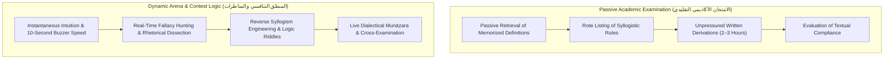
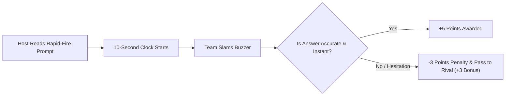
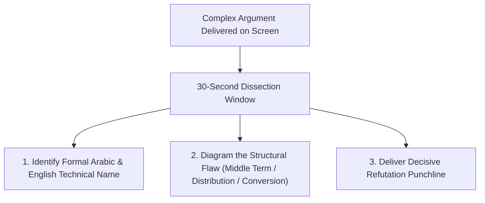
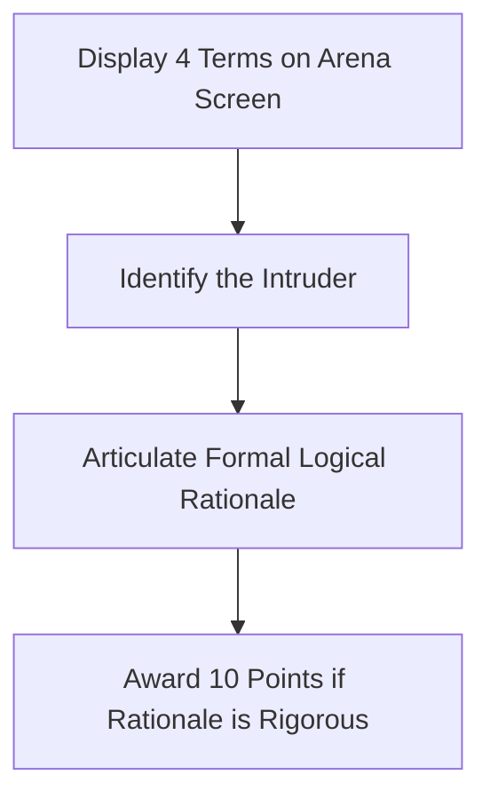
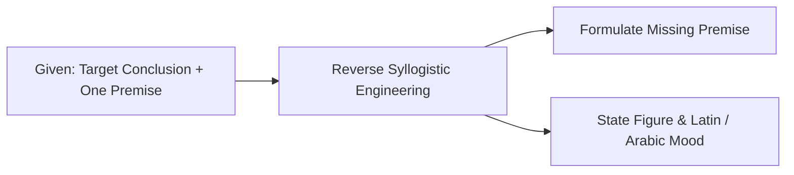
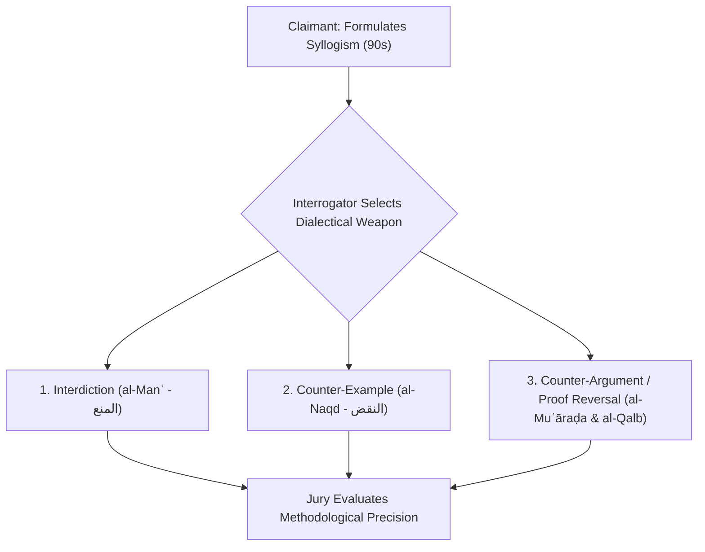
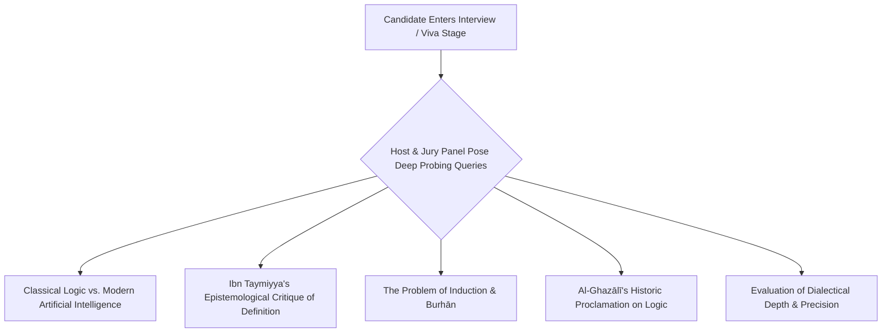
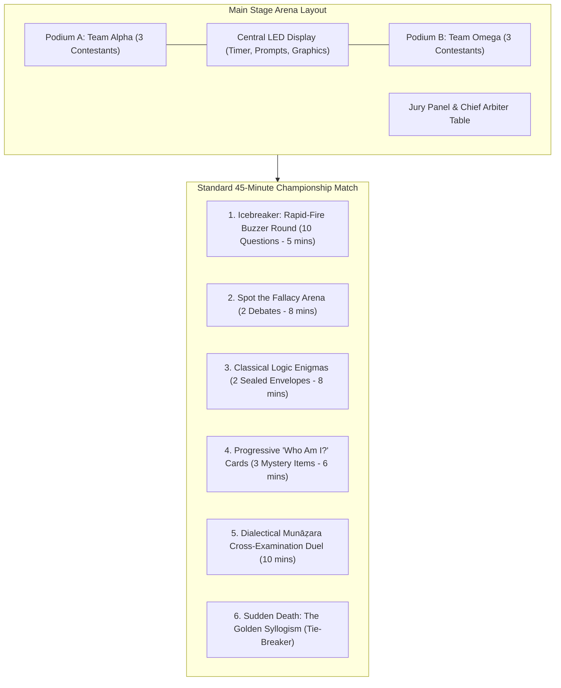

# The Master Manṭiq Arena Manual & Question Bank
## Comprehensive Guide to Logic Competitions, Quiz Bowls, Debate Tournaments, Viva Voce & Intellectual Interviews
### Based on the Classical Manual *Tasrīḥ al-Manṭiq* (تصريح المنطق)

---

## 1. Foreword: Competitive Logic vs. Academic Examinations
### (المنطق التنافسي في مواجهة الامتحانات المدرسية والأكاديمية)

In traditional educational curricula and academic examinations, classical logic (*ʿIlm al-Manṭiq* - علم المنطق) is all too often treated as a static exercise in memorization: students regurgitate canonical definitions, recite formal conditions for syllogistic figures, and reproduce textbook proofs in a leisurely, two-to-three-hour written setting.

**Competitive Logic**, by contrast—as practiced in student fests, debate leagues, quiz bowls, rapid-fire buzzer duels, and high-stakes intellectual viva voce interviews—demands an entirely different cognitive posture. It transforms formal logic from a dormant archive into an active intellectual weapon:



### The Four Pillars of Arena Logic

| Dimension | Academic Written Exam | Fests, Quizzes, Interviews & Tournaments |
| :--- | :--- | :--- |
| **Cognitive Objective** | Verifying textual coverage and memorized jargon. | Measuring cognitive agility, critical discernment, and the ability to silence an opponent (*Ifḥām al-Khaṣm* - إفحام الخصم). |
| **Question Format** | Descriptive: *"Define the difference between Taṣawwur and Taṣdīq."* | Operational / Applied: *"Given this 15-second political excerpt, pinpoint the formal fallacy and state the invalid figure."* |
| **Time Dynamics** | Generous, static, self-paced ($120 - 180\text{ minutes}$). | Extreme pressure: 5 to 15 seconds per buzzer; instant sudden-death penalties. |
| **Epistemic Modality** | Passive recall (*Istidhkār* - استذكار). | Active deduction, reverse engineering, counter-exemplification (*Naqd* - نقض), and conversion on the fly. |
| **Arena Environment** | Silent hall, solitary paper-and-pen submission. | Spotlight stage, live audience, electronic buzzers, cross-examination podiums, and an exacting jury panel. |

---

## Master Table of Contents

1. [Round 1: Rapid-Fire & High-Speed Buzzer Arena (جولة الأجراس والأسئلة الخاطفة)](#round-1-rapid-fire--high-speed-buzzer-arena)
2. [Round 2: Spot the Fallacy Arena — Dialectical & Public Rhetoric Sniper (قناص المغالطات وتحليل الحجج الزائفة)](#round-2-spot-the-fallacy-arena)
3. [Round 3: Classical Logic Riddles, Paradoxes & Enigmas (ألغاز المناطقة والأحاجي والمفارقات الكبرى)](#round-3-classical-logic-riddles-paradoxes--enigmas)
4. [Round 4: Progressive Deduction Clues — "Who Am I? / What Am I?" (التخمين التراكمي: من أنا؟)](#round-4-progressive-deduction-clues)
5. [Round 5: Odd-One-Out with Formal Logical Proof (استخراج العنصر الشاذ مع التعليل الصوري)](#round-5-odd-one-out-with-formal-logical-proof)
6. [Round 6: Reverse Syllogistic Engineering Challenges (ألغاز بناء القياس والهندسة العكسية)](#round-6-reverse-syllogistic-engineering-challenges)
7. [Round 7: The Dialectical Munāẓara Cross-Examination Duel (محاكاة المناظرة وإفحام الخصم)](#round-7-the-dialectical-munāẓara-cross-examination-duel)
8. [Round 8: The High-Stakes Viva Voce & Intellectual Interview Bank (بنك أسئلة المقابلات الشخصية والسبر الفكري)](#round-8-the-high-stakes-viva-voce--intellectual-interview-bank)
9. [Round 9: Stage Tournament Blueprint, Operational Protocol & Scoring Matrix (دليل تشغيل وإدارة مسابقات المهرجانات)](#round-9-stage-tournament-blueprint-operational-protocol--scoring-matrix)
10. [Round 10: Diagnostic Screening Questionnaire & Team Selection Matrix (استبيان الفرز واختيار فرق المنافسات)](#round-10-diagnostic-screening-questionnaire--team-selection-matrix)
11. [Project Cross-References & Linked Resources (المراجع والروابط)](#project-cross-references--linked-resources)

---

## Round 1: Rapid-Fire & High-Speed Buzzer Arena
### (جولة الأجراس والأسئلة الخاطفة)

### Tournament Rules & Mechanics:
- **Time Window**: Exactly $10\text{ seconds}$ per question.
- **Buzzer Protocol**: A team must press the electronic buzzer before answering. Answering before the host recognizes the team voids the point.
- **Scoring Formula**:
  - Correct Answer: **$+5\text{ Points}$**
  - Incorrect Answer / Premature Guess: **$-3\text{ Points}$** (Negative deduction prevents blind gambling).
  - Pass / Timeout: $0\text{ Points}$; the question passes to the rival team for $5\text{ seconds}$ for a bonus of $+3\text{ Points}$ (no negative marking on passed questions).



---

### Category A: Conception vs. Assent (*al-Taṣawwur wa al-Taṣdīq* - التصور والتصديق)

1. **Prompt**: The mental apprehension of the phrase: *"The servant of Zayd arriving from his long voyage."*
   - **Correct Answer**: **Conception (*Taṣawwur* - تصوّر)**.
   - **Technical Rationale**: It is a restrictive compound (*Murakkab Nāqiṣ Taqyīdī* - مركب ناقص تقييدي); it lacks an affirmative or negative declarative judgment (*Nisba Ḥukmiyya Idhʿāniyya*) upon which silence is valid.

2. **Prompt**: Conceiving the intrinsic impossibility of a co-creator with God (*Sharīk al-Bārī* - شريك الباري).
   - **Correct Answer**: **Conception (*Taṣawwur* - تصوّر)**.
   - **Technical Rationale**: Merely grasping the meaning of an impossible essence in the mind without predicating external existence or non-existence is conception.

3. **Prompt**: Hearing the courtroom question: *"Did the witness swear the oath?"*
   - **Correct Answer**: **Conception (*Taṣawwur* - تصوّر)**.
   - **Technical Rationale**: Interrogatives and performatives (*Inshāʾ wa Ṭalab* - إنشاء وطلب) do not communicate a reportable proposition capable of being true or false.

4. **Prompt**: The mental cognition: *"Every triangle has four internal right angles."*
   - **Correct Answer**: **Assent (*Taṣdīq* - تصديق)**.
   - **Technical Rationale**: The proposition is false, but being erroneous or counter-factual does not disqualify it from being an assent; assent is the mind's cognitive subscription to a declarative relation (*Idhʿān li al-Nisba*).

5. **Prompt**: Isolating the subject "Fire", the predicate "Burning", and their relation prior to judging that *Fire is burning*.
   - **Correct Answer**: **Simple Conceptions (*Taṣawwurāt Mujarrada* - تصورات مجردة)**.
   - **Technical Rationale**: According to the majority of logicians (and Imām al-Rāzī), these three isolated cognitions constitute the necessary prior conditions (*Shurūṭ*) of assent.

---

### Category B: Immediate vs. Inferential Cognition (*al-Badīhī wa al-Naẓarī* - البديهي والنظري)

6. **Prompt**: Grasping the ultimate metaphysical reality of the Human Soul (*al-Rūḥ* - الروح) or Quantum Gravity.
   - **Correct Answer**: **Inferential Conception (*Taṣawwur Naẓarī* - تصوّر نظري)**.
   - **Technical Rationale**: It cannot be attained immediately; it requires profound intellectual synthesis, analysis, and definition (*Ḥadd*).

7. **Prompt**: The judgment: *"One is exactly half of two."*
   - **Correct Answer**: **Immediate Assent (*Taṣdīq Badīhī / Awwalī* - تصديق بديهي أولي)**.
   - **Technical Rationale**: The intellect assents to it purely upon conceiving the two terms without requiring an external syllogism or empirical proof.

8. **Prompt**: The judgment: *"The integer $789,456$ is divisible by $3$ without a remainder."*
   - **Correct Answer**: **Inferential Assent (*Taṣdīq Naẓarī* - تصديق نظري)**.
   - **Technical Rationale**: Assent depends on applying the theoretical arithmetic rule of summing digits ($7+8+9+4+5+6 = 39$).

9. **Prompt**: Apprehending the raw meanings of *Existence* (*al-Wujūd* - الوجود) and *Heat* (*al-Ḥarāra* - الحرارة).
   - **Correct Answer**: **Immediate Conception (*Taṣawwur Badīhī* - تصوّر بديهي)**.
   - **Technical Rationale**: These are primal, self-evident concepts innate to consciousness, requiring no defining genus or differentia.

---

### Category C: Signification & Expressions (*al-Dalālāt wa al-Alfāẓ* - الدلالات والألفاظ)

10. **Prompt**: The signification of the word *"Car"* upon its internal *Combustion Engine* alone.
    - **Correct Answer**: **Inclusional Signification (*Dalāla Taḍammuniyya* - دلالة تضمن)**.
    - **Technical Rationale**: The word indicates a part of the complete meaning for which it was coined (*Dalālat al-lafẓ ʿalā juzʾ maʿnāh al-waḍʿī*).

11. **Prompt**: The illumination of a red traffic signal signifying the absolute mandate to bring vehicles to a stop.
    - **Correct Answer**: **Non-Verbal Conventional Signification (*Dalāla Ghayr Lafẓiyya Waḍʿiyya* - دلالة غير لفظية وضعية)**.
    - **Technical Rationale**: It is established by human convention, code, and legal consensus without using vocal speech.

12. **Prompt**: Hearing the groaning sound *"Ah! Ah!"* indicating internal thoracic pain.
    - **Correct Answer**: **Verbal Natural Signification (*Dalāla Lafẓiyya Ṭabīʿiyya* - دلالة لفظية طبعية)**.
    - **Technical Rationale**: Human physical instinct/nature directly triggers the vocalization under acute pain.

13. **Prompt**: The term *"Bank"* denoting either a financial treasury or the side of a river.
    - **Correct Answer**: **Homonym (*Mushtarak Lafẓī* - مشترك لفظي)**.
    - **Technical Rationale**: A single vocal form assigned independently by multiple conventions to distinct realities.

---

### Category D: The Four Ratios (*al-Nisab al-Arbaʿ* - النسب الأربع)

14. **Prompt**: The formal logical ratio between: **"Bird"** (*al-Ṭāʾir* - الطائر) and **"Black"** (*al-Aswad* - الأسود).
    - **Correct Answer**: **Generality and Specificity in One Respect (*ʿUmūm wa Khusūṣ min Wajh* - عموم وخصوص من وجه)**.
    - **Technical Rationale**: They overlap in a black raven; "Bird" isolates in a white dove; "Black" isolates in charcoal.

15. **Prompt**: The formal ratio between: **"Sword"** (*al-Sayf* - السيف) and **"Husam"** (*al-Ḥusām* - الحسام).
    - **Correct Answer**: **Equality / Synonymy (*al-Tasāwī / al-Tarāduf* - التساوي والترادف)**.
    - **Technical Rationale**: Every *Sayf* is an authentic *Ḥusām* in denotative extension (*Miṣdāq*).

16. **Prompt**: The formal ratio between: **"Inanimate Object"** (*al-Jamād* - الجماد) and **"Rational"** (*al-Nāṭiq* - الناطق).
    - **Correct Answer**: **Total Disparity (*al-Tabāyun al-Kullī* - التباين الكلي)**.
    - **Technical Rationale**: Mutual exclusion; no single external entity can embody both concepts simultaneously ($A \cap B = \emptyset$).

17. **Prompt**: The ratio between the contradictories of two terms standing in Absolute Generality: **"Non-Animal"** and **"Non-Human"**.
    - **Correct Answer**: **Reverse Absolute Generality and Specificity (*ʿUmūm wa Khusūṣ Muṭlaq bi al-ʿAks* - عموم وخصوص مطلق بالعكس)**.
    - **Technical Rationale**: Since Animal is broader than Human, *Non-Human* is strictly broader than *Non-Animal*.

---

### Category E: Propositions & Immediate Inferences (*al-Qaḍāyā wa al-ʿUkūs* - القضايا والعكوس)

18. **Prompt**: Formulate the exact contradictory (*Naqīḍ* - نقيض) of: *"Every scholar in this hall is a logician."*
    - **Correct Answer**: **"Some scholars in this hall are not logicians" (*Baʿḍ al-ʿulamāʾ laysa bi-manṭiqī* - بعض العلماء ليس بمنطقي)**.
    - **Technical Rationale**: The contradictory of a Universal Affirmative ($A$) is always a Particular Negative ($O$).

19. **Prompt**: What is the valid Simple Conversion (*al-ʿAks al-Mustawī* - العكس المستوي) of: *"Every human is an animal"*?
    - **Correct Answer**: **"Some animals are humans" (*Baʿḍ al-ḥayawān insān* - بعض الحيوان إنسان)**.
    - **Technical Rationale**: A Universal Affirmative ($A$) converts only into a Particular Affirmative ($I$); it cannot convert into a Universal Affirmative without illicit distribution of the predicate.

20. **Prompt**: What is the simple conversion of a Particular Negative proposition ($O$ - السالبة الجزئية): *"Some animals are not humans"*?
    - **Correct Answer**: **No Valid Simple Conversion Exists (*Lā ʿaksa lahā* - لا عكس لها)**.
    - **Technical Rationale**: Negating the specific does not necessitate negating the general; converting it leads to formal falsehood.

21. **Prompt**: What is the contradictory of an Unquantified Proposition (*al-Muhmala* - المهملة): *"Man is in loss"*?
    - **Correct Answer**: **Universal Negative (*Sāliba Kulliyya* - سالبة كلية)**: *"No man is in loss."*
    - **Technical Rationale**: In scholastic logic, an unquantified proposition (*Muhmala*) is formally equivalent in force to a Particular Affirmative ($I$); hence its contradictory is a Universal Negative ($E$).

---

### Category F: Syllogistic Moods & The Four Figures (*al-Ashkāl al-Arbaʿa* - الأشكال الأربعة)

22. **Prompt**: In which figure is the Middle Term (*al-Ḥadd al-Awsaṭ*) the Subject in the Minor Premise and Predicate in the Major Premise?
    - **Correct Answer**: **The Fourth Figure (*al-Shakl al-Rābiʿ* - الشكل الرابع)**.
    - **Technical Rationale**: It is the mirror inverse of the First Figure (where Middle is Predicate in Minor, Subject in Major).

23. **Prompt**: Why does the Second Figure (*al-Shakl al-Thānī*) produce exclusively negative conclusions?
    - **Correct Answer**: Because its fundamental productivity condition mandates **difference in quality (*Ikhtilāf al-Kayf*)** between the premises.
    - **Technical Rationale**: One premise must be affirmative and the other negative; by the universal meta-rule of syllogisms, the conclusion always follows the baser premise (*al-Natīja tatbaʿu akhass al-muqaddamatayn*).

24. **Prompt**: How many theoretically possible moods (*Ḍurūb*) exist in the four figures combined before applying validity conditions?
    - **Correct Answer**: **$256\text{ Moods}$** ($4 \text{ figures} \times 16 \text{ premise pairs} \times 4 \text{ possible conclusions} = 256$, or $16 \times 4 = 64$ premise pairings).
    - **Technical Rationale**: $4 \text{ categorical forms } (A, E, I, O) \times 4 = 16$ pairs per figure; across 4 figures $= 64$ pairs; only $19$ moods are productive.

25. **Prompt**: In a Conditional Syllogism (*al-Qiyās al-Istithnāʾī*), does affirming the Consequent (*Waḍʿ al-Tālī*) produce a valid conclusion?
    - **Correct Answer**: **No, it produces nothing (Formal Fallacy of Affirming the Consequent)**.
    - **Technical Rationale**: The antecedent necessitates the consequent, but the consequent may have multiple alternate causes.

---

## Round 2: Spot the Fallacy Arena
### (قناص المغالطات وتحليل الحجج الزائفة)

### Philosophy & Format:
Contestants are exposed to authentic excerpts of political spin, sophistry, courtroom arguments, or pseudo-philosophical debates. A team has **$30\text{ seconds}$** to dismantle the argument on the main stage. 

Full marks require three elements:
1. **Naming the Classical Fallacy** in precise logical terminology.
2. **Formal Structural Dissection** (revealing the broken premise, illicit distribution, or invalid mood).
3. **The Decisive Counter-Punchline** (a devastating, one-sentence refutation).



---

### Scenario 1: The Fallacy of Equivocation & Four Terms
* **Debate Prompt**:
  > *"Cowardice (*al-Jubn* - الجبن) is a blameworthy moral defect condemned by all sages. Cheese (*al-Jubn* - الجبن) is delicious processed dairy. Therefore, some delicious processed dairy is a blameworthy moral defect!"*
* **Contestant Dissection**:
  * **Formal Name**: **Fallacy of Equivocation (*Ishtirāk al-Lafẓ* - اشتراك اللفظ)** producing the **Fallacy of Four Terms (*Quaternio Terminorum* / *Mughālaṭat al-Ḥadd al-Rābiʿ*)**.
  * **Structural Analysis**: While the syllogism visually mimics the First Figure (*al-Shakl al-Awwal*), the Middle Term (*al-Ḥadd al-Awsaṭ*) changes meaning completely between the Minor Premise (moral timidity) and the Major Premise (dairy curd). A valid syllogism requires absolute conceptual and referential unity of the Middle Term ($M$).
  * **Decisive Punchline**: *"The arguer has conflated homonyms; there is no shared Middle Term to bridge the premises, rendering the syllogism sterile."*

---

### Scenario 2: The Undistributed Middle in Political Rhetoric
* **Debate Prompt**:
  > *"All radical terrorists possess extreme ideological zeal. Certain passionate social reform activists also possess extreme ideological zeal. Therefore, certain passionate social reform activists are radical terrorists!"*
* **Contestant Dissection**:
  * **Formal Name**: **Fallacy of the Undistributed Middle (*ʿAdam Istighrāq al-Ḥadd al-Awsaṭ* - عدم استغراق الحد الأوسط)** in the Second Figure.
  * **Structural Analysis**:
    $$\text{Premise 1 (Major): All } T \text{ are } Z \quad (A)$$
    $$\text{Premise 2 (Minor): Some } R \text{ are } Z \quad (I)$$
    $$\text{Conclusion: Some } R \text{ are } T \quad (I) \quad [\text{INVALID}]$$
    The Middle Term *"possess extreme ideological zeal"* ($Z$) is the predicate in both premises, which establishes **Figure II (*al-Shakl al-Thānī*)**. Figure II demands that **one premise must be negative** (*Ikhtilāf al-Kayf*). Because both premises are affirmative, the predicate term $Z$ is undistributed in both occurrences. The group $R$ and the group $T$ may occupy completely non-overlapping sectors of $Z$.
  * **Decisive Punchline**: *"Shared zeal does not imply shared identity; the Middle Term failed to unify the extremes in Figure II because both premises are affirmative."*

---

### Scenario 3: Petitio Principii (Begging the Question)
* **Debate Prompt**:
  > *"We must uncritically submit to every single decree uttered by this philosopher, because his statements represent absolute undeniable truth. And how do we know his statements represent absolute undeniable truth? Because he is an infallible master whose intellect never errs!"*
* **Contestant Dissection**:
  * **Formal Name**: **Begging the Question (*al-Muṣādara ʿalā al-Maṭlūb* - المصادرة على المطلوب)** or **Vicious Circularity (*al-Dawr al-Manṭiqī al-Ṣarīḥ*)**.
  * **Structural Analysis**: The conclusion to be demonstrated (*Matlūb* - that his statements are infallible truth) is covertly packaged as the evidentiary premise (*Dalīl* - that he is an infallible master). A legitimate logical proof requires the evidence (*al-Burhān*) to be epistemically clearer and prior to the claim being established (*Ajlā wa aʿraf min al-daʿwā*).
  * **Decisive Punchline**: *"The claimant has assumed the very point at issue as his premise; a proposition cannot stand as its own proof."*

---

### Scenario 4: The False Dilemma in Disjunctive Conditionals
* **Debate Prompt**:
  > *"Either you support our proposed administrative reorganization without questioning a single clause, or you are a traitor sabotaging the progress of this institution. Since you raised objections against Clause 4, you are undeniably a traitor sabotaging our progress!"*
* **Contestant Dissection**:
  * **Formal Name**: **False Dilemma (*al-Qisma al-Ḥāṣira al-Zāʾifa*)** / Masquerading an accidental disjunctive as an exhaustive exclusive disjunctive (*al-Munfaṣila al-Ḥaqīqiyya*).
  * **Structural Analysis**: The speaker formulated a Disjunctive Proposition (*Sharṭiyya Munfaṣila*) claiming it to be a True Exclusive Disjunctive (*Māniʿat Jamʿ wa Khalw Maʿan* - mutually exclusive and collectively exhaustive). In reality, it is a non-exhaustive accidental partition (*Munfaṣila Ittifāqiyya*); valid third and fourth alternatives exist (e.g., a loyal, constructive critic improving a flawed policy).
  * **Decisive Punchline**: *"The dichotomy is an artificial illusion; the speaker suppressed legitimate intermediate alternatives to force an invalid inference."*

---

### Scenario 5: Affirming the Consequent in Medical Diagnosis
* **Debate Prompt**:
  > *"If a patient is infected with acute malaria, they will experience recurring high fevers. This patient in Ward B is experiencing recurring high fevers. Therefore, this patient is definitively suffering from acute malaria!"*
* **Contestant Dissection**:
  * **Formal Name**: **Affirming the Consequent (*Waḍʿ al-Tālī / Ithbāt al-Tālī* - وضع التالي)** in a Connective Conditional Syllogism.
  * **Structural Analysis**:
    $$\text{Major: If } P \text{ (Malaria), then } Q \text{ (Fever)} \quad (P \rightarrow Q)$$
    $$\text{Minor: } Q \text{ is affirmed (Fever)}$$
    $$\text{Conclusion: Therefore, } P \text{ (Malaria)} \quad [\text{INVALID}]$$
    The canonical rule of Connective Syllogisms dictates:
    $$\text{Affirming the Antecedent affirms the Consequent } (\text{Modus Ponens})$$
    $$\text{Denying the Consequent denies the Antecedent } (\text{Modus Tollens})$$
    Affirming the Consequent is invalid because the Consequent ($Q$) is broader than the Antecedent ($P$). High fever can be caused by pneumonia, typhoid, septic shock, or meningitis.
  * **Decisive Punchline**: *"A symptom is broader than a single illness; affirming the broader effect never guarantees the specific cause."*

---

### Scenario 6: Illicit Conversion of Universal Affirmative
* **Debate Prompt**:
  > *"Every single genius displays eccentric habits in their private routine. Therefore, anyone who displays eccentric habits in their private routine is a genius!"*
* **Contestant Dissection**:
  * **Formal Name**: **Illicit Simple Conversion (*Fasād al-ʿAks al-Mustawī li al-Mūjiba al-Kulliyya*)**.
  * **Structural Analysis**: The original premise is Universal Affirmative ($A$ - موجبة كلية): *"Every genius is an eccentric"*. The speaker inverted the subject and predicate while retaining universal quantification ($A \rightarrow A$). In formal logic, the Simple Conversion of a Universal Affirmative is strictly a Particular Affirmative ($I$ - موجبة جزئية): *"Some eccentrics are geniuses"*. Universalizing the predicate includes millions of eccentric individuals who possess zero genius.
  * **Decisive Punchline**: *"The predicate of an affirmative proposition is broader than its subject; inverting it universally is an illicit distribution error."*

---

## Round 3: Classical Logic Riddles, Paradoxes & Enigmas
### (ألغاز المناطقة والأحاجي والمفارقات الكبرى)

### Riddle 1: The Syllogism with a Negative Minor that Yields a True Conclusion!
* **The Puzzle**:
  > Classical logicians universally affirm the inviolable meta-rule:
  > **"No valid syllogism can have two negative premises, and the First Figure strictly forbids a negative minor premise."**
  > How then did classical logicians construct a valid categorical-style syllogism whose minor premise is negative, situated in the First Figure, and yet yields an irrefragable, necessary conclusion?
* **The Decisive Solution**:
  * This is achieved in **Connective Conditional Syllogisms (*al-Qiyās al-Iqtirānī min al-Sharṭiyyāt*)** where the negation attaches to the connective link rather than the terms, or in **Modal Syllogisms of Impossibility (*Qiyās al-Imtināʿ*)**.
  * **The Classical Formulation**:
    * **Minor Premise**: *"It is never the case that if an entity is human, it is an inanimate rock"* (Universal Negative Connective: $\text{Sāliba Kulliyya Muttaṣila}$).
    * **Major Premise**: *"Whenever an entity is an inanimate rock, it is devoid of feeling"* (Universal Affirmative Connective: $\text{Mūjiba Kulliyya Muttaṣila}$).
    * **Resulting Valid Conclusion**: *"It is not necessary that whenever an entity is human, it is devoid of feeling!"*
  * **Logical Grounding**: The negation here does not dissolve the connection between subject and predicate; it denies the necessary implication (*Rafʿ al-Luzūm*), allowing the modal implication to transfer through the middle term.

---

### Riddle 2: The False Proposition Whose Simple Conversion is Necessarily True!
* **The Puzzle**:
  > The fundamental law of conversion (*Qāʿidat al-ʿAks al-Mustawī*) asserts:
  > **"If the original proposition is true, its conversion must be true."**
  > Can you present a proposition that is **factually false**, yet its formal simple conversion is an **absolute, undeniable, eternal truth**?
* **The Decisive Solution**:
  * **The False Original Proposition**:
    $$\text{"Every animal is a human" } (\text{كاذبة قطعاً - False})$$
  * **Its Formal Simple Conversion**:
    $$\text{"Some humans are animals" } (\text{صادقة قطعاً - Necessarily True})$$
  * **Logical Grounding**: Formal logic guarantees that the truth of the original necessitates the truth of the conversion ($P \rightarrow Q$). However, it does not hold in the reverse ($Q \not\rightarrow P$). The falsity of the original proposition does not require the falsity of its conversion, because the conversion shifts the quantification from the broader concept to the narrower reality.

---

### Riddle 3: The Concept that Overturns upon Self-Predication!
* **The Puzzle**:
  > What is that unique logical concept which, when predicated of its own essence, instantaneously becomes its own exact opposite?
* **The Decisive Solution**:
  * **The Concept**: **"The Particular" (*al-Juzʾī* - الجزئي)**.
  * **The Demonstration**:
    * If you predicate the concept of *Particular* upon itself: *"The concept of 'Particular' is a concept that applies to multiple instances."*
    * Therefore, the concept of "Particular" is itself a **Universal (*Kullī* - كلي)**!
  * **Logical Distinction**: Logicians resolve this through the profound distinction between:
    1. **Particular by Concept (*al-Juzʾī bi al-Mafhūm*)**: A universal essence that conceives individuality.
    2. **Particular by Extension (*al-Juzʾī bi al-Miṣdāq*)**: The concrete external token (e.g., Zayd).

---

### Riddle 4: The Crocodile Paradox & The Self-Referential Trap
* **The Puzzle**:
  > A crocodile snatches a child from the banks of the Nile. The crocodile promises the weeping mother: *"If you correctly predict what I am going to do with your child, I shall return him unharmed. But if you guess wrong, I shall devour him."*
  > The mother replies: *"You are going to devour my child!"*
  > If the crocodile devours the child, the mother guessed correctly, so he must return him. If the crocodile returns the child, the mother guessed wrongly, so he must devour him. What is the formal logical exit from this antinomy?
* **The Decisive Solution**:
  * **Formal Epistemic Classification**: **The Inconsistent Contract Dilemma (*Tanaquḍ al-Shart al-Dhātī*)**; an applied variant of the Epimenides / Liar Paradox (*Mufāraqat al-Kādhib*).
  * **Logical Resolution**: The crocodile's promise is formally self-defeating (*Bāṭil li-istiḥālat al-wafāʾ bihi*). The mother's proposition makes the condition of returning the child dependent on his being eaten, which creates a simultaneous conjunction of two contradictories:
    $$(A \land \neg A)$$
  * The contract is void at the root because its operational fulfillment requires the simultaneous truth of contradictory states.

---

## Round 4: Progressive Deduction Clues — "Who Am I?"
### (التخمين التراكمي: من أنا؟)

### Round Mechanics:
Three clues are presented sequentially by the host. A team may slam the buzzer after any clue:
- Guessing correctly on **Clue 1** awards **$+10\text{ Points}$**.
- Guessing correctly on **Clue 2** awards **$+6\text{ Points}$**.
- Guessing correctly on **Clue 3** awards **$+3\text{ Points}$**.
- An incorrect guess locks the team out of that card, and the remaining clues are read to the opponents.

---

### Card 1: Mystery Concept
* **Clue 1 (10 Pts)**: *"I am an accidental universal (*Kullī ʿAraḍī*) that lies entirely outside the intrinsic quiddity of my subject. Yet, once attached, I distinguish my subject from every other reality in existence without being part of its genus or differentia."*
* **Clue 2 (6 Pts)**: *"When I am combined with the proximate genus (*al-Jins al-Qarīb*), I form the Incomplete Definition (*al-Rasm al-Tāmm*). Logicians love to illustrate me through the capacity for laughter or the potentiality for literacy."*
* **Clue 3 (3 Pts)**: *"I am one of the Five Universals (*al-Kulliyyāt al-Khams*), standing right beside Common Accident (*al-ʿAraḍ al-ʿĀmm*), but exclusive to a single species."*
* **Answer**: **Property (*al-Khāṣṣa* - الخاصة / Proprium)**.

---

### Card 2: Mystery Syllogistic Mood
* **Clue 1 (10 Pts)**: *"I am the undisputed monarch of all syllogistic moods. I am the sole mood in the entire logical cosmos capable of proving a Universal Affirmative proposition (*Mūjiba Kulliyya* - $A$), which makes me the foundational engine of scientific demonstration."*
* **Clue 2 (6 Pts)**: *"Aristotle celebrated me as self-evident (*Badīhī al-Intāj*), requiring no reduction, conversion, or reductio ad absurdum (*Burhān al-Khulf*) to demonstrate my validity."*
* **Clue 3 (3 Pts)**: *"I consist of a Universal Affirmative Minor Premise and a Universal Affirmative Major Premise in the First Figure, known in Latin scholasticism as Barbara."*
* **Answer**: **The First Mood of the First Figure (*al-Ḍarb al-Awwal min al-Shakl al-Awwal* - الضرب الأول من الشكل الأول)**.

---

### Card 3: Mystery Propositional Structure
* **Clue 1 (10 Pts)**: *"I am a compound proposition built from two categorical propositions. I do not care whether my constituent parts are factually true or false in the external world; my entire truth depends purely upon the strict logical consequence and implication (*al-Luzūm wa al-Tarattub*) binding them."*
* **Clue 2 (6 Pts)**: *"My first component is christened the Antecedent (*al-Muqaddam*), and my second is the Consequent (*al-Tālī*). Affirming my antecedent produces my consequent, but affirming my consequent lands the thinker in a celebrated formal fallacy."*
* **Clue 3 (3 Pts)**: *"I am introduced by conditional particles such as 'Whenever' or 'If', as in: 'Whenever the sun rises, daytime is present'."*
* **Answer**: **The Connective Conditional Proposition (*al-Qaḍiyya al-Sharṭiyya al-Muttaṣila* - القضية الشرطية المتصلة)**.

---

### Card 4: Mystery Historic Luminary
* **Clue 1 (10 Pts)**: *"Known by the majestic title 'The Proof of Islam' (*Ḥujjat al-Islām*), I was the historic pioneer who integrated Aristotelian logic into the linguistic fabric of Islamic jurisprudence (*Uṣūl al-Fiqh*) and scholastic theology (*Kalām*), authoring *Miʿyār al-ʿIlm* and *Miḥakk al-Naẓar*."*
* **Clue 2 (6 Pts)**: *"I stunned traditionalists by opening my masterpiece *al-Mustaṣfā* with a revolutionary logical prologue, proclaiming: 'Whoever does not master this science, no confidence can be placed in any of his sciences whatsoever'."*
* **Clue 3 (3 Pts)**: *"I am the author of *Tahāfut al-Falāsifa* (The Incoherence of the Philosophers) and *Iḥyāʾ ʿUlūm al-Dīn*."*
* **Answer**: **Imām Abū Ḥāmid al-Ghazālī (الإمام أبو حامد الغزالي)**.

---

## Round 5: Odd-One-Out with Formal Logical Proof
### (استخراج العنصر الشاذ مع التعليل الصوري)

### Rules & Adjudication:
Contestants are shown **four logical terms or statements**. Three share an intricate formal, ontological, or epistemic criterion; one is an intruder. **Zero points are given for merely guessing the odd item; the team must articulate the exact formal rationale (*Manāṭ al-Shudhūdh al-Ṣūrī*).**



---

### Set 1: Universals & Ontological Hierarchy
* **Items**: `[ Human (الإنسان) — Horse (الفرس) — Lion (الأسد) — Animal (الحيوان) ]`
* **Odd One Out**: **Animal (*al-Ḥayawān* - الحيوان)**.
* **Formal Proof**:
  * Human, Horse, and Lion are all **Real Species (*Anwāʿ Ḥaqīqiyya*)** occupying equivalent peer-level ranks under a single genus.
  * *Animal* is the **Inclusive Genus (*al-Jins al-Jāmiʿ*)** predicated over them in answer to the fundamental question: *"What is it?"* (*Mā huwa*).

---

### Set 2: Epistemic Matter of Demonstration (*Mawādd al-Burhān*)
* **Items**: `[ Axioms (الأوليات) — Mass-Transmitted Data (المتواترات) — Empirical Observations (المشاهدات) — Accepted Testimonies (المقبولات) ]`
* **Odd One Out**: **Accepted Testimonies (*al-Maqbūlāt* - المقبولات)**.
* **Formal Proof**:
  * Axioms, Mass-Transmitted Data, and Empirical Observations belong to the **Six Certain Epistemic Foundations of Demonstration (*al-Yaqīniyyāt al-Sitt fī Māddat al-Burhān*)**, which produce indubitable certitude.
  * *Accepted Testimonies* (*al-Maqbūlāt*) belong to the materials of **Rhetoric (*al-Khiṭāba*) and Dialectic (*al-Jadal*)**, relying on personal trust in an authority without independent formal proof.

---

### Set 3: Immediate Conversion of Categorical Propositions
* **Items**: `[ Universal Affirmative (موجبة كلية) — Particular Affirmative (موجبة جزئية) — Universal Negative (سالبة كلية) — Particular Negative (سالبة جزئية) ]`
* **Odd One Out**: **Particular Negative (*al-Sāliba al-Juzʾiyya* - السالبة الجزئية / O)**.
* **Formal Proof**:
  * The first three propositions ($A, I, E$) all possess a **valid Simple Conversion (*ʿAks Mustawī*)** sanctioned by logical proof.
  * The *Particular Negative* ($O$) **possesses no valid simple conversion whatsoever**, because denying a specific predicate does not necessitate denying a broader subject.

---

### Set 4: Syllogistic Figure Conditions
* **Items**:
  1. Affirmative Minor & Universal Major.
  2. Difference in Quality & Universal Major.
  3. Affirmative Minor & Universal Premise (at least one).
  4. Both Premises Negative & Minor Premise Particular.
* **Odd One Out**: **Item 4 (Both Premises Negative & Minor Particular)**.
* **Formal Proof**:
  * Items 1, 2, and 3 represent the genuine productivity conditions for **Figure I, Figure II, and Figure III** respectively.
  * Item 4 represents an **absolutely sterile, impossible configuration**; negative premises never produce a conclusion in any figure, violating the universal meta-rules of syllogism.

---

## Round 6: Reverse Syllogistic Engineering Challenges
### (ألغاز بناء القياس والهندسة العكسية)

### Philosophy:
Instead of deriving a conclusion from given premises, contestants are given the **Target Conclusion** and **One Premise**. They must reverse-engineer the missing premise, identify the required Figure and Mood, and ensure valid distribution.



---

### Challenge 1: Engineering Figure II
* **Target Conclusion**: *"No immaterial soul is a composite physical substance."*
* **Given Minor Premise**: *"Every immaterial soul is simple and uncompounded."*
* **Contestant Tasks**:
  1. Formulate the missing Major Premise.
  2. Identify the Syllogistic Figure and Mood.
* **Model Solution**:
  * **Missing Major Premise**: *"No composite physical substance is simple and uncompounded"* (or: *"Every composite physical substance is not simple and uncompounded"*).
  * **Formal Analysis**:
    * Minor Term ($S$) = Immaterial soul.
    * Major Term ($P$) = Composite physical substance.
    * Middle Term ($M$) = Simple and uncompounded.
    * $M$ is predicate in Minor and predicate in Major $\rightarrow$ **Figure II (*al-Shakl al-Thānī*)**.
    * Minor is Universal Affirmative ($A$), Major is Universal Negative ($E$) $\rightarrow$ Conclusion is Universal Negative ($E$).
    * Mood: **Camestres / Cesare**.

---

### Challenge 2: Engineering Figure III
* **Target Conclusion**: *"Some rare metals are extraordinarily costly."*
* **Given Major Premise**: *"All platinum is extraordinarily costly."*
* **Contestant Tasks**:
  1. Formulate the missing Minor Premise.
  2. Explain why the conclusion must be Particular.
* **Model Solution**:
  * **Missing Minor Premise**: *"All platinum is a rare metal"* (or: *"Some platinum is a rare metal"*).
  * **Formal Analysis**:
    * Middle Term ($M$) = Platinum (Subject in Minor, Subject in Major $\rightarrow$ **Figure III (*al-Shakl al-Thālith*)**).
    * Major Premise is Universal Affirmative ($A$).
    * In Figure III, the conclusion is **strictly and invariably particular (*Lā yuntiju illā juzʾiyyan*)**, because the Middle Term is the subject in both premises, preventing universal distribution over the entire class of rare metals.
    * Mood: **Darapti / Datisi**.

---

### Challenge 3: Modern Applied Logic — Refuting Machine Consciousness
* **Given Terms**:
  $$\text{Terms: } [\text{Sentient Conscious Agent} \quad - \quad \text{Algorithmic Large Language Model} \quad - \quad \text{Deterministic Code Executor}]$$
* **Contestant Task**:
  * Construct a valid First Figure syllogism demonstrating that an LLM cannot be a sentient conscious agent.
* **Model Solution**:
  * **Minor Premise**: *"Every Algorithmic Large Language Model is a deterministic code executor."*
  * **Major Premise**: *"No deterministic code executor is a sentient conscious agent."*
  * **Valid First Figure Conclusion**: *"No Algorithmic Large Language Model is a sentient conscious agent."*
  * **Mood**: **Celarent** (Universal Affirmative Minor + Universal Negative Major = Universal Negative Conclusion).

---

## Round 7: The Dialectical Munāẓara Cross-Examination Duel
### (محاكاة المناظرة وإفحام الخصم)

### Framework:
Adapted from the classical science of **Ādāb al-Baḥth wa al-Munāẓara** (آداب البحث والمناظرة - The Protocols of Dialectical Investigation). Two contestants duel on stage:
- **The Claimant (*al-Muʿallil* - المعلل)** proposes an argument within $90\text{ seconds}$.
- **The Interrogator (*al-Sāʾil* - السائل)** must systematically dismantle it using one of the three canonical weapons within $120\text{ seconds}$.



### The Three Canonical Dialectical Weapons:

1. **Interdiction (*al-Manʿ* - المنع)**: Challenging the veracity of a specific premise before it is granted, accompanied by an evidentiary justification (*Sanad al-Manʿ*).
2. **Counter-Example (*al-Naqd* - النقض)**: Exposing an instance where the claimant's rule applies yet the expected conclusion clearly fails (*Takhalluf al-Ḥukm maʿ wujūd al-ʿIlla*).
3. **Counter-Argument & Proof-Reversal (*al-Muʿāraḍa wa al-Qalb* - المعارضة والقلب)**: Constructing an equally rigorous or superior syllogism using the opponent's own premises to prove the exact opposite conclusion!

---

### Live Duel Script: "Can Generative AI Possess True Knowledge?"

#### The Claimant's Opening Syllogism (المعلل):
> *"Artificial Intelligence systems synthesize linguistic answers, pass medical and legal bar exams, and converse with flawless grammatical precision. Processing queries and generating true answers constitutes genuine knowledge (*al-ʿIlm*). Therefore, Artificial Intelligence possesses genuine knowledge!"*

#### The Interrogator's Three-Stage Assault (السائل):

##### Weapon 1: Interdiction (*al-Manʿ bi al-Sanad* - المنع بسنده)
* **Interrogator**: *"I formally interdict your minor premise (*Amnāʿu al-Ṣughrā*): 'Generating answers constitutes genuine knowledge'. My evidentiary grounding (*Sanad al-Manʿ*) is that knowledge in formal epistemology requires intentional assent (*al-Taṣdīq al-Idhʿānī*) and semantic comprehension of the relation between subject and predicate. An AI merely executes statistical matrix multiplications over token distributions without conscious grasp of meaning."*

##### Weapon 2: Counter-Example (*al-Naqd al-Ijmālī* - النقض)
* **Interrogator**: *"Your major premise—that whatever produces correct answers possesses knowledge—is shattered by a blatant counter-example (*Naqd*): A phonograph player or an automated parrot repeating recorded verses of medicine and quantum mechanics produces perfectly accurate answers, yet no sane mind attributes knowledge to the spinning vinyl or the bird."*

##### Weapon 3: Proof-Reversal (*Qalb al-Dalīl* - قلب الدليل)
* **Interrogator**: *"I turn your very evidence against you (*Qalban li al-Dalīl*):
  * **Minor**: An AI model is a purely mechanical system operating on syntactic tokens blind to semantics.
  * **Major**: Whatever is blind to semantics is entirely devoid of genuine conception (*Taṣawwur*) and assent (*Taṣdīq*).
  * **Conclusion**: Therefore, by your very demonstration, Artificial Intelligence is intrinsically incapable of possessing genuine knowledge!"*

---

### Jury Adjudication Matrix for Debate Duels:
| Evaluation Criterion | Maximum Points | Description |
| :--- | :---: | :--- |
| **Identification of Logical Vulnerability** | $5\text{ Pts}$ | Precision in targeting the weakest premise rather than attacking peripheral rhetoric. |
| **Correct Dialectical Weaponry** | $5\text{ Pts}$ | Proper execution of *Manʿ*, *Naqd*, or *Muʿāraḍa* according to classical rules. |
| **Formal Syllogistic Formulation** | $5\text{ Pts}$ | Clean structuring of the counter-argument in valid mood and figure. |
| **Clarity, Eloquence & Composure** | $5\text{ Pts}$ | Stage presence, precision of technical terms, and intellectual poise under cross-examination. |
| **Decisive Rebuttal Impact** | $5\text{ Pts}$ | Total neutralization of the opponent's thesis (*Ifḥām al-Khaṣm*). |
| **Total** | **$25\text{ Points}$** | Official Match Scorecard. |

---

## Round 8: The High-Stakes Viva Voce & Intellectual Interview Bank
### (بنك أسئلة المقابلات الشخصية والسبر الفكري)

Designed for screening elite festival candidates, awarding championship honors, and conducting university-level oral examinations.



---

### Question 1: Classical Logic vs. Generative Artificial Intelligence
* **The Interrogator's Query**:
  > *"Modern Large Language Models (LLMs) operate through statistical next-token prediction over vast multidimensional vector spaces. From the standpoint of *Tasrīḥ al-Manṭiq*, can an LLM ever perform genuine Conception (*Taṣawwur*) or Assent (*Taṣdīq*)?"*
* **Model Answer & Conceptual Nuance**:
  * An LLM operates entirely within the realm of **Physical and Electronic Inscriptions (*al-Kitāba wa al-Nuqūsh al-Raqmiyya*)**, which are the fourth and lowest rank of existence in the fourfold ontological hierarchy of signification:
    1. Real Existence (*al-Wujūd al-ʿAynī*)
    2. Mental Existence (*al-Wujūd al-Dhihnī*)
    3. Verbal Existence (*al-Wujūd al-Lafẓī*)
    4. Written/Inscribed Existence (*al-Wujūd al-Rasmī / al-Khaṭṭī*)
  * **Conception (*Taṣawwur*)** requires mental presence (*Ḥuḍūr al-Ṣūra fī al-Dhihn*), and **Assent (*Taṣdīq*)** requires cognitive conviction and judgment (*Idhʿān al-Nafs*).
  * An LLM executes mathematical correlations between tokens without subjective awareness (*Wijdān*) or grasp of reality (*Idrāk al-Māhiyya*). Therefore, its output is a **Simulation of Signification (*Muḥākāt al-Dalāla*)**, not authentic cognitive assent.

---

### Question 2: Ibn Taymiyya’s Radical Critique of Aristotelian Definition
* **The Interrogator's Query**:
  > *"In *al-Radd ʿalā al-Manṭiqiyyīn* (Refutation of the Logicians), Shaykh al-Islām Ibn Taymiyya launched a famous two-pronged assault against the Aristotelian doctrine of Essential Definition (*al-Ḥadd al-Tāmm bi al-Jins wa al-Faṣl*). How do logicians defend the *Ḥadd*, and what is the philosophical core of Ibn Taymiyya's objection?"*
* **Model Answer & Conceptual Nuance**:
  * **Ibn Taymiyya’s Two-Pronged Critique**:
    1. **Impossibility (*Taʿadhdhur al-Ḥadd*)**: No human mind can claim with certitude to know all intrinsic essential constituents (*Dhātiyyāt*) of a thing while guaranteeing no external inseparable accident (*ʿAraḍ Lāzim*) has contaminated the definition.
    2. **Redundancy (*Istighnāʾ al-Insān ʿanhu*)**: If someone already knows the reality of "Human", the definition *"Rational Animal"* is redundant. If they do not know it, the words "animal" and "rational" are equally unknown, leading to circularity or infinite regress.
  * **The Classical Logicians' Defense**:
    * The Complete Definition (*al-Ḥadd al-Tāmm*) is an **epistemic ideal of intellectual analysis**; its purpose is not to introduce an unfamiliar reality ex nihilo, but to unpack and analyze an undifferentiated, confused concept (*Kashf al-Taṣawwur al-Sādhaj al-Mujmal*) into its distinct essential components (*al-Taṣawwur al-Mufaṣṣal*), preventing categorical conflation.

---

### Question 3: The Problem of Induction & Burhānic Certainty
* **The Interrogator's Query**:
  > *"Tasrīḥ al-Manṭiq classifies Incomplete Induction (*al-Istiqrāʾ al-Nāqiṣ*) as yielding only probabilistic knowledge (*Ẓann*), not apodictic certainty (*Yaqīn*). Why did logicians exclude incomplete induction from Demonstration (*al-Burhān*), and how does modern science bridge this gap?"*
* **Model Answer & Conceptual Nuance**:
  * Incomplete Induction examines a subset of particulars ($P_1, P_2, \dots, P_n$) and leaps to a universal conclusion ($\forall x P(x)$). Because the unexamined particulars may contain an anomaly (e.g., the black swan disproving the ancient European induction that all swans are white), the inference is invalid by formal necessity.
  * **How Classical Logicians Attain Certainty in Empirical Matters**:
    * Logicians distinguish between raw Incomplete Induction and **Empirical Observation (*al-Mujarrabāt*)**. Certainty in empirical science is not derived from induction alone, but from a **Hidden Syllogism (*Qiyās Khafī*)** rooted in causality:
      $$\text{Major: "An ongoing, consistent natural effect cannot occur perpetually by chance."}$$
      $$\text{Minor: "This medication perpetually cures this specific fever."}$$
      $$\text{Conclusion: "Therefore, there is an intrinsic causal property in this medication."}$$
    * It is the causal principle (*Mabdaʾ al-Sababiyya*) that transforms empirical induction into Burhānic certainty.

---

### Question 4: Al-Ghazālī’s Historic Epistemological Proclamation
* **The Interrogator's Query**:
  > *"Analyze the famous proclamation of Imām al-Ghazālī in *al-Mustaṣfā*: 'Whoever does not master logic, no confidence can be placed in his knowledge'. Why did traditionalists like Imām al-Nawawī and Ibn al-Ṣalāḥ originally restrict logic, and how did later scholars reconcile the science?"*
* **Model Answer & Conceptual Nuance**:
  * **Al-Ghazālī’s Thesis**: Logic is an neutral epistemic criterion (*Miʿyār*); it is to thought what grammar is to speech and prosody (*ʿArūḍ*) is to poetry. One who cannot distinguish an essential predicate from an accident, or a sound syllogism from an undistributed middle, is prone to fallacies in jurisprudence and theology.
  * **The Early Prohibition (*al-Taḥrīm*)**: Ibn al-Ṣalāḥ and al-Nawawī issued fatwas restricting logic because classical Greek logic was deeply interwoven with Peripatetic metaphysics (*Ilāhiyyāt Aristu*), including doctrines of the eternity of the world (*Qidam al-ʿĀlam*) and the denial of bodily resurrection.
  * **The Scholastic Reconciliation**: Later scholars (such as al-Sanūsī, al-Dardīr, and al-Akhḍarī in *al-Sullam*) established that logic, once purged of philosophical heresy and framed as an instrumental science of reasoning (*Ālat al-Fikr*), is a **Collective Obligation (*Farḍ Kifāya*)** essential for defending orthodoxy against doubts.

---

## Round 9: Stage Tournament Blueprint, Operational Protocol & Scoring Matrix
### (دليل تشغيل وإدارة مسابقات المهرجانات)

### Tournament Stage Architecture:



---

### Official 45-Minute Match Schedule & Point Breakdown:

| Round | Technical Round Name | Format & Items | Time Allowed | Scoring Formula | Hardware / Media |
| :---: | :--- | :---: | :---: | :---: | :--- |
| **1** | **Rapid-Fire Buzzer Arena** | 10 Fast Questions | $10\text{ sec / q}$ | $+5$ Correct / $-3$ Error | Digital Buzzer System |
| **2** | **Spot the Fallacy Sniper** | 2 Complex Scenarios | $45\text{ sec / team}$ | $10\text{ Pts each}$ | LED Projection Screen |
| **3** | **Classical Logic Enigmas** | 2 Sealed Riddles | $60\text{ sec / team}$ | $15\text{ Pts each}$ | Sealed Wax Envelope |
| **4** | **Progressive Clues: Who Am I?** | 3 Tiered Cards | 3 Clues ($10/6/3$) | $+10, +6, \text{ or } +3$ | Clue Prompt Cards |
| **5** | **The Dialectical Munāẓara** | 1 Live Debate Motion | $6\text{ minutes}$ | $25\text{ Pts max}$ | Podium Microphones |
| **Total** | **The Grand Championship** | **Master Syllabus** | **$45\text{ Minutes}$** | **$120\text{ Points Total}$** | **Championship Trophy** |

---

### Official Jury Protocols & Operational Guidelines:
1. **Instantaneous Rulings**: The Chief Arbiter must not permit prolonged debates during the Rapid-Fire Buzzer Round. The ruling is immediately announced as *"Correct"* or *"Incorrect"* with immediate score subtraction to prevent reckless buzzes.
2. **Sealed Envelopes**: In Round 3 (Enigmas), team captains draw sealed envelopes on stage in full view of the audience.
3. **The Sudden-Death Golden Syllogism (*al-Suʾāl al-Dhahabī*)**:
   - In the event of a tie at the end of Round 5, the host announces the **Golden Syllogism Challenge**.
   - A complex, four-line modal or conditional syllogism is projected. The first team to buzz and articulate the valid conclusion and mood wins the match instantly. An incorrect buzz grants immediate victory to the opposing team!

---

## Round 10: Diagnostic Screening Questionnaire & Team Selection Matrix
### (استبيان الفرز واختيار فرق المنافسات)

This 20-item diagnostic questionnaire is designed for Dars teachers, fest organizers, and debate coaches to screen, evaluate, and select elite students for competitive teams.

### Candidate Evaluation Grid:
- **Speed & Intuition (Questions 1–6)**: Tests raw processing speed and immediate apprehension.
- **Structural Rigor (Questions 7–14)**: Tests knowledge of formal syllogistic figures, conversions, and conditionals.
- **Dialectical & Critical Insight (Questions 15–20)**: Tests ability to detect sophistries, construct counter-arguments, and unpack metaphysical nuances.

---

### The 20-Question Screening Assessment:

```
[Diagnostic Questionnaire for Competitions & Tournaments]
Candidate Name: _______________________   Batch / Year: _______________________
Time Allowed: 25 Minutes                  Total Marks: 100
```

1. *(5 Pts)* Classify the mental state of a juror who hears a witness testify: Is the juror's grasp of the testimony before verifying it **Taṣawwur** or **Taṣdīq**? Explain in one sentence.
   * *Answer*: **Taṣawwur** if merely understanding the claim without believing it; **Taṣdīq** once mental assent or rejection of the relation is made.

2. *(5 Pts)* Give an example of a **Verbal Natural Signification** (*Dalāla Lafẓiyya Ṭabīʿiyya*) and a **Non-Verbal Rational Signification** (*Dalāla Ghayr Lafẓiyya ʿAqliyya*).
   * *Answer*: Verbal natural: Coughing signifying throat irritation; Non-verbal rational: Smoke rising from behind a mountain signifying fire.

3. *(5 Pts)* State the formal logical ratio (*al-Nisba al-Manṭiqiyya*) between: **"Living Being"** and **"Writer"**.
   * *Answer*: **Absolute Generality and Specificity** (*ʿUmūm wa Khusūṣ Muṭlaq*); every writer is necessarily a living being, but not every living being is a writer.

4. *(5 Pts)* Why is defining "Human" as *"A laughing animal"* an **Incomplete Description** (*Rasm Nāqiṣ*) rather than a Complete Definition (*Ḥadd Tāmm*)?
   * *Answer*: Because "laughing" is an accidental property (*Khāṣṣa*), not an essential differentia (*Faṣl ḥaqīqī*), and it defines by accident rather than intrinsic reality.

5. *(5 Pts)* State the exact contradictory of: *"No celestial body is stationary."*
   * *Answer*: *"Some celestial bodies are stationary"* (Particular Affirmative - $I$).

6. *(5 Pts)* What is the simple conversion (*ʿAks Mustawī*) of: *"No truth is contradictory"*?
   * *Answer*: *"No contradictory is truth"* (A Universal Negative converts to a Universal Negative - $E \rightarrow E$).

7. *(5 Pts)* What is the simple conversion of: *"Some students are memorizers of the Qur'an"*?
   * *Answer*: *"Some memorizers of the Qur'an are students"* (Particular Affirmative converts to Particular Affirmative - $I \rightarrow I$).

8. *(5 Pts)* Can a valid syllogism be constructed in the **Third Figure** that yields a Universal Affirmative conclusion? Why or why not?
   * *Answer*: **No**. The Third Figure produces exclusively particular conclusions ($I$ or $O$), because the middle term is subject in both premises.

9. *(5 Pts)* Identify the figure and validity of this syllogism:
   $$\text{Minor: All lions are predators.}$$
   $$\text{Major: All tigers are predators.}$$
   $$\text{Conclusion: Therefore, all lions are tigers.}$$
   * *Answer*: **Figure II; Invalid and sterile**. Figure II requires difference in quality (one negative premise); both premises are affirmative, causing an undistributed middle.

10. *(5 Pts)* In a Disjunctive Conditional Proposition (*Sharṭiyya Munfaṣila*), what is the difference between **Māniʿat Jamʿ** and **Māniʿat Khalw**?
    * *Answer*: *Māniʿat Jamʿ* cannot both be true simultaneously (prevents combination); *Māniʿat Khalw* cannot both be false simultaneously (prevents absence of both).

11. *(5 Pts)* Formulate a valid Connective Syllogism (*Istithnāʾī Muttaṣil*) demonstrating the rule of **Modus Tollens** (*Rafʿ al-Tālī yuntiju Rafʿ al-Muqaddam*).
    * *Answer*: "If this number is divisible by 4, it is an even number; but this number is not an even number; therefore, it is not divisible by 4."

12. *(5 Pts)* What is the formal fallacy in this statement: *"If it rains, the grass gets wet. The grass is wet; therefore, it rained."*
    * *Answer*: **Affirming the Consequent** (*Ithbāt al-Tālī*). The wet grass could have been caused by sprinklers or dew.

13. *(5 Pts)* Name the **Six Axiomatic Epistemic Materials** (*al-Yaqīniyyāt al-Sitt*) utilized exclusively in formal Demonstration (*Burhān*).
    * *Answer*: 
      1. Axioms (*al-Awwaliyyāt*)
      2. Empirical Observations (*al-Mushāhadāt / al-Maḥsūsāt*)
      3. Experiential Trials (*al-Mujarrabāt*)
      4. Intuited Truths (*al-Ḥadsiyyāt*)
      5. Mass-Transmitted Traditions (*al-Mutawātirāt*)
      6. Innate Truths with Hidden Syllogisms (*al-Fiṭriyyāt / Qaḍāyā qiyāsātuhā maʿahā*)

14. *(5 Pts)* Distinguish between **Rhetoric (*Khiṭāba*)** and **Sophistry (*Mughālaṭa*)** based on their epistemic aims.
    * *Answer*: Rhetoric aims to persuade and inspire emotional conviction (*Iqnāʿ*) using received and probable premises; Sophistry aims to deceive, confuse, and defeat opponents using false or ambiguous premises.

15. *(5 Pts)* Reverse-engineer this syllogism:
    $$\text{Given Major Premise: All virtuous acts are praiseworthy.}$$
    $$\text{Target Conclusion: Some social sacrifices are praiseworthy.}$$
    What is the missing Minor Premise, and what figure does it belong to?
    * *Answer*: Missing Minor: *"Some social sacrifices are virtuous acts"* (First Figure - Darii), or *"All virtuous acts are social sacrifices"* (Third Figure - Datisi).

16. *(5 Pts)* In classical debate (*Munāẓara*), when an interrogator utilizes **al-Manʿ** (Interdiction), what must they provide to prevent their objection from being dismissed as mere obstinacy (*Mukābara*)?
    * *Answer*: They must provide a **Sanad** (evidentiary backing or justification explaining why the premise is dubious).

17. *(5 Pts)* What is the logical difference between **al-Juzʾ** (the part) and **al-Juzʾī** (the particular)?
    * *Answer*: *Al-Juzʾ* is an intrinsic constituent of a whole compound (e.g., a hand to a body); *Al-Juzʾī* is an individual token under a universal type (e.g., Zayd under Human).

18. *(5 Pts)* A contestant claims: *"The contradictory of an unquantified proposition (Muhmala) is another unquantified proposition."* Refute this statement.
    * *Answer*: False. The *Muhmala* has the logical force of a Particular proposition; therefore, its strict contradictory must be a **Universal proposition** with the opposite quality.

19. *(5 Pts)* Can a proposition be its own differentia (*Faṣl*)? Why or why not?
    * *Answer*: No. A differentia is a simple universal concept (*Mufrad Kullī*); a proposition is a compound relation (*Murakkab Tāmm Khabarī*).

20. *(5 Pts)* Solve this rapid riddle: *"I am an essential universal that answers 'What is it?' when asked about multiple entities that share my reality, but I cannot be predicated as the genus of any species below me. What am I?"*
    * *Answer*: **The Lowest Species (*al-Nawʿ al-Sāfil / Nawʿ al-Anwāʿ*)**, such as "Human".

---

## Project Cross-References & Linked Resources
### (المراجع والروابط)

- The Original Classical Arabic Text: [Tasrih-al-mantiq.md](file:///Users/apple/Desktop/docs:books/Kanz-al-Tahqiq/Texts/Mantiq/tasrih-al-mantiq/Tasrih-al-mantiq.md)
- Complete English Translation of the Manual: [Tasrih-al-Mantiq-En.md](file:///Users/apple/Desktop/docs:books/Kanz-al-Tahqiq/Texts/Mantiq/tasrih-al-mantiq/Tasrih-al-Mantiq-En.md)
- Master English Commentary & Structural Guide: [Tasrih-al-Mantiq-note-En.md](file:///Users/apple/Desktop/docs:books/Kanz-al-Tahqiq/Texts/Mantiq/tasrih-al-mantiq/Notes/Tasrih-al-Mantiq-note-En.md)
- Trilingual Comprehensive Glossary (Arabic - Malayalam - English): [Tasrih-al-Mantiq-Complete-Glossary.md](file:///Users/apple/Desktop/docs:books/Kanz-al-Tahqiq/Texts/Mantiq/tasrih-al-mantiq/Notes/Tasrih-al-Mantiq-Complete-Glossary.md)
- Quadruple Examples Encyclopedia (Classical & Contemporary): [Tasrih-al-Mantiq-Examples.md](file:///Users/apple/Desktop/docs:books/Kanz-al-Tahqiq/Texts/Mantiq/tasrih-al-mantiq/Notes/Tasrih-al-Mantiq-Examples.md)
- Structural Tables & Classifications of Figures and Propositions: [Tasrih-al-Mantiq-Tables.md](file:///Users/apple/Desktop/docs:books/Kanz-al-Tahqiq/Texts/Mantiq/tasrih-al-mantiq/Notes/Tasrih-al-Mantiq-Tables.md)
- Visual Mind Maps & Decision Trees: [Tasrih-al-Mantiq-Trees.md](file:///Users/apple/Desktop/docs:books/Kanz-al-Tahqiq/Texts/Mantiq/tasrih-al-mantiq/Notes/Tasrih-al-Mantiq-Trees.md)
- Arabic Edition of the Fest & Competition Question Bank: [Tasrih-al-Mantiq-Fest-Competition-Quiz-Bank.md](file:///Users/apple/Desktop/docs:books/Kanz-al-Tahqiq/Texts/Mantiq/tasrih-al-mantiq/Notes/Tasrih-al-Mantiq-Fest-Competition-Quiz-Bank.md)
- Malayalam Edition of the Fest & Competition Question Bank: [Tasrih-al-Mantiq-Fest-Competition-Quiz-Bank-ml.md](file:///Users/apple/Desktop/docs:books/Kanz-al-Tahqiq/Texts/Mantiq/tasrih-al-mantiq/Notes/Tasrih-al-Mantiq-Fest-Competition-Quiz-Bank-ml.md)
- Official Mehrajan Fest Manual & Administrative Regulations: [manual.md](file:///Users/apple/Desktop/docs:books/Kanz-al-Tahqiq/Fest/velichathirutt/manual.md)
