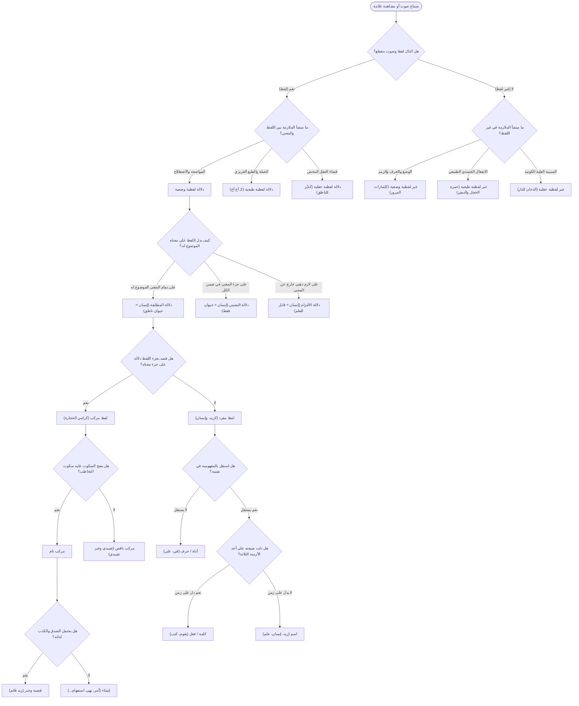
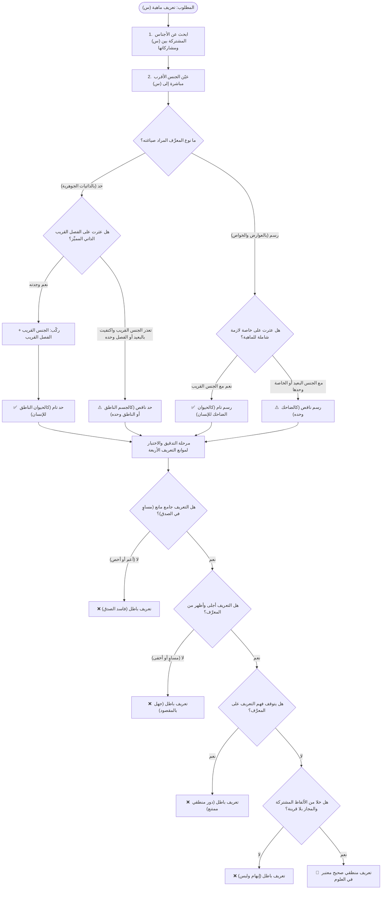
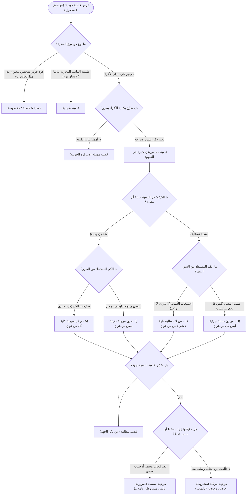
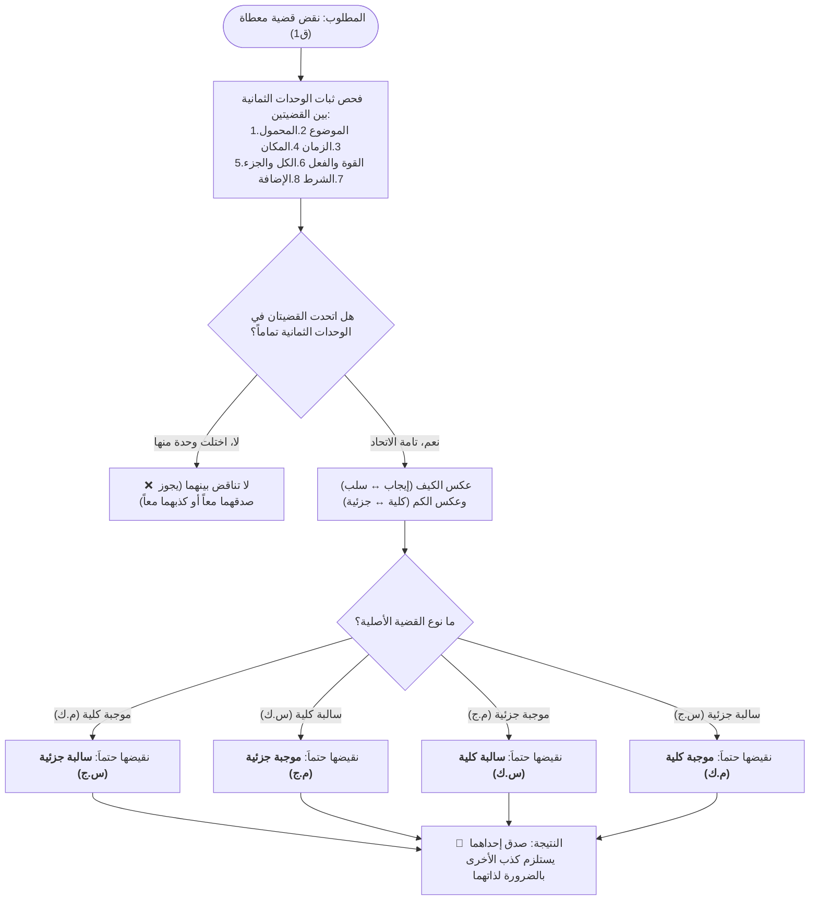
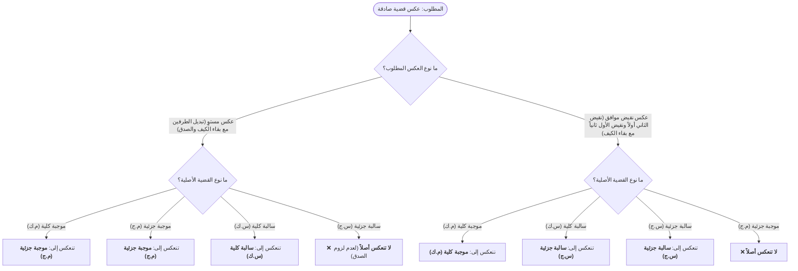
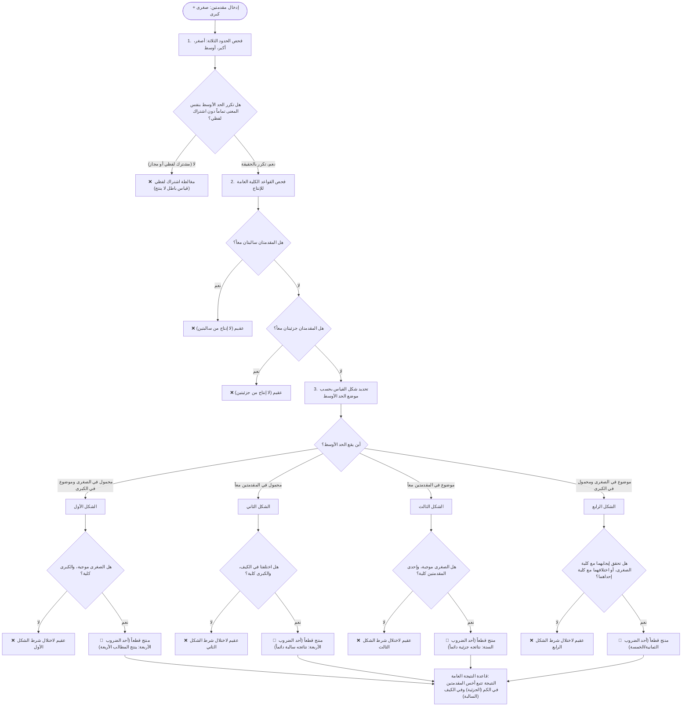
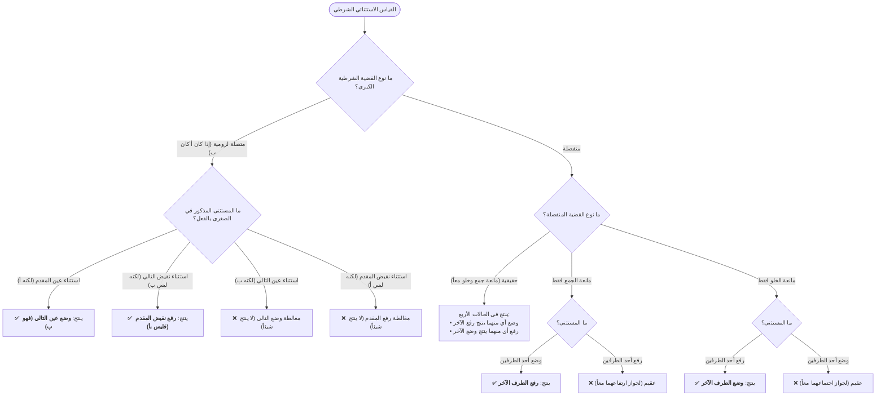
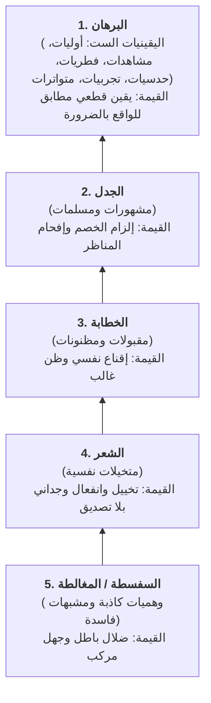

# خرائط ومسارات الاستدلال المنطقي لمتن «تصريح المنطق»
### محركات القرار الصوري، وخوارزميات فحص القضايا، ومسارات البرهان والاستنتاج

---

## مدخل منهجي

إن الغاية القصوى من دراسة المنطق الصوري هي **امتلاك ملكة التفكير المنهجي والتحقق الخوارزمي من صحة الأقوال والأحكام**. يهدف هذا الملف إلى تحويل قواعد متن **«تصريح المنطق»** إلى مسارات تدفق إجرائية (*Flowcharts*) وخوارزميات قرار صريحة (*Decision Engines*) تمكن الطالب من معالجة أي مفهوم أو قضية أو حجة معالجة آلية دقيقة.

---

## 1. محرك تصنيف الألفاظ والدلالات

يوضح هذا المسار كيفية الانتقال المنهجي من مجرد سماع اللفظ أو الرمز إلى تعيين نوع دلالته وتوصيف بنيته التركيبية:

---

## 2. خوارزمية بناء واختبار المعرِّف (الحد والرسم)

كيف تصوغ تعريفاً منطقياً لأي ماهية مجهولة؟ اتبع هذه الشجرة الإجرائية المنطقية:

---

## 3. محرك تحليل وتوصيف القضايا الحملية

إذا عُرضت عليك أي قضية خبرية، فهذا هو المسار الخوارزمي لتحديد نوعها وسورها وجهتها:

---

## 4. محرك فحص الاستدلال المباشر (التناقض والعكس)

### 4.1. خوارزمية استخراج النقيض وتدقيق الوحدات الثمانية:

### 4.2. خوارزمية العكس المستوي وعكس النقيض:

---

## 5. المحرك الخوارزمي العام لاختبار القياس الاقتراني الحملي

هذا هو المحرك الآلي الكامل لفحص أي قياس اقتراني من مقدمتين واستنتاج نتيجته الصورية:

---

## 6. محرك فحص القياس الاستثنائي واكتشاف المغالطات

---

## 7. شبكة التدرج المعرفي للصناعات الخمس (سلم القوة الإبستمولوجية)

تتفاضل مواد الأقيسة في ميزان المنطق واليقين كما يوضحه هذا المخطط الهرمي المتدرج:

---

> **خاتمة خرائط الاستدلال:**
> تُشكل هذه الخوارزميات محركاً برهانياً متكاملاً يستطيع الطالب من خلاله مراجعة أي قياس، أو اكتشاف أي خلل صوري في المناظرات والبحوث العقلية بصورة آلية منضبطة.

