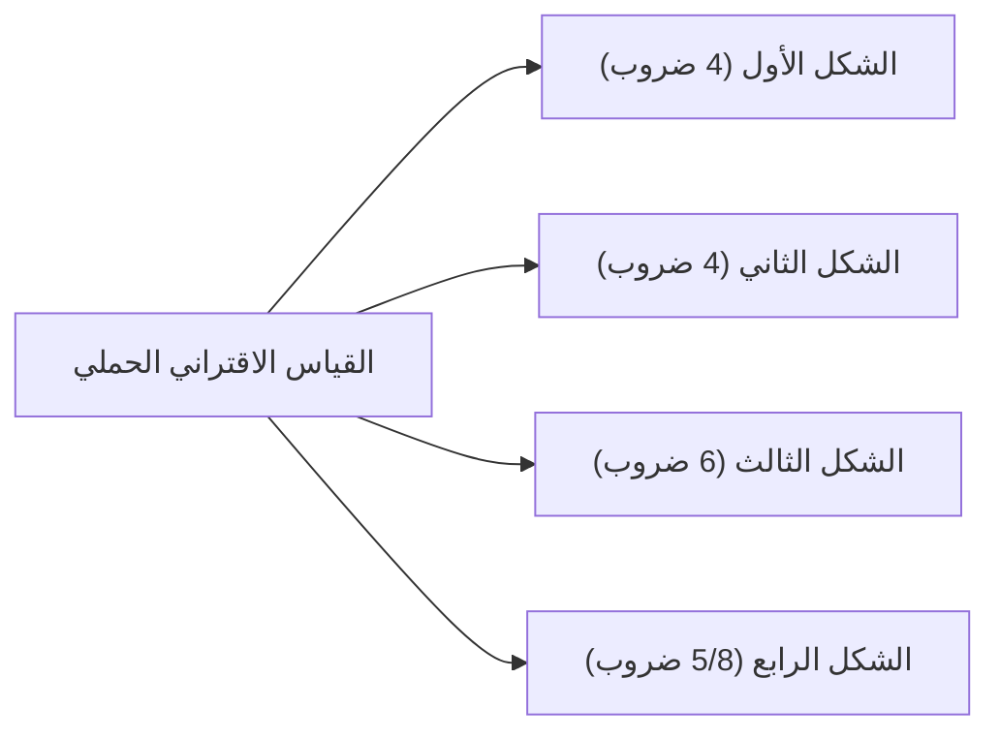

# موسوعة الجداول المقارنة والمصفوفات المنطقية لمتن «تصريح المنطق»
### الجداول الجامعة للتقسيمات، والنسب، والموجهات، وأحكام القضايا، وضروب القياس، والصناعات الخمس

---

## مدخل منهجي

تُعد الجداول المقارنة والمصفوفات البيانية من أبلغ الوسائل التعليمية لضبط دقائق علم المنطق وتثبيت الفروق بين المصطلحات المتقاربة. يجمع هذا الملف جميع قواعد وضوابط متن **«تصريح المنطق»** في مصفوفات مرجعية محكمة يستحضر بها الطالب القواعد الكلية، والضروب المنتجة، وشروط الاستدلال.

---

## 1. مصفوفة الدلالات الست الجامعة

تنقسم الدلالة (وهي: كون الشيء بحالة يلزم من العلم به العلم بشيء آخر) بحسب طبيعة الدال ومنشأ الملازمة إلى ستة أقسام:

| نوع الدلالة | تعريفها وضابطها | مستند الملازمة | مثال المتن | مثال معاصر مقرب |
|---|---|---|---|---|
| **لفظية وضعية** | دلالة اللفظ على معناه بجعل الواضع واصطلاحه | الوضع والمواضعة اللغوية | دلالة «زيد» على ذاته، و«الإنسان» على الحيوان الناطق | دلالة كلمة «حاسوب» على الجهاز الإلكتروني لمعالجة البيانات |
| **لفظية طبعية** | دلالة اللفظ بمقتضى طبع اللافظ وجبلته الإنسانية | الطبع البشري والغريزة | دلالة «أَخْ أَخْ» على وجع الصدر | دلالة التأوه بـ «آه» على شدة الألم الجسدي |
| **لفظية عقلية** | دلالة اللفظ باستدعاء العقل وقضائه المحض | حكم العقل السببي | دلالة سماع صوت «دَيْز» من وراء الجدار على وجود لافظ | دلالة التقاط رادار لجملة صوتية مشفرة على وجود باثٍّ حي |
| **غير لفظية وضعية** | دلالة غير الصوت مما جُعل علامة باصطلاح واضع | العرف والمواضعة الرمزية | الدوال الأربع: الخط، والعقد، والإشارة، والنُّصَب | دلالة الضوء الأحمر في إشارة المرور على وجوب التوقف |
| **غير لفظية طبعية** | دلالة عرض أو تغير جسدي اقتضاه الطبع والغريزة | الطبع التكويني للبدن | دلالة سرعة النبض على الحمى، وحمرة الوجه على الخجل | دلالة ارتجاف اليدين وتعرق الجبين على شدة الفزع والهلع |
| **غير لفظية عقلية** | دلالة أثر عيني على مؤثره ومسببه بقضاء العقل | قانون السببية والملازمة الذاتية | دلالة المصنوع على وجود الصانع، والدخان على النار | دلالة بصمات الأصابع على الزجاج على ملامسة شخص له |

### مصفوفة أقسام الدلالة اللفظية الوضعية (المعتبرة في العلوم):

| القسم | ضابطها المنطقي | علاقتها بالمعنى الموضوع له | مثال المتن (الإنسان) | مثال معاصر (السيارة) |
|---|---|---|---|---|
| **المطابقة** | دلالة اللفظ على تمام ما وُضع له | تطابق تام ($100\%$) | دلالة «الإنسان» على الحيوان الناطق | دلالة «السيارة» على المركبة الآلية ذات المحرك والعجلات لنقل الركاب |
| **التضمن** | دلالة اللفظ على جزء معناه الموضوع له في ضمن الكل | جزء داخلي في الماهية | دلالته على «الحيوان» فقط أو «الناطق» فقط | دلالتها على «المحرك» فقط أو «الهيكل» فقط |
| **الالتزام** | دلالة اللفظ على لازم خارج عن معناه ملازم له ذهناً | ملازم خارجي غير مقوم | دلالته على «قابلية الكتابة» و«الضحك» | دلالتها على «استهلاك الوقود أو الكهرباء» |

---

## 2. مصفوفة الألفاظ: المفرد والمركب

| التقسيم الأولي | القسم الفرعي | الضابط المنطقي | أقسامه التفصيلية | المثال |
|---|---|---|---|---|
| **المركب** (ما قصد بجزئه دلالة على جزء معناه) | **تام** | يصح السكوت عليه سكوت التخاطب | **1. خبر (قضية):** يحتمل الصدق والكذب لذاته. **2. إنشاء:** لا يحتمل الصدق والكذب (أمر، نهي، استفهام، تمنٍ، ترجٍ، تعجب، نداء). | • الخبر: «زيد قائم» • الأمر: «اكتب» • النهي: «لا تكذب» |
| | **ناقص** | لا يصح السكوت عليه | **1. تقييدي وصفي:** الثاني نعت للأول. **2. تقييدي إضافي:** الثاني مضاف للأول. **3. غير تقييدي:** شبه الجملة والعدد المركب. | • وصفي: «حيوان ناطق» • إضافي: «غلام زيد» • غير تقييدي: «في الدار»، «خمسة عشر» |
| **المفرد** (ما لا يقصد بجزئه دلالة على جزء معناه) | **اسم** | استقل بالمفهومية ولم يدل بهيئته على زمان معين | يصلح أن يكون موضوعاً (محكوماً عليه) ومحمولاً (محكوماً به) | «زيد»، «إنسان»، «عالم» |
| | **كلمة (فعل)** | استقل بالمفهومية ودل بهيئته على أحد الأزمنة الثلاثة | يصلح أن يكون محمولاً فقط ولا يكون موضوعاً | «قامَ»، «يَقُومُ»، «يَكْتُبُ» |
| | **أداة (حرف)** | لم يستقل بالمفهومية بل هو رابط بين المعاني | لا يصلح أن يكون موضوعاً ولا محمولاً (بل رابطة) | «في»، «إلى»، «مِن»، «هل» |

---

## 3. مصفوفة أنواع المفرد باعتبار المعنى

| حالة اللفظ والمعنى | القسم المنطقي | تعريفه وضابطه | مثاله من المتن |
|---|---|---|---|
| **لفظ واحد لمعنى واحد** | **جزئي (عَلَم)** | يمنع تصور مفهومه من وقوع الشركة فيه بين كثيرين | «زيد»، «مكة»، «هذا» |
| | **كلي متواطئ** | لا يمنع من وقوع الشركة، وصدقه على أفراده على السوية بلا تفاوت | «الإنسان» بالنسبة لزيد وعمرو، و«الذهب» |
| | **كلي مشكك** | لا يمنع من وقوع الشركة، لكن صدقه على أفراده متفاوت بالشدة أو الأولوية | «الوجود» صدقه على الواجب أقدم وأولى من الممكن، و«النور» |
| **لفظ واحد لمعانٍ متعددة** | **مشترك لفظي** | وضع لكل معنى بوضع مستقل على السواء | «العين» للباصرة والينبوع والذهب والجاسوس |
| | **منقول عرفي عام** | وضع لمعنى ثم نقل لمعنى ثانٍ لمناسبة وهُجر الأول في عرف العامة | «الدابة» كانت لكل ما يدب، ثم خُصت بذوات الأربع |
| | **منقول شرعي** | نقل باصطلاح الشرع وهجر الأول | «الصلاة» وضعت للدعاء، ونقلت للأركان المخصوصة |
| | **منقول اصطلاحي** | نقل باصطلاح جماعة مخصوصة من العلماء (نحو، فقه، فلسفة) | «الفعل» وضع لما صدر عن الفاعل، ونقل لما دل على زمن |
| | **حقيقة ومجاز** | استعمل في معنى ثانٍ لعلاقة وقرينة مع بقاء المعنى الأول مستعملاً | «الأسد» للحيوان المفترس حقيقة، وللشجاع مجازاً |
| **ألفاظ متعددة** | **مترادف** | ألفاظ متعددة تدل على معنى واحد بعينه | «الليث» و«الغضنفر»، و«القعود» و«الجلوس» |
| | **متباين** | ألفاظ متعددة تدل على معانٍ متغايرة متباينة | «الشجر» و«الحجر»، و«السماء» و«الأرض» |

---

## 4. مصفوفة الكليات الخمس

| الكلي | اعتباره الماهوي | السؤال المجاب به | مراتبه وأقسامه في المتن | مثاله للإنسان |
|---|---|---|---|---|
| **النوع** | **ذاتي** (تمام حقيقة الأفراد) | مقول على المتفقين بالحقائق في جواب: **«ما هو؟»** | **1. نوع حقيقي:** تمام الحقيقة كالإنسان. **2. نوع إضافي:** مندرج تحت جنس، ومراتبه: • سافل (نوع الأنواع): كالإنسان. • متوسط: كالحيوان. • عالٍ: كالجسم المطلق. | «الإنسان» بالنسبة لزيد وعمرو وبكر |
| **الجنس** | **ذاتي** (جزء الحقيقة المشترك) | مقول على مختلفي الحقائق في جواب: **«ما هو؟»** | **1. قريب (سافل):** تمام المشترك بين الماهية وأقرب مشاركاتها. **2. متوسط:** ما فوقه جنس وتحته جنس. **3. بعيد (عالٍ/جنس الأجناس):** ليس فوقه جنس. | • قريب: «حيوان» • متوسط: «جسم نامٍ»، «جسم مطلق» • بعيد: «جوهر» |
| **الفصل** | **ذاتي** (المميز الذاتي للماهية) | مقول في جواب: **«أي شيء هو في جوهره وذاته؟»** | **1. قريب:** يميز الماهية عن مشاركاتها في الجنس القريب. **2. بعيد:** يميزها عما يشاركها في الجنس البعيد. [وهو مقوم للنوع ومقسم للجنس]. | • قريب: «الناطق» • بعيد: «الحساس» |
| **الخاصة** | **عرضي** (خارج مختص بماهية واحدة) | مقول في جواب: **«أي شيء هو في عَرَضه؟»** | **1. خاصة لازمة:** يمتنع انفكاكها ذهناً أو خارجاً. **2. خاصة مفارقة:** يجوز انفكاكها وزوالها عن الذات. | • لازمة: «الكاتب بالقوة»، «الضاحك بالقوة» • مفارقة: «الكاتب بالفعل»، «الضاحك بالفعل» |
| **العرض العام** | **عرضي** (خارج مشترك بين حقائق) | مقول على مختلفي الحقائق عرضاً | **1. عرض عام لازم:** يمتنع انفكاكه عن معروضه. **2. عرض عام مفارق:** يصح انفكاكه عن معروضه. | • لازم: «المتنفس بالقوة»، «المتحيز» • مفارق: «الماشي بالفعل»، «النائم»، «القاعد» |

---

## 5. مصفوفة النسب الأربع ونقائضها

| النسبة | الرمز الرياضي | الضابط في الصدق | حكم نقائضهما | مثال الأصل في المتن | مثال النقائض |
|---|---|---|---|---|---|
| **التساوي** | $A = B$ | تصادق كلي من الجانبين: كل $A$ هو $B$، وكل $B$ هو $A$ | نقيضاهما **متساويان** حتماً: اللا $A$ = اللا $B$ | الإنسان والناطق | ال themاللاإنسان = اللاناطق |
| **العموم والخصوص المطلق** | $A \subset B$ | تصادق كلي من جانب واحد: كل $A$ هو $B$، وبعض $B$ هو $A$ | نقيضاهما **بعكس النسبة**: اللا $B \subset$ اللا $A$ | الحيوان ($B$) والإنسان ($A$) | اللاحيوان أخص مطلقاً من اللاإنسان (كل لاحيوان لاإنسان) |
| **العموم والخصوص من وجه** | $A \cap B \neq \emptyset$ | تصادق جزئي من الطرفين، مع انفراد كل طرف في مادة | نقيضاهما إما تباين كلي أو عموم وخصوص من وجه | الحيوان والأبيض | اللاحيوان واللاأبيض (بينهما عموم من وجه في الجماد الأسود) |
| **التباين الكلي** | $A \cap B = \emptyset$ | تباين كلي من الجانبين: لا شيء من $A$ هو $B$، ولا شيء من $B$ هو $A$ | نقيضاهما إما تباين كلي أو عموم وخصوص من وجه | الإنسان والحجر، والموجود والمعدوم | اللاموجود واللامعدوم (متباينان)، واللاإنسان واللاحجر (عموم من وجه) |

---

## 6. مصفوفة أقسام المعرِّف (القول الشارح) وشروطه

| نوع المعرِّف | تركيبته المنطقية | غايته وإفادته | مثال المتن | حكمه وقيمته المعرفية |
|---|---|---|---|---|
| **الحد التام** | **جنس قريب + فصل قريب** | إفادة تمام حقيقة الماهية وتصوير كنهها الذاتي | «الحيوان الناطق» للإنسان | أشرف المعرِّفات وأكملها دلالة ويقيناً |
| **الحد الناقص** | **جنس بعيد + فصل قريب** أو **الفصل القريب وحده** | تمييز الماهية ذاتياً عن جميع ما عداها دون إحاطة بتمام الذات | • «الجسم الناطق» للإنسان • «الناطق» للإنسان | تام في التمييز الذاتي، ناقص في بيان الماهية |
| **الرسم التام** | **جنس قريب + خاصة** | تمييز الماهية عن غيرها تمييزاً تاماً بالأعراض الملازمة | «الحيوان الضاحك» للإنسان | يفيد امتياز الماهية خواصها الشاملة اللازمة |
| **الرسم الناقص** | **جنس بعيد + خاصة** أو **الخاصة وحدها** | تمييز الماهية عن غيرها تمييزاً بالعوارض دون ذكر الجنس القريب | • «الجسم الضاحك» للإنسان • «الضاحك» للإنسان | أدنى مراتب الرسوم في البيان والتركيب |
| **التعريف اللفظي** | **لفظ مرادف أظهر وأشهر** | شرح معنى اللفظ الغريب بلفظ مألوف عند المخاطب | كتعريف «الغضنفر» بالأسد، و«العُقار» بالخمر | ليس تعريفاً بالمعنى المنطقي للماهية بل لغوي |

### شروط المعرِّف الأربعة:
1. أن يكون **مانعاً جامعاً** (مطرداً منعكساً): مساوياً للمعرَّف في الصدق فلا يكون أعم ولا أخص.
2. أن يكون **أجلى وأوضح** من المعرَّف: فلا يجوز التعريف بالأخفى ولا بالمساوي (كزوجية العدد بما ينقص عن الفرد بواحد).
3. ألا يتوقف فهم المعرِّف على المعرَّف (السلامة من **الدور** الصريح أو المضمر).
4. الخلو من **المجازات** البعيدة بلا قرينة، والألفاظ **المشتركة**، والألفاظ **المجهولة الوحشية**.

---

## 7. مصفوفة القضايا الحملية المحصورة (الأربع الكنسية)

| نوع القضية | الرمز | ألفاظ السور المعتمدة في المتن | الصيغة الصورية | مثال المتن | التمثيل الحديث |
|---|---|---|---|---|---|
| **موجبة كلية** | **م.ك** ($A$) | كُلٌّ، جَمِيعُ، لام الاستغراق | كل $S$ هو $P$ | «كل إنسان حيوان»، «الحيوان ماشٍ» | كل خوارزمية قابلة للتنفيذ هي برنامج حاسوبي |
| **موجبة جزئية** | **م.ج** ($I$) | بَعْضٌ، وَاحِدٌ | بعض $S$ هو $P$ | «بعض الحيوان إنسان»، «واحد من الإنسان جاءني» | بعض المركبات الآلية تعمل بالطاقة الكهربائية |
| **سالبة كلية** | **س.ك** ($E$) | لَا شَيْءَ، لَا وَاحِدَ، النكرة في سياق النفي | لا شيء من $S$ هو $P$ | «لا شيء من الإنسان بحجر»، «لا رجل في الدار» | لا شيء من المواد العازلة بناقل للكهرباء |
| **سالبة جزئية** | **س.ج** ($O$) | لَيْسَ كُلٌّ، لَيْسَ بَعْضٌ، بَعْضُ... لَيْسَ | ليس كل $S$ هو $P$ / بعض $S$ ليس $P$ | «ليس كل حيوان إنساناً»، «بعض الحيوان ليس بإنسان» | ليس كل متصفح للإنترنت آمناً من الثغرات |

---

## 8. مصفوفة القضايا المعدولة والمحصلة

| القسم | موقع حرف السلب («لا» أو «غير») | صيغتها الصورية | مثال المتن | حكمها من حيث الإيجاب والسلب |
|---|---|---|---|---|
| **المحصلة** | السلب ينصب على الرابطة والنسبة الحكمية | $S$ ليس $P$ | «زيد ليس بقائم» | سالبة محصلة حقيقية |
| **معدولة الموضوع** | السلب جزء متمم للفظ الموضوع فقط | (اللاـ $S$) هو $P$ | «اللاحي جماد» | موجبة محصلة المحمول معدولة الموضوع |
| **معدولة المحمول** | السلب جزء متمم للفظ المحمول فقط | $S$ هو (لاـ $P$) | «الجماد لاحي» | موجبة معدولة المحمول محصلة الموضوع |
| **معدولة الطرفين** | السلب جزء متمم للموضوع والمحمول معاً | (اللاـ $S$) هو (لاـ $P$) | «اللاحي لاعالم» | موجبة معدولة الطرفين |

---

## 9. مصفوفة القضايا الموجهة البسيطة (8) والمركبة (7)

### أولاً: القضايا الموجهة البسيطة (8):

| الرقم | اسم القضية | ضابط الجهة وحقيقتها | صياغة المتن الموجبة | صياغة المتن السالبة |
|---|---|---|---|---|
| **1** | **الضرورية المطلقة** | الحكم بضرورة الثبوت أو السلب ما دامت ذات الموضوع موجودة | كل إنسان حيوان بالضرورة | لا شيء من الإنسان بحجر بالضرورة |
| **2** | **المشروطة العامة** | ضرورة الثبوت أو السلب ما دام الوصف العنواني ثابتاً للموضوع | كل كاتب متحرك الأصابع بالضرورة ما دام كاتباً | لا شيء منه بساكن الأصابع بالضرورة ما دام كاتباً |
| **3** | **الوقتية المطلقة** | ضرورة الثبوت أو السلب في وقت معين محدد للذات | كل قمر منخسف بالضرورة وقت حيلولة الأرض | لا شيء من القمر بمنخسف بالضرورة وقت التربيع |
| **4** | **المنتشرة المطلقة** | ضرورة الثبوت أو السلب في وقت غير معين من الأوقات | كل إنسان متنفس بالضرورة في وقت ما | لا شيء منه بمتنفس بالضرورة في وقت ما |
| **5** | **الدائمة المطلقة** | دوام الثبوت أو السلب ما دامت الذات موجودة بلا امتناع ذاتي | كل فلك متحرك دائماً | لا شيء منه بساكن دائماً |
| **6** | **العرفية العامة** | دوام الثبوت أو السلب ما دام الوصف العنواني ثابتاً | كل كاتب متحرك الأصابع ما دام كاتباً | لا شيء منه بساكن الأصابع ما دام كاتباً |
| **7** | **المطلقة العامة** | ثبوت المحمول أو سلبه بالفعل في أحد الأزمنة الثلاثة | كل إنسان ضاحك بالفعل | لا شيء من الإنسان بضاحك بالفعل |
| **8** | **الممكنة العامة** | سلب الضرورة المطلقة عن الجانب المخالف | كل إنسان كاتب بالإمكان العام | لا شيء منه بكاتب بالإمكان العام |

### ثانياً: القضايا الموجهة المركبة (7):

| الرقم | اسم القضية المركبة | تركيبها الصوري الصريح | القيد الخفي المعطوف | مثال المتن المكتمل |
|---|---|---|---|---|
| **1** | **المشروطة الخاصة** | مشروطة عامة موجبة/سالبة | + قيد «اللادوام الذاتي» | كل كاتب متحرك الأصابع بالضرورة ما دام كاتباً، لا دائماً (أي لا شيء من الكاتب بمتحرك الأصابع بالفعل دائماً) |
| **2** | **الوقتية الخاصة** | وقتية مطلقة | + قيد «اللادوام بحسب الذات» | كل قمر منخسف بالضرورة وقت الحيلولة، لا دائماً (أي لا شيء من القمر بمنخسف بالفعل دائماً) |
| **3** | **المنتشرة الخاصة** | منتشرة مطلقة | + قيد «اللادوام الذاتي» | كل إنسان متنفس بالضرورة وقتاً ما، لا دائماً (أي لا شيء من الإنسان بمتنفس بالفعل دائماً) |
| **4** | **العرفية الخاصة** | عرفية عامة | + قيد «اللادوام الذاتي» | كل كاتب متحرك الأصابع ما دام كاتباً، لا دائماً |
| **5** | **الوجودية اللادرورية** | مطلقة عامة بالفعل | + قيد «اللادرورة الذاتية» | كل إنسان ضاحك بالفعل، لا بالضرورة (أي لا شيء من الإنسان بضاحك بالإمكان العام) |
| **6** | **الوجودية اللادائمة** | مطلقة عامة بالفعل | + قيد «اللادوام الذاتي» | كل إنسان ضاحك بالفعل، لا دائماً |
| **7** | **الممكنة الخاصة** | سلب الضرورة عن الموافق | + سلب الضرورة عن المخالف (إمكانان عامان) | كل إنسان كاتب بالإمكان الخاص (أي يثبت له بالإمكان العام ويسلب عنه بالإمكان العام) |

---

## 10. مصفوفة القضايا الشرطية وجدول قيم الصدق والحقيقة

| نوع الشرطية | تعريفها | أداة السور | حكم اجتماع الطرفين | حكم ارتفاع الطرفين | جدول الصدق ($T/F$) |
|---|---|---|---|---|---|
| **متصلة لزومية** | لزوم التالي للمقدم لعلاقة علية موجبة | كلما، متى، مهما | يتبعان في اللزوم | يلزم من كذب التالي كذب المقدم | صادقة إذا صدق اللزوم وإن كذب الطرفان |
| **متصلة اتفاقية** | موافقة التالي للمقدم بمحض الصدفة بلا علة | كلما | يجتمعان صدفة | لا تلازم بينهما | تصدق بمصادفة صدقهما معاً |
| **منفصلة حقيقية** | التنافي بين الطرفين صدقاً وكذباً | دائماً، أبداً، إما... أو... | **ممتنع** (لا يجتمعان) | **ممتنع** (لا يرتفعان) | $T \oplus T = F$ $T \oplus F = T$ $F \oplus F = F$ |
| **مانعة الجمع فقط** | التنافي في الصدق فقط دون الكذب | إما... أو... | **ممتنع** (لا يجتمعان) | **جائز** (يجوز أن يرتفعا) | لا يصدقان معاً، ويجوز كذبهما معاً (كالشجر والحجر) |
| **مانعة الخلو فقط** | التنافي في الكذب فقط دون الصدق | إما... أو... | **جائز** (يجوز أن يجتمعا) | **ممتنع** (لا يرتفعان) | لا يكذبان معاً، ويجوز صدقهما معاً (كفي البحر أو لا يغرق) |

---

## 11. مصفوفة أحكام القضايا: التناقض والعكس المستوي وعكس النقيض

### أولاً: مصفوفة التناقض بين المحصورات:
> **قاعدة التناقض الكبرى:** لابد من الاختلاف في **الكيف** (الإيجاب والسلب) و**الكم** (الكلية والجزئية) مع الاتحاد في **الوحدات الثمانية**: (الموضوع، المحمول، الزمان، المكان، الإضافة، القوة والفعل، الكل والجزء، الشرط).

| القضية الأصلية | نقيضها الملازم | مثال الأصل | مثال النقيض |
|---|---|---|---|
| **موجبة كلية (م.ك)** | **سالبة جزئية (س.ج)** | كل إنسان حيوان ($T$) | بعض الإنسان ليس بحيوان ($F$) |
| **سالبة كلية (س.ك)** | **موجبة جزئية (م.ج)** | لا شيء من الإنسان بحجر ($T$) | بعض الإنسان حجر ($F$) |
| **موجبة جزئية (م.ج)** | **سالبة كلية (س.ك)** | بعض الحيوان إنسان ($T$) | لا شيء من الحيوان بإنسان ($F$) |
| **سالبة جزئية (س.ج)** | **موجبة كلية (م.ك)** | بعض الحيوان ليس بإنسان ($T$) | كل حيوان إنسان ($F$) |

---

### ثانياً: مصفوفة العكوس (العكس المستوي وعكس النقيض):

| القضية الأصلية | العكس المستوي (تبديل الطرفين مع بقاء الكيف والصدق) | عكس النقيض الموافق (تبديل الطرفين بنقيضيهما مع بقاء الكيف) | عكس النقيض المخالف (تبديل الطرفين بنقيض المحمول وعين الموضوع مع تغير الكيف) | علة الامتناع إن وجد |
|---|---|---|---|---|
| **موجبة كلية (م.ك)** كل $S$ هو $P$ | **موجبة جزئية (م.ج)** بعض $P$ هو $S$ | **موجبة كلية (م.ك)** كل لاـ $P$ هو لاـ $S$ | **سالبة كلية (س.ك)** لا شيء من لاـ $P$ هو $S$ | لا تنعكس في المستوي كليةً لجواز كون المحمول أعم (كالحيوان والإنسان) |
| **موجبة جزئية (م.ج)** بعض $S$ هو $P$ | **موجبة جزئية (م.ج)** بعض $P$ هو $S$ | **لا تنعكس أصلاً** | **لا تنعكس أصلاً** | في عكس النقيض قد يصدق الأصل ويكذب العكس إن كان الموضوع أعم |
| **سالبة كلية (س.ك)** لا شيء من $S$ هو $P$ | **سالبة كلية (س.ك)** لا شيء من $P$ هو $S$ | **سالبة جزئية (س.ج)** بعض لاـ $P$ ليس بلاـ $S$ | **موجبة جزئية (م.ج)** بعض لاـ $P$ هو $S$ | العكس المستوي مطرد بالانفصال التام بين الطرفين |
| **سالبة جزئية (س.ج)** ليس كل $S$ هو $P$ | **لا تنعكس أصلاً** | **سالبة جزئية (س.ج)** بعض لاـ $P$ ليس بلاـ $S$ | **موجبة جزئية (م.ج)** بعض لاـ $P$ هو $S$ | في المستوي لجواز كون الموضوع أعم، فيصدق الأصل ويكذب العكس |

---

## 12. المصفوفة الكبرى للضروب الـ 19 المنتجة في القياس الاقتراني

| الشكل وموضع الأوسط | شروط الإنتاج الخاصة | رقم الضرب | الصغرى | الكبرى | النتيجة | الاسم الكنسي | مثال المتن المحلول |
|---|---|---|---|---|---|---|---|
| **الشكل الأول** محمول في الصغرى موضوع في الكبرى | 1. إيجاب الصغرى 2. كلية الكبرى | **1** | م.ك | م.ك | **م.ك** | Barbara | كل إنسان حيوان، وكل حيوان حساس $\therefore$ **كل إنسان حساس** |
| | | **2** | م.ك | س.ك | **س.ك** | Celarent | كل إنسان حيوان، ولا شيء من الحيوان بجماد $\therefore$ **لا شيء من الإنسان بجماد** |
| | | **3** | م.ج | م.ك | **م.ج** | Darii | بعض الحيوان إنسان، وكل إنسان ناطق $\therefore$ **بعض الحيوان ناطق** |
| | | **4** | م.ج | س.ك | **س.ج** | Ferio | بعض الحيوان إنسان، ولا شيء من الإنسان بحمار $\therefore$ **بعض الحيوان ليس بحمار** |
| **الشكل الثاني** محمول فيهما معاً | 1. اختلاف الكيف 2. كلية الكبرى | **1** | م.ك | س.ك | **س.ك** | Cesare | كل إنسان حيوان، ولا شيء من الحجر بحيوان $\therefore$ **لا شيء من الإنسان بحجر** |
| | | **2** | س.ك | م.ك | **س.ك** | Camestres | لا شيء من الحجر بحيوان، وكل إنسان حيوان $\therefore$ **لا شيء من الحجر بإنسان** |
| | | **3** | م.ج | س.ك | **س.ج** | Festino | بعض الحيوان إنسان، ولا شيء من الحجر بإنسان $\therefore$ **بعض الحيوان ليس بحجر** |
| | | **4** | س.ج | م.ك | **س.ج** | Baroco | بعض الحيوان ليس بإنسان، وكل ناطق إنسان $\therefore$ **بعض الحيوان ليس بناطق** |
| **الشكل الثالث** موضوع فيهما معاً | 1. إيجاب الصغرى 2. كلية إحدى المقدمتين | **1** | م.ك | م.ك | **م.ج** | Darapti | كل إنسان حيوان، وكل إنسان ناطق $\therefore$ **بعض الحيوان ناطق** |
| | | **2** | م.ج | م.ك | **م.ج** | Disamis | بعض الحيوان إنسان، وكل حيوان جسم $\therefore$ **بعض الإنسان جسم** |
| | | **3** | م.ك | م.ج | **م.ج** | Datisi | كل إنسان حيوان، وبعض الإنسان ناطق $\therefore$ **بعض الحيوان ناطق** |
| | | **4** | م.ك | س.ك | **س.ج** | Felapton | كل إنسان حيوان، ولا شيء من الإنسان بفرس $\therefore$ **بعض الحيوان ليس بفرس** |
| | | **5** | م.ج | س.ك | **س.ج** | Ferison | بعض الإنسان حيوان، ولا شيء من الإنسان بحمار $\therefore$ **بعض الحيوان ليس بحمار** |
| | | **6** | م.ك | س.ج | **س.ج** | Bocardo | كل إنسان حيوان، وبعض الإنسان ليس بفرس $\therefore$ **بعض الحيوان ليس بفرس** |
| **الشكل الرابع** موضوع في الصغرى محمول في الكبرى | إيجابهما مع كلية الصغرى، أو اختلافهما مع كلية إحداهما | **1** | م.ك | م.ك | **م.ج** | Bramantip | كل إنسان حيوان، وكل ناطق إنسان $\therefore$ **بعض الحيوان ناطق** |
| | | **2** | م.ك | م.ج | **م.ج** | Dimaris | كل إنسان ناطق، وبعض الكاتب إنسان $\therefore$ **بعض الناطق كاتب** |
| | | **3** | س.ك | م.ك | **س.ك** | Camenes | لا شيء من الحيوان بحجر، وكل إنسان حيوان $\therefore$ **لا شيء من الحجر بإنسان** |
| | | **4** | م.ك | س.ك | **س.ج** | Fesapo | كل إنسان حيوان، ولا شيء من الحجر بإنسان $\therefore$ **بعض الحيوان ليس بحجر** |
| | | **5** | م.ج | س.ك | **س.ج** | Fresison | بعض الإنسان حيوان، ولا شيء من الحجر بإنسان $\therefore$ **بعض الحيوان ليس بحجر** |
| | *(ضروب تكميلية)* | **6** | س.ج | م.ك | **س.ج** | — | بعض الإنسان ليس بحجر، وكل ناطق إنسان $\therefore$ **بعض الحجر ليس بناطق** |
| | | **7** | م.ك | س.ج | **س.ج** | — | كل إنسان حيوان، وبعض الحجر ليس بإنسان $\therefore$ **بعض الحيوان ليس بحجر** |
| | | **8** | س.ك | م.ج | **س.ج** | — | لا شيء من الإنسان بحجر، وبعض الناطق إنسان $\therefore$ **بعض الحجر ليس بناطق** |

---

## 13. مصفوفة قواعد الاستنتاج في القياس الاستثنائي

| نوع القضية الشرطية | الاستثناء الواقع | النتيجة الحاصلة | القاعدة المنطقية المعتمدة | حالات العقم (التي لا تنتج) |
|---|---|---|---|---|
| **متصلة لزومية** | وضع (إثبات) المقدم | **وضع (إثبات) التالي** | إثبات السبب والشرط يوجب ثبوت المشروط والمسبب | • وضع التالي لا ينتج وضع المقدم. • رفع المقدم لا ينتج رفع التالي. |
| | رفع (نفي) التالي | **رفع (نفي) المقدم** | نفي اللازم يوجب انتفاء الملزوم قطعاً | |
| **منفصلة حقيقية** (مانعة جمع وخلو) | وضع أحد الطرفين | **رفع الطرف الآخر** | لامتناع اجتماعهما معاً في الصدق | تنتج في جميع الحالات الأربع على الكمال |
| | رفع أحد الطرفين | **وضع الطرف الآخر** | لامتناع خلو الواقع عنهما معاً | |
| **مانعة الجمع فقط** | وضع أحد الطرفين | **رفع الطرف الآخر** | لامتناع اجتماعهما في الصدق | • رفع أحد الطرفين **عقيم** (لجواز ارتفاعهما معاً) |
| **مانعة الخلو فقط** | رفع أحد الطرفين | **وضع الطرف الآخر** | لامتناع ارتفاعهما معاً في الكذب | • وضع أحد الطرفين **عقيم** (لجواز اجتماعهما معاً) |

---

## 14. مصفوفة الصناعات الخمس (مواد الأقيسة وغاياتها المعرفية)

| الصناعة | نوع المادة المستعملة | تفصيل مبادئها ومقدماتها | القيمة الإبستمولوجية | الغاية المقصودة | مثال المتن |
|---|---|---|---|---|---|
| **1. البرهان** | **اليقينيات الست** | 1. الأوليات (الكل أعظم من الجزء) 2. الفطريات (الأربعة زوج) 3. المشاهدات: حسيات ووجدانيات 4. الحدسيات (نور القمر من الشمس) 5. التجربيات (السقمونيا مسهل) 6. المتواترات (وجود مكة) | **يقين قطعي** تام مطابق للواقع بالضرورة | تحصيل الحقيقة واليقين المطابق للواقع ونيل العلوم العقلية | • اللِمّي: هذا متعفن الأخلاط وكل متعفن الأخلاط محموم $\therefore$ هذا محموم • الإِنّي: هذا محموم وكل محموم متعفن الأخلاط $\therefore$ هذا متعفن الأخلاط |
| **2. الجدل** | **المشهورات والمسلمات** | • المشهورات: ما تطابقت عليه آراء العقلاء لحفظ المصلحة (كحسن العدل وقبح الظلم) • المسلمات: ما يُسلَّم به الخصم في المناظرة | **ظن غالب متفق عليه** بين أهل الصنعة | إلزام الخصم وإفحامه وإقناع من يقصر عقله عن إدراك البرهان | تسليم مسألة أصولية أن «الأمر يفيد الوجوب» لإلزام الفقيه بحكم شرعي |
| **3. الخطابة** | **المقبولات والمظنونات** | • المقبولات: المأخوذة ممن يحسن الظن به من أولياء وعلماء • المظنونات: قضايا يحكم بها الذهن مع تجويز نقيضها راجحاً | **إقناع نفسي وظن راجح** | ترغيب الجمهور وتحريك عواطفهم نحو الفضائل ودفعهم للعمل | الحكم بنزول المطر المظنون عند تراكم الغيوم الركامية السوداء |
| **4. الشعر** | **المتخيلات** | قضايا تصاغ بأوزان ومحسنات خيالية تحرك قوى النفس بالترغيب أو الترهيب | **انفعال نفسي تخييلي** (لا تصديق حقيقي فيه) | انفعال النفس وانبساطها أو انقباضها للتأثير الوجداني | إنشاد أبيات تصف العسل بأنه «قيء الزنابير» للتنفير، أو الخمر «ياقوتة سيالة» |
| **5. السفسطة (المغالطة)** | **الوهميات والمشبهات** | • الوهميات: أحكام وهمية كاذبة في غير المحسوسات (كل موجود مادي) • المشبهات: قضايا كاذبة تشبه الصادقة للفظ مشترك أو مجاز | **جهل مركب وضلال باطل** | تغليط الخصم في المناظرة أو الدفاع عن باطل أو التضليل | الإشارة لصورة الحمار المنقوش على الجدار والقول: «هذا حمار، وكل حمار ناهق $\therefore$ هذا ناهق» |

---

> **خاتمة الجداول:**
> تُشكل هذه المصفوفات الأربع عشرة نسقاً رياضياً شاملاً يغطي كافة تفاصيل وقواعد متن «تصريح المنطق»، وتصلح مرجعاً دائماً للمقارنة وسرعة الاستحضار.

