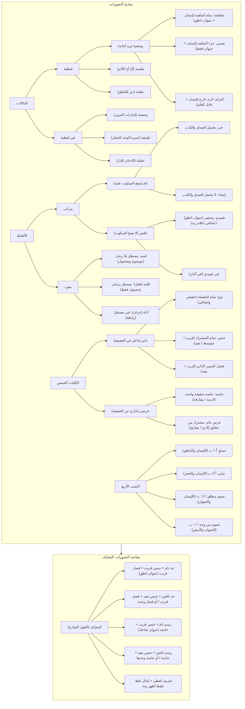
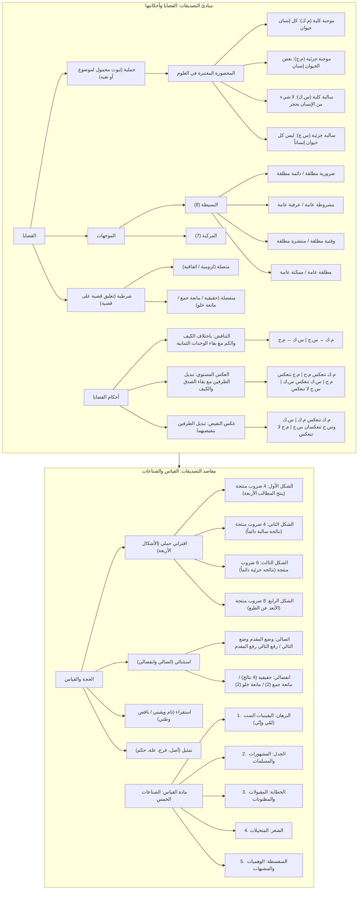

# موسوعة التشجيرات الكبرى لمتن «تصريح المنطق»
### الهيكلية الشاملة للأبواب، والمفاهيم، والتقسيمات، والشروط، والضروب المنطقية من الفاتحة إلى الخاتمة

---

## مقدمة المنهج التشجيري

يُمثل متن **«تصريح المنطق»** خلاصة جامعة دقيقة للمنطق الأرسطي الإسلامي المدرسي كما استقر عند المحققين المتأخرين. وقد بُني الكتاب على هندسة معرفية ثنائية محكمة تنقسم إلى قسمين رئيسيين:
1. **عالم التصورات:** وموضوعه الألفاظ والمفاهيم، وغايته القصوى هي **المعرِّف (القول الشارح)** لعصمة الذهن عن الخطأ في الفهم.
2. **عالم التصديقات:** وموضوعه القضايا والأحكام، وغايته القصوى هي **الحجة والقياس** لعصمة الذهن عن الخطأ في الاستدلال.

يحتوي هذا الملف على:
- **أولاً:** الشجرة الصورية الشاملة للمتن كاملاً (من فاتحته إلى خاتمته).
- **ثانياً:** الشجرة الهرمية النصية الكبرى ذات الكثافة العقدية القصوى (تستوعب كل مسألة وقيد وقاعدة وضابط في المتن).
- **ثالثاً:** الشجرة التفصيلية المعمقة لمباحث التصورات (مبادئ ومقاصد).
- **رابعاً:** الشجرة التفصيلية المعمقة لمباحث التصديقات (مبادئ ومقاصد).

---

## أولاً: الشجرة الكبرى الشاملة لمتن تصريح المنطق (من الفاتحة إلى الخاتمة)

```mermaid
flowchart TD
  %% الجذر الرئيسي
  Root["<b>العِلْم</b><br/>الصورة الحاصلة عند العقل"] --> Part1["<b>عالم التصورات</b><br/>(إدراك ساذج بلا حكم)"]
  Root --> Part2["<b>عالم التصديقات</b><br/>(اعتقاد النسبة الخبرية)"]

  %% قسم التصورات
  subgraph TASAWWURAT["عالم التصورات"]
    Part1 --> T_Mabadi["<b>مبادئ التصورات</b>"]
    Part1 --> T_Maqasid["<b>مقاصد التصورات</b>"]

    T_Mabadi --> Dalalat["<b>الدلالات (6 أقسام)</b><br/>لفظية / غير لفظية × وضعية / طبعية / عقلية"]
    Dalalat --> DalalaWad["<b>اللفظية الوضعية:</b><br/>مطابقة / تضمن / التزام"]

    T_Mabadi --> Alfaz["<b>الألفاظ</b>"]
    Alfaz --> Murakkab["<b>مركب:</b> تام (خبر / إنشاء) وناقص (تقييدي / غيره)"]
    Alfaz --> Mufrad["<b>مفرد:</b> اسم / كلمة / أداة"]
    Mufrad --> KulliJuz["<b>كلي وجزئي:</b> جزئي حقيقي وإضافي<br/>كلي متواطئ ومشكك"]
    Mufrad --> AlfazMany["<b>المعاني المتعددة:</b> مشترك / منقول / حقيقة ومجاز / ترادف وتباين"]

    T_Mabadi --> Kulliyat["<b>الكليات الخمس</b>"]
    Kulliyat --> Dhati["<b>ذاتي:</b><br/>1. نوع (حقيقي وإضافي)<br/>2. جنس (قريب وبعيد ومتوسط)<br/>3. فصل (قريب وبعيد)"]
    Kulliyat --> Aradi["<b>عرضي:</b><br/>4. خاصة (لازمة ومفارقة)<br/>5. عرض عام (لازم ومفارق)"]

    T_Mabadi --> Nisab["<b>النسب الأربع بين الكليات</b><br/>تساوٍ / عموم وخصوص مطلق / عموم وخصوص من وجه / تباين"]

    T_Maqasid --> Muarrif["<b>المعرِّف (القول الشارح)</b>"]
    Muarrif --> Hadd["<b>الحد:</b><br/>• تام (جنس قريب + فصل قريب)<br/>• ناقص (جنس بعيد + فصل قريب / أو فصل وحده)"]
    Muarrif --> Rasm["<b>الرسم:</b><br/>• تام (جنس قريب + خاصة)<br/>• ناقص (جنس بعيد + خاصة / أو خاصة وحدها)"]
    Muarrif --> Lafzi["<b>اللفظي:</b> تبديل لفظ بلفظ أوضح منه"]
  end

  %% قسم التصديقات
  subgraph TASDIQAT["عالم التصديقات"]
    Part2 --> P_Mabadi["<b>مبادئ التصديقات</b>"]
    Part2 --> P_Maqasid["<b>مقاصد التصديقات</b>"]

    P_Mabadi --> Qadaya["<b>القضايا</b>"]
    Qadaya --> Hamliyyah["<b>الحملية</b><br/>موضوع + محمول + رابطة"]
    Hamliyyah --> HamliTypes["شخصية / طبيعية / مهملة / محصورة (م.ك / م.ج / س.ك / س.ج)"]
    Hamliyyah --> Madulah["المعدولة: معدولة الموضوع / المحمول / الطرفين / المحصلة"]
    
    Qadaya --> Muwajjahat["<b>القضايا الموجهة</b>"]
    Muwajjahat --> Basait["<b>بسيطة (8):</b> ضرورية / دائمة / مشروطة عامة / عرفية عامة / وقتية / منتشرة / مطلقة عامة / ممكنة عامة"]
    Muwajjahat --> Murakkabat["<b>مركبة (7):</b> مشروطة خاصة / عرفية خاصة / وقتية خاصة / منتشرة خاصة / وجودية لادرورية / وجودية لادائمة / ممكنة خاصة"]

    Qadaya --> Shartiyyah["<b>الشرطية</b><br/>مقدم + تالي"]
    Shartiyyah --> Muttasilah["<b>متصلة:</b> لزومية / اتفاقية"]
    Shartiyyah --> Munfasilah["<b>منفصلة:</b> حقيقية / مانعة جمع / مانعة خلو<br/>(عنادية / اتفاقية)"]
    Shartiyyah --> ShartiSor["<b>باعتبار السور:</b> مخصوصة / محصورة ك وم.ج / مهملة"]

    P_Mabadi --> AhkamQadaya["<b>أحكام القضايا (الاستدلال المباشر)</b>"]
    AhkamQadaya --> Tanaqud["<b>التناقض:</b> اختلاف يقتضي صدق إحداهما وكذب الأخرى<br/>(الوحدات الثمانية + قواعد التقابل)"]
    AhkamQadaya --> AksMustawi["<b>العكس المستوي:</b> تبديل الطرفين مع بقاء الكيف والصدق"]
    AhkamQadaya --> AksNaqid["<b>عكس النقيض:</b> تبديل الطرفين بنقيضيهما مع بقاء الصدق والكيف"]

    P_Maqasid --> Qiyas["<b>الحجة: القياس الاقتراني الحملي</b>"]
    Qiyas --> Ashkal["<b>الأشكال الأربعة:</b><br/>• الشكل 1: الأوسط محمول الصغرى موضوع الكبرى (4 ضروب)<br/>• الشكل 2: الأوسط محمول فيهما (4 ضروب)<br/>• الشكل 3: الأوسط موضوع فيهما (6 ضروب)<br/>• الشكل 4: الأوسط موضوع الصغرى محمول الكبرى (8 ضروب)"]

    P_Maqasid --> QiyasOther["<b>أقسام القياس الأخرى</b>"]
    QiyasOther --> QiyasSharti["<b>القياس الشرطي الاقتراني:</b> 5 أقسام"]
    QiyasOther --> QiyasIstithnai["<b>القياس الاستثنائي:</b> اتصالي وانفصالي (أحكام الوضع والرفع)"]
    QiyasOther --> Istiqra["<b>الاستقراء:</b> تام (قطعي) وناقص (ظني)"]
    QiyasOther --> Tamthil["<b>التمثيل:</b> أركانه وطريقا العلة (الدوران والترديد)"]

    P_Maqasid --> SinaatKhams["<b>الصناعات الخمس (مادة القياس)</b>"]
    SinaatKhams --> Burhan["<b>1. البرهان:</b> مؤلف من اليقينيات الست (لمّي وإنّي)"]
    SinaatKhams --> Jadal["<b>2. الجدل:</b> من المشهورات والمسلمات"]
    SinaatKhams --> Khitabah["<b>3. الخطابة:</b> من المقبولات والمظنونات"]
    SinaatKhams --> Shir["<b>4. الشعر:</b> من المتخيلات"]
    SinaatKhams --> Safsatah["<b>5. السفسطة / المغالطة:</b> من الوهميات والمشبهات"]
  end
```

---

## ثانياً: الشجرة النصية الهرمية الكبرى (Maximum-Density Node Taxonomy)

هذا التقسيم يستوعب كامل متن «تصريح المنطق» بلا استثناء، مرتباً في تفريعات هرمية دقيقة:

- **1. الْعِلْمُ (الصورة الحاصلة عند العقل):**
  - **1.1. التَّصَوُّرُ:** إدراك الماهية مجردة من غير حكم بثبوت نسبة أو نفيها.
    - **1.1.1. بديهي (ضروري):** ما لا يحتاج إلى نظر وفكر (كتصور معنى الحرارة والبرودة والوجود).
    - **1.1.2. نظري (اكتسابي):** ما يتوقف على نظر وفكر (كتصور حقيقة الروح، وحقيقة الجن، وحقيقة الكهرباء).
  - **1.2. التَّصْدِيقُ:** اعتقاد النسبة الخبرية التامة وإذعانها إيجاباً أو سلباً.
    - **1.2.0. مقومات التصديق (التصورات الثلاثة الواجبة):**
      - 1.2.0.1. تصور المحكوم عليه (الموضوع).
      - 1.2.0.2. تصور المحكوم به (المحمول).
      - 1.2.0.3. تصور النسبة الحكمية بينهما (الإسناد).
    - **1.2.1. بديهي (ضروري):** ما يذعن له العقل بمجرد تصور أطرافه (كتصديق «الشمس مشرقة» و«الكل أعظم من الجزء»).
    - **1.2.2. نظري (اكتسابي):** ما يحتاج إذعانه لحجة وبرهان (كتصديق «العالم حادث» و«الصانع واحد»).

---

### [القِسمُ الأوّل: مَبَاحِثُ التَّصَوُّرَاتِ]

- **2. أَنْوَاعُ الدَّلَالَاتِ (كون الشيء بحيث يلزم من العلم به العلم بشيء آخر):**
  - **2.1. دلالة لفظية:** الدال فيها صوت مقطع مؤلف من حروف هجائية:
    - **2.1.1. لفظية وضعية:** جعل اللفظ بإزاء المعنى باصطلاح واضع.
      - **2.1.1.1. دلالة المطابقة:** دلالة اللفظ على تمام ما وضع له (كدلالة «الإنسان» على الحيوان الناطق).
      - **2.1.1.2. دلالة التضمن:** دلالة اللفظ على جزء معناه الموضوع له في ضمن الكل (كدلالة «الإنسان» على الحيوان وحده، أو الناطق وحده).
      - **2.1.1.3. دلالة الالتزام:** دلالة اللفظ على لازم خارج عن معناه ملازم له ذهناً (كدلالة «الإنسان» على قابلية الصنعة، أو الضحك، أو العلم).
    - **2.1.2. لفظية طبعية:** ما كان بمقتضى طبع اللافظ وجبلته (كدلالة «أخ أخ» أو «أح» على وجع الصدر، و«أف» على التضجر).
    - **2.1.3. لفظية عقلية:** ما كان بمقتضى استدعاء العقل وقضائه الحتمي (كدلالة سماع صوت «دَيْز» من وراء الجدار على وجود لافظ ومتكلم).
  - **2.2. دلالة غير لفظية:** الدال فيها غير صوت، كالإشارات والخطوط والعلامات:
    - **2.2.1. غير لفظية وضعية:** ما وضع بعرف وعلامة (كدلالة الخطوط، والنقوش، والدوال الأربع: العقد، والإشارة، والنصب، واللوحات المرورية).
    - **2.2.2. غير لفظية طبعية:** أثر بدني اقتضاه الطبع الغريزي (كسرعة النبض الدالة على الحمى، وحمرة الوجه الدالة على الخجل، وصفرته على الوجل).
    - **2.2.3. غير لفظية عقلية:** تلازم سببي عقلي بين الأثر والمؤثر (كدلالة المصنوع على وجود الصانع، والدخان على النار، والأثر على المسير).

- **3. أَقْسَامُ اللَّفْظِ (المفرد والمركب):**
  - **3.1. اللفظ المركب:** ما قصد بجزئه دلالة على جزء معناه حين الاستعمال (كرامي الحجارة، وغلام زيد):
    - **3.1.1. مركب تام:** ما يصح سكوت المتكلم عليه بحيث لا ينتظر السامع منه شيئاً آخر:
      - **3.1.1.1. خبر (قضية):** ما يحتمل الصدق والكذب لذاته (كزيد قائم).
      - **3.1.1.2. إنشاء:** ما لا يحتمل الصدق والكذب لذاته:
        - 3.1.1.2.1. أمر (طلب الفعل على وجه الاستعلاء).
        - 3.1.1.2.2. نهي (طلب الترك على وجه الاستعلاء).
        - 3.1.1.2.3. استفهام (طلب الفهم).
        - 3.1.1.2.4. تمنٍّ (طلب ما لا طمع فيه أو ما فيه عسر).
        - 3.1.1.2.5. ترجٍّ (طلب الأمر المحبوب القريب).
        - 3.1.1.2.6. تعجب.
        - 3.1.1.2.7. نداء.
    - **3.1.2. مركب ناقص:** ما لا يصح سكوت المتكلم عليه:
      - **3.1.2.1. تقييدي:** ما كان الجزء الثاني فيه قيداً للأول:
        - 3.1.2.1.1. تقييدي وصفي (نحو: حيوان ناطق، كاتب ماهر).
        - 3.1.2.1.2. تقييدي إضافي (نحو: غلام زيد، كتاب المنطق).
      - **3.1.2.2. غير تقييدي:** ما لم يكن قيداً وصفياً أو إضافياً (نحو: في الدار، خمسة عشر).
  - **3.2. اللفظ المفرد:** ما لا يقصد بجزئه دلالة على جزء معناه (كزيد، وعبد الله علماً، وإنسان):
    - **3.2.1. باعتبار الاستقلال بالمفهومية والزمان:**
      - **3.2.1.1. أداة (حرف):** ما لم يستقل بالمفهومية، ولا يصلح أن يكون محكوماً عليه ولا به (مثل: في، على، مِنْ).
      - **3.2.1.2. كلمة (فعل):** ما استقل بالمفهومية ودل بهيئته وصيغته على زمان معين من الأزمنة الثلاثة، ويصلح أن يكون محكوماً به فقط (مثل: قام، يقوم).
      - **3.2.1.3. اسم:** ما استقل بالمفهومية ولم يدل بهيئته على زمان معين، ويصلح أن يكون محكوماً عليه ومحكوماً به (مثل: زيد، إنسان، قائم).

- **4. أَنْوَاعُ الْمُفْرَدِ بِاعْتِبَارِ الْمَعْنَى:**
  - **4.1. اللفظ الواحد لمعنى واحد:**
    - **4.1.1. جزئي (عَلَم):** ما يمنع نفس تصور مفهومه من وقوع الشركة فيه بين كثيرين (كزيد، ومكة، وهذا).
      - 4.1.1.1. جزئي حقيقي (نفس ما لا يقبل الشركة كالذوات المعينة).
      - 4.1.1.2. جزئي إضافي (كل مندرج تحت كلي أعم منه، كالإنسان بالنسبة للحيوان).
    - **4.1.2. كلي:** ما لا يمنع نفس تصور مفهومه من وقوع الشركة فيه:
      - **4.1.2.1. كلي متواطئ:** ما كان صدقه على أفراده على السوية والتكافؤ دون تفاوت (كالإنسان لزيد وعمرو، والذهب).
      - **4.1.2.2. كلي مشكك:** ما كان صدقه على أفراده متفاوتاً بالشدة والضعف أو التقدم والرجحان (كالوجود لله وللخلق، والنور للشمس وللسراج).
  - **4.2. اللفظ الواحد لمعانٍ متعددة:**
    - **4.2.1. مشترك لفظي:** ما وضع لكل واحد من المعاني بأوضاع مستقلة على السواء (كالعين: للباصرة، والينبوع، والذهب، والجاسوس).
    - **4.2.2. منقول:** ما وضع لمعنى أول، ثم نقل لمعنى ثانٍ لمناسبة، وهُجر الأول:
      - 4.2.2.1. منقول عُرفي عام (كالدابة: نُقلت من كل ما يدب إلى ذات القوائم الأربع).
      - 4.2.2.2. منقول شرعي (كالصلاة: نُقلت من مطلق الدعاء إلى الأفعال والأقوال المخصوصة).
      - 4.2.2.3. منقول اصطلاحي خاص (كالفعل في اصطلاح النحاة، والجوهر عند الفلاسفة).
    - **4.2.3. حقيقة ومجاز:** ما نقل لمعنى ثانٍ لمناسبة مع بقاء المعنى الأول مستعملاً غير مهجور (كالأسد للحيوان المفترس حقيقة، وللرجل الشجاع مجازاً).
  - **4.3. الألفاظ المتعددة والمعاني المتعددة أو المتحدة:**
    - **4.3.1. مترادف:** ألفاظ متعددة وضعت لمعنى واحد (كالليث والأسد، والقعود والجلوس).
    - **4.3.2. متباين:** ألفاظ متعددة لكل منها معنى مستقل يباين الآخر (كالشجر والحجر، والفرس والكتاب).

- **5. الْكُلِّيَّاتُ الْخَمْسُ (أجزاء الماهية وعوارضها):**
  - **5.1. الذاتي:** ما يدخل في قوام حقيقة الشيء وماهيته لا ينفك عنها:
    - **5.1.1. النوع:** تمام حقيقة الأفراد، كلي مقول على المتفقين بالحقائق في جواب «ما هو؟»:
      - 5.1.1.1. نوع حقيقي: تمام حقيقة الأفراد المعينة (كالإنسان لزيد وعمرو).
      - 5.1.1.2. نوع إضافي: المقول عليه وعلى غيره الجنس في جواب «ما هو؟»؛ وله مراتب:
        - 5.1.1.2.1. نوع سافل (نوع الأنواع): تحته أشخاص فقط وليس تحته نوع (كالإنسان).
        - 5.1.1.2.2. نوع متوسط: فوقه جنس وتحته نوع (كالحيوان والجسم النامي).
        - 5.1.1.2.3. نوع عالٍ: تحته أنواع وفوقه الجنس العالي (كالجوهر بالنسبة للموجود).
    - **5.1.2. الجنس:** جزء الحقيقة المشترك بين حقائق مختلفة، مقول في جواب «ما هو؟»:
      - 5.1.2.1. جنس قريب (سافل): تمام المشترك بين الماهية وأقرب مشاركاتها (كالحيوان للإنسان).
      - 5.1.2.2. جنس متوسط: ما كان تحته جنس وفوقه جنس (كالجسم النامي، والجسم المطلق).
      - 5.1.2.3. جنس بعيد (عالٍ / جنس الأجناس): ليس فوقه جنس (كالجوهر).
    - **5.1.3. الفصل:** جزء الحقيقة المختص بها المميز لها، مقول في جواب «أي شيء هو في جوهره/ذاته؟»:
      - 5.1.3.1. فصل قريب: يميز الماهية عن مشاركاتها في جنسها القريب (كالناطق للإنسان).
      - 5.1.3.2. فصل بعيد: يميز الماهية عن مشاركاتها في جنسها البعيد (كالحساس للإنسان).
      - 5.1.3.3. مقوِّم ومقسِّم: المقوِّم للنوع مقسِّم للجنس (فالناطق مقوم للإنسان ومقسم للحيوان).
  - **5.2. العرضي:** ما يخرج عن حقيقة الشيء ويلحقها بعد تقرر الماهية:
    - **5.2.1. الخاصة:** كلي عرضي يختص بحقيقة واحدة فقط، مقول في جواب «أي شيء هو في عَرَضه؟»:
      - 5.2.1.1. خاصة لازمة: يمتنع انفكاكها ذهناً أو خارجاً (كالكتابة والضحك بالقوة للإنسان).
      - 5.2.1.2. خاصة مفارقة: يصح انفكاكها وزوالها (كالكتابة والضحك بالفعل للإنسان).
    - **5.2.2. العرض العام:** كلي عرضي يشترك فيه أكثر من حقيقة واحدة:
      - 5.2.2.1. عرض عام لازم: لا ينفك عن معروضه (كالتنفس أو المشي بالقوة للحيوان).
      - 5.2.2.2. عرض عام مفارق: ينفك ويزول (كالجلوس والقيام والمشي بالفعل).

- **6. النِّسَبُ الْأَرْبَعُ بَيْنَ الْكُلِّيَّاتِ:**
  - **6.1. التساوي (أ = ب):** تصادق كلي من الجانبين (كالإنسان والناطق)؛ ونقيضاهما متساويان (اللاإنسان = اللاناطق).
  - **6.2. التباين الكلي (أ // ب):** لا يجتمعان في فرد ألبتة (كالإنسان والحجر، والموجود والمعدوم)؛ ونقيضاهما قد يتباينان أو يعم أحدهما الآخر من وجه.
  - **6.3. العموم والخصوص المطلق (أ $\subset$ ب):** تصادق كلي من جهة واحدة (فكل أ هو ب، وبعض ب هو أ؛ كالحيوان والإنسان)؛ ونقيضاهما بعكس القضية (فاللاإنسان أعم مطلقاً من اللاحيوان).
  - **6.4. العموم والخصوص من وجه (أ $\cap$ ب $\neq \emptyset$):** يتصادقان في مادة ويفترق كل واحد في مادة (كالحيوان والأبيض: يجتمعان في الفرس الأبيض، وينفرد الحيوان في الغراب الأسود، وينفرد الأبيض في الثلج والقطن).

- **7. الْمُعَرِّفُ (الْقَوْلُ الشَّارِحُ):**
  - **7.1. الحد (المؤلف من الذاتيات):**
    - **7.1.1. حد تام:** جنس قريب + فصل قريب (كالحيوان الناطق في تعريف الإنسان).
    - **7.1.2. حد ناقص:** جنس بعيد + فصل قريب (كالاسم النامي الناطق)، أو بالفصل القريب وحده (كالناطق).
  - **7.2. الرسم (المؤلف من العرضيات أو مركب منها ومن الذاتيات):**
    - **7.2.1. رسم تام:** جنس قريب + خاصة (كالحيوان الضاحك / الحيوان الكاتب بالقوة).
    - **7.2.2. رسم ناقص:** جنس بعيد + خاصة (كالاسم الضاحك)، أو بالخاصة وحدها (كالضاحك).
  - **7.3. التعريف اللفظي:** تفسير لفظ مبهم بلفظ مرادف أوضح عند السامع (كالغضنفر بالأسد، والعُقار بالخمر).
  - **7.4. شروط المعرِّف:**
    - 7.4.1. أن يكون جامعاً مانعاً (مطرداً منعكساً / مساوياً للمعرَّف في الصدق).
    - 7.4.2. أن يكون أجلى وأظهر من المعرَّف (فلا يصح بالمساوي كالأب بالابن، ولا بالأخفى).
    - 7.4.3. ألا يتوقف فهم المعرِّف على المعرَّف (تحرزاً من الدور الصريح أو المضمر).
    - 7.4.4. خلوه من الألفاظ الوحشية، والمشتركة بلا قرينة، والمجازات البعيدة.

---

### [القِسمُ الثّاني: مَبَاحِثُ التَّصْدِيقَاتِ]

- **8. الْقَضِيَّةُ الْحَمْلِيَّةُ:**
  - **8.1. أركان القضية الحملية:**
    - 8.1.1. الموضوع: المحكوم عليه.
    - 8.1.2. المحمول: المحكوم به.
    - 8.1.3. الرابطة: اللفظ الدال على النسبة الحكمية (زمانية مثل: «كان»، أو غير زمانية مثل: «هو»).
  - **8.2. أقسام الحملية باعتبار الموضوع:**
    - **8.2.1. شخصية (مخصوصة):** موضوعها فرد جزئي معين (زيد كاتب، هذا عالم).
    - **8.2.2. طبيعية:** موضوعها كلي والحكم واقع على نفس الطبيعة والماهية لا على الأفراد (الإنسان نوع، الحيوان جنس).
    - **8.2.3. مهملة:** موضوعها كلي والحكم على الأفراد مع إهمال بيان الكمية والعدد كلاً أو بعضاً (الإنسان في خسر، الحيوان ماشٍ) [وقوتها قوة الجزئية].
    - **8.2.4. محصورة (مسوّرة):** موضوعها كلي مع بيان كمية الأفراد بسور، وهي المعتبرة في العلوم:
      - **8.2.4.1. موجبة كلية (م.ك):** سورها (كل، جميع، لام الاستغراق) نحو: كل إنسان حيوان.
      - **8.2.4.2. موجبة جزئية (م.ج):** سورها (بعض، واحد، فئة) نحو: بعض الحيوان إنسان.
      - **8.2.4.3. سالبة كلية (س.ك):** سورها (لا شيء، لا واحد، النكرة في سياق النفي) نحو: لا شيء من الإنسان بحجر.
      - **8.2.4.4. سالبة جزئية (س.ج):** سورها (ليس كل، ليس بعض، بعض... ليس) نحو: ليس كل حيوان إنساناً، بعض الحيوان ليس بإنسان.
  - **8.3. القضايا المحصلة والمعدولة (باعتبار أداة السلب «لا» أو «غير»):**
    - **8.3.1. محصلة:** إذا كانت أداة السلب تنفي الرابطة لا جزءاً من الأطراف (زيد ليس بقائم).
    - **8.3.2. معدولة الموضوع:** أداة السلب جزء من الموضوع (اللاحي جماد).
    - **8.3.3. معدولة المحمول:** أداة السلب جزء من المحمول (الجماد لاحي).
    - **8.3.4. معدولة الطرفين:** أداة السلب جزء من الموضوع والمحمول معاً (اللاحي لاعالم).

- **9. الْقَضَايَا الْمُوَجَّهَةُ (الكيفية النفس-أمرية للنسبة):**
  - **9.1. القضايا البسيطة (ما كانت حقيقتها إيجاباً فقط أو سلباً فقط - 8 قضايا):**
    - **9.1.1. ضرورية مطلقة:** الحكم بضرورة الثبوت أو السلب ما دامت ذات الموضوع موجودة (كل إنسان حيوان بالضرورة).
    - **9.1.2. مشروطة عامة:** الحكم بضرورة النسبة ما دام الوصف العنواني ثابتاً للموضوع (كل كاتب متحرك الأصابع بالضرورة ما دام كاتباً).
    - **9.1.3. وقتية مطلقة:** الحكم بضرورة النسبة في وقت معين محدد (كل قمر منخسف بالضرورة وقت حيلولة الأرض بينه وبين الشمس).
    - **9.1.4. منتشرة مطلقة:** الحكم بضرورة النسبة في وقت غير معين من الأوقات (كل إنسان متنفس بالضرورة في وقت ما).
    - **9.1.5. دائمة مطلقة:** الحكم بدوام النسبة ما دامت ذات الموضوع موجودة دون اشتراط الامتناع الذاتي (كل فلك متحرك دائماً).
    - **9.1.6. عرفية عامة:** الحكم بدوام النسبة ما دام الوصف العنواني ثابتاً للموضوع (كل كاتب متحرك الأصابع دائماً ما دام كاتباً).
    - **9.1.7. مطلقة عامة:** الحكم بثبوت النسبة أو سلبها بالفعل في أحد الأزمنة الثلاثة (كل إنسان ضاحك بالفعل).
    - **9.1.8. ممكنة عامة:** سلب الضرورة المطلقة عن الجانب المقابل المخالف (كل إنسان كاتب بالإمكان العام).
  - **9.2. القضايا المركبة (ما تألفت حقيقتها من إيجاب وسلب معاً - 7 قضايا):**
    - **9.2.1. مشروطة خاصة:** مشروطة عامة + قيد اللادوام الذاتي (كل كاتب متحرك الأصابع بالضرورة ما دام كاتباً لا دائماً).
    - **9.2.2. وقتية خاصة:** وقتية مطلقة + قيد اللادوام بحسب الذات (كل قمر منخسف بالضرورة وقت الحيلولة لا دائماً).
    - **9.2.3. منتشرة خاصة:** منتشرة مطلقة + قيد اللادوام بحسب الذات (كل إنسان متنفس بالضرورة وقتاً ما لا دائماً).
    - **9.2.4. عرفية خاصة:** عرفية عامة + قيد اللادوام الذاتي (كل كاتب متحرك الأصابع ما دام كاتباً لا دائماً).
    - **9.2.5. وجودية لادرورية:** مطلقة عامة + قيد اللادرورة الذاتية (كل إنسان ضاحك بالفعل لا بالضرورة).
    - **9.2.6. وجودية لادائمة:** مطلقة عامة + قيد اللادوام الذاتي (كل إنسان ضاحك بالفعل لا دائماً).
    - **9.2.7. ممكنة خاصة:** سلب الضرورة الذاتية عن الطرفين معاً (الموافق والمخالف)، وهي مركبة من إمكانين عامين (كل إنسان كاتب بالإمكان الخاص).

- **10. الْقَضِيَّةُ الشَّرْطِيَّةُ:**
  - **10.1. الشرطية المتصلة (الحكم فيها بتعليق قضية على أخرى بأداة شرط):**
    - **10.1.1. متصلة لزومية:** بين طرفيها تلازم وعلاقة موجبة للترتب (كلما كانت الشمس طالعة فالنهار موجود).
    - **10.1.2. متصلة اتفاقية:** ليس بينهما علاقة لزوم بل مجرد مصادفة الاتفاق (كلما كان الإنسان ناطقاً كان الفرس صاهلاً).
  - **10.2. الشرطية المنفصلة (الحكم فيها بالتنافي والانفصال بين طرفين بأداة عناد):**
    - **10.2.1. حقيقية (مانعة الجمع والخلو معاً):** لا يجتمعان معاً ولا يرتفعان معاً (العدد إما زوج وإما فرد).
    - **10.2.2. مانعة الجمع فقط:** لا يجتمعان لكن يجوز أن يرتفعا معاً (هذا الشيء إما شجر وإما حجر؛ يرتفعان في الفرس).
    - **10.2.3. مانعة الخلو فقط:** لا يرتفعان لكن يجوز أن يجتمعا معاً (زيد إما أن يكون في البحر وإما ألا يغرق).
    - **10.2.4. عنادية واتفاقية:** عنادية إن كان التنافي لذاتي الطرفين (كالزوجية والفردية)، واتفاقية إن كان التنافي بمحض الاتفاق (كقولنا: زيد إما أن يكون شاعراً أو كاتباً).
  - **10.3. الشرطية باعتبار السور والحصر:**
    - 10.3.1. مخصوصة: الحكم على تقدير زمان وحال معين (إن جئتني اليوم أكرمتك).
    - 10.3.2. محصورة كلية: استيعاب جميع التقادير والأحوال؛ وسور المتصلة (متى، مهما، كلما)، وسور المنفصلة (دائماً، أبداً).
    - 10.3.3. محصورة جزئية: الحكم على بعض التقادير؛ وسورهما (قد يكون) وسالبتهما (قد لا يكون).
    - 10.3.4. مهملة: إهمال بيان التقادير والأحوال (إذا كان الشيء إنساناً كان حيواناً).

- **11. أَحْكَامُ الْقَضَايَا (الاستدلال المباشر):**
  - **11.1. التناقض:** اختلاف قضيتين بالإيجاب والسلب بحيث يقتضي لذاته صدق إحداهما وكذب الأخرى:
    - **11.1.1. الوحدات الثمانية الواجبة في التناقض:**
      - 1. وحدة الموضوع (زيد قائم / زيد ليس بقائم).
      - 2. وحدة المحمول (زيد كاتب / زيد ليس بكاتب).
      - 3. وحدة الزمان (زيد نائم في الليل / زيد ليس بنائم في الليل).
      - 4. وحدة المكان (زيد جالس في الدار / زيد ليس بجالس في الدار).
      - 5. وحدة القوة والفعل (الطفل كاتب بالقوة / الطفل ليس بكاتب بالقوة).
      - 6. وحدة الكل والجزء (الزنجي أسود كله / الزنجي ليس بأسود كله).
      - 7. وحدة الشرط (الجسم مبرد بشرط الغليان / ليس بمبرد بشرط الغليان).
      - 8. وحدة الإضافة (زيد أب لعمرو / زيد ليس بأب لعمرو).
    - **11.1.2. قواعد تناقض المحصورات:**
      - نقيض الموجبة الكلية (م.ك) = سالبة جزئية (س.ج).
      - نقيض السالبة الكلية (س.ك) = موجبة جزئية (م.ج).
      - نقيض الموجبة الجزئية (م.ج) = سالبة كلية (س.ك).
      - نقيض السالبة الجزئية (س.ج) = موجبة كلية (م.ك).
  - **11.2. العكس المستوي:** تحويل طرفي القضية (جعل الموضوع محمولاً والمحمول موضوعاً) مع بقاء الصدق والكيف:
    - 11.2.1. الموجبة الكلية (م.ك) تنعكس $\leftarrow$ **موجبة جزئية (م.ج)** (كل إنسان حيوان $\rightarrow$ بعض الحيوان إنسان).
    - 11.2.2. الموجبة الجزئية (م.ج) تنعكس $\leftarrow$ **موجبة جزئية (م.ج)** (بعض الحيوان إنسان $\rightarrow$ بعض الإنسان حيوان).
    - 11.2.3. السالبة الكلية (س.ك) تنعكس $\leftarrow$ **سالبة كلية (س.ك)** (لا شيء من الإنسان بحجر $\rightarrow$ لا شيء من الحجر بإنسان).
    - 11.2.4. السالبة الجزئية (س.ج) $\leftarrow$ **لا تنعكس أصلاً**؛ لعدم لزوم الصدق في جميع المواد (مثل: بعض الحيوان ليس بإنسان صادقة، وعكسها: ليس بعض الإنسان بحيوان كاذبة).
  - **11.3. عكس النقيض:** تبديل الطرفين بنقيضيهما مع بقاء الصدق والكيف:
    - **11.3.1. عكس النقيض الموافق:** جعل نقيض المحمول موضوعاً ونقيض الموضوع محمولاً مع بقاء الكيف:
      - م.ك تنعكس $\leftarrow$ **موجبة كلية (م.ك)** (كل إنسان حيوان $\rightarrow$ كل لاحيوان لاإنسان).
      - س.ك تنعكس $\leftarrow$ **سالبة جزئية (س.ج)** (لا شيء من الإنسان بحجر $\rightarrow$ بعض اللاحجر ليس بلاإنسان).
      - س.ج تنعكس $\leftarrow$ **سالبة جزئية (س.ج)** (بعض الحيوان ليس بإنسان $\rightarrow$ بعض اللاإنسان ليس بلا حيوان).
      - م.ج $\leftarrow$ **لا تنعكس أصلاً**.
    - **11.3.2. عكس النقيض المخالف:** جعل نقيض المحمول موضوعاً وعين الموضوع محمولاً مع تغيير الكيف (إيجاب لسلب وسلب لإيجاب).

- **12. الْقِيَاسُ الْاقْتِرَانِيُّ الْحَمْلِيُّ (العمدة في الاستدلال غير المباشر):**
  - **12.1. أجزاء القياس وحدوده:**
    - 12.1.1. الحد الأصغر: موضوع المطلوب والنتيجة.
    - 12.1.2. الحد الأكبر: محمول المطلوب والنتيجة.
    - 12.1.3. الحد الأوسط: المكرر بين المقدمتين الرابط بين الطرفين، ويسقط في النتيجة.
    - 12.1.4. الصغرى: المقدمة المشتملة على الحد الأصغر.
    - 12.1.5. الكبرى: المقدمة المشتملة على الحد الأكبر.
  - **12.2. الأشكال الأربعة بحسب موضع الحد الأوسط:**
    - **12.2.1. الشكل الأول (الأوسط محمول في الصغرى وموضوع في الكبرى):**
      - شرط الإنتاج: 1. إيجاب الصغرى، 2. كلية الكبرى.
      - الضروب المنتجة (4 ضروب، ينتج المطالب الأربعة):
        - الضرب 1: م.ك صغرى + م.ك كبرى $\implies$ **موجبة كلية (م.ك)** [كل إنسان حيوان، وكل حيوان حساس $\therefore$ كل إنسان حساس].
        - الضرب 2: م.ك صغرى + س.ك كبرى $\implies$ **سالبة كلية (س.ك)** [كل إنسان حيوان، ولا شيء من الحيوان بجماد $\therefore$ لا شيء من الإنسان بجماد].
        - الضرب 3: م.ج صغرى + م.ك كبرى $\implies$ **موجبة جزئية (م.ج)** [بعض الحيوان إنسان، وكل إنسان ناطق $\therefore$ بعض الحيوان ناطق].
        - الضرب 4: م.ج صغرى + س.ك كبرى $\implies$ **سالبة جزئية (س.ج)** [بعض الحيوان إنسان، ولا شيء من الإنسان بحمار $\therefore$ بعض الحيوان ليس بحمار].
    - **12.2.2. الشكل الثاني (الأوسط محمول فيهما معاً):**
      - شرط الإنتاج: 1. اختلاف المقدمتين في الكيف (إحداهما موجبة والأخرى سالبة)، 2. كلية الكبرى.
      - نتائجه: سالبة دائماً (لا ينتج موجبة أصلاً).
      - الضروب المنتجة (4 ضروب):
        - الضرب 1: م.ك صغرى + س.ك كبرى $\implies$ **سالبة كلية (س.ك)** [كل إنسان حيوان، ولا شيء من الحجر بحيوان $\therefore$ لا شيء من الإنسان بحجر].
        - الضرب 2: س.ك صغرى + م.ك كبرى $\implies$ **سالبة كلية (س.ك)** [لا شيء من الحجر بحيوان، وكل إنسان حيوان $\therefore$ لا شيء من الحجر بإنسان].
        - الضرب 3: م.ج صغرى + س.ك كبرى $\implies$ **سالبة جزئية (س.ج)** [بعض الحيوان إنسان، ولا شيء من الحجر بإنسان $\therefore$ بعض الحيوان ليس بحجر].
        - الضرب 4: س.ج صغرى + م.ك كبرى $\implies$ **سالبة جزئية (س.ج)** [بعض الحيوان ليس بإنسان، وكل ناطق إنسان $\therefore$ بعض الحيوان ليس بناطق].
    - **12.2.3. الشكل الثالث (الأوسط موضوع فيهما معاً):**
      - شرط الإنتاج: 1. إيجاب الصغرى، 2. كلية إحدى المقدمتين (الصغرى أو الكبرى).
      - نتائجه: جزئية دائماً (لا ينتج كلية أصلاً).
      - الضروب المنتجة (6 ضروب):
        - الضرب 1: م.ك صغرى + م.ك كبرى $\implies$ **موجبة جزئية (م.ج)** [كل إنسان حيوان، وكل إنسان ناطق $\therefore$ بعض الحيوان ناطق].
        - الضرب 2: م.ج صغرى + م.ك كبرى $\implies$ **موجبة جزئية (م.ج)** [بعض الحيوان إنسان، وكل حيوان جسم $\therefore$ بعض الإنسان جسم].
        - الضرب 3: م.ك صغرى + م.ج كبرى $\implies$ **موجبة جزئية (م.ج)** [كل إنسان حيوان، وبعض الإنسان ناطق $\therefore$ بعض الحيوان ناطق].
        - الضرب 4: م.ك صغرى + س.ك كبرى $\implies$ **سالبة جزئية (س.ج)** [كل إنسان حيوان، ولا شيء من الإنسان بفرس $\therefore$ بعض الحيوان ليس بفرس].
        - الضرب 5: م.ج صغرى + س.ك كبرى $\implies$ **سالبة جزئية (س.ج)** [بعض الإنسان حيوان، ولا شيء من الإنسان بحمار $\therefore$ بعض الحيوان ليس بحمار].
        - الضرب 6: م.ك صغرى + س.ج كبرى $\implies$ **سالبة جزئية (س.ج)** [كل إنسان حيوان، وبعض الإنسان ليس بفرس $\therefore$ بعض الحيوان ليس بفرس].
    - **12.2.4. الشكل الرابع (الأوسط موضوع في الصغرى ومحمول في الكبرى):**
      - شرط الإنتاج: ألا يجتمع فيه الخستان (الجزئية والسلب)، أو شرطه: 1. إيجابهما مع كلية الصغرى، أو 2. اختلافهما في الكيف مع كلية إحداهما.
      - الضروب المنتجة (8 ضروب عند مصنف المتن):
        - الضرب 1: م.ك + م.ك $\implies$ **موجبة جزئية (م.ج)** [كل إنسان حيوان، وكل ناطق إنسان $\therefore$ بعض الحيوان ناطق].
        - الضرب 2: م.ك صغرى + م.ج كبرى $\implies$ **موجبة جزئية (م.ج)** [كل إنسان ناطق، وبعض الكاتب إنسان $\therefore$ بعض الناطق كاتب].
        - الضرب 3: س.ك صغرى + م.ك كبرى $\implies$ **سالبة كلية (س.ك)** [لا شيء من الحيوان بحجر، وكل إنسان حيوان $\therefore$ لا شيء من الحجر بإنسان].
        - الضرب 4: م.ك صغرى + س.ك كبرى $\implies$ **سالبة جزئية (س.ج)** [كل إنسان حيوان، ولا شيء من الحجر بإنسان $\therefore$ بعض الحيوان ليس بحجر].
        - الضرب 5: م.ج صغرى + س.ك كبرى $\implies$ **سالبة جزئية (س.ج)** [بعض الإنسان حيوان، ولا شيء من الحجر بإنسان $\therefore$ بعض الحيوان ليس بحجر].
        - الضرب 6: س.ج صغرى + م.ك كبرى $\implies$ **سالبة جزئية (س.ج)** [بعض الإنسان ليس بحجر، وكل ناطق إنسان $\therefore$ بعض الحجر ليس بناطق].
        - الضرب 7: م.ك صغرى + س.ج كبرى $\implies$ **سالبة جزئية (س.ج)** [كل إنسان حيوان، وبعض الحجر ليس بإنسان $\therefore$ بعض الحيوان ليس بحجر].
        - الضرب 8: س.ك صغرى + م.ج كبرى $\implies$ **سالبة جزئية (س.ج)** [لا شيء من الإنسان بحجر، وبعض الناطق إنسان $\therefore$ بعض الحجر ليس بناطق].

- **13. أَقْسَامُ الْقِيَاسِ الأُخْرَى:**
  - **13.1. القياس الشرطي الاقتراني (5 تركيبات):**
    - 13.1.1. مركب من متصلتين (كلما كان زيد إنساناً كان حيواناً، وكلما كان حيواناً كان جسماً $\therefore$ كلما كان زيد إنساناً كان جسماً).
    - 13.1.2. مركب من منفصلتين (إما أن يكون العدد زوجاً أو فرداً، وكل زوج إما زوج الزوج أو زوج الفرد...).
    - 13.1.3. مركب من حملية ومتصلة (هذا الشيء إنسان، وكلما كان الشيء إنساناً كان حيواناً $\therefore$ هذا الشيء حيوان).
    - 13.1.4. مركب من حملية ومنفصلة (هذا عدد، ودائماً إما أن يكون العدد زوجاً أو فرداً $\therefore$ هذا إما زوج وإما فرد).
    - 13.1.5. مركب من متصلة ومنفصلة (كلما كان هذا ثلاثة فهو عدد، ودائماً إما أن يكون العدد زوجاً أو فرداً $\therefore$ كلما كان هذا ثلاثة فهو إما زوج وإما فرد).
  - **13.2. القياس الاستثنائي (ما صرح فيه بالنتيجة أو نقيضها بالفعل):**
    - **13.2.1. استثنائي اتصالي (من متصلة لزومية):**
      - 13.2.1.1. وضع المقدم $\implies$ ينتج **وضع التالي** (إن كان هذا إنساناً فهو حيوان، لكنه إنسان $\therefore$ فهو حيوان).
      - 13.2.1.2. رفع التالي $\implies$ ينتج **رفع المقدم** (لكنه ليس بحيوان $\therefore$ فليس بإنسان).
      - [ملحوظة: وضع التالي لا ينتج، ورفع المقدم لا ينتج].
    - **13.2.2. استثنائي انفصالي:**
      - **13.2.2.1. من حقيقية:** ينتج 4 صور (وضع كل ينتج رفع الآخر، ورفع كل ينتج وضع الآخر).
      - **13.2.2.2. من مانعة الجمع فقط:** وضع أحد الجزءين ينتج **رفع الآخر** (لكنه شجر $\therefore$ فليس بحجر).
      - **13.2.2.3. من مانعة الخلو فقط:** رفع أحد الجزءين ينتج **وضع الآخر** (لكنه ليس بلاشجر $\therefore$ فهو لا حجر).
  - **13.3. الاستقراء (الاستدلال من حكم الجزئيات على كليها):**
    - **13.3.1. استقراء تام:** تتبع جميع الجزئيات بلا شذوذ فرد واحد؛ مفيد لليقين القطعي (كل جسم عنصري إما حيوان أو نبات أو جماد، وكلها متحيزة $\therefore$ كل جسم عنصري متحيز).
    - **13.3.2. استقراء ناقص:** تتبع أكثر الجزئيات والحكم على الكل؛ يفيد الظن فقط ولا يفيد اليقين (كتتبع حركة الفك الأسفل عند المضغ في الحيوانات، وينقض بتمساح النيل).
  - **13.4. التمثيل (قياس التمثيل عند الأصوليين: قياس جزئي على جزئي لجامع):**
    - **13.4.1. أركان التمثيل الأربعة:** 1. الأصل (المقيس عليه كالخمر)، 2. الفرع (المقيس كالنبيذ)، 3. العلة (الجامع المشترك كالإسكار)، 4. الحكم (كالحرمة).
    - **13.4.2. مسالك إثبات العلة في المتن:**
      - 13.4.2.1. الدوران (الوجود والعدم): ترتب الحكم على الوصف وجوداً وعدماً.
      - 13.4.2.2. الترديد (السبر والتقسيم): حصر أوصاف الأصل وإبطال ما لا يصلح ليتعين الباقي علة.

- **14. الصِّنَاعَاتُ الْخَمْسُ (مَوَادُّ الْأَقْيِسَةِ وَغَايَاتُهَا):**
  - **14.1. البرهان (غاية المنطق وعمدته، وهو المؤلف من اليقينيات الست):**
    - **14.1.1. اليقينيات الست (مبادئ البرهان):**
      - 14.1.1.1. الأوليات: يكفي تصور الطرفين والنسبة للجزم بها دون دليل خارجي (الكل أعظم من الجزء).
      - 14.1.1.2. الفطريات (قضايا قياساتها معها): تفتقر لواسطة حاضرة في الذهن لا تغيب (الأربعة زوج لانقسامها بمتساويين).
      - 14.1.1.3. المشاهدات:
        - 14.1.1.3.1. الحسيات (بالحس الظاهر): الشمس مشرقة، النار محرقة.
        - 14.1.1.3.2. الوجدانيات (بالحس الباطن): لنا جوع وعطش وألم ولذة.
      - 14.1.1.4. الحدسيات: انتقال الذهن من المبادئ إلى المطلوب دفعة واحدة بنور إلهامي (نور القمر مستفاد من الشمس).
      - 14.1.1.5. التجربيات: تكرر المشاهدة والاقتران المقرون بحدس عقلي (السقمونيا مسهل للصفراء، الأسبرين مسكن للصداع).
      - 14.1.1.6. المتواترات: إخبار جمع غفير تحيل العادة تواطؤهم على الكذب كابراً عن كابر (وجود مكة وبغداد).
    - **14.1.2. قسما البرهان:**
      - 14.1.2.1. برهان لِمِّي: الحد الأوسط فيه علة لثبوت النسبة في الخارج والواقع كما هو علة في الذهن (هذا متعفن الأخلاط، وكل متعفن الأخلاط محموم $\therefore$ هذا محموم).
      - 14.1.2.2. برهان إِنِّي: الحد الأوسط علة للتصديق في الذهن فقط دون الخارج والواقع (هذا محموم، وكل محموم متعفن الأخلاط $\therefore$ هذا متعفن الأخلاط).
  - **14.2. الجدل:** قياس مؤلف من قضايا **مشهورة** (كحسن العدل وقبح الظلم) أو **مسلَّمة** بين المتناظرين؛ وغايته إلزام الخصم وإقناع القاصر.
  - **14.3. الخطابة:** قياس مؤلف من **مقبولات** (مأخوذة من الأولياء أو العلماء الموثوقين) أو **مظنونات** (كترتب المطر على وجود الغيم الأسود)؛ وغايته ترغيب الجمهور وتحريك النفوس.
  - **14.4. الشعر:** قياس مؤلف من **متخيلات** تنفعل بها النفس ترغيباً وترهيباً وانبساطاً وانقباضاً (كالخمر ياقوتة سيالة، والعسل قيء الزنابير).
  - **14.5. السفسطة (المغالطة):** قياس مؤلف من **وهميات كاذبة** (كقولهم: كل موجود مشار إليه بالحس) أو **مشبهات** بالحق وليست بحق (كصورة الحمار على الجدار حمار، وكل حمار ناهق)؛ وغايتها إيقاع الخصم في الغلط واللبس.

---

## ثالثاً: الشجرة التفصيلية المعمقة لمباحث التصورات (المبادئ والمقاصد)

---

## رابعاً: الشجرة التفصيلية المعمقة لمباحث التصديقات (المبادئ والمقاصد)

---

> **خاتمة المرجع التشجيري:**
> تُمثل هذه الشجرة الكبرى خريطة طريق متكاملة، يرجع إليها الطالب والباحث لضبط مراتب المسائل المنطقية واستحضار قيودها وشروطها دون عناء.

