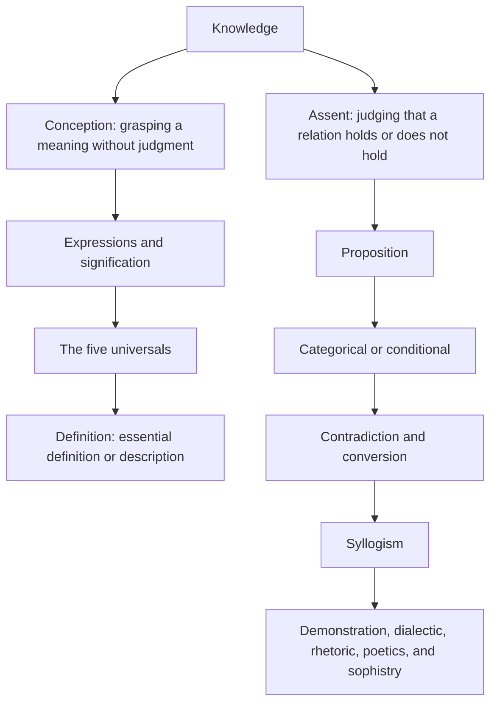
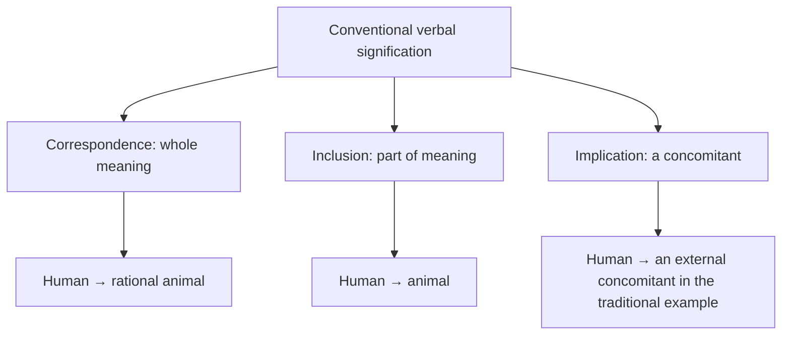
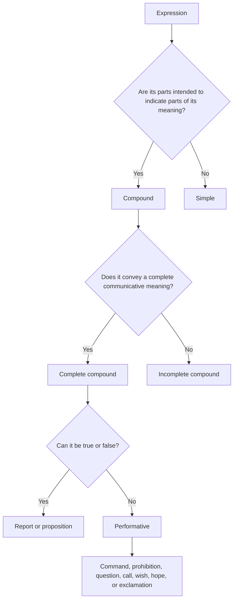
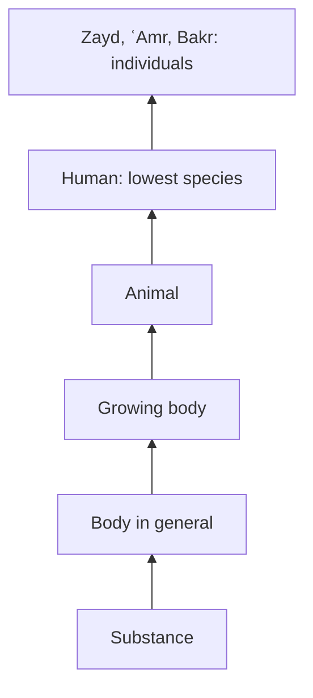
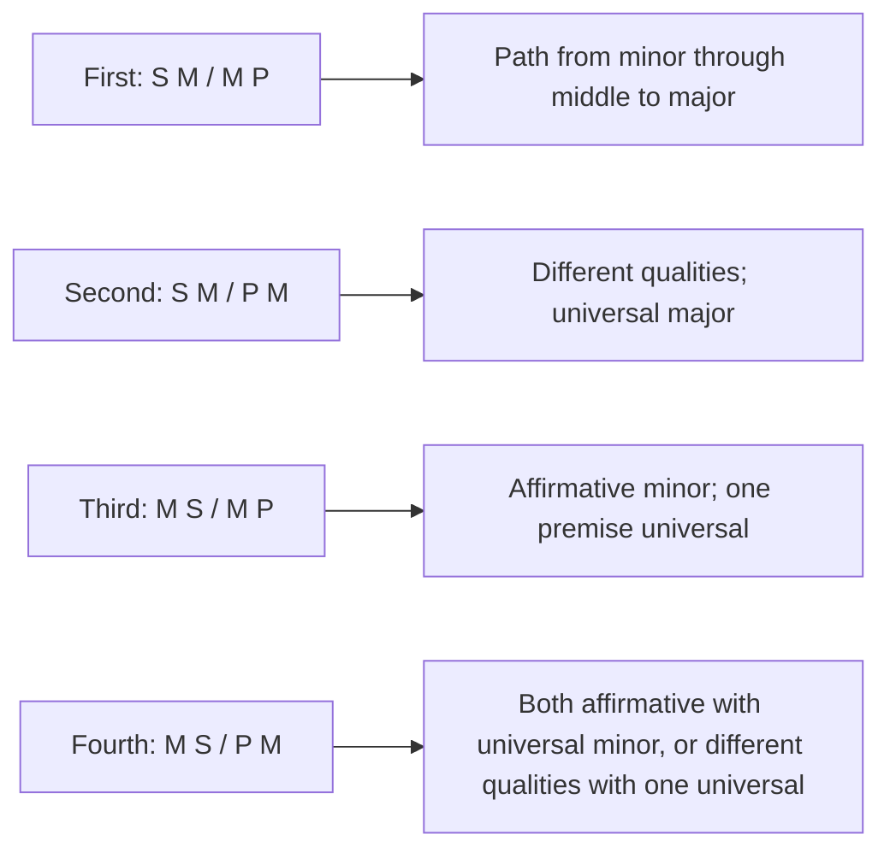

# A Study Guide to *Taṣrīḥ al-Manṭiq*

## A map of the book, explanations of its chapters, and study notes

This guide explains the text of *Taṣrīḥ al-Manṭiq* from conception and assent through the five arts. It reorganizes its rules into tables, diagrams, and worked examples. It is intended for a student beginning the subject or reviewing it: each term is explained, its connection to the preceding and following topics is shown, and common confusions are flagged.

The guide is based on the complete Arabic text supplied and compared with the 147-page edition of Jamia Islamia Hind, the fourth edition dated 15 May 2019. The order of the text is broadly similar in both files. The Jamia edition adds an educational and historical introduction, a biographical notice, numbered marginal notes, diagrams, and exercises after most chapters. This guide keeps **the text itself**, **the edition’s additions**, and **the present teaching commentary** distinct.

> **Reading key:** “The text says” points to a rule in the book; “Commentary” explains or qualifies it; “Example” makes it easier to grasp. Many examples in traditional logic are hypothetical exercises in form, not reports of fact or scientific claims.

## The book at a glance

The text presents two complementary paths: one for grasping **meanings and definitions**, and one for establishing **judgments and inferences**.



The central question of each chapter can be summarized as follows:

| If the question is… | The relevant topic is… |
|---|---|
| What does this word mean? | Conception, signification, universals, definition |
| Has this judgment been established? | Assent and proposition |
| What kind of proposition is it? | Categorical or conditional form, quantity, quality, and modality |
| Do these two propositions contradict one another? | Contradiction and its conditions |
| Does the conclusion follow from the premises? | Syllogism, figure, and matter |
| Is the argument certain, dialectical, or persuasive? | The five arts and their premises |

## 1. Knowledge: conception and assent

### Conception

**Conception** (*taṣawwur*) is the occurrence of a meaning in the mind **without judging** that something belongs or does not belong to something else. If I understand “tree” or “justice,” I have conceived a meaning; I have not yet said that a particular tree bears fruit or that a particular act is just.

### Assent

**Assent** (*taṣdīq*) is accepting a propositional relation: judging that something does or does not belong to something else. In “Zayd is standing,” we conceive Zayd, standing, and the relation between them, then judge that standing belongs to Zayd.

| Kind of knowledge | What occurs in the mind? | Example |
|---|---|---|
| Conception | A meaning, without affirmation or negation | The concept “student” |
| Assent | A judgment about a propositional relation | “The student is present” |

Every assent, when analyzed, includes three conceptions: the **subject** (what is judged about), the **predicate** (what is judged of it), and the **relation** between them. Merely seeing or understanding these elements separately does not establish the proposition.

### Self-evident and inferential

What does not depend on reflection and thought for its acquisition is **self-evident**; what does depend on them is **inferential**. The text divides both conception and assent in this way:

| Kind | Meaning | Example in the text |
|---|---|---|
| Self-evident conception | A meaning grasped without extended inquiry | Heat |
| Inferential conception | A meaning that requires definition or inquiry | The reality of jinn |
| Self-evident assent | A judgment grasped without acquired proof | The sun is shining |
| Inferential assent | A judgment requiring reflection and evidence | The world came into being |

**Commentary:** This distinction concerns how we come to know a concept or judgment, not whether it is true or false in itself. What feels self-evident may also vary in difficulty with a learner’s experience and familiarity with the words.

## 2. Signification

**Signification** is a state in which knowing one thing necessarily leads to knowing another. The first is the **sign**, the second the **signified**. Knowing an effect can point to its cause; hearing a word points to a meaning according to a language.

### General divisions

| Basis of division | Kinds | Approximate example |
|---|---|---|
| Form of the sign | Verbal / nonverbal | The word “water” / smoke |
| Source of signification | Conventional / natural / rational | An agreed word / a flushed face / a made object indicating a maker |

Two classifications can apply to the same example: a word can be verbal and conventional, while a nonverbal sign may be natural, conventional, or rational. **The main concern of this text** is conventional verbal signification, because it underlies our understanding of words and definitions.

### Conventional verbal signification by how much meaning is indicated

| Kind | What does the word indicate? | Example: “human” |
|---|---|---|
| Correspondence (*muṭābaqa*) | The whole meaning for which it was assigned | Rational animal |
| Inclusion (*taḍammun*) | Part of that assigned meaning | Animal alone, or rational alone |
| Implication (*iltizām*) | A concomitant outside the complete meaning | Writing, in the traditional example |



**Commentary:** Do not confuse a part of the meaning with a concomitant of it. Animality is included in the logical analysis of “human”; writing is not part of human nature. Implication is not established by a person’s private association: it requires a recognized entailment or a clear linguistic convention.

## 3. Simple and compound expressions; kinds of utterance

An expression is **compound** when its parts are intended to indicate parts of its meaning, as in “Zayd’s boy.” It is **complete** when it conveys a meaning on which one may properly stop; otherwise it is **incomplete**.



A complete compound is either:

1. **A report or proposition:** it can be true or false in respect of its meaning, such as “The weather is mild.”
2. **A performative:** it is not judged true or false in this respect. Examples include the command “Write,” the prohibition “Do not strike,” the question “Did you attend?”, a call, a wish, a hope, or an exclamation.

An incomplete compound may be **restrictive**, as in the description “rational animal” or the annexation “Zayd’s boy”; or it may be nonrestrictive under the text’s classification, as in some constructions whose second part is neither a description of nor annexed to the first.

A simple expression whose meaning does not stand independently is a **particle**. If its meaning does stand independently, it is either a **verb**, whose form indicates a time, or a **noun**, whose form does not itself indicate a particular time. In building a proposition, a noun can generally serve as subject or predicate; a verb can serve as predicate; a particle ordinarily stands as neither term by itself.

## 4. One expression and its meaning: universals, particulars, and ambiguity

The text considers an expression from two angles: how many meanings it has, and how a single meaning applies to individuals.

| Case | Meaning | Example in the text |
|---|---|---|
| Particular or proper name | Conceiving it prevents it from applying to many | Zayd |
| Univocal universal | Applies equally to its individuals | “Human” of Zayd and ʿAmr |
| Analogical universal | Applies with a difference in priority or degree | Existence, according to the text’s terminology |
| Homonym | One word assigned equally to several meanings | *ʿAyn*: eye, spring, gold, and other meanings |
| Transferred term | Shifted to a new technical or customary meaning that becomes established | “Prayer,” from supplication to the prescribed ritual |
| Literal and figurative | The first meaning remains in use; the word is also applied to a second by a relation | “Lion” for the animal and for a brave man |
| Synonymous expressions | Several words for one or closely related meaning | *Layth* and *ghaḍanfar* in usage |
| Distinct expressions | Different words with different meanings | Tree and stone |

**Note:** “Analogical” here is a technical term for a concept that applies with varying priority; it does not mean that a speaker is hesitant. Judgments about synonymy, literal meaning, and figurative use depend on language and context. A short list of examples does not prove those judgments for every use.

## 5. The five universals

A **universal** is something that can truly be predicated of many. The logician classifies it by its relation to the reality of its individuals: does it answer “What is it?”, distinguish the reality, or describe something outside it?

| Universal | Relation to the reality | Question answered | Example for “human” |
|---|---|---|---|
| Species | The whole reality shared by its individuals | What is Zayd? | Human |
| Genus | The whole essential common element among different realities | What are human and horse? | Animal |
| Differentia | An essential part that distinguishes a reality | What is it essentially, in distinction from others? | Rational, meaning possessing reason in logical usage |
| Property | An accidental description specific to one reality | What belongs peculiarly to it as an attribute? | Laughter or capacity for writing in traditional examples |
| Common accident | An extrinsic description shared by different realities | What accidental feature do they share? | Walking of human and horse |

Genus and differentia are classified by proximity to or distance from a species. In the order presented by the text: **substance ← body in general ← growing body ← animal ← human**. Animal is the proximate genus of human; growing body is more remote, body in general still more remote, and substance is the highest and most remote. “Rational” is the proximate differentia in the example; sensitivity is given as a remote differentia.



The text distinguishes a **real species**, such as “human” in relation to Zayd and ʿAmr, from a **relative species**: something included under a genus while also functioning as a genus for what falls beneath it. Animal is thus a relative species under growing body and a genus for human and horse.

An accident is **inseparable** when, in the relevant technical sense, it cannot be detached from its subject; it is **separable** when it can. Examples in the text: the capacity to write is an inseparable property of human; actually writing is a separable property. The capacity to walk is an inseparable common accident of animal; actually walking is separable.

**Commentary:** These examples belong to a traditional classification of essences. “Rational” does not mean that a human is distinguished only by producing speech sounds; in this terminology it refers to rational capacity. “Laughter” in logic books may mean the special disposition, not constant actual laughter.

## 6. The four relations between universals

When comparing two universals, imagine the set of individuals to which each applies. Are the sets identical? Is one wholly inside the other? Do they overlap only in part? Or do they not overlap?

| Relation | Test | Example |
|---|---|---|
| Equality | Everything covered by the first is covered by the second, and vice versa | Human and rational in the example |
| Absolute generality and specificity | One is broader; the narrower falls entirely within it | Animal and human |
| Generality and specificity in one respect | They overlap, but each also has individuals not covered by the other | Animal and nonhuman; white and animal |
| Disparateness | They apply to no same individual in the domain under discussion | Human and stone; existent and nonexistent |

```text
Equality:                 Absolute generality:
A = B                     human ⊂ animal

Overlap in one respect:   Disparateness:
A ∩ B is nonempty         A ∩ B = ∅
each also has its own members
```

The contradictory of a universal is what applies to everything to which that universal does not apply, within the domain assumed. The relation between contradictories changes with the original relation; do not copy the relation between two universals and transfer it to their contradictories without checking.

## 7. Definition: essential definition and description

A **definer** is what enables one to conceive the thing. The text distinguishes an essential definition from a definition by attribute:

| Kind | Structure | Example |
|---|---|---|
| Complete essential definition (*ḥadd tāmm*) | Proximate genus + proximate differentia | Human: rational animal |
| Incomplete essential definition | Proximate differentia alone, or a remote genus with the proximate differentia | Rational; or rational body |
| Complete description (*rasm tāmm*) | Proximate genus + property | Laughing animal |
| Incomplete description | Property alone, or a remote genus with the property | Laughing; or laughing body |

**How to test a definition:** Ask two questions. Does it name essential parts of the reality, or an attribute outside it? Is its genus proximate or remote? If it is essential and contains the proximate genus and differentia, it is a complete essential definition. If it defines through a property, it is a description.

**Commentary on good definitions:** A definition is not good merely because it contains the words “genus” and “differentia.” It should not be circular, broader or narrower than what it defines, and its words should be clearer to the learner than the defined expression. This practical discipline prevents memorizing classifications from becoming an end in itself.

## 8. Categorical propositions and their kinds

A **proposition** is an utterance that can be true or false in respect of its meaning. In a categorical proposition, a predicate is affirmed of a subject or denied of it: “Zayd is standing”; “Zayd is not standing.” The subject is what is judged about, the predicate is what is judged of it, and the copula indicates their relation, though it may be implicit in Arabic.

### By subject and quantity

| Kind | Definition | Example |
|---|---|---|
| Singular | Its subject is a particular individual | Zayd is a writer |
| Natural | The judgment concerns the nature or concept itself | Human is a species |
| Universal quantified | The judgment concerns all individuals | Every human is an animal |
| Particular quantified | The judgment concerns some individuals | Some animal is human |
| Unquantified | The subject is universal, but the quantity is unstated | Human is an animal |

The four quantified forms are the main review tools:

| Symbol | Name | Form | Example |
|---|---|---|---|
| A | Universal affirmative | Every S is P | Every human is an animal |
| E | Universal negative | No S is P | No human is a stone |
| I | Particular affirmative | Some S is P | Some animal is human |
| O | Particular negative | Some S is not P | Some animal is not human |

The **quantifier** is the word that indicates quantity, such as “every,” “some,” and “none.” The presence of a negative word alone does not tell you what kind of proposition you have. Ask whether negation is part of a term or applies to the judgment as a whole.

### Negated terms: where does the negation belong?

When a negative particle becomes part of the subject, the proposition is **subject-negated**, as in “The non-animal is a body.” When it becomes part of the predicate, it is **predicate-negated**, as in “The body is nonliving.” If it belongs to both terms, both are negated. In a standard negative proposition, by contrast, negation applies to the relation: “A human is not a stone.”

**Quick distinction:** “The body is nonliving” makes “nonliving” a predicate; “The body is not living” denies the relation. This concerns how the sentence is analyzed, not merely word order.

## 9. Modality and modal propositions

**Modality** is the way in which the predicate–subject relation is considered: necessary, enduring, actually obtaining, or possible. A proposition that states or intends a modality is modal. The text divides modalities into simple and compound.

### Eight simple modalities

| Name | Short teaching gloss | Example or qualification |
|---|---|---|
| Absolute necessity | The relation necessarily holds or fails as long as the subject’s essence exists | Every human is necessarily an animal |
| General conditional necessity | Necessity while the subject bears a specified description | The writer’s fingers move necessarily while he is writing |
| Absolute temporal | Necessity at a specified time in the subject’s existence | The moon is eclipsed while Earth intervenes |
| Disjunctive temporal | Necessity at some unspecified time | A human breathes at some time |
| Absolute permanence | The relation endures as long as the subject’s essence exists | The traditional example of celestial motion |
| General customary permanence | The judgment endures while the subject bears a stated description | A writer’s fingers move while he is writing |
| General actual | Affirmation or negation obtains actually at one of the three times | A human is actually laughing |
| General possibility | The opposite relation is not necessary; the relation is not impossible | A human may be a writer |

**Essential distinction:** Necessity means that the relation cannot be detached under the relevant consideration. Permanence means that it continues through the times being considered. Not every permanent relation is necessary to the subject’s essence. Do not equate “always” with “necessarily.”

### Seven compound modalities

A compound modal adds a second qualification, such as “not always” or “not necessarily.” Read its two parts rather than relying only on the name:

| Name in the text | Construction |
|---|---|
| Special conditional | General conditional necessity + denial of essential permanence |
| Temporal | Absolute temporal + denial of essential permanence |
| Disjunctive temporal | Disjunctive temporal + denial of essential permanence |
| Special customary | General customary permanence + denial of essential permanence |
| Existential non-necessary | General actual + denial of essential necessity |
| Existential non-permanent | General actual + denial of essential permanence |
| Special possible | Denial of essential necessity in both the affirmative and opposite directions |

**Important note:** These are names and divisions in traditional scholastic logic. Do not assume that each term maps directly onto one operator in modern symbolic logic. One must specify the domain, time, existence of the subject, and meaning of the qualification.

## 10. Conditional propositions

A **conditional proposition** does not directly judge that a predicate belongs to a subject. It judges a relation between two propositions: the **antecedent** and the **consequent**.

### Conjunctive conditionals

| Kind | Rule | Example |
|---|---|---|
| Necessary connection | The speaker claims that the consequent follows from the antecedent | Whenever the sun rises, daytime exists |
| Coincidental connection | An association or concurrence is asserted without claiming an intrinsic entailment | Whenever a human is rational, a horse neighs—in a constructed example |

### Disjunctive propositions

| Kind | What does it rule out? | Illustrative example |
|---|---|---|
| Exclusive and exhaustive alternative | Both terms together, and neither term, are ruled out | A number is either even or odd |
| Incompatible alternatives | Both terms together are ruled out, but both may be false | This thing is either a tree or a stone, within an assumed classification |
| Exhaustive alternatives | Both terms being false is ruled out, but both may be true | Zayd is either at sea or does not drown, depending on how the example is framed |

If the incompatibility belongs to the terms themselves, the text calls the conditional **intrinsic**; if it comes from an external coincidence, it calls it **coincidental**. Common markers of universal conjunctive conditionals include “whenever,” “whatever the case,” and “every time”; disjunctions use words such as “always” or “never,” while particular forms may use “it may be” or “it may not be.”

**Commentary:** Before reasoning from a disjunction, identify its kind. From “either even or odd,” one may establish one and deny the other because the division is exhaustive and exclusive. “Either tree or stone” is not an exhaustive division of all things unless the domain has been restricted to those two classes.

## 11. Contradiction and the conditions for it

Two propositions **contradict** when the truth of either requires the falsity of the other, and the falsity of either requires the truth of the other. Among quantified categorical propositions, affirmative and negative forms oppose each other with a change in quantity:

```text
Every S is P (A)       contradicts       Some S is not P (O)
No S is P (E)          contradicts       Some S is P (I)
```

It is not enough for one phrase to differ. The two propositions must agree in **eight respects**, while differing in affirmation/negation and, where required, quantity:

| Respect | What must be held constant? |
|---|---|
| Subject | The same Zayd, not another person named Zayd |
| Predicate | The same act of standing, not another attribute |
| Place | The same market or place |
| Time | The same time, such as noon |
| Potentiality and actuality | Writer actually vs writer actually, not one potential and one actual |
| Condition | The same condition |
| Relation | The same person’s fatherhood of the same child |
| Part and whole | Judgment about the same whole person or the same part |

**Example:** “Zayd is standing in the market at noon” does not contradict “Zayd is not standing at home in the morning.” Place and time differ. Holding the respects constant prevents us from mistaking statements about different circumstances for a contradiction.

## 12. Simple conversion and conversion by contraposition

### Simple conversion

Simple conversion exchanges the subject and predicate while preserving truth and quality, subject to the quantity allowed by the conversion rule.

| Original proposition | Simple converse in the text |
|---|---|
| Universal affirmative: Every human is an animal | Particular affirmative: Some animal is human |
| Particular affirmative: Some human is an animal | Particular affirmative: Some animal is human |
| Universal negative: No human is a stone | Universal negative: No stone is human |
| Particular negative: Some human is not a stone | It has no converse in this chapter |

**Memory rule:** A universal affirmative does not remain universal under simple conversion; it becomes particular. A universal negative retains its quantity. A particular negative does not convert under this classification.

### Conversion by contraposition

In contraposition, exchange the terms and put the contradictory of each term in its place, preserving quality and truth according to the rule:

| Original proposition | Form stated in the text |
|---|---|
| Universal affirmative | Universal affirmative: Every human is an animal → every non-animal is nonhuman |
| Particular affirmative | No contraposition in this chapter |
| Universal or particular negative | Particular negative, according to the example and construction in the text |

**Commentary:** Contradictory terms and the assumed existence of members of a subject affect some traditional conversions. In an application, write the original, identify its terms, and then write the contradictory of each. Do not rely on memorizing an unexplained sentence.

## 13. Categorical syllogism

A **syllogism** is an utterance composed of propositions from which another utterance follows by their nature. If its conclusion, or the contradictory of its conclusion, is explicitly mentioned in the premises, it is an **exception syllogism**. If not, it is a **conjunctive syllogism**. A conjunctive syllogism is categorical when its propositions are categorical, and conditional when it includes conditionals.

In a categorical syllogism:

| Term | Function |
|---|---|
| Minor term | Subject of the conclusion |
| Major term | Predicate of the conclusion |
| Middle term | The shared term linking minor and major, then omitted from the conclusion |
| Minor premise | Premise containing the minor term |
| Major premise | Premise containing the major term |
| Figure | Position of the middle term in the two premises |

Example:

```text
Every human is an animal       (minor premise: minor human, middle animal)
Every animal is sentient       (major premise: middle animal, major sentient)
Therefore, every human is sentient (conclusion: minor human, major sentient)
```

### The four figures

Let **S** stand for the minor, **P** for the major, and **M** for the middle term. The table gives the position of the middle in the minor premise and then the major premise:

| Figure | Minor, then major | Position cue |
|---|---|---|
| First | S–M, M–P | Middle is predicate in the minor and subject in the major |
| Second | S–M, P–M | Middle is predicate in both premises |
| Third | M–S, M–P | Middle is subject in both premises |
| Fourth | M–S, P–M | Middle is subject in the minor and predicate in the major |



### Productive conditions and moods as ordered by the text

In this table **A** = universal affirmative, **E** = universal negative, **I** = particular affirmative, and **O** = particular negative. The two symbols before the arrow are the minor premise followed by the major premise.

| Figure | Condition stated by the text | Listed moods and results |
|---|---|---|
| First | Minor affirmative; major universal | AA→A; AE→E; IA→I; IE→O |
| Second | One premise affirmative and the other negative; major universal | AE→E; EA→E; IE→O; OA→O |
| Third | Minor affirmative; one premise universal | AA→I; IA→I; AI→I; AE→O; IE→O; AO→O |
| Fourth | Both affirmative with universal minor, or different qualities with one universal | AA→I; AI→I; EA→E; AE→O; IE→O; OA→O; AO→O; EI→O |

For the first figure, the text illustrates the four moods with examples such as “Every human is an animal; every animal is sentient.” In the second, it emphasizes difference in quality. In the third and fourth, changing the middle term’s position changes the conditions and conclusions.

**Advanced note:** This is the teaching list as ordered in the supplied edition. Some particular conclusions—especially in figures where the minor is not the subject of the conclusion in the familiar way—depend on the traditional assumption that the subject has members. When testing the syllogism in modern logic without existential import, do not transfer every particular rule mechanically; check existence and distribution of terms. Students should first learn the convention of their course, then study the comparison in its proper place.

### A three-step method for checking a syllogism

1. Write the proposed conclusion and identify its minor and major terms.
2. Find the term shared by the premises: this is the middle. Check that it is used in the same sense.
3. Match the arrangement to a figure, then check quantity, quality, and that figure’s conditions.

If the shared word has two different meanings, or the middle does not link the other terms, the premises do not yield the proposed conclusion, even if the wording sounds persuasive.

## 14. Conditional and exception syllogisms

### Conjunctive conditional syllogism

This syllogism combines conditional propositions and connects their parts. The text presents five constructions:

1. **Two conjunctive conditionals:** If Zayd is human, he is an animal; whenever he is an animal, he is a body; therefore, if he is human, he is a body.
2. **Two disjunctions:** Divide numbers into even and odd, then divide the even into even-even and even-odd.
3. **Categorical plus conjunctive conditional:** This is human; every human is an animal; therefore, this is an animal.
4. **Categorical plus disjunction:** This is a number; every number is either even or odd; therefore, this is either even or odd.
5. **Conjunctive conditional plus disjunction:** If this is three, it is a number; every number is either even or odd; therefore, if this is three, it is either even or odd.

The four figures also apply according to the positions of the terms, but the text refers the detailed treatment to more extensive works.

### Exception syllogism

An exception syllogism states an antecedent, consequent, or one part of a disjunction, then affirms or denies it to infer the other.

| Major proposition | Productive exception |
|---|---|
| Necessary conditional: If A, then B | Affirm A to infer B; deny B to infer not-A |
| Exclusive and exhaustive disjunction: A or B, but not both and not neither | Affirming one denies the other; denying one establishes the other |
| Incompatible alternatives | Affirming one denies the other; denying one does not establish the other |
| Exhaustive alternatives | Denying one establishes the other; affirming one does not deny the other |

**A common trap in conditionals:** From “If A, then B” and “B,” it does not follow that A; B may occur for another reason. From “If A, then B” and “not A,” it does not follow that “not B.” These are affirming the consequent and denying the antecedent, two forms that do not yield a conclusion without an additional premise.

## 15. Induction and analogy

### Induction

**Induction** moves from judgments about particulars to a universal judgment.

| Kind | What has been examined? | Strength of conclusion |
|---|---|---|
| Complete | Every member of the assumed domain | Strongest, provided the domain is enumerable and the classification is correct |
| Incomplete | Some or most members | Does not by itself yield certainty; a counterexample may appear |

The text’s example of the movement of an animal’s jaw while chewing illustrates the risk of generalizing from observed cases to all kinds, then mentions the crocodile as a possible counterexample. The methodological point is that a sample is not the whole.

### Analogy

**Analogy** moves from one particular judgment to another because of a shared attribute. The text gives two ways to investigate that attribute:

| Method | How it works | Example in the text |
|---|---|---|
| Concomitance (correlation) | Observe the judgment occurring and ceasing together with an attribute | Intoxication and the legal ruling on wine in the jurisprudential example |
| Elimination | List the attributes of the original case and eliminate those that cannot be the cause, leaving a candidate | Test color, taste, smell, and other features, then identify intoxication in the example |

**Commentary:** Analogy becomes stronger when the shared cause is established, but resemblance alone does not make it certain. Similarity in a superficial feature does not prove that two things have the same ruling; one must test whether the attribute causes the ruling and rule out relevant differences.

## 16. The five arts and the matter of argument

The text calls the five forms of argumentative composition “the five arts.” Their main difference is the **kind of premises and intended effect**, not merely the style of speaking.

| Art | Its matter in the text | Usual aim | Note |
|---|---|---|---|
| Demonstration | Certain premises | To produce knowledge or establish certainty under its conditions | Strongest in the certainty of its matter |
| Dialectic | Generally accepted or conceded premises | To engage an opponent using what they accept | A premise may be conceded by an opponent without being true in itself |
| Rhetoric | Accepted or probable premises | To persuade an audience and move the will | Probability is not certainty |
| Poetics | Imaginative premises | To affect the soul through attraction or aversion | Meter and rhyme are not required for this logical classification |
| Sophistry | Illusory or merely resembling premises | To mislead and make falsehood appear true | Study exposes deception; it does not license it |

### The materials of demonstration: certainties

| Kind | Simple definition | Approximate example |
|---|---|---|
| Primary principles | Judgment follows from conceiving the two terms and relation | The whole is greater than the part |
| Innate inferences | A middle term is immediately present to the mind when the terms are conceived | Four is even because it divides into two equal parts |
| Sense perceptions | Perceived by the external senses | The sun is shining, according to observation |
| Inner experiences | Perceived by a person’s inner sense | I am hungry or thirsty |
| Intuitions | The mind moves directly from a starting point to what is sought | The traditional example connecting moonlight with sunlight |
| Experiential judgments | Repeated action or observation yields certainty under its conditions | An effect of a substance after repeated experiments |
| Mass-transmitted reports | A group’s report that people would not ordinarily conspire to fabricate, under the conditions of transmission | The existence of Mecca to someone who has not visited it |

### Non-certain or non-demonstrative materials in the narrower sense

| Kind | Character |
|---|---|
| Generally accepted | Widely accepted among people or a group |
| Conceded | Accepted by an opponent in a particular debate, whether true or false |
| Accepted on authority | Taken from someone trusted by the listener |
| Probable | Favored by the reasoner, while its opposite remains possible |
| Imaginative | Affects the soul through comparison, attraction, or aversion |
| Estimative | Strongly judged by estimation though not established by rigorous reason |
| Resembling | Appears like truth or common opinion but is not so on examination |

A proposition may belong to more than one class under different considerations: it may be self-evident in one respect, generally accepted because it is widely held, and conceded by a particular interlocutor. These are not always mutually exclusive boxes.

### Demonstration *limmī* and *innī*

If the middle term is the actual cause of the judgment, as well as the route of reasoning in the mind, the demonstration is **limmī**: from cause to effect, answering “Why?” If the middle term is not the actual cause but indicates the judgment, the demonstration is **innī**: from effect to what it indicates, or from the caused thing to its cause.

```text
Limmī: cause ──explains──> effect
Innī: effect ──indicates──> cause or reason
```

**Teaching caution:** The old medical examples in the text and Jamia edition, such as putrefaction of humors and fever, are historical examples of syllogistic form—not medical advice or a modern account of disease. In contemporary teaching, replace their factual premises with scientifically established ones while retaining the syllogistic form.

## 17. Comparing the Jamia Islamia Hind edition with the supplied text

### What does the Jamia edition add?

| Element | What appears in the Jamia edition |
|---|---|
| Publication details | Identifies itself as the fourth edition, dated 15 May 2019, published by the Publications and Distribution Department of Jamia Islamia Hind in Calicut, Kerala |
| Teaching introduction | Discusses the difficulty of teaching logic and the aim of making it accessible, and criticizes reliance on memorization and repetition alone |
| Religious framing | Presents the editors’ view of logic’s benefit for religious sciences and mentions scholarly disagreement about logic mixed with philosophy; this belongs to the edition’s introduction, not the text of *Taṣrīḥ* |
| History | Adds brief pages on the origins, development, and periods of logic, with names from antiquity, Muslim scholarship, and modern times |
| Author | Includes a biography attributing the book to Shaykh Muhammad Riza Ali Khan al-Bukhari and giving his birth, death, and some works |
| Commentary | Adds numbered notes explaining terms and diversifying examples, including linguistic, jurisprudential, and everyday examples |
| Teaching aids | Provides explanatory maps and activities in reading, comprehension, classification, and example-making after most chapters |
| Ending | The supplied file ends with exercises on certainties, non-certainties, and demonstration. The introduction mentions an appended glossary, but no separate glossary section appears in the 147 pages examined |

### The ten introductory principles in the Jamia edition

The edition adds an introductory list that is not a chapter of the text: the definition, subject, name, aim and benefit, source, merit, author, legal ruling, questions, and relation of logic. It defines logic as examining conceptual and assent-based information insofar as it leads to an unknown conception or assent, and describes its aim as protecting the mind from error in thought. The introduction discusses the ruling on studying it and its relation to the religious sciences within its own jurisprudential framework; those claims should not be confused with the technical definition of logic.

### Quick page guide to the Jamia edition

The page numbers below are those printed at the foot of the pages. The PDF begins with introductory material; the text begins on printed page 19, and the exercise pages end on printed page 151.

| Printed page | Topic |
|---:|---|
| 19 | Assent and conception |
| 24 | Kinds of signification |
| 32 | Compound and simple expressions |
| 37 | Kinds of simple terms by meaning |
| 41 | The five universals |
| 52 | The four relations between universals |
| 57 | Definition |
| 60 | Categorical and conditional propositions |
| 65 | Negated-term propositions |
| 68 | Modal propositions |
| 74 | Compound propositions |
| 80 | Conjunctive and disjunctive conditionals |
| 87 | Special, quantified, and unquantified conditionals |
| 92 | Contradiction |
| 96 | Simple conversion |
| 99 | Conversion by contraposition |
| 102 | Syllogism and figures |
| 109–120 | Figures two, three, and four |
| 127 | Conditional syllogism |
| 132 | Exception syllogism |
| 137 | Induction |
| 139 | Analogy |
| 142 | The five arts |
| 147 | Diagram of the five arts |
| 148–151 | Exercises on the arts and certainties |

The supplied Markdown begins directly with the Arabic text and ends with its conclusion; it does not include the introduction, translation, or Jamia exercises. It also does not name the author within the supplied text. Therefore, the careful formulation is **“The Jamia edition attributes the text to Muhammad Riza Ali Khan al-Bukhari,”** not “the supplied text itself proves the attribution.”

The Jamia biography says that he was born in 1198 AH in Jowfami near Lucknow and died in 1270 AH after an illness on his return journey from pilgrimage; it also lists some of his works. These are facts as reported in that edition. The supplied text itself contains neither an author biography nor independent documentation of those details.

### A critical note on the historical introduction

The Jamia introduction is useful as a quick orientation to names, schools, and periods, but it is brief and does not give detailed references for every date or claim. It should be used as an initial map, not as a final historical reference. Studies of Arabic logic describe the transmission of elements from Aristotelian and later commentary traditions while also showing the development of distinct Arabic-Islamic traditions, with their own organization, terminology, and history—not a simple verbatim transfer from Greek. Scholarly encyclopedia entries discuss Porphyry and the *Isagoge* in the history of the five universals, as well as conception, assent, definition, and syllogism in Avicennian logic: [Medieval Theories of the Syllogism](https://plato.stanford.edu/entries/medieval-syllogism/); [Porphyry](https://plato.stanford.edu/entries/porphyry/); [Ibn Sina](https://plato.stanford.edu/entries/ibn-sina/index.html).

Accordingly, read the edition’s historical pages as an educational introduction and verify detailed claims against specialized historical sources before using them in research or documentation. The order of the text’s chapters follows a familiar teaching path: concepts and definition, then propositions, then syllogism, then the materials of argument.

### A useful critical reading of the notes and exercises

One strength of the Jamia edition is that it does not leave every definition abstract: after a definition, it often supplies a diagram or an activity asking the learner to apply it. For example, after signification it asks students to classify verbal and nonverbal signs; after the universals it asks them to identify genus and differentia; after propositions it exercises quantifiers, modality, and contradiction; and after the figures it asks students to identify terms and derive conclusions. This serves the introduction’s stated aim of moving from memorization to application.

Yet an educational note does not change the status of the text: a modern example added by the edition clarifies a term but does not become part of its original definition. Some jurisprudential or historical examples require knowledge of their domain before they are used. The classification of a proposition under one of the kinds of argumentative matter may also change depending on the speaker and listener. For each note, it helps to ask: is this a definition, an example, an introductory opinion, or a legal judgment?

## 18. Common mistakes and how to avoid them

| Mistake | Correction |
|---|---|
| Treating all knowledge as assent | You may know the meaning of “human” without judging anything about it; that is conception |
| Treating every verbal signification as correspondence | A word may indicate part of its meaning or a concomitant, depending on use and relation |
| Confusing genus and species | Animal is a genus of human; human is a species under animal. A term can be a relative species and a genus of what falls below it |
| Making a property part of the essence | In this classification, a property is outside the essence even if it is specific to a kind |
| Confusing universality in quantity with a universal concept | “Universal” quantity concerns how many individuals a judgment covers; a “universal” concept applies to many |
| Treating “not” as always outside the terms | In a negated-term proposition, negation may be part of the subject or predicate |
| Equating necessity with permanence | Necessity means the relation cannot be detached; permanence means it continues across the relevant times |
| Declaring contradiction from a difference in negation alone | First align subject, predicate, time, place, and the other conditions |
| Reversing every proposition in conversion | Some do not convert; some convert to particular, not universal |
| Accepting every argument that looks syllogistic | Check the middle term, quantity, and quality; verbal resemblance is not enough |
| Inferring a universal with certainty from some cases | This is incomplete induction; a counterexample may appear |
| Treating analogy as invariably demonstrative | Analogy requires proof of the shared cause and exclusion of relevant differences |
| Confusing valid form with true premises | A syllogism may be properly arranged while its premises are unestablished; valid form cannot repair defective matter |

## 19. Quick review

### Conception and assent

```text
Conception = grasping a meaning without judgment
Assent = judging that a relation holds or does not hold
Analyzed assent = conception of subject + predicate + relation + judgment
```

### The five universals

```text
Species: the whole reality shared by individuals
Genus: the whole essential common element among different realities
Differentia: an essential distinguishing part
Property: an extrinsic attribute specific to a reality
Common accident: an extrinsic attribute shared by different realities
```

### Four quantified forms

```text
A: Every S is P              E: No S is P
I: Some S is P                O: Some S is not P
Contradictory of A = O        Contradictory of E = I
```

### Conversions in this text

```text
Simple conversion:
A → I       I → I       E → E       O → no conversion

Contraposition:
A → A       I → no conversion       E/O → O, according to the text’s construction
```

### The five arts

```text
Demonstration: certainties        Dialectic: generally accepted or conceded
Rhetoric: accepted or probable    Poetics: imaginative
Sophistry: estimative or resembling premises
```

## 20. Review exercises with answer key

### Questions

1. Is understanding the meaning of “rain” alone conception or assent? What must be added to make it assent?
2. Classify a word such as “book” when it indicates its whole meaning, part of its meaning, and a concomitant, using the lesson’s categories.
3. In “Every human is an animal,” identify the subject, predicate, quantifier, quantity, and quality.
4. What contradicts “Every student is present”? What contradicts “No student is negligent”?
5. Are “Zayd is standing in the morning” and “Zayd is not standing in the evening” contradictory? Explain.
6. What is the simple converse of “Every human is an animal” according to the text? What qualification should be remembered?
7. Find the middle term and conclusion: “Every human is an animal; every animal is sentient.”
8. Why does “If it rains, the ground gets wet; the ground is wet” not establish that it rained?
9. If we examine some animals and generalize the judgment to every animal, what kind of induction is this?
10. How do dialectic and demonstration differ with respect to their premises?
11. Is similarity in color enough to prove that two medicines have the same effect? Why?
12. In the traditional definition “Human is a rational animal,” which two parts are genus and differentia?

### Answer key

1. Conception. Add a propositional judgment, such as “Rain is falling.”
2. Whole meaning: correspondence; part: inclusion; concomitant: implication, provided the relation is established in the intended use.
3. Subject: human; predicate: animal; quantifier: every; quantity: universal; quality: affirmative.
4. The first is contradicted by “Some student is not present.” The second by “Some student is negligent.”
5. No. The time differs; Zayd may be standing in the morning and not standing in the evening.
6. “Some animal is human.” Remember the traditional assumption that the subject has members when moving to a particular proposition.
7. Middle term: animal. Conclusion: “Every human is sentient.”
8. This affirms the consequent: the ground may become wet for another reason.
9. Incomplete induction, which does not by itself provide certainty.
10. According to the text, demonstration is made from certainties; dialectic uses generally accepted or conceded premises.
11. No. Color is a superficial shared feature and does not establish a cause or effect. Evidence for the causally relevant property is needed.
12. “Animal” is the proximate genus, and “rational” is the proximate differentia; together they form a complete essential definition in this terminology.

## 21. Brief glossary

| Term | Short meaning |
|---|---|
| Knowledge | A form or cognition occurring in the mind, according to the text’s definition |
| Conception | Grasping a meaning without propositional judgment |
| Assent | Accepting a propositional relation affirmatively or negatively |
| Relation | Predicating one thing of another, affirmatively or negatively |
| Sign / signified | What indicates / what is known through the indication |
| Correspondence | A word’s indication of the whole meaning for which it was assigned |
| Inclusion | Its indication of a part of the assigned meaning |
| Implication | Its indication of an external concomitant of the complete meaning |
| Universal / particular | What applies to many / what, in the relevant consideration, applies only to a particular |
| Genus | The whole essential common element among different realities |
| Species | The whole reality shared by agreeing individuals |
| Differentia | An essential part that distinguishes a reality |
| Property | An accidental attribute specific to one reality |
| Common accident | An accidental attribute shared by different realities |
| Essential definition | A definition by genus and differentia |
| Description | A definition through a property or accidental attributes |
| Subject | What is judged about in a categorical proposition |
| Predicate | What is judged of the subject |
| Quantifier | A word indicating how many individuals are covered |
| Antecedent / consequent | The two parts of a conditional proposition |
| Modality | The manner in which the predicate–subject relation is considered |
| Contradiction | Opposition in which each proposition’s truth entails the other’s falsity, with the relevant conditions aligned |
| Simple conversion | Reversing subject and predicate while observing the conversion rules |
| Middle term | The term connecting the premises and omitted from the conclusion of a categorical syllogism |
| Conjunctive syllogism | A syllogism whose conclusion is not explicitly stated in its premises |
| Exception syllogism | A syllogism that states and then affirms or denies an antecedent, consequent, or disjunct |
| Induction | Moving from particular cases to a universal judgment |
| Analogy | Moving from one particular case to another because of an assumed or established shared cause |
| Demonstration | A syllogism whose matter consists of certainties, according to the text |
| Sophistry | A fallacious argument using illusion or resemblance to disguise falsehood as truth |

## Reading references

### Texts compared

- The complete Arabic text of *Taṣrīḥ al-Manṭiq* in the supplied Markdown file.
- *Taṣrīḥ al-Manṭiq (Jamia Islamia Hind)*, fourth edition, 2019, 147-page PDF. Its introduction, preliminary pages, diagrams, marginal notes, and activities informed the comparison above.

### Historical and philosophical sources online

- [Stanford Encyclopedia of Philosophy, “Medieval Theories of the Syllogism”](https://plato.stanford.edu/entries/medieval-syllogism/): for the historical setting of syllogism and Arabic logic in the medieval tradition.
- [Stanford Encyclopedia of Philosophy, “Porphyry”](https://plato.stanford.edu/entries/porphyry/): for the context of the *Isagoge* and the five universals.
- [Stanford Encyclopedia of Philosophy, “Ibn Sina”](https://plato.stanford.edu/entries/ibn-sina/index.html): for conception, assent, definition, syllogism, and the middle term in Avicennian logic.

These references establish broad historical context; they do not by themselves establish the attribution or date of every part of *Taṣrīḥ al-Manṭiq*. The author’s biographical details are therefore attributed here to what the Jamia edition reports.
