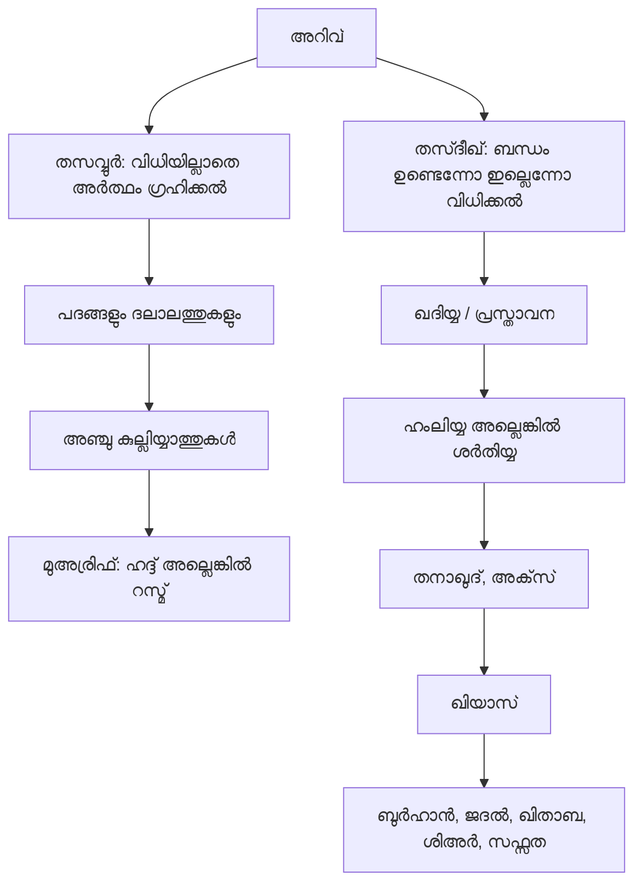
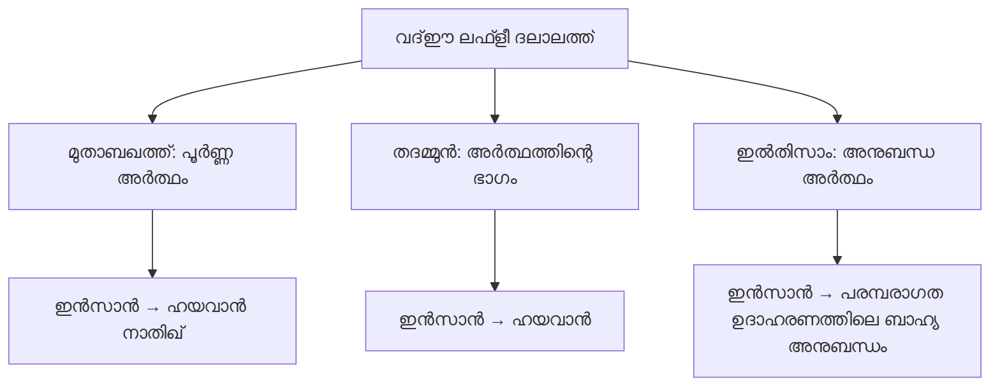
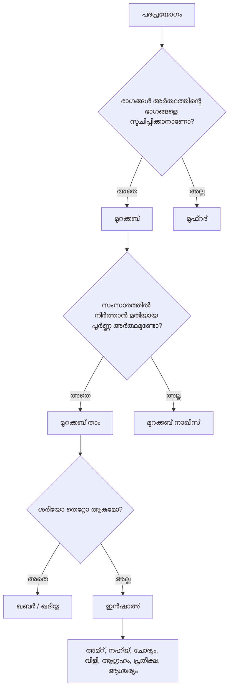
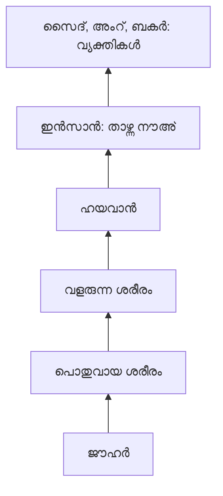
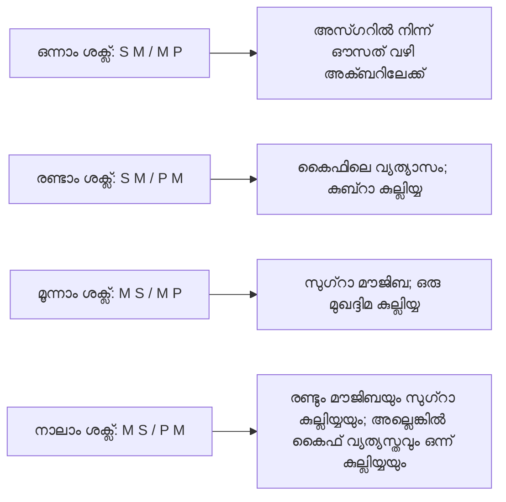

# തസ്‌രീഹുൽ മന്തിഖ് — പഠനസഹായി

## ഗ്രന്ഥത്തിന്റെ ഭൂപടം, അധ്യായങ്ങളുടെ വിശദീകരണം, പഠനക്കുറിപ്പുകൾ

ഈ പഠനസഹായി *തസ്‌രീഹുൽ മന്തിഖ്* എന്ന ഗ്രന്ഥത്തിലെ തസവ്വുർ–തസ്ദീഖ് (ധാരണയും സ്ഥിരീകരണവും) മുതൽ പഞ്ചകലകൾ വരെ വിശദീകരിക്കുന്നു. ഗ്രന്ഥത്തിലെ നിയമങ്ങളെ പട്ടികകളായും ചിത്രരൂപങ്ങളായും ഉദാഹരണങ്ങളായും ക്രമീകരിച്ചിരിക്കുന്നു. മന്തിഖ് പഠനം തുടങ്ങുന്നവർക്കും അധ്യായങ്ങൾ ആവർത്തിക്കുന്നവർക്കും വേണ്ടിയാണ് ഇത്: ഓരോ പദത്തിന്റെയും പ്രയോജനം വിശദീകരിക്കുകയും മുൻപും പിന്നുമുള്ള വിഷയങ്ങളുമായുള്ള ബന്ധം കാണിക്കുകയും സാധാരണയായി ഉണ്ടാകുന്ന ആശയക്കുഴപ്പങ്ങൾ പ്രത്യേകം ചൂണ്ടിക്കാണിക്കുകയും ചെയ്യുന്നു.

ഇവിടെ ആശ്രയിച്ചിരിക്കുന്നത് നൽകിയിരിക്കുന്ന സമ്പൂർണ അറബി പാഠവും, 2019 മേയ് 15-ന് തീയതിയിട്ട നാലാം പതിപ്പായ 147 പേജുള്ള ജാമിഅ ഇസ്‌ലാമിയ ഹിന്ദ് പതിപ്പുമാണ്. രണ്ടു ഫയലുകളിലെയും പാഠത്തിന്റെ അധ്യായക്രമം പൊതുവിൽ സമാനമാണ്. ജാമിഅ പതിപ്പിൽ അധ്യാപന–ചരിത്ര ആമുഖം, ഗ്രന്ഥകർത്താവിനെക്കുറിച്ചുള്ള കുറിപ്പ്, നമ്പറിട്ട ഹാശിയകൾ, ചിത്രങ്ങൾ, മിക്ക അധ്യായങ്ങൾക്കു ശേഷമുള്ള അഭ്യാസങ്ങൾ എന്നിവ അധികമായി ചേർത്തിരിക്കുന്നു. ഇവിടെ **മൂലപാഠം**, **പതിപ്പിലെ കൂട്ടിച്ചേർക്കലുകൾ**, **ഈ പഠനസഹായിയിലെ അധ്യാപനക്കുറിപ്പുകൾ** എന്നിവ വേർതിരിച്ചിരിക്കുന്നു.

> **വായനാസൂചിക:** “മൂലപാഠം” എന്നു പറയുന്നത് ഗ്രന്ഥത്തിലെ നിയമത്തെയാണ് സൂചിപ്പിക്കുന്നത്; “വ്യാഖ്യാനം” അതിനെ വിശദീകരിക്കുകയോ പരിധി വ്യക്തമാക്കുകയോ ചെയ്യുന്നു; “ഉദാഹരണം” ആശയം എളുപ്പമാക്കുന്നു. പരമ്പരാഗത മന്തിഖിലെ പല ഉദാഹരണങ്ങളും രൂപം പരിശീലിപ്പിക്കാനുള്ള സങ്കൽപ്പിത ഉദാഹരണങ്ങളാണ്; അവ യഥാർത്ഥ സംഭവവിവരങ്ങളോ ശാസ്ത്രീയ പ്രസ്താവനകളോ ആകണമെന്നില്ല.

## ഗ്രന്ഥത്തിന്റെ മൊത്തത്തിലുള്ള ഭൂപടം

ഈ ഗ്രന്ഥത്തിൽ പരസ്പരം പൂരിപ്പിക്കുന്ന രണ്ടു വഴികളുണ്ട്: **അർത്ഥവും നിർവചനവും** ഗ്രഹിക്കാനുള്ള വഴി, **വിധിയും അനുമാനവും** സ്ഥാപിക്കാനുള്ള വഴി.



ഓരോ അധ്യായത്തോടും ബന്ധപ്പെട്ട അടിസ്ഥാന ചോദ്യം ഇങ്ങനെ ചുരുക്കാം:

| ചോദ്യം ഇതാണെങ്കിൽ… | പഠിക്കേണ്ട വിഷയം… |
|---|---|
| ഈ പദത്തിന്റെ അർത്ഥമെന്ത്? | തസവ്വുർ, ദലാലത്ത്, കുല്ലിയ്യാത്ത്, നിർവചനം |
| ഈ വിധി സ്ഥാപിക്കപ്പെട്ടിട്ടുണ്ടോ? | തസ്ദീഖും ഖദിയ്യയും |
| ഈ ഖദിയ്യ ഏതു തരത്തിലുള്ളതാണ്? | ഹംലിയ്യയോ ശർതിയ്യയോ, കം, കൈഫ്, ജിഹത്ത് |
| രണ്ടു ഖദിയ്യകൾ പരസ്പരവിരുദ്ധമാണോ? | തനാഖുദും അതിന്റെ നിബന്ധനകളും |
| രണ്ടു മുഖദ്ദിമകളിൽ നിന്ന് നതീജ നിർബന്ധമായി വരുന്നുണ്ടോ? | ഖിയാസ്, ശക്ല്, മാദ്ദത്ത് |
| വാദം യഖീനിയ്യോ ജദലിയ്യോ പ്രേരണാപരമോ? | പഞ്ചകലകളും അവയുടെ മുഖദ്ദിമകളും |

## 1. അറിവ്: തസവ്വുറും തസ്ദീഖും

### തസവ്വുർ — ധാരണ

ഒരു അർത്ഥം മനസ്സിൽ രൂപപ്പെടുകയും, ഒരു കാര്യം മറ്റൊന്നിൽ ഉണ്ടെന്നോ ഇല്ലെന്നോ **വിധിക്കാതിരിക്കുകയും** ചെയ്യുന്നതാണ് **തസവ്വുർ**. “മരം”, “നീതി” എന്നിവയുടെ അർത്ഥം മനസ്സിലാക്കുമ്പോൾ ഒരു അർത്ഥം ധരിക്കുന്നു; എന്നാൽ ഒരു പ്രത്യേക മരം ഫലം തരുന്നു എന്നോ ഒരു പ്രത്യേക പ്രവൃത്തി നീതിയുക്തമാണ് എന്നോ അപ്പോഴും വിധിക്കുന്നില്ല.

### തസ്ദീഖ് — സ്ഥിരീകരണം

ഒരു ഖബരിയ്യ ബന്ധം അംഗീകരിക്കുന്നതാണ് **തസ്ദീഖ്**: ഒരു കാര്യം മറ്റൊന്നിൽ ഉണ്ടെന്നോ ഇല്ലെന്നോ വിധിക്കൽ. “സൈദ് നിൽക്കുന്നു” എന്നതിൽ സൈദിനെയും നിൽക്കലിനെയും അവ തമ്മിലുള്ള ബന്ധത്തെയും ധരിച്ച ശേഷം, നിൽക്കൽ സൈദിൽ ഉണ്ടെന്ന് വിധിക്കുന്നു.

| അറിവിന്റെ തരം | മനസ്സിൽ സംഭവിക്കുന്നത് | ഉദാഹരണം |
|---|---|---|
| തസവ്വുർ | ശരിയോ തെറ്റോ എന്നു വിധിക്കാതെ ഒരു അർത്ഥം ഗ്രഹിക്കൽ | “വിദ്യാർഥി” എന്ന ആശയം |
| തസ്ദീഖ് | ഒരു ഖബരിയ്യ ബന്ധത്തെക്കുറിച്ചുള്ള വിധി | “വിദ്യാർഥി സന്നിഹിതനാണ്” |

വിശകലനം ചെയ്യുമ്പോൾ ഓരോ തസ്ദീഖിലും മൂന്നു തസവ്വുറുകൾ അടങ്ങിയിരിക്കുന്നു: **മൗദൂഅ്** (വിധിക്കപ്പെടുന്ന വിഷയം), **മഹ്മൂൽ** (വിഷയത്തെക്കുറിച്ച് വിധിക്കപ്പെടുന്ന ഗുണം), അവ തമ്മിലുള്ള **നിസ്ബത്ത്** (ബന്ധം). ഇവ ഓരോന്നായി കാണുകയോ മനസ്സിലാക്കുകയോ ചെയ്താൽ മാത്രം ഖദിയ്യ സ്ഥാപിക്കപ്പെടുന്നില്ല.

### ബദീഹിയും നളരിയും

ചിന്തയും നിരീക്ഷണവും ആശ്രയിക്കാതെ ലഭിക്കുന്നത് **ബദീഹി**; അവയെ ആശ്രയിച്ചേ ലഭിക്കൂ എന്നത് **നളരി**. തസവ്വുറിനെയും തസ്ദീഖിനെയും ഗ്രന്ഥം ഈ രണ്ടു വിഭാഗങ്ങളായി തിരിക്കുന്നു:

| ഇനം | അർത്ഥം | ഗ്രന്ഥത്തിലെ ഉദാഹരണം |
|---|---|---|
| ബദീഹിയായ തസവ്വുർ | ദീർഘാന്വേഷണമില്ലാതെ ഗ്രഹിക്കുന്ന അർത്ഥം | ചൂട് |
| നളരിയായ തസവ്വുർ | നിർവചനമോ പഠനമോ ആവശ്യമായ അർത്ഥം | ജിന്നുകളുടെ യാഥാർഥ്യം |
| ബദീഹിയായ തസ്ദീഖ് | സമ്പാദിച്ച തെളിവില്ലാതെ ഗ്രഹിക്കുന്ന വിധി | സൂര്യൻ പ്രകാശിക്കുന്നു |
| നളരിയായ തസ്ദീഖ് | ചിന്തയും തെളിവും ആവശ്യമായ വിധി | ലോകം പുതുതായി ഉണ്ടായതാണ് |

**വ്യാഖ്യാനം:** ഈ വിഭജനം ഒരു ആശയമോ വിധിയോ നമുക്ക് അറിയാൻ ഉപയോഗിക്കുന്ന മാർഗത്തെക്കുറിച്ചാണ്; അത് സ്വതവേ ശരിയോ തെറ്റോ എന്നതിനെക്കുറിച്ചല്ല. പഠിതാവിന്റെ പരിചയവും പദങ്ങളുടെ വ്യക്തതയും അനുസരിച്ച് ബദീഹിയായി തോന്നുന്ന കാര്യത്തിന്റെ ഗ്രഹണസൗകര്യത്തിലും വ്യത്യാസം വരാം.

## 2. ദലാലത്ത് — സൂചന

ഒരു കാര്യം അറിയുന്നത് മറ്റൊരു കാര്യം അറിയുന്നതിലേക്ക് അനിവാര്യമായി നയിക്കുന്ന അവസ്ഥയാണ് **ദലാലത്ത്**. ആദ്യത്തേത് **ദാല്ല്** (സൂചകം); രണ്ടാമത്തേത് **മദ്‌ലൂൽ** (സൂചിതം). ഒരു ഫലം അറിയുന്നത് കാരണത്തെ സൂചിപ്പിക്കാം; ഭാഷയിലെ ഒരു പദം കേൾക്കുന്നത് അതിന്റെ അർത്ഥത്തെ സൂചിപ്പിക്കുന്നു.

### പൊതുവിഭാഗങ്ങൾ

| വിഭജനത്തിന്റെ അടിസ്ഥാനം | വിഭാഗങ്ങൾ | ഏകദേശ ഉദാഹരണം |
|---|---|---|
| സൂചകത്തിന്റെ രൂപം | ലഫ്ളി / ഗൈർ ലഫ്ളി | “വെള്ളം” എന്ന പദം / പുക |
| സൂചനയുടെ ഉറവിടം | വദ്ഈ / ത്വബീഈ / അഖ്‌ലീ | അംഗീകരിച്ച അർത്ഥമുള്ള പദം / മുഖം ചുവക്കുക / നിർമ്മിതവസ്തു നിർമാതാവിനെ സൂചിപ്പിക്കൽ |

ഒരു ഉദാഹരണത്തിന് രണ്ടു വർഗീകരണങ്ങളും ബാധകമായേക്കാം: ഒരു പദം ലഫ്ളിയും വദ്ഈയുമാകാം; പദമല്ലാത്ത സൂചന ത്വബീഈയോ വദ്ഈയോ അഖ്‌ലീയോ ആകാം. **ഈ ഗ്രന്ഥത്തിൽ പ്രധാനമായും പഠിക്കുന്നത് വദ്ഈ ലഫ്ളീ ദലാലത്താണ്**; പദങ്ങളെയും നിർവചനങ്ങളെയും മനസ്സിലാക്കുന്നതിന്റെ അടിസ്ഥാനം അതാണ്.

### അർത്ഥത്തിന്റെ അളവനുസരിച്ചുള്ള വദ്ഈ ലഫ്ളീ ദലാലത്ത്

| ഇനം | പദം എന്തിനെ സൂചിപ്പിക്കുന്നു? | “ഇൻസാൻ” എന്ന ഉദാഹരണം |
|---|---|---|
| മുതാബഖത്ത് | പദം ഏത് പൂർണ്ണ അർത്ഥത്തിനായി നിശ്ചയിച്ചുവോ അതിനെ | ഹയവാൻ നാതിഖ് — വിവേകശേഷിയുള്ള ജീവി |
| തദമ്മുൻ | നിശ്ചയിച്ച അർത്ഥത്തിന്റെ ഒരു ഭാഗത്തെ | ഹയവാൻ മാത്രം, അല്ലെങ്കിൽ നാതിഖ് മാത്രം |
| ഇൽതിസാം | പൂർണ്ണ അർത്ഥത്തിന് പുറത്തുള്ള അതിന്റെ അനുബന്ധത്തെ | പരമ്പരാഗത ഉദാഹരണത്തിലെ എഴുത്ത് |



**വ്യാഖ്യാനം:** അർത്ഥത്തിന്റെ ഭാഗത്തെയും അതിന്റെ അനുബന്ധത്തെയും കൂട്ടിക്കുഴക്കരുത്. മന്തിഖിലെ വിശകലനപ്രകാരം ഹയവാനിയ്യത്ത് “ഇൻസാൻ” എന്ന ആശയത്തിൽ ഉൾപ്പെടുന്നു; എഴുത്ത് മനുഷ്യന്റെ യാഥാർഥ്യത്തിന്റെ ഭാഗമല്ല. വ്യക്തിപരമായ ഓർമ്മബന്ധം ഉണ്ടായതുകൊണ്ടു മാത്രം ഇൽതിസാം തെളിയുകയില്ല; അംഗീകരിക്കപ്പെട്ട നിർബന്ധബന്ധമോ വ്യക്തമായ ഭാഷാചാരമോ വേണം.

## 3. മുഫ്റദ്, മുറക്കബ്; വാക്യങ്ങളുടെ ഇനങ്ങൾ

ഒരു പദത്തിന്റെ ഭാഗങ്ങൾ അർത്ഥത്തിന്റെ ഭാഗങ്ങളെ സൂചിപ്പിക്കാനാണ് ഉദ്ദേശിക്കുന്നതെങ്കിൽ അത് **മുറക്കബ്** (സംയുക്തം) ആണ്; ഉദാ. “സൈദിന്റെ ബാലൻ”. സംസാരത്തിൽ അവിടെ നിർത്താവുന്നത്ര പൂർണ്ണമായ അർത്ഥം നൽകുന്നുവെങ്കിൽ **താം**; അല്ലെങ്കിൽ **നാഖിസ്**.



മുറക്കബ് താം രണ്ടുതരമാണ്:

1. **ഖബർ അല്ലെങ്കിൽ ഖദിയ്യ:** അർത്ഥത്തിന്റെ പരിഗണനയിൽ ശരിയോ തെറ്റോ ആയേക്കാം. ഉദാ. “കാലാവസ്ഥ സുഖകരമാണ്.”
2. **ഇൻഷാഅ്:** ഈ പരിഗണനയിൽ ശരി–തെറ്റ് വിധി ബാധകമല്ല. “എഴുതുക” എന്ന കല്പന, “അടിക്കരുത്” എന്ന വിലക്ക്, “നീ വന്നോ?” എന്ന ചോദ്യം, വിളി, ആശ, പ്രതീക്ഷ, ആശ്ചര്യം എന്നിവ ഉദാഹരണങ്ങളാണ്.

മുറക്കബ് നാഖിസ് **തഖ്‌യീദി** ആയിരിക്കാം: “ഹയവാൻ നാതിഖ്” എന്ന വിശേഷണപ്രയോഗം, “ഗുലാം സൈദ്” എന്ന ഇദാഫത്ത് എന്നിവ പോലെ. അല്ലെങ്കിൽ ഗ്രന്ഥത്തിന്റെ വിഭജനപ്രകാരം തഖ്‌യീദിയല്ലാത്തതുമാകാം; അതായത് രണ്ടാം ഭാഗം ഒന്നാമത്തേതിന്റെ വിശേഷണമോ അതിലേക്കുള്ള ഇദാഫത്തോ അല്ല.

സ്വതന്ത്രമായ അർത്ഥം നൽകാത്ത മുഫ്റദ് **ഹർഫ്/അദാത്ത്** ആണ്. അർത്ഥം സ്വതന്ത്രമാണെങ്കിൽ, അതിന്റെ രൂപം ഒരു കാലത്തെ സൂചിപ്പിക്കുന്നത് **ഫിഅ്ൽ**; രൂപം സ്വയം നിർദിഷ്ടകാലം സൂചിപ്പിക്കാത്തത് **ഇസം**. ഖദിയ്യ നിർമ്മിക്കുമ്പോൾ ഇസം സാധാരണയായി മൗദൂഅായോ മഹ്മൂലായോ വരാം; ഫിഅ്ൽ മഹ്മൂലായി വരാം; ഹർഫ് സാധാരണയായി ഒറ്റയ്ക്ക് ഈ രണ്ടു സ്ഥാനങ്ങളിൽ ഒന്നും വഹിക്കില്ല.

## 4. ഒരു പദവും അതിന്റെ അർത്ഥവും: കുല്ലിയും ജുസ്ഈയും, ബഹുവർത്ഥതയും

പദത്തെ രണ്ടു വശങ്ങളിൽ നിന്നു നോക്കുന്നു: അതിന് എത്ര അർത്ഥങ്ങളുണ്ട്? ഒരു അർത്ഥം വ്യക്തികളിൽ എങ്ങനെ പ്രയോഗിക്കപ്പെടുന്നു?

| അവസ്ഥ | അർത്ഥം | ഗ്രന്ഥത്തിലെ ഉദാഹരണം |
|---|---|---|
| ജുസ്ഈ അല്ലെങ്കിൽ നാമം | ധാരണയിൽ തന്നെ പലരിൽ ശരിയായി പ്രയോഗിക്കാനാവാത്തത് | സൈദ് |
| മുതവാതിഉ കുല്ലി | എല്ലാ വ്യക്തികളിലും ഒരേ അളവിൽ പ്രയോഗിക്കുന്നത് | സൈദിനും അംറിനും “ഇൻസാൻ” |
| മുശക്കിക് കുല്ലി | മുൻഗണനയിലോ പദവിയിലോ വ്യത്യാസത്തോടെ പ്രയോഗിക്കുന്നത് | ഗ്രന്ഥത്തിലെ സാങ്കേതികപ്രയോഗത്തിലുള്ള വുജൂദ് |
| മുശ്തറക് | പല അർത്ഥങ്ങൾക്കും ഒരുപോലെ നിശ്ചയിച്ച ഒരു പദം | ‘അയ്ന്: കണ്ണ്, ഉറവ്, സ്വർണം മുതലായവ |
| മന്ഖൂൽ | പുതിയ സാങ്കേതികമോ ആചാരപരമോ ആയ അർത്ഥത്തിലേക്ക് മാറ്റി, ആ അർത്ഥത്തിൽ പ്രസിദ്ധമായ പദം | ദുആ എന്ന അർത്ഥത്തിൽ നിന്ന് നിർദ്ദിഷ്ട ആരാധനാകർമങ്ങളിലേക്ക് മാറിയ സ്വലാത്ത് |
| ഹഖീഖത്ത്–മജാസ് | ആദ്യ അർത്ഥം ഉപയോഗത്തിൽ തുടരുകയും ബന്ധംകൊണ്ട് രണ്ടാമത്തെ അർത്ഥത്തിലും ഉപയോഗിക്കുകയും ചെയ്യുന്നത് | സിംഹത്തിനും ധീരനായ മനുഷ്യനും “അസദ്” |
| മുതറാദിഫ് | ഒരേ അല്ലെങ്കിൽ അടുത്ത അർത്ഥത്തിലുള്ള പല പദങ്ങൾ | ഉപയോഗമനുസരിച്ച് ലൈഥ്, ഗദൻഫർ |
| മുതബായിൻ | വ്യത്യസ്ത അർത്ഥങ്ങളുള്ള പദങ്ങൾ | മരം, കല്ല് |

**ശ്രദ്ധിക്കുക:** ഇവിടെ “മുശക്കിക്” എന്നത് ഒരു ആശയം വ്യത്യസ്ത മുൻഗണനകളോടെ പ്രയോഗിക്കുന്നു എന്ന സാങ്കേതികപദമാണ്; സംസാരിക്കുന്നവൻ സംശയത്തിലാണ് എന്നല്ല. മുതറാദിഫ്, ഹഖീഖത്ത്, മജാസ് എന്നിവയെക്കുറിച്ചുള്ള വിധി ഭാഷയെയും സന്ദർഭത്തെയും ആശ്രയിക്കുന്നു. കുറച്ച് ഉദാഹരണങ്ങൾ മാത്രം എല്ലാ ഉപയോഗങ്ങളിലും ആ വിധി തെളിയിക്കില്ല.

## 5. അഞ്ചു കുല്ലിയ്യാത്തുകൾ

പലരിൽ സത്യമായി പ്രയോഗിക്കാവുന്നതാണ് **കുല്ലി**. അതിന്റെ വ്യക്തികളുടെ യാഥാർഥ്യവുമായി ബന്ധം നോക്കിയാണ് മന്തിഖി അതിനെ വർഗീകരിക്കുന്നത്: “ഇത് എന്താണ്?” എന്ന ചോദ്യത്തിന് ഉത്തരം നൽകുന്നുവോ, യാഥാർഥ്യത്തെ വേർതിരിക്കുന്നുവോ, അതിന് പുറത്തുള്ള ഗുണം വിവരിക്കുന്നുവോ?

| കുല്ലി | യാഥാർഥ്യവുമായുള്ള ബന്ധം | ഉത്തരം നൽകുന്ന ചോദ്യം | “ഇൻസാൻ” എന്ന ഉദാഹരണം |
|---|---|---|---|
| നൗഅ് | ഒരേ വ്യക്തികളിൽ പങ്കിടുന്ന പൂർണ്ണ യാഥാർഥ്യം | സൈദ് എന്താണ്? | ഇൻസാൻ |
| ജിൻസ് | വ്യത്യസ്ത യാഥാർഥ്യങ്ങളിൽ പൊതുവായ പൂർണ്ണ ദാത് | ഇൻസാനും കുതിരയും എന്താണ്? | ഹയവാൻ |
| ഫസ്ൽ | യാഥാർഥ്യത്തെ വേർതിരിക്കുന്ന ദാതീ ഭാഗം | സത്താപരമായി അതെന്താണ്? | നാതിഖ്; മന്തിഖിലെ പ്രയോഗത്തിൽ വിവേകശേഷിയുള്ളത് |
| ഖാസ്സ | മാഹിയ്യത്തിന് പുറത്തുള്ളതും ഒരു യാഥാർഥ്യത്തിന് മാത്രം പ്രത്യേകവുമായ ഗുണം | അതിന്റെ പ്രത്യേക ഗുണമെന്ത്? | ചിരി, അല്ലെങ്കിൽ ഗ്രന്ഥങ്ങളിലെ എഴുത്തിനുള്ള കഴിവ് |
| അർദ് ആം | വ്യത്യസ്ത യാഥാർഥ്യങ്ങളിൽ പങ്കിടുന്ന ബാഹ്യഗുണം | അവ പങ്കിടുന്ന ആകസ്മിക ഗുണമെന്ത്? | മനുഷ്യനും കുതിരയ്ക്കും നടത്തം |

നൗഇനോടുള്ള അകലം അല്ലെങ്കിൽ അടുപ്പം അനുസരിച്ച് ജിൻസിനെയും ഫസ്‌ലിനെയും വേർതിരിക്കുന്നു. ഗ്രന്ഥം നൽകുന്ന ക്രമം: **ജൗഹർ ← ജിസ്മ് മുത്‌ലഖ് ← ജിസ്മ് നാമി ← ഹയവാൻ ← ഇൻസാൻ**. ഇൻസാന്റെ അടുത്ത ജിൻസാണ് ഹയവാൻ; ജിസ്മ് നാമി അതിനേക്കാൾ അകന്നത്; ജിസ്മ് മുത്‌ലഖ് അതിലും അകന്നത്; ജൗഹർ ഏറ്റവും ഉയർന്നതും അകന്നതുമാണ്. “നാതിഖ്” ഉദാഹരണത്തിലെ അടുത്ത ഫസ്‌ലാണ്; ഹസ്സാസിയ്യത്ത് അകന്ന ഫസ്‌ലായി പറയുന്നു.



**ഹഖീഖീ നൗഅ്** എന്നത് സൈദിനെയും അംറിനെയും സംബന്ധിച്ച “ഇൻസാൻ” പോലെയാണ്. **ഇളാഫീ നൗഅ്** ഒരു ജിൻസിന്റെ കീഴിൽ വരുകയും അതേ സമയം അതിന്റെ താഴെയുള്ളവയ്ക്ക് ജിൻസായി പ്രവർത്തിക്കുകയും ചെയ്യുന്ന ആശയമാണ്. അതുകൊണ്ട് ഹയവാൻ, ജിസ്മ് നാമിയുടെ കീഴിൽ ഇളാഫീ നൗഅും ഇൻസാനും കുതിരയും സംബന്ധിച്ച് ജിൻസുമാണ്.

ബന്ധപ്പെട്ട വിഷയത്തിൽ നിന്ന് വേർപെടാൻ സാങ്കേതിക അർത്ഥത്തിൽ കഴിയാത്ത അർദ് **ലാസിം**; വേർപെടാവുന്നത് **മുഫാരിഖ്**. ഗ്രന്ഥത്തിലെ ഉദാഹരണങ്ങൾ: എഴുത്തിനുള്ള സാധ്യത ഇൻസാന്റെ ലാസിം ഖാസ്സ; യഥാർത്ഥ എഴുത്ത് മുഫാരിഖ് ഖാസ്സ. നടക്കാനുള്ള സാധ്യത ഹയവാന്റെ ലാസിം അർദ് ആം; യഥാർത്ഥ നടത്തം മുഫാരിഖ് അർദ് ആം.

**വ്യാഖ്യാനം:** ഇവ പരമ്പരാഗത മാഹിയ്യാ വർഗീകരണത്തിലെ ഉദാഹരണങ്ങളാണ്. “നാതിഖ്” എന്നതിന്റെ അർത്ഥം മനുഷ്യൻ ശബ്ദമുണ്ടാക്കുന്നതുകൊണ്ട് മാത്രം വേർതിരിക്കപ്പെടുന്നു എന്നല്ല; ഇവിടെ വിവേകശേഷിയാണ് ഉദ്ദേശ്യം. മന്തിഖ് ഗ്രന്ഥങ്ങളിലെ “ചിരി” സ്ഥിരമായി ചിരിക്കുന്ന പ്രവൃത്തിയല്ല, പ്രത്യേകമായ കഴിവോ സന്നദ്ധതയോ ആയിരിക്കാം.

## 6. കുല്ലികൾക്കിടയിലെ നാല് ബന്ധങ്ങൾ

രണ്ടു കുല്ലികളെ താരതമ്യം ചെയ്യുമ്പോൾ ഓരോ ആശയത്തിനും ബാധകമായ വ്യക്തികളുടെ കൂട്ടം മനസ്സിൽ കാണുക. രണ്ടു കൂട്ടങ്ങളും ഒന്നാണോ? ഒന്ന് മുഴുവനായി മറ്റൊന്നിനുള്ളിലാണോ? ഭാഗികമായി മാത്രമാണോ കൂടിച്ചേരുന്നത്? അതോ ഒട്ടും കൂടിച്ചേരുന്നില്ലേ?

| ബന്ധം | പരിശോധന | ഉദാഹരണം |
|---|---|---|
| തസാവി | ഒന്നാമത്തേതിൽപ്പെടുന്നതെല്ലാം രണ്ടാമത്തേതിലും തിരിച്ചുംപ്പെടുന്നു | ഉദാഹരണത്തിൽ ഇൻസാനും നാതിഖും |
| ഉമൂം–ഖുസൂസ് മുത്‌ലഖ് | ഒന്ന് വിശാലം; മറ്റേത് മുഴുവനായി അതിനുള്ളിൽ | ഹയവാനും ഇൻസാനും |
| ഉമൂം–ഖുസൂസ് മിൻ വജ്ഹ് | ചില വ്യക്തികളിൽ കൂടിച്ചേരുന്നു; രണ്ടിനും സ്വന്തമായി ചില വ്യക്തികളുണ്ട് | ഹയവാനും ലാ-ഇൻസാനും; വെളുപ്പും ഹയവാനും |
| തബായുൻ | പരിശോധിക്കുന്ന പരിധിയിൽ ഒരേ വ്യക്തിയിൽ രണ്ടും സത്യമാകുന്നില്ല | ഇൻസാനും കല്ലും; മൗജൂദും മഅ്ദൂമും |

```text
തസാവി:                      ഉമൂം മുത്‌ലഖ്:
A = B                       ഇൻസാൻ ⊂ ഹയവാൻ

ഒരു വശത്തെ കൂടിച്ചേരൽ:      തബായുൻ:
A ∩ B ശൂന്യമല്ല              A ∩ B = ∅
രണ്ടിനും തനതായ അംഗങ്ങളുണ്ട്
```

ഒരു കുല്ലിയുടെ നഖീള്, നിശ്ചയിച്ച പരിധിയിൽ ആ കുല്ലി ബാധകമല്ലാത്ത എല്ലാറ്റിനും ബാധകമാകുന്നതാണ്. ആദിമ ആശയങ്ങൾ തമ്മിലുള്ള ബന്ധം മാറുമ്പോൾ അവയുടെ നഖീളുകൾ തമ്മിലുള്ള ബന്ധവും മാറാം. അതിനാൽ രണ്ടു കുല്ലികളുടെ ബന്ധം നോക്കാതെ അതേ ബന്ധം അവയുടെ നഖീളുകൾക്ക് പകർത്തരുത്.

## 7. മുഅര്രിഫ്: ഹദ്ദും റസ്മും

ഒരു വസ്തുവിനെ ധരിക്കാൻ സഹായിക്കുന്നതാണ് **മുഅര്രിഫ്**. സത്താപരമായ നിർവചനത്തെയും ഗുണം മുഖേനയുള്ള നിർവചനത്തെയും ഗ്രന്ഥം വേർതിരിക്കുന്നു:

| ഇനം | ഘടന | ഉദാഹരണം |
|---|---|---|
| ഹദ്ദ് താം | അടുത്ത ജിൻസ് + അടുത്ത ഫസ്ൽ | ഇൻസാൻ: ഹയവാൻ നാതിഖ് |
| ഹദ്ദ് നാഖിസ് | അടുത്ത ഫസ്ൽ മാത്രം, അല്ലെങ്കിൽ അകന്ന ജിൻസും അടുത്ത ഫസ്‌ലും | നാതിഖ്; അല്ലെങ്കിൽ ജിസ്മ് നാതിഖ് |
| റസ്മ് താം | അടുത്ത ജിൻസ് + ഖാസ്സ | ചിരിക്കുന്ന ഹയവാൻ |
| റസ്മ് നാഖിസ് | ഖാസ്സ മാത്രം, അല്ലെങ്കിൽ അകന്ന ജിൻസിനൊപ്പം ഖാസ്സ | ചിരിക്കുന്നവൻ; അല്ലെങ്കിൽ ചിരിക്കുന്ന ജിസ്മ് |

**നിർവചനം പരിശോധിക്കുന്ന വിധം:** രണ്ടു ചോദ്യങ്ങൾ ചോദിക്കുക. യാഥാർഥ്യത്തിന്റെ സത്താപരമായ ഭാഗങ്ങളാണോ പറഞ്ഞത്, അതോ പുറത്തുള്ള ഒരു ഗുണമാണോ? ജിൻസ് അടുത്തതാണോ അകന്നതാണോ? അടുത്ത ജിൻസും ഫസ്‌ലും സത്താപരമായി പറഞ്ഞാൽ അത് ഹദ്ദ് താം; ഖാസ്സ മുഖേന നിർവചിച്ചാൽ റസ്മ്.

**നല്ല നിർവചനത്തെക്കുറിച്ചുള്ള വ്യാഖ്യാനം:** “ജിൻസ്”, “ഫസ്ൽ” എന്നീ പദങ്ങൾ ഉണ്ടായതുകൊണ്ടുമാത്രം നിർവചനം നല്ലതാകില്ല. അത് ചാക്രികമാകരുത്; നിർവചിക്കപ്പെടുന്നതിനെക്കാൾ വിശാലമോ ഇടുങ്ങിയതോ ആകരുത്; ഉപയോഗിക്കുന്ന പദങ്ങൾ പഠിതാവിന് നിർവചിക്കപ്പെടുന്ന പദത്തേക്കാൾ വ്യക്തമായിരിക്കണം. ഇങ്ങനെ ശ്രദ്ധിക്കുന്നത് വിഭാഗങ്ങൾ മനഃപാഠമാക്കുന്നതിനെ പഠനത്തിന്റെ ലക്ഷ്യമാക്കി മാറ്റാതിരിക്കാൻ സഹായിക്കുന്നു.

## 8. ഹംലിയ്യ ഖദിയ്യയും അതിന്റെ വിഭാഗങ്ങളും

അർത്ഥത്തിന്റെ പരിഗണനയിൽ ശരിയോ തെറ്റോ ആയേക്കാവുന്ന വാക്യമാണ് **ഖദിയ്യ**. ഹംലിയ്യയിൽ ഒരു മഹ്മൂൽ മൗദൂഅിൽ ഉണ്ടെന്ന് സ്ഥാപിക്കുകയോ ഇല്ലെന്ന് നിഷേധിക്കുകയോ ചെയ്യുന്നു: “സൈദ് നിൽക്കുന്നു”; “സൈദ് നിൽക്കുന്നില്ല”. മൗദൂഅ് വിധിക്കപ്പെടുന്ന വിഷയം; മഹ്മൂൽ അതിനെക്കുറിച്ച് വിധിക്കപ്പെടുന്ന കാര്യം; റാബിത ആ ബന്ധത്തെ സൂചിപ്പിക്കുന്നു, അറബിയിൽ അത് ചിലപ്പോൾ പറയാതെ വിടും.

### മൗദൂഅും കംമും അനുസരിച്ച്

| ഇനം | നിർവചനം | ഉദാഹരണം |
|---|---|---|
| ശഖ്സിയ്യ | നിർദ്ദിഷ്ട ജുസ്ഈ ആണ് മൗദൂഅ് | സൈദ് എഴുത്തുകാരനാണ് |
| തബീഈയ്യ | വിധി പ്രകൃതിയെയോ ആശയത്തെയോ തന്നെയാണ് സംബന്ധിക്കുന്നത് | ഇൻസാൻ ഒരു നൗആണ് |
| മുഹസ്സൂറ കുല്ലിയ്യ | എല്ലാ വ്യക്തികളെയും കുറിച്ചുള്ള വിധി | എല്ലാ ഇൻസാനും ഹയവാനാണ് |
| മുഹസ്സൂറ ജുസ്ഈയ്യ | ചില വ്യക്തികളെക്കുറിച്ചുള്ള വിധി | ചില ഹയവാനുകൾ ഇൻസാനാണ് |
| മുഹ്മല | മൗദൂഅ് കുല്ലിയാണെങ്കിലും അളവ് പറയുന്നില്ല | ഇൻസാൻ ഹയവാനാണ് |

പുനരവലോകനത്തിന് പ്രധാനമായ നാല് മുഹസ്സൂറ രൂപങ്ങൾ:

| ചിഹ്നം | പേര് | രൂപം | ഉദാഹരണം |
|---|---|---|---|
| A | മൗജിബ കുല്ലിയ്യ | എല്ലാ S-ഉം P ആണ് | എല്ലാ ഇൻസാനും ഹയവാനാണ് |
| E | സാലിബ കുല്ലിയ്യ | ഒരു S-ഉം P അല്ല | ഒരു ഇൻസാനും കല്ലല്ല |
| I | മൗജിബ ജുസ്ഈയ്യ | ചില S-കൾ P ആണ് | ചില ഹയവാനുകൾ ഇൻസാനാണ് |
| O | സാലിബ ജുസ്ഈയ്യ | ചില S-കൾ P അല്ല | ചില ഹയവാനുകൾ ഇൻസാനല്ല |

വ്യക്തികളുടെ അളവ് വ്യക്തമാക്കുന്ന “എല്ലാം”, “ചില”, “ഒന്നുമില്ല” തുടങ്ങിയ പദങ്ങളാണ് **സൂർ**. ഒരു നിഷേധപദം കണ്ടതുകൊണ്ടു മാത്രം ഖദിയ്യയുടെ തരം തീരുമാനിക്കരുത്. നിഷേധം മൗദൂഅിലോ മഹ്മൂലിലോ ഉൾപ്പെട്ടതാണോ, അതോ ബന്ധത്തെയാകെ നിഷേധിക്കുന്നതാണോ എന്ന് നോക്കണം.

### മഅ്ദൂല ഖദിയ്യ: നിഷേധം എവിടെയാണ്?

നിഷേധചിഹ്നം മൗദൂഇന്റെ ഭാഗമായാൽ **മഅ്ദൂലതുൽ മൗദൂഅ്**: “ലാ-ഹയവാൻ ഒരു ജിസ്മാണ്”. നിഷേധം മഹ്മൂലിന്റെ ഭാഗമായാൽ **മഅ്ദൂലതുൽ മഹ്മൂൽ**: “ജിസ്മ് ലാ-ഹയ്യാണ്”. രണ്ടു ഭാഗങ്ങളിലും നിഷേധമുണ്ടെങ്കിൽ രണ്ടും മഅ്ദൂലാണ്. സാധാരണ സാലിബ ഖദിയ്യയിൽ നിഷേധം നിസ്ബത്തിനെയാണ് ബാധിക്കുന്നത്: “ഇൻസാൻ കല്ലല്ല”.

**വേഗത്തിലുള്ള വ്യത്യാസം:** “ജിസ്മ് ലാ-ഹയ്യാണ്” എന്നതിൽ “ലാ-ഹയ്യ്” മഹ്മൂലായി വരുന്നു; “ജിസ്മ് ഹയ്യല്ല” എന്നതിൽ ബന്ധത്തെ നിഷേധിക്കുന്നു. ഇത് വാക്കുകളുടെ ക്രമം മാത്രമല്ല, വാക്യം വിശകലനം ചെയ്യുന്ന രീതിയിലുള്ള വ്യത്യാസമാണ്.

## 9. ജിഹത്തും മുവജ്ജഹ ഖദിയ്യകളും

മൗദൂഅ്–മഹ്മൂൽ ബന്ധം ഏതു നിലയിലാണ് പരിഗണിക്കുന്നതെന്ന് പറയുന്നതാണ് **ജിഹത്ത്**: അനിവാര്യമാണോ, സ്ഥിരമാണോ, യഥാർത്ഥത്തിൽ സംഭവിക്കുന്നുണ്ടോ, സാധ്യമാണോ? ജിഹത്ത് പ്രസ്താവിക്കുകയോ ഉദ്ദേശിക്കുകയോ ചെയ്യുന്ന ഖദിയ്യ **മുവജ്ജഹ** ആണ്. ഗ്രന്ഥം മുവജ്ജഹകളെ ബസീതും മുറക്കബുമായി തിരിക്കുന്നു.

### എട്ട് ബസീത് ജിഹത്തുകൾ

| പേര് | പഠനസഹായിക്കുള്ള ചുരുക്കവ്യാഖ്യാനം | ഉദാഹരണം അല്ലെങ്കിൽ പരിധി |
|---|---|---|
| ദറൂരിയ്യ മുത്‌ലഖ | മൗദൂഇന്റെ ദാത് നിലനിൽക്കുന്ന കാലം ബന്ധം അനിവാര്യമായി ഉണ്ടാകുകയോ ഇല്ലാതാകുകയോ ചെയ്യുന്നു | എല്ലാ ഇൻസാനും അനിവാര്യമായി ഹയവാനാണ് |
| മശ്റൂത മുത്‌ലഖ | മൗദൂഅ് നിർദ്ദിഷ്ട വിശേഷണത്തിൽ നിൽക്കുമ്പോൾ അനിവാര്യത | എഴുത്തുകാരനായിരിക്കുമ്പോൾ എഴുത്തുകാരന്റെ വിരലുകൾ ചലിക്കുന്നു |
| വഖ്തിയ്യ മുത്‌ലഖ | മൗദൂഇന്റെ ഒരു നിർദ്ദിഷ്ട സമയത്ത് അനിവാര്യത | ഭൂമി ഇടയിൽ വരുന്ന സമയത്ത് ചന്ദ്രന് ഗ്രഹണം |
| മുന്തശിറ മുത്‌ലഖ | നിർദിഷ്ടമല്ലാത്ത ഏതെങ്കിലും സമയത്ത് അനിവാര്യത | ഏതെങ്കിലും സമയത്ത് ഇൻസാൻ ശ്വസിക്കുന്നു |
| ദായിമ മുത്‌ലഖ | മൗദൂഇന്റെ ദാത് നിലനിൽക്കുന്ന കാലം ബന്ധം തുടർച്ചയായി നിലനിൽക്കുന്നു | പരമ്പരാഗത ഉദാഹരണത്തിലെ ആകാശഗതികൾ |
| ഉർഫിയ്യ ആമ്മ | തലക്കെട്ടായ വിശേഷണം നിലനിൽക്കുന്ന കാലം വിധി തുടരുന്നു | എഴുതുമ്പോൾ എഴുത്തുകാരന്റെ വിരലുകൾ ചലിക്കുന്നു |
| മുത്‌ലഖ ആമ്മ | മൂന്നു കാലങ്ങളിൽ ഏതെങ്കിലും ഒന്നിൽ വിധി യഥാർത്ഥത്തിൽ നിലനിൽക്കുന്നു | ഇൻസാൻ യഥാർത്ഥത്തിൽ ചിരിക്കുന്നു |
| മുങ്കിന ആമ്മ | വിപരീതബന്ധം ദറൂരിയല്ല; ബന്ധം അസാധ്യമല്ല | ഇൻസാൻ എഴുത്തുകാരനായിരിക്കാം |

**അനിവാര്യമായി മനസ്സിലാക്കേണ്ട വ്യത്യാസം:** ബന്ധപ്പെട്ട പരിഗണനയിൽ ബന്ധം വേർപെടാനാവില്ല എന്നതാണ് ദറൂറ; പരിഗണിക്കുന്ന കാലങ്ങളിലൂടെ തുടർന്നുനിൽക്കുന്നു എന്നതാണ് ദവാം. ദായിമായ എല്ലാ ബന്ധവും മൗദൂഇന്റെ ദാതിന് അനിവാര്യമായിരിക്കണമെന്നില്ല. “എപ്പോഴും” എന്നതും “അനിവാര്യമായി” എന്നതും ഒന്നാക്കരുത്.

### ഏഴ് മുറക്കബ് ജിഹത്തുകൾ

“എപ്പോഴും അല്ല”, “അനിവാര്യമായി അല്ല” എന്നിങ്ങനെ രണ്ടാമത്തെ നിയന്ത്രണം കൂടി ചേർക്കുന്നതാണ് മുറക്കബ് ജിഹത്ത്. പേര് മാത്രം മനഃപാഠമാക്കാതെ അതിനെ രണ്ടു ഘടകങ്ങളായി തുറന്നു വായിക്കുക:

| ഗ്രന്ഥത്തിലെ പേര് | വാക്യഘടന |
|---|---|
| മശ്റൂത ഖാസ്സ | മശ്റൂത ആമ്മ + ദാതീ ലാ-ദവാമിന്റെ നിഷേധം |
| വഖ്തിയ്യ | വഖ്തിയ്യ മുത്‌ലഖ + ദാതീ ലാ-ദവാമിന്റെ നിഷേധം |
| മുന്തശിറ | മുന്തശിറ മുത്‌ലഖ + ദാതീ ലാ-ദവാമിന്റെ നിഷേധം |
| ഉർഫിയ്യ ഖാസ്സ | ഉർഫിയ്യ ആമ്മ + ദാതീ ലാ-ദവാമിന്റെ നിഷേധം |
| വുജൂദിയ്യ ലാ-ദറൂരിയ്യ | മുത്‌ലഖ ആമ്മ + ദാതീ ദറൂറിന്റെ നിഷേധം |
| വുജൂദിയ്യ ലാ-ദായിമ | മുത്‌ലഖ ആമ്മ + ദാതീ ദവാമിന്റെ നിഷേധം |
| മുങ്കിന ഖാസ്സ | അനുകൂലവും പ്രതികൂലവുമായ ഇരുവശങ്ങളിലും ദാതീ ദറൂറിന്റെ നിഷേധം |

**പ്രധാന കുറിപ്പ്:** പരമ്പരാഗത മദ്റസാ മന്തിഖിലെ പേരുകളും വിഭജനങ്ങളുമാണിവ. ആധുനിക സിംബോളിക് ലോജിക്കിലെ ഓരോ ഓപ്പറേറ്ററിനും ഓരോ പേര് നേരിട്ട് തുല്യമാണെന്ന് കരുതരുത്. പരിധി, സമയം, മൗദൂഅിന്റെ അസ്തിത്വം, നിയന്ത്രണത്തിന്റെ അർത്ഥം എന്നിവ വ്യക്തമാക്കണം.

## 10. ശർതിയ്യ ഖദിയ്യ

ഒരു മൗദൂഇിൽ മഹ്മൂൽ നേരിട്ട് ഉണ്ടെന്ന് വിധിക്കുന്നതിനു പകരം രണ്ടു ഖദിയ്യകൾക്കിടയിലെ ബന്ധത്തെ വിധിക്കുന്നതാണ് **ശർതിയ്യ ഖദിയ്യ**. അതിലെ രണ്ടു ഭാഗങ്ങൾ **മുഖദ്ദം** (മുൻഭാഗം), **താലി** (പിൻഭാഗം) എന്നിവയാണ്.

### മുത്തസില ശർതിയ്യ

| ഇനം | നിയമം | ഉദാഹരണം |
|---|---|---|
| ലുസൂമിയ്യ മുത്തസില | മുഖദ്ദമിൽ നിന്ന് താലി വരുമെന്ന് പറയുന്ന ബന്ധം | സൂര്യൻ ഉദിച്ചാൽ പകലുണ്ടാകും |
| ഇത്തിഫാഖിയ്യ മുത്തസില | സ്വതസിദ്ധമായ ലുസൂം അവകാശപ്പെടാതെ സഹസംഭവം പറയുന്നത് | “ഇൻസാൻ നാതിഖാണെങ്കിൽ കുതിര കിടക്കും” എന്ന സങ്കൽപ്പിത ഉദാഹരണം |

### മുൻഫസില ശർതിയ്യ

| ഇനം | എന്താണ് അസാധ്യമാക്കുന്നത്? | വിശദീകരണ ഉദാഹരണം |
|---|---|---|
| ഹഖീഖിയ്യ | രണ്ടു ഭാഗങ്ങളും ഒരുമിച്ച് ശരിയാകുന്നതും രണ്ടും തെറ്റാകുന്നതും | സംഖ്യ ഇരട്ടയോ ഒറ്റയോ ആണ് |
| മാനിഅതുൽ ജംഅ് | രണ്ടു ഭാഗങ്ങളും ഒരുമിച്ച് ശരിയാകുന്നത്; രണ്ടും തെറ്റാകാം | നിശ്ചയിച്ച വർഗീകരണത്തിൽ ഇത് മരമോ കല്ലോ ആണ് |
| മാനിഅതുൽ ഖുലൂ | രണ്ടു ഭാഗങ്ങളും ഒരുമിച്ച് തെറ്റാകുന്നത്; രണ്ടും ശരിയാകാം | ഉദാഹരണത്തിന്റെ രൂപീകരണമനുസരിച്ച് സൈദ് കടലിലോ മുങ്ങാതെയോ ആണ് |

രണ്ടു ഭാഗങ്ങൾ തമ്മിലുള്ള പൊരുത്തക്കേട് അവയുടെ സ്വഭാവത്തിൽ തന്നെയാണെങ്കിൽ ഗ്രന്ഥം അതിനെ **ഇനാദിയ്യ** എന്നു വിളിക്കുന്നു; പുറമെയുള്ള യാദൃച്ഛികത കാരണമാണെങ്കിൽ **ഇത്തിഫാഖിയ്യ**. കുല്ലിയ്യ മുത്തസില ശർതിയ്യയുടെ സാധാരണ സൂചകങ്ങൾ “മതാ”, “മഹ്മാ”, “കുല്ലമാ” എന്നിവയാണ്; മുൻഫസിലയിൽ “ദായിമൻ”, “അബദൻ” തുടങ്ങിയവയും ജുസ്ഈ രൂപങ്ങളിൽ “ഖദ് യകൂൻ”, “ഖദ് ലാ യകൂൻ” എന്നിവയും വരാം.

**വ്യാഖ്യാനം:** മുൻഫസിലയിൽ നിന്ന് നിഗമനം എടുക്കുന്നതിനു മുമ്പ് ഏതു തരം ആണെന്ന് ഉറപ്പാക്കുക. “ഇരട്ടയോ ഒറ്റയോ” എന്നതിൽ ഒന്ന് സ്ഥാപിച്ചാൽ മറ്റേത് നിഷേധിക്കാം; വിഭജനം പൂർണ്ണവും പരസ്പരവിരുദ്ധവുമാണ്. എന്നാൽ “മരമോ കല്ലോ” എല്ലാ വസ്തുക്കളെയും ഉൾക്കൊള്ളുന്ന വിഭജനമാകണമെന്നില്ല; പരിധി ആ രണ്ടു വിഭാഗങ്ങളിലേക്ക് ചുരുക്കിയാൽ മാത്രമേ അതാകൂ.

## 11. തനാഖുദും ഖദിയ്യയുടെ ഏകതാ നിബന്ധനകളും

ഒരു ഖദിയ്യ ശരിയാണെങ്കിൽ മറ്റേത് തെറ്റും, ഒന്ന് തെറ്റാണെങ്കിൽ മറ്റേത് ശരിയുമാകുന്ന രീതിയിലുള്ള എതിർപ്പാണ് **തനാഖുദ്**. മുഹസ്സൂറ ഹംലിയ്യകളിൽ, ഇജാബും സൽബും വ്യത്യസ്ത കംമുകളോടെ ഇങ്ങനെ എതിർക്കുന്നു:

```text
എല്ലാ S-ഉം P ആണ് (A)       ഇതിന് നഖീള്       ചില S-കൾ P അല്ല (O)
ഒരു S-ഉം P അല്ല (E)        ഇതിന് നഖീള്       ചില S-കൾ P ആണ് (I)
```

ഒരു വാചകം മാത്രം വ്യത്യസ്തമായാൽ മതി വരില്ല. ഇജാബ–സൽബയും ആവശ്യമായ കം വ്യത്യാസവും ഒഴികെ **എട്ട് കാര്യങ്ങളിൽ** രണ്ടു ഖദിയ്യകളും ഒന്നായിരിക്കണം:

| ഏകത പാലിക്കേണ്ട കാര്യം | എന്താണ് ഒരേപോലെ വേണം? |
|---|---|
| മൗദൂഅ് | മറ്റൊരു സൈദ് അല്ല, അതേ സൈദ് |
| മഹ്മൂൽ | മറ്റൊരു ഗുണമല്ല, അതേ നിൽക്കൽ |
| സ്ഥലം | അതേ ചന്തയോ സ്ഥലമോ |
| സമയം | ഉച്ച പോലെയുള്ള അതേ സമയം |
| ബിൽഖുവ്വ–ബിൽഫിഅ്ൽ | എഴുത്തുകാരൻ യഥാർത്ഥത്തിൽ/എഴുത്തുകാരൻ യഥാർത്ഥത്തിൽ; സാധ്യതയും യാഥാർഥ്യവും കലരരുത് |
| ശർത്ത് | അതേ വ്യവസ്ഥ |
| ഇളാഫത്ത് | അതേ കുട്ടിയോടുള്ള അതേ വ്യക്തിയുടെ പിതൃത്വം |
| ഭാഗം–മുഴുവൻ | അതേ വ്യക്തി മുഴുവനായോ അതേ ഭാഗമായോ വിധിയുടെ വിഷയമാകണം |

**ഉദാഹരണം:** “ഉച്ചയ്ക്ക് ചന്തയിൽ സൈദ് നിൽക്കുന്നു” എന്നത് “രാവിലെ വീട്ടിൽ സൈദ് നിൽക്കുന്നില്ല” എന്നതിന്റെ നഖീളല്ല. സ്ഥലവും സമയവും വ്യത്യസ്തമാണ്. ഏകതാനിബന്ധനകൾ പാലിക്കുന്നത് വ്യത്യസ്ത സാഹചര്യങ്ങളെക്കുറിച്ചുള്ള പ്രസ്താവനകളെ തെറ്റായി തനാഖുദായി കാണാതിരിക്കാൻ സഹായിക്കുന്നു.

## 12. അക്‌സുൽ മുസ്തവി, അക്‌സുന്നഖീള്

### അക്‌സുൽ മുസ്തവി — സാധാരണ രൂപമാറ്റം

കം അനുവദിക്കുന്ന പരിധി പാലിച്ചുകൊണ്ട് മൗദൂഅിനെയും മഹ്മൂലിനെയും പരസ്പരം മാറ്റുകയും, കൈഫും സത്യവും സംരക്ഷിക്കുകയും ചെയ്യുന്നതാണ് അക്‌സുൽ മുസ്തവി.

| യഥാർത്ഥ ഖദിയ്യ | ഗ്രന്ഥത്തിലെ അക്‌സുൽ മുസ്തവി |
|---|---|
| മൗജിബ കുല്ലിയ്യ: എല്ലാ ഇൻസാനും ഹയവാനാണ് | മൗജിബ ജുസ്ഈയ്യ: ചില ഹയവാനുകൾ ഇൻസാനാണ് |
| മൗജിബ ജുസ്ഈയ്യ: ചില ഇൻസാനുകൾ ഹയവാനാണ് | മൗജിബ ജുസ്ഈയ്യ: ചില ഹയവാനുകൾ ഇൻസാനാണ് |
| സാലിബ കുല്ലിയ്യ: ഒരു ഇൻസാനും കല്ലല്ല | സാലിബ കുല്ലിയ്യ: ഒരു കല്ലും ഇൻസാനല്ല |
| സാലിബ ജുസ്ഈയ്യ: ചില ഇൻസാനുകൾ കല്ലല്ല | ഈ അധ്യായത്തിലെ നിയമപ്രകാരം അക്‌സ് ഇല്ല |

**ഓർമ്മിക്കാൻ:** മൗജിബ കുല്ലിയ്യ അക്‌സിൽ കുല്ലിയ്യയായി നിലനിൽക്കില്ല; ജുസ്ഈയാകുന്നു. സാലിബ കുല്ലിയ്യ കുല്ലിയ്യയായി നിലനിൽക്കും. ഈ വർഗീകരണത്തിൽ സാലിബ ജുസ്ഈയ്യക്ക് അക്‌സ് ഇല്ല.

### അക്‌സുന്നഖീള് — വിപരീതപദങ്ങളോടുള്ള അക്‌സ്

ഇതിൽ രണ്ടു പദങ്ങളെയും പരസ്പരം മാറ്റുകയും ഓരോന്നിനും പകരം അതിന്റെ നഖീളിനെ വെക്കുകയും ചെയ്യുന്നു; നിയമപ്രകാരം കൈഫും സത്യവും സംരക്ഷിക്കുന്നു.

| യഥാർത്ഥ ഖദിയ്യ | ഗ്രന്ഥം പറയുന്ന രൂപം |
|---|---|
| മൗജിബ കുല്ലിയ്യ | മൗജിബ കുല്ലിയ്യ: എല്ലാ ഇൻസാനും ഹയവാനാണ് → എല്ലാ ലാ-ഹയവാനും ലാ-ഇൻസാനാണ് |
| മൗജിബ ജുസ്ഈയ്യ | ഈ അധ്യായത്തിൽ അക്‌സ് ഇല്ല |
| സാലിബ കുല്ലിയ്യ അല്ലെങ്കിൽ ജുസ്ഈയ്യ | ഉദാഹരണവും ഘടനയും അനുസരിച്ച് സാലിബ ജുസ്ഈയ്യ |

**വ്യാഖ്യാനം:** നഖീള് പദങ്ങളും മൗദൂഅിന് അംഗങ്ങൾ ഉണ്ടെന്ന മുൻകൂർ പരിഗണനയും പരമ്പരാഗത അക്‌സിലെ ചില മാറ്റങ്ങളെ ബാധിക്കുന്നു. പ്രയോഗിക്കുമ്പോൾ ആദ്യം യഥാർത്ഥ രൂപം എഴുതുക, രണ്ടു പദങ്ങളും തിരിച്ചറിയുക, ശേഷം ഓരോ പദത്തിന്റെയും നഖീള് എഴുതുക. വിശദീകരണമില്ലാത്ത ഒരു വാചകം മനഃപാഠമാക്കുന്നതിൽ മാത്രം ആശ്രയിക്കരുത്.

## 13. ഹംലിയ്യ ഖിയാസ്

ചില ഖദിയ്യകൾ ചേർന്നുണ്ടാകുകയും അവയിൽ നിന്ന് സ്വഭാവതഃ മറ്റൊരു വാക്യം ലഭിക്കുകയും ചെയ്യുന്ന സംയോജനമാണ് **ഖിയാസ്**. നതീജയെയോ അതിന്റെ നഖീളിനെയോ മുഖദ്ദിമകളിൽ വ്യക്തമായി പറഞ്ഞിട്ടുണ്ടെങ്കിൽ അത് **ഇസ്തിസ്നാഈ ഖിയാസ്**. അങ്ങനെ പറഞ്ഞിട്ടില്ലെങ്കിൽ **ഇഖ്തിറാനി ഖിയാസ്**. ഖദിയ്യകൾ ഹംലിയ്യയാണെങ്കിൽ ഹംലിയ്യയും ശർതിയ്യകൾ ഉൾപ്പെട്ടാൽ ശർതിയ്യയുമാകുന്നു.

ഹംലിയ്യ ഖിയാസിലെ പദങ്ങൾ:

| പദം | പ്രയോജനം |
|---|---|
| അസ്ഗർ | നതീജയുടെ മൗദൂഅ് |
| അക്ബർ | നതീജയുടെ മഹ്മൂൽ |
| ഹദ്ദ് ഔസത് | രണ്ടു മുഖദ്ദിമകളിലും ആവർത്തിക്കുന്നതും അസ്ഗറിനെയും അക്ബറിനെയും ബന്ധിപ്പിച്ച ശേഷം നതീജയിൽ ഒഴിവാക്കപ്പെടുന്നതുമായ പദം |
| സുഗ്റാ | അസ്ഗർ ഉൾപ്പെടുന്ന മുഖദ്ദിമ |
| കുബ്റാ | അക്ബർ ഉൾപ്പെടുന്ന മുഖദ്ദിമ |
| ശക്ല് | രണ്ടു മുഖദ്ദിമകളിലെ ഹദ്ദ് ഔസതിന്റെ സ്ഥാനം |

വ്യക്തമായ ഉദാഹരണം:

```text
എല്ലാ ഇൻസാനും ഹയവാനാണ്       (സുഗ്റാ: അസ്ഗർ ഇൻസാൻ; ഔസത് ഹയവാൻ)
എല്ലാ ഹയവാനും ഇഹ്‌സാസ് ഉള്ളതാണ് (കുബ്റാ: ഔസത് ഹയവാൻ; അക്ബർ ഇഹ്‌സാസ് ഉള്ളത്)
അതിനാൽ എല്ലാ ഇൻസാനും ഇഹ്‌സാസ് ഉള്ളതാണ് (നതീജ: അസ്ഗർ ഇൻസാൻ; അക്ബർ ഇഹ്‌സാസ് ഉള്ളത്)
```

### നാലു ശക്ലുകൾ

**S** അസ്ഗറിനും **P** അക്ബറിനും **M** ഹദ്ദ് ഔസതിനും ചിഹ്നമാണ്. സുഗ്റായിലും തുടർന്ന് കുബ്റായിലും M എവിടെ വരുന്നു എന്ന് പട്ടിക കാണിക്കുന്നു:

| ശക്ല് | സുഗ്റാ, തുടർന്ന് കുബ്റാ | സ്ഥാനം ഓർക്കാൻ |
|---|---|---|
| ഒന്നാം | S–M, M–P | M സുഗ്റായിൽ മഹ്മൂലും കുബ്റായിൽ മൗദൂഅും |
| രണ്ടാം | S–M, P–M | M രണ്ടു മുഖദ്ദിമകളിലും മഹ്മൂൽ |
| മൂന്നാം | M–S, M–P | M രണ്ടു മുഖദ്ദിമകളിലും മൗദൂഅ് |
| നാലാം | M–S, P–M | M സുഗ്റായിൽ മൗദൂഅും കുബ്റായിൽ മഹ്മൂലും |



### നതീജ നൽകുന്ന നിബന്ധനകളും ഗ്രന്ഥത്തിലെ ദർബുകളും

ഇവിടെ **A** മൗജിബ കുല്ലിയ്യ; **E** സാലിബ കുല്ലിയ്യ; **I** മൗജിബ ജുസ്ഈയ്യ; **O** സാലിബ ജുസ്ഈയ്യ. ആരോയ്ക്ക് മുമ്പുള്ള രണ്ടു ചിഹ്നങ്ങൾ യഥാക്രമം സുഗ്റയും കുബ്റയുമാണ്.

| ശക്ല് | ഗ്രന്ഥം പറയുന്ന നിബന്ധന | പറയുന്ന രൂപങ്ങളും നതീജകളും |
|---|---|---|
| ഒന്നാം | സുഗ്റാ മൗജിബ; കുബ്റാ കുല്ലിയ്യ | AA→A; AE→E; IA→I; IE→O |
| രണ്ടാം | ഒരു മുഖദ്ദിമ മൗജിബയും മറ്റേത് സാലിബയും; കുബ്റാ കുല്ലിയ്യ | AE→E; EA→E; IE→O; OA→O |
| മൂന്നാം | സുഗ്റാ മൗജിബ; ഒരു മുഖദ്ദിമ കുല്ലിയ്യ | AA→I; IA→I; AI→I; AE→O; IE→O; AO→O |
| നാലാം | രണ്ടു മുഖദ്ദിമകളും മൗജിബയും സുഗ്റാ കുല്ലിയ്യയും; അല്ലെങ്കിൽ കൈഫ് വ്യത്യസ്തവും ഒന്ന് കുല്ലിയ്യയും | AA→I; AI→I; EA→E; AE→O; IE→O; OA→O; AO→O; EI→O |

ഒന്നാം ശക്ലിലെ നാലു ദർബുകൾ “എല്ലാ ഇൻസാനും ഹയവാനാണ്; എല്ലാ ഹയവാനും ഇഹ്‌സാസ് ഉള്ളതാണ്” തുടങ്ങിയ ഉദാഹരണങ്ങളാൽ ഗ്രന്ഥം വ്യക്തമാക്കുന്നു. രണ്ടാം ശക്ലിൽ കൈഫ് വ്യത്യസ്തമാകണം എന്ന നിബന്ധന പ്രാധാന്യത്തോടെ പറയുന്നു. മൂന്നും നാലും ശക്ലുകളിൽ ഹദ്ദ് ഔസതിന്റെ സ്ഥാനം മാറുന്നതുകൊണ്ട് നിബന്ധനകളും നതീജകളും മാറുന്നു.

**ഉന്നത പഠനക്കുറിപ്പ്:** നൽകിയിരിക്കുന്ന പതിപ്പ് പഠനത്തിനായി ക്രമീകരിച്ചിരിക്കുന്ന ദർബുകളുടെ പട്ടികയാണിത്. ചില ജുസ്ഈ നിഗമനങ്ങൾ—പ്രത്യേകിച്ച് പരിചിതമായ രീതിയിൽ അസ്ഗർ നതീജയുടെ മൗദൂഅാകാത്ത ശക്ലുകളിൽ—മൗദൂഅിന് അംഗങ്ങളുണ്ടെന്ന പരമ്പരാഗത മുൻകൂർ ധാരണയെ ആശ്രയിക്കുന്നു. അസ്തിത്വം മുൻകൂട്ടി കരുതാത്ത ആധുനിക തർക്കശാസ്ത്രത്തിൽ പരിശോധിക്കുമ്പോൾ ഓരോ ജുസ്ഈ നിയമവും യാന്ത്രികമായി പകർത്തരുത്; മൗദൂഅിന്റെ അസ്തിത്വവും ഹുദൂദിന്റെ വിതരണം (distribution) പരിശോധിക്കുക. ആദ്യം പഠനപദ്ധതിയുടെ പദപ്രയോഗം പഠിച്ച് പിന്നീട് താരതമ്യം ചെയ്യുന്നതാണ് ഉചിതം.

### ഒരു ഖിയാസ് പരിശോധിക്കാൻ മൂന്നു ഘട്ടങ്ങൾ

1. പ്രതീക്ഷിക്കുന്ന നതീജ എഴുതുക; അസ്ഗറും അക്ബറും തിരിച്ചറിയുക.
2. രണ്ടു മുഖദ്ദിമകളിലും ആവർത്തിക്കുന്ന പദം കണ്ടെത്തുക: അതാണ് ഔസത്. രണ്ടു സ്ഥലത്തും ഒരേ അർത്ഥത്തിലാണെന്ന് ഉറപ്പാക്കുക.
3. പദങ്ങളുടെ ക്രമം ഒരു ശക്ലുമായി ഒത്തുനോക്കുക; തുടർന്ന് കം, കൈഫ്, ആ ശക്ലിന്റെ നിബന്ധനകൾ പരിശോധിക്കുക.

ആവർത്തിച്ച പദത്തിന് രണ്ടു വ്യത്യസ്ത അർത്ഥങ്ങളാണെങ്കിൽ, അല്ലെങ്കിൽ ഔസത് മറ്റു രണ്ടു പദങ്ങളെ ബന്ധിപ്പിക്കുന്നില്ലെങ്കിൽ, വാദം കേൾക്കാൻ വിശ്വസനീയമായിരുന്നാലും മുഖദ്ദിമകൾ ആവശ്യപ്പെട്ട നതീജ നൽകുന്നില്ല.

## 14. ശർതിയ്യ ഖിയാസും ഇസ്തിസ്നാഈ ഖിയാസും

### ഇഖ്തിറാനി ശർതിയ്യ ഖിയാസ്

ഇതിൽ മുഖദ്ദിമകളായി ശർതിയ്യ ഖദിയ്യകൾ വരുകയും അവയുടെ ഭാഗങ്ങൾ പരസ്പരം ബന്ധിപ്പിക്കപ്പെടുകയും ചെയ്യുന്നു. ഗ്രന്ഥം അഞ്ചു ഘടനകൾ പറയുന്നു:

1. **രണ്ടു മുത്തസില ശർതിയ്യകൾ:** സൈദ് ഇൻസാനാണെങ്കിൽ ഹയവാനാണ്; ഹയവാനാണെങ്കിൽ ജിസ്മാണ്; അതിനാൽ ഇൻസാനാണെങ്കിൽ ജിസ്മാണ്.
2. **രണ്ടു മുൻഫസിലകൾ:** സംഖ്യകളെ ഇരട്ട, ഒറ്റ എന്നിങ്ങനെ തിരിക്കുക; തുടർന്ന് ഇരട്ടയെ ഇരട്ടയുടെ ഇരട്ട, ഇരട്ടയുടെ ഒറ്റ എന്നിങ്ങനെ വിശദീകരിക്കുക.
3. **ഹംലിയ്യയും മുത്തസിലയും:** ഇത് ഇൻസാനാണ്; എല്ലാ ഇൻസാനും ഹയവാനാണ്; അതിനാൽ ഇത് ഹയവാനാണ്.
4. **ഹംലിയ്യയും മുൻഫസിലയും:** ഇത് സംഖ്യയാണ്; സംഖ്യ ഇരട്ടയോ ഒറ്റയോ ആണ്; അതിനാൽ ഇത് ഇരട്ടയോ ഒറ്റയോ ആണ്.
5. **മുത്തസിലയും മുൻഫസിലയും:** ഇത് മൂന്ന് ആണെങ്കിൽ സംഖ്യയാണ്; എല്ലാ സംഖ്യയും ഇരട്ടയോ ഒറ്റയോ ആണ്; അതിനാൽ ഇത് മൂന്ന് ആണെങ്കിൽ ഇരട്ടയോ ഒറ്റയോ ആണ്.

ഹുദൂദുകളുടെ സ്ഥാനമനുസരിച്ച് നാലു ശക്ലുകളും ഇതിലും ബാധകമാണ്; എന്നാൽ വിശദാംശങ്ങൾക്കായി ഗ്രന്ഥം വിശാലമായ കൃതികളിലേക്ക് സൂചന നൽകുന്നു.

### ഇസ്തിസ്നാഈ ഖിയാസ്

മുഖദ്ദം, താലി, അല്ലെങ്കിൽ മുൻഫസിലയിലെ ഒരു ഭാഗം ആദ്യം പറഞ്ഞശേഷം അതിനെ സ്ഥാപിക്കുകയോ നിഷേധിക്കുകയോ ചെയ്ത് മറ്റേ ഭാഗത്തെ നിഗമനം ചെയ്യുന്നതാണ് ഇസ്തിസ്നാഈ ഖിയാസ്.

| കുബ്റാ ഖദിയ്യയുടെ ഇനം | നതീജ നൽകുന്ന ഇസ്തിസ്നാ |
|---|---|
| ലുസൂമിയ്യ മുത്തസില: A ആണെങ്കിൽ B | A സ്ഥാപിച്ചാൽ B; B നിഷേധിച്ചാൽ A അല്ല |
| ഹഖീഖിയ്യ മുൻഫസില: A അല്ലെങ്കിൽ B; രണ്ടും ഒരുമിച്ചോ രണ്ടുമില്ലാതെയോ വരില്ല | ഒന്ന് സ്ഥാപിച്ചാൽ മറ്റേത് നിഷേധിക്കാം; ഒന്ന് നിഷേധിച്ചാൽ മറ്റേത് സ്ഥാപിക്കാം |
| മാനിഅതുൽ ജംഅ് | ഒന്ന് സ്ഥാപിച്ചാൽ മറ്റേത് നിഷേധിക്കാം; ഒന്ന് നിഷേധിച്ചതുകൊണ്ട് മറ്റേത് സ്ഥാപിക്കാനാവില്ല |
| മാനിഅതുൽ ഖുലൂ | ഒന്ന് നിഷേധിച്ചാൽ മറ്റേത് സ്ഥാപിക്കാം; ഒന്ന് സ്ഥാപിച്ചതുകൊണ്ട് മറ്റേത് നിഷേധിക്കാനാവില്ല |

**മുത്തസിലയിലെ പ്രശസ്തമായ പിഴവ്:** “A ആണെങ്കിൽ B” എന്നും “B” എന്നും പറഞ്ഞാൽ A ആണെന്ന് നിഗമിക്കാനാവില്ല; മറ്റൊരു കാരണത്താൽ B സംഭവിച്ചിരിക്കാം. “A ആണെങ്കിൽ B” എന്നും “A അല്ല” എന്നും പറഞ്ഞാൽ “B അല്ല” എന്നും വരില്ല. ഇവ താലി സ്ഥാപിക്കലും മുഖദ്ദം നിഷേധിക്കലുമാണ്; അധിക മുഖദ്ദിമയില്ലാതെ നതീജ നൽകാത്ത രണ്ടു രൂപങ്ങൾ.

## 15. ഇസ്തിഖ്റാഉം തമ്‌സീലും

### ഇസ്തിഖ്റാഅ് — ഇൻഡക്ഷൻ

ജുസ്ഈ സംഭവങ്ങളിലെ വിധികളിൽ നിന്ന് കുല്ലിയായ വിധിയിലേക്ക് നീങ്ങുന്നതാണ് **ഇസ്തിഖ്റാഅ്**.

| ഇനം | എന്തെല്ലാം പരിശോധിച്ചു? | നതീജയുടെ ശക്തി |
|---|---|---|
| താം | നിശ്ചയിച്ച പരിധിയിലെ എല്ലാ അംഗങ്ങളും | പരിധി എണ്ണാവുന്നതും വർഗീകരണം ശരിയുമായാൽ ഏറ്റവും ശക്തം |
| നാഖിസ് | ചിലതോ മിക്കതോ ആയ അംഗങ്ങൾ | ഒറ്റയ്ക്ക് യഖീൻ നൽകില്ല; എതിർ ഉദാഹരണം പ്രത്യക്ഷപ്പെടാം |

ചവയ്ക്കുമ്പോൾ മൃഗത്തിന്റെ താടിയെല്ല് ചലിക്കുന്നതിനെക്കുറിച്ച് ഗ്രന്ഥം പറയുന്ന ഉദാഹരണം, കണ്ട ചില ഇനങ്ങളിൽ നിന്ന് എല്ലാ ഇനങ്ങളിലേക്കും വിധി പൊതുവാക്കുന്നതിലെ അപകടം കാണിക്കുന്നു; മുതലയെ സാധ്യതയുള്ള എതിർ ഉദാഹരണമായി ചൂണ്ടുന്നു. രീതിശാസ്ത്രപരമായ പാഠം: ഒരു സാമ്പിൾ മുഴുവൻ കൂട്ടമല്ല.

### തമ്‌സീൽ — അനാലജി

പൊതുവായ ഒരു ഗുണം ഉള്ളതിനാൽ ഒരു ജുസ്ഈ വിധിയിൽ നിന്ന് മറ്റൊരു ജുസ്ഈ വിധിയിലേക്കു നീങ്ങുന്നതാണ് **തമ്‌സീൽ**. ആ ഗുണം അന്വേഷിക്കാൻ രണ്ടു മാർഗങ്ങൾ ഗ്രന്ഥം പറയുന്നു:

| മാർഗം | പ്രവർത്തനരീതി | ഗ്രന്ഥത്തിലെ ഉദാഹരണം |
|---|---|---|
| ദൗറാൻ | ഒരു ഗുണത്തോടൊപ്പം വിധി ഉണ്ടാകുന്നതും ഇല്ലാതാകുന്നതും നിരീക്ഷിക്കുക | ഫിഖ്ഹിലെ ഉദാഹരണത്തിൽ മദ്യം സംബന്ധിച്ച ഹുക്മും ഇസ്‌കാറും |
| തർദീദ് / ഒഴിവാക്കൽ | അസലിലെ ഗുണങ്ങൾ പട്ടികയിട്ട്, ഇലത്താകാൻ കഴിയാത്തവ ഒഴിവാക്കി സാധ്യതയുള്ളത് ശേഷിപ്പിക്കുക | നിറം, രുചി, മണം തുടങ്ങിയവ പരിശോധിച്ച് ഉദാഹരണത്തിലെ ഇസ്‌കാറിനെ തിരിച്ചറിയുക |

**വ്യാഖ്യാനം:** പൊതുവായ ഇലത്ത് തെളിയുന്നത്ര തമ്‌സീൽ ശക്തമാകും; സാമ്യം മാത്രം അതിനെ യഖീനിയ്യാക്കില്ല. ഉപരിതല ഗുണത്തിൽ രണ്ടു വസ്തുക്കൾക്ക് സാമ്യമുണ്ടെന്നതുകൊണ്ട് ഒരേ ഹുക്മുണ്ടെന്ന് തെളിയുകയില്ല. ആ ഗുണം ഹുക്മിന്റെ കാരണമാണോ എന്ന് പരിശോധിക്കുകയും പ്രസക്തമായ വ്യത്യാസങ്ങൾ ഒഴിവാക്കുകയും വേണം.

## 16. പഞ്ചകലകളും വാദത്തിന്റെ മാദ്ദത്തും

വാദനിർമാണത്തിന്റെ അഞ്ചു രീതികളെ ഗ്രന്ഥം **പഞ്ചകലകൾ** എന്നു വിളിക്കുന്നു. അവയുടെ പ്രധാന വ്യത്യാസം **മുഖദ്ദിമകളുടെ ഇനവും ഉദ്ദേശിക്കുന്ന ഫലവുമാണ്**; സംസാരശൈലി മാത്രമല്ല.

| കല | ഗ്രന്ഥപ്രകാരം അതിന്റെ മാദ്ദത്ത് | സാധാരണ ലക്ഷ്യം | കുറിപ്പ് |
|---|---|---|---|
| ബുർഹാൻ | യഖീനിയ്യാത്ത് | നിബന്ധനകൾ പാലിച്ച് അറിവോ യഖീനോ നൽകുക | മാദ്ദത്തിന്റെ ഉറപ്പിൽ ഏറ്റവും ശക്തം |
| ജദൽ | മശ്ഹൂറാത്ത് അല്ലെങ്കിൽ മുസല്ലമാത്ത് | മറുവശം സമ്മതിക്കുന്നതുകൊണ്ട് സംവദിക്കുകയോ ബാധ്യതപ്പെടുത്തുകയോ ചെയ്യുക | എതിരാളി മുസല്ലം ചെയ്യുന്ന മുഖദ്ദിമ സ്വതവേ ശരിയാകണമെന്നില്ല |
| ഖിതാബ | മഖ്ബൂലാത്ത് അല്ലെങ്കിൽ മള്നൂനാത്ത് | പൊതുജനത്തെ ബോധ്യപ്പെടുത്തി ഇച്ഛയെ പ്രേരിപ്പിക്കുക | ളന്നിന്റെ മുൻഗണന യഖീനല്ല |
| ശിഅർ | മുതഖയ്യലാത്ത് | ആകർഷണം/വെറുപ്പ് മുഖേന മനസ്സിനെ സ്വാധീനിക്കുക | ഈ മന്തിഖ് വർഗീകരണത്തിൽ ഛന്ദസ്സും പ്രാസവും നിർബന്ധമല്ല |
| സഫ്സത | വഹ്മിയ്യാത്ത് അല്ലെങ്കിൽ മുശബ്ബഹാത്ത് | തെറ്റിനെ ശരിയുടെ രൂപത്തിൽ കാണിച്ച് വഞ്ചിക്കുക | പഠനം വഞ്ചന തിരിച്ചറിയാനാണ്; വഞ്ചന അനുവദിക്കാനല്ല |

### ബുർഹാന്റെ മാദ്ദത്ത്: യഖീനിയ്യാത്ത്

| ഇനം | ലളിതമായ നിർവചനം | ഏകദേശ ഉദാഹരണം |
|---|---|---|
| അവ്വലിയ്യാത്ത് | രണ്ടു പദങ്ങളും ബന്ധവും ധരിച്ചാൽ വിധി ഉറപ്പാകും | മുഴുവൻ അതിന്റെ ഭാഗത്തേക്കാൾ വലുതാണ് |
| ഫിത്രിയ്യാത്ത് | പദങ്ങൾ ധരിക്കുമ്പോൾ തന്നെ ഇടനില കാരണം മനസ്സിൽ സന്നിഹിതം | നാലിനെ രണ്ടു തുല്യഭാഗങ്ങളാക്കാം; അതിനാൽ നാലു ജോടിയാണ് |
| മുശാഹദാത്ത് ഹിസ്സിയ്യ | ബാഹ്യ ഇന്ദ്രിയം ഗ്രഹിക്കുന്നത് | നിരീക്ഷണമനുസരിച്ച് സൂര്യൻ പ്രകാശിക്കുന്നു |
| വജ്ദാനിയ്യാത്ത് | ആന്തരിക അനുഭവം ഗ്രഹിക്കുന്നത് | എനിക്ക് വിശക്കുന്നു അല്ലെങ്കിൽ ദാഹിക്കുന്നു |
| ഹദ്സിയ്യാത്ത് | തുടക്കത്തിൽ നിന്ന് ആവശ്യത്തിലേക്ക് മനസ്സ് പെട്ടെന്ന് നീങ്ങുന്നു | പരമ്പരാഗത ഉദാഹരണത്തിൽ ചന്ദ്രപ്രകാശത്തെ സൂര്യപ്രകാശവുമായി ബന്ധിപ്പിക്കൽ |
| തജ്റിബിയ്യാത്ത് | ആവർത്തിച്ച പ്രവർത്തനമോ നിരീക്ഷണമോ നിശ്ചിത നിബന്ധനയിൽ ഉറപ്പുണ്ടാക്കുന്നു | ഒരു വസ്തു ആവർത്തിച്ച പരീക്ഷണത്തിൽ ഉണ്ടാക്കുന്ന ഫലം |
| മുതവാതിറാത്ത് | സാധാരണഗതിയിൽ കള്ളത്തിൽ ഒത്തുചേരുമെന്ന് കരുതാനാവാത്ത കൂട്ടത്തിന്റെ വാർത്ത; തവാതുറിന്റെ നിബന്ധനകൾ പാലിക്കണം | മക്ക സന്ദർശിക്കാത്ത ഒരാൾക്ക് മക്കയുടെ അസ്തിത്വം |

### പ്രത്യേക അർത്ഥത്തിൽ യഖീനിയ്യയല്ലാത്തതോ ബുർഹാനിയ്യയല്ലാത്തതോ ആയ മാദ്ദത്തുകൾ

| ഇനം | സ്വഭാവം |
|---|---|
| മശ്ഹൂറാത്ത് | ജനങ്ങൾക്കിടയിലോ ഒരു വിഭാഗത്തിനിടയിലോ വ്യാപകമായി അംഗീകരിച്ചവ |
| മുസല്ലമാത്ത് | ഒരു പ്രത്യേക സംവാദത്തിൽ എതിരാളി സമ്മതിച്ചവ; ശരിയോ തെറ്റോ ആയിരിക്കാം |
| മഖ്ബൂലാത്ത് | ശ്രോതാവ് വിശ്വസിക്കുന്ന അധികാരിയിൽ നിന്ന് സ്വീകരിക്കുന്നവ |
| മള്നൂനാത്ത് | വിപരീതം സാധ്യമെന്നിരിക്കിലും നളറിന് കൂടുതൽ സാധ്യത തോന്നുന്നത് |
| മുതഖയ്യലാത്ത് | ഉപമ, ആകർഷണം, വെറുപ്പ് തുടങ്ങിയവയാൽ മനസ്സിനെ സ്വാധീനിക്കുന്നത് |
| വഹ്മിയ്യാത്ത് | ശക്തമായി തോന്നലിൽ വിധിക്കപ്പെടുന്നു; പക്ഷേ പരിശോധിച്ച ബുദ്ധിയാൽ സ്ഥാപിക്കപ്പെട്ടതല്ല |
| മുശബ്ബഹാത്ത് | പുറമേ സത്യമോ മശ്ഹൂറോ പോലെ തോന്നുന്നു; പരിശോധനയിൽ അങ്ങനെയല്ല |

ഒരേ ഖദിയ്യ വ്യത്യസ്ത പരിഗണനകളിൽ ഒന്നിലധികം വിഭാഗത്തിൽ വരാം: ഒരു നിലയിൽ ബദീഹി, വ്യാപകപ്രചാരം കാരണം മശ്ഹൂർ, ഒരു പ്രത്യേക സംവാദകന്റെ അംഗീകാരം കാരണം മുസല്ലം എന്നിങ്ങനെ. അതിനാൽ ഇവ എപ്പോഴും പരസ്പരം വേർപെട്ട പെട്ടികളല്ല.

### ബുർഹാൻ ലിമ്മിയും ഇന്നിയും

ഹദ്ദ് ഔസത് യാഥാർഥ്യത്തിൽ വിധിയുടെ കാരണവും മനസ്സിലെ അനുമാനത്തിന്റെ വഴിയും ആണെങ്കിൽ അത് **ലിമ്മീ ബുർഹാൻ**: കാരണത്തിൽ നിന്ന് ഫലത്തിലേക്കുള്ള തെളിവ്; “എന്തുകൊണ്ട്?” എന്ന ചോദ്യത്തിന് ഉത്തരം. ഹദ്ദ് ഔസത് യാഥാർഥ്യത്തിൽ കാരണമല്ലെങ്കിലും വിധിയെ സൂചിപ്പിക്കുന്നതാണെങ്കിൽ അത് **ഇന്നീ ബുർഹാൻ**: ഫലത്തിൽ നിന്ന് അത് സൂചിപ്പിക്കുന്ന കാരണത്തിലേക്കുള്ള തെളിവ്.

```text
ലിമ്മീ: കാരണം ──വിശദീകരിക്കുന്നു──> ഫലം
ഇന്നീ: ഫലം ──സൂചിപ്പിക്കുന്നു──> കാരണം അല്ലെങ്കിൽ ഹേതു
```

**അധ്യാപനജാഗ്രത:** ഖില്തുകൾ അഴുകുന്നതും പനിയും പോലുള്ള പഴയ വൈദ്യശാസ്ത്ര ഉദാഹരണങ്ങൾ ചരിത്രപരമായി ഖിയാസ് നിർമ്മിക്കുന്നത് കാണിക്കാനാണ്; അവ വൈദ്യോപദേശമോ ആധുനിക രോഗവിവരണമോ അല്ല. ഇന്നത്തെ അധ്യാപനത്തിൽ ഖിയാസിന്റെ രൂപം നിലനിർത്തി, വസ്തുതാപരമായ മുഖദ്ദിമകൾ ശാസ്ത്രീയമായി സ്ഥിരീകരിച്ചവ ഉപയോഗിച്ച് മാറ്റുക.

## 17. ജാമിഅ ഇസ്‌ലാമിയ ഹിന്ദ് പതിപ്പും നൽകിയിരിക്കുന്ന പാഠവും

### ജാമിഅ പതിപ്പിൽ എന്തെല്ലാം അധികമുണ്ട്?

| ഘടകം | ജാമിഅ പതിപ്പിൽ കാണുന്നത് |
|---|---|
| പ്രസിദ്ധീകരണവിവരം | നാലാം പതിപ്പ്, 2019 മേയ് 15; കേരളത്തിലെ കാലിക്കറ്റിലുള്ള ജാമിഅ ഇസ്‌ലാമിയ ഹിന്ദിന്റെ പ്രസിദ്ധീകരണ–വിതരണ വിഭാഗം പ്രസിദ്ധീകരിച്ചത് |
| അധ്യാപന ആമുഖം | മന്തിഖ് പഠിപ്പിക്കുന്നതിലെ പ്രയാസവും പഠിതാക്കൾക്ക് എളുപ്പമാക്കാനുള്ള ലക്ഷ്യവും പറയുന്നു; മനഃപാഠത്തിലും ആവർത്തനത്തിലും മാത്രം ഒതുങ്ങുന്നതിനെ വിമർശിക്കുന്നു |
| മതപരമായ ചട്ടക്കൂട് | മതശാസ്ത്രങ്ങളിൽ മന്തിഖിന്റെ പ്രയോജനത്തെക്കുറിച്ചുള്ള പതിപ്പുകാരുടെ അഭിപ്രായവും ഫിലോസഫി കലർന്ന മന്തിഖിനെച്ചൊല്ലിയ പണ്ഡിതവ്യത്യാസവും പറയുന്നു; ഇത് പതിപ്പിന്റെ ആമുഖമാണ്, തസ്‌രീഹിന്റെ മൂലപാഠമല്ല |
| ചരിത്രം | മന്തിഖിന്റെ ഉത്ഭവം, വികാസം, ഘട്ടങ്ങൾ എന്നിവയും പുരാതന, മുസ്‌ലിം, ആധുനിക പണ്ഡിതരുടെ പേരുകളും ചുരുക്കത്തിൽ ചേർക്കുന്നു |
| ഗ്രന്ഥകർത്താവ് | ശൈഖ് മുഹമ്മദ് റിളാ അലി ഖാൻ അൽ-ബുഖാരിയിലേക്കു ഗ്രന്ഥം ചേർക്കുന്ന ജീവചരിത്രവും ജനനം, മരണം, ചില കൃതികൾ എന്നിവയും നൽകുന്നു |
| വ്യാഖ്യാനം | പദങ്ങൾ വിശദീകരിക്കുകയും ഭാഷാപരവും ഫിഖ്ഹിയ്യും ദൈനംദിനവുമായ ഉദാഹരണങ്ങൾ നൽകുകയും ചെയ്യുന്ന നമ്പറിട്ട ഹാശിയകൾ |
| അധ്യാപനസഹായങ്ങൾ | മിക്ക അധ്യായങ്ങൾക്കു ശേഷവും ഭൂപടങ്ങൾ, വായന, ഗ്രഹണം, വർഗീകരണം, ഉദാഹരണ നിർമ്മാണം എന്നിവയ്ക്കുള്ള പ്രവർത്തനങ്ങൾ |
| സമാപനം | നൽകിയ PDF ഫയൽ യഖീനിയ്യാത്ത്, ഗൈർ യഖീനിയ്യാത്ത്, ബുർഹാൻ എന്നിവയിലെ അഭ്യാസങ്ങളോടെ അവസാനിക്കുന്നു. ആമുഖം ഗ്ലോസറി അധികമായി പറയുന്നുവെങ്കിലും പരിശോധിച്ച 147 പേജിൽ സ്വതന്ത്ര ഗ്ലോസറി വിഭാഗം കണ്ടില്ല |

### ജാമിഅ ആമുഖത്തിലെ പത്തു തത്ത്വങ്ങൾ

മൂലഗ്രന്ഥത്തിലെ അധ്യായമല്ലാത്ത ഒരു ആമുഖപ്പട്ടിക പതിപ്പിൽ ചേർത്തിരിക്കുന്നു: മന്തിഖിന്റെ നിർവചനം, വിഷയം, പേര്, ലക്ഷ്യവും പ്രയോജനവും, ഉറവിടം, മഹത്വം, സ്ഥാപകൻ, പഠനവിധി, പ്രശ്നങ്ങൾ, മറ്റു വിജ്ഞാനങ്ങളോടുള്ള ബന്ധം. തസവ്വുർ–തസ്ദീഖ് വിവരങ്ങളെ അവ അജ്ഞാതമായ തസവ്വുറിലേക്കോ തസ്ദീഖിലേക്കോ എത്തിക്കുന്ന വശത്ത് പഠിക്കുന്നതാണ് മന്തിഖ് എന്ന് ആമുഖം നിർവചിക്കുന്നു; ചിന്തയിൽ നിന്ന് മനസ്സിനെ തെറ്റിൽ കാക്കുക എന്നതാണ് ലക്ഷ്യമെന്നും പറയുന്നു. മന്തിഖ് പഠിക്കുന്നതിന്റെ ഹുക്മും മതശാസ്ത്രങ്ങളുമായുള്ള ബന്ധവും ആമുഖം സ്വന്തം ഫിഖ്ഹിയ്യ ചട്ടക്കൂടിലാണ് അവതരിപ്പിക്കുന്നത്; അവയെ മന്തിഖിന്റെ സാങ്കേതിക നിർവചനവുമായി കലർത്തരുത്.

### ജാമിഅ പതിപ്പിന്റെ പേജ് സൂചിക

താഴെ കൊടുത്തിരിക്കുന്നത് പേജിന്റെ അടിയിൽ അച്ചടിച്ച നമ്പറുകളാണ്. PDF ആദ്യം ആമുഖവസ്തുക്കളോടെയാണ് തുടങ്ങുന്നത്; മൂലപാഠം അച്ചടിച്ച 19-ാം പേജിലും അഭ്യാസങ്ങൾ 151-ാം പേജിലും അവസാനിക്കുന്നു.

| അച്ചടിച്ച പേജ് | വിഷയം |
|---:|---|
| 19 | തസ്ദീഖും തസവ്വുറും |
| 24 | ദലാലത്തിന്റെ ഇനങ്ങൾ |
| 32 | മുറക്കബും മുഫ്റദും |
| 37 | അർത്ഥമനുസരിച്ചുള്ള മുഫ്റദുകളുടെ ഇനങ്ങൾ |
| 41 | അഞ്ചു കുല്ലിയ്യാത്തുകൾ |
| 52 | കുല്ലികൾക്കിടയിലെ നാല് ബന്ധങ്ങൾ |
| 57 | മുഅര്രിഫ് |
| 60 | ഹംലിയ്യയും ശർതിയ്യയും |
| 65 | മഅ്ദൂല ഖദിയ്യ |
| 68 | മുവജ്ജഹ ഖദിയ്യകൾ |
| 74 | മുറക്കബ് ഖദിയ്യകൾ |
| 80 | മുത്തസിലയും മുൻഫസിലയും |
| 87 | പ്രത്യേക, മുഹസ്സൂറ, മുഹ്മല ശർതിയ്യകൾ |
| 92 | തനാഖുദ് |
| 96 | അക്‌സുൽ മുസ്തവി |
| 99 | അക്‌സുന്നഖീള് |
| 102 | ഖിയാസും ശക്ലുകളും |
| 109–120 | രണ്ടാം, മൂന്നാം, നാലാം ശക്ലുകൾ |
| 127 | ശർതിയ്യ ഖിയാസ് |
| 132 | ഇസ്തിസ്നാഈ ഖിയാസ് |
| 137 | ഇസ്തിഖ്റാഅ് |
| 139 | തമ്‌സീൽ |
| 142 | പഞ്ചകലകൾ |
| 147 | പഞ്ചകലകളുടെ ചിത്രം |
| 148–151 | കലകളും യഖീനിയ്യാത്തും സംബന്ധിച്ച അഭ്യാസങ്ങൾ |

നൽകിയിരിക്കുന്ന Markdown ഫയൽ അറബി മൂലപാഠത്തിൽ നിന്ന് നേരിട്ട് ആരംഭിച്ച് അതിന്റെ സമാപനത്തിൽ അവസാനിക്കുന്നു; ആമുഖം, പരിഭാഷ, ജാമിഅയിലെ അഭ്യാസങ്ങൾ എന്നിവ അതിലില്ല. ആ ഫയലിൽ തന്നെ ഗ്രന്ഥകർത്താവിന്റെ പേര് പറയുന്നുമില്ല. അതിനാൽ **“ഗ്രന്ഥം മുഹമ്മദ് റിളാ അലി ഖാൻ അൽ-ബുഖാരിയുടേതാണെന്ന് ജാമിഅ പതിപ്പ് പറയുന്നു”** എന്നു പറയുന്നതാണ് സൂക്ഷ്മമായ ഭാഷ; “നൽകിയ പാഠം തന്നെയാണ് ഈ നിസ്ബത്ത് തെളിയിക്കുന്നത്” എന്നു പറയരുത്.

ജാമിഅയിലെ ജീവചരിത്രം അദ്ദേഹം 1198 ഹിജ്റിയിൽ ലഖ്‌നൗവിനടുത്തുള്ള ജൗഫാമിയിൽ ജനിച്ചു, ഹജ്ജിൽ നിന്ന് മടങ്ങുമ്പോൾ അസുഖത്തെ തുടർന്ന് 1270 ഹിജ്റിയിൽ മരിച്ചു എന്നും ചില കൃതികൾ പട്ടികപ്പെടുത്തുകയും ചെയ്യുന്നു. ഇവ ആ പതിപ്പ് റിപ്പോർട്ട് ചെയ്യുന്ന വിവരങ്ങളാണ്. നൽകിയ പാഠത്തിൽ ജീവചരിത്രമോ ഈ വിവരങ്ങൾക്ക് സ്വതന്ത്രമായ രേഖയോ ഇല്ല.

### ചരിത്രപരമായ ആമുഖത്തെക്കുറിച്ചുള്ള വിമർശനാത്മക കുറിപ്പ്

പേരുകൾ, വിദ്യാലയങ്ങൾ, കാലഘട്ടങ്ങൾ എന്നിവയെ വേഗത്തിൽ പരിചയപ്പെടുത്താൻ ജാമിഅ ആമുഖം ഉപകാരപ്പെടുന്നു. എന്നാൽ അത് ചുരുക്കമാണ്; ഓരോ തീയതിക്കും വാദത്തിനും വിശദമായ അവലംബം നൽകുന്നില്ല. അതിനാൽ അന്തിമ ചരിത്രസ്രോതസ്സായി അല്ല, ആദ്യ ഭൂപടമായി ഉപയോഗിക്കുക. അറബി മന്തിഖിന്റെ ചരിത്രപഠനങ്ങൾ അരിസ്റ്റോട്ടിലിയൻ പാരമ്പര്യത്തിലും പിൽക്കാല വ്യാഖ്യാനങ്ങളിലും നിന്നുള്ള ഘടകങ്ങളുടെ കൈമാറ്റം വിവരിക്കുന്നതോടൊപ്പം, സ്വന്തം ക്രമീകരണവും സാങ്കേതികപദങ്ങളും വികാസചരിത്രവുമുള്ള പ്രത്യേക അറബി–ഇസ്‌ലാമിക പാരമ്പര്യങ്ങളും കാണിക്കുന്നു; ഗ്രീക്കിൽ നിന്നുള്ള അക്ഷരാർഥ പകർപ്പായി അതിനെ ചുരുക്കുന്നില്ല. *ഇസാഗൂജി*യും പഞ്ചകുല്ലിയ്യാത്തുകളുടെ ചരിത്രത്തിലെ പോർഫിറിയും, ഇബ്‌നുസീനായുടെ മന്തിഖിൽ തസവ്വുർ, തസ്ദീഖ്, ഹദ്ദ്, ഖിയാസ് എന്നിവയുടെ സ്ഥാനവും വിജ്ഞാനകോശ ലേഖനങ്ങൾ വിശദീകരിക്കുന്നു: [മധ്യകാല സിലോജിസത്തെക്കുറിച്ചുള്ള സിദ്ധാന്തങ്ങൾ](https://plato.stanford.edu/entries/medieval-syllogism/); [പോർഫിറി](https://plato.stanford.edu/entries/porphyry/); [ഇബ്‌നുസീനാ](https://plato.stanford.edu/entries/ibn-sina/index.html).

അതിനാൽ പതിപ്പിലെ ചരിത്രപേജുകൾ അധ്യാപനപരമായ ആമുഖമായി വായിക്കുകയും ഗവേഷണത്തിലോ രേഖപ്പെടുത്തലിലോ ഉപയോഗിക്കുന്നതിന് മുമ്പ് വിശദാംശങ്ങൾ പ്രത്യേക ചരിത്രസ്രോതസ്സുകളിൽ പരിശോധിക്കുകയും വേണം. മൂലഗ്രന്ഥത്തിന്റെ അധ്യായക്രമം പരിചിതമായ പഠനക്രമമാണ് പിന്തുടരുന്നത്: ആശയങ്ങളും നിർവചനവും, തുടർന്ന് ഖദിയ്യകൾ, പിന്നെ ഖിയാസ്, തുടർന്ന് വാദത്തിന്റെ മാദ്ദത്തുകൾ.

### ഹാശിയകളും അഭ്യാസങ്ങളും വിമർശനബോധത്തോടെ വായിക്കുക

ഓരോ ഹദ്ദും അമൂർത്തമായി വിടാതെ, അതിനു ശേഷം ചിത്രം അല്ലെങ്കിൽ പ്രയോഗപ്രവർത്തനം നൽകുന്നതാണ് ജാമിഅ പതിപ്പിന്റെ ഒരു ശക്തി. ദലാലത്തിനു ശേഷം ലഫ്ളീ–ഗൈർ ലഫ്ളീ വർഗീകരിക്കാൻ പറയുന്നു; കുല്ലിയ്യാത്തിനു ശേഷം ജിൻസും ഫസ്‌ലും കണ്ടെത്താൻ പറയുന്നു; ഖദിയ്യകൾക്കു ശേഷം സൂർ, ജിഹത്ത്, തനാഖുദ് എന്നിവ പരിശീലിപ്പിക്കുന്നു; ശക്ലുകൾക്കു ശേഷം ഹുദൂദ് തിരിച്ചറിയാനും നതീജ കണ്ടെത്താനും അഭ്യസിപ്പിക്കുന്നു. മനഃപാഠത്തിൽ നിന്ന് പ്രയോഗത്തിലേക്ക് നീങ്ങുക എന്ന ആമുഖത്തിന്റെ ലക്ഷ്യത്തോട് ഇത് യോജിക്കുന്നു.

എന്നിരുന്നാലും അധ്യാപന ഹാശിയ മൂലപാഠത്തിന്റെ പദവി മാറ്റുന്നില്ല: പതിപ്പ് ചേർക്കുന്ന ആധുനിക ഉദാഹരണം ആശയം വ്യക്തമാക്കുന്നതാണ്, മൂല നിർവചനത്തിന്റെ ഭാഗമാകുന്നില്ല. ചില ഫിഖ്ഹിയ്യോ ചരിത്രപരമോ ആയ ഉദാഹരണങ്ങൾ ഉപയോഗിക്കുന്നതിന് മുമ്പ് അവയുടെ മേഖല അറിയണം. വാദത്തിന്റെ മാദ്ദത്തുകളിലെ ഒരു ഖദിയ്യയുടെ വർഗീകരണം സംസാരിക്കുന്നവനെയും കേൾക്കുന്നവനെയും ആശ്രയിച്ചും മാറാം. ഓരോ ഹാശിയയോടും ചോദിക്കുക: ഇത് നിർവചനമാണോ, ഉദാഹരണമാണോ, ആമുഖാഭിപ്രായമാണോ, ഫിഖ്ഹിയ്യ വിധിയാണോ?

## 18. സാധാരണ പിഴവുകളും അവ ഒഴിവാക്കുന്ന വഴിയും

| പിഴവ് | തിരുത്തൽ |
|---|---|
| എല്ലാ അറിവിനെയും തസ്ദീഖായി കണക്കാക്കൽ | “ഇൻസാൻ” എന്ന അർത്ഥം ഒരു വിധിയും കൂടാതെ അറിയാം; അത് തസവ്വുറാണ് |
| എല്ലാ ലഫ്ളീ ദലാലത്തിനെയും മുതാബഖത്താക്കൽ | ഉപയോഗവും ബന്ധവും അനുസരിച്ച് പദം അർത്ഥത്തിന്റെ ഭാഗത്തെയോ അനുബന്ധത്തെയോ സൂചിപ്പിക്കാം |
| ജിൻസും നൗഉം കൂട്ടിക്കുഴക്കൽ | ഹയവാൻ ഇൻസാന്റെ ജിൻസാണ്; ഇൻസാൻ ഹയവാന്റെ കീഴിലെ നൗആണ്. ഒരു പദം ഇളാഫീ നൗആയും അതിനു താഴെയുള്ളവയുടെ ജിൻസുമായിരിക്കാം |
| ഖാസ്സയെ മാഹിയ്യയുടെ ഭാഗമാക്കൽ | ഈ വിഭജനത്തിൽ ഖാസ്സ യാഥാർഥ്യത്തിന് പുറത്തുള്ള ഗുണമാണ്; ഒരു ഇനത്തിന് പ്രത്യേകമായാലും സത്താഭാഗമല്ല |
| കുല്ലിയ്യത്തും കുല്ലിയും കൂട്ടിക്കുഴക്കൽ | “കുല്ലിയ്യ” വിധി എത്ര വ്യക്തികൾക്ക് ബാധകമെന്ന കം; “കുല്ലി” പലരിൽ പ്രയോഗിക്കുന്ന ആശയം |
| “ലൈസ” എപ്പോഴും പദങ്ങൾക്ക് പുറത്താണെന്ന് കരുതൽ | മഅ്ദൂല ഖദിയ്യയിൽ നിഷേധം മൗദൂഅിലോ മഹ്മൂലിലോ ഉൾപ്പെട്ടേക്കാം |
| ദറൂറും ദവാമും ഒന്നാക്കൽ | ദറൂർ ബന്ധം വേർപെടാനാവില്ലെന്നത്; ദവാം കാലംകൊണ്ട് തുടരുന്നതാണ് |
| നിഷേധം വ്യത്യസ്തമെന്നതുകൊണ്ടു മാത്രം തനാഖുദ് വിധിക്കൽ | ആദ്യം മൗദൂഅ്, മഹ്മൂൽ, സമയം, സ്ഥലം തുടങ്ങിയ ഏകതകൾ ഉറപ്പാക്കുക |
| അക്‌സിൽ എല്ലാ ഖദിയ്യകളും തിരിച്ചിടൽ | ചിലതിന് അക്‌സ് ഇല്ല; ചിലത് കുല്ലിയിൽ നിന്ന് ജുസ്ഈയിലേക്ക് മാറും |
| ഖിയാസുപോലെ തോന്നുന്ന എല്ലാ വാദങ്ങളും സ്വീകരിക്കൽ | ഹദ്ദ് ഔസത്, കം, കൈഫ് പരിശോധിക്കുക; വാക്കുകളുടെ സാമ്യം മാത്രം പോരാ |
| ചില സംഭവങ്ങളിൽ നിന്ന് എല്ലാ സംഭവങ്ങൾക്കും യഖീനോടെ വിധിക്കൽ | ഇത് നാഖിസ് ഇസ്തിഖ്റാഅാണ്; എതിർ ഉദാഹരണം വരാം |
| തമ്‌സീലിനെ എപ്പോഴും യഖീനിയായ ബുർഹാനാക്കൽ | പൊതുവായ ഇലത്ത് തെളിയിക്കുകയും പ്രസക്തമായ വ്യത്യാസങ്ങൾ ഒഴിവാക്കുകയും വേണം |
| രൂപത്തിന്റെ സാധുതയും മുഖദ്ദിമകളുടെ സത്യവും ഒന്നാക്കൽ | ക്രമം ശരിയായാലും മുഖദ്ദിമകൾ തെളിയിക്കപ്പെട്ടിട്ടില്ലായിരിക്കാം; സാധുവായ രൂപം തെറ്റായ മാദ്ദത്ത് നന്നാക്കില്ല |

## 19. വേഗത്തിലുള്ള ആവർത്തനം

### തസവ്വുർ–തസ്ദീഖ്

```text
തസവ്വുർ = വിധിയില്ലാതെ അർത്ഥം ഗ്രഹിക്കൽ
തസ്ദീഖ് = ഒരു ബന്ധം ഉണ്ടെന്നോ ഇല്ലെന്നോ വിധിക്കൽ
തസ്ദീഖിന്റെ വിശകലനം = മൗദൂഅിന്റെ തസവ്വുർ + മഹ്മൂലിന്റെ തസവ്വുർ + നിസ്ബത്തിന്റെ തസവ്വുർ + വിധി
```

### അഞ്ചു കുല്ലിയ്യാത്തുകൾ

```text
നൗഅ്: ഒരേ വ്യക്തികൾ പങ്കിടുന്ന പൂർണ്ണ യാഥാർഥ്യം
ജിൻസ്: വ്യത്യസ്ത യാഥാർഥ്യങ്ങളിൽ പൊതുവായ പൂർണ്ണ ദാത്
ഫസ്ൽ: വേർതിരിക്കുന്ന ദാതീ ഭാഗം
ഖാസ്സ: യാഥാർഥ്യത്തിന് പുറത്തുള്ള, ഒരു ഇനത്തിന് പ്രത്യേകമായ ഗുണം
അർദ് ആം: വ്യത്യസ്ത യാഥാർഥ്യങ്ങൾ പങ്കിടുന്ന ബാഹ്യഗുണം
```

### മുഹസ്സൂറ ഖദിയ്യകളുടെ നാല് രൂപങ്ങൾ

```text
A: എല്ലാ S-ഉം P ആണ്            E: ഒരു S-ഉം P അല്ല
I: ചില S-കൾ P ആണ്              O: ചില S-കൾ P അല്ല
A-യുടെ നഖീള് = O                E-യുടെ നഖീള് = I
```

### ഈ ഗ്രന്ഥത്തിലെ അക്‌സുകൾ

```text
അക്‌സുൽ മുസ്തവി:
A → I       I → I       E → E       O → അക്‌സ് ഇല്ല

അക്‌സുന്നഖീള്:
A → A       I → അക്‌സ് ഇല്ല       E/O → O (ഗ്രന്ഥത്തിലെ ഘടനപ്രകാരം)
```

### പഞ്ചകലകൾ

```text
ബുർഹാൻ: യഖീനിയ്യാത്ത്       ജദൽ: മശ്ഹൂറാത്ത് അല്ലെങ്കിൽ മുസല്ലമാത്ത്
ഖിതാബ: മഖ്ബൂലാത്ത് അല്ലെങ്കിൽ മള്നൂനാത്ത്
ശിഅർ: മുതഖയ്യലാത്ത്          സഫ്സത: വഹ്മിയ്യാത്ത് അല്ലെങ്കിൽ മുശബ്ബഹാത്ത്
```

## 20. ആവർത്തന ചോദ്യങ്ങളും ഉത്തരസൂചികയും

### ചോദ്യങ്ങൾ

1. “മഴ” എന്ന അർത്ഥം മാത്രം ഗ്രഹിക്കുന്നത് തസവ്വൂറോ തസ്ദീഖോ? തസ്ദീഖാക്കാൻ എന്തു കൂട്ടണം?
2. “കിതാബ്” എന്ന പദം പൂർണ്ണ അർത്ഥത്തെയും അതിന്റെ ഭാഗത്തെയും അനുബന്ധത്തെയും സൂചിപ്പിക്കുമ്പോൾ ഓരോന്നും ഏതു ദലാലത്താണ്?
3. “എല്ലാ ഇൻസാനും ഹയവാനാണ്” എന്നതിൽ മൗദൂഅ്, മഹ്മൂൽ, സൂർ, കം, കൈഫ് എന്നിവ ഏതെല്ലാം?
4. “എല്ലാ വിദ്യാർഥികളും സന്നിഹിതരാണ്” എന്നതിന്റെ നഖീള് എന്ത്? “ഒരു വിദ്യാർഥിയും അശ്രദ്ധനല്ല” എന്നതിന്റെ നഖീള് എന്ത്?
5. “രാവിലെ സൈദ് നിൽക്കുന്നു”, “വൈകുന്നേരം സൈദ് നിൽക്കുന്നില്ല” എന്നിവ തനാഖുദാണോ? വിശദീകരിക്കുക.
6. “എല്ലാ ഇൻസാനും ഹയവാനാണ്” എന്നതിന്റെ അക്‌സുൽ മുസ്തവി എന്ത്? ഓർക്കേണ്ട നിബന്ധന ഏത്?
7. ഔസതും നതീജയും കണ്ടെത്തുക: “എല്ലാ ഇൻസാനും ഹയവാനാണ്; എല്ലാ ഹയവാനും ഇഹ്‌സാസ് ഉള്ളതാണ്.”
8. “മഴ പെയ്താൽ നിലം നനയും; നിലം നനഞ്ഞിരിക്കുന്നു” എന്നതിൽ നിന്ന് മഴ പെയ്തുവെന്ന് നിർബന്ധമായി വരാത്തത് എന്തുകൊണ്ട്?
9. ചില മൃഗങ്ങളെ പരിശോധിച്ച് എല്ലാ മൃഗങ്ങളെയും കുറിച്ച് വിധി പൊതുവാക്കിയാൽ അത് ഏതു ഇനം ഇസ്തിഖ്റാഅ്?
10. മുഖദ്ദിമകളുടെ കാര്യത്തിൽ ജദലും ബുർഹാനും തമ്മിലുള്ള വ്യത്യാസമെന്ത്?
11. രണ്ടു മരുന്നുകളുടെ നിറം സമാനമാണെന്നതുകൊണ്ട് അവയ്ക്ക് ഒരേ ഫലമുണ്ടെന്ന് തെളിയുമോ? എന്തുകൊണ്ട്?
12. “ഇൻസാൻ ഹയവാൻ നാതിഖാണ്” എന്ന പരമ്പരാഗത നിർവചനത്തിൽ ഏതു രണ്ടു ഭാഗങ്ങളാണ് ജിൻസും ഫസ്‌ലും?

### ഉത്തരസൂചിക

1. തസവ്വുർ. “മഴ പെയ്യുന്നു” എന്നതുപോലെ ഒരു ഖബരിയ്യ വിധി കൂട്ടണം.
2. പൂർണ്ണ അർത്ഥം മുതാബഖത്ത്; ഭാഗം തദമ്മുൻ; ബന്ധം സ്ഥാപിച്ചിരിക്കുമ്പോൾ അനുബന്ധം ഇൽതിസാം.
3. മൗദൂഅ് ഇൻസാൻ; മഹ്മൂൽ ഹയവാൻ; സൂർ “എല്ലാ”; കം കുല്ലി; കൈഫ് ഇജാബ്.
4. ഒന്നാമത്തേത് “ചില വിദ്യാർഥികൾ സന്നിഹിതരല്ല”. രണ്ടാമത്തേത് “ചില വിദ്യാർഥികൾ അശ്രദ്ധരാണ്”.
5. അല്ല. സമയം മാറിയിട്ടുണ്ട്; രാവിലെ നിന്ന സൈദ് വൈകുന്നേരം നിൽക്കാതിരിക്കാം.
6. “ചില ഹയവാനുകൾ ഇൻസാനാണ്”. ജുസ്ഈയിലേക്ക് മാറുമ്പോൾ മൗദൂഅിന് അംഗങ്ങളുണ്ടെന്ന പരമ്പരാഗത ധാരണ ഓർക്കണം.
7. ഔസത് ഹയവാൻ; നതീജ: “എല്ലാ ഇൻസാനും ഇഹ്‌സാസ് ഉള്ളതാണ്.”
8. ഇത് താലിയെ സ്ഥാപിക്കുന്ന രൂപമാണ്; മറ്റൊരു കാരണത്താൽ നിലം നനഞ്ഞിരിക്കാം.
9. നാഖിസ് ഇസ്തിഖ്റാഅ്; അതുകൊണ്ടുമാത്രം യഖീൻ ലഭിക്കില്ല.
10. ഗ്രന്ഥപ്രകാരം ബുർഹാൻ യഖീനിയ്യാത്തിൽ നിന്ന് നിർമ്മിക്കുന്നു; ജദൽ മശ്ഹൂറാത്തോ മുസല്ലമാത്തോ ഉപയോഗിക്കുന്നു.
11. ഇല്ല. നിറം ഉപരിതലത്തിലെ പൊതുഗുണമാണ്; കാരണമോ ഫലമോ സ്ഥാപിക്കുന്നില്ല. കാരണപ്രധാന ഗുണത്തിന് തെളിവ് വേണം.
12. “ഹയവാൻ” അടുത്ത ജിൻസും “നാതിഖ്” അടുത്ത ഫസ്‌ലുമാണ്; ചേർന്നാൽ സാങ്കേതികമായി ഹദ്ദ് താം.

## 21. ചുരുക്ക പദസൂചിക

| പദം | ചുരുക്ക അർത്ഥം |
|---|---|
| ഇൽം | ഗ്രന്ഥത്തിന്റെ നിർവചനപ്രകാരം മനസ്സിൽ ഉണ്ടാകുന്ന രൂപമോ ഗ്രഹണമോ |
| തസവ്വുർ | ഖബരിയ്യ വിധിയില്ലാതെ അർത്ഥം ഗ്രഹിക്കൽ |
| തസ്ദീഖ് | ഒരു ഖബരിയ്യ ബന്ധം ഇജാബായോ സൽബായോ അംഗീകരിക്കൽ |
| നിസ്ബത്ത് | ഒരു കാര്യത്തെ മറ്റൊന്നിൽ ഉണ്ടെന്നോ ഇല്ലെന്നോ ചേർത്തുവിധിക്കൽ |
| ദാല്ല് / മദ്‌ലൂൽ | സൂചകം / സൂചനയിലൂടെ അറിയപ്പെടുന്നത് |
| മുതാബഖത്ത് | പദം നിശ്ചയിക്കപ്പെട്ട പൂർണ്ണ അർത്ഥത്തെ സൂചിപ്പിക്കൽ |
| തദമ്മുൻ | നിശ്ചയിക്കപ്പെട്ട അർത്ഥത്തിന്റെ ഭാഗത്തെ സൂചിപ്പിക്കൽ |
| ഇൽതിസാം | പൂർണ്ണ അർത്ഥത്തിന് പുറത്തുള്ള അനുബന്ധത്തെ സൂചിപ്പിക്കൽ |
| കുല്ലി / ജുസ്ഈ | പലരിൽ ബാധകമാകുന്നത് / ബന്ധപ്പെട്ട പരിഗണനയിൽ നിർദ്ദിഷ്ട വ്യക്തിയിൽ മാത്രം ബാധകമാകുന്നത് |
| ജിൻസ് | വ്യത്യസ്ത യാഥാർഥ്യങ്ങളിൽ പൊതുവായ പൂർണ്ണ ദാത് |
| നൗഅ് | ഒത്തുപോകുന്ന വ്യക്തികളുടെ പൂർണ്ണ യാഥാർഥ്യം |
| ഫസ്ൽ | യാഥാർഥ്യത്തെ വേർതിരിക്കുന്ന ദാതീ ഭാഗം |
| ഖാസ്സ | ഒരു യാഥാർഥ്യത്തിന് പ്രത്യേകമായ അർദീ ഗുണം |
| അർദ് ആം | വ്യത്യസ്ത യാഥാർഥ്യങ്ങൾക്ക് പൊതുവായ അർദീ ഗുണം |
| ഹദ്ദ് | ജിൻസും ഫസ്‌ലും മുഖേനയുള്ള സത്താപര നിർവചനം |
| റസ്മ് | ഖാസ്സയോ അർദീ ഗുണങ്ങളോ മുഖേനയുള്ള നിർവചനം |
| മൗദൂഅ് | ഹംലിയ്യ ഖദിയ്യയിൽ വിധിക്കപ്പെടുന്ന വിഷയം |
| മഹ്മൂൽ | മൗദൂഇനെക്കുറിച്ച് വിധിക്കപ്പെടുന്ന കാര്യം |
| സൂർ | എത്ര വ്യക്തികളെ വിധി ഉൾക്കൊള്ളുന്നു എന്നു പറയുന്ന പദം |
| മുഖദ്ദം / താലി | ശർതിയ്യ ഖദിയ്യയുടെ രണ്ടു ഭാഗങ്ങൾ |
| ജിഹത്ത് | മൗദൂഅ്–മഹ്മൂൽ ബന്ധം പരിഗണിക്കുന്ന രീതി |
| തനാഖുദ് | ഏകതാ നിബന്ധനകൾ ഒത്തിരിക്കെ ഒന്ന് ശരിയെങ്കിൽ മറ്റേത് തെറ്റാകുന്ന എതിർപ്പ് |
| അക്‌സുൽ മുസ്തവി | അക്‌സിന്റെ നിയമം പാലിച്ച് മൗദൂഅും മഹ്മൂലും മാറ്റൽ |
| ഹദ്ദ് ഔസത് | മുഖദ്ദിമകളെ ബന്ധിപ്പിച്ച് ഹംലിയ്യ നതീജയിൽ ഒഴിവാകുന്ന പദം |
| ഇഖ്തിറാനി | നതീജ മുഖദ്ദിമയിൽ വ്യക്തമായി പറയാത്ത ഖിയാസ് |
| ഇസ്തിസ്നാഈ | മുഖദ്ദം, താലി, അല്ലെങ്കിൽ മുൻഫസിലയുടെ ഭാഗം പറഞ്ഞ് സ്ഥാപിക്കുകയോ നിഷേധിക്കുകയോ ചെയ്യുന്ന ഖിയാസ് |
| ഇസ്തിഖ്റാഅ് | ജുസ്ഈകളിൽ നിന്ന് കുല്ലിയ്യ വിധിയിലേക്ക് നീങ്ങൽ |
| തമ്‌സീൽ | അനുമാനിക്കപ്പെട്ടതോ തെളിയിച്ചതോ ആയ പൊതുകാരണത്താൽ ഒരു ജുസ്ഈയിൽ നിന്ന് മറ്റൊന്നിലേക്ക് നീങ്ങൽ |
| ബുർഹാൻ | ഗ്രന്ഥപ്രകാരം യഖീനിയ്യാത്ത് മാദ്ദത്തായുള്ള ഖിയാസ് |
| സഫ്സത | തെറ്റിനെ സത്യമെന്നു തോന്നിക്കാൻ വഹ്മോ സാമ്യമോ ഉപയോഗിക്കുന്ന വഞ്ചനാപര വാദം |

## വായനാ അവലംബങ്ങൾ

### താരതമ്യം ചെയ്ത പാഠങ്ങൾ

- നൽകിയിരിക്കുന്ന Markdown ഫയലിലെ *തസ്‌രീഹുൽ മന്തിഖ്* എന്ന ഗ്രന്ഥത്തിന്റെ സമ്പൂർണ അറബി മൂലപാഠം.
- *തസ്‌രീഹുൽ മന്തിഖ് (ജാമിഅ ഇസ്‌ലാമിയ ഹിന്ദ്)*, നാലാം പതിപ്പ്, 2019; 147 പേജുള്ള PDF. മുകളിലെ താരതമ്യക്കുറിപ്പുകളിൽ ആമുഖം, ആദ്യ പേജുകൾ, ചിത്രങ്ങൾ, ഹാശിയകൾ, പ്രവർത്തനങ്ങൾ എന്നിവ ആശ്രയിച്ചു.

### ഓൺലൈൻ ചരിത്ര–ദാർശനിക സ്രോതസ്സുകൾ

- [സ്റ്റാൻഫഡ് എൻസൈക്ലോപീഡിയ ഓഫ് ഫിലോസഫി, “മധ്യകാല സിലോജിസത്തെക്കുറിച്ചുള്ള സിദ്ധാന്തങ്ങൾ”](https://plato.stanford.edu/entries/medieval-syllogism/): മധ്യകാല പാരമ്പര്യത്തിലെ ഖിയാസിന്റെയും അറബി മന്തിഖിന്റെയും ചരിത്രസന്ദർഭം.
- [സ്റ്റാൻഫഡ് എൻസൈക്ലോപീഡിയ ഓഫ് ഫിലോസഫി, “പോർഫിറി”](https://plato.stanford.edu/entries/porphyry/): *ഇസാഗൂജി*യുടെയും പഞ്ചകുല്ലിയ്യാത്തുകളുടെയും പശ്ചാത്തലം.
- [സ്റ്റാൻഫഡ് എൻസൈക്ലോപീഡിയ ഓഫ് ഫിലോസഫി, “ഇബ്‌നുസീനാ”](https://plato.stanford.edu/entries/ibn-sina/index.html): ഇബ്‌നുസീനായുടെ മന്തിഖിലെ തസവ്വുർ, തസ്ദീഖ്, ഹദ്ദ്, ഖിയാസ്, ഹദ്ദ് ഔസത് എന്നിവയുടെ പശ്ചാത്തലം.

ഈ അവലംബങ്ങൾ വിശാലമായ ചരിത്രസന്ദർഭം നൽകുന്നു; *തസ്‌രീഹുൽ മന്തിഖി*ന്റെ ഓരോ ഭാഗത്തിന്റെയും നിസ്ബത്തോ രചനാകാലമോ അവ മാത്രം തെളിയിക്കുന്നില്ല. അതിനാൽ ഗ്രന്ഥകർത്താവിനെക്കുറിച്ചുള്ള വിവരങ്ങൾ ജാമിഅ പതിപ്പ് റിപ്പോർട്ട് ചെയ്യുന്നതായി മാത്രമാണ് ഇവിടെ പറഞ്ഞിരിക്കുന്നത്.
