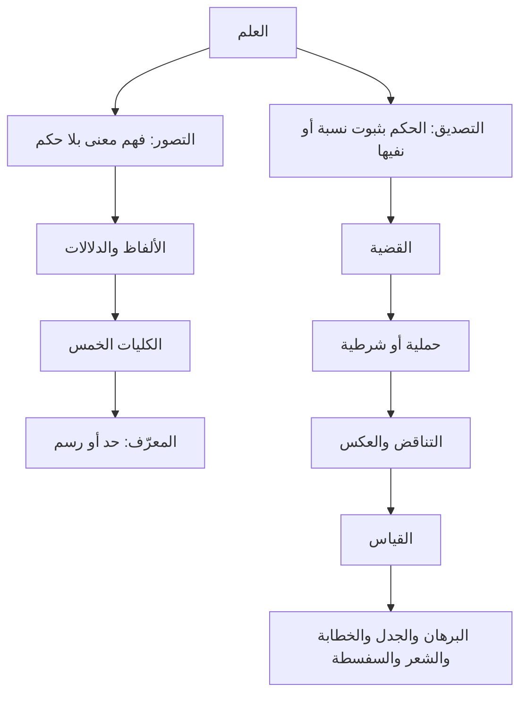
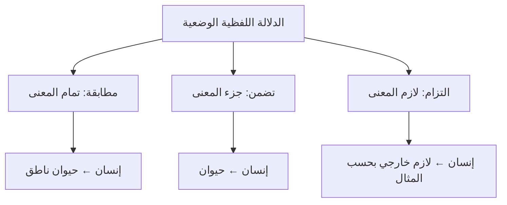
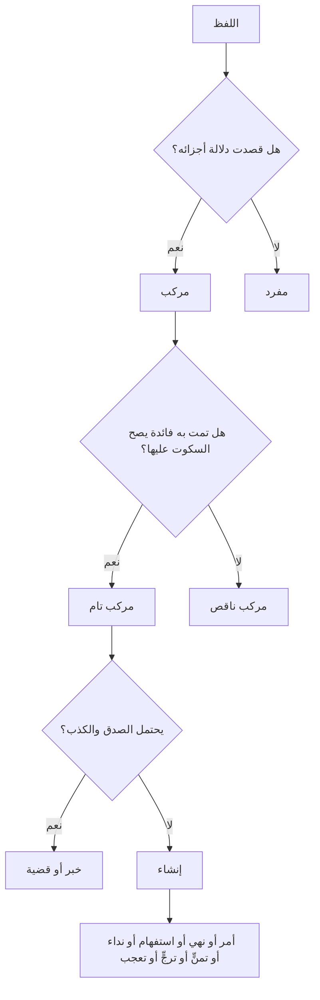
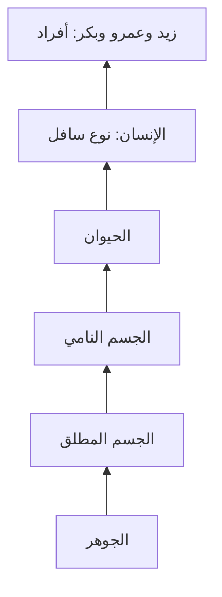
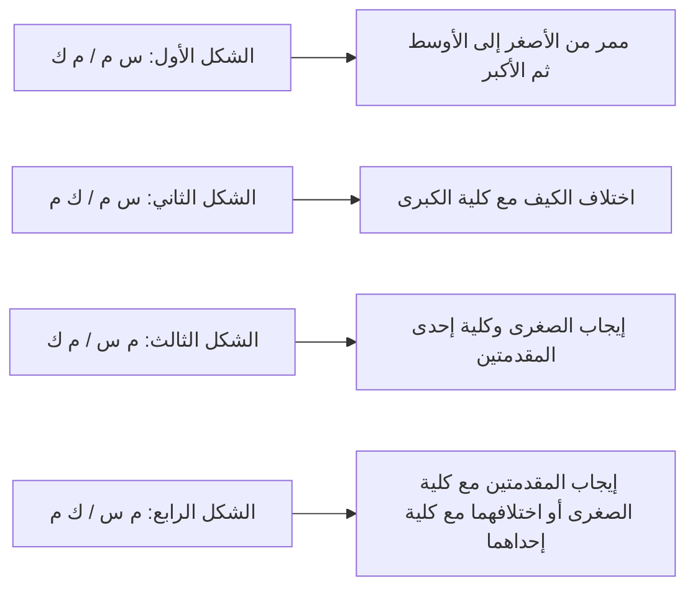

# دليل تعليمي لتصريح المنطق

## خريطة الكتاب وشرح أبوابه وتعليقاته

هذا الدليل يشرح متن «تصريح المنطق» من أول مباحث التصور والتصديق إلى الصناعات الخمس، ويعيد ترتيب قواعده في جداول ورسوم ومثال محلول. وهو موجَّه إلى طالب يبدأ دراسة الفن أو يراجع أبوابه؛ لذلك يشرح وظيفة المصطلح، ثم يبيّن علاقته بما قبله وما بعده، ثم يضع علامة تنبيه عند المواضع التي يكثر فيها الخلط.

بُني الشرح على النص العربي الكامل المرفق، وقوبل بكتاب جامعة الهند الإسلامية ذي 147 صفحة، وهو الطبعة الرابعة المؤرخة في 15 مايو 2019. ترتيب المتن في الملفين متقارب، أما نسخة الجامعة فتزيد مقدمة تعليمية وتاريخية، وتعريفًا بالمصنف، وحواشي مرقمة، ومخططات، وتدريبات بعد غالب الأبواب. أحافظ هنا على الفصل بين **نص المتن** و**شرح الطبعة** و**التعليق التعليمي**.

> **مفتاح القراءة:** «قال المتن» يحيل إلى قاعدة الكتاب، و«تعليق» يشرحها أو يضبط مجالها، و«مثال» يقرّبها. كثير من أمثلة المنطق المدرسي أمثلة مفترضة لتدريب الصورة؛ فلا يلزم أن تكون خبرًا واقعيًا أو تقريرًا علميًا.

## الخريطة الكبرى

المنطق في هذا المتن طريقان متكاملان: طريق لتحصيل **المعنى والتعريف**، وطريق لتحصيل **الحكم والاستدلال**.



يمكن اختصار سؤال كل باب هكذا:

| إذا كان السؤال... | فالمبحث الذي نحتاجه |
|---|---|
| ما معنى هذا اللفظ؟ | التصور، الدلالة، الكليات، المعرّف |
| هل ثبت هذا الحكم؟ | التصديق والقضية |
| ما نوع القضية؟ | الحملية أو الشرطية، والكم والكيف والجهة |
| هل تتناقض قضيتان؟ | التناقض ووحداته |
| هل تلزم النتيجة من المقدمتين؟ | القياس وشكله ومادته |
| هل الحجة يقينية أم جدلية أم إقناعية؟ | الصناعات الخمس ومقدماتها |

## 1. العلم: التصور والتصديق

### التصور

التصور هو حصول معنى في الذهن **من غير الحكم** عليه بثبوت شيء لشيء أو نفيه عنه. حين أفهم معنى «شجرة» أو «عدالة» فقد تصورت معنى، ولم أقل بعد إن شجرة معينة مثمرة أو إن فعلًا معينًا عادل.

### التصديق

التصديق هو اعتقاد نسبة خبرية؛ أي الحكم بأن شيئًا ثبت لشيء أو لم يثبت له. في «زيد قائم» نتصور زيدًا، والقيام، والنسبة بينهما، ثم نحكم بثبوت القيام لزيد.

| جهة المعرفة | ما الذي يحصل في الذهن؟ | مثال |
|---|---|---|
| تصور | معنى بلا إثبات ولا نفي | مفهوم «طالب» |
| تصديق | حكم على نسبة خبرية | «الطالب حاضر» |

كل تصديق يشتمل في تحليله على ثلاثة تصورات: **الموضوع** (المحكوم عليه)، و**المحمول** (المحكوم به)، و**النسبة** بينهما. أما رؤية هذه العناصر أو فهمها منفردة فلا تكفي لإثبات القضية.

### البديهي والنظري

البديهي ما لا يتوقف تحصيله على نظر وفكر، والنظري ما يتوقف عليهما. ويقسم المتن التصور والتصديق إلى هذين النوعين:

| القسم | معناه | مثال المتن |
|---|---|---|
| تصور بديهي | معنى يتضح من غير بحث طويل | الحرارة |
| تصور نظري | معنى يحتاج إلى تعريف أو بحث | حقيقة الجن |
| تصديق بديهي | حكم يدرك بلا استدلال مكتسب | الشمس مشرقة |
| تصديق نظري | حكم يحتاج إلى نظر ودليل | العالم حادث |

**تعليق:** هذه القسمة تتعلق بطريق معرفتنا بالحكم أو المفهوم، لا بكونه صادقًا أو كاذبًا في نفسه. كما أن البديهيات قد تختلف صعوبتها بحسب خبرة المتعلم ووضوح الألفاظ له.

## 2. الدلالة

الدلالة هي أن يكون شيء على حالة يلزم من العلم به العلم بشيء آخر. الأول **دالّ**، والثاني **مدلول**. معرفة الأثر تدل على مؤثره، وسماع لفظ يدل على معنى بحسب اللغة.

### التقسيم العام

| وجه القسمة | الأقسام | مثال تقريبي |
|---|---|---|
| حال الدال | لفظي / غير لفظي | كلمة «ماء» / دخان |
| منشأ الدلالة | وضعية / طبيعية / عقلية | كلمة متفق على معناها / احمرار الوجه / دلالة المصنوع على صانع |

قد تجتمع جهتان في المثال نفسه: اللفظ يمكن أن يكون لفظيًا وضعيًا، وغير اللفظ قد يكون طبيعيًا أو وضعيًا أو عقليًا. **المهم في درس المتن** هو الدلالة اللفظية الوضعية؛ لأنها أساس فهم الألفاظ والتعريفات.

### الدلالة اللفظية الوضعية بحسب مقدار المعنى

| النوع | إلى ماذا يدل اللفظ؟ | مثال «إنسان» |
|---|---|---|
| المطابقة | إلى تمام المعنى الموضوع له | الحيوان الناطق |
| التضمن | إلى جزء المعنى الموضوع له | الحيوان وحده، أو الناطق وحده |
| الالتزام | إلى لازم خارج عن تمام المعنى | الكتابة، على اصطلاح المثال القديم |



**تعليق:** لا يصح أن نخلط بين «جزء المعنى» و«لازمه». الحيوانية داخلة في مفهوم الإنسان على التحليل المنطقي، أما الكتابة فليست جزءًا من حقيقته. والالتزام لا يثبت بمجرد التداعي الشخصي؛ لا بد من لزوم معتبر أو عرف لغوي واضح.

## 3. المفرد والمركب وأنواع القول

يكون اللفظ مركبًا إذا قصد بجزء منه الدلالة على جزء معناه، مثل «غلام زيد». ويكون تامًا إذا أفاد فائدة يصح السكوت عليها، وناقصًا إذا احتاج إلى غيره ليكتمل المقصود.



المركب التام نوعان:

1. **الخبر أو القضية:** يحتمل الصدق والكذب من جهة مفهومه، مثل «الجو معتدل».
2. **الإنشاء:** لا يُحكم عليه بالصدق والكذب بهذا الاعتبار، مثل الأمر «اكتب»، والنهي «لا تضرب»، والاستفهام «هل حضرت؟»، والنداء والتمني والترجي والتعجب.

والمركب الناقص قد يكون **تقييديًا**، كالوصف «حيوان ناطق» أو الإضافة «غلام زيد»، وقد يكون غير تقييدي بحسب تقسيم المتن، مثل بعض التراكيب التي لا يكون ثانيها وصفًا للأول ولا مضافًا إليه.

أما المفرد، فإن لم يستقل معناه فهو **أداة**، وإن استقل فإما **كلمة** تدل صيغتها على زمن، أو **اسم** لا تدل صيغته بنفسها على زمن معين. في بناء القضية يصلح الاسم عادة أن يكون موضوعًا أو محمولًا، والكلمة تصلح للمحمول، والأداة لا تستقل غالبًا بأحد الطرفين.

## 4. اللفظ الواحد والمعنى: كلي وجزئي واشتراك

ينظر المتن إلى اللفظ من جهتين: عدد معانيه، وكيفية صدق المعنى الواحد على الأفراد.

| الصورة | معناها | مثال المتن |
|---|---|---|
| جزئي أو عَلَم | يمنع تصوره من الصدق على كثيرين | زيد |
| كلي متواطئ | يصدق على أفراده على السواء | إنسان على زيد وعمرو |
| كلي مشكك | يصدق على أفراده مع تفاوت في الأولوية أو التقدم | الوجود بحسب اصطلاح المتن |
| مشترك | لفظ لمعان متعددة وُضع لها على السواء | العين: الباصرة والينبوع والذهب وغيرها |
| منقول | نقل إلى معنى اصطلاحي أو عرفي جديد حتى اشتهر فيه | الصلاة من الدعاء إلى العبادة ذات الأركان المخصوصة |
| حقيقة ومجاز | يبقى المعنى الأول مستعملًا، ويستعار اللفظ للثاني لعلاقة | الأسد للحيوان المفترس وللرجل الشجاع |
| مترادف | ألفاظ متعددة لمعنى واحد أو متقارب | الليث والغضنفر بحسب الاستعمال |
| متباين | ألفاظ مختلفة المعاني | الشجر والحجر |

**تنبيه:** «المشكك» هنا مصطلح في تفاوت صدق المفهوم، وليس اتهامًا للمتكلم بالتردد. كما أن الحكم على الترادف أو الحقيقة والمجاز يتأثر باللغة والسياق، فلا تكفي قائمة أمثلة مختصرة لإثباته في كل استعمال.

## 5. الكليات الخمس

الكلي هو ما يصح أن يصدق على كثيرين. وينظر المنطقي إلى الكلي بحسب علاقته بحقيقة أفراده: هل يجيب عن «ما هو؟» أم يميز الحقيقة أم يصف أمرًا خارجًا عنها؟

| الكلي | موقعه من الحقيقة | السؤال الذي يجيب عنه | مثال الإنسان |
|---|---|---|---|
| النوع | تمام حقيقة الأفراد المتفقة | ما هو زيد؟ | إنسان |
| الجنس | تمام المشترك بين حقائق مختلفة | ما الإنسان والفرس؟ | حيوان |
| الفصل | جزء ذاتي مميز للحقيقة | أي شيء هو في جوهره؟ | ناطق، أي عاقل في الاصطلاح المنطقي |
| الخاصة | عرض خارج عن الماهية يختص بحقيقة واحدة | أي شيء هو في عرضه؟ | الضحك أو قابلية الكتابة في أمثلة الفن |
| العرض العام | وصف خارج مشترك بين حقائق مختلفة | ما الوصف المشترك العارض؟ | الماشي للإنسان والفرس |

يقسم الجنس والفصل بحسب القرب والبعد من النوع. فبالترتيب الذي يقدمه المتن: **الجوهر ← الجسم المطلق ← الجسم النامي ← الحيوان ← الإنسان**. الحيوان جنس قريب للإنسان، والجسم النامي أبعد منه، والجسم المطلق أبعد، والجوهر أعلى وأبعد. و«ناطق» فصل قريب في المثال، أما الحساسية فتذكر فصلًا بعيدًا.



ويفرق المتن بين **النوع الحقيقي**، كـ«الإنسان» بالنسبة إلى زيد وعمرو، و**النوع الإضافي**، وهو ما يندرج تحت جنس ويكون جنسًا لما دونه في الوقت نفسه. لذلك يكون الحيوان نوعًا إضافيًا تحت الجسم النامي، وجنسًا بالنسبة إلى الإنسان والفرس.

ويكون العرض **لازمًا** إذا امتنع انفكاكه عن المعروض بحسب الاصطلاح المقصود، و**مفارقًا** إذا أمكن انفكاكه. ومن أمثلة المتن: الكتابة بالقوة خاصة لازمة للإنسان، والكتابة بالفعل خاصة مفارقة؛ والمشي بالقوة عرض عام لازم للحيوان، والمشي بالفعل عرض عام مفارق.

**تعليق:** هذه أمثلة من التصنيف الماهوي التقليدي. كلمة «ناطق» لا تعني أن الإنسان لا يتميز إلا بإصدار الصوت؛ المراد في الاصطلاح القدرة العقلية. و«الضحك» في كتب المنطق قد يراد به الاستعداد الخاص لا الضحك الفعلي الدائم.

## 6. النسب الأربع بين الكليات

عند مقارنة كليين، تخيل مجموعة أفراد كل مفهوم: هل تتطابق المجموعتان؟ هل تدخل إحداهما كلها في الأخرى؟ هل تتقاطعان جزئيًا؟ أم لا تلتقيان؟

| النسبة | الضابط | المثال |
|---|---|---|
| التساوي | كل ما صدق عليه الأول صدق عليه الثاني والعكس | الإنسان والناطق في المثال |
| العموم والخصوص المطلق | أحدهما أوسع، والآخر أخص كله داخل فيه | الحيوان والإنسان |
| العموم والخصوص من وجه | يلتقيان في بعض الأفراد، وينفرد كل منهما ببعض | الحيوان واللاإنسان؛ الأبيض والحيوان |
| التباين | لا يصدق واحد منهما على فرد واحد في محل البحث | الإنسان والحجر؛ الموجود والمعدوم |

```text
التساوي:                 العموم المطلق:
A = B                    الإنسان ⊂ الحيوان

العموم من وجه:           التباين:
A ∩ B موجود              A ∩ B = ∅
ولكل منهما أفراد خاصة
```

نقيض الكلي هو ما يصدق على كل ما لا يصدق عليه ذلك الكلي، بحسب المجال المفروض. لهذا تتغير علاقة النقيضين بتغير العلاقة الأصلية؛ فلا تحفظ علاقة الكليين وحدها ثم تنقلها إلى نقيضيهما بلا فحص.

## 7. المعرّف: الحد والرسم

المعرّف ما يفيد تصور الشيء. ويفرق المتن بين التعريف الذاتي والتعريف بالصفة:

| القسم | التركيب | المثال |
|---|---|---|
| الحد التام | الجنس القريب + الفصل القريب | الإنسان: حيوان ناطق |
| الحد الناقص | الفصل القريب وحده، أو الجنس البعيد مع الفصل القريب | ناطق؛ أو جسم ناطق |
| الرسم التام | الجنس القريب + الخاصة | حيوان ضاحك |
| الرسم الناقص | الخاصة وحدها أو مع جنس بعيد | ضاحك؛ أو جسم ضاحك |

**كيف تختبر التعريف؟** اسأل سؤالين: هل ذكر أجزاء الحقيقة أم وصفًا خارجًا عنها؟ وهل الجنس قريب أم بعيد؟ إذا كان ذاتيًا وجاء الجنس القريب والفصل القريب فهو حد تام؛ وإذا عرّف بالخاصّة فهو رسم.

**تعليق على جودة التعريف:** التعريف المنطقي لا يصير جيدًا بمجرد احتوائه على كلمتي «جنس» و«فصل». ينبغي ألا يكون دوريًا، وألا يكون أوسع من المعرَّف أو أضيق منه، وأن تكون ألفاظه أوضح للمتعلم من اللفظ المعرَّف. هذا ضبط تعليمي لازم حتى لا يتحول حفظ الأقسام إلى غاية مستقلة.

## 8. القضية الحملية وأقسامها

القضية قول يحتمل الصدق والكذب من جهة معناه. في القضية الحملية نحكم بثبوت محمول لموضوع أو سلبه عنه: «زيد قائم»، «زيد ليس بقائم». الموضوع هو المحكوم عليه، والمحمول هو المحكوم به، والرابطة تدل على النسبة بينهما وقد تكون مقدرة في العربية.

### القضية الحملية بحسب الموضوع والكم

| نوع الموضوع أو الكم | تعريفه | مثال |
|---|---|---|
| شخصية | موضوعها جزئي معين | زيد كاتب |
| طبيعية | الحكم على نفس الطبيعة أو المفهوم | الإنسان نوع |
| محصورة كلية | الحكم على جميع الأفراد | كل إنسان حيوان |
| محصورة جزئية | الحكم على بعض الأفراد | بعض الحيوان إنسان |
| مهملة | موضوعها كلي ولم يذكر مقدار الأفراد | الإنسان حيوان |

القضايا المحصورة الأربع هي أدوات المراجعة الأساسية:

| الرمز | الاسم | الصيغة | مثال |
|---|---|---|---|
| A | موجبة كلية | كل س هو ص | كل إنسان حيوان |
| E | سالبة كلية | لا شيء من س هو ص | لا شيء من الإنسان حجر |
| I | موجبة جزئية | بعض س هو ص | بعض الحيوان إنسان |
| O | سالبة جزئية | بعض س ليس ص | بعض الحيوان ليس إنسانًا |

«السور» هو اللفظ الذي يحدد الكم، مثل «كل» و«بعض» و«لا شيء». لا يكفي أن ترى كلمة النفي لتعرف نوع القضية؛ انظر هل النفي داخل في الطرف أم واقع على الحكم كله.

### المعدولة: أين دخل النفي؟

إذا صار حرف النفي جزءًا من الموضوع سميت **معدولة الموضوع**، مثل «اللاحيوان جماد». وإذا صار جزءًا من المحمول سميت **معدولة المحمول**، مثل «الجماد لاحي». وإذا دخل الطرفين فهي معدولة الطرفين. أما القضية السالبة المحصلة فالنفي فيها حكم على النسبة، مثل «الإنسان ليس بحجر».

**الفرق السريع:** «الجماد لاحي» يجعل «لاحي» وصفًا للمحمول؛ أما «الجماد ليس بحي» فيسلب الحكم عن النسبة. هذا فرق في تحليل العبارة، لا مجرد اختلاف في ترتيب الكلمات.

## 9. الجهة والقضايا الموجّهة

الجهة هي الكيفية التي تلاحظ بها نسبة المحمول إلى الموضوع: أهي ضرورية، أو دائمة، أو واقعة بالفعل، أو ممكنة؟ القضية التي تذكر جهة أو تقصدها قضية موجهة. يقسم المتن الموجهات إلى بسيطة ومركبة.

### الموجهات البسيطة الثماني

| الاسم | المعنى التعليمي المختصر | المثال أو القيد |
|---|---|---|
| الضرورية المطلقة | ثبوت النسبة أو سلبها بالضرورة ما دامت ذات الموضوع موجودة | كل إنسان حيوان بالضرورة |
| المشروطة العامة | الضرورة ما دام الموضوع موصوفًا بعنوان معين | الكاتب متحرك الأصابع ما دام كاتبًا |
| الوقتية المطلقة | الضرورة في وقت معين من أوقات الموضوع | القمر منخسف وقت حيلولة الأرض |
| المنتشرة المطلقة | الضرورة في وقت ما غير معين | الإنسان متنفس في وقت ما |
| الدائمة المطلقة | دوام النسبة ما دامت ذات الموضوع موجودة | حركة الفلك في المثال التقليدي |
| العرفية العامة | دوام الحكم ما دام الوصف العنواني قائمًا | الكاتب متحرك الأصابع ما دام كاتبًا |
| المطلقة العامة | ثبوت أو سلب بالفعل في أحد الأزمنة الثلاثة | الإنسان ضاحك بالفعل |
| الممكنة العامة | سلب ضرورة الطرف المخالف، أي عدم امتناع النسبة | الإنسان كاتب بالإمكان العام |

**الفرق الذي لا بد منه:** الضرورة تعني امتناع انفكاك النسبة في الاعتبار المقصود، أما الدوام فيعني استمرارها بحسب الأزمنة، ولا يلزم من كل دوام أن تكون النسبة ضرورية لذات الموضوع. لذلك لا تساوِ بين «دائمًا» و«بالضرورة».

### الموجهات المركبة السبع

الموجهة المركبة تضيف قيدًا ثانيًا إلى الجهة الأولى، مثل «لا دائمًا» أو «لا بالضرورة». فلا تقرأ اسمها فقط؛ فكّها إلى جزأين:

| الاسم في المتن | تركيبها في الجملة |
|---|---|
| المشروطة الخاصة | المشروطة العامة مع قيد اللادوام الذاتي |
| الوقتية | الوقتية المطلقة مع قيد اللادوام الذاتي |
| المنتشرة | المنتشرة المطلقة مع قيد اللادوام الذاتي |
| العرفية الخاصة | العرفية العامة مع قيد اللادوام الذاتي |
| الوجودية اللاضرورية | المطلقة العامة مع نفي الضرورة الذاتية |
| الوجودية اللادائمة | المطلقة العامة مع نفي الدوام الذاتي |
| الممكنة الخاصة | سلب الضرورة الذاتية من الجانبين الموافق والمخالف |

**تنبيه مهم:** هذه أسماء وتقسيمات في المنطق المدرسي التقليدي. لا تفترض أن كل لفظ من ألفاظها يطابق مباشرة عاملًا واحدًا في المنطق الرمزي المعاصر؛ يلزم تحديد مجال الحكم، وزمنه، ووجود الموضوع، ومعنى القيد.

## 10. القضية الشرطية

القضية الشرطية لا تحكم مباشرة بثبوت محمول لموضوع، بل تحكم بعلاقة بين قضيتين: **مقدم** و**تالٍ**.

### المتصلة

| النوع | الضابط | المثال |
|---|---|---|
| متصلة لزومية | يرى المتكلم لزوم التالي للمقدم | كلما طلعت الشمس فالنهار موجود |
| متصلة اتفاقية | يثبت اقترانًا أو موافقة دون ادعاء لزوم ذاتي | كلما كان الإنسان ناطقًا كان الفرس صاهلًا في المثال المصنوع |

### المنفصلة

| النوع | ما الذي تمنعه؟ | مثال توضيحي |
|---|---|---|
| حقيقية | تمنع اجتماع الطرفين وارتفاعهما معًا | العدد إما زوج أو فرد |
| مانعة الجمع | تمنع صدق الطرفين معًا، وقد يرتفعان | هذا الشيء إما شجر أو حجر في تقسيم مفروض |
| مانعة الخلو | تمنع كذب الطرفين معًا، وقد يصدقان معًا | زيد إما في البحر أو لا يغرق، بحسب صياغة المثال |

وإذا كان التنافي في ذات الطرفين سميت عند المتن **عنادية**، وإذا كان بسبب اتفاق خارجي سميت **اتفاقية**. ومن أشهر أدوات القضية الشرطية الكلية المتصلة «متى، مهما، كلما»، ومن أدوات المنفصلة «دائمًا، أبدًا»، وللجزئية «قد يكون» و«قد لا يكون».

**تعليق:** قبل الاستدلال بالمنفصلة، عيّن نوعها. من «إما زوج أو فرد» يصح إثبات أحدهما ونفي الآخر لأن القسمة حقيقية. أما «إما شجر أو حجر» فلا تصلح قسمة حاصرة لكل الموجودات إلا إذا كان المجال محصورًا في هذين القسمين.

## 11. التناقض ووحدات القضية

التناقض هو أن يقتضي صدق إحدى القضيتين كذب الأخرى، وكذب إحداهما صدق الأخرى. في الحملية المحصورة تتقابل الموجبة والسالبة مع اختلاف الكم:

```text
كل س ص (A)          تناقض          بعض س ليس ص (O)
لا شيء من س ص (E)    تناقض          بعض س ص (I)
```

لا يكفي اختلاف عبارة واحدة؛ يجب اتحاد **ثماني وحدات** في القضيتين مع اختلاف الإيجاب والسلب والكم حيث يلزم:

| الوحدة | مثال ما يجب توحيده |
|---|---|
| الموضوع | زيد نفسه، لا زيد آخر |
| المحمول | القيام نفسه، لا صفة أخرى |
| المكان | في السوق نفسه |
| الزمان | وقت الظهر نفسه |
| القوة والفعل | كاتب بالفعل مع كاتب بالفعل، لا أحدهما بالقوة |
| الشرط | بشرط واحد |
| الإضافة | أبوة الشخص نفسه إلى الابن نفسه |
| الجزء والكل | الحكم على الشخص كله أو على بعضه بالطريقة نفسها |

**مثال:** «زيد قائم في السوق وقت الظهر» لا يناقض «زيد ليس بقائم في البيت صباحًا»؛ فقد اختلف المكان والزمان. توحيد الوحدات يمنع أن نظن اختلاف قضيتين تناقضًا وهي في الحقيقة تتحدث عن حالين مختلفين.

## 12. العكس المستوي وعكس النقيض

### العكس المستوي

هو تبديل الموضوع والمحمول مع بقاء الصدق والكيف، مع مراعاة الكم الذي يسمح به الانعكاس.

| أصل القضية | العكس المستوي في المتن |
|---|---|
| موجبة كلية: كل إنسان حيوان | موجبة جزئية: بعض الحيوان إنسان |
| موجبة جزئية: بعض الإنسان حيوان | موجبة جزئية: بعض الحيوان إنسان |
| سالبة كلية: لا شيء من الإنسان حجر | سالبة كلية: لا شيء من الحجر إنسان |
| سالبة جزئية: بعض الإنسان ليس حجرًا | لا عكس لها في هذا الباب |

**قاعدة للحفظ:** الموجبة الكلية لا تبقى كلية في العكس المستوي؛ تنزل إلى جزئية. والسالبة الكلية تحفظ كليتها. والسالبة الجزئية لا تنعكس بحسب هذا التقسيم.

### عكس النقيض

في عكس النقيض نبدل الطرفين ونضع نقيض كل طرف مكانه، مع حفظ الكيف والصدق بحسب القاعدة:

| أصل القضية | الصورة التي يذكرها المتن |
|---|---|
| الموجبة الكلية | موجبة كلية: كل إنسان حيوان ← كل لا حيوان لا إنسان |
| الموجبة الجزئية | لا عكس لها في هذا الباب |
| السالبة الكلية أو الجزئية | سالبة جزئية بحسب المثال والتركيب المذكورين في المتن |

**تعليق:** ألفاظ النقيض، والوجود المفروض لأفراد الموضوع، تؤثر في بعض هذه التحويلات في المنطق التقليدي. عند التطبيق، اكتب الأصل، وعيّن طرفيه، ثم اكتب نقيض كل طرف، ولا تعتمد على حفظ جملة غامضة وحدها.

## 13. القياس الحملي

القياس قول مؤلف من قضايا يلزم عنها لذاتها قول آخر. إن ذكرت النتيجة أو نقيضها في المقدمات بالفعل فهو **استثنائي**. وإن لم تذكر فهي **اقتراني**؛ ويكون الاقتراني حمليًا إذا كانت قضاياه حملية، وشرطيًا إذا دخلت فيه الشرطيات.

في القياس الحملي:

| المصطلح | وظيفته |
|---|---|
| الأصغر | موضوع النتيجة |
| الأكبر | محمول النتيجة |
| الحد الأوسط | اللفظ المشترك الذي يربط الأصغر بالأكبر ثم يسقط من النتيجة |
| الصغرى | المقدمة التي تشتمل على الأصغر |
| الكبرى | المقدمة التي تشتمل على الأكبر |
| الشكل | موضع الحد الأوسط في المقدمتين |

مثال واضح:

```text
كل إنسان حيوان       (الصغرى: الأصغر إنسان، الأوسط حيوان)
كل حيوان حساس        (الكبرى: الأوسط حيوان، الأكبر حساس)
إذن: كل إنسان حساس   (النتيجة: الأصغر إنسان، الأكبر حساس)
```

### الأشكال الأربعة

يرمز **س** إلى الأصغر، و**ك** إلى الأكبر، و**م** إلى الحد الأوسط. الجدول يبين موضع الأوسط في الصغرى ثم الكبرى:

| الشكل | الصغرى ثم الكبرى | تذكرة الموضع |
|---|---|---|
| الأول | س–م ، م–ك | الأوسط محمول في الصغرى وموضوع في الكبرى |
| الثاني | س–م ، ك–م | الأوسط محمول في المقدمتين |
| الثالث | م–س ، م–ك | الأوسط موضوع في المقدمتين |
| الرابع | م–س ، ك–م | الأوسط موضوع في الصغرى ومحمول في الكبرى |



### شروط الإنتاج وصور الضروب كما يرتبها المتن

الرموز في هذا الجدول: **A** موجبة كلية، **E** سالبة كلية، **I** موجبة جزئية، **O** سالبة جزئية. كل رمزَين قبل السهم هما الصغرى ثم الكبرى.

| الشكل | الشرط الذي يذكره المتن | الصور المذكورة ونتائجها |
|---|---|---|
| الأول | الصغرى موجبة، والكبرى كلية | AA→A؛ AE→E؛ IA→I؛ IE→O |
| الثاني | إحدى المقدمتين موجبة والأخرى سالبة، والكبرى كلية | AE→E؛ EA→E؛ IE→O؛ OA→O |
| الثالث | الصغرى موجبة، وإحدى المقدمتين كلية | AA→I؛ IA→I؛ AI→I؛ AE→O؛ IE→O؛ AO→O |
| الرابع | إيجاب المقدمتين مع كلية الصغرى، أو اختلافهما مع كلية إحداهما | AA→I؛ AI→I؛ EA→E؛ AE→O؛ IE→O؛ OA→O؛ AO→O؛ EI→O |

في الشكل الأول يوضح المتن الصور الأربع بأمثلة من جنس «كل إنسان حيوان، وكل حيوان حساس»؛ وفي الشكل الثاني يبرز شرط اختلاف الكيف؛ وفي الثالث والرابع تتغير جهة الحد الأوسط فتتغير الشروط والنتائج.

**تنبيه متقدم:** هذه قائمة المتن التعليمية كما رتبتها الطبعة المرفقة. بعض نتائج الجزئي، ولا سيما في الأشكال التي لا يكون فيها الأصغر موضوع النتيجة على النحو المعتاد، تتعلق بالافتراض التقليدي لوجود أفراد الموضوع. إذا اختبرت القياس على المنطق الحديث ذي المجال الخالي من الوجود المفترض، فلا تنقل كل قاعدة جزئية آليًا؛ تحقق من وجود الحد ومن توزيع الحدود. أما الطالب فيحفظ اصطلاح المقرر أولًا ثم يدرس المقارنة في موضعها.

### طريقة فحص قياس من ثلاث خطوات

1. اكتب النتيجة المتوقعة وحدد الأصغر والأكبر.
2. ابحث عن اللفظ المشترك بين المقدمتين: هذا هو الأوسط؛ وتأكد من أنه استُعمل بالمعنى نفسه.
3. طابق ترتيب الحدود مع أحد الأشكال، ثم افحص الكم والكيف وشروط ذلك الشكل.

إذا ظهر لفظ مشترك بمعنيين مختلفين، أو لم يربط الأوسط بين الحدين الآخرين، فالمقدمات لا تنتج النتيجة المطلوبة، ولو بدا الكلام مقنعًا.

## 14. القياس الشرطي والقياس الاستثنائي

### القياس الشرطي الاقتراني

يضم قضايا شرطية في مقدماته، ويصل أجزاءها بعضها ببعض. يعرض المتن خمسة تراكيب:

1. متصلتان: إذا كان زيد إنسانًا كان حيوانًا؛ وكلما كان حيوانًا كان جسمًا؛ إذن إذا كان إنسانًا كان جسمًا.
2. منفصلتان: تقسيم العدد إلى زوج أو فرد، ثم تفصيل الزوج إلى زوج الزوج أو زوج الفرد.
3. حملية مع متصلة: هذا إنسان؛ وكل إنسان حيوان؛ إذن هذا حيوان.
4. حملية مع منفصلة: هذا عدد؛ والعدد إما زوج أو فرد؛ إذن هذا زوج أو فرد.
5. متصلة مع منفصلة: إذا كان هذا ثلاثة فهو عدد؛ والعدد إما زوج أو فرد؛ إذن إذا كان ثلاثة فهو زوج أو فرد.

والأشكال الأربعة تجري فيه بحسب مواضع الحدود، لكن المتن يحيل تفصيله إلى المطولات.

### القياس الاستثنائي

هو ما يذكر فيه المقدم أو التالي أو أحد جزأي المنفصلة، ثم يثبت أحدهما أو ينفيه ليستنتج الآخر.

| نوع القضية الكبرى | الاستثناء المنتج |
|---|---|
| متصلة لزومية: إن كان أ فب | وضع المقدم ينتج وضع التالي: أ، إذن ب. ورفع التالي ينتج رفع المقدم: ليس ب، إذن ليس أ. |
| منفصلة حقيقية: أ أو ب، لا يجتمعان ولا يرتفعان | وضع أحد الطرفين يرفع الآخر، ورفع أحدهما يثبت الآخر. |
| مانعة الجمع | وضع أحد الطرفين يرفع الآخر؛ ولا ينتج رفع أحدهما وضع الآخر. |
| مانعة الخلو | رفع أحد الطرفين يثبت الآخر؛ ولا ينتج وضع أحدهما رفع الآخر. |

**مصيدة مشهورة في المتصلة:** من «إذا كان أ فب» و«ب» لا يلزم «أ»؛ فقد يتحقق ب لسبب آخر. ومن «إذا كان أ فب» و«ليس أ» لا يلزم «ليس ب». الأول إثبات التالي، والثاني نفي المقدم، وهما صورتان لا تنتجان بلا مقدمة إضافية.

## 15. الاستقراء والتمثيل

### الاستقراء

هو الانتقال من أحكام الجزئيات إلى حكم كلي.

| النوع | ما الذي فُحص؟ | قوة النتيجة |
|---|---|---|
| تام | جميع أفراد المجال المفروض | أقوى؛ لأن جميع الأفراد داخلة في الفحص بشرط حصرها وصحة التقسيم |
| ناقص | بعض الأفراد أو أكثرها | لا يفيد اليقين وحده؛ فقد يظهر فرد مخالف |

مثال المتن عن حركة فك الحيوان عند المضغ يوضح خطر تعميم الحكم من الملاحظ إلى كل الأنواع، ثم يذكر التمساح مثالًا على احتمال المخالفة. المقصود المنهجي هو أن العينة لا تساوي الكل.

### التمثيل

هو الانتقال من حكم جزئي إلى جزئي آخر بسبب وصف مشترك. يذكر المتن طريقين للبحث عن الوصف:

| الطريق | كيف يعمل؟ | المثال الذي يذكره المتن |
|---|---|---|
| الدوران | يلاحظ اقتران الحكم بالوصف وجودًا وعدمًا | الإسكار مع حكم الخمر في المثال الفقهي |
| الترديد | يجمع أوصاف الأصل ثم يبطل ما لا يصلح للعلة ليبقى المرشح | اختبار اللون والطعم والرائحة وغيرها، ثم تعيين الإسكار في المثال |

**تعليق:** التمثيل يقوى بقدر ثبوت العلة المشتركة، لكنه لا يصير يقينيًا لمجرد التشابه. تشابه شيئين في وصف سطحي لا يثبت أن لهما الحكم نفسه؛ فلا بد من فحص علاقة الوصف بالحكم واستبعاد الفروق المؤثرة.

## 16. الصناعات الخمس ومادة الحجة

يسمي المتن وجوه التأليف الحجاجي «الصناعات الخمس». الفارق الرئيس بينها **نوع المقدمات والأثر المقصود**، لا مجرد هيئة الكلام.

| الصناعة | مادتها بحسب المتن | غايتها المعتادة | ملاحظة |
|---|---|---|---|
| البرهان | اليقينيات | إفادة العلم أو إقامة اليقين بحسب شروطه | أقوى الأنواع من جهة مادته |
| الجدل | المشهورات أو المسلمات | إلزام الخصم أو محاورته بما يسلّم به | قد تكون القضية مسلّمة للخصم لا صادقة في نفسها |
| الخطابة | المقبولات أو المظنونات | إقناع الجمهور وتحريك الإرادة | رجحان الظن ليس يقينًا |
| الشعر | المتخيلات | التأثير في النفس بالترغيب أو التنفير | الوزن والقافية ليسا شرطًا في هذا الاعتبار المنطقي |
| السفسطة | الوهميات أو المشبهات | التغليط وإظهار الباطل في صورة الحق | دراستها تكشف مواضع الخداع، لا تبيح التضليل |

### مواد البرهان: اليقينيات

| النوع | تعريف مبسط | مثال تقريبي |
|---|---|---|
| الأوليات | يكفي تصور الطرفين والنسبة للجزم | الكل أعظم من الجزء |
| الفطريات | لها واسطة حاضرة لا تغيب عن الذهن عند تصور الطرفين | الأربعة زوج لأنها تنقسم إلى متساويين |
| المشاهدات الحسية | يدركها الحس الظاهر | الشمس مشرقة، بحسب المشاهدة |
| الوجدانيات | يدركها الإنسان بحسه الباطن | أنا جائع أو عطشان |
| الحدسيات | ينتقل الذهن من المبدأ إلى المطلوب دفعة | ربط نور القمر بضوء الشمس في المثال التقليدي |
| التجريبيات | يكرر الفعل أو الملاحظة حتى يحصل الجزم ضمن شروطها | أثر مادة بعد تكرر تجربتها |
| المتواترات | خبر جماعة يمتنع عادة تواطؤهم على الكذب بحسب شروط التواتر | وجود مكة لمن لم يزرها |

### مواد غير يقينية أو غير برهانية بالمعنى الخاص

| النوع | وجهه |
|---|---|
| المشهورات | ما ذاع قبوله بين الناس أو طائفة منهم |
| المسلمات | ما يسلمه الخصم في مناظرة معينة، صدقًا كان أو خطأً |
| المقبولات | ما يؤخذ ممن يوثق به عند المستمع |
| المظنونات | ما ترجح عند الناظر مع تجويز النقيض |
| المتخيلات | ما يؤثر في النفس بالتشبيه والترغيب والتنفير |
| الوهميات | ما يحكم الوهم به بقوة مع عدم ثبوته للعقل المحقق |
| المشبهات | مقدمات تشبه الحق أو المشهور ظاهرًا وليست منه في التحقيق |

قد تدخل القضية الواحدة في أكثر من صنف باعتبارات مختلفة؛ فقد تكون بديهية من جهة، ومشهورة من جهة شيوعها، ومسلمة عند محاور بعينه من جهة قبوله لها. إذن هذه ليست دائمًا صناديق متباعدة.

### البرهان اللمي والبرهان الإني

إذا كان الحد الأوسط علة للحكم في الواقع كما هو طريق الاستدلال في الذهن، كان البرهان **لميًا**: من العلة إلى المعلول، أو جوابًا عن «لماذا؟». وإذا لم يكن الأوسط علة الحكم في الواقع، لكنه يدل عليه، كان **إنيًا**: من الأثر إلى ما يدل عليه أو من المعلول إلى العلة.

```text
لمي: العلة ──تفسر──> المعلول
إني: المعلول ──يدل──> العلة أو السبب
```

**تحفظ تعليمي:** أمثلة الطب القديمة في المتن ونسخة الجامعة، كتعفن الأخلاط والحمى، أمثلة تاريخية على بناء القياس وليست نصيحة طبية ولا وصفًا حديثًا للمرض. عند التعليم المعاصر يستحسن استبدال مقدماتها الواقعية بما ثبت علميًا، مع إبقاء صورة القياس نفسها.

## 17. مقابلة نسخة جامعة الهند الإسلامية بالنص المرفق

### ما الذي تضيفه طبعة الجامعة؟

| العنصر | ما يظهر في النسخة الجامعية |
|---|---|
| بيانات الطبعة | تذكر أنها الطبعة الرابعة، مؤرخة في 15 مايو 2019، صادرة عن قسم النشر والتوزيع بجامعة الهند الإسلامية في كاليكوت، كيرالا |
| مقدمة المنهج | تشرح صعوبة تدريس المنطق ومقصد تيسيره للطلاب، وتنتقد الاكتفاء بالحفظ والترديد |
| التأطير الديني | تعرض رأيها في فائدة المنطق في العلوم الشرعية، وتورد اختلاف العلماء في المنطق الممزوج بالفلسفة؛ هذا تقرير مقدمة الطبعة لا جزء من متن تصريح |
| التاريخ | تضيف صفحات موجزة عن نشأة المنطق وتطوره ومراحله، وأسماء من القدماء والمسلمين والحديثين |
| المصنف | تذكر ترجمة تنسب الكتاب إلى الشيخ محمد ارتضا علي خان البخاري، وتورد مولده ووفاته وبعض مؤلفاته |
| الشرح | تضيف حواشي مرقمة تفسر المصطلحات وتنوع الأمثلة، ومنها أمثلة لغوية وفقهية وحياتية |
| الوسائل | تضع خرائط توضيحية وأنشطة قراءة وفهم وتصنيف وتكوين أمثلة بعد غالب الأبواب |
| نهاية الكتاب | ينتهي الملف المتاح بتمارين في اليقينيات وغير اليقينيات والبرهان؛ وتذكر المقدمة معجمًا ملحقًا، لكن لم يظهر في الصفحات الـ147 قسم معجم مستقل |

### المبادئ العشرة في مقدمة الجامعة

تضيف الطبعة قائمة تمهيدية ليست فصلًا من المتن: حد المنطق، وموضوعه، واسمه، وغايته وفائدته، واستمداده، وفضله، وواضعه، وحكمه، ومسائله، ونسبته. وتعرض الحد بأنه النظر في المعلومات التصورية والتصديقية من حيث إيصالها إلى مجهول تصوري أو تصديقي، والغاية بأنها صيانة الذهن عن الخطأ في الفكر. أما حكم تعلمه وعلاقته بالعلوم الشرعية فتقررهما المقدمة ضمن إطارها الفقهي، فلا أخلطهما بالتعريف الاصطلاحي للمنطق.

### دليل سريع لصفحات طبعة الجامعة

أرقام الصفحات التالية بحسب الرقم المطبوع أسفل الصفحة. تبدأ النسخة PDF فعليًا بمواد تمهيدية، ويبدأ المتن في الصفحة المطبوعة 19؛ وتنتهي صفحات التمارين في الصفحة المطبوعة 151.

| الصفحة المطبوعة | الباب |
|---:|---|
| 19 | التصديق والتصور |
| 24 | أنواع الدلالات |
| 32 | المركب والمفرد |
| 37 | أنواع المفرد باعتبار المعنى |
| 41 | الكليات الخمس |
| 52 | النسب الأربع بين الكليات |
| 57 | المعرّف |
| 60 | القضية الحملية والشرطية |
| 65 | القضية المعدولة |
| 68 | القضايا الموجهة |
| 74 | القضايا المركبة |
| 80 | القضايا المتصلة والمنفصلة |
| 87 | الشرطية المخصوصة والمحصورة والمهملة |
| 92 | التناقض |
| 96 | العكس المستوي |
| 99 | عكس النقيض |
| 102 | القياس والأشكال |
| 109–120 | الشكل الثاني والثالث والرابع |
| 127 | القياس الشرطي |
| 132 | القياس الاستثنائي |
| 137 | الاستقراء |
| 139 | التمثيل |
| 142 | الصناعات الخمس |
| 147 | مخطط الصناعات الخمس |
| 148–151 | تمارين الصناعات واليقينيات |

النص المرفق في Markdown يبدأ مباشرة بمتن الكتاب وينتهي بخاتمته، ولا يتضمن المقدمة أو الترجمة أو تدريبات الجامعة. كما لا يذكر اسم المصنف داخل نسخته. لذلك أقول: **«تنسب طبعة الجامعة المتن إلى محمد ارتضا علي خان البخاري»**، لا «يثبت النص المرفق وحده هذه النسبة».

وتذكر ترجمة الجامعة أنه ولد سنة 1198هـ في جوفامي من نواحي لكنو، وتوفي سنة 1270هـ بعد مرض في رحلة عودته من الحج، وتعدّد بعض آثاره. هذه بيانات الطبعة كما وردت فيها؛ لم أجد في النص المرفق نفسه ترجمة للمصنف أو توثيقًا مستقلًا لهذه التفاصيل.

### تقييم المقدمة التاريخية

مقدمة الجامعة نافعة كمدخل سريع إلى أسماء ومدارس ومراحل، لكنها موجزة ولا تسند كل تاريخ أو دعوى فيها بإحالات تفصيلية؛ لذا ينبغي استعمالها كخريطة أولى لا كمرجع تاريخي نهائي. دراسات تاريخ المنطق العربي تصف انتقال عناصر من التراث الأرسطي والشرح المتأخر، وتبين كذلك نشوء تقاليد عربية إسلامية لها تنظيمها ومصطلحاتها وتطورها الخاص، ولا تختزلها في نقل حرفي عن اليونان. وتعرض مداخل موسوعية محكمة موقع Porphyry وكتاب «إيساغوجي» في تاريخ الكليات الخمس، كما تعرض موقع التصور والتصديق والحد والقياس في تقاليد ابن سينا المنطقية. [مدخل تاريخ القياس في المنطق الوسيط](https://plato.stanford.edu/entries/medieval-syllogism/)؛ [Porphyry وكتاب Isagoge](https://plato.stanford.edu/entries/porphyry/)؛ [منطق ابن سينا](https://plato.stanford.edu/entries/ibn-sina/index.html).

على هذا، تُقرأ صفحات التاريخ في الطبعة بوصفها تمهيدًا تربويًا، وتراجع تفاصيلها الجزئية من مصادر تاريخية متخصصة قبل اعتمادها في بحث أو توثيق. أما ترتيب أبواب المتن فيعكس مسارًا تعليميًا مألوفًا: المفاهيم والتعريف، ثم القضايا، ثم القياس، ثم مواد الاحتجاج.

### قراءة نقدية نافعة للحواشي والأنشطة

قوة طبعة الجامعة أنها لا تترك كل حد مجردًا؛ فهي تضع بعد التعريف مخططًا أو تمرينًا يطلب من الطالب تطبيقه. مثلًا: بعد الدلالة تدريبات لتصنيف اللفظي وغير اللفظي، وبعد الكليات تدريبات على تعيين الجنس والفصل، وبعد القضايا تدريبات على السور والجهة والتناقض، وبعد الأشكال تمارين لتعيين الحدود واستنتاج النتيجة. وهذا يوافق الغرض الذي تصرح به المقدمة: الانتقال من الحفظ إلى التطبيق.

ومع ذلك، فالحاشية التعليمية لا تغيّر رتبة المتن: المثال الحديث الذي تضيفه الجامعة يوضح المصطلح ولا يصبح جزءًا من تعريفه الأصلي. وبعض الأمثلة الفقهية أو التاريخية يحتاج إلى معرفة مجالها قبل استعماله، كما أن تصنيف القضية في باب من أبواب «مادة القياس» قد يختلف باختلاف اعتبار المتكلم والسامع. لهذا يفيد أن يسأل الطالب في كل حاشية: هل هي تعريف؟ أم مثال؟ أم رأي تمهيدي؟ أم حكم فقهي؟

## 18. أخطاء شائعة وكيف تتجنبها

| الخطأ | التصحيح |
|---|---|
| اعتبار كل معرفة تصديقًا | قد تعرف معنى «إنسان» من غير أن تحكم عليه بشيء؛ هذا تصور |
| عدّ كل دلالة لفظية مطابقة | اللفظ قد يدل على جزء معناه أو لازمه، بحسب قصد الاستعمال والعلاقة |
| الخلط بين الجنس والنوع | الحيوان جنس للإنسان، والإنسان نوع تحت الحيوان؛ وقد يكون اللفظ نوعًا إضافيًا وجنسًا لما تحته |
| جعل الخاصة جزءًا من الماهية | الخاصة وصف خارج عن الحقيقة في هذا التقسيم، وإن اختص بها نوعًا |
| الخلط بين الكلية والكلّي | «كلية» مقدار الحكم على الأفراد، و«كلي» مفهوم يصدق على كثيرين |
| جعل «ليس» دائمًا خارج الطرف | قد تكون جزءًا من الموضوع أو المحمول في القضية المعدولة |
| مساواة الضرورة بالدوام | الضرورة امتناع الانفكاك؛ والدوام استمرار بحسب الزمان في الاعتبار المذكور |
| الحكم بالتناقض من اختلاف النفي فقط | وحّد الموضوع والمحمول والزمان والمكان وسائر الوحدات أولًا |
| قلب كل قضية في العكس | بعض القضايا لا تنعكس، وبعضها ينعكس إلى جزئي لا كلي |
| قبول كل صورة تشبه القياس | افحص الحد الأوسط والكم والكيف؛ التشابه اللفظي لا يكفي |
| الاستدلال من بعض الحالات على كل الحالات بيقين | هذا استقراء ناقص، ويمكن أن يظهر فرد ناقض |
| جعل التمثيل برهانًا يقينيًا دائمًا | قياس النظير يحتاج إلى إثبات العلة المشتركة واستبعاد الفروق |
| الخلط بين صحة الصورة وصدق المقدمات | قد يكون القياس مرتبًا لكن مقدماته غير ثابتة؛ صحة الشكل لا تصحح مادة الحجة |

## 19. ملخص سريع للحفظ

### التصور والتصديق

```text
تصور = فهم معنى بلا حكم
تصديق = حكم بثبوت نسبة أو نفيها
التصديق التحليلي = تصور الموضوع + تصور المحمول + تصور النسبة + الحكم
```

### الكليات الخمس

```text
النوع: تمام حقيقة أفراد متفقة
الجنس: تمام المشترك بين حقائق مختلفة
الفصل: جزء ذاتي مميّز
الخاصة: وصف خارج يختص بحقيقة
العرض العام: وصف خارج مشترك بين حقائق مختلفة
```

### أربعة أنماط في القضايا المحصورة

```text
A: كل س ص             E: لا شيء من س ص
I: بعض س ص            O: بعض س ليس ص
نقيض A هو O           نقيض E هو I
```

### عكس القضايا كما في هذا المتن

```text
العكس المستوي:
A -> I       I -> I       E -> E       O -> لا عكس

عكس النقيض:
A -> A       I -> لا عكس       E/O -> O بحسب تركيب المتن
```

### خمس صناعات

```text
برهان: يقينيات       جدل: مشهورات أو مسلمات
خطابة: مقبولات أو مظنونات
شعر: متخيلات         سفسطة: وهميات أو مشبهات
```

## 20. تمارين مراجعة مع مفتاح الإجابة

### الأسئلة

1. هل فهم معنى «المطر» وحده تصور أم تصديق؟ وما الذي يضاف ليصير تصديقًا؟
2. صنف دلالة كلمة «كتاب» على تمام معناها، وعلى جزء معناها، وعلى لازمها بحسب أمثلة الدرس.
3. في «كل إنسان حيوان»، ما الموضوع والمحمول والسور والكم والكيف؟
4. ما نقيض «كل طالب حاضر»؟ وما نقيض «لا شيء من الطالب مهمل»؟
5. هل «زيد قائم صباحًا» و«زيد ليس بقائم مساءً» متناقضان؟ علل.
6. ما العكس المستوي لـ«كل إنسان حيوان» بحسب المتن؟ وما القيد الذي ينبغي تذكره؟
7. استخرج الأوسط والنتيجة: «كل إنسان حيوان؛ وكل حيوان حساس».
8. لماذا لا تنتج «إذا أمطرت ابتلت الأرض؛ والأرض مبتلة» أن السماء أمطرت بالضرورة؟
9. إذا فحصنا بعض الحيوانات ثم عممنا الحكم على كل الحيوان، فأي نوع من الاستقراء هذا؟
10. ما الفرق بين الجدل والبرهان من جهة مقدماتهما؟
11. هل تكفي مشابهة دواءين في اللون لإثبات أن لهما الأثر نفسه؟ لماذا؟
12. في تعريف «الإنسان حيوان ناطق» بحسب التقسيم التقليدي، أي جزأين هما الجنس والفصل؟

### مفتاح الإجابة

1. تصور؛ ويضاف إليه الحكم بنسبة خبرية، مثل «المطر نازل».
2. التمام مطابقة، والجزء تضمن، واللازم التزام، متى ثبتت العلاقة في الاستعمال المقصود.
3. الموضوع إنسان، المحمول حيوان، السور كل، الكم كلي، والكيف إيجاب.
4. نقيض الأولى «بعض الطالب ليس حاضرًا». ونقيض الثانية «بعض الطالب مهمل».
5. لا؛ اختلف الزمان، وقد يكون قائمًا صباحًا وغير قائم مساءً.
6. «بعض الحيوان إنسان»؛ ويُراعى افتراض وجود أفراد للموضوع عند الانتقال إلى الجزئي.
7. الأوسط حيوان؛ والنتيجة «كل إنسان حساس».
8. لأنها صورة إثبات التالي: قد تبتل الأرض لسبب آخر.
9. استقراء ناقص، فلا يعطي اليقين بمجرده.
10. البرهان مؤلف من يقينيات بحسب المتن، والجدل من مشهورات أو مسلمات.
11. لا؛ اللون وصف مشترك سطحي لا يثبت العلة أو الأثر. لا بد من دليل على الوصف المؤثر.
12. «حيوان» جنس قريب و«ناطق» فصل قريب، فيكون التعريف حدًا تامًا في الاصطلاح.

## 21. معجم موجز للمصطلحات

| المصطلح | معناه المختصر |
|---|---|
| العلم | صورة أو إدراك يحصل في الذهن بحسب تعريف المتن |
| التصور | إدراك معنى بلا حكم خبري |
| التصديق | اعتقاد نسبة خبرية بثبوت أو سلب |
| النسبة | إسناد أمر إلى آخر إيجابًا أو سلبًا |
| الدال / المدلول | ما يدل / ما يُعرف من الدلالة |
| المطابقة | دلالة اللفظ على تمام ما وضع له |
| التضمن | دلالته على جزء المعنى الموضوع له |
| الالتزام | دلالته على لازم خارج عن المعنى التام |
| الكلي / الجزئي | ما يصدق على كثيرين / ما لا يصدق إلا على معين في الاعتبار |
| الجنس | تمام المشترك الذاتي بين حقائق مختلفة |
| النوع | تمام حقيقة الأفراد المتفقة |
| الفصل | جزء ذاتي يميز الحقيقة |
| الخاصة | وصف عارض يختص بحقيقة واحدة |
| العرض العام | وصف عارض مشترك بين حقائق مختلفة |
| الحد | تعريف ذاتي بالجنس والفصل |
| الرسم | تعريف بالخاصّة أو بالأوصاف العرضية |
| الموضوع | المحكوم عليه في الحملية |
| المحمول | المحكوم به في الحملية |
| السور | لفظ يدل على مقدار الأفراد المحكوم عليها |
| المقدّم / التالي | طرفا القضية الشرطية |
| الجهة | كيفية نسبة المحمول إلى الموضوع |
| التناقض | تقابل يقتضي صدق كل واحدة كذب الأخرى مع اتحاد الوحدات |
| العكس المستوي | تبديل طرفي القضية مع مراعاة صورة الانعكاس |
| الحد الأوسط | رابط المقدمتين الذي يسقط من نتيجة القياس الحملي |
| الاقتراني | قياس لا تذكر نتيجته صراحة في المقدمات |
| الاستثنائي | قياس يذكر مقدمًا أو تاليًا أو جزءًا من المنفصلة ثم يستثنيه |
| الاستقراء | انتقال من الجزئيات إلى حكم كلي |
| التمثيل | انتقال من جزئي إلى جزئي لعلة مشتركة مفترضة أو مثبتة |
| البرهان | قياس مادته يقينيات بحسب المتن |
| السفسطة | حجة مغالطة تستخدم الوهم أو التشبيه لتلبيس الحق بالباطل |

## مراجع القراءة

### النصوص التي قوبلت

- متن «تصريح المنطق» العربي الكامل في ملف Markdown المرفق.
- «تصريح المنطق (جامعة الهند)»، الطبعة الرابعة، جامعة الهند الإسلامية، 2019؛ 147 صفحة PDF. اعتمدت مقدمته وصفحاته التمهيدية والرسوم والحواشي والأنشطة في ملاحظات المقابلة أعلاه.

### مراجع تاريخية وفلسفية عبر الويب

- [Stanford Encyclopedia of Philosophy، Medieval Theories of the Syllogism](https://plato.stanford.edu/entries/medieval-syllogism/): لتأطير تاريخ القياس والمنطق العربي في التقليد الوسيط.
- [Stanford Encyclopedia of Philosophy، Porphyry](https://plato.stanford.edu/entries/porphyry/): لسياق «إيساغوجي» والكليات الخمس.
- [Stanford Encyclopedia of Philosophy، Ibn Sina](https://plato.stanford.edu/entries/ibn-sina/index.html): للتصور والتصديق والحد والقياس والحد الأوسط في منطق ابن سينا.

هذه الإحالات تضبط السياق التاريخي العام، ولا تثبت وحدها نسبة كل فقرة في «تصريح المنطق» أو تاريخ تأليفها؛ لذلك نسبتُ بيانات المؤلف إلى ما تقوله طبعة الجامعة نفسها.
