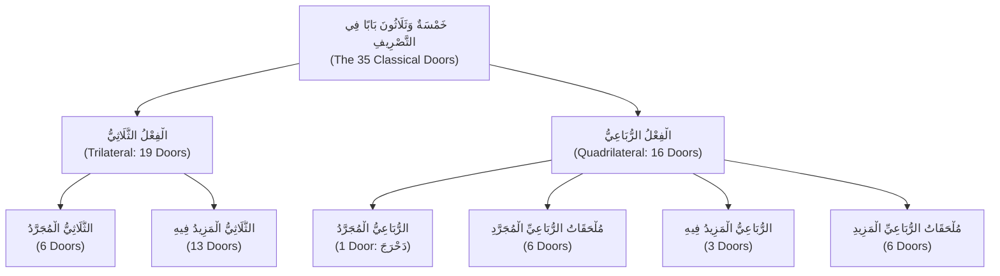
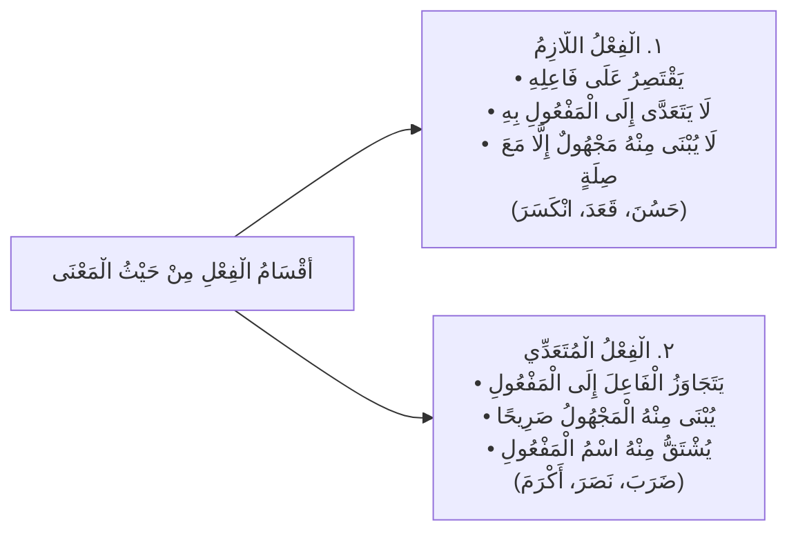
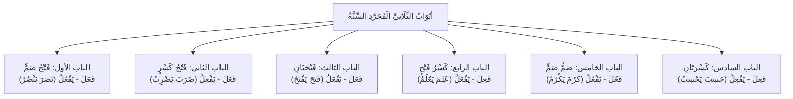
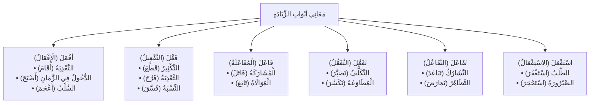

# Ajnās al-Kubrā · Morphological Concept Trees (Mermaid)
### *Taxonomic Visualizations for Classical Morphological Systems & Semantic Extensions*
*Discipline: ʿIlm al-Ṣarf · Kanz al-Taḥqīq Library*

---

## 1. Master System: The 35 Classical Morphological Doors (*Khamsah wa-Thalāthūn Bāban*)

---

## 2. Semantic Matrix: Transitivity (*al-Lāzim wal-Mutaʿaddī*)

---

## 3. The 6 Doors of Trilateral Verbs and Their Vocalic Formulas

---

## 4. Morpho-Semantics of Verbal Augmentations (*Maʿānī Abwāb al-Ziyādah*)

