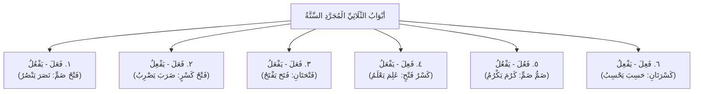

# كِتَابُ الْأَجْنَاسِ الْكُبْرَى
### لِلشَّيْخِ الْعَلَّامَةِ دَادَا عَلِيّ بْنِ الشَّيْخِ قَاسِم (ت ١١٢٧ هـ)
*تَحْقِيقُ وَضَبْطُ مَكْتَبَةِ كَنْزِ التَّحْقِيقِ · دِرَاسَاتُ عِلْمِ الصَّرْفِ*

---

## فِهْرِسُ الْمُحْتَوَيَاتِ

- [خُطْبَةُ الْكِتَابِ وَتَقْسِيمُ الْأَفْعَالِ إِلَى لَازِمٍ وَمُتَعَدٍّ](#خطبة-الكتاب-وتقسيم-الأفعال-إلى-لازم-ومتعد)
- [الْفَصْلُ الْأَوَّلُ: الثُّلَاثِيُّ الْمُجَرَّدُ وَأَبْوَابُهُ السِّتَّةُ](#الفصل-الأول-الثلاثي-المجرد-وأبوابه-الستة)
  - [الْبَابُ الْأَوَّلُ: فَعَلَ - يَفْعُلُ (نَصَرَ يَنْصُرُ)](#الباب-الأول-فعل---يفعل-نصر-ينصر)
  - [الْبَابُ الثَّانِي: فَعَلَ - يَفْعِلُ (ضَرَبَ يَضْرِبُ)](#الباب-الثاني-فعل---يفعل-ضرب-يضرب)
  - [الْبَابُ الثَّالِثُ: فَعَلَ - يَفْعَلُ (فَتَحَ يَفْتَحُ)](#الباب-الثالث-فعل---يفعل-فتح-يفتح)
  - [الْبَابُ الرَّابِعُ: فَعِلَ - يَفْعَلُ (عَلِمَ يَعْلَمُ)](#الباب-الرابع-فعل---يفعل-علم-يعلم)
  - [الْبَابُ الْخَامِسُ: فَعُلَ - يَفْعُلُ (كَرُمَ يَكْرُمُ)](#الباب-الخامس-فعل---يفعل-كرم-يكرم)
  - [الْبَابُ السَّادِسُ: فَعِلَ - يَفْعِلُ (حَسِبَ يَحْسِبُ)](#الباب-السادس-فعل---يفعل-حسب-يحسب)
- [الْفَصْلُ الثَّانِي: الشَّاذُّ مِنَ الثُّلَاثِيِّ الْمُجَرَّدِ](#الفصل-الثاني-الشاذ-من-الثلاثي-المجرد)
- [الْفَصْلُ الثَّالِثُ: التَّصْرِيفُ الْكَامِلُ وَصِيَغُ الْمُشْتَقَّاتِ الْعِشْرُونَ](#الفصل-الثالث-التصريف-الكامل-وصيغ-المشتقات-العشرون)
- [الْفَصْلُ الرَّابِعُ: الثُّلَاثِيُّ الْمَزِيدُ فِيهِ وَمَعَانِي أَبْوَابِ الزِّيَادَةِ](#الفصل-الرابع-الثلاثي-المزيد-فيه-ومعاني-أبواب-الزيادة)
  - [أَبْوَابُ الثُّلَاثِيِّ الْمَزِيدِ بِحَرْفٍ وَاحِدٍ](#أبواب-الثلاثي-المزيد-بحرف-واحد)
  - [أَبْوَابُ الثُّلَاثِيِّ الْمَزِيدِ بِحَرْفَيْنِ](#أبواب-الثلاثي-المزيد-بحرفين)
  - [أَبْوَابُ الثُّلَاثِيِّ الْمَزِيدِ بِثَلَاثَةِ أَحْرُفٍ](#أبواب-الثلاثي-المزيد-بثلاثة-أحرف)
- [الْفَصْلُ الْخَامِسُ: الرُّبَاعِيُّ الْمُجَرَّدُ وَمُلْحَقَاتُهُ وَالْمَزِيدُ فِيهِ](#الفصل-الخامس-الرباعي-المجرد-وملحقاته-والمزيد-فيه)
- [الْفَصْلُ السَّادِسُ: الْأَنْشِطَةُ التَّدْرِيبِيَّةُ وَالتَّطْبِيقَاتُ الْمُتَقَدِّمَةُ](#الفصل-السادس-الأنشطة-التدريبية-والتطبيقات-المتقدمة)

---

## خُطْبَةُ الْكِتَابِ وَتَقْسِيمُ الْأَفْعَالِ إِلَى لَازِمٍ وَمُتَعَدٍّ

بِسْمِ اللَّهِ الرَّحْمَنِ الرَّحِيمِ

الْحَمْدُ لِلَّهِ رَبِّ الْعَالَمِينَ، وَالْعَاقِبَةُ لِلْمُتَّقِينَ، وَالصَّلَاةُ وَالسَّلَامُ عَلَى سَيِّدِنَا مُحَمَّدٍ، وَآلِهِ وَصَحْبِهِ أَجْمَعِينَ.

**وَبَعْدُ:**  
فَاعْلَمْ يَا أَخِي -أَسْعَدَكَ اللَّهُ تَعَالَى وَإِيَّانَا فِي الدَّارَيْنِ- أَنَّ الْأَفْعَالَ مِنْ حَيْثُ الْمَعْنَى نَوْعَانِ: **لَازِمٌ**، وَ**مُتَعَدٍّ**:

1. **فَاللَّازِمُ:** مَا لَا يَتَجَاوَزُ الْفَاعِلَ إِلَى الْمَفْعُولِ؛ فَلَا يُبْنَى مِنْهُ الْمَجْهُولُ وَلَا اسْمُ الْمَفْعُولِ إِلَّا مَعَ صِلَةٍ، نَحْوُ: **حَسُنَ زَيْدٌ**، وَ**قَعَدَ عَمْرٌو**.
2. **وَالْمُتَعَدِّي:** مَا يَتَجَاوَزُ الْفَاعِلَ إِلَى الْمَفْعُولِ بِهِ بِغَيْرِ وَاسِطَةِ حَرْفِ جَرٍّ؛ فَيُبْنَى مِنْهُ الْمَعْلُومُ وَالْمَجْهُولُ وَاسْمُ الْفَاعِلِ وَاسْمُ الْمَفْعُولِ، نَحْوُ: **ضَرَبَ زَيْدٌ عَمْرًا**، وَ**نَصَرَ عَلِيٌّ بَكْرًا**.

ثُمَّ إِنَّ الْأَفْعَالَ مِنْ حَيْثُ الْبِنْيَةُ إِمَّا **ثُلَاثِيٌّ**، وَإِمَّا **رُبَاعِيٌّ**؛ وَكُلُّ وَاحِدٍ مِنْهُمَا إِمَّا **مُجَرَّدٌ**، أَوْ **مَزِيدٌ فِيهِ**.

[⬆ العودة إلى الفهرس](#فهرس-المحتويات)

---

## الْفَصْلُ الْأَوَّلُ: الثُّلَاثِيُّ الْمُجَرَّدُ وَأَبْوَابُهُ السِّتَّةُ

اعْلَمْ أَنَّ الثُّلَاثِيَّ الْمُجَرَّدَ يَنْحَصِرُ عَقْلًا وَاسْتِقْرَاءً فِي **سِتَّةِ أَبْوَابٍ** بِاعْتِبَارِ حَرَكَةِ عَيْنِ الْفِعْلِ فِي الْمَاضِي وَالْمُضَارِعِ:

### الْبَابُ الْأَوَّلُ: فَعَلَ - يَفْعُلُ (نَصَرَ يَنْصُرُ)
- **ضَابِطُهُ:** فَتْحُ الْعَيْنِ فِي الْمَاضِي، وَضَمُّهَا فِي الْمُضَارِعِ.
- **حُكْمُهُ:** يَكُونُ مُتَعَدِّيًا غَالِبًا (نَحْوُ: **نَصَرَ زَيْدٌ عَمْرًا**)، وَلَازِمًا نَادِرًا (نَحْوُ: **قَعَدَ زَيْدٌ**، وَ**خَرَجَ عَمْرٌو**).
- **أَمْثِلَتُهُ:** كَتَبَ يَكْتُبُ، خَرَجَ يَخْرُجُ، طَلَبَ يَطْلُبُ، حَكَمَ يَحْكُمُ.

### الْبَابُ الثَّانِي: فَعَلَ - يَفْعِلُ (ضَرَبَ يَضْرِبُ)
- **ضَابِطُهُ:** فَتْحُ الْعَيْنِ فِي الْمَاضِي، وَكَسْرُهَا فِي الْمُضَارِعِ.
- **حُكْمُهُ:** يَكُونُ مُتَعَدِّيًا غَالِبًا (نَحْوُ: **ضَرَبَ زَيْدٌ عَمْرًا**)، وَلَازِمًا نَادِرًا (نَحْوُ: **جَلَسَ زَيْدٌ**).
- **أَمْثِلَتُهُ:** غَفَرَ يَغْفِرُ، حَبَسَ يَحْبِسُ، رَجَعَ يَرْجِعُ، وَعَدَ يَعِدُ.

### الْبَابُ الثَّالِثُ: فَعَلَ - يَفْعَلُ (فَتَحَ يَفْتَحُ)
- **ضَابِطُهُ:** فَتْحُ الْعَيْنِ فِي الْمَاضِي وَالْمُضَارِعِ مَعًا.
- **شَرْطُهُ:** لَا يَكُونُ هَذَا الْبَابُ قِيَاسِيًّا إِلَّا إِذَا كَانَتْ عَيْنُهُ أَوْ لَامُهُ حَرْفًا مِنْ حُرُوفِ الْحَلْقِ السِّتَّةِ (الْهَمْزَةِ، وَالْهَاءِ، وَالْعَيْنِ، وَالْحَاءِ، وَالْغَيْنِ، وَالْخَاءِ).
- **حُكْمُهُ:** يَكُونُ مُتَعَدِّيًا (نَحْوُ: **فَتَحَ زَيْدٌ الْبَابَ**)، وَلَازِمًا (نَحْوُ: **ذَهَبَ زَيْدٌ**).
- **أَمْثِلَتُهُ:** مَنَعَ يَمْنَعُ، قَرَأَ يَقْرَأُ، جَعَلَ يَجْعَلُ، قَطَعَ يَقْطَعُ.

### الْبَابُ الرَّابِعُ: فَعِلَ - يَفْعَلُ (عَلِمَ يَعْلَمُ)
- **ضَابِطُهُ:** كَسْرُ الْعَيْنِ فِي الْمَاضِي، وَفَتْحُهَا فِي الْمُضَارِعِ.
- **حُكْمُهُ:** يَكُونُ مُتَعَدِّيًا (نَحْوُ: **عَلِمَ زَيْدٌ الْمَسْأَلَةَ**)، وَلَازِمًا (نَحْوُ: **فَرِحَ زَيْدٌ**، وَ**حَزِنَ عَمْرٌو**).
- **أَمْثِلَتُهُ:** شَرِبَ يَشْرَبُ، فَهِمَ يَفْهَمُ، رَكِبَ يَرْكَبُ، شَبِعَ يَشْبَعُ.

### الْبَابُ الْخَامِسُ: فَعُلَ - يَفْعُلُ (كَرُمَ يَكْرُمُ)
- **ضَابِطُهُ:** ضَمُّ الْعَيْنِ فِي الْمَاضِي وَالْمُضَارِعِ مَعًا.
- **حُكْمُهُ:** لَا يَكُونُ إِلَّا **لَازِمًا دَائِمًا**؛ لِأَنَّهُ مَوْضُوعٌ لِلْأَوْصَافِ الْخِلْقِيَّةِ وَالطَّبَائِعِ وَالسَّجَايَا الثَّابِتَةِ. فَلَا يُبْنَى مِنْهُ مَفْعُولٌ وَلَا مَجْهُولٌ.
- **أَمْثِلَتُهُ:** حَسُنَ يَحْسُنُ، شَرُفَ يَشْرُفُ، صَغُرَ يَصْغُرُ، كَبُرَ يَكْبُرُ.

### الْبَابُ السَّادِسُ: فَعِلَ - يَفْعِلُ (حَسِبَ يَحْسِبُ)
- **ضَابِطُهُ:** كَسْرُ الْعَيْنِ فِي الْمَاضِي وَالْمُضَارِعِ مَعًا.
- **حُكْمُهُ:** هُوَ أَقَلُّ الْأَبْوَابِ دَوَرَانًا فِي كَلَامِ الْعَرَبِ، وَيَكُونُ مُتَعَدِّيًا (نَحْوُ: **حَسِبَ زَيْدٌ عَمْرًا عَالِمًا**)، وَلَازِمًا (نَحْوُ: **وَرِعَ الرَّجُلُ يَرِعُ**، وَ**وَلِيَ يَلِي**).

[⬆ العودة إلى الفهرس](#فهرس-المحتويات)

---

## الْفَصْلُ الثَّانِي: الشَّاذُّ مِنَ الثُّلَاثِيِّ الْمُجَرَّدِ

اعْلَمْ أَنَّهُ قَدْ جَاءَتْ أَفْعَالٌ عَلَى غَيْرِ الْقِيَاسِ الْمُطَّرِدِ سَمَاعًا عَنِ الْعَرَبِ، وَتُسَمَّى **الشَّوَاذَّ**:

1. **مَا جَاءَ عَلَى «فَعَلَ يَفْعَلُ» مِنْ غَيْرِ حَرْفِ حَلْقٍ:**  
   نَحْوُ: **أَبَى يَأْبَى**؛ فَإِنَّهُ فَعَلَ يَفْعَلُ وَلَيْسَتْ عَيْنُهُ وَلَا لَامُهُ حَرْفَ حَلْقٍ (إِذِ الْهَمْزَةُ فَاؤُهُ لَا عَيْنُهُ وَلَا لَامُهُ).
2. **مَا جَاءَ بِكَسْرِ الْعَيْنِ فِي الْمَاضِي وَالْمُضَارِعِ مُعْتَلًّا:**  
   نَحْوُ: **وَمِقَ يَمِقُ**، **وَرِثَ يَرِثُ**، **وَلِيَ يَلِي**، **وَثِقَ يَثِقُ**، **وَرِعَ يَرِعُ**؛ فَإِنَّ الْقِيَاسَ فِي مَكْسُورِ الْعَيْنِ أَنْ يَأْتِيَ مَفْتُوحًا فِي الْمُضَارِعِ (عَلِمَ يَعْلَمُ)، فَجَاءَ هَذَا شَاذًّا بِالْكَسْرِ فِي الطَّرَفَيْنِ.
3. **مَا جَاءَ بِالْوَجْهَيْنِ (جَوَازُ الْقِيَاسِ وَالشُّذُوذِ):**  
   نَحْوُ: **حَسِبَ يَحْسِبُ** (بِالْكَسْرِ عَلَى الشُّذُوذِ، وَهِيَ لُغَةُ تَمِيمٍ) وَ**يَحْسَبُ** (بِالْفَتْحِ عَلَى الْقِيَاسِ، وَهِيَ لُغَةُ قُرَيْشٍ وَالْفُصْحَى).

[⬆ العودة إلى الفهرس](#فهرس-المحتويات)

---

## الْفَصْلُ الثَّالِثُ: التَّصْرِيفُ الْكَامِلُ وَصِيَغُ الْمُشْتَقَّاتِ الْعِشْرُونَ

تَصْرِيفُ الْبَابِ الْأَوَّلِ (**نَصَرَ يَنْصُرُ**) كَمِثَالٍ لِلصِّيَغِ التَّصْرِيفِيَّةِ الْكَامِلَةِ:

| الرَّقْمُ | الصِّيغَةُ الصَّرْفِيَّةُ | الْمِثَالُ الصَّرْفِيُّ | الْحَالَةُ وَالْإِعْرَابُ |
|:---:|---|---|---|
| ١ | **الْمَاضِي الْمَعْلُومُ** | نَصَرَ | مَبْنِيٌّ عَلَى الْفَتْحِ |
| ٢ | **الْمُضَارِعُ الْمَعْلُومُ** | يَنْصُرُ | مَرْفُوعٌ بِالضَّمَّةِ |
| ٣ | **الْمَصْدَرُ الْمُطْلَقُ** | نَصْرًا | مَنْصُوبٌ بِالْفَتْحِ |
| ٤ | **اسْمُ الْفَاعِلِ** | نَاصِرٌ | مُشْتَقٌّ لِلدَّلَالَةِ عَلَى الْفَاعِلِ |
| ٥ | **الْمَاضِي الْمَجْهُولُ** | نُصِرَ | مَبْنِيٌّ لِمَا لَمْ يُسَمَّ فَاعِلُهُ |
| ٦ | **الْمُضَارِعُ الْمَجْهُولُ** | يُنْصَرُ | مَرْفُوعٌ بِالضَّمَّةِ لِلْمَجْهُولِ |
| ٧ | **اسْمُ الْمَفْعُولِ** | مَنْصُورٌ | مُشْتَقٌّ لِلدَّلَالَةِ عَلَى مَنْ وَقَعَ عَلَيْهِ الْفِعْلُ |
| ٨ | **الْجَحْدُ بِلَمْ (نَفْيُ الْمَاضِي)** | لَمْ يَنْصُرْ | مَجْزُومٌ بِلَمْ وَعَلَامَتُهُ السُّكُونُ |
| ٩ | **نَفْيُ الْمُسْتَقْبَلِ بِلَا** | لَا يَنْصُرُ | مَنْفِيٌّ بِلَا النَّافِيَةِ مَرْفُوعٌ |
| ١٠ | **نَفْيُ التَّأْبِيدِ بِلَنْ** | لَنْ يَنْصُرَ | مَنْصُوبٌ بِلَنْ وَعَلَامَتُهُ الْفَتْحَةُ |
| ١١ | **أَمْرُ الْغَائِبِ بِلَامِ الْأَمْرِ** | لِيَنْصُرْ | مَجْزُومٌ بِلَامِ الْأَمْرِ |
| ١٢ | **أَمْرُ الْحَاضِرِ (الْمُخَاطَبِ)** | انْصُرْ | مَبْنِيٌّ عَلَى السُّكُونِ |
| ١٣ | **نَهْيُ الْغَائِبِ بِلَا النَّاهِيَةِ** | لَا يَنْصُرْ | مَجْزُومٌ بِلَا النَّاهِيَةِ |
| ١٤ | **نَهْيُ الْحَاضِرِ بِلَا النَّاهِيَةِ** | لَا تَنْصُرْ | مَجْزُومٌ بِلَا النَّاهِيَةِ |
| ١٥ | **الْمُؤَكَّدُ بِنُونِ التَّوْكِيدِ الثَّقِيلَةِ** | لَيَنْصُرَنَّ / انْصُرَنَّ | مَبْنِيٌّ عَلَى الْفَتْحِ لِاتِّصَالِهِ بِالنُّونِ |
| ١٦ | **الْمُؤَكَّدُ بِنُونِ التَّوْكِيدِ الْخَفِيفَةِ** | لَيَنْصُرَنْ / انْصُرَنْ | مَبْنِيٌّ عَلَى الْفَتْحِ لِاتِّصَالِهِ بِالنُّونِ |
| ١٧ | **اسْمُ الزَّمَانِ وَالْمَكَانِ** | مَنْصَرٌ (عَلَى وَزْنِ مَفْعَلٍ) | صِيغَةٌ لِمَكَانِ النَّصْرِ أَوْ زَمَانِهِ |
| ١٨ | **اسْمُ الْآلَةِ** | مِنْصَرٌ / مِنْصَارٌ / مِنْصَرَةٌ | صِيغَةٌ لِآلَةِ النَّصْرِ |
| ١٩ | **اسْمُ الْمَرَّةِ (الْمَصْدَرُ الْمَرِّيُّ)** | نَصْرَةً | مَصْدَرٌ لِلدَّلَالَةِ عَلَى الْمَرَّةِ الْوَاحِدَةِ |
| ٢٠ | **اسْمُ النَّوْعِ (الْهَيْئَةِ)** | نِصْرَةً | مَصْدَرٌ لِلدَّلَالَةِ عَلَى هَيْئَةِ الْفِعْلِ |

[⬆ العودة إلى الفهرس](#فهرس-المحتويات)

---

## الْفَصْلُ الرَّابِعُ: الثُّلَاثِيُّ الْمَزِيدُ فِيهِ وَمَعَانِي أَبْوَابِ الزِّيَادَةِ

اعْلَمْ أَنَّ الثُّلَاثِيَّ الْمَزِيدَ فِيهِ يُزَادُ عَلَى أُصُولِهِ حَرْفٌ أَوْ حَرْفَانِ أَوْ ثَلَاثَةُ أَحْرُفٍ، وَلِكُلِّ زِيَادَةٍ مَعْنًى بَلَاغِيٌّ وَصَرْفِيٌّ خَاصٌّ («زِيَادَةُ الْمَبْنَى تَدُلُّ عَلَى زِيَادَةِ الْمَعْنَى»):

### أَبْوَابُ الثُّلَاثِيِّ الْمَزِيدِ بِحَرْفٍ وَاحِدٍ (ثَلَاثَةُ أَبْوَابٍ)
1. **أَفْعَلَ يُفْعِلُ إِفْعَالًا (أَكْرَمَ يُكْرِمُ إِكْرَامًا):**
   - **أَشْهَرُ مَعَانِيهِ:**
     - **التَّعْدِيَةُ:** نَحْوُ: قَامَ زَيْدٌ -> أَقَمْتُ زَيْدًا.
     - **الدُّخُولُ فِي الشَّيْءِ زَمَانًا أَوْ مَكَانًا:** نَحْوُ: أَصْبَحَ (دَخَلَ فِي الصَّبَاحِ)، أَمْسَى، أَعْرَقَ (دَخَلَ الْعِرَاقَ).
     - **السَّلْبُ وَالْإِزَالَةُ:** نَحْوُ: أَعْجَمْتُ الْكِتَابَ (أَزَلْتُ عُجْمَتَهُ).
2. **فَعَّلَ يُفَعِّلُ تَفْعِيلًا (فَرَّحَ يُفَرِّحُ تَفْرِيحًا):**
   - **أَشْهَرُ مَعَانِيهِ:**
     - **التَّكْثِيرُ وَالْمُبَالَغَةُ:** نَحْوُ: قَطَّعَ الثِّيَابَ (أَيْ كَثَّرَ قَطْعَهَا)، طَوَّفَ.
     - **التَّعْدِيَةُ:** نَحْوُ: فَرِحَ زَيْدٌ -> فَرَّحْتُ زَيْدًا.
     - **النِّسْبَةُ إِلَى الْمَأْخَذِ:** نَحْوُ: فَسَّقْتُهُ (نَسَبْتُهُ إِلَى الْفِسْقِ)، كَفَّرْتُهُ.
3. **فَاعَلَ يُفَاعِلُ مُفَاعَلَةً وَفِعَالًا (قَاتَلَ يُقَاتِلُ مُقَاتَلَةً وَقِتَالًا):**
   - **أَشْهَرُ مَعَانِيهِ:**
     - **الْمُشَارَكَةُ بَيْنَ اثْنَيْنِ فَصَاعِدًا:** نَحْوُ: ضَارَبَ زَيْدٌ عَمْرًا (كُلٌّ مِنْهُمَا ضَارِبٌ وَمَضْرُوبٌ).
     - **الْمُوَالَاةُ وَالْمُتَابَعَةُ:** نَحْوُ: وَالَيْتُ الصَّوْمَ، تَابَعْتُ الْقِرَاءَةَ.

---

### أَبْوَابُ الثُّلَاثِيِّ الْمَزِيدِ بِحَرْفَيْنِ (خَمْسَةُ أَبْوَابٍ)
1. **انْفَعَلَ يَنْفَعِلُ انْفِعَالًا (انْكَسَرَ يَنْكَسِرُ انْكِسَارًا):**  
   مَوْضُوعٌ لِـ **الْمُطَاوَعَةِ** فَقَطْ، وَلَا يَكُونُ إِلَّا لَازِمًا، نَحْوُ: كَسَرْتُ الْإِنَاءَ فَانْكَسَرَ.
2. **افْتَعَلَ يَفْتَعِلُ افْتِعَالًا (اجْتَمَعَ يَجْتَمِعُ اجْتِمَاعًا):**  
   لِلْمُطَاوَعَةِ (نَحْوُ: جَمَعْتُهُ فَاجْتَمَعَ)، وَالِاتِّخَاذِ (نَحْوُ: اشْتَوَى أَيِ اتَّخَذَ شِوَاءً)، وَالِاجْتِهَادِ وَالِاكْتِسَابِ (نَحْوُ: اكْتَسَبَ).
3. **افْعَلَّ يَفْعَلُّ افْعِلَالًا (احْمَرَّ يَحْمَرُّ احْمِرَارًا):**  
   لِـ **مُبَالَغَةِ الْأَلْوَانِ وَالْعُيُوبِ الْحِسِّيَّةِ**، وَلَا يَكُونُ إِلَّا لَازِمًا، نَحْوُ: احْمَرَّ الْبُسْرُ، اعْوَرَّتِ الْعَيْنُ.
4. **تَفَعَّلَ يَتَفَعَّلُ تَفَعُّلًا (تَعَلَّمَ يَتَعَلَّمُ تَعَلُّمًا):**  
   لِـ **التَّكَلُّفِ** (نَحْوُ: تَصَبَّرَ، تَشَجَّعَ)، وَالْمُطَاوَعَةِ (نَحْوُ: كَسَّرْتُهُ فَتَكَسَّرَ)، وَالِاتِّخَاذِ (نَحْوُ: تَوَسَّدَ ثَوْبَهُ).
5. **تَفَاعَلَ يَتَفَاعَلُ تَفَاعُلًا (تَبَاعَدَ يَتَبَاعَدُ تَبَاعُدًا):**  
   لِـ **التَّشَارُكِ بَيْنَ اثْنَيْنِ فَأَكْثَرَ فِي الْفَاعِلِيَّةِ صَرِيحًا** (نَحْوُ: تَبَاعَدَ الْقَوْمُ، تَصَالَحَ الزَّوْجَانِ)، وَ**إِظْهَارِ مَا لَيْسَ فِي الْوَاقِعِ (التَّظَاهُرِ)** (نَحْوُ: تَمَارَضَ، تَنَاعَسَ).

---

### أَبْوَابُ الثُّلَاثِيِّ الْمَزِيدِ بِثَلَاثَةِ أَحْرُفٍ (سِتَّةُ أَبْوَابٍ)
1. **اسْتَفْعَلَ يَسْتَفْعِلُ اسْتِفْعَالًا (اسْتَخْرَجَ يَسْتَخْرِجُ اسْتِخْرَاجًا):**  
   لِـ **الطَّلَبِ** غَالِبًا (نَحْوُ: اسْتَغْفَرَ اللَّهَ أَيْ طَلَبَ مَغْفِرَتَهُ)، وَ**الصَّيْرُورَةِ** (نَحْوُ: اسْتَحْجَرَ الطِّينُ أَيْ صَارَ حَجَرًا).
2. **افْعَوْعَلَ يَفْعَوْعِلُ افْعِيعَالًا (اعْشَوْشَبَ يَعْشَوْشِبُ اعْشِيشَابًا):**  
   لِـ **الْمُبَالَغَةِ الشَّدِيدَةِ فِي الْوَصْفِ** (نَحْوُ: اعْشَوْشَبَتِ الْأَرْضُ أَيْ كَثُرَ عُشْبُهَا جِدًّا، احْدَوْدَبَ الظَّهْرُ).
3. **افْعَوَّلَ يَفْعَوِّلُ افْعِوَّالًا (اجْلَوَّذَ يَجْلَوِّذُ اجْلِوَّاذًا):**  
   لِلْمُبَالَغَةِ فِي الْحَرَكَةِ وَالسُّرْعَةِ (نَحْوُ: اعْلَوَّطَ الْفَرَسَ).
4. **افْعَالَّ يَفْعَالُّ افْعِيلَالًا (احْمَارَّ يَحْمَارُّ احْمِيرَارًا):**  
   لِزِيَادَةِ الْمُبَالَغَةِ عَلَى افْعَلَّ (احْمَرَّ) فِي الْأَلْوَانِ.

[⬆ العودة إلى الفهرس](#فهرس-المحتويات)

---

## الْفَصْلُ الْخَامِسُ: الرُّبَاعِيُّ الْمُجَرَّدُ وَمُلْحَقَاتُهُ وَالْمَزِيدُ فِيهِ

1. **الرُّبَاعِيُّ الْمُجَرَّدُ:**  
   بَابٌ وَاحِدٌ عَلَى وَزْنِ: **فَعْلَلَ يُفَعْلِلُ فَعْلَلَةً وَفِعْلَالًا** (نَحْوُ: **دَحْرَجَ يُدَحْرِجُ دَحْرَجَةً وَدِحْرَاجًا**، زَلْزَلَ يُزَلْزِلُ زَلْزَلَةً وَزِلْزَالًا).
2. **مُلْحَقَاتُ الرُّبَاعِيِّ الْمُجَرَّدِ:**  
   أَلْحَقَتِ الْعَرَبُ بِـ «دَحْرَجَ» أَوْزَانًا سِتَّةً لِتُمَاثِلَهَا فِي عَدَدِ الْحُرُوفِ وَالْحَرَكَاتِ وَالسَّكَنَاتِ:
   - **فَوْعَلَ:** حَوْقَلَ يُحَوْقِلُ حَوْقَلَةً.
   - **فَيْعَلَ:** بَيْطَرَ يُبَيْطِرُ بَيْطَرَةً.
   - **فَعْوَلَ:** جَهْوَرَ يُجَهْوِرُ جَهْوَرَةً.
   - **فَعْيَلَ:** عَثْيَرَ يُعَثْيِرُ عَثْيَرَةً.
   - **فَعْلَلَ:** جَلْبَبَ يُجَلْبِبُ جَلْبَبَةً.
   - **فَعْلَى:** سَلْقَى يُسَلْقِي سَلْقَاةً.
3. **الرُّبَاعِيُّ الْمَزِيدُ فِيهِ:**
   - **مَا زِيدَ فِيهِ حَرْفٌ وَاحِدٌ:** بَابُ **تَفَعْلَلَ يَتَفَعْلَلُ تَفَعْلُلًا** (تَدَحْرَجَ يَتَدَحْرَجُ تَدَحْرُجًا - لِلْمُطَاوَعَةِ).
   - **مَا زِيدَ فِيهِ حَرْفَانِ:**
     - بَابُ **افْعَنْلَلَ يَفْعَنْلِلُ افْعِنْلَالًا** (احْرَنْجَمَ يَحْرَنْجِمُ احْرِنْجَامًا - أَيْ تَجَمَّعَتِ الْإِبِلُ).
     - بَابُ **افْعَلَلَّ يَفْعَلِلُّ افْعِلَّالًا** (اقْشَعَرَّ يَقْشَعِرُّ اقْشِعْرَارًا).

[⬆ العودة إلى الفهرس](#فهرس-المحتويات)

---

## الْفَصْلُ السَّادِسُ: الْأَنْشِطَةُ التَّدْرِيبِيَّةُ وَالتَّطْبِيقَاتُ الْمُتَقَدِّمَةُ

### النَّشَاطُ الْأَوَّلُ: التَّمْيِيزُ بَيْنَ اللَّازِمِ وَالْمُتَعَدِّي
بَيِّنْ نَوْعَ كُلِّ فِعْلٍ مِنَ الْأَفْعَالِ الْآتِيَةِ مَعَ التَّعْلِيلِ:

| الْفِعْلُ | نَوْعُهُ | التَّعْلِيلُ الصَّرْفِيُّ | مِثَالُهُ فِي جُمْلَةٍ |
|---|---|---|---|
| **كَتَبَ** | مُتَعَدٍّ | يَتَجَاوَزُ الْفَاعِلَ إِلَى الْمَفْعُولِ | كَتَبَ زَيْدٌ الرِّسَالَةَ |
| **قَعَدَ** | لَازِمٌ | يَقْتَصِرُ عَلَى فَاعِلِهِ | قَعَدَ الشَّيْخُ عَلَى الْكُرْسِيِّ |
| **أَكْرَمَ** | مُتَعَدٍّ | صَارَ مُتَعَدِّيًا بِهَمْزَةِ التَّعْدِيَةِ | أَكْرَمَ الْمُضِيفُ الضَّيْفَ |
| **انْكَسَرَ** | لَازِمٌ | جَاءَ عَلَى وَزْنِ انْفَعَلَ وَهُوَ لِلْمُطَاوَعَةِ | انْكَسَرَ الزُّجَاجُ |
| **حَسُنَ** | لَازِمٌ | جَاءَ مِنْ بَابِ فَعُلَ وَهُوَ لِلسَّجَايَا | حَسُنَ خُلُقُ الْمُؤْمِنِ |

---

### النَّشَاطُ الثَّانِي: بِنَاءُ صِيَغِ الْمُشْتَقَّاتِ الْعِشْرِينَ
اخْتَرْ فِعْلَ (**غَفَرَ يَغْفِرُ**) وَصَرِّفْهُ فِي الصِّيَغِ الْآتِيَةِ:
1. **اسْمُ الْفَاعِلِ:** غَافِرٌ.
2. **اسْمُ الْمَفْعُولِ:** مَغْفُورٌ.
3. **أَمْرُ الْحَاضِرِ:** اغْفِرْ.
4. **نَهْيُ الْحَاضِرِ:** لَا تَغْفِرْ.
5. **مَصْدَرُ الْمَرَّةِ:** غَفْرَةً.
6. **مَصْدَرُ الْهَيْئَةِ:** غِفْرَةً.
7. **اسْمُ الْمَكَانِ:** مَغْفِرٌ.
8. **فِعْلُ الِاسْتِغْفَارِ (مَزِيدٌ بِثَلَاثَةِ أَحْرُفٍ):** اسْتَغْفَرَ يَسْتَغْفِرُ اسْتِغْفَارًا.

[⬆ العودة إلى الفهرس](#فهرس-المحتويات)

