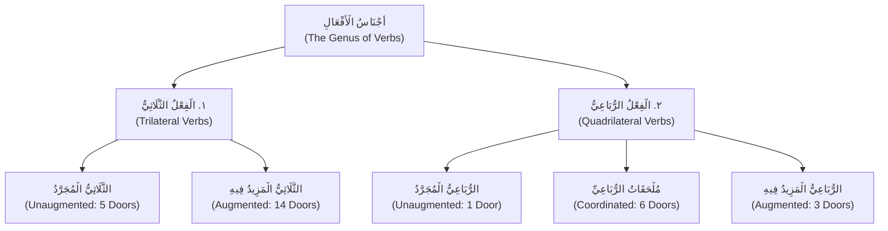
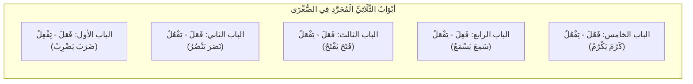
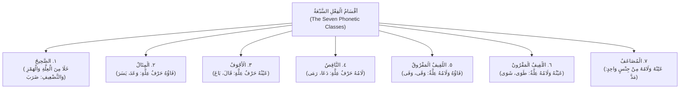

# Ajnās al-Ṣughrā · Morphological Concept Trees (Mermaid)
### *Taxonomic Visualizations for Verbal Patterns & Root Classifications*
*Discipline: ʿIlm al-Ṣarf · Kanz al-Taḥqīq Library*

---

## 1. Master Verbal Taxonomy: The Genus of Verbs

---

## 2. The 5 Doors of Unaugmented Trilateral Verbs (*al-Thulāthī al-Mujarrad*)

---

## 3. The 14 Doors of Augmented Trilateral Verbs (*al-Thulāthī al-Mazīd fīh*)

```mermaid
flowchart TD
    Mazid["الثُّلَاثِيُّ الْمَزِيدُ فِيهِ (١٤ بَابًا)"] --> G1["مَزِيدٌ بِحَرْفٍ وَاحِدٍ (٣ أَبْوَابٍ)"]
    Mazid --> G2["مَزِيدٌ بِحَرْفَيْنِ (٥ أَبْوَابٍ)"]
    Mazid --> G3["مَزِيدٌ بِثَلَاثَةِ أَحْرُفٍ (٦ أَبْوَابٍ)"]

    G1 --> P1["أَفْعَلَ يُفْعِلُ (أَكْرَمَ)"]
    G1 --> P2["فَعَّلَ يُفَعِّلُ (فَرَّحَ)"]
    G1 --> P3["فَاعَلَ يُفَاعِلُ (قَاتَلَ)"]

    G2 --> P4["انْفَعَلَ يَنْفَعِلُ (انْكَسَرَ)"]
    G2 --> P5["افْتَعَلَ يَفْتَعِلُ (اجْتَمَعَ)"]
    G2 --> P6["افْعَلَّ يَفْعَلُّ (احْمَرَّ)"]
    G2 --> P7["تَفَعَّلَ يَتَفَعَّلُ (تَعَلَّمَ)"]
    G2 --> P8["تَفَاعَلَ يَتَفَاعَلُ (تَبَاعَدَ)"]

    G3 --> P9["اسْتَفْعَلَ يَسْتَفْعِلُ (اسْتَخْرَجَ)"]
    G3 --> P10["افْعَوْعَلَ يَفْعَوْعِلُ (اعْشَوْشَبَ)"]
    G3 --> P11["افْعَوَّلَ يَفْعَوِّلُ (اجْلَوَّذَ)"]
    G3 --> P12["افْعَالَّ يَفْعَالُّ (احْمَارَّ)"]
    G3 --> P13["افْعَنْلَى (اسْلَنْقَى)"]
    G3 --> P14["فَعْنَلَ (اقْعَنْسَسَ)"]
```

---

## 4. The Seven Morphological Classes (*al-Aqsām al-Sabʿah*)

