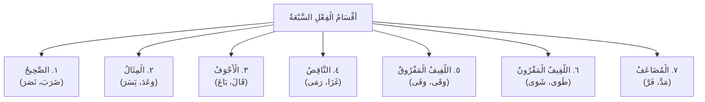

# كِتَابُ الْأَجْنَاسِ الصُّغْرَى
### لِلشَّيْخِ الْعَلَّامَةِ دَادَا عَلِيّ بْنِ الشَّيْخِ قَاسِم (ت ١١٢٧ هـ)
*تَحْقِيقُ وَضَبْطُ مَكْتَبَةِ كَنْزِ التَّحْقِيقِ · دِرَاسَاتُ عِلْمِ الصَّرْفِ*

---

## فِهْرِسُ الْمُحْتَوَيَاتِ

- [مُقَدِّمَةُ الْكِتَابِ: فِي أَجْنَاسِ الْأَفْعَالِ](#مقدمة-الكتاب-في-أجناس-الأفعال)
- [الْقِسْمُ الْأَوَّلُ: الثُّلَاثِيُّ الْمُجَرَّدُ (الْأَبْوَابُ الْخَمْسَةُ)](#القسم-الأول-الثلاثي-المجرد-الأبواب-الخمسة)
  - [الْبَابُ الْأَوَّلُ: فَعَلَ - يَفْعِلُ (كَـ ضَرَبَ يَضْرِبُ)](#الباب-الأول-فعل---يفعل-كـ-ضرب-يضرب)
  - [الْبَابُ الثَّانِي: فَعَلَ - يَفْعُلُ (كَـ نَصَرَ يَنْصُرُ)](#الباب-الثاني-فعل---يفعل-كـ-نصر-ينصر)
  - [الْبَابُ الثَّالِثُ: فَعَلَ - يَفْعَلُ (كَـ فَتَحَ يَفْتَحُ)](#الباب-الثالث-فعل---يفعل-كـ-فتح-يفتح)
  - [الْبَابُ الرَّابِعُ: فَعِلَ - يَفْعَلُ (كَـ سَمِعَ يَسْمَعُ)](#الباب-الرابع-فعل---يفعل-كـ-سمع-يسمع)
  - [الْبَابُ الْخَامِسُ: فَعُلَ - يَفْعُلُ (كَـ كَرُمَ يَكْرُمُ)](#الباب-الخامس-فعل---يفعل-كـ-كرم-يكرم)
- [الْقِسْمُ الثَّانِي: الثُّلَاثِيُّ الْمَزِيدُ فِيهِ (أَرْبَعَةَ عَشَرَ بَابًا)](#القسم-الثاني-الثلاثي-المزيد-فيه-أربعة-عشر-بابا)
  - [الْمَجْمُوعَةُ الْأُولَى: مَا زِيدَ فِيهِ حَرْفٌ وَاحِدٌ](#المجموعة-الأولى-ما-زيد-فيه-حرف-واحد)
  - [الْمَجْمُوعَةُ الثَّانِيَةُ: مَا زِيدَ فِيهِ حَرْفَانِ](#المجموعة-الثانية-ما-زيد-فيه-حرفان)
  - [الْمَجْمُوعَةُ الثَّالِثَةُ: مَا زِيدَ فِيهِ ثَلَاثَةُ أَحْرُفٍ](#المجموعة-الثالثة-ما-زيد-فيه-ثلاثة-أحرف)
- [الْقِسْمُ الثَّالِثُ: الرُّبَاعِيُّ الْمُجَرَّدُ وَمُلْحَقَاتُهُ وَالْمَزِيدُ فِيهِ](#القسم-الثالث-الرباعي-المجرد-وملحقاته-والمزيد-فيه)
  - [أَوَّلًا: الرُّبَاعِيُّ الْمُجَرَّدُ (فَعْلَلَ يُفَعْلِلُ)](#أولا-الرباعي-المجرد-فعلل-يفعلل)
  - [ثَانِيًا: مُلْحَقَاتُ الرُّبَاعِيِّ الْمُجَرَّدِ](#ثانيا-ملحقات-الرباعي-المجرد)
  - [ثَالِثًا: الرُّبَاعِيُّ الْمَزِيدُ فِيهِ](#ثالثا-الرباعي-المزيد-فيه)
- [الْقِسْمُ الرَّابِعُ: أَقْسَامُ الْفِعْلِ السَّبْعَةُ (مِنْ حَيْثُ الصِّحَّةُ وَالِاعْتِلَالُ)](#القسم-الرابع-أقسام-الفعل-السبعة-من-حيث-الصحة-والاعتلال)
- [الْقِسْمُ الْخَامِسُ: الْأَنْشِطَةُ التَّدْرِيبِيَّةُ وَالتَّطْبِيقَاتُ](#القسم-الخامس-الأنشطة-التدريبية-والتطبيقات)

---

## مُقَدِّمَةُ الْكِتَابِ: فِي أَجْنَاسِ الْأَفْعَالِ

بِسْمِ اللَّهِ الرَّحْمَنِ الرَّحِيمِ

**فَصْلٌ: فِي أَجْنَاسِ الْأَفْعَالِ:**

اعْلَمْ أَنَّ الْأَفْعَالَ: إِمَّا **ثُلَاثِيٌّ**، وَإِمَّا **رُبَاعِيٌّ**.  
وَكُلُّ وَاحِدٍ مِنْهُمَا: إِمَّا **مُجَرَّدٌ**، أَوْ **مَزِيدٌ فِيهِ**.

[⬆ العودة إلى الفهرس](#فهرس-المحتويات)

---

## الْقِسْمُ الْأَوَّلُ: الثُّلَاثِيُّ الْمُجَرَّدُ (الْأَبْوَابُ الْخَمْسَةُ)

فَأَمَّا الثُّلَاثِيُّ الْمُجَرَّدُ: فَخَمْسَةُ أَبْوَابٍ:

### الْبَابُ الْأَوَّلُ: فَعَلَ - يَفْعِلُ (كَـ ضَرَبَ يَضْرِبُ)
**وَزْنُهُ:**  
فَعَلَ - يَفْعِلُ - فَعْلًا - فَهُوَ فَاعِلٌ،  
وَفُعِلَ - يُفْعَلُ - فَعْلًا - فَهُوَ مَفْعُولٌ،  
الْأَمْرُ مِنْهُ: **افْعِلْ**، وَالنَّهْيُ: **لَا تَفْعِلْ**.

**مِثَالُهُ:**  
ضَرَبَ - يَضْرِبُ - ضَرْبًا - فَهُوَ ضَارِبٌ،  
وَضُرِبَ - يُضْرَبُ - ضَرْبًا - فَهُوَ مَضْرُوبٌ،  
الْأَمْرُ مِنْهُ: **اضْرِبْ**، وَالنَّهْيُ: **لَا تَضْرِبْ**.

---

### الْبَابُ الثَّانِي: فَعَلَ - يَفْعُلُ (كَـ نَصَرَ يَنْصُرُ)
**وَزْنُهُ:**  
فَعَلَ - يَفْعُلُ - فَعْلًا - فَهُوَ فَاعِلٌ،  
وَفُعِلَ - يُفْعَلُ - فَعْلًا - فَهُوَ مَفْعُولٌ،  
الْأَمْرُ مِنْهُ: **افْعُلْ**، وَالنَّهْيُ: **لَا تَفْعُلْ**.

**مِثَالُهُ:**  
نَصَرَ - يَنْصُرُ - نَصْرًا - فَهُوَ نَاصِرٌ،  
وَنُصِرَ - يُنْصَرُ - نَصْرًا - فَهُوَ مَنْصُورٌ،  
الْأَمْرُ مِنْهُ: **انْصُرْ**، وَالنَّهْيُ: **لَا تَنْصُرْ**.

---

### الْبَابُ الثَّالِثُ: فَعَلَ - يَفْعَلُ (كَـ فَتَحَ يَفْتَحُ)
**وَزْنُهُ:**  
فَعَلَ - يَفْعَلُ - فَعْلًا - فَهُوَ فَاعِلٌ،  
وَفُعِلَ - يُفْعَلُ - فَعْلًا - فَهُوَ مَفْعُولٌ،  
الْأَمْرُ مِنْهُ: **افْعَلْ**، وَالنَّهْيُ: **لَا تَفْعَلْ**.

**مِثَالُهُ:**  
فَتَحَ - يَفْتَحُ - فَتْحًا - فَهُوَ فَاتِحٌ،  
وَفُتِحَ - يُفْتَحُ - فَتْحًا - فَهُوَ مَفْتُوحٌ،  
الْأَمْرُ مِنْهُ: **افْتَحْ**، وَالنَّهْيُ: **لَا تَفْتَحْ**.

---

### الْبَابُ الرَّابِعُ: فَعِلَ - يَفْعَلُ (كَـ سَمِعَ يَسْمَعُ)
**وَزْنُهُ:**  
فَعِلَ - يَفْعَلُ - فَعْلًا - فَهُوَ فَاعِلٌ،  
وَفُعِلَ - يُفْعَلُ - فَعْلًا - فَهُوَ مَفْعُولٌ،  
الْأَمْرُ مِنْهُ: **افْعَلْ**، وَالنَّهْيُ: **لَا تَفْعَلْ**.

**مِثَالُهُ:**  
سَمِعَ - يَسْمَعُ - سَمْعًا - فَهُوَ سَامِعٌ،  
وَسُمِعَ - يُسْمَعُ - سَمْعًا - فَهُوَ مَسْمُوعٌ،  
الْأَمْرُ مِنْهُ: **اسْمَعْ**، وَالنَّهْيُ: **لَا تَسْمَعْ**.

---

### الْبَابُ الْخَامِسُ: فَعُلَ - يَفْعُلُ (كَـ كَرُمَ يَكْرُمُ)
**وَزْنُهُ:**  
فَعُلَ - يَفْعُلُ - فَعَالَةً أَوْ فُعُولًا أَوْ فَعْلًا - فَهُوَ فَاعِلٌ أَوْ فَعِيلٌ،  
الْأَمْرُ مِنْهُ: **افْعُلْ**، وَالنَّهْيُ: **لَا تَفْعُلْ**.

**مِثَالُهُ:**  
كَرُمَ - يَكْرُمُ - كَرَامَةً - فَهُوَ كَرِيمٌ،  
الْأَمْرُ مِنْهُ: **اكْرُمْ**، وَالنَّهْيُ: **لَا تَكْرُمْ**.  
*(وَهَذَا الْبَابُ لَا يُبْنَى مِنْهُ الْمَفْعُولُ لِأَنَّهُ لَا يَكُونُ إِلَّا لَازِمًا)*.

[⬆ العودة إلى الفهرس](#فهرس-المحتويات)

---

## الْقِسْمُ الثَّانِي: الثُّلَاثِيُّ الْمَزِيدُ فِيهِ (أَرْبَعَةَ عَشَرَ بَابًا)

وَأَمَّا الثُّلَاثِيُّ الْمَزِيدُ فِيهِ: فَأَرْبَعَةَ عَشَرَ بَابًا، عَلَى ثَلَاثِ مَجْمُوعَاتٍ:

### الْمَجْمُوعَةُ الْأُولَى: مَا زِيدَ فِيهِ حَرْفٌ وَاحِدٌ
وَهُوَ ثَلَاثَةُ أَبْوَابٍ:

1. **بَابُ الْإِفْعَالِ (أَفْعَلَ يُفْعِلُ):**  
   - **وَزْنُهُ:** أَفْعَلَ - يُفْعِلُ - إِفْعَالًا - فَهُوَ مُفْعِلٌ، وَأُفْعِلَ - يُفْعَلُ - إِفْعَالًا - فَهُوَ مُفْعَلٌ، الْأَمْرُ مِنْهُ: **أَفْعِلْ**، وَالنَّهْيُ: **لَا تُفْعِلْ**.  
   - **مِثَالُهُ:** أَكْرَمَ - يُكْرِمُ - إِكْرَامًا - فَهُوَ مُكْرِمٌ، وَأُكْرِمَ - يُكْرَمُ - إِكْرَامًا - فَهُوَ مُكْرَمٌ، الْأَمْرُ مِنْهُ: **أَكْرِمْ**، وَالنَّهْيُ: **لَا تُكْرِمْ**.

2. **بَابُ التَّفْعِيلِ (فَعَّلَ يُفَعِّلُ):**  
   - **وَزْنُهُ:** فَعَّلَ - يُفَعِّلُ - تَفْعِيلًا - فَهُوَ مُفَعِّلٌ، وَفُعِّلَ - يُفَعَّلُ - تَفْعِيلًا - فَهُوَ مُفَعَّلٌ، الْأَمْرُ مِنْهُ: **فَعِّلْ**، وَالنَّهْيُ: **لَا تُفَعِّلْ**.  
   - **مِثَالُهُ:** فَرَّحَ - يُفَرِّحُ - تَفْرِيحًا - فَهُوَ مُفَرِّحٌ، وَفُرِّحَ - يُفَرَّحُ - تَفْرِيحًا - فَهُوَ مُفَرَّحٌ، الْأَمْرُ مِنْهُ: **فَرِّحْ**، وَالنَّهْيُ: **لَا تُفَرِّحْ**.

3. **بَابُ الْمُفَاعَلَةِ (فَاعَلَ يُفَاعِلُ):**  
   - **وَزْنُهُ:** فَاعَلَ - يُفَاعِلُ - مُفَاعَلَةً وَفِعَالًا - فَهُوَ مُفَاعِلٌ، وَفُوعِلَ - يُفَاعَلُ - مُفَاعَلَةً - فَهُوَ مُفَاعَلٌ، الْأَمْرُ مِنْهُ: **فَاعِلْ**، وَالنَّهْيُ: **لَا تُفَاعِلْ**.  
   - **مِثَالُهُ:** قَاتَلَ - يُقَاتِلُ - مُقَاتَلَةً وَقِتَالًا - فَهُوَ مُقَاتِلٌ، وَقُوتِلَ - يُقَاتَلُ - مُقَاتَلَةً - فَهُوَ مُقَاتَلٌ، الْأَمْرُ مِنْهُ: **قَاتِلْ**، وَالنَّهْيُ: **لَا تُقَاتِلْ**.

---

### الْمَجْمُوعَةُ الثَّانِيَةُ: مَا زِيدَ فِيهِ حَرْفَانِ
وَهُوَ خَمْسَةُ أَبْوَابٍ:

1. **بَابُ الِانْفِعَالِ (انْفَعَلَ يَنْفَعِلُ):**  
   - **وَزْنُهُ:** انْفَعَلَ - يَنْفَعِلُ - انْفِعَالًا - فَهُوَ مُنْفَعِلٌ، الْأَمْرُ مِنْهُ: **انْفَعِلْ**، وَالنَّهْيُ: **لَا تَنْفَعِلْ**.  
   - **مِثَالُهُ:** انْكَسَرَ - يَنْكَسِرُ - انْكِسَارًا - فَهُوَ مُنْكَسِرٌ، الْأَمْرُ مِنْهُ: **انْكَسِرْ**، وَالنَّهْيُ: **لَا تَنْكَسِرْ**.

2. **بَابُ الِافْتِعَالِ (افْتَعَلَ يَفْتَعِلُ):**  
   - **وَزْنُهُ:** افْتَعَلَ - يَفْتَعِلُ - افْتِعَالًا - فَهُوَ مُفْتَعِلٌ، وَاُفْتُعِلَ - يُفْتَعَلُ - افْتِعَالًا - فَهُوَ مُفْتَعَلٌ، الْأَمْرُ مِنْهُ: **افْتَعِلْ**، وَالنَّهْيُ: **لَا تَفْتَعِلْ**.  
   - **مِثَالُهُ:** اجْتَمَعَ - يَجْتَمِعُ - اجْتِمَاعًا - فَهُوَ مُجْتَمِعٌ، الْأَمْرُ مِنْهُ: **اجْتَمِعْ**، وَالنَّهْيُ: **لَا تَجْتَمِعْ**.

3. **بَابُ الِافْعِلَالِ (افْعَلَّ يَفْعَلُّ):**  
   - **وَزْنُهُ:** افْعَلَّ - يَفْعَلُّ - افْعِلَالًا - فَهُوَ مُفْعَلٌّ، الْأَمْرُ مِنْهُ: **افْعَلَّ أَوْ افْعَلِلْ**، وَالنَّهْيُ: **لَا تَفْعَلَّ**.  
   - **مِثَالُهُ:** احْمَرَّ - يَحْمَرُّ - احْمِرَارًا - فَهُوَ مُحْمَرٌّ، الْأَمْرُ مِنْهُ: **احْمَرَّ**، وَالنَّهْيُ: **لَا تَحْمَرَّ**.

4. **بَابُ التَّفَعُّلِ (تَفَعَّلَ يَتَفَعَّلُ):**  
   - **وَزْنُهُ:** تَفَعَّلَ - يَتَفَعَّلُ - تَفَعُّلًا - فَهُوَ مُتَفَعِّلٌ، وَتُفُعِّلَ - يُتَفَعَّلُ - تَفَعُّلًا - فَهُوَ مُتَفَعَّلٌ، الْأَمْرُ مِنْهُ: **تَفَعَّلْ**، وَالنَّهْيُ: **لَا تَتَفَعَّلْ**.  
   - **مِثَالُهُ:** تَعَلَّمَ - يَتَعَلَّمُ - تَعَلُّمًا - فَهُوَ مُتَعَلِّمٌ، الْأَمْرُ مِنْهُ: **تَعَلَّمْ**، وَالنَّهْيُ: **لَا تَتَعَلَّمْ**.

5. **بَابُ التَّفَاعُلِ (تَفَاعَلَ يَتَفَاعَلُ):**  
   - **وَزْنُهُ:** تَفَاعَلَ - يَتَفَاعَلُ - تَفَاعُلًا - فَهُوَ مُتَفَاعِلٌ، وَتُفُوعِلَ - يُتَفَاعَلُ - تَفَاعُلًا - فَهُوَ مُتَفَاعَلٌ، الْأَمْرُ مِنْهُ: **تَفَاعَلْ**، وَالنَّهْيُ: **لَا تَتَفَاعَلْ**.  
   - **مِثَالُهُ:** تَبَاعَدَ - يَتَبَاعَدُ - تَبَاعُدًا - فَهُوَ مُتَبَاعِدٌ، الْأَمْرُ مِنْهُ: **تَبَاعَدْ**، وَالنَّهْيُ: **لَا تَتَبَاعَدْ**.

---

### الْمَجْمُوعَةُ الثَّالِثَةُ: مَا زِيدَ فِيهِ ثَلَاثَةُ أَحْرُفٍ
وَهُوَ سِتَّةُ أَبْوَابٍ:

1. **بَابُ الِاسْتِفْعَالِ (اسْتَفْعَلَ يَسْتَفْعِلُ):**  
   - **وَزْنُهُ:** اسْتَفْعَلَ - يَسْتَفْعِلُ - اسْتِفْعَالًا - فَهُوَ مُسْتَفْعِلٌ، وَاُسْتُفْعِلَ - يُسْتَفْعَلُ - اسْتِفْعَالًا - فَهُوَ مُسْتَفْعَلٌ، الْأَمْرُ مِنْهُ: **اسْتَفْعِلْ**، وَالنَّهْيُ: **لَا تَسْتَفْعِلْ**.  
   - **مِثَالُهُ:** اسْتَخْرَجَ - يَسْتَخْرِجُ - اسْتِخْرَاجًا - فَهُوَ مُسْتَخْرِجٌ، وَاُسْتُخْرِجَ - يُسْتَخْرَجُ - اسْتِخْرَاجًا - فَهُوَ مُسْتَخْرَجٌ، الْأَمْرُ مِنْهُ: **اسْتَخْرِجْ**، وَالنَّهْيُ: **لَا تَسْتَخْرِجْ**.

2. **بَابُ الِافْعِيعَالِ (افْعَوْعَلَ يَفْعَوْعِلُ):**  
   - **وَزْنُهُ:** افْعَوْعَلَ - يَفْعَوْعِلُ - افْعِيعَالًا - فَهُوَ مُفْعَوْعِلٌ، الْأَمْرُ مِنْهُ: **افْعَوْعِلْ**، وَالنَّهْيُ: **لَا تَفْعَوْعِلْ**.  
   - **مِثَالُهُ:** اعْشَوْشَبَ - يَعْشَوْشِبُ - اعْشِيشَابًا - فَهُوَ مُعْشَوْشِبٌ، الْأَمْرُ مِنْهُ: **اعْشَوْشِبْ**، وَالنَّهْيُ: **لَا تَعْشَوْشِبْ**.

3. **بَابُ الِافْعِوَّالِ (افْعَوَّلَ يَفْعَوِّلُ):**  
   - **وَزْنُهُ:** افْعَوَّلَ - يَفْعَوِّلُ - افْعِوَّالًا - فَهُوَ مُفْعَوِّلٌ، الْأَمْرُ مِنْهُ: **افْعَوِّلْ**، وَالنَّهْيُ: **لَا تَفْعَوِّلْ**.  
   - **مِثَالُهُ:** اجْلَوَّذَ - يَجْلَوِّذُ - اجْلِوَّاذًا - فَهُوَ مُجْلَوِّذٌ، الْأَمْرُ مِنْهُ: **اجْلَوِّذْ**، وَالنَّهْيُ: **لَا تَجْلَوِّذْ**.

4. **بَابُ الِافْعِيلَالِ (افْعَالَّ يَفْعَالُّ):**  
   - **وَزْنُهُ:** افْعَالَّ - يَفْعَالُّ - افْعِيلَالًا - فَهُوَ مُفْعَالٌّ، الْأَمْرُ مِنْهُ: **افْعَالَّ**، وَالنَّهْيُ: **لَا تَفْعَالَّ**.  
   - **مِثَالُهُ:** احْمَارَّ - يَحْمَارُّ - احْمِيرَارًا - فَهُوَ مُحْمَارٌّ، الْأَمْرُ مِنْهُ: **احْمَارَّ**، وَالنَّهْيُ: **لَا تَحْمَارَّ**.

5. **بَابُ فَعْنَلَ (كَـ قَعْنَسَ يَقْعَنْسِسُ):**  
   - **مِثَالُهُ:** اقْعَنْسَسَ - يَقْعَنْسِسُ - اقْعِنْسَاسًا - فَهُوَ مُقْعَنْسِسٌ.

6. **بَابُ افْعَنْلَى (كَـ اسْلَنْقَى يَسْلَنْقِي):**  
   - **مِثَالُهُ:** اسْلَنْقَى - يَسْلَنْقِي - اسْلِنْقَاءً - فَهُوَ مُسْلَنْقٍ.

[⬆ العودة إلى الفهرس](#فهرس-المحتويات)

---

## الْقِسْمُ الثَّالِثُ: الرُّبَاعِيُّ الْمُجَرَّدُ وَمُلْحَقَاتُهُ وَالْمَزِيدُ فِيهِ

### أَوَّلًا: الرُّبَاعِيُّ الْمُجَرَّدُ (فَعْلَلَ يُفَعْلِلُ)
وَهُوَ بَابٌ وَاحِدٌ:  
- **وَزْنُهُ:** فَعْلَلَ - يُفَعْلِلُ - فَعْلَلَةً وَفِعْلَالًا - فَهُوَ مُفَعْلِلٌ، وَفُعْلِلَ - يُفَعْلَلُ - فَعْلَلَةً - فَهُوَ مُفَعْلَلٌ، الْأَمْرُ مِنْهُ: **فَعْلِلْ**، وَالنَّهْيُ: **لَا تُفَعْلِلْ**.  
- **مِثَالُهُ:** دَحْرَجَ - يُدَحْرِجُ - دَحْرَجَةً وَدِحْرَاجًا - فَهُوَ مُدَحْرِجٌ، وَدُحْرِجَ - يُدَحْرَجُ - دَحْرَجَةً - فَهُوَ مُدَحْرَجٌ، الْأَمْرُ مِنْهُ: **دَحْرِجْ**، وَالنَّهْيُ: **لَا تُدَحْرِجْ**.

---

### ثَانِيًا: مُلْحَقَاتُ الرُّبَاعِيِّ الْمُجَرَّدِ (سِتَّةُ أَبْوَابٍ)
وَهِيَ الْأَبْوَابُ الْمُلْحَقَةُ بِـ «دَحْرَجَ»:

1. **فَوْعَلَ يُفَوْعِلُ:** نَحْوُ: حَوْقَلَ - يُحَوْقِلُ - حَوْقَلَةً.
2. **فَعْوَلَ يُفَعْوِلُ:** نَحْوُ: جَهْوَرَ - يُجَهْوِرُ - جَهْوَرَةً.
3. **فَيْعَلَ يُفَيْعِلُ:** نَحْوُ: بَيْطَرَ - يُبَيْطِرُ - بَيْطَرَةً.
4. **فَعْيَلَ يُفَعْيِلُ:** نَحْوُ: عَثْيَرَ - يُعَثْيِرُ - عَثْيَرَةً.
5. **فَعْلَى يُفَعْلِي:** نَحْوُ: سَلْقَى - يُسَلْقِي - سَلْقَاةً.
6. **فَعْلَلَ يُفَعْلِلُ (مَا كَانَ مُكَرَّرَ اللَّامِ):** نَحْوُ: جَلْبَبَ - يُجَلْبِبُ - جَلْبَبَةً.

---

### ثَالِثًا: الرُّبَاعِيُّ الْمَزِيدُ فِيهِ (ثَلَاثَةُ أَبْوَابٍ)
وَهُوَ قِسْمَانِ:
- **مَا زِيدَ فِيهِ حَرْفٌ وَاحِدٌ (بَابٌ وَاحِدٌ):**
  - **بَابُ تَفَعْلَلَ (تَفَعْلَلَ يَتَفَعْلَلُ):**  
    نَحْوُ: تَدَحْرَجَ - يَتَدَحْرَجُ - تَدَحْرُجًا - فَهُوَ مُتَدَحْرِجٌ، الْأَمْرُ مِنْهُ: **تَدَحْرَجْ**، وَالنَّهْيُ: **لَا تَتَدَحْرَجْ**.
- **مَا زِيدَ فِيهِ حَرْفَانِ (بَابَانِ):**
  1. **بَابُ افْعَنْلَلَ (افْعَنْلَلَ يَفْعَنْلِلُ):**  
     نَحْوُ: احْرَنْجَمَ - يَحْرَنْجِمُ - احْرِنْجَامًا - فَهُوَ مُحْرَنْجِمٌ، الْأَمْرُ مِنْهُ: **احْرَنْجِمْ**، وَالنَّهْيُ: **لَا تَحْرَنْجِمْ**.
  2. **بَابُ افْعَلَلَّ (افْعَلَلَّ يَفْعَلِلُّ):**  
     نَحْوُ: اقْشَعَرَّ - يَقْشَعِرُّ - اقْشِعْرَارًا - فَهُوَ مُقْشَعِرٌّ، الْأَمْرُ مِنْهُ: **اقْشَعِرَّ**، وَالنَّهْيُ: **لَا تَقْشَعِرَّ**.

[⬆ العودة إلى الفهرس](#فهرس-المحتويات)

---

## الْقِسْمُ الرَّابِعُ: أَقْسَامُ الْفِعْلِ السَّبْعَةُ (مِنْ حَيْثُ الصِّحَّةُ وَالِاعْتِلَالُ)

اعْلَمْ أَنَّ الْفِعْلَ يَنْقَسِمُ بِاعْتِبَارِ نَوْعِ حُرُوفِهِ إِلَى **سَبْعَةِ أَقْسَامٍ**:

1. **الصَّحِيحُ:** مَا خَلَتْ أُصُولُهُ مِنَ الْهَمْزَةِ وَالتَّضْعِيفِ وَحُرُوفِ الْعِلَّةِ (الْوَاوِ، وَالْأَلِفِ، وَالْيَاءِ)، نَحْوُ: **ضَرَبَ**، **نَصَرَ**.
2. **الْمِثَالُ:** مَا كَانَتْ فَاؤُهُ حَرْفَ عِلَّةٍ، نَحْوُ: **وَعَدَ**، **يَسَرَ**.
3. **الْأَجْوَفُ:** مَا كَانَتْ عَيْنُهُ حَرْفَ عِلَّةٍ، نَحْوُ: **قَالَ** (أَصْلُهُ: قَوَلَ)، **بَاعَ** (أَصْلُهُ: بَيَعَ).
4. **النَّاقِصُ:** مَا كَانَتْ لَامُهُ حَرْفَ عِلَّةٍ، نَحْوُ: **غَزَا** (أَصْلُهُ: غَزَوَ)، **رَمَى** (أَصْلُهُ: رَمَيَ).
5. **اللَّفِيفُ الْمَفْرُوقُ:** مَا كَانَتْ فَاؤُهُ وَلَامُهُ حَرْفَيْ عِلَّةٍ وَفُرِّقَ بَيْنَهُمَا بِحَرْفٍ صَحِيحٍ، نَحْوُ: **وَقَى**، **وَفَى**.
6. **اللَّفِيفُ الْمَقْرُونُ:** مَا كَانَتْ عَيْنُهُ وَلَامُهُ حَرْفَيْ عِلَّةٍ مُقْتَرِنَيْنِ، نَحْوُ: **طَوَى**، **شَوَى**.
7. **الْمُضَاعَفُ:** مَا كَانَتْ عَيْنُهُ وَلَامُهُ مِنْ جِنْسٍ وَاحِدٍ، نَحْوُ: **مَدَّ** (أَصْلُهُ: مَدَدَ)، **فَرَّ** (أَصْلُهُ: فَرَرَ).

[⬆ العودة إلى الفهرس](#فهرس-المحتويات)

---

## الْقِسْمُ الْخَامِسُ: الْأَنْشِطَةُ التَّدْرِيبِيَّةُ وَالتَّطْبِيقَاتُ

### النَّشَاطُ الْأَوَّلُ: تَمْيِيزُ أَبْوَابِ الثُّلَاثِيِّ الْمُجَرَّدِ
زِنِ الْأَفْعَالَ الْآتِيَةَ مَعَ ضَبْطِ عَيْنِ الْمَاضِي وَالْمُضَارِعِ وَتَحْدِيدِ بَابِهَا:

| الْفِعْلُ الْمَاضِي | مُضَارِعُهُ | مَصْدَرُهُ | اسْمُ الْفَاعِلِ | الْبَابُ الصَّرْفِيُّ |
|---|---|---|---|---|
| **كَتَبَ** | يَكْتُبُ | كِتَابَةً | كَاتِبٌ | نَصَرَ يَنْصُرُ (فَعَلَ - يَفْعُلُ) |
| **جَلَسَ** | يَجْلِسُ | جُلُوسًا | جَالِسٌ | ضَرَبَ يَضْرِبُ (فَعَلَ - يَفْعِلُ) |
| **ذَهَبَ** | يَذْهَبُ | ذَهَابًا | ذَاهِبٌ | فَتَحَ يَفْتَحُ (فَعَلَ - يَفْعَلُ) |
| **فَرِحَ** | يَفْرَحُ | فَرَحًا | فَرِحٌ | سَمِعَ يَسْمَعُ (فَعِلَ - يَفْعَلُ) |
| **شَرُفَ** | يَشْرُفُ | شَرَفًا | شَرِيفٌ | كَرُمَ يَكْرُمُ (فَعُلَ - يَفْعُلُ) |

---

### النَّشَاطُ الثَّانِي: تَحْوِيلُ الثُّلَاثِيِّ الْمُجَرَّدِ إِلَى الْمَزِيدِ
حَوِّلِ الْأَفْعَالَ الْمُجَرَّدَةَ إِلَى الْأَبْوَابِ الْمَزِيدَةِ الْمَطْلُوبَةِ مَعَ الضَّبْطِ التَّامِّ:

1. **خَرَجَ** (الثُّلَاثِيُّ الْمُجَرَّدُ):
   - بَابُ الْإِفْعَالِ: **أَخْرَجَ يُخْرِجُ إِخْرَاجًا**.
   - بَابُ الِاسْتِفْعَالِ: **اسْتَخْرَجَ يَسْتَخْرِجُ اسْتِخْرَاجًا**.
2. **عَلِمَ** (الثُّلَاثِيُّ الْمُجَرَّدُ):
   - بَابُ التَّفْعِيلِ: **عَلَّمَ يُعَلِّمُ تَعْلِيمًا**.
   - بَابُ التَّفَعُّلِ: **تَعَلَّمَ يَتَعَلَّمُ تَعَلُّمًا**.
3. **غَفَرَ** (الثُّلَاثِيُّ الْمُجَرَّدُ):
   - بَابُ الِاسْتِفْعَالِ: **اسْتَغْفَرَ يَسْتَغْفِرُ اسْتِغْفَارًا**.
4. **كَسَرَ** (الثُّلَاثِيُّ الْمُجَرَّدُ):
   - بَابُ الِانْفِعَالِ: **انْكَسَرَ يَنْكَسِرُ انْكِسَارًا**.

[⬆ العودة إلى الفهرس](#فهرس-المحتويات)

