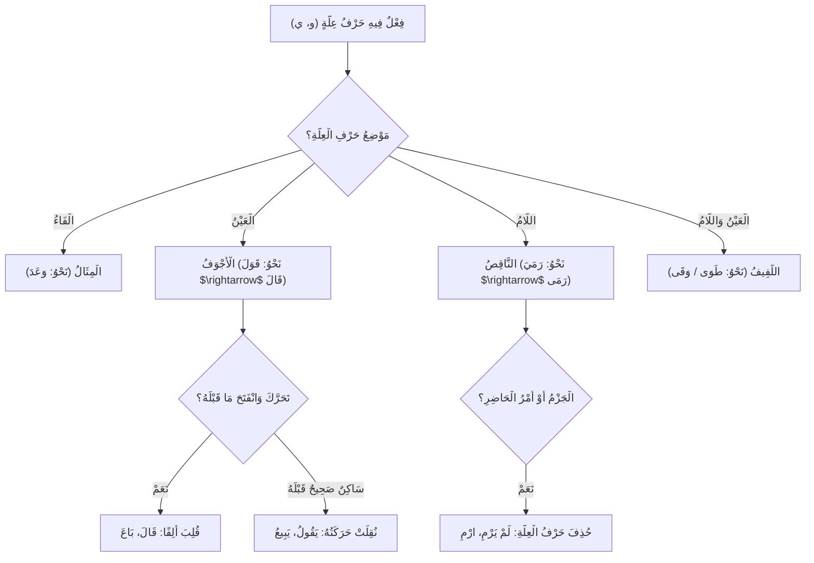

# Kanz al-Taḥqīq · Visual Morphological Trees: Kitāb al-Mīzān
### *Comprehensive Mermaid Decision Diagrams for Arabic Conjugational Grammar*
*Discipline: ʿIlm al-Ṣarf · Reference: Kitāb al-Mīzān fī Taṣrīf al-Afʿāl*

---

## 1. Master Systemic Taxonomy of Verbal Paradigms

```mermaid
flowchart TD
    ROOT["🌱 الْفِعْلُ الثُّلَاثِيُّ الْمُجَرَّدُ\n(Canonical Root: ف - ع - ل)"] --> MOODS["أَنْوَاعُ الْأَفْعَالِ (Verbal Moods & Categories)"]
    ROOT --> DERIVATIVES["الْأَسْمَاءُ الْمُشْتَقَّةُ (Derived Nominal Classes)"]

    subgraph MoodsTree["١. مَنْظُومَةُ الْأَفْعَالِ (Verbs Engine)"]
        MOODS --> MADI["الْفِعْلُ الْمَاضِي (Past)"]
        MOODS --> MUDARI["الْفِعْلُ الْمُضَارِعُ (Imperfect)"]
        MOODS --> AMR["فِعْلُ الْأَمْرِ (Command)"]
        MOODS --> NAHY["فِعْلُ النَّهْيِ (Prohibition)"]

        MADI --> M1["مَعْرُوفٌ مُثْبَتٌ: فَعَلَ"]
        MADI --> M2["مَعْرُوفٌ مَنْفِيٌّ: مَا فَعَلَ"]
        MADI --> M3["مَجْهُولٌ مُثْبَتٌ: فُعِلَ"]
        MADI --> M4["مَجْهُولٌ مَنْفِيٌّ: مَا فُعِلَ"]

        MUDARI --> MU1["مُطْلَقٌ مُثْبَتٌ: يَفْعُلُ"]
        MUDARI --> MU2["مُطْلَقٌ مَنْفِيٌّ: لَا يَفْعُلُ"]
        MUDARI --> MU3["مَجْهُولٌ مُثْبَتٌ: يُفْعَلُ"]
        MUDARI --> MU4["مَجْهُولٌ مَنْفِيٌّ: لَا يُفْعَلُ"]
        MUDARI --> MU5["مَجْزُومٌ بِلَمْ: لَمْ يَفْعُلْ / لَمْ يُفْعَلْ"]
        MUDARI --> MU6["مَنْصُوبٌ بِلَنْ: لَنْ يَفْعُلَ / لَنْ يُفْعَلَ"]

        AMR --> A_HADIR["أَمْرُ الْحَاضِرِ: افْعُلْ / لِتُفْعَلْ"]
        AMR --> A_GHAIB["أَمْرُ الْغَائِبِ: لِيَفْعُلْ / لِيُفْعَلْ"]

        NAHY --> N_HADIR["نَهْيُ الْحَاضِرِ: لَا تَفْعُلْ / لَا تُفْعَلْ"]
        NAHY --> N_GHAIB["نَهْيُ الْغَائِبِ: لَا يَفْعُلْ / لَا يُفْعَلْ"]

        AMR -.->|تَوْكِيدٌ| NUN_EMP["نُونُ التَّوْكِيدِ الثَّقِيلَةُ (-َنَّ) وَالْخَفِيفَةُ (-َنْ)"]
        NAHY -.->|تَوْكِيدٌ| NUN_EMP
    end

    subgraph NounsTree["٢. مَنْظُومَةُ الْأَسْمَاءِ الْمُشْتَقَّةِ (Nominals Engine)"]
        DERIVATIVES --> NOM_FA["اسْمُ الْفَاعِلِ: فَاعِلٌ"]
        DERIVATIVES --> NOM_MAF["اسْمُ الْمَفْعُولِ: مَفْعُولٌ"]
        DERIVATIVES --> NOM_ZARF["اسْمُ الظَّرْفِ: مَفْعَلٌ"]
        DERIVATIVES --> NOM_ALA["اسْمُ الْآلَةِ: مِفْعَلٌ، مِفْعَلَةٌ، مِفْعَالٌ"]
        DERIVATIVES --> NOM_TAFD["اسْمُ التَّفْضِيلِ: أَفْعَلُ / فُعْلَى"]
    end
```

---

## 2. Conjugation Matrix Flowchart (The 14 Forms)

```mermaid
flowchart LR
    subgraph ThirdPerson["الْغَائِبُ وَالْغَائِبَةُ (3rd Person)"]
        G_M_S["وَاحِدٌ مُذَكَّرٌ: فَعَلَ (هُوَ)"]
        G_M_D["تَثْنِيَةٌ مُذَكَّرٌ: فَعَلَا (هُمَا)"]
        G_M_P["جَمْعٌ مُذَكَّرٌ: فَعَلُوا (هُمْ)"]
        G_F_S["وَاحِدَةٌ مُؤَنَّثَةٌ: فَعَلَتْ (هِيَ)"]
        G_F_D["تَثْنِيَةٌ مُؤَنَّثَةٌ: فَعَلَتَا (هُمَا)"]
        G_F_P["جَمْعٌ مُؤَنَّثٌ: فَعَلْنَ (هُنَّ)"]
    end

    subgraph SecondPerson["الْمُخَاطَبُ وَالْمُخَاطَبَةُ (2nd Person)"]
        K_M_S["وَاحِدٌ مُذَكَّرٌ: فَعَلْتَ (أَنْتَ)"]
        K_M_D["تَثْنِيَةٌ مُذَكَّرٌ: فَعَلْتُمَا (أَنْتُمَا)"]
        K_M_P["جَمْعٌ مُذَكَّرٌ: فَعَلْتُمْ (أَنْتُمْ)"]
        K_F_S["وَاحِدَةٌ مُؤَنَّثَةٌ: فَعَلْتِ (أَنْتِ)"]
        K_F_D["تَثْنِيَةٌ مُؤَنَّثَةٌ: فَعَلْتُمَا (أَنْتُمَا)"]
        K_F_P["جَمْعٌ مُؤَنَّثٌ: فَعَلْتُنَّ (أَنْتُنَّ)"]
    end

    subgraph FirstPerson["الْمُتَكَلِّمُ (1st Person)"]
        T_S["مُتَكَلِّمٌ وَحْدَهُ: فَعَلْتُ (أَنَا)"]
        T_P["مَعَ الْغَيْرِ: فَعَلْنَا (نَحْنُ)"]
    end

    ThirdPerson --> SecondPerson --> FirstPerson
```

---

## 3. Decision Logic for Weak Verb Mutations (*Iʿtilāl*)

