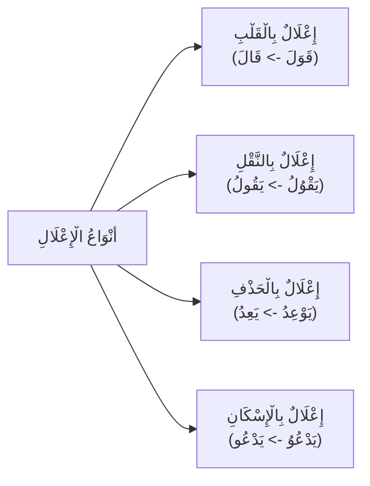
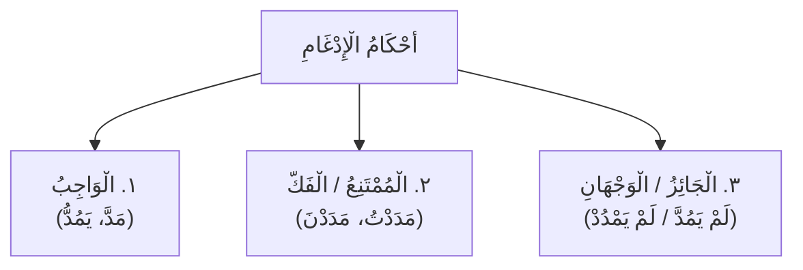

# قَوَاعِدُ الْإِعْلَالِ وَالْإِدْغَامِ فِي عِلْمِ الصَّرْفِ
### مُلْحَقٌ تَحْلِيلِيٌّ لِكِتَابَيِ الْأَجْنَاسِ الصُّغْرَى وَالْكُبْرَى
*مَكْتَبَةُ كَنْزِ التَّحْقِيقِ · سِلْسِلَةُ عُلُومِ اللُّغَةِ وَالصَّرْفِ*

---

## فِهْرِسُ الْمُحْتَوَيَاتِ

- [مُقَدِّمَةُ الْإِعْلَالِ وَالْإِدْغَامِ](#مقدمة-الإعلال-والإدغام)
- [الْقِسْمُ الْأَوَّلُ: قَوَاعِدُ الْإِعْلَالِ الْعَشَرَةُ](#القسم-الأول-قواعد-الإعلال-العشرة)
  - [١. قَلْبُ الْوَاوِ وَالْيَاءِ أَلِفًا](#١-قلب-الواو-والياء-ألفا)
  - [٢. إِسْكَانُ حَرْفِ الْعِلَّةِ (النَّقْلُ)](#٢-إسكان-حرف-العلة-النقل)
  - [٣. حَذْفُ حَرْفِ الْعِلَّةِ لِالْتِقَاءِ السَّاكِنَيْنِ](#٣-حذف-حرف-العلة-لالتقاء-الساكنين)
  - [٤. قَلْبُ الْوَاوِ يَاءً لِانْكِسَارِ مَا قَبْلَهَا](#٤-قلب-الواو-ياء-لانكسار-ما-قبلها)
  - [٥. حَذْفُ فَاءِ الْمِثَالِ فِي الْمُضَارِعِ وَالْأَمْرِ](#٥-حذف-فاء-المثال-في-المضارع-والأمر)
- [الْقِسْمُ الثَّانِي: أَحْكَامُ الْإِدْغَامِ فِي الْمُضَاعَفِ](#القسم-الثاني-أحكام-الإدغام-في-المضاعف)
  - [١. الْإِدْغَامُ الْوَاجِبُ](#١-الإدغام-الواجب)
  - [٢. الْإِدْغَامُ الْمُمْتَنِعُ (فَكُّ الْإِدْغَامِ)](#٢-الإدغام-الممتنع-فك-الإدغام)
  - [٣. الْإِدْغَامُ الْجَائِزُ (الْوَجْهَانِ)](#٣-الإدغام-الجائز-الوجهان)

---

## مُقَدِّمَةُ الْإِعْلَالِ وَالْإِدْغَامِ

بِسْمِ اللَّهِ الرَّحْمَنِ الرَّحِيمِ

الْحَمْدُ لِلَّهِ وَالصَّلَاةُ وَالسَّلَامُ عَلَى رَسُولِ اللَّهِ وَآلِهِ وَصَحْبِهِ.

اعْلَمْ أَنَّ تَصْرِيفَ الْأَفْعَالِ يَعْتَرِيهِ تَغْيِيرٌ طَبِيعِيٌّ لِاسْتِثْقَالِ بَعْضِ الْحَرَكَاتِ عَلَى حُرُوفِ الْعِلَّةِ، أَوْ لِتَقَارُبِ الْحُرُوفِ الْمُتَمَاثِلَةِ. وَهَذَا التَّغْيِيرُ يَنْقَسِمُ إِلَى:
1. **الْإِعْلَالِ:** تَغْيِيرُ حَرْفِ الْعِلَّةِ بِالْقَلْبِ، أَوِ النَّقْلِ، أَوِ الْحَذْفِ، أَوِ الْإِسْكَانِ.
2. **الْإِدْغَامِ:** إِدْخَالُ حَرْفٍ سَاكِنٍ فِي حَرْفٍ مُتَحَرِّكٍ مِثْلِهِ بِحَيْثُ يَصِيرَانِ حَرْفًا وَاحِدًا مُشَدَّدًا.

[⬆ العودة إلى الفهرس](#فهرس-المحتويات)

---

## الْقِسْمُ الْأَوَّلُ: قَوَاعِدُ الْإِعْلَالِ الْعَشَرَةُ

### ١. قَلْبُ الْوَاوِ وَالْيَاءِ أَلِفًا
- **الْقَاعِدَةُ:** إِذَا تَحَرَّكَتِ الْوَاوُ أَوِ الْيَاءُ وَانْفَتَحَ مَا قَبْلَهُمَا، قُلِبَتَا أَلِفًا لِثِقَلِ الْحَرَكَةِ عَلَيْهِمَا بَعْدَ الْفَتْحَةِ.
- **الْأَمْثِلَةُ:**
  - **قَالَ:** أَصْلُهُ: **قَوَلَ**، تَحَرَّكَتِ الْوَاوُ وَانْفَتَحَ مَا قَبْلَهَا، فَقُلِبَتْ أَلِفًا -> قَالَ.
  - **بَاعَ:** أَصْلُهُ: **بَيَعَ**، تَحَرَّكَتِ الْيَاءُ وَانْفَتَحَ مَا قَبْلَهَا، فَقُلِبَتْ أَلِفًا -> بَاعَ.
  - **دَعَا:** أَصْلُهُ: **دَعَوَ**.
  - **رَمَى:** أَصْلُهُ: **رَمَيَ**.

---

### ٢. إِسْكَانُ حَرْفِ الْعِلَّةِ (النَّقْلُ)
- **الْقَاعِدَةُ:** إِذَا كَانَتِ الْعَيْنُ حَرْفَ عِلَّةٍ مُتَحَرِّكًا، وَقَبْلَهُ حَرْفٌ صَحِيحٌ سَاكِنٌ، نُقِلَتْ حَرَكَةُ حَرْفِ الْعِلَّةِ إِلَى السَّاكِنِ الصَّحِيحِ قَبْلَهُ.
- **الْأَمْثِلَةُ:**
  - **يَقُولُ:** أَصْلُهُ: **يَقْوُلُ** (عَلَى وَزْنِ يَفْعُلُ)، نُقِلَتِ الضَّمَّةُ مِنَ الْوَاوِ إِلَى الْقَافِ السَّاكِنَةِ قَبْلَهَا -> يَقُولُ.
  - **يَبِيعُ:** أَصْلُهُ: **يَبْيِعُ** (عَلَى وَزْنِ يَفْعِلُ)، نُقِلَتِ الْكَسْرَةُ مِنَ الْيَاءِ إِلَى الْبَاءِ السَّاكِنَةِ قَبْلَهَا -> يَبِيعُ.

---

### ٣. حَذْفُ حَرْفِ الْعِلَّةِ لِالْتِقَاءِ السَّاكِنَيْنِ
- **الْقَاعِدَةُ:** إِذَا سَكَنَ حَرْفُ الْعِلَّةِ الْمُنْقَلِبُ وَالْتَقَى مَعَ سَاكِنٍ بَعْدَهُ، حُذِفَ حَرْفُ الْعِلَّةِ لِلتَّخَلُّصِ مِنِ الْتِقَاءِ السَّاكِنَيْنِ.
- **الْأَمْثِلَةُ:**
  - **قُلْتُ:** أَصْلُهُ: **قَالْتُ** (مِنْ قَوَلْتُ)، الْتَقَتِ الْأَلِفُ السَّاكِنَةُ مَعَ اللَّامِ السَّاكِنَةِ، فَحُذِفَتِ الْأَلِفُ وَضُمَّتِ الْقَافُ لِلدَّلَالَةِ عَلَى الْوَاوِ -> قُلْتُ.
  - **بِعْتُ:** أَصْلُهُ: **بَاعْتُ** (مِنْ بَيَعْتُ)، الْتَقَتِ الْأَلِفُ السَّاكِنَةُ مَعَ الْعَيْنِ السَّاكِنَةِ، فَحُذِفَتِ الْأَلِفُ وَكُسِرَتِ الْبَاءُ لِلدَّلَالَةِ عَلَى الْيَاءِ -> بِعْتُ.
  - **لَمْ يَقُلْ:** أَصْلُهُ: **لَمْ يَقُولْ**، حُذِفَتِ الْوَاوُ لِالْتِقَاءِ السَّاكِنَيْنِ.

---

### ٤. قَلْبُ الْوَاوِ يَاءً لِانْكِسَارِ مَا قَبْلَهَا
- **الْقَاعِدَةُ:** إِذَا سَكَنَتِ الْوَاوُ إِثْرَ كَسْرَةٍ، قُلِبَتْ يَاءً لِاسْتِثْقَالِ خُرُوجِ الْوَاوِ مِنْ بَعْدِ الْكَسْرَةِ.
- **الْأَمْثِلَةُ:**
  - **مِيزَانٌ:** أَصْلُهُ: **مِوْزَانٌ** (مِنَ الْوَزْنِ: مِفْعَالٌ)، سَكَنَتِ الْوَاوُ بَعْدَ كَسْرَةِ الْمِيمِ، فَقُلِبَتْ يَاءً -> مِيزَانٌ.
  - **مِيعَادٌ:** أَصْلُهُ: **مِوْعَادٌ** (مِنَ الْوَعْدِ) -> مِيعَادٌ.
  - **قِيلَ:** أَصْلُهُ: **قُوِلَ** (مَبْنِيٌّ لِلْمَجْهُولِ)، نُقِلَتْ كَسْرَةُ الْوَاوِ إِلَى الْقَافِ وَقُلِبَتِ الْوَاوُ يَاءً -> قِيلَ.

---

### ٥. حَذْفُ فَاءِ الْمِثَالِ فِي الْمُضَارِعِ وَالْأَمْرِ
- **الْقَاعِدَةُ:** تُحْذَفُ الْوَاوُ مِنْ مُضَارِعِ الْمِثَالِ الْوَاوِيِّ إِذَا وَقَعَتْ بَيْنَ يَاءٍ مَفْتُوحَةٍ وَكَسْرَةٍ ظَاهِرَةٍ أَوْ مُقَدَّرَةٍ.
- **الْأَمْثِلَةُ:**
  - **وَعَدَ:** مُضَارِعُهُ: **يَعِدُ** (أَصْلُهُ: يَوْعِدُ، وَقَعَتِ الْوَاوُ بَيْنَ يَاءٍ وَكَسْرَةٍ فَحُذِفَتْ).
  - الْأَمْرُ مِنْهُ: **عِدْ** (أَصْلُهُ: اِوْعِدْ).
  - الْمَصْدَرُ: **عِدَةً** (عُوِّضَ عَنِ الْوَاوِ الْمَحْذُوفَةِ بِتَاءِ التَّأْنِيثِ فِي آخِرِهِ).

[⬆ العودة إلى الفهرس](#فهرس-المحتويات)

---

## الْقِسْمُ الثَّانِي: أَحْكَامُ الْإِدْغَامِ فِي الْمُضَاعَفِ

اعْلَمْ أَنَّ الْإِدْغَامَ فِي الْفِعْلِ الْمُضَاعَفِ (مَا كَانَتْ عَيْنُهُ وَلَامُهُ مِنْ جِنْسٍ وَاحِدٍ كَـ «مَدَّ»، «فَرَّ») لَهُ **ثَلَاثَةُ أَحْكَامٍ**:

### ١. الْإِدْغَامُ الْوَاجِبُ
يَجِبُ الْإِدْغَامُ فِي حَالَتَيْنِ:
1. أَنْ يَكُونَ الْحَرْفَانِ الْمُتَمَاثِلَانِ مُتَحَرِّكَيْنِ مَعًا فِي كَلِمَةٍ وَاحِدَةٍ، نَحْوُ: **مَدَّ** (أَصْلُهُ: مَدَدَ)، **يَمُدُّ** (أَصْلُهُ: يَمْدُدُ).
2. أَنْ يَكُونَ الْأَوَّلُ سَاكِنًا وَالثَّانِي مُتَحَرِّكًا، نَحْوُ: **مَدَّهُ**.

### ٢. الْإِدْغَامُ الْمُمْتَنِعُ (فَكُّ الْإِدْغَامِ)
يَمْتَنِعُ الْإِدْغَامُ وَيَجِبُ الْفَكُّ:
- إِذَا اتَّصَلَ بِالْفِعْلِ الْمُضَاعَفِ ضَمِيرُ رَفْعٍ مُتَحَرِّكٌ (تَاءُ الْفَاعِلِ، نَا الْفَاعِلِينَ، نُونُ النِّسْوَةِ)؛ لِأَنَّ الْحَرْفَ الثَّانِيَ يُسَكَّنُ لِبِنَاءِ الْفِعْلِ، وَلَا يَجُوزُ إِدْغَامُ حَرْفٍ مُتَحَرِّكٍ فِي حَرْفٍ سَاكِنٍ.
- **أَمْثِلَتُهُ:**
  - مَدَدْتُ، مَدَدْتَ، مَدَدْتِ، مَدَدْنَا.
  - النِّسْوَةُ: يَمْدُدْنَ، امْدُدْنَ.

### ٣. الْإِدْغَامُ الْجَائِزُ (الْوَجْهَانِ)
يَجُوزُ فِيهِ الْإِدْغَامُ وَالْفَكُّ:
- إِذَا كَانَ الْفِعْلُ مَجْزُومًا بِالسُّكُونِ (نَحْوُ: جَزْمِ الْمُضَارِعِ بِلَمْ، أَوْ أَمْرِ الْحَاضِرِ):
  - **وَجْهُ الْإِدْغَامِ (لُغَةُ أَهْلِ الْحِجَازِ):** **لَمْ يَمُدَّ**، **مُدَّ**.
  - **وَجْهُ الْفَكِّ (لُغَةُ بَنِي تَمِيمٍ وَالْأَصْلُ):** **لَمْ يَمْدُدْ**، **امْدُدْ**.

[⬆ العودة إلى الفهرس](#فهرس-المحتويات)

