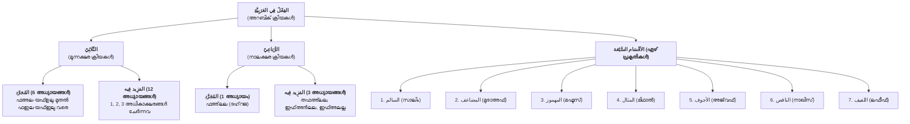

# فِهْرِسُ مَبَاحِثِ كِتَابِ زَنْجَان فِي عِلْمِ الصَّرْفِ
## തസ്‌രീഫുസ്സൻജാനി (അൽ-ഇസ്സീ) — സമഗ്ര അധ്യായ സൂചികയും പഠന സഹായിയും
### *Matn al-Zanjānī (al-ʿIzzī fī al-Ṣarf)* — Master Curriculum & Chapter Navigator

---

## 1. ഗ്രന്ഥ പരിചയം (Overview of the Kitāb)

പരമ്പരാഗത ഇസ്‌ലാമിക ദർസ് സിലബസുകളിൽ അറബി ഭാഷാശാസ്ത്രത്തിന്റെ (ഇൽമുസ്സ്വറഫ് / മോർഫോളജി) മർമ്മപ്രധാനമായ മൂന്നാം ഘട്ടത്തിൽ വിദ്യാർത്ഥികൾ ഹൃദിസ്ഥമാക്കുന്ന വിശ്വപ്രസിദ്ധമായ മത്‌നാണ് **«متن الزنجاني» (*Matn al-Zanjānī*)** അഥവാ **«العزي في التصريف» (*al-ʿIzzī fī al-Taṣrīf*)**. ഹിജ്റ 655-ൽ അന്തരിച്ച മഹാനായ പണ്ഡിതൻ **ഇമാം ഇസ്സുദ്ദീൻ അബ്ദുൽ വഹാബ് ബിൻ ഇബ്രാഹിം അസ്സൻജാനി (റഹ്)** ആണ് ഈ ഗ്രന്ഥത്തിന്റെ രചയിതാവ്.

അറബിക് പദങ്ങളുടെ ഘടനാപരമായ രൂപമാറ്റങ്ങൾ, സന്ധിനിയമങ്ങൾ (ഇഅ്‌ലാൽ), വർണ്ണവ്യതിയാനങ്ങൾ (ഇബ്ദാൽ), അക്ഷരലോപങ്ങൾ (ഹദ്ഫ്), ഇരട്ടിപ്പുകൾ (ഇദ്ഗാം) എന്നിവ കേവലം വായ്ത്താരികളായി ഉരുവിടുന്നതിനപ്പുറം, അവയുടെ നിദാനശാസ്ത്രപരമായ കാരണങ്ങളും (**علل التصريف**) ഉച്ചാരണശാസ്ത്രപരമായ തത്വങ്ങളും യുക്തിഭദ്രമായി അപഗ്രഥിക്കുന്ന ആദ്യത്തെ ആധികാരിക ഗ്രന്ഥമാണിത്.

ഈ ഡിജിറ്റൽ ശേഖരത്തിൽ, സമഗ്രമായ 24 അധ്യായ കുറിപ്പുകളിലൂടെ (Modular Study Dossiers) ഗ്രന്ഥത്തിന്റെ ഓരോ ഭാഗവും ചിട്ടപ്പെടുത്തിയിരിക്കുന്നു.

---

## 2. സ്വറഫിന്റെ ബൃഹദ് ഘടന (Grand Architecture of Arabic Morphology)

അറബിക് ക്രിയാപദങ്ങളെയും നാമങ്ങളെയും പാരമ്പര്യ സ്വറഫ് ശാസ്ത്രം മൂലാക്ഷരങ്ങളുടെ എണ്ണവും ശബ്ദശുദ്ധിയും ആസ്പദമാക്കി വിഭജിക്കുന്നു:

---

## 3. അധ്യായങ്ങളുടെ പൂർണ്ണ പട്ടിക (Complete Chapter Navigator)

### ഭാഗം 1: പ്രാരംഭ തത്വങ്ങളും അടിസ്ഥാന വിഭജനങ്ങളും (Foundations & Classifications)
- [**01. المبادئ العشرة ونشأة علم الصرف** (സ്വറഫ് ശാസ്ത്രത്തിന്റെ 10 പ്രമാണങ്ങളും ഉത്ഭവചരിത്രവും / Epistemology & 10 Canonical Principles)](file:///Users/apple/Desktop/docs/Kanz-al-Tahqiq/Kanz-al-Tahqiq-pub/Texts/Sarf/zanjan/Notes/Chapters/01-muqaddimah-wa-mabadi.md)
- [**02. خطبة المتن وحقيقة التصريف** (മത്‌നിന്റെ ആമുഖവും തസ്‌രീഫിന്റെ നിർവചനവും / Prologue & Definition of Tasrif)](file:///Users/apple/Desktop/docs/Kanz-al-Tahqiq/Kanz-al-Tahqiq-pub/Texts/Sarf/zanjan/Notes/Chapters/02-khutbah-wa-haqiqat-tasrif.md)
- [**03. أبواب الثلاثي المجرد الستة** (മുജർറദായ മൂന്നക്ഷര ക്രിയകളുടെ 6 ബാബുകൾ / The 6 Doors of Bare Triliterals)](file:///Users/apple/Desktop/docs/Kanz-al-Tahqiq/Kanz-al-Tahqiq-pub/Texts/Sarf/zanjan/Notes/Chapters/03-abwab-al-thulathi-al-mujarrad.md)
- [**04. الثلاثي المزيد فيه ودلالات الزيادة** (മസീദായ മൂന്നക്ഷര ക്രിയകളും അധികാക്ഷരങ്ങളുടെ അർത്ഥങ്ങളും / Augmented Triliterals)](file:///Users/apple/Desktop/docs/Kanz-al-Tahqiq/Kanz-al-Tahqiq-pub/Texts/Sarf/zanjan/Notes/Chapters/04-al-thulathi-al-mazid-fih.md)
- [**05. الرباعي المجرد والمزيد وملحقاته** (നാലക്ഷര ക്രിയകളും അവയോട് സാദൃശ്യപ്പെടുത്തിയവയും / Quadriliterals & Annexes)](file:///Users/apple/Desktop/docs/Kanz-al-Tahqiq/Kanz-al-Tahqiq-pub/Texts/Sarf/zanjan/Notes/Chapters/05-al-rubai-al-mujarrad-wal-mulhaq.md)
- [**06. المتعدي واللازم وتحويل الأفعال** (കർമ്മമുള്ളതും കർമ്മമില്ലാത്തതുമായ ക്രിയകൾ / Transitivity & Causative Shifts)](file:///Users/apple/Desktop/docs/Kanz-al-Tahqiq/Kanz-al-Tahqiq-pub/Texts/Sarf/zanjan/Notes/Chapters/06-al-mutaaddi-wal-lazim.md)

### ഭാഗം 2: ക്രിയകളുടെ രൂപപരിണാമങ്ങൾ (Verbal Inflection & Moods)
- [**07. تصريف الفعل الماضي** (ഭൂതകാല ക്രിയകളുടെ വിഭക്തികൾ / Conjugation Paradigm of the Past Tense)](#)
- [**08. تصريف الفعل المضارع وأحكامه** (വർത്തമാന-ഭാവികാല ക്രിയകളും നാസിബ്-ജാസിമുകളും / Imperfect Conjugation & Particles)](#)
- [**09. فعل الأمر وأحكام همزة الوصل** (കല്പനാക്രിയകളും ഹംസത്തുൽ വസ്‌ലിന്റെ നിയമങ്ങളും / The Imperative Mood & Hamzat al-Wasl)](#)
- [**10. نونا التوكيد الثقيلة والخفيفة** (ഭാരമുള്ളതും ലളിതവുമായ തൗകീദിന്റെ നൂനുകൾ / Heavy & Light Emphatic Nuns)](#)
- [**11. اسما الفاعل والمفعول والصفة المشبهة** (കർതൃനാമവും കർമ്മനാമവും വിശേഷണങ്ങളും / Participles & Verbal Adjectives)](#)

### ഭാഗം 3: അഖ്‌സാമുസ്സബ്അഃയും സന്ധിനിയമങ്ങളും (The 7 Root Types & Phonological Rules)
- [**12. المضاعف وأحكام الإدغام** (ഇരട്ടിപ്പുള്ള ക്രിയകളും ഇദ്ഗാമും / Geminates & Mandatory/Permissible Idgham)](#)
- [**13. المعتل: أحكام المثال** (ആദ്യാക്ഷരം ദുർബലമായ ക്രിയകൾ / The Weak Verb: Assimilated / al-Mithāl)](#)
- [**14. المعتل: أحكام الأجوف** (മധ്യാക്ഷരം ദുർബലമായ ക്രിയകൾ / The Weak Verb: Hollow / al-Ajwaf)](#)
- [**15. المعتل: أحكام الناقص** (അന്ത്യാക്ഷരം ദുർബലമായ ക്രിയകൾ / The Weak Verb: Defective / al-Nāqiṣ)](#)
- [**16. المعتل: أحكام اللفيف** (രണ്ട് ദുർബലാക്ഷരങ്ങൾ ചേർന്ന ക്രിയകൾ / The Weak Verb: Doubly Weak / al-Lafīf)](#)
- [**17. أحكام المهموز** (ഹംസയുള്ള ക്രിയകളും ലഘൂകരണവും / The Hamzated Verb & Phonetic Alleviation)](#)

### ഭാഗം 4: നാമനിഷ്പത്തിയും സാങ്കേതിക സൂചികകളും (Nominal Derivations & Analytical Vaults)
- [**18. أسماء الزمان والمكان والآلة** (സ്ഥല-കാല-ഉപകരണ നാമങ്ങൾ / Nouns of Space, Time & Instrument)](#)
- [**19. التصغير وصيغتا المرة والهيئة** (ലഘൂകരണവും തവണ-രീതി നാമങ്ങളും / The Diminutive & Nouns of Instance/Manner)](#)
- [**20. قواعد الاعتلال الكبرى** (ഇഅ്‌ലാലിന്റെ 10 അടിസ്ഥാന തത്വങ്ങൾ / The Master Rules of I'lāl)](#)
- [**21. قواعد الإبدال الصرفي** (അക്ഷരമാറ്റ നിയമങ്ങൾ / The Master Rules of Ibdāl)](#)
- [**22. الأنشطة التدريبية الشاملة** (സമഗ്ര പരിശീലനങ്ങളും ചോദ്യോത്തരങ്ങളും / Comprehensive Training Activities & Solutions)](file:///Users/apple/Desktop/docs/Kanz-al-Tahqiq/Kanz-al-Tahqiq-pub/Texts/Sarf/zanjan/Notes/Zanjan-Anshitah-Tadribiyyah.md)
- [**23. المعجم الصرفي للألفاظ والجذور** (പദാവലി കോശവും മൂലാക്ഷര സൂചികയും / Alphabetical Morphological Root Index)](#)
- [**24. ثبت المراجع وتاريخ الفن** (അവലംബ ഗ്രന്ഥങ്ങളും വ്യാഖ്യാന ചരിത്രവും / Classical Provenance & Commentaries)](#)
