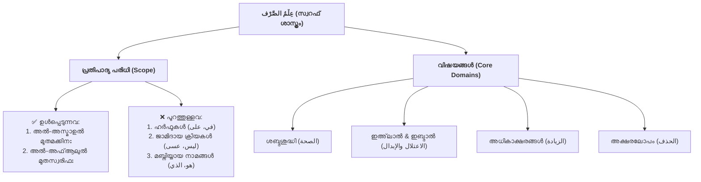

# المَبَادِئُ العَشَرَةُ وَنَشْأَةُ عِلْمِ الصَّرْفِ
## സ്വറഫ് ശാസ്ത്രത്തിന്റെ 10 പ്രമാണങ്ങളും ഉത്ഭവചരിത്രവും — Epistemology, History & The 10 Canonical Principles of Ṣarf

<!-- Top Navigation Bar -->
[📑 സൂചിക / Master Index](file:///Users/apple/Desktop/docs/Kanz-al-Tahqiq/Kanz-al-Tahqiq-pub/Texts/Sarf/zanjan/Notes/Chapters/00-index.md) | [അടുത്ത അധ്യായം: 02. خطبة المتن وحقيقة التصريف ⏭️](file:///Users/apple/Desktop/docs/Kanz-al-Tahqiq/Kanz-al-Tahqiq-pub/Texts/Sarf/zanjan/Notes/Chapters/02-khutbah-wa-haqiqat-tasrif.md)

---

### 1. മൂലപാഠം / النص الأصلي (Al-Matn al-Aṣl)

بِسْمِ اللَّهِ الرَّحْمَنِ الرَّحِيمِ

**مَنْظُومَةُ الصَّبَّانِ فِي المَبَادِئِ العَشَرَةِ:**
> إِنَّ مَبَادِي كُلِّ فَنٍّ عَشَرَهْ ... الحَدُّ، وَالمَوْضُوعُ، ثُمَّ الثَّمَرَهْ  
> وَنِسْبَةٌ، وَفَضْلُهُ، وَالوَاضِعْ ... وَالاسْمُ، الِاسْتِمْدَادُ، حُكْمُ الشَّارِعْ  
> مَسَائِلُ، وَالبَعْضُ بِالبَعْضِ اكْتَفَى ... وَمَنْ دَرَى الجَمِيعَ حَازَ الشَّرَفَا  

**مَبَادِئُ عِلْمِ الصَّرْفِ العَشَرَةُ:**
1. **حَدُّهُ (تَعْرِيفُهُ):** عِلْمٌ بِأُصُولٍ يُعْرَفُ بِهَا أَحْوَالُ أَبْنِيَةِ الكَلِمِ الَّتِي لَيْسَتْ بِإِعْرَابٍ وَلَا بِنَاءٍ.
2. **مَوْضُوعُهُ:** الأَلْفَاظُ العَرَبِيَّةُ؛ مِنْ حَيْثُ الصِّحَّةُ، وَالاعْتِلَالُ، وَالأَصَالَةُ، وَالزِّيَادَةُ، وَنَحْوُهَا. وَيَخْتَصُّ بِالأَسْمَاءِ المُتَمَكِّنَةِ (المُعْرَبَةِ)، وَالأَفْعَالِ المُتَصَرِّفَةِ.
3. **ثَمَرَتُهُ:** صَوْنُ اللِّسَانِ عَنِ الخَطَأِ فِي صِيَغِ الكَلَامِ العَرَبِيِّ، وَاحْتِرَازُ الفَهْمِ عَنِ الخَلَلِ فِي مَعَانِي الكِتَابِ وَالسُّنَّةِ.
4. **نِسْبَتُهُ:** التَّبَايُنُ مَعَ غَيْرِهِ مِنْ عُلُومِ اللِّسَانِ، فَهُوَ قَسِيمٌ لِلنَّحْوِ وَالبَلَاغَةِ.
5. **فَضْلُهُ:** هُوَ مِنْ أَشْرَفِ عُلُومِ العَرَبِيَّةِ؛ إِذْ هُوَ مِيزَانُهَا، وَبِهِ تُعْرَفُ حَقَائِقُ الأَبْنِيَةِ.
6. **وَاضِعُهُ:** مُعَاذُ بْنُ مُسْلِمٍ الهَرَّاءُ (ت 187 هـ)، وَقِيلَ: أَمِيرُ المُؤْمِنِينَ عَلِيُّ بْنُ أَبِي طَالِبٍ كَرَّمَ اللَّهُ وَجْهَهُ، حَيْثُ وَضَعَ أُصُولَهُ مَعَ النَّحْوِ.
7. **اسْمُهُ:** عِلْمُ الصَّرْفِ، أَوْ عِلْمُ التَّصْرِيفِ.
8. **اسْتِمْدَادُهُ:** مِنْ كَلَامِ اللَّهِ تَعَالَى (القُرْآنِ الكَرِيمِ)، وَكَلَامِ رَسُولِهِ ﷺ، وَكَلَامِ العَرَبِ المَوْثُوقِ بِفَصَاحَتِهِمْ.
9. **حُكْمُ الشَّارِعِ فِيهِ:** فَرْضُ كِفَايَةٍ عَلَى الأُمَّةِ، وَفَرْضُ عَيْنٍ عَلَى كُلِّ مُجْتَهِدٍ وَمُفَسِّرٍ وَفَقِيهٍ.
10. **مَسَائِلُهُ:** قَضَايَاهُ البَاحِثَةُ عَنْ صِيَغِ الأَفْعَالِ وَالأَسْمَاءِ؛ نَحْوُ: كُلُّ وَاوٍ أَوْ يَاءٍ تَحَرَّكَتْ وَانْفَتَحَ مَا قَبْلَهَا قُلِبَتْ أَلِفاً.

---

### 2. മലയാള പരിഭാഷ (ദർസ് ശൈലിയിലുള്ള വാച്യാർത്ഥവും ആശയവും)

ഏതൊരു വിജ്ഞാനശാഖയും പഠിച്ചു തുടങ്ങുന്നതിന് മുമ്പ് അതിന്റെ 10 അടിസ്ഥാന പ്രമാണങ്ങൾ ഗ്രഹിക്കൽ അനിവാര്യമാണ്. സ്വറഫ് ശാസ്ത്രത്തിന്റെ പ്രസ്തുത പത്ത് തത്വങ്ങൾ താഴെ പറയുന്നവയാണ്:

1. **നിർവചനം (ഹദ്ദ്):** ഇഅ്‌റാബോ (വിഭക്തി മാറ്റം) ബിനാഓ (അവ്യയം) അല്ലാത്ത വിധത്തിൽ, അറബിക് പദങ്ങളുടെ ഘടനാപരമായ രൂപഭാവങ്ങളെക്കുറിച്ച് പ്രതിപാദിക്കുന്ന നിയമവ്യവസ്ഥയാണ് ഇൽമുസ്സ്വറഫ്.
2. **പ്രതിപാദ്യ വിഷയം (മൗദൂഅ്):** രൂപമാറ്റം സാധ്യമാകുന്ന നാമങ്ങളും (അൽ-അസ്മാഉൽ മുതമക്കിനഃ), കാലഭേദങ്ങൾ സ്വീകരിക്കുന്ന ക്രിയകളുമാണ് (അൽ-അഫ്ആലുൽ മുതസ്വരിഫഃ) ഇതിന്റെ വിഷയം. ശബ്ദശുദ്ധി (സ്വിഹ്ഹത്ത്), ന്യൂനത (ഇഅ്‌ലാൽ), മൂലാക്ഷരങ്ങൾ (അസ്വാലത്ത്), അധികാക്ഷരങ്ങൾ (സിയാദത്ത്) എന്നീ അവസ്ഥകളാണ് ഇവിടെ പരിശോധിക്കപ്പെടുന്നത്.
3. **പഠനഫലം (ഥമറത്ത്):** അറബിക് പദങ്ങൾ തെറ്റായ ഘടനയിൽ ഉച്ചരിക്കുന്നതിൽ നിന്ന് നാവിനെ കാത്തുസൂക്ഷിക്കുക, വിശുദ്ധ ഖുർആനിലെയും തിരുസുന്നത്തിലെയും പദങ്ങളുടെ സൂക്ഷ്മാർത്ഥങ്ങൾ വ്യതിയാനമില്ലാതെ ഗ്രഹിക്കുക.
4. **ബന്ധം (നിസ്ബത്ത്):** നഹ്‌വ്, ബലാഗത്ത് തുടങ്ങിയ ഇതര ഭാഷാശാസ്ത്രങ്ങളുമായി സമാന ശാഖ എന്ന നിലയിലുള്ള ബന്ധം (ഖസീം).
5. **ശ്രേഷ്ഠത (ഫദ്‌ൽ):** പദങ്ങളുടെ ശരിയായ അളവുകോലായതിനാൽ (മീസാൻ) അറബി ഭാഷാവിജ്ഞാനങ്ങളിൽ ഏറ്റവും പവിത്രമായ ശാഖ.
6. **സ്ഥാപകൻ (വാദിഅ്):** പ്രസിദ്ധ ഭാഷാ പണ്ഡിതനായ മുആദ് ബിൻ മുസ്‌ലിം അൽ-ഹർറാഅ് (റഹ്). അലി (റ) ആണെന്നും അഭിപ്രായമുണ്ട്.
7. **നാമം (ഇസ്മ്):** ഇൽമുസ്സ്വറഫ് (علم الصرف) അഥവാ ഇൽമുത്തസ്‌രീഫ് (علم التصريف).
8. **അവലംബം (ഇസ്തിംദാദ്):** വിശുദ്ധ ഖുർആൻ, ഹദീസുകൾ, ശുദ്ധ അറബികളുടെ കാവ്യഭാഷ.
9. **മതവിധി (ഹുക്മുശ്ശാരീ):** സമുദായത്തിന് മേൽ ഫർദ് കിഫായ; എന്നാൽ ഖുർആൻ വ്യാഖ്യാതാവിനും (മുഫസ്സിർ), മുജ്തഹിദിനും ഫർദ് ഐൻ.
10. **വിഷയങ്ങൾ (മസാഇൽ):** "പൂർവ്വാക്ഷരം ഫത്‌ഹുള്ളതായിരിക്കെ വാവോ യാഓ ഹറകത്തുള്ളതായാൽ അത് അലിഫായി മാറും" തുടങ്ങിയ സാർവ്വത്രിക നിയമങ്ങൾ.

---

### 3. ഇംഗ്ലീഷ് വിവർത്തനം / English Scholastic Translation

The ten canonical epistemological principles (*al-Mabādi' al-ʿAshrah*) form the mandatory prolegomena to classical Arabic morphology (*ʿIlm al-Ṣarf*):
1. **Definition (*al-Ḥadd*):** The systematic science of morphological axioms through which one apprehends the internal configurations and structural shifts of words, outside the realm of syntactic inflection (*Iʿrāb*) and indeclinability (*Binā'*).
2. **Subject Matter (*al-Mawḍūʿ*):** Declinable Arabic nouns (*al-Asmā' al-Mutamakkinah*) and fully inflected verbs (*al-Afʿāl al-Mutaṣarrifah*), analyzed through phonetic soundness, defectiveness, radical status, and derivational augmentation.
3. **Fruit (*al-Thamrah*):** Safeguarding the tongue from articulation errors in verbal molds and preventing hermeneutical distortion in understanding the Qur'an and Sunnah.
4. **Taxonomic Relation (*al-Nisbah*):** A coordinate, autonomous discipline standing alongside Arabic syntax (*Naḥw*) and rhetoric (*Balāghah*).
5. **Excellence (*al-Faḍl*):** Ranked among the most sublime linguistic sciences, serving as the foundational metric (*Mīzān*) of Arabic words.
6. **Pioneer (*al-Wāḍiʿ*):** Credited primarily to Muʿādh ibn Muslim al-Harrā' (d. 187 AH) in Kūfah, with foundational guidance tracing to ʿAlī ibn Abī Ṭālib (رضي الله عنه).
7. **Nomenclature (*al-Ism*):** *ʿIlm al-Ṣarf* or *ʿIlm al-Taṣrīf* (Arabic Morphology / Semitic Stem Derivation).
8. **Source Materials (*al-Istimdād*):** The text of the Holy Qur'an, Prophetic Hadith, and classical Arabian poetry.
9. **Legal Norm (*Ḥukm al-Shāriʿ*):** A collective communal obligation (*Farḍ Kifāyah*), rising to a strict individual duty (*Farḍ ʿAyn*) for jurists (*Mujtahidūn*) and exegetes (*Mufassirūn*).
10. **Axiomatic Problems (*al-Masā'il*):** Propositions governing morpho-phonology, such as the metathesis of medial semivowels into Alif.

---

### 4. ത്രിഭാഷാ പദസൂചിക / المصطلحات / Key Terminology Matrix

| അറബിക് പദം (Arabic) | ലിപ്യന്തരണം (Transliteration) | മലയാള അർത്ഥം (Malayalam Equivalent) | English Logic/Grammar Term | സാങ്കേതിക വിവരണം (Scholastic Definition) |
|---|---|---|---|---|
| **المَبَادِئ العَشَرَة** | *al-mabādi' al-ʿashrah* | പത്ത് അടിസ്ഥാന പ്രമാണങ്ങൾ | Ten Epistemological Principles | ഏതൊരു ശാസ്ത്രത്തിന്റെയും പ്രവേശന കവാടമായ 10 അടിസ്ഥാന ഘടകങ്ങൾ. |
| **عِلْمُ الصَّرْف** | *ʿilm al-ṣarf* | സ്വറഫ് ശാസ്ത്രം / മോർഫോളജി | Arabic Morphology | പദങ്ങളുടെ ആന്തരിക ഘടനയെയും രൂപമാറ്റങ്ങളെയും കുറിച്ചുള്ള ശാസ്ത്രം. |
| **الأَسْمَاءُ المُتَمَكِّنَة** | *al-asmā' al-mutamakkinah* | ഇഅ്‌റാബ് സ്വീകരിക്കുന്ന നാമങ്ങൾ | Fully declinable nouns | വിഭക്തിമാറ്റങ്ങൾ പൂർണ്ണമായി സ്വീകരിക്കുന്ന അറബിക് നാമങ്ങൾ. |
| **الأَفْعَالُ المُتَصَرِّفَة** | *al-afʿāl al-mutaṣarrifah* | കാലമാറ്റമുള്ള ക്രിയകൾ | Inflected / Conjugable verbs | ഭൂതം, വർത്തമാനം, കല്പന എന്നീ മൂന്ന് രൂപങ്ങളിലേക്ക് മാറാൻ സാധിക്കുന്ന ക്രിയകൾ. |
| **المِيزَانُ الصَّرْفِي** | *al-mīzān al-ṣarfī* | സ്വറഫിന്റെ അളവുകോൽ | Morphological Metric (F-ʿ-L) | ഫാ, ഐൻ, ലാം എന്നീ മൂന്ന് മൂലാക്ഷരങ്ങൾ ഉപയോഗിച്ച് പദങ്ങളെ അളക്കുന്ന രീതി. |

---

### 5. വിശദമായ ശർഹും തത്വവിചാരവും / الشرح والتحليل المعمق

#### എ. സ്വറഫും നഹ്‌വും തമ്മിലുള്ള അടിസ്ഥാന വ്യത്യാസം:
- **നഹ്‌വ് (Syntax):** വാക്യത്തിൽ ചേർക്കപ്പെട്ടതിന് ശേഷം പദങ്ങളുടെ അവസാനത്തെ ഹറകത്ത് (ഇഅ്‌റാബ്) എങ്ങനെ നിർണ്ണയിക്കപ്പെടുന്നുവെന്ന് പരിശോധിക്കുന്നു (ഉദാ: «جَاءَ زَيْدٌ» - സയ്ദ് എന്നത് ഫാഇലായതിനാൽ റഫ്അ് ചെയ്യുന്നു).
- **സ്വറഫ് (Morphology):** പദങ്ങൾ വാക്യത്തിൽ പ്രയോഗിക്കുന്നതിന് മുമ്പ് തന്നെ അവയുടെ ആന്തരിക ഘടനയെയും (ബിൽഡിംഗ് ബ്ലോക്കുകൾ) അക്ഷരങ്ങളുടെ മാറ്റങ്ങളെയും പരിശോധിക്കുന്നു (ഉദാ: «قَالَ» എന്നതിലെ അലിഫ് യഥാർത്ഥത്തിൽ വാവ് ആണെന്നും, «قَوَلَ» എന്നതിൽ നിന്നാണ് അത് മാറിയതെന്നും കണ്ടെത്തുന്നത് സ്വറഫിലൂടെയാണ്).

#### ബി. സ്വറഫ് ശാസ്ത്രത്തിന്റെ ഉത്ഭവ പശ്ചാത്തലം:
ഇസ്‌ലാമിക ലോകം പേർഷ്യയിലേക്കും റോമൻ അതിർത്തികളിലേക്കും വ്യാപിച്ചപ്പോൾ അറബികളല്ലാത്ത അനറബികൾ ഇസ്‌ലാമിലേക്ക് കടന്നുവരികയും അറബി ഉച്ചാരണത്തിൽ വ്യതിയാനങ്ങൾ (ലഹ്ൻ) സംഭവിക്കുകയും ചെയ്തു. ഇതോടെ വിശുദ്ധ ഖുർആന്റെ ഘടനയെ സംരക്ഷിക്കുന്നതിനായി ഇമാം അലി (റ) അബുൽ അസ്‌വദ് അദ്ദുവലിക്ക് നൽകിയ നിർദ്ദേശങ്ങളിലൂടെയാണ് വ്യാകരണ ശാസ്ത്രം രൂപപ്പെട്ടത്. പിന്നീട് കൂഫയിലെ മഹാനായ ഭാഷാപണ്ഡിതൻ **മുആദ് ബിൻ മുസ്‌ലിം അൽ-ഹർറാഅ് (റഹ്)** നഹ്‌വിൽ നിന്ന് സ്വറഫിനെ വേർതിരിച്ച് ഒരു സ്വതന്ത്ര വിജ്ഞാനശാഖയായി ക്രോഡീകരിച്ചു.

---

### 6. ചിത്രരൂപങ്ങളും താരതമ്യ പട്ടികകളും / Visual Diagrams & Matrices

---

### 7. ഉദാഹരണ വിശകലനം / Analysis of Classical Quranic & Hadith Examples

- **വിശുദ്ധ ഖുർആനിലെ പ്രയോഗം:**  
  ﴿وَتَصْرِيفِ الرِّيَاحِ وَالسَّحَابِ الْمُسَخَّرِ بَيْنَ السَّمَاءِ وَالْأَرْضِ لَآيَاتٍ لِّقَوْمٍ يَعْقِلُونَ﴾ [[سورة البقرة: 164](https://quran.com/2/164)]  
  **വിശകലനം:** ഇവിടെ കാറ്റിന്റെ ഗതി തിരിച്ചുവിടുന്നതിനും വിവിധ രൂപങ്ങളിലേക്ക് മാറ്റുന്നതിനുമാണ് ഖുർആൻ 'തസ്‌രീഫ്' എന്ന് പ്രയോഗിച്ചിട്ടുള്ളത്. ഇതാണ് പദങ്ങളുടെ രൂപമാറ്റത്തിന് ഈ പേര് സ്വീകരിക്കാൻ ആധാരമായത്.
- **തിരുഹദീസിലെ പ്രയോഗം:**  
  റസൂലുള്ളാഹി ﷺ പ്രാർത്ഥിക്കാറുണ്ടായിരുന്നു: «يَا مُصَرِّفَ القُلُوبِ صَرِّفْ قُلُوبَنَا عَلَى طَاعَتِكَ» ([صحيح مسلم: 2654](https://sunnah.com/muslim:2654)).  
  **വിശകലനം:** ഹൃദയങ്ങളെ സദാ പരിവർത്തിപ്പിക്കുന്ന അല്ലാഹുവിന്റെ വിശേഷണമായി 'മുസ്വരിഫ്' എന്ന പദം ഇവിടെ വന്നിരിക്കുന്നു.

---

### 8. ശ്രദ്ധിക്കേണ്ട സൂക്ഷ്മതകൾ / تنبيهات ومزالق شائعة (Common Student Pitfalls)

> [!NOTE]
> തുടക്കക്കാരായ വിദ്യാർത്ഥികൾ «حُرُوف» (അവ്യയങ്ങൾ), «الأَسْمَاء المَبْنِيَّة» (ളമീറുകൾ, ഇസ്മ് ഇശാറകൾ), «الأَفْعَال الجَامِدَة» (ലൈസ, നിഅ്മ, ബിഅ്സ) എന്നിവയിൽ സ്വറഫിന്റെ നിയമങ്ങൾ പ്രയോഗിക്കാൻ തുനിയുന്നത് വലിയ അബദ്ധമാണ്. സ്വറഫ് ശാസ്ത്രം വിഭക്തിസ്വീകരണ ശേഷിയുള്ള പദങ്ങളിൽ മാത്രമേ പ്രവർത്തിക്കുകയുള്ളൂ.

---

### 9. ആവർത്തന ചോദ്യങ്ങളും വ്യായാമങ്ങളും / تدريبات وتمارين (Review Exercises)

1. സ്വറഫ് ശാസ്ത്രത്തിന്റെ സാങ്കേതിക നിർവചനം എന്ത്?
2. എന്തുകൊണ്ടാണ് 'ജാമിദായ' ക്രിയകളിലും 'മബ്നിയ്യായ' നാമങ്ങളിലും സ്വറഫ് ചർച്ച ചെയ്യപ്പെടാത്തത്?
3. സ്വറഫ് ശാസ്ത്രത്തിന്റെ പ്രഥമ ക്രോഡീകരണ കർത്താവ് ആരാണ്?
4. സ്വറഫും നഹ്‌വും തമ്മിലുള്ള പ്രായോഗികമായ രണ്ട് വ്യത്യാസങ്ങൾ വിശദീകരിക്കുക.
