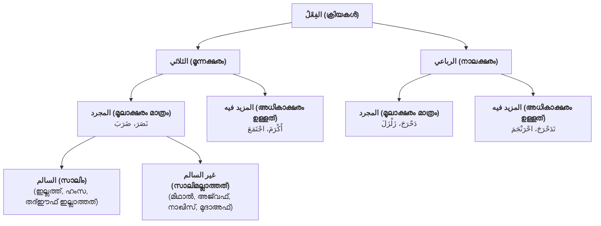

# خُطْبَةُ الْمَتْنِ وَحَقِيقَةُ التَّصْرِيفِ وَتَقْسِيمُ الْفِعْلِ
## മത്‌നിന്റെ ആമുഖവും തസ്‌രീഫിന്റെ നിർവചനവും ക്രിയാവിഭജനങ്ങളും — Prologue, Definition of Taṣrīf & Primary Verb Taxonomies

<!-- Top Navigation Bar -->
[⬅️ മുൻ അധ്യായം: 01. المبادئ العشرة](file:///Users/apple/Desktop/docs/Kanz-al-Tahqiq/Kanz-al-Tahqiq-pub/Texts/Sarf/zanjan/Notes/Chapters/01-muqaddimah-wa-mabadi.md) | [📑 സൂചിക / Master Index](file:///Users/apple/Desktop/docs/Kanz-al-Tahqiq/Kanz-al-Tahqiq-pub/Texts/Sarf/zanjan/Notes/Chapters/00-index.md) | [അടുത്ത അധ്യായം: 03. أبواب الثلاثي المجرد ⏭️](file:///Users/apple/Desktop/docs/Kanz-al-Tahqiq/Kanz-al-Tahqiq-pub/Texts/Sarf/zanjan/Notes/Chapters/03-abwab-al-thulathi-al-mujarrad.md)

---

### 1. മൂലപാഠം / النص الأصلي (Al-Matn al-Aṣl)

بِسْمِ اللَّهِ الرَّحْمَنِ الرَّحِيمِ

الْحَمْدُ لِلَّهِ رَبِّ الْعَالَمِينَ، وَالصَّلَاةُ وَالسَّلَامُ عَلَى سَيِّدِنَا مُحَمَّدٍ وَآلِهِ وَصَحْبِهِ أَجْمَعِينَ.

اعْلَمْ: أَنَّ **التَّصْرِيفَ** فِي اللُّغَةِ: **التَّغْيِيرُ**؛ وَمِنْهُ قَوْلُهُ تَعَالَى: ﴿وَتَصْرِيفِ الرِّيَاحِ﴾ [[سورة البقرة: 164](https://quran.com/2/164)].

وَفِي الصِّنَاعَةِ: **تَحْوِيلُ الأَصْلِ الوَاحِدِ إِلَى أَمْثِلَةٍ مُخْتَلِفَةٍ، لِمَعَانٍ مَقْصُودَةٍ لَا تَحْصُلُ إِلَّا بِهَا**.

ثُمَّ الفِعْلُ:
- إِمَّا **ثُلَاثِيٌّ**،
- وَإِمَّا **رُبَاعِيٌّ**.

وَكُلُّ وَاحِدٍ مِنْهُمَا:
- إِمَّا **مُجَرَّدٌ**،
- وَإِمَّا **مَزِيدٌ فِيهِ**.

وَكُلُّ وَاحِدٍ مِنْهَا:
- إِمَّا **سَالِمٌ**،
- وَإِمَّا **غَيْرُ سَالِمٍ**.

وَنَعْنِي بِـ **السَّالِمِ**: مَا سَلِمَتْ حُرُوفُهُ الأَصْلِيَّةُ الَّتِي تُقَابَلُ بِالفَاءِ وَالعَيْنِ وَاللَّامِ مِنْ: **حُرُوفِ العِلَّةِ**، وَ**الهَمْزَةِ**، وَ**التَّضْعِيفِ**.

---

### 2. മലയാള പരിഭാഷ (ദർസ് ശൈലിയിലുള്ള വാച്യാർത്ഥവും ആശയവും)

പരമകാരുണികനും കരുണാനിധിയുമായ അല്ലാഹുവിന്റെ നാമത്തിൽ ആരംഭിക്കുന്നു. സർവ്വലോക പരിപാലകനായ അല്ലാഹുവിനാണ് സർവ്വസ്തുതികളും. നമ്മുടെ നേതാവ് മുഹമ്മദ് മുസ്തഫാ ﷺ യുടെ മേലിലും അവിടുത്തെ ഉത്തമ കുടുംബത്തിന്റേയും സ്വഹാബികളുടേയും മേലിലും ശാന്തിയും സമാധാനവും സദാ വർഷിക്കുമാറാകട്ടെ.

**നീ അറിയുക:**  
ഭാഷാർത്ഥത്തിൽ **«തസ്‌രീഫ്»** എന്നാൽ **«മാറ്റം വരുത്തൽ» (തഗ്‌യീർ)** എന്നാണ് അർത്ഥം. അല്ലാഹു തആല വിശുദ്ധ ഖുർആനിൽ «وَتَصْرِيفِ الرِّيَاحِ» (കാറ്റുകളുടെ ഗതി തിരിച്ചുവിടൽ) എന്ന് പറഞ്ഞത് ഇതിൽ പെട്ടതാണ്.

സാങ്കേതിക ശാസ്ത്രത്തിൽ (ഇസ്തിലാഹിൽ):  
**"നിശ്ചിത ഉദ്ദേശ്യാർത്ഥങ്ങൾ സാക്ഷാത്കരിക്കുന്നതിനായി—ആ രൂപങ്ങളിലൂടെയല്ലാതെ ലഭിക്കാത്ത അർത്ഥങ്ങൾക്കായി—ഒരൊറ്റ മൂലരൂപത്തെ (അസ്വ്‌ലിനെ) വ്യത്യസ്ത പദരൂപങ്ങളിലേക്ക് (അംഥിലഃ) പരിവർത്തിപ്പിക്കുന്നതിനാണ് തസ്‌രീഫ് എന്ന് പറയുന്നത്."**

തുടർന്ന് അറിയുക: ക്രിയകൾ പ്രാഥമികമായി രണ്ട് വിധമാണ്:
1. **മൂന്നക്ഷര ക്രിയകൾ (ഥുലാഥീ):** മൂന്ന് മൂലാക്ഷരങ്ങൾ ഉള്ളവ.
2. **നാലക്ഷര ക്രിയകൾ (റുബാഈ):** നാല് മൂലാക്ഷരങ്ങൾ ഉള്ളവ.

ഇവയിൽ ഓരോന്നും വീണ്ടും രണ്ട് വിധമാണ്:
- **മുജർറദ് (Bare):** മൂലാക്ഷരങ്ങൾ മാത്രമുള്ളത് (അധികാക്ഷരങ്ങൾ ഇല്ലാത്തത്).
- **മസീദ് ഫീഹ് (Augmented):** മൂലാക്ഷരങ്ങൾക്ക് പുറമെ അധികാക്ഷരങ്ങൾ ചേർത്തത്.

ഇവ ഓരോന്നും വീണ്ടും രണ്ട് വിധമാണ്:
- **സാലിം (Sound):** സുരക്ഷിതമായത്.
- **ഗൈറു സാലിം (Unsound):** സുരക്ഷിതമല്ലാത്തത്.

**«സാലിം»** എന്നത് കൊണ്ട് നാം അർത്ഥമാക്കുന്നത്:  
ഫാ, ഐൻ, ലാം എന്നീ മൂലാക്ഷര സ്ഥാനങ്ങളിൽ:
1. **ഇല്ലത്തിന്റെ അക്ഷരങ്ങൾ (വാവ്, അലിഫ്, യാഅ്)**,
2. **ഹംസ**,
3. **തദ്‌ഈഫ് (ഐൻ-ലാം സ്ഥാനങ്ങൾ ഒരേ അക്ഷരമായി ഇരട്ടിക്കൽ)**  
എന്നീ മൂന്ന് ദോഷങ്ങളിൽ നിന്നും മുക്തമായ പദരൂപമാണ്.

---

### 3. ഇംഗ്ലീഷ് വിവർത്തനം / English Scholastic Translation

In the Name of Allah, the Most Compassionate, the Most Merciful. Praise be to Allah, Lord of all the worlds, and peace and blessings be upon our Master Muhammad, his family, and all his companions.

**Know that:**  
*Morphology* (*al-Taṣrīf*) in linguistic lexicography denotes **alteration / directional change** (*al-taghyīr*), as in the Divine utterance: *"...and the directing of the winds"* [[Surah al-Baqarah: 164](https://quran.com/2/164)].

In technical morphological science, it is:  
**"The transformation of a single root morpheme (*al-Aṣl*) into diverse paradigm templates (*Amthilah*), in order to yield targeted semantic meanings that cannot be achieved except through those specific structures."**

Furthermore, the verb is fundamentally divided into:
- **Triliteral (*Thulāthī*):** Composed of three root radicals.
- **Quadriliteral (*Rubāʿī*):** Composed of four root radicals.

Each of these two is either:
- **Bare / Unaugmented (*Mujarrad*):** Retaining exclusively its radical consonants.
- **Augmented (*Mazīd fīh*):** Possessing one or more derivational affixes.

And each of these is either:
- **Sound (*Sālim*):** Free from structural defects.
- **Unsound (*Ghayr Sālim*):** Containing phonological irregularities.

By **Sound (*al-Sālim*)**, we denote that form whose radical consonants corresponding to the *Fā'*, *ʿAyn*, and *Lām* positions are free from:
1. **Weak semivowels (*Ḥurūf al-ʿIlla*):** Wāw, Alif, and Yāʾ.
2. **Glottal stop (*al-Hamzah*).**
3. **Gemination (*al-Tadʿīf*):** Identity of the second and third radicals.

---

### 4. ത്രിഭാഷാ പദസൂചിക / المصطلحات / Key Terminology Matrix

| അറബിക് പദം (Arabic) | ലിപ്യന്തരണം (Transliteration) | മലയാള അർത്ഥം (Malayalam Equivalent) | English Logic/Grammar Term | സാങ്കേതിക വിവരണം (Scholastic Definition) |
|---|---|---|---|---|
| **التَّصْرِيف** | *al-taṣrīf* | തസ്‌രീഫ്; രൂപാന്തരീകരണം | Morphological transformation | ഒരു മൂലപദത്തിൽ നിന്ന് പല ഉദ്ദേശ്യാർത്ഥങ്ങൾക്കായി പുതിയ രൂപങ്ങൾ ഉണ്ടാക്കൽ. |
| **الأَصْلُ الوَاحِد** | *al-aṣl al-wāḥid* | ഏക മൂലരൂപം | The Primitive Root / Morpheme | ബസ്വറക്കാരുടെ അടുക്കൽ 'മസ്ദറും' (നിഷ്പന്ന നാമം), കൂഫക്കാരുടെ അടുക്കൽ 'മാളിയുമാണ്' ഇത്. |
| **الأَمْثِلَةُ المُخْتَلِفَة** | *al-amthilah al-mukhtalifah* | വ്യത്യസ്ത പദരൂപങ്ങൾ | Inflectional Paradigms | മാളി, മുളാരിഅ്, അംറ്, ഇസ്മുൽ ഫാഇൽ തുടങ്ങിയ ശാഖാ രൂപങ്ങൾ. |
| **السَّالِم** | *al-sālim* | സാലിം; സുരക്ഷിതമായത് | Sound radical form | ഇല്ലത്തോ ഹംസയോ ഇരട്ടിപ്പോ ഇല്ലാത്ത പദം (ഉദാ: നസ്വറ, ളറബ). |
| **غَيْرُ السَّالِم** | *ghayr al-sālim* | സാലിമല്ലാത്തത് | Unsound / Defective form | മിഥാൽ, അജ്‌വഫ്, നാഖിസ്, ലഫീഫ്, മുദാഅഫ്, മഹ്മൂസ് എന്നിവ. |

---

### 5. വിശദമായ ശർഹും തത്വവിചാരവും / الشرح والتحليل المعمق

#### എ. "അൽ-അസ്വ്‌ലുൽ വാഹിദ്" (الأصل الواحد) എന്നാൽ എന്ത്?
ഭാഷാപണ്ഡിതന്മാർക്കിടയിൽ പ്രസിദ്ധമായ തർക്കമാണിത്:
- **ബസ്വറ സ്കൂൾ (ഇമാം സീബവൈഹി, ഖലീൽ):** എല്ലാ പദങ്ങളുടെയും അടിസ്ഥാന മൂലരൂപം **«മസ്ദർ» (Verbal Noun)** ആണ് (ഉദാ: «الضَّرْبُ» - അടിക്കുക എന്നത്). കാരണം മസ്ദർ കേവലമായ അർത്ഥത്തെ മാത്രമേ കുറിക്കുന്നുള്ളൂ; എന്നാൽ ക്രിയ അതിനോടൊപ്പം കാലത്തെയും (Time) ഉൾക്കൊള്ളുന്നു. ലളിതമായതിൽ നിന്നാണ് സങ്കീർണ്ണമായത് ഉണ്ടാകുന്നത്.
- **കൂഫ സ്കൂൾ:** മൂലരൂപം **«മാളിയായ ക്രിയയാണ്»** (ഉദാ: «ضَرَبَ» എന്നത്). കാരണം മാളിയിലെ മൂന്നക്ഷരങ്ങളാണ് മസ്ദറിലും നിലനിൽക്കുന്നത്.  
ഗ്രന്ഥകർത്താവ് ഇവിടെ രണ്ടുപേരുടെയും വാദങ്ങൾക്ക് പഴുതു നൽകുന്ന വിധത്തിൽ പൊതുവായ നിർവചനമാണ് നൽകിയിരിക്കുന്നത്.

#### ബി. സ്വറഫിലെ ത്രിമാന മാതൃക (Mīzān al-Ṣarf):
അറബികൾ പദങ്ങളുടെ തൂക്കം കണക്കാക്കാൻ **«ف - ع - ل» (ഫ-ഐ-ല)** എന്ന മൂന്നക്ഷരങ്ങളാണ് തിരഞ്ഞെടുത്തത്.
1. മനുഷ്യന്റെ അധരങ്ങളിൽ നിന്നും തൊണ്ടയിൽ നിന്നും വളരെ സ്വാഭാവികമായി പുറപ്പെടുന്ന ശബ്ദങ്ങളാണിവ.
2. മനുഷ്യന്റെ ഏതൊരു പ്രവൃത്തിയെയും കുറിക്കാൻ 'ഫഅല' (അവൻ ചെയ്തു) എന്ന പൊതുപദം ഉപയോഗിക്കാം.

---

### 6. ചിത്രരൂപങ്ങളും താരതമ്യ പട്ടികകളും / Visual Diagrams & Matrices

---

### 7. ഉദാഹരണ വിശകലനം / Analysis of Classical Quranic & Hadith Examples

- **സാലിമായ പദത്തിന്റെ വിശുദ്ധ ഖുർആൻ ഉദാഹരണം:**  
  ﴿فَصَبْرٌ جَمِيلٌ وَاللَّهُ الْمُسْتَعَانُ عَلَىٰ مَا تَصِفُونَ﴾ [[سورة يوسف: 18](https://quran.com/12/18)]  
  **വിശകലനം:** «صَبْر» (മസ്ദർ), «تَصِفُونَ» (മുളാരിഅ്). ഇതിൽ 'സ്വബറ' (ص-ب-ر) എന്നത് സാലിമായ ക്രിയയാണ്; എന്നാൽ 'വസഫ' (و-ص-ف) എന്നത് ഫാഇൽ വാവ് വന്ന 'മിഥാലായ' (സാലിമല്ലാത്ത) ക്രിയയാണ്.
- **തിരുഹദീസിലെ പ്രയോഗം:**  
  റസൂലുള്ളാഹി ﷺ അരുളി: «المُسْلِمُ مَنْ سَلِمَ المُسْلِمُونَ مِنْ لِسَانِهِ وَيَدِهِ» ([صحيح البخاري: 10](https://sunnah.com/bukhari:10)).  
  **വിശകലനം:** «سَلِمَ» (സുരക്ഷിതമായി) എന്നത് സാലിമായ ക്രിയയാണ്; ഇതേ വേരിലാണ് സ്വറഫിലെ 'സാലിം' എന്ന സാങ്കേതിക ശബ്ദവും നിലകൊള്ളുന്നത്.

---

### 8. ശ്രദ്ധിക്കേണ്ട സൂക്ഷ്മതകൾ / تنبيهات ومزالق شائعة (Common Student Pitfalls)

> [!WARNING]
> വിദ്യാർത്ഥികൾ പലപ്പോഴും **«സഹീഹ്» (الصحيح)** എന്നതും **«സാലിം» (السالم)** എന്നതും ഒന്നാണെന്ന് തെറ്റിദ്ധരിക്കാറുണ്ട്.  
> - **സ്വഹീഹ് (Sound):** ഇല്ലത്തിന്റെ അക്ഷരങ്ങൾ (വാവ്, അലിഫ്, യാഅ്) ഇല്ലാത്ത പദം (ഇതിൽ മഹ്മൂസും മുദാഅഫും ഉൾപ്പെടും; ഉദാ: مَدَّ, أَمَرَ).  
> - **സാലിം (Completely Sound):** ഇല്ലത്തിന്റെ അക്ഷരങ്ങൾക്ക് പുറമെ ഹംസയിൽ നിന്നും ഇരട്ടിപ്പിൽ നിന്നും കൂടി സുരക്ഷിതമായ പദമാണ് സാലിം. അതുകൊണ്ട് **എല്ലാ സാലിമും സ്വഹീഹാണ്, എന്നാൽ എല്ലാ സ്വഹീഹും സാലിമല്ല!**

---

### 9. ആവർത്തന ചോദ്യങ്ങളും വ്യായാമങ്ങളും / تدريبات وتمارين (Review Exercises)

1. തസ്‌രീഫിന്റെ ഭാഷാർത്ഥവും സാങ്കേതിക നിർവചനവും വിശദീകരിക്കുക.
2. സാലിമായ ക്രിയയും സ്വഹീഹായ ക്രിയയും തമ്മിലുള്ള സൂക്ഷ്മ വ്യത്യാസം എന്ത്?
3. താഴെ പറയുന്ന ക്രിയകളിൽ നിന്ന് സാലിമും സാലിമല്ലാത്തതും വേർതിരിക്കുക:  
   «نَصَرَ»، «قَالَ»، «مَدَّ»، «أَكَلَ»، «عَلِمَ»، «رَمَى».
4. ബസ്വറ-കൂഫ പണ്ഡിതന്മാർക്കിടയിൽ 'അൽ-അസ്വ്‌ലുൽ വാഹിദ്' എന്നതിലുള്ള ഭിന്നത വ്യക്തമാക്കുക.
